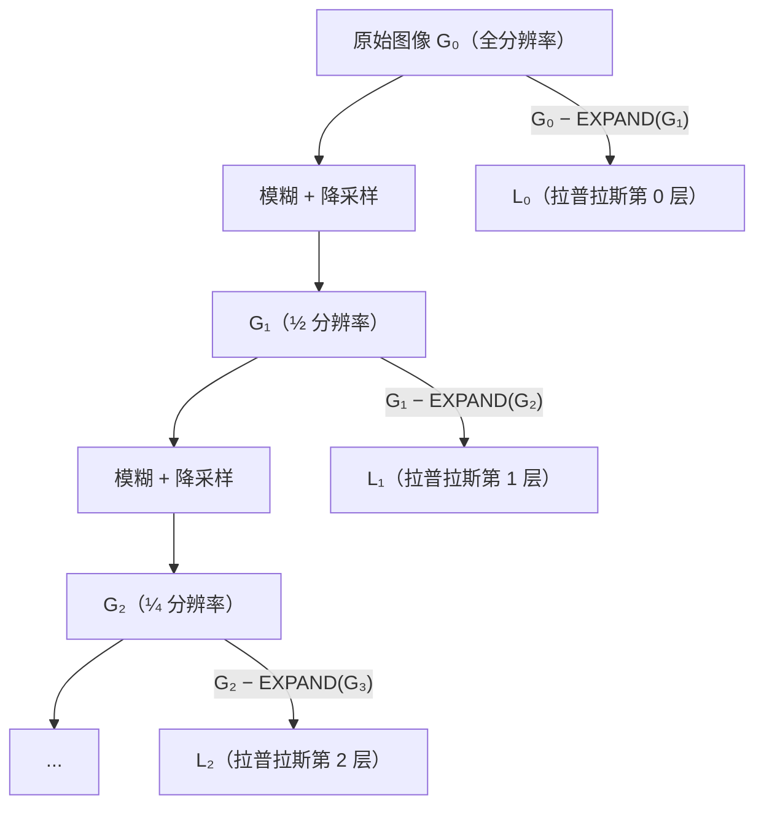

# 图像处理：滤波、边缘、频域与金字塔

> **英文原文：** [cv-knowledge-base/00_foundations/02_image_processing.md](../../cv-knowledge-base/00_foundations/02_image_processing.md)（本中文版供参考，内容以英文原文为准）

> **最后更新：** 2026年10月
> **难度级别：** 基础
> **相关章节：** [特征工程](./03_feature_engineering.md) · [图像形成](./01_image_formation.md) · [CV 概述](./00_overview.md) · [经典几何](./04_classical_geometry.md)

> **🆕 2026年10月更新：** 经典图像处理内容无重大变化。修正了 BSD68 去噪表（其各列实际报告的是 σ = 15 和 σ = 25 的结果，且 BM3D 数值有误），并补充说明了 OpenCV 5.0.0（2026年6月）：这是实现本文各类算子的参考库的首个 5.x 稳定版本。

---

## 概述

图像处理涵盖一系列操作，它们将离散二维信号（原始像素阵列）变换为更适合高层分析的形式。这些操作包括噪声抑制（高斯平滑）、结构增强（锐化、均衡化）、结构检测（边缘检测）以及多尺度表示（金字塔）。从线性系统理论、频域分析和离散数学的层面理解这些操作，对于解读现代深度网络隐式学到的内容至关重要：卷积网络的前几层会重现类 Gabor 滤波器、类 Sobel 边缘检测器以及中心-环绕模式，而这些正是经典图像处理以解析方式推导出来的。

经典图像处理的数学支柱是**线性系统理论**，特别是卷积定理。一个线性移不变（Linear Shift-Invariant, LSI）系统完全由其**冲激响应**（空间域）或等价的**传递函数**（频域）刻画。所有频域方法都利用了这种对偶性：高斯平滑是低通滤波；边缘检测是高通滤波；高斯拉普拉斯（LoG）是带通算子。频域还解释了混叠*为何*会发生、*为何*必须在降采样前进行平滑（Nyquist 约束），以及梯度算子*为何*会放大噪声。

除线性滤波外，该领域还包括非线性操作，如用于椒盐噪声的中值滤波、用于二值结构分析的形态学算子、用于全局强度归一化的直方图操作，以及多尺度表示（高斯金字塔与拉普拉斯金字塔、小波）。后者是现代深度架构中特征金字塔网络和多尺度注意力机制在概念上的前身。

在实践中，下面几乎所有算子都通过 OpenCV（目前维护两条产品线：4.x 和 5.x，其中 5.0.0 于2026年6月发布）或 PyTorch/Kornia 等 GPU 张量库来使用，在这些库中，同样的卷积核以固定或可学习卷积的形式出现。

---

## 卷积与线性滤波

### 连续卷积与离散卷积

图像 $f$ 与卷积核 $h$ 的二维连续卷积为：

```latex
(f * h)(x, y) = \int_{-\infty}^{\infty} \int_{-\infty}^{\infty} f(u, v) \, h(x - u, y - v) \, du \, dv
```

在离散情形（像素阵列）下，变为：

```latex
(I * k)[i, j] = \sum_{m=-M}^{M} \sum_{n=-N}^{N} I[i - m, \, j - n] \cdot k[m, n]
```

其中 $k$ 是一个 $(2M+1) \times (2N+1)$ 的滤波核。相关（互相关）与卷积的唯一区别是卷积核*不*翻转；许多框架（例如 PyTorch `F.conv2d`）实现的是相关运算却称之为卷积，这是常见的混淆来源。

### 高斯滤波器

高斯核是标准的低通滤波器，其独特之处在于同时在空间域和频域达到最优（达到 Heisenberg 不确定性下界）：

```latex
G_\sigma(x, y) = \frac{1}{2\pi\sigma^2} \exp\!\left(-\frac{x^2 + y^2}{2\sigma^2}\right)
```

关键性质：
- **可分离**：$G_\sigma(x,y) = G_\sigma(x) \cdot G_\sigma(y)$，因此二维卷积可化为两次一维运算，每像素复杂度为 $O(k)$ 而非 $O(k^2)$。
- **级联性质**：$G_{\sigma_1} * G_{\sigma_2} = G_{\sqrt{\sigma_1^2 + \sigma_2^2}}$
- **尺度空间公理**（Lindeberg 1994）：高斯核是唯一同时满足因果性、各向同性、线性和半群性质的核。

离散近似：$\sigma = 1$ 时常用的 $5 \times 5$ 核为：

```latex
\frac{1}{273}
\begin{pmatrix}
1 & 4  & 7  & 4  & 1 \\
4 & 16 & 26 & 16 & 4 \\
7 & 26 & 41 & 26 & 7 \\
4 & 16 & 26 & 16 & 4 \\
1 & 4  & 7  & 4  & 1
\end{pmatrix}
```

### 导数滤波器

一阶导数近似用于检测梯度。**Sobel** 算子使用 $3 \times 3$ 核，同时进行微分和平滑：

```latex
\mathbf{S}_x = \begin{pmatrix}
-1 & 0 & 1 \\
-2 & 0 & 2 \\
-1 & 0 & 1
\end{pmatrix}, \quad
\mathbf{S}_y = \begin{pmatrix}
-1 & -2 & -1 \\
 0 &  0 &  0 \\
 1 &  2 &  1
\end{pmatrix}
```

梯度幅值和方向为：

```latex
|\nabla I| = \sqrt{(I * S_x)^2 + (I * S_y)^2}, \quad
\theta = \arctan\!\left(\frac{I * S_y}{I * S_x}\right)
```

**Prewitt** 算子使用 $\pm 1$ 权重（中心不加权），因此比 Sobel 稍嘈杂。**拉普拉斯算子** $\nabla^2 I = \frac{\partial^2 I}{\partial x^2} + \frac{\partial^2 I}{\partial y^2}$ 检测二阶强度变化，其近似为：

```latex
\nabla^2 \approx \begin{pmatrix}
0 & 1 & 0 \\ 1 & -4 & 1 \\ 0 & 1 & 0
\end{pmatrix}
```

---

## 边缘检测：Canny 算法

**Canny 边缘检测器**（John Canny，IEEE PAMI，1986）至今仍是经典边缘检测器的标杆，它由三条最优性准则推导而来：
1. **良好的检测**：最小化误检和漏检。
2. **良好的定位**：检测到的边缘位置应尽可能接近真实边缘。
3. **单一响应**：每条边缘只产生一个响应（抑制拖尾）。

### 算法步骤

```
1. 高斯平滑：            I_s = I * G_σ
2. 梯度计算：            G_x = I_s * S_x,  G_y = I_s * S_y
                         |G| = sqrt(Gx² + Gy²),  θ = atan2(Gy, Gx)
3. 非极大值抑制：        将在梯度方向（插值后）上不是局部极大值的像素置零，
                         从而细化脊线
4. 双阈值：              强边缘：|G| > T_high
                         弱边缘：T_low < |G| ≤ T_high
                         抑制：  |G| ≤ T_low
5. 滞后边缘跟踪：        保留与强边缘相连的弱边缘
```

在高斯噪声下，阶跃边缘的最优一维检测器可以很好地用高斯函数的一阶导数近似，这解释了为何在微分前用 $G_\sigma$ 预平滑在理论上是合理的。在存在高斯噪声 $\sigma_n$ 的情况下，Canny 检测器对宽度为 $\Delta$ 的阶跃边缘的响应信噪比为：

```latex
\text{SNR} = \frac{\Delta}{\sigma_n} \cdot \frac{\|h'\|}{\|h\|_2}
```

其中 $h$ 为平滑核。

---

## 傅里叶/频域分析

### 二维离散傅里叶变换

```latex
\hat{I}(u, v) = \sum_{m=0}^{M-1} \sum_{n=0}^{N-1} I(m, n) \, e^{-2\pi i (um/M + vn/N)}
```

逆变换：

```latex
I(m, n) = \frac{1}{MN} \sum_{u=0}^{M-1} \sum_{v=0}^{N-1} \hat{I}(u, v) \, e^{2\pi i (um/M + vn/N)}
```

### 卷积定理

连接空间域和频域的基本结论：

```latex
\mathcal{F}\{f * g\} = \mathcal{F}\{f\} \cdot \mathcal{F}\{g\}
```

空间域中的卷积等于频域中的逐点乘积；这是通过 FFT 进行高效滤波的基础，对于大卷积核，其复杂度为 $O(N^2 \log N)$ 而非 $O(N^2 k^2)$。

### 频域滤波

| 滤波器类型 | 效果 | 频域掩码 |
|-------------|--------|----------------------|
| 高斯 | 平滑（低通） | $H(u,v) = e^{-2\pi^2\sigma^2(u^2+v^2)}$ |
| 理想高通 | 边缘增强 | $H = 1 - H_{\text{LP}}$ |
| 带通 | 提取特定尺度的纹理 | $H_{\sigma_1} - H_{\sigma_2}$ |
| 高斯拉普拉斯（LoG） | 斑点/边缘检测 | $H = -(u^2+v^2)e^{-2\pi^2\sigma^2(u^2+v^2)}$ |

**高斯差分（Difference of Gaussians, DoG）** 是对 LoG 计算高效的近似：

```latex
\text{DoG}_\sigma = G_{k\sigma} - G_\sigma \approx (k-1)\sigma^2 \nabla^2 G_\sigma
```

该近似取 $k \approx 1.6$（Lowe 在 SIFT 中使用的值），构成了尺度空间斑点检测的基础。

---

## 形态学操作

二值形态学操作将图像视为集合，并使用结构元素 $B$ 施加集合论运算：

**腐蚀**（收缩前景，去除小的突起）：
```latex
A \ominus B = \{z \mid B_z \subseteq A\}
```

**膨胀**（扩展前景，填充小孔洞）：
```latex
A \oplus B = \{z \mid \hat{B}_z \cap A \neq \emptyset\}
```

**开运算**（$A \circ B = (A \ominus B) \oplus B$）：先腐蚀后膨胀，去除小物体、平滑轮廓。

**闭运算**（$A \bullet B = (A \oplus B) \ominus B$）：先膨胀后腐蚀，填充孔洞、连接邻近物体。

**形态学梯度**（检测二值图像中的边缘）：
```latex
\text{Gradient}(A) = (A \oplus B) - (A \ominus B)
```

灰度形态学用局部最小/最大值替代集合运算；灰度膨胀计算结构元素邻域内的局部最大值。

---

## 直方图操作

### 直方图均衡化

直方图均衡化重新分配像素强度，以获得（近似）均匀的直方图，从而增强全局对比度。对于归一化直方图为 $p(k) = n_k / N$ 的 8 位图像：

```latex
T(k) = \lfloor (L-1) \sum_{j=0}^{k} p(j) \rceil
```

其中 $L = 256$，$T$ 为映射函数（即直方图的累积分布函数）。

**CLAHE**（对比度受限自适应直方图均衡化）在局部图块上进行均衡化，并在均衡化前对直方图进行截断，以防止在近乎均匀的区域过度放大噪声。它是医学影像（胸部 X 光、视网膜图像）预处理中的标准方法。

### 用于匹配的直方图归一化

颜色直方图可用作图像检索的描述子（Swain & Ballard，1991，*直方图交叉*法）；但除非使用 HSV 或归一化表示，否则它们对光照变化很敏感。

---

## 图像金字塔

### 高斯金字塔

高斯金字塔 $\{G_0, G_1, \ldots, G_N\}$ 通过交替进行高斯模糊和降采样（reduce 操作）构建：

```latex
G_{l+1}[i,j] = \sum_{m=-2}^{2}\sum_{n=-2}^{2} w[m,n] \, G_l[2i+m, \, 2j+n]
```

其中 $w$ 是对高斯函数的可分离二项式近似（Burt & Adelson，1983）。每一层将空间分辨率减半；整个金字塔共包含 $O(4/3 \cdot N^2)$ 个像素，仅有 33% 的额外开销。

### 拉普拉斯金字塔

**拉普拉斯金字塔**（Burt & Adelson，IEEE Trans. Commun.，1983）编码带通残差：

```latex
L_l = G_l - \text{EXPAND}(G_{l+1})
```

其中 EXPAND 通过插零并与 $2w$ 卷积来对 $G_{l+1}$ 进行上采样。拉普拉斯金字塔是一种紧凑的过完备图像表示，可精确重建：$G_0 = L_0 + \text{EXPAND}(L_1 + \text{EXPAND}(\cdots))$。其应用包括图像融合（无缝合成）、纹理分析和压缩。

### 尺度空间

连续高斯尺度空间 $L(x, y; \sigma)$ 满足线性热方程：

```latex
\frac{\partial L}{\partial \sigma^2} = \frac{1}{2}\nabla^2 L, \quad L(x,y;0) = I(x,y)
```

Lindeberg（1994）证明，在因果性约束下（随着尺度增大不产生新的极值），高斯核是唯一的尺度空间核。SIFT 的关键点检测直接在尺度空间中进行，即在 DoG 金字塔中寻找极值。



---

## 插值

图像重采样（缩放、几何变换）需要在非整数像素位置进行插值。常用方法：

| 方法 | 核函数 | 连续性 | 说明 |
|--------|--------|-----------|-------|
| 最近邻 | 盒函数 | $C^{-1}$ | 最快；会产生块效应 |
| 双线性 | 帐篷（帽）函数 | $C^0$ | 平滑但模糊；标准默认选项 |
| 双三次 | 三次 B 样条 | $C^1$ | 质量好；有轻微振铃 |
| Lanczos | 加窗 sinc | $C^1$ | 质量最佳；计算更昂贵 |

参数 $a = -0.5$ 的双三次核（Keys，1989）：

```latex
W(x) = \begin{cases}
(a+2)|x|^3 - (a+3)|x|^2 + 1 & 0 \leq |x| < 1 \\
a|x|^3 - 5a|x|^2 + 8a|x| - 4a & 1 \leq |x| < 2 \\
0 & |x| \geq 2
\end{cases}
```

---

## 关键论文

| 论文 | 作者 | 年份 | 发表场所 | 关键贡献 |
|-------|---------|------|-------|-----------------|
| "A Computational Approach to Edge Detection" | J. Canny | 1986 | IEEE PAMI 8(6) | 基于三条准则的最优边缘检测器；滞后阈值 |
| "The Laplacian Pyramid as a Compact Image Code" | P. J. Burt, E. H. Adelson | 1983 | IEEE Trans. Commun. | 用于压缩和图像融合的多尺度金字塔 |
| "A Multiresolution Spline with Application to Image Mosaics" | P. J. Burt, E. H. Adelson | 1983 | ACM Trans. Graphics | 拉普拉斯金字塔融合；无缝拼接 |
| "Scale-Space Theory in Computer Vision" | T. Lindeberg | 1994 | Kluwer（专著） | 高斯尺度空间的公理化推导 |
| "Histogram Intersection for Object Recognition" | M. Swain, D. Ballard | 1991 | IJCV 7(1) | 用于三维物体识别的颜色直方图匹配 |
| "Beyond a Gaussian Denoiser: Residual Learning of Deep CNN for Image Denoising" (DnCNN) | K. Zhang et al. | 2017 | IEEE TIP | 通过残差深度 CNN 实现最先进的盲去噪 |
| "BM3D: Image Denoising by Sparse 3D Transform-Domain Collaborative Filtering" | K. Dabov et al. | 2007 | IEEE TIP | 长期保持最先进水平的经典去噪算法 |

---

## 基准性能

| 方法 | BSD68 PSNR（σ=15） | BSD68 PSNR（σ=25） | 说明 |
|--------|------------------|--------------------|-------|
| 高斯滤波 | 远低于 BM3D | 远低于 BM3D | 基线；会模糊细节 |
| BM3D (2007) | 31.07 dB | 28.57 dB | 长期保持的经典 SOTA |
| DnCNN (2017) | 31.73 dB | 29.23 dB | 发表时比 BM3D 高约 0.6–0.7 dB |
| FFDNet (2018) | 31.63 dB | 29.19 dB | 可处理空间变化的噪声 |
| DRUNet (2021) | 31.91 dB | 29.48 dB | 即插即用先验 |

PSNR = $10 \log_{10}(255^2 / \text{MSE})$。灰度加性高斯白噪声；数值为各方法作者报告的结果（BM3D 和 DnCNN 的数值来自 DnCNN 论文/代码仓库；在 σ = 50 时二者分别为 25.62 dB 和 26.23 dB）。BSD68 由来自 Berkeley 分割数据集的 68 幅自然图像组成。后续的 Transformer 复原模型（SwinIR 2021、Restormer 2022）报告了进一步的小幅提升；该基准目前已接近饱和，近期的图像复原研究已转向真实噪声、一体化（all-in-one）以及基于扩散先验的方法（见[扩散模型](../10_generative_vision/01_diffusion_models.md)）。

---

## 优缺点

| 技术 | 优点 | 缺点 |
|-----------|------|------|
| 高斯滤波 | 理论上最优的低通滤波；可分离；无振铃 | 模糊边缘；需要选择核大小 |
| 中值滤波 | 去除椒盐噪声；保边 | 非线性；大窗口时速度慢；不是 LSI 系统 |
| Canny 边缘检测器 | 接近最优的检测/定位；研究充分 | 两个阈值需要调参；大规模时速度慢 |
| 直方图均衡化 | 全局对比度增强；简单 | 可能过度放大噪声；冲淡局部细节 |
| 拉普拉斯金字塔 | 可精确重建；融合高效 | 过完备；不具备平移不变性 |
| 双边滤波 | 保边平滑 | 非线性；无加速时每像素 $O(k^2)$ |

---

## 开放问题与研究空白

- **联合去噪与去马赛克。** 在相机流水线中，必须在去马赛克之前或期间去除噪声；经典的顺序处理方法并非最优，而能处理整条链路的端到端学习式 ISP 流水线是一个活跃的研究领域。
- **纹理与结构分离。** 在多个尺度上可靠地将图像分解为几何结构（边缘、轮廓）和随机纹理成分仍然困难，对学习式方法尤其如此。
- **高效的学习式滤波。** 深度去噪网络优于经典方法，但速度慢了几个数量级；需要面向边缘/移动端部署的高效架构。
- **非高斯与重尾噪声。** 许多真实传感器（极低光照下的 CMOS、SAR、医学超声）会产生非高斯噪声（泊松、Rician、散斑）；经典算法假设高斯噪声而失效，在高斯噪声上训练的学习模型泛化也很差。
- **学习式算子的理论保证。** 经典滤波器的性质可以完全通过解析方式刻画，而学习得到的卷积层在鲁棒性、频率响应或尺度空间性质方面缺乏类似的理论保证。
- **形态学神经网络。** 尽管在形状分析方面具有理论优势，可微的形态学层（以最大/最小池化实现的膨胀/腐蚀）与标准卷积相比仍未得到充分研究。
- **现代架构中的金字塔结构。** 特征金字塔网络（Lin 等，2017）和 Swin Transformer 中的多尺度注意力呼应了经典金字塔；经典尺度空间理论与这些学习得到的多尺度表示之间的形式化联系尚未完全建立。

---

## 延伸阅读

- [Canny, J. (1986). A Computational Approach to Edge Detection. *IEEE PAMI*, 8(6), 679–698.](https://doi.org/10.1109/TPAMI.1986.4767851)：边缘检测的原始论文。
- [Burt, P. J. & Adelson, E. H. (1983). The Laplacian Pyramid as a Compact Image Code. *IEEE Trans. Commun.*, 31(4), 532–540.](https://doi.org/10.1109/TCOM.1983.1095851)：金字塔的奠基论文。
- [Gonzalez, R. C. & Woods, R. E. (2018). *Digital Image Processing*, 4th ed. Pearson.](https://www.pearson.com/en-us/subject-catalog/p/digital-image-processing/P200000003334)：标准研究生教材。
- [Lindeberg, T. (1994). *Scale-Space Theory in Computer Vision*. Kluwer.](https://www.springer.com/gp/book/9780792394570)：严谨的尺度空间公理化论述。
- [Dabov, K. et al. (2007). Image Denoising by Sparse 3D Transform-Domain Collaborative Filtering. *IEEE TIP*, 16(8), 2080–2095.](https://doi.org/10.1109/TIP.2007.901238)：BM3D 算法。
- [Szeliski, R. (2022). *Computer Vision: Algorithms and Applications*, Ch. 3.](https://szeliski.org/Book/)：现代 CV 背景下的滤波与金字塔。
- [Zhang, K. et al. DnCNN 官方代码仓库。](https://github.com/cszn/DnCNN)：BM3D、WNNM、TNRD 和 DnCNN 在 σ = 15/25/50 下的 BSD68 参考结果。
- [OpenCV 发布版本。](https://github.com/opencv/opencv/releases)：本文中滤波、形态学、金字塔和插值核的参考实现；5.0.0 于2026年6月发布，4.x 产品线仍在持续维护（4.14.0，2026年7月）。
