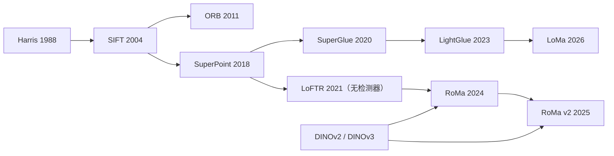

# 特征工程：经典描述子、检测器及其遗产

> **英文原文：** [cv-knowledge-base/00_foundations/03_feature_engineering.md](../../cv-knowledge-base/00_foundations/03_feature_engineering.md)（本中文版供参考，内容以英文原文为准）

> **最后更新：** 2026年10月
> **难度级别：** 中级
> **相关章节：** [CNN 架构](../03_architectures/00_cnn_architectures.md) · [经典几何](./04_classical_geometry.md) · [图像处理](./02_image_processing.md) · [CV 概述](./00_overview.md)

> **🆕 2026年10月更新：**
> - 学习特征的发展脉络延伸到 SuperGlue 之后：LightGlue（ICCV 2023）、稠密匹配器 RoMa（CVPR 2024）和 RoMa v2（2025年11月），以及规模化的稀疏匹配器 LoMa（ECCV 2026 口头报告）。
> - 新增 DINOv3（2025年8月）作为当前的自监督稠密特征主干网络，它通过 Gram 锚定获得稳定的图像块特征。
> - 学习特征现已内置于标准 SfM 工具中：COLMAP 4.0（2026年3月）提供 ALIKED + LightGlue，COLMAP 4.2（2026年9月）加入 LoMa。
> - 新增两视图位姿 / WxBS 基准表（数值来自官方代码仓库），以及新的关键论文和延伸阅读条目。

---

## 概述

计算机视觉中的特征工程，是指为图像内容设计紧凑且具有判别力的表示（从单个像素邻域到全局图像统计量），以支持匹配、识别和检索。在深度学习时代之前，CV 系统的质量几乎完全取决于其手工设计特征的质量：更好的描述子意味着更好的性能，大量研究精力投入到设计对真实图像中各种干扰因素保持不变的特征上，这些干扰因素包括视点变化、光照变化、尺度变化、部分遮挡和图像噪声。

经典流水线可以分解为两个阶段：**检测**（找到哪些图像位置值得描述）和**描述**（用紧凑向量刻画这些位置的局部图像外观）。好的检测器必须具有**可重复性**：同一物理位置应在场景的多个视图中都被检测到。好的描述子必须具有**区分性**（外观不同的两点应有不相似的描述子）和**不变性**（同一物理点在干扰变换下应有相似的描述子）。不变性与区分性之间的张力是根本性的：对所有变换都完全不变，会使描述子失去信息量。

从 Harris 角点（1988）到 SIFT（2004）再到 ORB（2011）的发展，反映了在“不变性-区分性-效率”三者之间的权衡优化。SIFT 作为金标准长达十年：它对尺度和旋转具有不变性，对仿射变化和光照具有鲁棒性，但计算代价高且受专利保护（美国专利 6,711,293，已过期）。SURF 借助 Haar 小波和积分图像，以描述子质量换取速度。ORB（2011）在匹配质量上与 SIFT 相近，速度却快约 100 倍，且无专利限制，使实时应用成为可能。要理解为何学习特征（来自 CNN、SuperPoint、DINO）最终取代了所有这些方法，不仅需要理解它们做了什么，还需要理解手工设计的不变性在实践中*为何*不够。

---

## 兴趣点检测

### Harris 角点检测器

Harris & Stephens（Alvey Vision Conference，1988）将角点定义为图像强度在*所有*方向上都显著变化的位置。局部窗口 $W$ 上的**结构张量**（二阶矩矩阵）为：

```latex
\mathbf{M} = \sum_{(x,y) \in W} w(x,y)
\begin{pmatrix}
I_x^2 & I_x I_y \\
I_x I_y & I_y^2
\end{pmatrix}
```

其中 $w(x,y)$ 为高斯加权，$I_x, I_y$ 为图像空间梯度。$\mathbf{M}$ 的特征值 $\lambda_1, \lambda_2$ 刻画了局部几何：
- 两者都小：平坦区域
- 一大一小：边缘
- 两者都大：角点

**Harris 响应函数**避免了显式计算特征值：

```latex
R = \det(\mathbf{M}) - k \cdot \text{tr}^2(\mathbf{M}) = \lambda_1\lambda_2 - k(\lambda_1 + \lambda_2)^2
```

经验上取 $k \in [0.04, 0.06]$。角点是 $R$ 中高于阈值的局部极大值。Harris 角点具有**旋转不变性**（结构张量在旋转下对称），但**不具备尺度不变性**，这是一个关键局限。

**Shi-Tomasi** 检测器（Shi & Tomasi，CVPR 1994）将响应修改为 $R = \min(\lambda_1, \lambda_2)$，得到的角点在跟踪时条件更好。

### 尺度选择：LoG 与 DoG

Lindeberg（1998）证明，归一化的高斯拉普拉斯（LoG）在尺度 $\sigma$ 与特征大小相匹配时取得最大响应：

```latex
\sigma^2 \nabla^2 G_\sigma * I = \sigma^2 (I_{xx} + I_{yy})
```

SIFT 检测器用高斯差分（DoG）近似 LoG：

```latex
\text{DoG}(x, y, \sigma) = G_{k\sigma} * I - G_\sigma * I \approx (k-1)\sigma^2 \nabla^2 G
```

关键点被检测为 DoG 金字塔中在空间和尺度上同时取得的极值（极小或极大），从而得到**尺度不变**的检测结果。

---

## SIFT：尺度不变特征变换

Lowe（IJCV，2004）是标准参考文献。完整的 SIFT 流水线如下：

### 1. 尺度空间极值检测

构建每个八度（octave）有 $S$ 层的 DoG 金字塔（Lowe 使用 $S=3$，$k = 2^{1/S}$）。每个候选关键点是 $3 \times 3 \times 3$ 邻域（空间 + 尺度）中的局部极值。

### 2. 关键点定位与筛选

通过对 DoG $D(\mathbf{x})$ 进行泰勒展开实现亚像素定位：

```latex
\hat{\mathbf{x}} = -\frac{\partial^2 D}{\partial \mathbf{x}^2}^{-1} \frac{\partial D}{\partial \mathbf{x}}
```

对比度低（$|D(\hat{\mathbf{x}})| < 0.03$）或位于边缘上（Harris 比值 $> 10$）的关键点会被丢弃。

### 3. 方向分配

通过在关键点邻域内构建加权梯度方向直方图来分配主方向。标准方向使描述子与梯度峰值对齐，从而赋予**旋转不变性**。

### 4. 描述子计算

将关键点周围 $16 \times 16$ 像素的区域（与主方向对齐，并按 $\sigma$ 缩放）划分为 $4 \times 4$ 的单元网格。在每个单元内计算一个 8 柱梯度方向直方图（带幅值加权和三线性插值）。由此得到一个 $4 \times 4 \times 8 = 128$ 维向量。描述子先归一化为单位 $L_2$ 范数，然后将各分量截断到 $0.2$，再重新归一化，从而对非线性光照变化具有鲁棒性。

### SIFT 的性质

| 性质 | 状态 |
|----------|--------|
| 尺度不变性 | 是（DoG 金字塔） |
| 旋转不变性 | 是（主方向） |
| 仿射不变性 | 近似（倾斜约 50° 以内） |
| 光照不变性 | 是（梯度归一化） |
| 描述子维度 | 128 个浮点数 |
| 计算代价 | 高（$O(N \log N)$ 特征提取） |

---

## SURF：加速稳健特征

Bay、Tuytelaars & Van Gool（ECCV，2006）利用积分图像和 Haar 小波加速了类 SIFT 描述子：

- **检测器**：用盒式滤波器近似 Hessian 矩阵行列式（借助积分图像快速计算）：

```latex
\det(\mathbf{H}_{\text{approx}}) = D_{xx} D_{yy} - (0.9 D_{xy})^2
```

- **描述子**：在 $4 \times 4$ 子区域网格中计算 Haar 小波响应，得到 64 维向量（基础 SURF）或 128 维向量（扩展版）。发表时速度约为 SIFT 的 3 倍。

注：SURF 受专利保护（美国专利 7,630,564），并于 2015 年因许可问题从 OpenCV 主模块中移除。

---

## HOG：方向梯度直方图

Dalal & Triggs（CVPR，2005）提出 HOG 用于行人检测，在 INRIA 行人数据集上取得了最先进的结果。HOG 通过梯度方向的分布来表示局部形状：

### 算法

```
1. 可选地施加 Gamma/幂律归一化（或平方根）
2. 计算梯度幅值和方向（不平滑，或 1 像素高斯平滑）
3. 将图像划分为单元（例如 8×8 像素）
4. 对每个单元：构建具有 B 个柱（9 或 18）的加权方向直方图
5. 将单元组合成相互重叠的块（例如 2×2 单元 = 16×16 像素）
6. 对每个块描述子做 L2 归一化（或 L2-Hys）
7. 将所有块描述子拼接成最终的 HOG 向量
```

对于 $64 \times 128$ 的行人窗口，采用 8×8 单元、2×2 块重叠和 9 个方向柱时：$(7 \times 15) \times 4 \times 9 = 3780$ 维描述子。在该描述子上训练的 SVM 分类器在 INRIA 上于 10⁻⁴ FPPI 下达到 89% 的检测率（2005），远超此前的方法。

### HOG 为何有效

HOG 隐式地捕获了**局部形状**信息：物体边界处的梯度是主导信号，其方向分布刻画了局部部件几何，而与确切幅值无关。块归一化提供了对光照梯度的鲁棒性。与 SIFT 不同，HOG 是稠密的（在规则网格上计算），而非稀疏的（仅在检测到的关键点处计算），这更适合滑动窗口检测。

---

## ORB：带方向的 FAST 与旋转 BRIEF

Rublee、Rabaud、Konolige & Bradski（ICCV，2011）将 ORB 设计为 SIFT 和 SURF 的免费、快速替代方案：

**关键点检测**使用 FAST（Features from Accelerated Segment Test，Rosten & Drummond 2006）检测器，辅以 Harris 评分来选出前 $N$ 个关键点，并使用尺度金字塔进行多尺度检测。

**方向分配**计算图像块的**强度质心**：

```latex
m_{pq} = \sum_{x,y} x^p y^q I(x,y), \quad
\theta = \text{atan2}(m_{01}, m_{10})
```

**描述子**：Steered BRIEF（Binary Robust Independent Elementary Features），即按 $\theta$ 旋转的成对强度比较所构成的二进制串：

```latex
\tau(p; x, y) = \begin{cases} 1 & p(x) < p(y) \\ 0 & \text{otherwise} \end{cases}
```

由 256 个学习得到的点对计算出 256 位二进制描述子。匹配通过**汉明距离**（XOR + popcount）完成，在现代 CPU 上极快（64 位只需 1 条指令）。

在标准基准上，ORB 的匹配质量与 SIFT 相差约 1–2%，速度却快约 100 倍，且二进制描述子的内存占用比浮点描述子少 16–32 倍。

---

## 视觉词袋（BoVW）

Sivic & Zisserman（ICCV，2003，“Video Google”）将信息检索方法（TF-IDF、倒排文件索引）应用于视觉描述子：

### 流水线

```
1. 从大型训练语料中提取局部描述子（SIFT）
2. 用 k-means 对描述子聚类 → 得到包含 k 个“视觉词”的词表
3. 对每幅图像：将每个描述子分配给最近的视觉词（量化）
4. 将图像表示为视觉词频率的直方图
5. 施加 TF-IDF 加权：降低高频词的权重，提高罕见词的权重
6. 用倒排文件建立索引以实现可扩展检索
```

视觉词 $i$ 在图像 $j$ 中的 TF-IDF 权重为：

```latex
w_{ij} = \text{tf}_{ij} \cdot \text{idf}_i = \frac{n_{ij}}{n_j} \cdot \log\frac{N}{d_i}
```

其中 $n_{ij}$ 为词 $i$ 在图像 $j$ 中的出现次数，$n_j$ 为图像 $j$ 中的总词数，$N$ 为图像总数，$d_i$ 为包含词 $i$ 的图像数。

BoVW 可扩展到数百万图像规模的数据库；Fisher Vector（Perronnin & Dance，2007）和 VLAD（Jégou 等，2010）等扩展方法通过编码相对于 GMM 词表的一阶和二阶统计量，提升了判别能力。

---

## 学习特征为何取代了手工描述子

从 SIFT/HOG 到 CNN 特征的转变不仅仅关乎精度，而是结构性的：

1. **领域特定的最优性**：SIFT 的不变性（尺度、旋转、仿射）是为通用的富纹理场景设计的。深度特征从数据中学习特定于任务的不变性：需要时学习旋转不变性，有用时保留纹理敏感性。

2. **语义抽象**：CNN 各层逐步构建越来越抽象的表示：边缘 → 纹理 → 部件 → 物体。SIFT 停留在局部梯度统计的层面；它无法表示“车轮”或“眼睛”这样的语义概念。

3. **端到端训练**：为分类训练的 CNN 学到的特征针对*任务损失*进行了优化，而不是针对可重复性或描述子距离之类的替代指标。手工特征无法进行这种全局优化。

4. **自监督大规模预训练**：DINO（Caron 等，2021）、DINOv2（Oquab 等，2023）、DINOv3（Siméoni 等，2025）等方法从无标注图像中学习通用特征，在语义匹配和几何匹配任务上都优于 SIFT。

5. **对极端外观变化的鲁棒性**：SIFT 在严重模糊、大幅光照变化或非刚性形变下会失效。经过适当数据增强训练的学习特征能够从容应对这些情况。

然而，经典特征仍在以下场景中发挥作用：（a）计算预算严格受限的系统（ORB 可在嵌入式设备上实时运行）；（b）训练数据有限的领域（卫星影像、医学影像）；（c）需要显式几何推理（通过单应矩阵或基础矩阵）的可解释流水线；（d）如 SuperPoint + SuperGlue 这样的混合系统，它们将学习式特征提取与经典几何验证结合起来。

---

## 2023–2026：学习式匹配器成为默认选择

经典流水线所确立的“检测器–描述子–匹配器”分解得以延续，但每个阶段如今都是学习得到的；而且自 2026 年起，这些学习式变体已被集成到标准工具中。

**稀疏匹配器。** LightGlue [Lindenberger2023]（ICCV 2023）以自适应深度和宽度重新设计了 SuperGlue 的注意力匹配器：对简单图像对提前停止，并剪除无法匹配的点，因此在精度相近的情况下比 SuperGlue 快得多。LoMa [Nordstrom2026]（arXiv 2604.04931，ECCV 2026 口头报告）借鉴基础模型的规模化方案（大规模且多样化的数据混合、现代训练方法、更大的模型和更多算力）重新审视局部特征匹配。它保留了 LightGlue 的稀疏关键点接口，因此可在 SfM 和定位流水线中直接替换；其规模从 LoMa-B（与 LightGlue 相当）到 LoMa-G 不等，另有面向航拍影像的旋转不变版本 LoMa-R。作者报告其在困难的 WxBS 宽基线基准上优于稠密的 RoMa 系列。

**稠密匹配器。** LoFTR（2021）完全去掉了检测器；RoMa [Edstedt2024]（CVPR 2024）将冻结的 DINOv2 粗粒度特征与细粒度卷积网络以及“以分类实现回归”的形变（warp）预测头结合起来。RoMa v2 [Edstedt2025]（arXiv 2511.15706，2025年11月）预测双向稠密形变场及其置信度，*并且*预测逐像素精度矩阵；它采用“匹配 + 细化”两阶段流水线，配合自定义 CUDA 细化内核，并构建在 DINOv3 特征之上。作者报告其在众多基准上取得了最先进的结果，同时运行时间和内存占用相比 RoMa 有所降低。

**作为描述子的基础模型特征。** DINOv3 [Simeoni2025]（2025年8月）引入了 *Gram 锚定*：将图像块特征的 Gram 矩阵（图像块两两之间的相似度）朝较早的“锚点”检查点的 Gram 矩阵进行正则化。这使稠密特征在长时间训练中保持清晰且定位准确，而当冻结的图像块特征被用于建立对应关系时，这正是最重要的性质：

```latex
\mathcal{L}_{\text{Gram}} = \left\| \mathbf{X}_S \mathbf{X}_S^\top - \mathbf{X}_G \mathbf{X}_G^\top \right\|_F^2
% X_S：学生模型经 L2 归一化的图像块特征；X_G：Gram 锚点教师模型的对应特征
```

**标准工具中的集成。** COLMAP 4.0（2026年3月）通过 ONNX Runtime 加入了 ALIKED 特征提取和 LightGlue 匹配（同时支持 SIFT 和 ALIKED），COLMAP 4.2（2026年9月）加入了 LoMa 的特征提取与匹配。因此，学习特征已从研究性附加组件（例如 hloc）变为参考 SfM 工具中的内置选项，而 SIFT 仍是追求可复现性和仅用 CPU 场景下的标准选择。



---

## 关键论文

| 论文 | 作者 | 年份 | 发表场所 | 关键贡献 |
|-------|---------|------|-------|-----------------|
| "Distinctive Image Features from Scale-Invariant Keypoints" | D. G. Lowe | 2004 | IJCV 60(2), 91–110 | SIFT：尺度/旋转不变的检测器 + 描述子；128 维浮点向量 |
| "Histograms of Oriented Gradients for Human Detection" | N. Dalal, B. Triggs | 2005 | CVPR | HOG 稠密描述子 + SVM；最先进的行人检测 |
| "A Combined Corner and Edge Detector" | C. Harris, M. Stephens | 1988 | Alvey Vision Conf. | 基于二阶矩矩阵的角点检测器 |
| "SURF: Speeded Up Robust Features" | H. Bay, T. Tuytelaars, L. Van Gool | 2006 | ECCV | 借助积分图像和 Haar 小波的快速类 SIFT 特征 |
| "ORB: An Efficient Alternative to SIFT or SURF" | E. Rublee et al. | 2011 | ICCV | 二进制描述子，FAST + Harris 检测，比 SIFT 快约 100 倍 |
| "Video Google: A Text Retrieval Approach to Object Matching in Videos" | J. Sivic, A. Zisserman | 2003 | ICCV | 视觉词袋；用于图像检索的 TF-IDF |
| "SuperPoint: Self-Supervised Interest Point Detection and Description" | D. DeTone, T. Malisiewicz, A. Rabinovich | 2018 | CVPR Workshops | 可与 SIFT 竞争的自监督学习关键点 |
| "SuperGlue: Learning Feature Matching with Graph Neural Networks" | P. Sarlin et al. | 2020 | CVPR | 基于 GNN 的描述子匹配；基于注意力的分配 |
| "LightGlue: Local Feature Matching at Light Speed" | P. Lindenberger, P.-E. Sarlin, M. Pollefeys | 2023 | ICCV | 自适应深度/宽度的注意力匹配器；比 SuperGlue 快得多 |
| "RoMa: Robust Dense Feature Matching" | J. Edstedt et al. | 2024 | CVPR | 以冻结的 DINOv2 粗粒度特征和“以分类实现回归”的形变头实现稠密匹配 |
| "DINOv3" | O. Siméoni et al. | 2025 | arXiv 2508.10104 | 7B 自监督 ViT；用 Gram 锚定获得高质量稠密特征 |
| "RoMa v2: Harder Better Faster Denser Feature Matching" | J. Edstedt et al. | 2025 | arXiv 2511.15706 | 带精度矩阵的双向稠密形变场；更快的两阶段训练 |
| "LoMa: Local Feature Matching Revisited" | D. Nordström, J. Edstedt, G. Bökman et al. | 2026 | ECCV（口头报告） | 在数据、模型和算力上规模化的稀疏匹配器；可直接替换 LightGlue |

---

## 基准性能

在 HPatches 基准（108 个序列，包含光度和视点变化）上的匹配性能，以 3 像素阈值下的平均匹配精度（Mean Matching Accuracy, MMA）衡量：

| 方法 | MMA@3px（光照） | MMA@3px（视点） | 描述子维度 |
|--------|----------------------|-------------------|----------------|
| SIFT | ~65% | ~52% | 128 浮点 |
| ORB | ~52% | ~38% | 256 位 |
| SuperPoint (2018) | ~73% | ~63% | 256 浮点 |
| D2-Net (2019) | ~71% | ~67% | 512 浮点 |
| SuperPoint + SuperGlue (2020) | ~88% | ~78% | 256 浮点 + 匹配 |

以上数值为近似值；确切数值取决于检测器参数和评测协议。

对于学习式方法，HPatches 如今已基本饱和。现代匹配器主要在**两视图相对位姿**（MegaDepth-1500 和 ScanNet-1500 上位姿误差在 5°/10°/20° 阈值下的 AUC）以及极端宽基线图像对（**WxBS**，10 像素阈值下的平均精度 mAA）上进行比较：

| 方法 | MegaDepth-1500 AUC@5/10/20 | ScanNet-1500 AUC@5/10/20 | WxBS mAA@10px | 来源 |
|--------|---------------------------|--------------------------|---------------|--------|
| RoMa v2 (2025) | 62.8 / 76.8 / 86.5 | 34.0 / 56.5 / 73.9 | — | 官方代码仓库（复现结果） |
| LoMa-B (2026) | — | — | 68.8 | 官方代码仓库 |

以上为作者报告的数值。关于在统一协议下与 LightGlue、RoMa 及其他匹配器的完整比较，请参见相应论文。

---

## 优缺点

| 描述子 | 优点 | 缺点 |
|-----------|------|------|
| SIFT | 鲁棒；研究充分；尺度 + 旋转不变 | 慢；专利于 2020 年到期；浮点存储 |
| SURF | 比 SIFT 快；不变性良好 | 受专利保护（US 7,630,564）；精度不如 SIFT |
| HOG | 稠密；非常适合刚性物体检测 | 不基于关键点；维度高 |
| ORB | 实时；免费；二进制（紧凑 + 匹配快） | 不变性不如 SIFT；在极端视点下表现较差 |
| BoVW | 可扩展检索；可解释 | 量化损失；对词表大小 $k$ 敏感 |
| 学习式（SuperPoint） | 针对任务优化；对极端变化鲁棒 | 需要 GPU；可解释性较差；需要训练数据 |
| 学习式稀疏匹配器（LightGlue、LoMa） | 可直接用于 SfM/定位；快速；宽基线匹配鲁棒 | 面向 GPU；存在模型许可证以及 ONNX/运行时依赖 |
| 稠密匹配器（RoMa、RoMa v2） | 在低纹理区域也能工作；位姿非常精确 | 更重；稠密输出需采样成轨迹才能用于 SfM |

---

## 开放问题与研究空白

- **跨模态特征匹配。** 跨图像模态（RGB–热红外、RGB–深度、RGB–SAR）匹配特征需要学习表示，而经典描述子完全不具备这一能力。
- **可形变/动态场景匹配。** SIFT 和 ORB 假设局部刚性；在存在非刚性形变的场景（布料、组织、人脸）中匹配特征，若无针对任务的训练，仍未得到解决。
- **弱监督下的描述子学习。** 自监督描述子学习（DINO、DINOv2）很强大，但需要大量算力；将描述子以小样本或零样本方式迁移到新领域是一个开放挑战。
- **长期地点识别。** 对于机器人定位，特征必须在昼夜、季节和天气变化下保持一致；在这种情形下，若不显式建模外观变化，经典描述子和基础的学习描述子都会失效。
- **学习特征的理论基础。** SIFT 具有已知的不变性和失效模式，而学习描述子缺乏形式化刻画；理解它们捕获了哪些不变性、何时会失效，在很大程度上仍是一个开放的理论问题。
- **学习式匹配器的大规模效率。** SuperGlue 的注意力机制在关键点数量上呈二次方复杂度；LightGlue 的自适应剪枝和 RoMa v2 的自定义内核降低了开销，但对大规模图像集合进行穷举式两两匹配仍然昂贵，而面向大词表检索的高效近似匹配是一个活跃的工程问题。
- **统一检测与描述。** 检测与描述在 SuperPoint 中联合训练，但在概念上仍是分离的；完全统一检测-描述-匹配的架构（例如完全放弃检测的 LoFTR）是一个不断演进的前沿方向。
- **稀疏与稠密之争，以及规模的作用。** 截至 2026 年，规模化的稀疏匹配器（LoMa）和稠密匹配器（RoMa v2）都在不同基准上声称取得了最先进的结果。二者的差距究竟源于架构，还是主要源于训练数据和算力，目前尚无定论；前馈式三维模型（VGGT、MapAnything）是否会使 SfM 不再需要显式的两两匹配，同样悬而未决。

---

## 延伸阅读

- [Lowe, D. G. (2004). Distinctive Image Features from Scale-Invariant Keypoints. *IJCV*, 60(2), 91–110.](https://www.cs.ubc.ca/~lowe/papers/ijcv04.pdf)：SIFT 原始论文。
- [Dalal, N. & Triggs, B. (2005). Histograms of Oriented Gradients for Human Detection. *CVPR*.](https://lear.inrialpes.fr/people/triggs/pubs/Dalal-cvpr05.pdf)：HOG 论文。
- [Rublee, E. et al. (2011). ORB: An Efficient Alternative to SIFT or SURF. *ICCV*.](https://doi.org/10.1109/ICCV.2011.6126544)：ORB 论文。
- [Tuytelaars, T. & Mikolajczyk, K. (2008). Local Invariant Feature Detectors: A Survey. *Foundations and Trends in Computer Graphics and Vision*, 3(3).](https://doi.org/10.1561/0600000017)：经典检测器的全面综述。
- [Sarlin, P. E. et al. (2020). SuperGlue: Learning Feature Matching with Graph Neural Networks. *CVPR*.](https://arxiv.org/abs/1911.11763)：最先进的学习式匹配。
- [Oquab, M. et al. (2023). DINOv2: Learning Robust Visual Features without Supervision. *TMLR*.](https://arxiv.org/abs/2304.07193)：自监督基础特征。
- [Lindenberger, P., Sarlin, P.-E. & Pollefeys, M. (2023). LightGlue: Local Feature Matching at Light Speed. *ICCV*.](https://arxiv.org/abs/2306.13643)：高效的自适应注意力匹配器。
- [Siméoni, O. et al. (2025). DINOv3. arXiv:2508.10104.](https://arxiv.org/abs/2508.10104)：Gram 锚定与 7B 规模的自监督稠密特征。
- [Edstedt, J. et al. (2025). RoMa v2: Harder Better Faster Denser Feature Matching. arXiv:2511.15706.](https://arxiv.org/abs/2511.15706)：当前的稠密匹配器；代码见 [Parskatt/romav2](https://github.com/Parskatt/romav2)。
- [Nordström, D. et al. (2026). LoMa: Local Feature Matching Revisited. *ECCV 2026*.](https://arxiv.org/abs/2604.04931)：规模化的稀疏匹配器；代码见 [davnords/loma](https://github.com/davnords/loma)。
- [COLMAP 发布说明。](https://github.com/colmap/colmap/releases)：ALIKED/LightGlue（4.0）与 LoMa（4.2）的集成。
