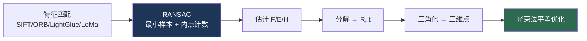
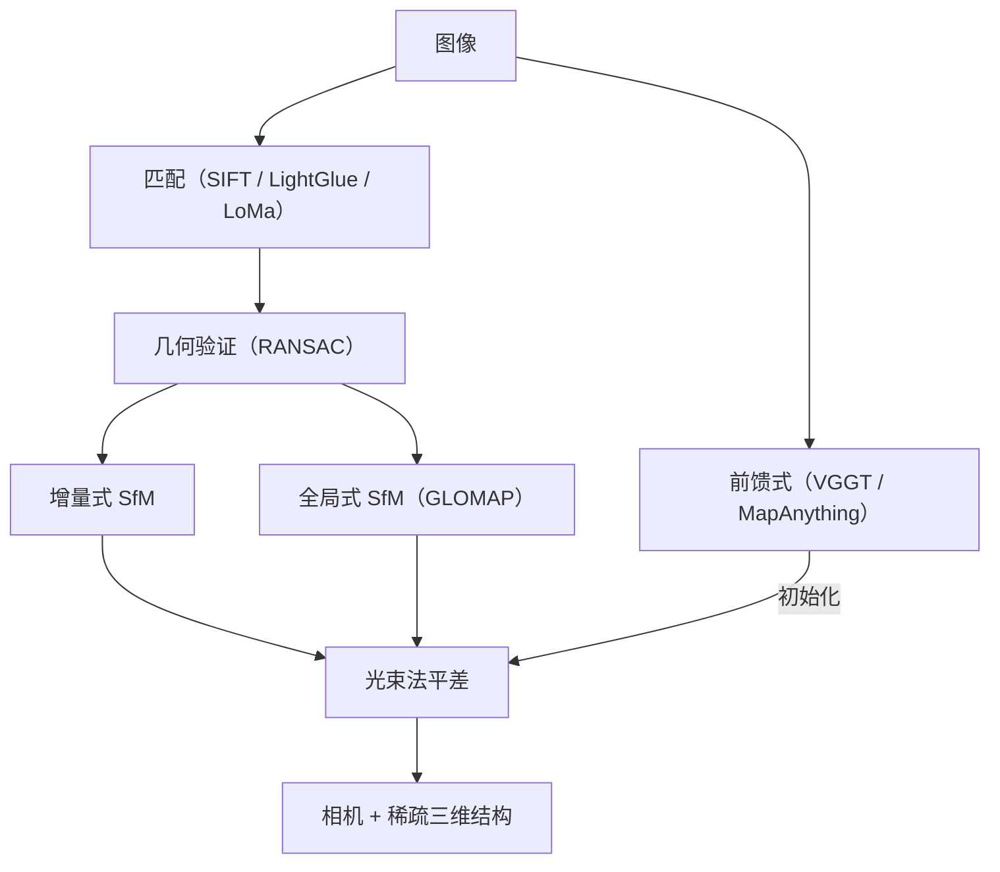

# 经典多视图几何

> **英文原文：** [cv-knowledge-base/00_foundations/04_classical_geometry.md](../../cv-knowledge-base/00_foundations/04_classical_geometry.md)（本中文版供参考，内容以英文原文为准）

> **最后更新：** 2026年10月
> **难度级别：** 基础
> **相关章节：**
> - [图像形成](./01_image_formation.md)
> - [SfM 与 SLAM](../04_3d_vision_and_scene/03_sfm_and_slam.md)
> - [三维重建](../02_core_tasks/09_3d_reconstruction.md)
> - [特征工程](./03_feature_engineering.md)

> **🆕 2026年10月更新：**
> - 新增关于**全局 SfM 与前馈式几何**的一节：GLOMAP（ECCV 2024）现已作为一等公民的全局建图器内置于 COLMAP 4.0（2026年3月）；COLMAP 4.1（2026年6月）新增 GPU 光束法平差后端（Caspar）；COLMAP 4.2（2026年9月）加入 LoMa 学习式匹配。
> - 前馈网络（VGGT，CVPR 2025 最佳论文；MapAnything；Depth Anything 3）如今可直接预测相机和深度，经典光束法平差（BA）则成为一个优化步骤。
> - 鲁棒估计：新增统一的 RANSAC 流水线 SupeRANSAC（2025）；参考文献、优缺点和开放问题也相应更新。

---

## 概述

经典多视图几何是将二维图像观测与三维场景结构及相机运动联系起来的数学基础。它是学习式三维视觉赖以构建的严谨的、基于模型的核心：即使在神经辐射场（NeRF）和高斯泼溅（Gaussian Splatting）的时代，几何关系（对极约束、单应、三角化、透视 n 点）依然不可或缺，它们既是运动恢复结构（SfM）和 SLAM 流水线的骨架（见 [SfM 与 SLAM](../04_3d_vision_and_scene/03_sfm_and_slam.md)），也是学习系统必须遵循的归纳结构。从事三维视觉或机器人视觉的博士生必须掌握这些内容，因为它们界定了从图像中在几何上*能够*恢复什么，以及在什么条件下重建是适定的。

该主题以射影几何为核心组织：相机是射影设备（见[图像形成](./01_image_formation.md)），刚性场景的多个视图之间的关系由一小组代数对象刻画，即**基础矩阵**和**本质矩阵**（两视图几何）、**单应矩阵**（平面场景或纯旋转），以及将带噪对应关系转化为度量三维结构的**三角化**、**PnP** 和**光束法平差**等机制。鲁棒估计（RANSAC）贯穿其中，因为真实的对应关系（来自 SIFT/ORB 或学习式匹配器；见[特征工程](./03_feature_engineering.md)）包含外点。本文结合定义方程阐述这些核心结论。

---

## 对极几何

给定一个三维点的两个视图，**对极约束**将对应的图像点 `x` 和 `x'`（齐次坐标）联系起来。**基础矩阵** `F`（未标定）和**本质矩阵** `E`（已标定）编码了这一约束：

```
xᵀ F x' = 0            # 基础矩阵约束（像素坐标）
x̂ᵀ E x̂' = 0           # 本质矩阵（归一化坐标），x̂ = K⁻¹ x
E = [t]_× R            # 本质矩阵 = 平移的反对称矩阵 × 旋转
F = K⁻ᵀ E K'⁻¹         # 通过内参 K、K' 建立的关系
```

`F`（秩为 2，7 个自由度）由 ≥7 个（或 8 个，即归一化八点算法）对应点估计；`E`（5 个自由度）需要 ≥5 个点，并可分解为相对旋转 `R` 和平移 `t`（相差一个尺度），从而给出相机运动。**极线** `Fx'` 将在另一幅图像中搜索匹配的范围约束到一维，这是立体匹配的基础。

## 单应

对于位于**平面**上的点，或在**相机纯旋转**的情况下，两个视图之间由一个 `3×3` 的**单应矩阵** `H`（8 个自由度）联系：

```
x = H x'      # 平面 / 纯旋转映射
```

单应矩阵由 ≥4 个对应点估计（DLT）。单应是图像拼接/全景图、平面增强现实和旋转估计的基础。

## 三角化、PnP 与标定

- **三角化**：给定已知的相机矩阵和一组对应点，通过求反投影射线的交点恢复三维点（线性 DLT，或最优中点法/最小二乘法）。
- **透视 n 点（PnP）**：给定 ≥3 个（P3P）已知的三维-二维对应，恢复相机位姿 `(R, t)`，这是定位和增强现实的核心。
- **相机标定**（Zhang 方法 [Zhang2000]）：通过单应，从平面棋盘格的多个视图中恢复内参 `K` 和畸变。

## 鲁棒估计：RANSAC

真实的对应关系包含外点，因此几何模型用 **RANSAC** 进行拟合：反复采样一个最小集，拟合模型，统计内点（在阈值内与模型一致的点），并保留支持度最高的假设。

在内点率为 `w` 时，为以置信度 `p` 至少抽到一个全由内点组成、大小为 `s` 的最小样本，所需迭代次数为：

```
N = log(1 − p) / log(1 − wˢ)
```

因此，计算代价随最小样本大小（例如八点、五点与三点求解器）和外点率急剧增长。现代变体用对阈值鲁棒的评分（MAGSAC++）取代硬性的内点计数，加入局部优化（LO-/GC-RANSAC），并使用引导采样（PROSAC）。SupeRANSAC [Barath2025]（2025）认为，端到端的*实现*选择与任何单个组件同样重要，并将它们整合为一条流水线，用于单应矩阵、基础/本质矩阵以及绝对/刚体位姿估计。其作者报告相对于 OpenCV 和 PoseLib 等现有实现有所提升，例如在基础矩阵估计上平均提升约 6 个 AUC 点。



## 光束法平差

作为金标准的优化方法，光束法平差（Bundle Adjustment, BA）在所有相机和三维点上联合最小化**重投影误差**：

```
min_{Cᵢ, Xⱼ}  Σᵢⱼ  ρ( || π(Cᵢ, Xⱼ) − xᵢⱼ ||² )
# Cᵢ：相机参数，Xⱼ：三维点，π：投影函数，ρ：鲁棒损失
```

它通过利用稀疏性的 Levenberg-Marquardt 方法求解，是 SfM/SLAM 的计算核心（见 [SfM 与 SLAM](../04_3d_vision_and_scene/03_sfm_and_slam.md)）。

## 全局 SfM 与前馈式几何（2024–2026）

**增量式与全局式 SfM。** 增量式 SfM（COLMAP 的经典建图器）逐张注册图像，反复进行三角化和光束法平差。它很鲁棒，但在大规模图像集合上速度慢，且对初始图像对敏感。*全局式* SfM 则先一次性估计所有相机旋转（在视图图上进行旋转平均），然后估计位置，最后进行优化：

```
R* = argmin_{Rᵢ} Σ_{(i,j)} d(R_ij, Rⱼ Rᵢᵀ)²     # 旋转平均
然后：全局定位（点 + 相机）→ 光束法平差
```

GLOMAP [Pan2024]（ECCV 2024）用一个联合估计相机位置和三维点的*全局定位（global positioning）*步骤取代了单独的平移平均，使全局 SfM 在精度上可与增量式 SfM 相媲美。其作者报告它通常比增量式建图快 1–2 个数量级。在 **COLMAP 4.0（2026年3月）**中，GLOMAP 被集成为一等公民的 `global_mapper`，内参通过视图图标定进行估计。**COLMAP 4.1（2026年6月）**在 Ceres 之外新增了 GPU 光束法平差后端 Caspar；**COLMAP 4.2（2026年9月）**使全局建图器将互不连通的视图图分量重建为各自独立的模型，并加入了 LoMa 学习式匹配。

**前馈式几何。** 另一条并行的研究路线完全跳过了显式的“对应 + 优化”。DUSt3R/MASt3R（2024）回归成对的点图。VGGT [Wang2025]（CVPR 2025 最佳论文）在单次前向传播中为多达数百个视图预测内参、外参、深度、点图和轨迹。MapAnything [Keetha2025]（arXiv 2509.13414；3DV 2026）输出度量尺度的几何和相机，并可接受可选的标定、位姿或深度输入。Depth Anything 3（2025年11月）用一个朴素的 Transformer 恢复深度和相机射线。这些模型并没有取代本文中的理论，而是将其摊销：它们的输出常被导出为 COLMAP 格式并用光束法平差进行优化，而多视图几何仍然界定了哪些量是可辨识的（例如，单目输入下的尺度只能通过学习先验获得）。



---

## 关键参考文献

| 工作 | 作者 | 年份 | 类型 | 关键贡献 |
|------|---------|------|------|-----------------|
| Multiple View Geometry | Hartley, Zisserman | 2004 | 专著（第 2 版） | 权威参考书 |
| Normalized 8-point algorithm | Hartley | 1997 | TPAMI | 稳定的基础矩阵估计 |
| RANSAC | Fischler, Bolles | 1981 | CACM | 存在外点时的鲁棒模型拟合 |
| Five-point algorithm | Nistér | 2004 | TPAMI | 最小配置下的本质矩阵估计 |
| Camera calibration | Zhang | 2000 | TPAMI | 灵活的平面标定 |
| Global Structure-from-Motion Revisited (GLOMAP) | Pan, Baráth, Pollefeys, Schönberger | 2024 | ECCV | 全局定位使全局 SfM 与增量式一样精确，且快得多 |
| VGGT: Visual Geometry Grounded Transformer | Wang, Chen, Karaev, Vedaldi, Rupprecht, Novotny | 2025 | CVPR（最佳论文） | 前馈预测相机、深度、点图和轨迹 |
| SupeRANSAC: One RANSAC to Rule Them All | Barath | 2025 | arXiv 2506.04803 | 跨多种几何问题的统一、精心工程化的鲁棒估计流水线 |
| MapAnything: Universal Feed-Forward Metric 3D Reconstruction | Keetha et al. | 2025 | arXiv 2509.13414 (3DV 2026) | 支持可选几何输入的度量尺度前馈重建 |

---

## 优缺点（经典几何与学习式三维）

| 方面 | 经典几何 | 学习式三维 |
|--------|--------------------|-----------|
| 保证 | 可证明、可解释 | 依赖数据、不透明 |
| 对纹理/特征的依赖 | 需要有区分度的特征 | 可在无纹理区域利用先验 |
| 泛化 | 适用于任何刚性场景 | 受限于训练分布 |
| 鲁棒性 | RANSAC 可处理外点 | 可能“幻觉”出看似合理但错误的结构 |
| 速度 | 增量式 SfM：大规模数据需数分钟到数小时（全局式 SfM 快得多） | 前馈式：数百个视图只需数秒，之后可选 BA |
| 度量尺度 | 需要额外传感器或已知物体 | 由学习先验预测（MapAnything、MoGe-2），无保证 |

---

## 开放问题与研究空白

- **无纹理 / 重复纹理场景。** 在特征缺失或存在歧义的地方，对应关系会失效；学习式匹配器有所帮助，但并未完全解决问题。
- **动态场景。** 多视图几何假设场景刚性；非刚性/动态重建要困难得多（参见 [4D 场景](../12_research_frontier_2024_2026/05_4d_and_dynamic_scenes.md)）。
- **尺度歧义。** 在没有额外约束的情况下，单目重建只能恢复相差一个尺度的结构。度量尺度的前馈模型（MapAnything、MoGe-2）通过学习先验预测尺度，但不具备基于传感器的尺度所具有的保证。
- **鲁棒估计的效率。** 在外点率高时 RANSAC 性能下降；更好的采样器、评分和局部优化方法（MAGSAC++、SupeRANSAC）仍是活跃的研究方向。
- **经典与学习方法的融合。** 如何最优地将几何约束与学习先验（DUSt3R/VGGT/MapAnything 式）结合，是一个开放方向（见[三维重建](../02_core_tasks/09_3d_reconstruction.md)）。开放问题包括：何时可以信任前馈预测的相机、如何将其不确定性传递到 BA 中，以及如何将其扩展到数百个视图以上。
- **全局一致性。** 大规模重建中的漂移和回环闭合仍然具有挑战性。

---

## 延伸阅读

- [Hartley & Zisserman, *Multiple View Geometry*](https://www.robots.ox.ac.uk/~vgg/hzbook/)：经典教科书
- [Zhang 标定法（TPAMI 2000）](https://www.microsoft.com/en-us/research/publication/a-flexible-new-technique-for-camera-calibration/)：灵活的标定方法
- [RANSAC（CACM 1981）](https://dl.acm.org/doi/10.1145/358669.358692)：鲁棒拟合
- [COLMAP](https://colmap.github.io/)：实现上述理论的实用 SfM 工具
- [五点算法（Nistér 2004）](https://ieeexplore.ieee.org/document/1288525)：最小配置相对位姿估计
- [GLOMAP（ECCV 2024）](https://github.com/colmap/glomap)：全局 SfM，现已集成到 COLMAP 4.x
- [COLMAP 发布说明](https://github.com/colmap/colmap/releases)：4.0 全局建图器、4.1 GPU BA、4.2 LoMa 匹配（2026）
- [VGGT（CVPR 2025）](https://github.com/facebookresearch/vggt)：前馈式多视图几何
- [MapAnything（arXiv 2509.13414）](https://arxiv.org/abs/2509.13414)：通用的度量尺度前馈重建
- [SupeRANSAC（arXiv 2506.04803）](https://github.com/danini/superansac)：统一的鲁棒估计
