# 计算机视觉：全面的历史时间线

> **英文原文：** [cv-knowledge-base/01_history/00_timeline_overview.md](../../cv-knowledge-base/01_history/00_timeline_overview.md)（本中文版供参考，内容以英文原文为准）

> **最后更新：** 2026年10月
> **难度级别：** 基础
> **相关章节：** [深度学习革命](./02_deep_learning_revolution.md) | [计算机视觉基础概述](../00_foundations/00_overview.md) | [CNN 架构](../03_architectures/00_cnn_architectures.md) | [基础模型时代](./06_foundation_model_era.md)

> **🆕 2026年10月更新：**
> - 新增章节 **“概念级感知、交互式世界模型与时间检验认可（2025–2026）”**，涵盖 DINOv3（2025年8月）、SAM 3 / SAM 3D（2025年11月）、Genie 3 → Project Genie → Waymo World Model（2025年8月 – 2026年2月）、π\*0.6 与 Gemini Robotics 1.5，以及 AMI Labs 的 10.3 亿美元种子轮融资（2026年3月）。
> - 修正 Mermaid 时间线：SAM 2、π₀ 和 Genie 2 移至 2024 年（其实际发布年份）；以经过核实的里程碑重建 2025 和 2026 年条目，包括 CVPR 2026 最佳论文（D4RT）与 ECCV 2026。
> - 补充了为深度学习时代"正名"的十年回顾奖项：2025 年 Longuet-Higgins 奖（GoogLeNet、FCN）与 2026 年 Longuet-Higgins 奖（ResNet、YOLO）、2025 年 Helmholtz 奖（Fast R-CNN、PReLU）、NeurIPS 2025 时间检验奖（Faster R-CNN）。
> - 关键论文表新增条目（VGGT、DINOv3、SAM 3），更新了各时代对比表，新增开放问题（基于机器人经验的强化学习、生成式模拟器的验证）以及新的延伸阅读链接。

---

## 概述

计算机视觉作为一门科学学科已有近七十年历史，从用于解释线条图的手工编码启发式方法，演进到在几乎所有视觉任务上都展现出零样本泛化能力的自监督基础模型（Foundation Model）。理解这一发展轨迹至关重要——不仅因为它是一段思想史，更因为 2026 年的架构决策、失效模式和开放研究问题，往往要放在"曾经尝试过并被放弃"——或"尝试过、失败过，后来凭借更好的归纳偏置和更多数据而复兴"——的背景下才能得到最好的理解。

该领域的发展弧线被若干次"相变"所划分。第一次发生在 1960 年代初至 1970 年代，确立了视觉是一个可被形式化描述的计算问题。第二次由 David Marr 在 1982 年提出的框架推动，随后 1980 至 2000 年代工程化特征检测器大量涌现，形成了一套成熟的手工设计表示工具箱——Canny 边缘、Hough 变换、SIFT、HOG——并在 2010 年左右进入平台期。第三次转变由 AlexNet 在 ILSVRC 2012 上开启，使卷积神经网络成为视觉研究的核心，并将基准错误率降低到手工方法从未达到的程度。第四次转变大约始于 2020 年 ViT 的提出，并经由 CLIP（2021）、MAE（2022）、SAM（2023）以及自 2023 年起视觉-语言-动作模型（Vision-Language-Action, VLA）的大量涌现而加速，逐步消解了计算机视觉与自然语言处理之间的边界，催生了如今主导工业部署与学术研究的基础模型范式。

本文档提供一个按时间顺序展开的叙事，整合了里程碑论文、概念转折点和基准结果。配套文件对各个时代有更深入的论述；本文引用采用 [AuthorYear] 约定，完整引用见下方的关键论文表。

---

## 史前期与感知起源（1950年代–1960年代）

计算机视觉的思想根源早于该领域的命名。Frank Rosenblatt 的感知机（Perceptron）[Rosenblatt1958] 于 1957 年以康奈尔航空实验室技术报告的形式提出，并于 1958 年正式发表于《Psychological Review》，它提出了一种基于加权连接和阈值激活、受生物启发的模式识别模型。尽管感知机处理的是简单模式的分类而非自然图像，但它引入了"从带标签样本中学习"的范式，这一范式在六十年后主导了机器学习。

第一篇可辨认的现代计算机视觉论文是 Lawrence Roberts 1963 年的 MIT 博士论文《Machine Perception of Three-Dimensional Solids》[Roberts1963]。Roberts 证明，程序可以通过检测边缘、推断角点并与已知三维物体模型数据库进行匹配，从单张照片中恢复多面体物体的三维结构。这种*积木世界*（blocks-world）设定是刻意受限的——物体是受控光照下的简单多面体——但它确立了边缘、表面和三维推断这一套延续至今的表示词汇。

1966 年的"夏季视觉项目"（Summer Vision Project）由 Seymour Papert 在 MIT 人工智能实验室提出，它著名地把机器视觉问题作为暑期练习分配给一组本科生 [Papert1966]。该项目的雄心反映了当时对视觉理解可解性近乎无限的乐观。学生们未能在一个夏天内解决这一问题；他们识别出的许多子问题——分割、分组、三维推断——在六十年后仍是活跃的研究领域。

---

## 计算视觉与工程化特征时代（1970年代–2000年代）

1970 年代和 1980 年代初产生了第一个用于理解计算机视觉究竟在计算什么的严谨理论框架。David Marr 身后出版的专著《Vision》[Marr1982] 阐述了著名的三层次分解——计算层（计算什么以及为什么）、算法层（如何表示以及采用什么过程实现）和实现层（算法如何在物理上实现）。Marr 提出了一个层次化处理流水线：从初级简图（primal sketch，边缘与边界检测），经由 2.5 维简图（以观察者为中心的表面朝向），到完整的三维物体表示。该框架对领域自我认知的影响持续了数十年，并至今仍在影响关于神经网络究竟在计算什么的讨论。

Hough 变换最初由 Paul Hough 于 1962 年申请专利，用于检测气泡室照片中的直线，后由 Duda 和 Hart 推广 [DudaHart1972]，为在噪声存在下检测参数化形状提供了一种鲁棒方法。John Canny 1986 年的论文《A Computational Approach to Edge Detection》[Canny1986] 发表于《IEEE Transactions on Pattern Analysis and Machine Intelligence》（第 8 卷，第 679–698 页），形式化了最优边缘检测器的准则——良好的检测、良好的定位、对单一边缘只产生单一响应——并提出了以其名字命名的多尺度、基于梯度的检测器，该检测器在 2026 年仍被用作预处理步骤。

1990 年代出现了日益复杂的特征表示。David Lowe 的尺度不变特征变换（SIFT）[Lowe2004] 在 1999 年 ICCV 的初步报告之后，于 2004 年在《International Journal of Computer Vision》论文中被形式化。它将高斯差分（difference-of-Gaussian）关键点检测与梯度方向直方图相结合，生成对尺度、旋转和光照变化具有不变性的关键点描述子。SIFT 使得在视角和外观差异显著的图像之间进行可靠特征匹配成为可能，并成为运动恢复结构（structure-from-motion）和图像检索流水线的事实标准。

Navneet Dalal 和 Bill Triggs 在 CVPR 2005 上提出了方向梯度直方图（HOG）[DalalTriggs2005]，证明了局部梯度方向直方图的稠密网格与线性 SVM 分类器结合时，在行人检测上显著优于当时已有的特征。HOG 在固定尺度上编码中层纹理信息，不进行显式的特征定位，从而与 SIFT 以关键点为中心的设计形成互补。

Paul Viola 和 Michael Jones 基于 AdaBoost 的人脸检测器 [ViolaJones2001] 发表于 CVPR 2001，通过结合三个思想实现了实时人脸检测：用于快速计算矩形 Haar 类特征的积分图、从数千候选中选择判别性特征的 AdaBoost，以及可尽早拒绝非人脸区域、复杂度递增的级联分类器。这可以说是第一个针对自然图像类别的实时、高精度检测器，并立即在数码相机中获得了商业部署。

PASCAL 视觉目标类别（VOC）基准 [Everingham2010] 从 2005 年持续到 2012 年，由 Everingham、Van Gool、Williams、Winn 和 Zisserman 组织，为社区提供了标准化的数据集、评估协议（平均精度均值，mAP）以及年度竞赛赛道。该基准从 2005 年的 4 个类别增长到 2007 年的 20 个类别，并成为 DPM 时代比较检测器的主要舞台。Pedro Felzenszwalb、Ross Girshick、David McAllester 和 Deva Ramanan 的可变形部件模型（Deformable Part Model, DPM）[Felzenszwalb2010] 于 2010 年发表于 IEEE TPAMI，它将物体表示为由类弹簧空间模型连接的根滤波器与部件滤波器的混合，并用潜变量 SVM 训练，赢得了 2007、2008 和 2009 年 VOC 检测挑战赛。DPM 代表了手工特征流水线的巅峰。

---

## 深度学习革命（2012–2014）

2012 年 9 月 30 日，Alex Krizhevsky、Ilya Sutskever 和 Geoffrey Hinton 向 ILSVRC 图像分类挑战赛提交了一个方案，取得了 15.3% 的 top-5 错误率，而第二名为 26.2% [Krizhevsky2012]。这一差距在竞争性机器学习基准中前所未有，立即标志着一次相变。AlexNet——这一架构后来的名称——结合了在 GPU 上并行训练的八层网络（五个卷积层、三个全连接层）、用于避免梯度消失的 ReLU 激活、dropout 正则化以及数据增强。该论文被 NeurIPS 2012 接收，并已成为计算机科学史上被引用最多的论文之一。

2013–2014 年见证了架构的快速改进。Karen Simonyan 和 Andrew Zisserman 的 VGGNet [Simonyan2014] 以 arXiv:1409.1556 提交并在 ICLR 2015 上发表，表明用 3×3 卷积的堆叠替代大尺寸滤波器，可以在减少参数的同时将深度增加到 16–19 层。GoogLeNet [Szegedy2015] 是 ILSVRC 2014 的冠军，top-5 错误率为 6.67%，它引入了 Inception 模块——包含 1×1、3×3 和 5×5 卷积的并行分支——并证明可以通过架构重新设计而非简单堆叠层来高效地增加深度。

---

## 检测与分割走向成熟（2014–2017）

Ross Girshick 的 R-CNN [Girshick2014] 发表于 CVPR 2014，是第一个将深度卷积特征应用于区域候选（region proposal）的方法，相对 DPM 将 VOC 2012 的 mAP 提升了 30 多个百分点。Girshick 的 Fast R-CNN（2015）将特征提取并入共享主干网络；Shaoqing Ren、Kaiming He、Ross Girshick 和 Jian Sun 的 Faster R-CNN [Ren2015] 发表于 NeurIPS 2015，用与检测主干共享的可学习区域候选网络（Region Proposal Network, RPN）取代了选择性搜索，将候选生成时间从秒级缩短到毫秒级。

Kaiming He、Xiangyu Zhang、Shaoqing Ren 和 Jian Sun 的残差网络 [He2016] 发表于 CVPR 2016，通过引入恒等捷径连接（使梯度可以直接穿过各层）解决了退化问题——即用反向传播训练的深层网络表现反而不如较浅的网络。ResNet-152 在 ILSVRC 2015 上取得了 3.57% 的 top-5 错误率，残差网络的集成赢得了该竞赛的多个赛道。ResNet 成为几乎所有下游视觉任务的默认主干网络，并在 2026 年仍被广泛部署。

Jonathan Long、Evan Shelhamer 和 Trevor Darrell 的全卷积网络（FCN）[LongShelhamer2015] 发表于 CVPR 2015，表明通过用卷积替换全连接层并添加上采样操作，分类 CNN 可以转换为分割网络。Olaf Ronneberger、Philipp Fischer 和 Thomas Brox 的 U-Net [Ronneberger2015] 发表于 MICCAI 2015，在 FCN 概念的基础上增加了编码器与解码器之间的跳跃连接，使得在有限训练数据下也能实现精确定位；它成为医学图像分割的主导架构。Joseph Redmon、Santosh Divvala、Ross Girshick 和 Ali Farhadi 的 YOLO [Redmon2016] 发表于 CVPR 2016，将检测重新表述为通过网络单次前向传播求解的单一回归问题，在具有竞争力的精度下达到 45 fps。

Kaiming He、Georgia Gkioxari、Piotr Dollár 和 Ross Girshick 的 Mask R-CNN [He2017] 发表于 ICCV 2017（获 Marr 奖），在 Faster R-CNN 的基础上增加了并行的掩码预测分支，以极少的额外计算在 COCO 上取得了强劲的实例分割结果。

---

## 生成模型与自监督学习（2014–2020）

Ian Goodfellow、Jean Pouget-Abadie、Mehdi Mirza、Bing Xu、David Warde-Farley、Sherjil Ozair、Aaron Courville 和 Yoshua Bengio 在 NeurIPS 2014（第 27 届 NIPS 会议论文集，第 2 卷，第 2672–2680 页）上提出了生成对抗网络（Generative Adversarial Networks）[Goodfellow2014]。生成器与判别器之间的对抗极小极大博弈，为学习隐式生成模型提供了一个新框架，避免了 VAE 解码图像的模糊问题。DCGAN（2015）、Pix2Pix [Isola2017] 和 CycleGAN [Zhu2017]（均为 2017 年 ICCV/CVPR）展示了条件图像合成和非配对图像到图像转换。StyleGAN [Karras2019] 发表于 CVPR 2019，引入了基于风格、以 AdaIN 调制中间潜空间的生成器，生成的逼真人脸与照片难以区分。

Jonathan Ho、Ajay Jain 和 Pieter Abbeel 的去噪扩散概率模型（DDPM）[Ho2020] 发表于 NeurIPS 2020，建立了扩散过程与分数匹配之间的联系，表明一个简单的高斯加噪-去噪过程即可生成质量可与 GAN 竞争的图像样本，且没有对抗训练的不稳定性。Robin Rombach、Andreas Blattmann、Dominik Lorenz、Patrick Esser 和 Björn Ommer 的潜在扩散模型（Latent Diffusion Models, LDMs）[Rombach2022] 作为 CVPR 2022 口头报告论文发表，通过预训练的 VQ-VAE 编码器将扩散过程移入压缩的潜空间，大幅降低了计算成本，并使大规模文本条件图像合成成为可能——这就是 *Stable Diffusion*，第一个高质量的开源文本到图像模型。

---

## Transformer 转型（2017–2022）

Ashish Vaswani、Noam Shazeer、Niki Parmar、Jakob Uszkoreit、Llion Jones、Aidan Gomez、Łukasz Kaiser 和 Illia Polosukhin 的 Transformer [Vaswani2017] 发表于 NeurIPS 2017，引入多头自注意力作为序列建模的主要计算原语，在 NLP 中取代了循环网络。它在视觉中的应用最初是间接的（通过受 BERT 启发的图像块序列预训练），但 Alexey Dosovitskiy 及其同事的 ViT [Dosovitskiy2021]（以 arXiv:2010.11929 于 2020 年 10 月发布，并在 ICLR 2021 上发表）表明，当在大型数据集（JFT-300M）上预训练时，直接作用于 16×16 图像块序列的纯 Transformer 能够达到或超过 CNN。

Ze Liu、Yutong Lin、Yue Cao、Han Hu、Yixuan Wei、Zheng Zhang、Stephen Lin 和 Baining Guo 的 Swin Transformer [Liu2021] 发表于 ICCV 2021（Marr 奖得主），通过在移位局部窗口内计算层次化特征图，解决了 ViT 在稠密预测上缺乏归纳偏置的问题——赋予 Transformer 与 CNN 相同的多尺度处理能力，而正是这种能力使 CNN 在检测和分割上表现出色。

OpenAI 的 Alec Radford、Jong Wook Kim、Chris Hallacy 及其同事在 ICML 2021 上提出了 CLIP [Radford2021]，通过对称对比损失在 4 亿个网络爬取的图像-文本对上联合训练图像编码器和文本编码器。所得表示通过将图像嵌入与文本类别描述进行比较来支持零样本图像分类，无需任何任务特定的微调即可取得有竞争力的 ImageNet 精度。Kaiming He、Xinlei Chen、Saining Xie、Yanghao Li、Piotr Dollár 和 Ross Girshick 的 MAE [He2022] 发表于 CVPR 2022，将掩码语言建模范式迁移到视觉：掩盖 75% 的图像块，并训练一个 ViT 编码器-解码器来重建它们，以极简的架构复杂度产生高度可迁移的特征。

Mathilde Caron、Hugo Touvron、Ishan Misra、Hervé Jégou、Julien Mairal、Piotr Bojanowski 和 Armand Joulin 的 DINO [Caron2021] 发表于 ICCV 2021，表明使用自蒸馏目标（无标签、无对比负样本，仅有学生-教师 EMA 机制）对 ViT 进行自监督训练，能够产生在注意力图中显式涌现出语义分割结构的特征。

---

## 基础模型与 2023–2026 范式

Meta AI 的 Alexander Kirillov、Eric Mintun、Nikhila Ravi 及其同事提出了 Segment Anything（SAM）[Kirillov2023]，发表于 ICCV 2023（arXiv:2304.02643），同时发布了包含超过十亿个分割掩码的 SA-1B 数据集。SAM 的可提示（promptable）架构——接受点、框或掩码提示并返回有效的分割掩码——确立了任务无关视觉基础模型的范式。

DINOv2 [Oquab2023]（arXiv:2304.07193）在经过筛选的 1.42 亿图像数据集上扩展了 DINO 风格的自监督 ViT 训练，产生的特征可在深度估计、分割、分类和检索中作为强大的现成主干。Depth Anything [Yang2024] 发表于 CVPR 2024（V2 发表于 NeurIPS 2024），结合 150 万张有标签深度图像和超过 6200 万张无标签图像，构建了单目深度基础模型。

视觉与语言在大型预训练模型层面的融合（GPT-4V、Gemini 1.5、Claude 3），以及视觉-语言-动作（VLA）模型的出现——例如 Google DeepMind 的 RT-2 [Brohan2023]（2023 年 7 月）和 Physical Intelligence 的 π0（2024 年 10 月）——代表着将机器人动作作为一种模态纳入其中，使基于自然语言指令的通用操作成为可能。Google DeepMind 于 2024 年 3 月提出的 Genie [Bruce2024] 展示了一个在无动作标签的互联网视频上训练、参数量为 110 亿的生成式世界模型（World Model），并衍生出 Genie 2（2024 年 12 月）和 Genie 3（2025 年 8 月）。NVIDIA 的 Cosmos（2025 年 1 月）及相关项目将世界模型能力推向大规模、物理上准确的视频预测。

到 2026 年中，主导范式结合了大规模预训练视觉编码器（通常基于 ViT）、语言解码器（通常为自回归 LLM），以及通过指令微调或检索增强进行的任务特定适配。研究前沿包括样本高效的适配、组合性、从单目视频进行三维场景理解，以及生成式世界模型中的物理模拟保真度。

---

## 概念级感知、交互式世界模型与时间检验认可（2025–2026）

从 2025 年中到 2026 年末的十八个月并没有引入新的范式，而是沿着三个维度同时推进了基础模型范式：感知模型可以用*什么*来提示、学习得到的世界模拟器可以*多么具有交互性*，以及具身策略在部署后*如何*持续改进。

**7B 规模的自监督特征。** Meta 的 DINOv3 [Simeoni2025]（arXiv:2508.10104，2025 年 8 月）将 DINO 风格的自蒸馏扩展到一个 70 亿参数的 ViT 教师模型，在约 17 亿张经过筛选的图像上训练。其核心技术贡献 *Gram 锚定*（Gram anchoring）将图像块特征的 Gram 矩阵向较早检查点的 Gram 矩阵正则化，解决了长训练过程中稠密特征图退化这一长期已知的问题；随后该 7B 教师模型被蒸馏为 ViT-S 至 ViT-H+ 以及 ConvNeXt 等一系列学生模型。DINOv3 由此闭合了 DINO 在 2021 年开启的循环：单个冻结的、无标签训练的主干网络，在全局任务和稠密任务上都具有竞争力。

**从"分割一切"到"分割某一概念的每一个实例"。** SAM 3 [Carion2026]（arXiv:2511.16719，2025 年 11 月；ICLR 2026）将 SAM 的几何提示推广为*概念提示*——简短的名词短语、图像示例或两者兼有——并定义了可提示概念分割（Promptable Concept Segmentation, PCS）任务：在图像和视频中为*所有*匹配的实例返回掩码和持久的身份标识。检测器与基于记忆的视频跟踪器共享同一主干，而一个独立的*存在性头*（presence head）将识别（"该概念是否出现？"）与定位解耦。模型在环（model-in-the-loop）的数据引擎产生了约 400 万个唯一概念标签（包括困难负样本），并随 SA-Co 基准一同发布；作者报告在图像和视频 PCS 上将以往系统的精度大约提高了一倍。Meta 同时发布了 SAM 3D，将可提示范式扩展到物体和人体的单图像三维重建。实际上，SAM 3 将开放词汇（open-vocabulary）检测——R-CNN 谱系的后代——纳入了可提示分割框架。

**前馈几何取代优化流水线。** VGGT [Wang2025]（CVPR 2025 最佳论文，牛津 VGG 与 Meta）表明，单个前馈 Transformer 可以在一次前向传播中为多个视图预测相机参数、深度图、点图和轨迹，从而挑战了自 2000 年代以来一直作为标准的"SIFT + 光束法平差"运动恢复结构流水线。CVPR 2026 最佳论文《Efficiently Reconstructing Dynamic Scenes One D4RT at a Time》（Google DeepMind、UCL 和牛津大学）将这一研究计划扩展到动态场景，从视频中预测几何、相机、深度和跨帧对应关系——连续两届 CVPR 最佳论文都授予了基于学习的三维/四维重建。

**世界模型走向交互化与产业化。** Genie 3（Google DeepMind，2025 年 8 月）能够实时生成可导航的环境（据报道约 24 fps、720p），并具有分钟级的一致性。2026 年 1 月 29 日，Google 向美国的 Google AI Ultra 订阅用户开放了基于 Genie 3 的实验性原型 *Project Genie*。2026 年 2 月 6 日，Waymo 发布了 *Waymo World Model*，它基于 Genie 3 并针对驾驶场景进行了适配，可生成可控的相机*和*激光雷达输出，用于模拟车队从未观测到的罕见事件——这是通用生成式世界模型被用作安全关键系统生产级模拟器的第一个突出案例。在研究机构方面，由 Yann LeCun（董事长）创立、Alexandre LeBrun 担任 CEO 的 AMI Labs 于 2026 年 3 月 10 日宣布完成 10.3 亿美元种子轮融资，用于构建在表示空间而非像素空间中进行预测的 JEPA 风格世界模型。

**具身策略从经验中学习。** Physical Intelligence 的 π\*0.6（2025 年 11 月）在 π0.6 VLA 之上加入了 RECAP（*Reinforcement learning with Experience and Corrections via Advantage-conditioned Policies*，基于优势条件策略、利用经验与纠正的强化学习），将示范、专家干预和自主执行结合起来；该公司报告在制作浓缩咖啡和叠衣服等困难任务上吞吐量提升了一倍以上。Google DeepMind 的 Gemini Robotics 1.5 和 Gemini Robotics-ER 1.5（2025 年 9 月）将机器人控制拆分为一个具身推理"规划器"模型（可通过 Gemini API 使用）和一个 VLA"执行器"；NVIDIA 的 GR00T N1.6 则采用 Cosmos-Reason-2B 视觉-语言主干和 32 层扩散 Transformer 动作头。2026 年，这些路线继续推进：π0.7（4 月）、GR00T N1.7 以及 Google DeepMind 的 Gemini Robotics 2（7 月），后者将单一 VLA 扩展到人形机器人的全身控制。这些进展在[基础模型时代](./06_foundation_model_era.md)一文中有深入论述。

**深度学习时代被"正名"。** 2025–2026 年的十年回顾奖项正式认可了本时间线前面各节所叙述的论文：CVPR Longuet-Higgins 奖授予了 GoogLeNet 和 FCN（2025）以及 ResNet 和 YOLO（2026）；ICCV 2025 Helmholtz 奖授予了 Fast R-CNN 以及 He 等人的 PReLU 论文（*Delving Deep into Rectifiers*）；NeurIPS 2025 时间检验奖授予了 Faster R-CNN，其作者于 2025 年 12 月在圣地亚哥进行了报告，Kaiming He 的配套演讲题为 *A Brief History of Visual Object Detection*。在 ECCV 2026（马尔默，2026 年 9 月；投稿超过 10,000 篇）上，据报道最佳论文授予了 *Heat Kernel Textures*（伦敦帝国理工学院）。

---

## Mermaid 时间线

```mermaid
timeline
    title 计算机视觉：主要里程碑
    section 1957–1969
        1957 : Rosenblatt 感知机（康奈尔技术报告）
        1958 : 感知机 — Psychological Review 论文
        1963 : Roberts 积木世界博士论文（MIT）
        1966 : MIT 夏季视觉项目（Papert）
    section 1970年代–1980年代
        1972 : Hough 变换的推广（Duda 与 Hart）
        1980 : Fukushima 新认知机（Neocognitron）
        1982 : Marr — Vision（MIT Press，遗著）
        1986 : Canny 边缘检测器 — IEEE TPAMI
        1989 : LeCun 卷积网络 + 反向传播用于 MNIST
    section 1990年代–2000年代
        1998 : LeCun LeNet-5 — 支票识别系统
        1999 : Lowe SIFT（ICCV 初步版本）
        2001 : Viola-Jones 人脸检测器（CVPR）
        2004 : Lowe SIFT（IJCV 完整论文）
        2005 : Dalal 与 Triggs HOG（CVPR）
        2005 : PASCAL VOC 挑战赛开始
    section 2010–2014
        2010 : Felzenszwalb DPM 赢得 VOC（TPAMI）
        2012 : AlexNet — ILSVRC top-5 错误率 15.3%（NeurIPS）
        2013 : Girshick R-CNN（CVPR 2014）
        2014 : GoogLeNet top-5 错误率 6.67%；Goodfellow GAN（NeurIPS）
        2014 : Simonyan VGGNet（arXiv）
    section 2015–2017
        2015 : ResNet ILSVRC top-5 错误率 3.57%；Faster R-CNN（NeurIPS）
        2015 : FCN 语义分割（CVPR）；U-Net（MICCAI）
        2016 : YOLO v1 — 实时检测（CVPR）
        2017 : Mask R-CNN 获 ICCV Marr 奖；Vaswani Transformer（NeurIPS）
        2017 : pix2pix（CVPR）；CycleGAN（ICCV）
    section 2018–2021
        2019 : StyleGAN（CVPR）；EfficientNet（ICML）
        2020 : DDPM — 扩散模型（NeurIPS）；ViT 10 月发布于 arXiv
        2021 : ViT（ICLR）；CLIP（ICML）；DINO（ICCV）；Swin（ICCV Marr 奖）
        2021 : MAE（11 月 arXiv → CVPR 2022）
    section 2022–2025
        2022 : Stable Diffusion / LDM（CVPR 口头报告）
        2023 : SAM（ICCV）；DINOv2（arXiv）；RT-2 VLA（7 月）
        2024 : Depth Anything（CVPR）；Genie 世界模型（3 月）；GPT-4V 广泛部署
        2024 : SAM 2 视频分割（7 月）；π0 VLA（10 月）；Genie 2（12 月）
        2025 : Cosmos 世界基础模型（1 月）；VGGT 获 CVPR 最佳论文
        2025 : Genie 3 实时世界模型（8 月）；DINOv3 7B 自监督（8 月）
        2025 : Gemini Robotics 1.5（9 月）；SAM 3 与 SAM 3D（11 月）；π*0.6 从经验中强化学习（11 月）
        2025 : Faster R-CNN 获 NeurIPS 时间检验奖
    section 2026
        2026 : Project Genie（1 月）；基于 Genie 3 的 Waymo World Model（2 月）
        2026 : AMI Labs 获 10.3 亿美元种子轮用于 JEPA 世界模型（3 月）；π0.7（4 月）
        2026 : Gemini Robotics 2 全身人形机器人 VLA（7 月）
        2026 : CVPR 最佳论文 D4RT 四维重建；ResNet 与 YOLO 获 Longuet-Higgins 奖
        2026 : ECCV 马尔默（9 月）；概念可提示感知与 VLA 基础模型
```

---

## 关键论文

| 论文 | 作者 | 年份 | 会议/期刊 | 主要贡献 |
|---|---|---|---|---|
| The Perceptron: A Probabilistic Model | Frank Rosenblatt | 1958 | *Psychological Review* | 第一个基于学习的模式识别模型；神经网络的奠基理论 |
| Machine Perception of Three-Dimensional Solids | Lawrence Roberts | 1963 | MIT 博士论文 | 首次从二维图像推断三维场景；积木世界范式 |
| Vision | David Marr | 1982 | MIT Press（专著） | 三层次框架（计算/算法/实现）；初级简图 |
| A Computational Approach to Edge Detection | John Canny | 1986 | *IEEE TPAMI* 8:679–698 | 最优边缘检测器准则；高斯平滑梯度极大值与滞后阈值 |
| Rapid Object Detection Using a Boosted Cascade | Paul Viola & Michael Jones | 2001 | CVPR | 实时人脸检测；积分图、AdaBoost 级联、Haar 特征 |
| Distinctive Image Features from Scale-Invariant Keypoints | David Lowe | 2004 | *IJCV* 60(2):91–110 | SIFT 关键点与描述子；尺度/旋转/光照不变性 |
| Histograms of Oriented Gradients for Human Detection | Navneet Dalal & Bill Triggs | 2005 | CVPR | 用于行人检测的 HOG 描述子；稠密梯度方向网格 |
| Object Detection with Discriminatively Trained Part-Based Models | Felzenszwalb, Girshick, McAllester, Ramanan | 2010 | *IEEE TPAMI* | DPM：基于潜变量 SVM 的可变形部件模型；PASCAL VOC 2007–2009 冠军 |
| ImageNet Classification with Deep CNNs (AlexNet) | Krizhevsky, Sutskever, Hinton | 2012 | NeurIPS | GPU 训练的深度 CNN；ILSVRC top-5 错误率 15.3%；ReLU、dropout、数据增强 |
| Deep Residual Learning for Image Recognition (ResNet) | He, Zhang, Ren, Sun | 2016 | CVPR | 恒等捷径连接；152 层网络；ILSVRC 2015 top-5 错误率 3.57% |
| Generative Adversarial Nets | Goodfellow et al. | 2014 | NeurIPS | 生成器/判别器的对抗极小极大训练；隐式生成建模 |
| Faster R-CNN | Ren, He, Girshick, Sun | 2015 | NeurIPS | 将区域候选网络集成进检测主干；端到端（end-to-end）训练 |
| Attention Is All You Need | Vaswani et al. | 2017 | NeurIPS | Transformer：多头自注意力取代循环结构；LLM 的 NLP 主干 |
| An Image is Worth 16×16 Words (ViT) | Dosovitskiy et al. | 2021 | ICLR | 作用于图像块的纯 Transformer；在大规模下与 CNN 竞争 |
| Learning Transferable Visual Models from Natural Language (CLIP) | Radford et al. | 2021 | ICML | 在 4 亿图文对上进行对比式图像-文本训练；零样本视觉分类 |
| Segment Anything (SAM) | Kirillov et al. | 2023 | ICCV | 可提示分割基础模型；含 10 亿+ 掩码的 SA-1B 数据集 |
| VGGT: Visual Geometry Grounded Transformer | Wang, Chen, Karaev, Vedaldi, Rupprecht, Novotny | 2025 | CVPR（最佳论文） | 前馈预测相机、深度、点图和轨迹；SfM 的学习式替代方案 |
| DINOv3 | Siméoni et al. | 2025 | arXiv:2508.10104 | 70 亿参数自蒸馏 ViT；Gram 锚定保持稠密特征；蒸馏模型家族 |
| SAM 3: Segment Anything with Concepts | Carion et al. | 2026 | ICLR | 基于名词短语/示例的可提示概念分割；存在性头；SA-Co 基准 |
| Efficiently Reconstructing Dynamic Scenes One D4RT at a Time | Google DeepMind, UCL, Oxford | 2026 | CVPR（最佳论文） | 前馈四维重建：从视频中预测几何、相机、深度和对应关系 |

---

## 各时代的影响与局限

| 时代 | 最高成就 | 根本局限 |
|---|---|---|
| 感知机 / 早期计算机视觉（1957–1969） | 形式化的学习模型；从线条图推断三维场景 | 仅适用于受限、理想化的场景；没有学习得到的低层特征 |
| 工程化特征（1970–2011） | 实时人脸检测；可靠的多尺度特征匹配 | 对域偏移脆弱；特征设计需要专家知识；语义鸿沟 |
| 深度 CNN 监督学习时代（2012–2017） | ImageNet top-5 错误率低于 5%；高精度实时检测 | 需要数百万带标签样本；跨任务的泛化能力有限 |
| Transformer + 自监督学习时代（2017–2022） | 强大的零样本迁移；注意力图中涌现的分割结构 | 注意力的二次方代价；需要大规模语料；位置编码脆弱 |
| 基础模型时代（2023–2026） | 可提示与概念级分割（SAM → SAM 3）；前馈三维/四维重建；结合强化学习微调的 VLA 机器人控制；被用作生产级模拟器的实时交互式世界模型 | 幻觉与事实错误；高计算成本；无法保证三维一致性；缺乏公认的生成式模拟器验证协议 |

---

## 开放问题与研究空白

- **组合泛化**：当前的视觉模型，包括大型 VLM，在已知概念的新组合上仍会系统性失败（例如 CLEVR 式评测中的空间关系推理），这表明缺乏显式的组合式场景表示。
- **数据效率与少样本适配**：尽管有自监督预训练，在少于 100 个带标签样本的情况下将基础模型适配到新领域（如卫星图像、内窥镜、电子显微镜）并达到可部署质量，仍未解决。
- **单目视频的三维场景一致性**：Depth Anything 等模型能够产生逐帧深度，但缺乏时间上一致的三维表示，限制了其在机器人和 AR/VR 中的应用。
- **超越封闭集基准的评估**：ImageNet、COCO 和 PASCAL VOC 衡量的是固定标签分布上的精度；对开放世界识别、分布外鲁棒性以及分布偏移下失效模式的系统性评估仍处于起步阶段。
- **因果与物理理解**：世界模型（Genie、Cosmos）能够模拟看似合理的视觉动态，但无法可靠地建模反事实或牛顿力学，限制了它们在基于物理的预测中的效用。
- **伦理与社会维度**：在网络爬取数据上训练的基础模型会继承并放大人口统计偏见；训练数据的来源、归属和版权问题在法律和技术上仍未解决。
- **语言在感知中的落地（grounding）**：VLM 能够流畅地描述图像，但将语言 token 与视觉基元联系起来的表示尚未被很好地理解，引发了关于多模态模型中"理解"究竟意味着什么的问题。
- **生成式模拟器的验证**：随着基于 Genie 3 的模型被用于生成罕见驾驶场景（Waymo World Model，2026），如何证明学习得到的模拟器在罕见事件分布上足够忠实、可用于安全论证，这一问题已从学术问题变为运营问题。
- **从部署经验中学习**：在模仿预训练的 VLA 之上进行 π\*0.6 式强化学习，在基础模型规模上重新提出了信用分配、奖励设定、安全探索等经典问题，而用于评估的共享方法论却很少。
- **概念级长尾**：SAM 3 的概念提示暴露出一个新的失效面——歧义的、细粒度的或组合式的名词短语——这是封闭词汇基准从未衡量过的。

---

## 延伸阅读

- [ImageNet Large Scale Visual Recognition Challenge (Russakovsky et al., 2015)](https://arxiv.org/abs/1409.0575) — 截至 2014 年的权威基准历史
- [A Survey on Visual Transformer (Han et al., 2022)](https://arxiv.org/abs/2012.12556) — ViT 变体的全面综述
- [Object Detection in 20 Years: A Survey (Zou et al., 2019)](https://arxiv.org/abs/1905.05055) — 从滑动窗口到 Transformer 的检测发展脉络
- [On the Opportunities and Risks of Foundation Models (Bommasani et al., 2022)](https://arxiv.org/abs/2108.07258) — 斯坦福 CRFM 关于基础模型影响的报告
- [Thirty Years After Marr's Vision (Carandini, 2012)](https://www.researchgate.net/publication/273330363) — 从计算神经科学视角对 Marr 框架的回顾
- [Segment Anything (Kirillov et al., 2023)](https://arxiv.org/abs/2304.02643) — 确立可提示基础模型范式的 SAM 论文
- [SAM 3: Segment Anything with Concepts (Carion et al., 2025)](https://arxiv.org/abs/2511.16719) — 图像与视频中的可提示概念分割
- [DINOv3 (Siméoni et al., 2025)](https://arxiv.org/abs/2508.10104) — 采用 Gram 锚定的 70 亿参数自监督视觉主干
- [VGGT: Visual Geometry Grounded Transformer (Wang et al., 2025)](https://arxiv.org/abs/2503.11651) — CVPR 2025 最佳论文；前馈多视图几何
- [The Waymo World Model (Waymo, Feb 2026)](https://waymo.com/blog/2026/02/the-waymo-world-model-a-new-frontier-for-autonomous-driving-simulation) — 基于 Genie 3 的自动驾驶生成式模拟器
- [Project Genie (Google, Jan 2026)](https://blog.google/innovation-and-ai/models-and-research/google-deepmind/project-genie/) — Genie 3 世界模型的公开研究原型
- [NeurIPS 2025 Test of Time Award: Faster R-CNN](https://blog.neurips.cc/2025/11/26/announcing-the-test-of-time-paper-award-for-neurips-2025/) — 对可学习区域候选十年历程的回顾
