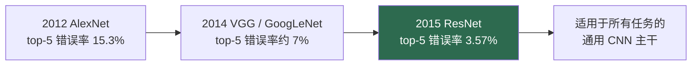

# 深度学习革命（2012–2015）

> **英文原文：** [cv-knowledge-base/01_history/02_deep_learning_revolution.md](../../cv-knowledge-base/01_history/02_deep_learning_revolution.md)（本中文版供参考，内容以英文原文为准）

> **最后更新：** 2026年10月
> **难度级别：** 基础
> **相关章节：**
> - [时间线概览](./00_timeline_overview.md)
> - [深度学习之前的时代](./01_pre_deep_learning.md)
> - [CNN 架构](../03_architectures/00_cnn_architectures.md)
> - [检测与分割时代](./03_detection_segmentation_era.md)

> **🆕 2026年10月更新：**
> - 新增章节 **“十年之后：认可与保存（2025–2026）”**：CVPR Longuet-Higgins 奖授予了 GoogLeNet（2025）和 ResNet（2026）；ICCV 2025 Helmholtz 奖授予了 He 等人的 PReLU 论文（*Delving Deep into Rectifiers*）。
> - 记录了 2025 年 3 月计算机历史博物馆（Computer History Museum）与 Google 公开发布 AlexNet 原始源代码一事。
> - 在关键论文中加入 *Delving Deep into Rectifiers*（PReLU / He 初始化），并新增延伸阅读链接。

---

## 概述

计算机视觉中的深度学习革命通常被追溯到一个单一事件：AlexNet 在 ILSVRC-2012 ImageNet 挑战赛中的胜利，它将 top-5 错误率从亚军的 26.2% 降到 15.3%——这一差距之大，使整个领域在十八个月内完成了重组。但"革命"的说法掩盖了一个更深层的故事：三个各自独立成熟的使能条件的汇合。第一，**数据**：ImageNet [Deng2009] 拥有覆盖 1000 个类别的 120 万张带标签训练图像，规模足以训练高容量模型而不发生灾难性过拟合。第二，**算力**：可编程 GPU（AlexNet 在两块各有 3 GB 显存的 GTX 580 上训练）使深层网络的反向传播变得可行。第三，**算法改进**：ReLU 激活、dropout 正则化和大规模数据增强，它们共同稳定了比上一代深得多的网络的训练。

随后是深度的快速攀升，以及对使深度可训练的架构基元的探索。VGG 证明了将小型 3×3 卷积堆叠到很深是可行的；GoogLeNet 引入了多分支 Inception 模块以提升参数效率；而 ResNet [He2016] 用残差连接解决了退化问题，使 152 层网络成为可能，并以 3.57% 的集成 top-5 错误率赢得 ILSVRC-2015——超过了估计的人类水平。到 2015 年，手工特征（SIFT、HOG；参见[深度学习之前的时代](./01_pre_deep_learning.md)）已被全面取代，卷积主干网络成为所有下游任务的通用基底。本文叙述这四年的转变及其所凝练出的架构思想（技术细节见 [CNN 架构](../03_architectures/00_cnn_architectures.md)）。

---

## AlexNet 与 2012 时刻

**AlexNet** [Krizhevsky2012]（NeurIPS 2012）是一个在 ImageNet 上训练的 8 层 CNN（5 个卷积层 + 3 个全连接层，约 6000 万参数）。它的创新单独来看并不那么新颖，但组合起来却具有决定性：**ReLU** 非线性（比 tanh/sigmoid 收敛更快）、**dropout**（抑制全连接层的过拟合）、**重叠最大池化**、**局部响应归一化**、激进的**数据增强**（裁剪、翻转、PCA 颜色抖动），以及双 GPU 模型并行实现。15.3% 的 top-5 错误率对比第二名（Fisher 向量方法）的 26.2%，这一实证冲击改变了整个领域的方向。业界普遍吸取的教训是：只要有足够的数据和算力，*学习得到的*层次化特征就会胜过工程化特征。

## 走向更深：VGG 与 Inception

**VGGNet** [Simonyan2015]（ICLR 2015）用统一的 **3×3 滤波器**堆叠替代大卷积核，表明小感受野下的深度（16–19 层）能提升精度（VGG-19 达到约 92.7% 的 top-5 准确率），同时保持设计的统一性——代价是约 1.38 亿参数。**GoogLeNet/Inception** [Szegedy2015]（CVPR 2015）通过 **Inception 模块**解决参数效率问题：并行的 1×1、3×3、5×5 卷积和池化，并用 1×1 瓶颈卷积控制计算成本。它以 22 层赢得 ILSVRC-2014（top-5 错误率 6.67%），参数量比 VGG 少约 12 倍。

## 残差突破：ResNet

继续堆叠更多层最终会使训练精度*退化*——这是优化困难的迹象，而非过拟合。**ResNet** [He2016]（CVPR 2016）用**残差连接**解决了这一问题，将每个块重新表述为学习一个加到其输入上的残差 `F(x)`：

```
y = F(x, {W_i}) + x        # 恒等捷径
# 梯度可直接经由 +x 路径流动，从而简化优化
```

这使 50/101/152 层网络的稳定训练成为可能；ResNet 集成以 **3.57% 的 top-5 错误率**赢得 ILSVRC-2015。残差连接成为整个深度学习中最具影响力的基元之一，后来也成为 Transformer 的核心组成部分。

在 GoogLeNet 与 ResNet 之间，还有一篇来自同一团队、不那么出名但同样举足轻重的论文：**Delving Deep into Rectifiers** [He2015]（ICCV 2015）提出了参数化 ReLU（PReLU）以及针对 ReLU 网络的方差保持型"He"（Kaiming）初始化，并报告了 ImageNet 上 4.94% 的 top-5 错误率——这是第一个低于 ILSVRC 分析中约 5.1% 人类错误率估计的结果。He 初始化至今仍是深度学习框架中的默认设置之一。



---

## 十年之后：认可与保存（2025–2026）

上述论文在发表十年后的 2025–2026 年获得了正式的"时间检验"评判。IEEE PAMI 技术委员会的 **Longuet-Higgins 奖**（在 CVPR 上授予十年前的 CVPR 论文）于 2025 年授予了 GoogLeNet《Going Deeper with Convolutions》与 FCN，于 2026 年授予了 ResNet《Deep Residual Learning for Image Recognition》与 YOLO。每两年颁发一次的 **Helmholtz 奖**在 ICCV 2025 上授予了 *Delving Deep into Rectifiers*（He、Zhang、Ren、Sun）以及 Fast R-CNN。这个时代的奠基性"文物"也得到了保存：2025 年 3 月，计算机历史博物馆与 Google 合作，公开发布了由 Krizhevsky 编写的 2012 年 AlexNet 原始源代码，使引发这场革命的代码作为历史档案得以公开。

这些认可提醒我们，2012–2015 年的工具箱有多少仍存活在 2026 年的系统中：残差连接存在于每一个 ViT 和扩散 Transformer 之中，He 初始化仍是 ReLU 系列层在框架中的默认设置，而 ResNet 主干在已部署模型和边缘模型中依然常见。

---

## 关键论文

| 论文 | 作者 | 年份 | 会议/期刊 | 主要贡献 |
|-------|---------|------|-------|-----------------|
| ImageNet | Deng, Dong, Socher, et al. | 2009 | CVPR | 促成这场革命的数据集 |
| AlexNet | Krizhevsky, Sutskever, Hinton | 2012 | NeurIPS | 深度 CNN 赢得 ImageNet；ReLU/dropout/GPU |
| VGGNet | Simonyan, Zisserman | 2015 | ICLR | 由堆叠 3×3 卷积构成的极深网络 |
| GoogLeNet/Inception | Szegedy, Liu, Jia, et al. | 2015 | CVPR | 多分支 Inception 模块；高效率 |
| ResNet | He, Zhang, Ren, Sun | 2016 | CVPR | 残差连接；152 层网络的训练 |
| Batch Normalization | Ioffe, Szegedy | 2015 | ICML | 支持更快/更深训练的归一化方法 |
| Delving Deep into Rectifiers (PReLU) | He, Zhang, Ren, Sun | 2015 | ICCV | PReLU + He 初始化；top-5 错误率 4.94%，低于估计的人类错误率；2025 年 Helmholtz 奖 |

---

## 影响与局限

| 方面 | 影响 | 局限 |
|--------|--------|------------|
| 学习得到的特征 | 在所有任务上取代了 SIFT/HOG | 需要大规模标注数据 + GPU |
| 深度 | 精度随深度提升（直到 ResNet） | 在残差连接出现之前存在退化问题 |
| 迁移学习 | ImageNet 预训练成为通用做法 | 偏向类似 ImageNet 的数据分布 |
| 可复现性 | 开放的架构/权重加速了领域发展 | 算力门槛使研究趋于集中 |

---

## 开放问题与研究空白（这个时代遗留的未解问题）

- **样本效率。** CNN 需要数百万标签；向自监督学习的转变（参见[自监督学习](../03_architectures/03_self_supervised_learning.md)）多年后才解决了这一问题。
- **归纳偏置的刚性。** 硬编码的局部性/平移等变性限制了对长程/全局结构的建模——这推动了 Transformer 的出现（参见 [Transformer 时代](./05_transformer_era.md)）。
- **可解释性。** 深度 CNN 为何能够泛化，过去（以及现在）都没有被很好地理解。
- **鲁棒性。** 对对抗扰动和分布偏移的脆弱性在这个时代被发现，至今仍未解决。
- **算力集中。** 对 GPU 规模的需求开启了前沿研究向资源充足的实验室集中的进程。
- **超越分类。** 将主干网络的提升转化到检测/分割需要新的架构（参见[检测与分割时代](./03_detection_segmentation_era.md)）。

---

## 延伸阅读

- [AlexNet (NeurIPS 2012)](https://papers.nips.cc/paper/2012/hash/c399862d3b9d6b76c8436e924a68c45b-Abstract.html) — 开启一切的论文
- [ResNet (arXiv:1512.03385)](https://arxiv.org/abs/1512.03385) — 深度残差学习
- [VGG (arXiv:1409.1556)](https://arxiv.org/abs/1409.1556) — 极深卷积网络
- [Batch Normalization (arXiv:1502.03167)](https://arxiv.org/abs/1502.03167) — 稳定深层训练
- [ImageNet (CVPR 2009)](https://www.image-net.org/) — 数据集
- [Delving Deep into Rectifiers (arXiv:1502.01852)](https://arxiv.org/abs/1502.01852) — PReLU 与 He 初始化
- [AlexNet source code (Computer History Museum, 2025)](https://github.com/computerhistory/AlexNet-Source-Code) — 为保存历史而发布的 2012 年原始代码
- [Longuet-Higgins Prize past awardees (IEEE PAMI TC)](https://tc.computer.org/tcpami/awards/longuet-higgins-prize/) — 时间检验奖，包括 GoogLeNet（2025）和 ResNet（2026）
