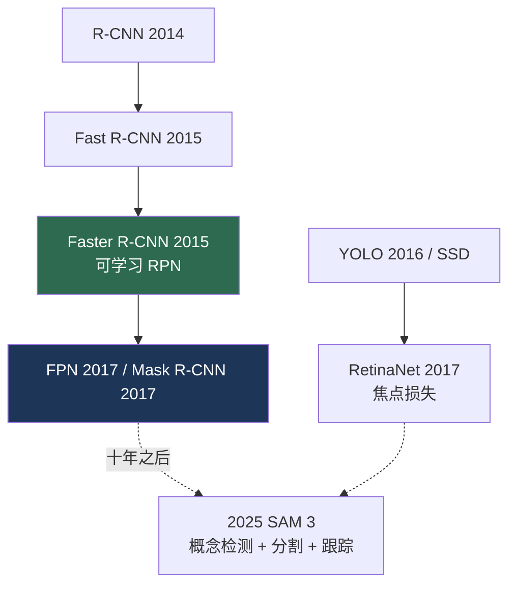

# 检测与分割时代（2013–2018）

> **英文原文：** [cv-knowledge-base/01_history/03_detection_segmentation_era.md](../../cv-knowledge-base/01_history/03_detection_segmentation_era.md)（本中文版供参考，内容以英文原文为准）

> **最后更新：** 2026年10月
> **难度级别：** 基础
> **相关章节：**
> - [深度学习革命](./02_deep_learning_revolution.md)
> - [目标检测](../02_core_tasks/01_object_detection.md)
> - [语义分割](../02_core_tasks/02_semantic_segmentation.md)
> - [实例分割与全景分割](../02_core_tasks/03_instance_panoptic_segmentation.md)

> **🆕 2026年10月更新：**
> - 新增章节 **“十年之后：时间检验奖与后继者（2025–2026）”**：Faster R-CNN 获 NeurIPS 2025 时间检验奖；Fast R-CNN 获 ICCV 2025 Helmholtz 奖；FCN（2025）和 YOLO（2026）获 CVPR Longuet-Higgins 奖。
> - 追溯了该时代的谱系如何延续到 2025–2026 年的基础模型：SAM 3 的可提示概念分割融合了开放词汇检测、实例分割和跟踪。
> - 在关键论文中加入 Fast R-CNN，并新增延伸阅读（NeurIPS 2025 获奖公告、Kaiming He 的演讲、SAM 3）。

---

## 概述

当深度 CNN 解决了分类问题后，领域的注意力转向了*定位*：不仅是"这张图像里有什么"，而是"什么东西在哪里、范围有多大"。这个时代——大致从 2013 年到 2018 年——将 CNN 主干网络的表示能力转化为稠密的、具有空间结构的预测，产生了支撑当今几乎所有应用视觉部署（自动驾驶、医学影像、机器人感知）的检测与分割系统。其思想脉络从**区域候选流水线**（R-CNN 的外部候选 + CNN 分类）走向**端到端学习的检测器**（Faster R-CNN 的可学习区域候选网络），从粗略的框预测走向**像素级精确的掩码**（FCN、U-Net、Mask R-CNN）。

两种架构上的张力组织了这一时期。第一是**两阶段与单阶段检测**之争：两阶段方法（R-CNN 谱系）先提议后分类以追求精度；单阶段方法（YOLO、SSD、RetinaNet）直接预测以追求速度，而 RetinaNet 的焦点损失（focal loss）弥合了大部分精度差距。第二是**分割任务的统一**：语义分割（逐像素类别）、实例分割（逐物体掩码）和全景分割（两者兼有）最初需要不同的架构，这种割裂直到后来的掩码分类 Transformer 出现才得以解决。本文叙述其发展谱系；技术细节见[目标检测](../02_core_tasks/01_object_detection.md)、[语义分割](../02_core_tasks/02_semantic_segmentation.md)和[实例分割与全景分割](../02_core_tasks/03_instance_panoptic_segmentation.md)。

---

## 检测谱系

**R-CNN** [Girshick2014]（CVPR 2014）对每幅图像约 2000 个选择性搜索区域候选应用 CNN——精确但缓慢（每个区域独立进行前向传播）。**Fast R-CNN** [Girshick2015]（ICCV 2015）通过在单一特征图上进行 RoI 池化实现计算共享。**Faster R-CNN** [Ren2015]（NeurIPS 2015）用可学习的**区域候选网络（RPN）**取代了选择性搜索，使检测接近端到端，并确立了两阶段的模板。**FPN** [Lin2017a]（CVPR 2017）增加了用于多尺度检测的特征金字塔。

与此同时，**单阶段**检测器优先考虑速度：**YOLO** [Redmon2016]（CVPR 2016）将检测表述为在网格上的单一回归；**SSD** 增加了多尺度锚框。精度差距被归因于前景-背景类别不平衡，**RetinaNet** [Lin2017b]（ICCV 2017）用**焦点损失**解决了这一问题：

```
FL(p_t) = -α_t (1 - p_t)^γ log(p_t)
# 降低简单负样本的权重（γ>0），使学习聚焦于困难样本
```

## 分割谱系

**FCN** [Long2015]（CVPR 2015）使分割全卷积化，用上采样取代全连接层以生成稠密的逐像素预测。**U-Net** [Ronneberger2015]（MICCAI 2015）增加了对称的编码器-解码器跳跃连接，成为医学影像的主导架构（参见[医学影像](../08_medical_and_scientific_cv/00_medical_imaging.md)）。**DeepLab** 系列引入了空洞（膨胀）卷积和 ASPP 以获取多尺度上下文。**Mask R-CNN** [He2017]（ICCV 2017）在 Faster R-CNN 上扩展了并行的掩码头，在一个模型中统一了检测与实例分割——这是该时代最具代表性的实例分割系统。



---

## 十年之后：时间检验奖与后继者（2025–2026）

在 2025 年至 2026 年间，这个时代的几乎每一根支柱都获得了十年回顾奖项。在 **NeurIPS 2025** 上，时间检验奖授予了 **Faster R-CNN**（Ren、He、Girshick、Sun），NeurIPS 委员会指出该论文已被引用超过 56,700 次，并成为大量后续工作的基础；它的核心贡献——用可学习的区域候选网络取代手工设计的区域候选——正是上文所述从流水线走向端到端学习的那一步。获奖公告还向已于 2022 年去世的合著者 Jian Sun 致以哀悼。Kaiming He 在圣地亚哥的会议上作了获奖报告 *A Brief History of Visual Object Detection*。在 **ICCV 2025** 上，Helmholtz 奖授予了 **Fast R-CNN**（Girshick）；在 **CVPR** 上，Longuet-Higgins 奖授予了 **FCN**（2025）和 **YOLO**（2026），后者与 ResNet 共享。

这个时代的技术谱系也走到了一个自然的终点。**SAM 3** [Carion2026]（2025 年 11 月；ICLR 2026）在单个可提示模型中统一了该时代作为独立系统构建的能力：对某一概念所有实例的开放词汇*检测*、逐实例*掩码*，以及保持身份一致的*视频跟踪*；其"存在性头"（presence head）将识别与定位分离，呼应了 RPN 的目标性（objectness）得分。与此同时，实时检测——YOLO 的遗产——作为一条快速发展的工程路线仍在延续，越来越多地建立在采用无 NMS 集合预测的 Transformer（DETR 风格）检测器之上（参见[目标检测](../02_core_tasks/01_object_detection.md)）。

---

## 关键论文

| 论文 | 作者 | 年份 | 会议/期刊 | 主要贡献 |
|-------|---------|------|-------|-----------------|
| R-CNN | Girshick, Donahue, Darrell, Malik | 2014 | CVPR | 在区域候选上使用 CNN 特征 |
| Fast R-CNN | Girshick | 2015 | ICCV | RoI 池化；计算共享；多任务损失（2025 年 Helmholtz 奖） |
| Faster R-CNN | Ren, He, Girshick, Sun | 2015 | NeurIPS | 可学习 RPN；接近端到端的两阶段检测（2025 年 NeurIPS 时间检验奖） |
| YOLO | Redmon, Divvala, Girshick, Farhadi | 2016 | CVPR | 实时单阶段检测 |
| RetinaNet (Focal Loss) | Lin, Goyal, Girshick, et al. | 2017 | ICCV | 焦点损失弥合单阶段检测的精度差距 |
| FCN | Long, Shelhamer, Darrell | 2015 | CVPR | 全卷积稠密预测 |
| Mask R-CNN | He, Gkioxari, Dollár, Girshick | 2017 | ICCV | 统一检测与实例分割 |

---

## 影响与局限

| 方面 | 影响 | 局限 |
|--------|--------|------------|
| 两阶段检测器 | 高精度；应用标准 | 速度慢；多阶段训练复杂 |
| 单阶段检测器 | 实时部署 | 在焦点损失出现前精度较低 |
| 稠密分割 | 像素级精确感知 | 计算量大；边界误差 |
| 基于锚框的设计 | 强先验 | 对超参数敏感；后来被无锚框/DETR 取代 |

---

## 开放问题与研究空白（这个时代遗留的未解问题）

- **手工设计的组件。** NMS、锚框和 RoI 操作都是不可微的启发式方法——直到后来才被 DETR 的集合预测去除（参见[目标检测](../02_core_tasks/01_object_detection.md)）。
- **任务割裂。** 语义/实例/全景分割需要各自独立的模型，直到掩码分类 Transformer 将其统一。
- **封闭词汇。** 检测器只能识别训练类别；开放词汇检测是后来才出现的（参见[开放词汇检测](../05_multimodal_vision_language/03_open_vocabulary_detection.md)）。
- **小目标与拥挤场景性能。** 尽管有 FPN，这仍是长期存在的薄弱环节。
- **标注成本。** 稠密掩码标注昂贵，推动了 SAM 等可提示模型的出现。
- **长尾识别。** 稀有类别检测（LVIS）仍远远落后于常见类别。
- **视频与时间范围。** 该时代的方法绝大多数基于图像；将检测和分割扩展到具有时间一致性的连贯视频目标跟踪，留给了后来的流式记忆架构（如 SAM 2）。
- **三维与非模态推理。** 框和掩码预测在图像平面内进行；恢复三维范围以及推理被遮挡的（非模态，amodal）物体部分，仍在该时代的标准流水线之外。

---

## 延伸阅读

- [Faster R-CNN (arXiv:1506.01497)](https://arxiv.org/abs/1506.01497) — 区域候选网络
- [Mask R-CNN (arXiv:1703.06870)](https://arxiv.org/abs/1703.06870) — 实例分割
- [Focal Loss / RetinaNet (arXiv:1708.02002)](https://arxiv.org/abs/1708.02002) — 稠密检测
- [FCN (arXiv:1411.4038)](https://arxiv.org/abs/1411.4038) — 全卷积分割
- [U-Net (arXiv:1505.04597)](https://arxiv.org/abs/1505.04597) — 生物医学分割
- [Fast R-CNN (arXiv:1504.08083)](https://arxiv.org/abs/1504.08083) — RoI 池化与计算共享
- [NeurIPS 2025 Test of Time Award: Faster R-CNN](https://blog.neurips.cc/2025/11/26/announcing-the-test-of-time-paper-award-for-neurips-2025/) — 获奖公告与回顾
- [Kaiming He — "A Brief History of Visual Object Detection" (NeurIPS 2025 talk)](https://slideslive.com/39055696/test-of-time-award-a-brief-history-of-visual-object-detection) — 关于这一时代的第一手历史
- [SAM 3: Segment Anything with Concepts (arXiv:2511.16719)](https://arxiv.org/abs/2511.16719) — 通过概念提示统一检测、分割与跟踪
