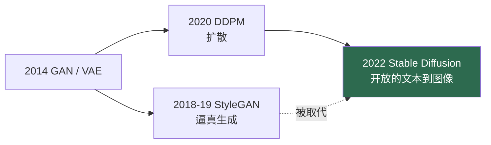

# 生成时代（2014–2022）

> **英文原文：** [cv-knowledge-base/01_history/04_generative_era.md](../../cv-knowledge-base/01_history/04_generative_era.md)（本中文版供参考，内容以英文原文为准）

> **最后更新：** 2026年10月
> **难度级别：** 基础
> **相关章节：**
> - [检测与分割时代](./03_detection_segmentation_era.md)
> - [GAN 与 VAE](../10_generative_vision/00_gans_and_vaes.md)
> - [扩散模型](../10_generative_vision/01_diffusion_models.md)
> - [Transformer 时代](./05_transformer_era.md)

> **🆕 2026年10月更新：**
> - 新增章节 **“遗产：从图像合成到世界模拟（2024–2026）”**：该时代奠基论文获得的时间检验认可（ICLR 2024 授予 VAE；NeurIPS 2024 授予 GAN），以及其思想如何延续到 2025–2026 年的视频生成器（Veo 3、Sora 2）和交互式世界模型（Genie 3、Waymo World Model）。
> - 新增一个开放问题（生成模型作为经过验证的模拟器）以及新的延伸阅读链接。

---

## 概述

生成时代从 2014 年生成对抗网络的发明延续到 2022 年潜在扩散模型的普及，它将计算机视觉从一门判别式学科（将图像映射到标签）重塑为一门生成式学科（对图像分布本身进行建模与合成）。这一转变影响深远：生成模型既成为创作工具（被数百万人使用的文本到图像系统），也成为科学工具（逆问题的学习先验、机器人训练的模拟器、世界模型）。这个时代由一系列相继的生成范式组织起来——GAN、VAE、自回归模型和扩散模型——它们在样本质量、多样性、训练稳定性和似然可处理性之间各有不同的取舍。

主导叙事是 **GAN 的兴起与被取代**。从 2014 年到约 2021 年，对抗训练产生了最逼真的图像（以 StyleGAN 近乎完美的人脸为巅峰），但 GAN 以训练不稳定和易发生模式坍塌而著称。从 2020 年的 DDPM 开始，并随着 2022 年潜在扩散模型而加速，**扩散模型**凭借稳定的基于似然的训练、更优的多样性和模式覆盖以及天然的条件控制能力超越了 GAN——代价是缓慢的迭代采样。到 2022 年，Stable Diffusion 的开放发布使高质量文本到图像生成变得人人可用，为基础模型时代奠定了基础。本文叙述这些范式的更替；技术细节见 [GAN 与 VAE](../10_generative_vision/00_gans_and_vaes.md) 和[扩散模型](../10_generative_vision/01_diffusion_models.md)。

---

## GAN 谱系

**GAN** [Goodfellow2014]（NeurIPS 2014）将生成表述为生成器 `G` 与判别器 `D` 之间的极小极大博弈：

```
min_G max_D  E_{x~p_data}[log D(x)] + E_{z~p_z}[log(1 - D(G(z)))]
```

**DCGAN** 用卷积架构稳定了训练；**WGAN/WGAN-GP** 通过 Wasserstein 距离提升了稳定性；**Progressive GAN** 和 **StyleGAN** 系列 [Karras2019] 借助具有解耦潜空间的基于风格的生成器，实现了前所未有的逼真度。**条件 GAN**（pix2pix、CycleGAN）实现了配对和非配对的图像到图像转换。然而训练不稳定和模式坍塌始终是顽疾。

## VAE 与自回归模型

**VAE** [Kingma2014]（ICLR 2014）提供了一种基于似然的替代方案，优化证据下界（ELBO）：

```
L = E_q(z|x)[log p(x|z)] - D_KL(q(z|x) || p(z))
```

VAE 训练稳定、潜空间有用，但样本较为模糊。**VQ-VAE/VQ-VAE-2** 引入了离散潜变量，**VQGAN** 将其与对抗损失和感知损失相结合，使在图像 token 上运行自回归 Transformer 成为可能——这是通往 Transformer 时代的桥梁。

## 扩散模型的接管

**DDPM** [Ho2020]（NeurIPS 2020）将生成重新表述为学习逆转一个逐步加噪的过程，训练网络预测所添加的噪声。**潜在扩散 / Stable Diffusion** [Rombach2022]（CVPR 2022）将扩散移入压缩的 VAE 潜空间，大幅削减了计算量，使高分辨率文本到图像合成成为可能。它在 2022 年的开放发布，与 DALL·E 2 和 Imagen 一道，标志着生成式视觉成为一项大众技术。



---

## 遗产：从图像合成到世界模拟（2024–2026）

这个时代的奠基论文在十年后得到了正式认可。**VAE** 论文（Kingma 与 Welling）于 2024 年获得首届 **ICLR 时间检验奖**，**Generative Adversarial Nets**（Goodfellow 等）则与 Seq2Seq 共同获得 **NeurIPS 2024 时间检验奖**。这些认可到来之时，上文所述的范式更替已经完全尘埃落定：GAN 主要以*对抗损失*的形式存活于潜在自编码器和少步扩散蒸馏之中，VAE 则成为几乎所有现代扩散模型与流模型运行所在的*潜空间*，而扩散本身也已在很大程度上从 U-Net 迁移到扩散/流匹配（flow matching）Transformer（参见[扩散模型](../10_generative_vision/01_diffusion_models.md)）。

该时代开启的雄心——将视觉分布建模到足以*模拟*它的程度——在 2025–2026 年变得具体可见。Google 的 **Veo 3**（2025 年，可原生生成音频）和 OpenAI 的 **Sora 2**（2025 年 9 月）等视频生成器实现了广泛的公众可用性，生成模型也跨入了*交互式模拟*：**Genie 3**（2025 年 8 月）能够实时生成可导航的环境，而基于 Genie 3 的 **Waymo World Model**（2026 年 2 月）能够为罕见驾驶场景生成相机和激光雷达数据，用于测试自动驾驶车辆。因此，下文列出的"从图像到世界模型"这一开放问题已不再是推测；它如今是一个工程与验证问题（参见[基础模型时代](./06_foundation_model_era.md)和[世界模型](../06_robotics_and_embodied_ai/02_world_models.md)）。

---

## 关键论文

| 论文 | 作者 | 年份 | 会议/期刊 | 主要贡献 |
|-------|---------|------|-------|-----------------|
| GAN | Goodfellow, Pouget-Abadie, Mirza, et al. | 2014 | NeurIPS | 对抗式生成训练 |
| VAE | Kingma, Welling | 2014 | ICLR | 变分自编码器；ELBO 目标 |
| StyleGAN | Karras, Laine, Aila | 2019 | CVPR | 基于风格的生成器；逼真人脸 |
| DDPM | Ho, Jain, Abbeel | 2020 | NeurIPS | 去噪扩散概率模型 |
| Latent Diffusion (SD) | Rombach, Blattmann, Lorenz, et al. | 2022 | CVPR | 在 VAE 潜空间中扩散；Stable Diffusion |
| VQGAN | Esser, Rombach, Ommer | 2021 | CVPR | 离散 token + Transformer 用于图像合成 |

---

## 影响与局限

| 方面 | 影响 | 局限 |
|--------|--------|------------|
| GAN | 逼真合成；图像编辑 | 训练不稳定；模式坍塌 |
| VAE | 稳定、有原则的潜变量 | 样本模糊 |
| 扩散模型 | 最先进的质量 + 多样性；可控 | 迭代采样缓慢 |
| 开放发布（SD） | 生成能力的普及 | 滥用：深度伪造、版权、偏见 |

---

## 开放问题与研究空白（这个时代遗留的未解问题）

- **采样速度。** 扩散模型的迭代采样推动了蒸馏和流匹配的发展（参见[扩散模型](../10_generative_vision/01_diffusion_models.md)）。
- **评估。** FID/IS 不能完美地反映质量；忠实的、组合性的指标仍是开放问题（参见[评估与安全](../10_generative_vision/04_evaluation_and_safety.md)）。
- **可控性。** 精确的空间/结构控制（ControlNet）是后来才加入的。
- **安全与溯源。** 深度伪造、记忆化和版权问题仍未解决。
- **组合式生成。** 将属性正确绑定到物体上仍不完美。
- **从图像到世界模型。** 将生成扩展到物理一致的视频/三维，直接推动了机器人前沿的发展（参见[世界模型](../06_robotics_and_embodied_ai/02_world_models.md)）。
- **似然与质量。** GAN 能生成清晰样本但没有可处理的似然；VAE 有似然但样本模糊；扩散模型只部分调和了两者，一个同时具备高质量、快速且有似然原则的单一模型仍难以实现。
- **条件保真度。** 忠实遵循复杂的、多物体的、具有空间约束的提示——而不是生成看似合理却错误的组合——在这个时代尚未解决，并推动了随后的可控生成研究。
- **生成模型作为经过验证的模拟器（2026 年视角）。** 既然生成的视频和多传感器数据已被用于测试自主系统，这个时代薄弱的评估工具（FID/IS）显然已不够用：需要的是证明学习得到的分布中*罕见*模式在物理上是忠实的——这是 GAN 时代的模式坍塌研究提出过但从未回答的问题。

---

## 延伸阅读

- [GAN (arXiv:1406.2661)](https://arxiv.org/abs/1406.2661) — 生成对抗网络
- [StyleGAN (arXiv:1812.04948)](https://arxiv.org/abs/1812.04948) — 基于风格的生成
- [DDPM (arXiv:2006.11239)](https://arxiv.org/abs/2006.11239) — 去噪扩散
- [Latent Diffusion (arXiv:2112.10752)](https://arxiv.org/abs/2112.10752) — 高分辨率合成
- [VAE (arXiv:1312.6114)](https://arxiv.org/abs/1312.6114) — 自编码变分贝叶斯
- [The Waymo World Model (Feb 2026)](https://waymo.com/blog/2026/02/the-waymo-world-model-a-new-frontier-for-autonomous-driving-simulation) — 被用作驾驶模拟器的生成模型
- [Project Genie (Jan 2026)](https://blog.google/innovation-and-ai/models-and-research/google-deepmind/project-genie/) — Genie 3 交互式世界模型原型
