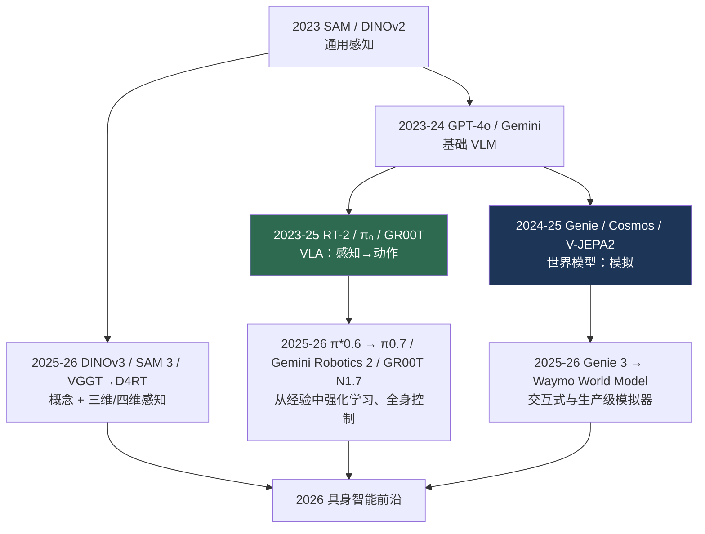

# 基础模型时代（2023–2026）

> **英文原文：** [cv-knowledge-base/01_history/06_foundation_model_era.md](../../cv-knowledge-base/01_history/06_foundation_model_era.md)（本中文版供参考，内容以英文原文为准）

> **最后更新：** 2026年10月
> **难度级别：** 基础
> **相关章节：**
> - [Transformer 时代](./05_transformer_era.md)
> - [VLA 模型](../06_robotics_and_embodied_ai/01_vla_models.md)
> - [最新进展](../12_research_frontier_2024_2026/00_overview_latest.md)
> - ["Anything" 模型范式](../12_research_frontier_2024_2026/02_any_model_paradigm.md)

> **🆕 2026年10月更新：**
> - 通用感知扩展到**概念**和**三维**：SAM 3（可提示概念分割，2025 年 11 月；ICLR 2026）、SAM 3D、DINOv3（7B 自监督主干，2025 年 8 月），以及前馈式三维/四维重建（VGGT → D4RT，分别为 CVPR 2025 和 CVPR 2026 最佳论文）。
> - 具身方面：π0.5 → 采用 RECAP 的 π\*0.6（基于机器人自身经验的强化学习，2025 年 11 月）→ π0.7（2026 年 4 月）；Gemini Robotics 1.5 / ER 1.5（2025 年 9 月）→ Gemini Robotics 2 / ER 2（2026 年 7 月，人形机器人全身控制）；采用 Cosmos-Reason 主干的 GR00T N1.6 → N1.7。
> - 世界模型走向交互化与产业化：V-JEPA 2（2025 年 6 月）、Genie 3（2025 年 8 月）→ Project Genie（2026 年 1 月）→ Waymo World Model（2026 年 2 月）；AMI Labs 的 10.3 亿美元种子轮融资（2026 年 3 月）。
> - 新增关于 2025–2026 年里程碑的小节，更新了 Mermaid 谱系图，关键论文表新增六行，影响表新增两行，新增三个开放问题以及新的延伸阅读。

---

## 概述

基础模型时代由一个单一的组织思想所定义：不再训练特定于任务的模型，而是训练一个大型的、经过广泛预训练的模型，通过提示或轻量微调迁移到开放范围的任务上。在视觉领域，这表现为**通用感知基元**（用于分割的 SAM、用于深度的 Depth Anything、用于特征的 DINOv2）、吸收了几乎所有图像理解任务的**基础视觉-语言模型**（GPT-4V、Gemini、InternVL），以及——对该领域发展轨迹影响最深远的——将基础模型从*感知*扩展到*动作*（VLA）和*预测*（世界模型）。这个时代的重心从"识别世界"转向"在世界中行动并模拟世界"，使机器人与具身智能（Embodied AI）成为前沿（参见 [VLA 模型](../06_robotics_and_embodied_ai/01_vla_models.md)和[最新进展](../12_research_frontier_2024_2026/00_overview_latest.md)）。

这个时代有三个结构性特征。第一，**可提示性与零样本迁移**：SAM 能分割所指向的"任何东西"，将几何任务与语义解耦（参见 ["Anything" 模型范式](../12_research_frontier_2024_2026/02_any_model_paradigm.md)）。第二，**数据引擎**：模型与标注协同演化（SAM 的 SA-1B 包含 11 亿个掩码，是以模型在环方式自举构建的），使瓶颈从架构转移到数据。第三，**具身化与融合**：视觉、语言和控制被整合进统一模型（RT-2、π₀、Gemini Robotics），生成式视频成为用于训练智能体的*世界模拟器*（Genie、Cosmos）。本文叙述截至 2026 年 10 月仍在展开的这一时代；届时第四个特征已经显现——**部署后的学习**：VLA 开始利用自身经验通过强化学习得到改进，世界模型也被采纳为生产级模拟器。

---

## 通用感知基元

**SAM** [Kirillov2023]（ICCV 2023）引入了在十亿级掩码数据引擎上训练的可提示分割，能在新分布上零样本工作；**SAM 2** 将其扩展到视频。**Depth Anything V1/V2** [Yang2024] 通过大规模无标签数据，将相同的方法应用于单目深度估计。**DINOv2** [Oquab2023] 提供了无需微调即可跨任务使用的通用视觉特征。它们共同成为下游系统（包括机器人）现成的感知构件（参见[机器人感知](../06_robotics_and_embodied_ai/08_perception_for_robotics.md)）。

第二代基元（2025–2026）拓宽了*可以用什么来提示*以及*预测什么*：

- **DINOv3** [Simeoni2025]（arXiv:2508.10104，2025 年 8 月）将自蒸馏扩展到一个在约 17 亿张筛选图像上训练的 70 亿参数 ViT 教师模型。*Gram 锚定*（Gram anchoring）——将图像块特征的 Gram 矩阵向较早、更"干净"的检查点正则化——修复了长时间训练下稠密特征的退化问题，使单个冻结主干在稠密任务上也具有竞争力；该教师模型被蒸馏为 ViT-S 至 ViT-H+ 以及 ConvNeXt 变体。
- **SAM 3** [Carion2026]（arXiv:2511.16719，2025 年 11 月；ICLR 2026）引入了*可提示概念分割*（Promptable Concept Segmentation, PCS）：给定名词短语和/或图像示例，在图像和视频中分割并跟踪**每一个**匹配的实例。共享主干同时为图像级检测器和基于记忆的跟踪器提供特征；*存在性头*（presence head）将"该概念是否存在？"与"它在哪里？"分离开来。其数据引擎产生了约 400 万个唯一概念标签（含困难负样本）以及 SA-Co 基准；作者报告其在 PCS 上的精度约为以往系统的 2 倍。同时发布的 **SAM 3D** 将可提示方法带到了物体与人体的单图像三维重建。
- **前馈几何。** VGGT [Wang2025]（CVPR 2025 最佳论文）在一次前向传播中为多个视图回归相机、深度、点图和轨迹；CVPR 2026 最佳论文《Efficiently Reconstructing Dynamic Scenes One D4RT at a Time》（Google DeepMind、UCL、牛津大学）将其扩展到动态四维场景。由此，几何与分割和深度一样，成为一种可提示/前馈的基元，而不再是一条优化流水线。

## 基础视觉-语言模型

大型多模态模型——**GPT-4V → GPT-4o**、**Gemini 1.5/2.0**（100 万 token 的视频上下文）、**InternVL**、**Qwen-VL**——将 VQA、图像描述、OCR、视觉定位和推理纳入单一的提示驱动系统，并在 2025 年前弥合了开源与闭源之间的差距（参见[大型视觉-语言模型](../05_multimodal_vision_language/02_large_vision_language_models.md)）。2025–2026 年的新一代模型——**GPT-5**（2025 年 8 月）、**Gemini 3**（2025 年 11 月）以及开放权重的 **Qwen3-VL** 系列——使长视频理解、可操作 GUI 的视觉智能体，以及对图像的"思考"（测试时推理）成为标准能力；与此同时，生成式视频模型（具备原生音频的 **Veo 3**、**Sora 2**）成为多模态前沿的另一半。

## 从感知到动作与模拟

这个时代的决定性一步是将基础模型扩展到具身领域。**RT-2** [Brohan2023] 表明，在机器人数据上微调的网络预训练 VLM 能将互联网知识迁移到控制中；**π₀** 增加了用于灵巧操作的流匹配（flow matching）动作头；**Gemini Robotics** 和 **GR00T N1**（2025）为机器人带来了前沿模型能力和双系统架构。与此同时，**世界模型**——**Genie**（从视频生成可游玩的世界）、**Cosmos**（NVIDIA 的物理 AI 世界基础模型）、**V-JEPA 2**——将生成式视频变成了用于具身学习的模拟器和预测引擎（参见[世界模型](../06_robotics_and_embodied_ai/02_world_models.md)）。

### 2025–2026：从经验中学习，交互式世界

**策略。** Physical Intelligence 的 **π0.5**（2025）通过在异构数据上的联合训练，瞄准对未见过家庭环境的开放世界泛化；**π\*0.6**（2025 年 11 月）加入了 **RECAP**（*Reinforcement learning with Experience and Corrections via Advantage-conditioned Policies*，基于优势条件策略、利用经验与纠正的强化学习），将示范、专家纠正和自主执行整合进 π0.6 VLA 的优势条件训练中；该公司报告在困难任务（制作浓缩咖啡、叠衣服、组装纸箱）上吞吐量提升一倍以上，并可连续数小时自主运行——这些是公司自行公布的数据，而非独立评估。Google DeepMind 的 **Gemini Robotics 1.5** 和 **Gemini Robotics-ER 1.5**（2025 年 9 月）将控制拆分为一个可调用搜索等工具的具身推理规划器（ER 1.5，可通过 Gemini API 使用，据报道在 15 个具身推理基准上达到最先进水平）和一个仅向部分合作伙伴开放的 VLA 执行器。NVIDIA 的 **GR00T N1.6**（2025 年 10 月发布公告，约在 CES 2026 前后正式发布）将其 VLM 替换为内部的 **Cosmos-Reason-2B** 变体，并将扩散 Transformer 动作头的深度加倍（32 层 vs. 16 层），目标是让人形机器人能够同时进行移动与操作。2026 年前三个季度，这三条路线都在延续：Physical Intelligence 的 **π0.7**（2026 年 4 月）报告了组合式任务泛化的初步迹象；**GR00T N1.7** 改用 Cosmos-Reason2-2B 主干（Qwen3-VL 架构），并通过人类与机器人共享的相对末端执行器动作空间，额外在约 2 万小时的第一人称人类视频上进行预训练，以 Apache 2.0 许可发布；Google DeepMind 的 **Gemini Robotics 2**（2026 年 7 月 30 日发布）连同新的 **Gemini Robotics-ER 2** 规划器，将单一 VLA 从上半身操作扩展到人形机器人的*全身*控制，并在 Apptronik 的 Apollo 2 上进行了演示——DeepMind 自己也指出其运动速度仍有待提升。

**世界模型。** Meta 的 **V-JEPA 2**（2025 年 6 月）表明，一个在表示空间中进行预测的自监督视频模型，在少量机器人交互数据上进行后训练后，即可支持零样本规划；**V-JEPA 2.1** 于 2026 年 3 月接续发布。**Genie 3**（2025 年 8 月）能够实时生成可导航的世界（据报道约 24 fps、720p）；Google 于 2026 年 1 月 29 日以 **Project Genie** 的形式向美国 Google AI Ultra 订阅用户开放，并明确定位为研究原型而非游戏引擎。2026 年 2 月 6 日，Waymo 发布了 **Waymo World Model**，它基于 Genie 3 并针对驾驶进行了适配，可生成可控的多传感器（相机和激光雷达）输出，用于模拟车队数据中缺失的罕见事件——这是一个通用世界模型被改造为安全关键系统生产级模拟器的案例。NVIDIA 延续了 **Cosmos** 系列（Predict、Transfer 以及物理推理 VLM **Cosmos Reason**，NVIDIA 报告其下载量已超过一百万次），World Labs 则推出了用于生成持久、可编辑三维世界的 **Marble**。对非生成式世界模型的押注也获得了机构层面的分量：由 Yann LeCun（董事长）创立、Alexandre LeBrun 担任 CEO 的 **AMI Labs** 于 2026 年 3 月 10 日宣布完成 10.3 亿美元种子轮融资，用于构建在抽象表示空间中进行预测的 JEPA 风格模型。

---

## 关键论文

| 论文 | 作者 | 年份 | 会议/期刊 | 主要贡献 |
|-------|---------|------|-------|-----------------|
| Segment Anything (SAM) | Kirillov, Mintun, Ravi, et al. | 2023 | ICCV | 可提示分割 + 十亿级掩码数据引擎 |
| DINOv2 | Oquab, Darcet, Moutakanni, et al. | 2023 | TMLR | 通用自监督视觉特征 |
| Depth Anything V2 | Yang, Kang, Huang, et al. | 2024 | NeurIPS | 单目深度基础模型 |
| RT-2 | Brohan, Brown, Carbajal, et al. | 2023 | CoRL | VLA：网络知识迁移到机器人控制 |
| Genie | Bruce, Dennis, Edwards, et al. | 2024 | ICML | 从视频生成交互式环境 |
| Cosmos | NVIDIA | 2025 | arXiv | 面向物理 AI 的世界基础模型 |
| V-JEPA 2 | Assran et al. | 2025 | arXiv | 自监督视频世界模型；零样本机器人规划 |
| VGGT | Wang, Chen, Karaev, et al. | 2025 | CVPR（最佳论文） | 前馈多视图三维几何 |
| DINOv3 | Siméoni et al. | 2025 | arXiv | 7B 自监督主干；用于稠密特征的 Gram 锚定 |
| SAM 3: Segment Anything with Concepts | Carion et al. | 2026 | ICLR | 可提示概念分割；SA-Co 基准 |
| π\*0.6 (RECAP) | Physical Intelligence | 2025 | 技术报告 | 通过基于机器人自身经验与纠正的强化学习改进 VLA |
| Efficiently Reconstructing Dynamic Scenes One D4RT at a Time | Google DeepMind, UCL, Oxford | 2026 | CVPR（最佳论文） | 从视频进行前馈四维重建 |

---

## 影响与局限

| 方面 | 影响 | 局限 |
|--------|--------|------------|
| 可提示基元 | 开箱即用的零样本感知 | 仅限几何（SAM）；编码器笨重 |
| 基础 VLM | 一个模型完成所有理解任务 | 空间推理、幻觉、计算量 |
| VLA | 通用机器人控制 | 灵巧性/长时程能力有限；难以复现 |
| 世界模型 | 智能体的模拟器与数据引擎 | 物理合理性评估尚不成熟 |
| 概念级感知（SAM 3） | 一次提示即可完成开放词汇检测 + 分割 + 跟踪 | 歧义/组合式短语；模型笨重 |
| 交互式与生产级世界模型（Genie 3、Waymo WM） | 罕见事件模拟；可实时探索的世界 | 一致性仅维持分钟级；缺乏认证标准 |

---

## 开放问题与研究空白

- **空间智能。** 基础模型在度量/关系空间推理上仍会失败（参见[空间智能](../12_research_frontier_2024_2026/06_spatial_intelligence.md)）。
- **具身泛化。** 第 5 级的组合式、长时程机器人任务仍未解决（参见[优缺点与路线图](../06_robotics_and_embodied_ai/07_pros_cons_roadmaps.md)）。
- **机器人数据瓶颈。** 与文本/图像不同，动作数据稀缺且昂贵（参见[机器人数据与遥操作](../06_robotics_and_embodied_ai/09_robot_data_and_teleoperation.md)）。
- 面向控制的**世界模型评估**（物理合理性，而不仅仅是 FVD）。
- **效率。** 在边缘机器人上运行基础 VLA 仍是开放问题（参见[边缘部署](../09_efficiency_and_deployment/03_edge_deployment.md)）。
- 物理具身智能体的**安全与对齐**。
- **开放与封闭。** 开源势头与前沿实验室集中化之间的张力。
- **在模仿学习之上的强化学习。** π\*0.6 式的部署后强化学习带来了奖励设计、安全探索和可复现性问题，而共享基准很少。
- **认证学习得到的模拟器。** 当世界模型生成安全论证所依赖的罕见事件时（Waymo World Model），必须恰恰在这些事件上验证其保真度——这是一个尚未解决的方法论问题。
- **生成式与表示空间世界模型之争。** 生成像素的模拟器（Genie、Cosmos）与 JEPA 风格的潜空间预测器（V-JEPA 2、AMI Labs）代表了相互竞争的押注；目前还没有公认的、可用于在控制任务上比较二者的任务。

---

## 延伸阅读

- [Segment Anything (arXiv:2304.02643)](https://arxiv.org/abs/2304.02643) — 分割基础模型
- [RT-2 (arXiv:2307.15818)](https://arxiv.org/abs/2307.15818) — 视觉-语言-动作模型
- [Genie (arXiv:2402.15391)](https://arxiv.org/abs/2402.15391) — 生成式交互环境
- [Cosmos (arXiv:2501.03575)](https://arxiv.org/abs/2501.03575) — 面向物理 AI 的世界基础模型
- [DINOv2 (arXiv:2304.07193)](https://arxiv.org/abs/2304.07193) — 通用视觉特征
- [DINOv3 (arXiv:2508.10104)](https://arxiv.org/abs/2508.10104) — 采用 Gram 锚定的 7B 自监督主干
- [SAM 3 (arXiv:2511.16719)](https://arxiv.org/abs/2511.16719) — 基于概念的分割一切
- [V-JEPA 2 (arXiv:2506.09985)](https://arxiv.org/abs/2506.09985) — 用于理解、预测和规划的自监督视频模型
- [VGGT (arXiv:2503.11651)](https://arxiv.org/abs/2503.11651) — 前馈视觉几何
- [The Waymo World Model (Feb 2026)](https://waymo.com/blog/2026/02/the-waymo-world-model-a-new-frontier-for-autonomous-driving-simulation) — 将 Genie 3 用作驾驶模拟器
- [Project Genie (Jan 2026)](https://blog.google/innovation-and-ai/models-and-research/google-deepmind/project-genie/) — Genie 3 研究原型
- [NVIDIA open robotics models, incl. GR00T N1.6 and Cosmos Reason (Oct 2025)](https://investor.nvidia.com/news/press-release-details/2025/NVIDIA-Accelerates-Robotics-Research-and-Development-With-New-Open-Models-and-Simulation-Libraries/default.aspx) — 新闻稿
- [Gemini Robotics 2 (Google DeepMind, Jul 2026)](https://deepmind.google/blog/gemini-robotics-2-brings-whole-body-intelligence-to-robots/) — 全身人形机器人 VLA 与 ER 2 规划器
- [Isaac GR00T repository](https://github.com/NVIDIA/Isaac-GR00T) — GR00T N1.5 / N1.6 / N1.7 代码与发布说明
- [AMI Labs raises $1.03B to train world models (SiliconANGLE, Mar 2026)](https://siliconangle.com/2026/03/10/yann-lecuns-new-startup-ami-labs-raises-1-03b-train-world-models/) — LeCun 的世界模型实验室
