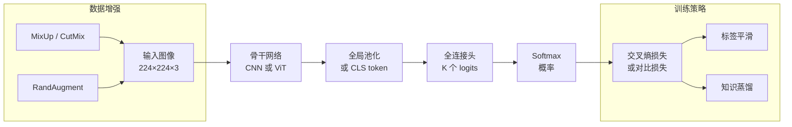

# 图像分类

> **英文原文：** [cv-knowledge-base/02_core_tasks/00_image_classification.md](../../cv-knowledge-base/02_core_tasks/00_image_classification.md)（本中文版供参考，内容以英文原文为准）

> **最后更新：** 2026年10月
> **难度级别：** 中级 → 高级
> **相关章节：** [CNN 架构](../03_architectures/00_cnn_architectures.md) · [视觉 Transformer](../03_architectures/01_vision_transformers.md) · [数据集与基准](../11_datasets_and_benchmarks/00_core_datasets.md) · [研究前沿](../12_research_frontier_2024_2026/00_overview_latest.md)

> **🆕 2026年10月更新：**
> - 新增 **DINOv3** [Simeoni2025]（Meta，2025年8月）：在 LVD-1689M 上以 Gram anchoring（Gram 锚定）训练的 70 亿参数自监督 ViT；冻结骨干的线性探测在 ImageNet-ReaL 上达到 90.4 %、在 ImageNet-R 上达到 91.1 %，并提供蒸馏得到的 ViT-S→H+ 与 ConvNeXt 学生模型。
> - 新增 **Web-SSL** [Fan2025]（在 20 亿图像的 MC-2B 语料上扩展到 70 亿参数的无语言自监督学习）与 **Perception Encoder** [Bolya2025]（PE-Core G/14：ImageNet-1k 零样本 85.4 %，ImageNet-A 92.6 %）。
> - 新增聚合式蒸馏（**C-RADIOv4**，2026，教师模型为 SigLIP2-g + DINOv3-7B + SAM 3）以及 YOLO26-cls 边缘端分类器。
> - 在关键论文、精度表和分布外（OOD）表中新增条目；新增关于前沿编码器蒸馏与基准饱和的开放问题；新增延伸阅读链接。

---

## 概述

图像分类是计算机视觉中最典型的监督学习任务：给定固定尺寸的图像张量 **x** ∈ ℝ^(H×W×C)，预测离散标签 **y** ∈ {1, …, K}。尽管看似简单，ImageNet 大规模视觉识别挑战赛（ILSVRC）[Russakovsky2015] 从 2012 年至今一直是每一次重大架构创新的主要试验场。该基准包含 1,000 个类别、128 万张训练图像，规模足以奖励深度过参数化模型，同时又易于处理，使其成为深度学习革命的理想实验载体。

ImageNet top-1 精度十年来的演进——从 2012 年 AlexNet 的 56.5 % 到现代基础模型（Foundation Model）超过 91 %——集中体现了架构设计（深度、跳跃连接、注意力）、训练方案（数据增强、正则化、自监督预训练）与规模（数据集大小、参数量、计算预算）之间的相互作用。每一代都推翻了此前的理论假设：跳跃连接表明表征深度并不必然意味着优化困难 [He2016]；EfficientNet 系列证明协调的复合缩放优于单独缩放宽度或深度 [Tan2019]；而视觉 Transformer [Dosovitskiy2020] 揭示出，只要有足够的数据或预训练，卷积特有的归纳偏置并非取得最先进视觉性能的必要前提。

当代图像分类研究同时在多个方向推进：(1) 通过标签平滑、MixUp、CutMix 和 RandAugment 实现数据高效训练；(2) 在自然类别频率不平衡下的长尾识别；(3) 通过视觉-语言对比预训练（CLIP [Radford2021]）实现零样本迁移；(4) 稠密自监督预训练（DINOv2 [Oquab2023]、DINOv3 [Simeoni2025]），其线性探测特征可媲美完全监督微调。到 2025–2026 年，前沿与其说由新的分类架构定义，不如说由 **70 亿参数级视觉编码器** 定义：DINOv3 与 Web-SSL [Fan2025] 表明，无语言的自监督学习（Self-Supervised Learning, SSL）在扩展后可以达到甚至超过 CLIP 式训练，而 Perception Encoder [Bolya2025] 则将对比学习的零样本精度推高到 ImageNet-1k 上约 85 %。"分类"与"表征学习"之间的概念边界已基本消融：现代分类器是下游稠密预测、检索与多模态推理的第一阶段特征提取器。

---

## ILSVRC 基准

**ImageNet** [Deng2009] 包含 21,841 个 WordNet 同义词集下的 1,400 万张图像。ILSVRC 分类挑战赛使用其中 1,000 个同义词集的子集：

- **训练集：** 1,281,167 张图像
- **验证集：** 50,000 张图像（每类 50 张）
- **测试集：** 100,000 张图像（标签不公开）
- **主要指标：** Top-1 精度（单裁剪，除非另有说明均为 224×224）
- **次要指标：** Top-5 精度（若真实标签位于前 5 个 logits 中即视为预测正确）

ILSVRC 上人类水平的 top-5 精度通常被引用为约 5.1 % 错误率（即 94.9 % 精度）[Russakovsky2015]，这一参考点已被 ResNet 和 Transformer 超越。

---

## 架构演进

### 卷积时代（2012–2019）

**AlexNet** [Krizhevsky2012] 确立了深度 CNN 的主导范式，使用五个卷积层、ReLU 激活、dropout，以及跨两块 GPU 的数据并行。它相对 2011 年冠军 10.9 个百分点的提升前所未有。

**VGGNet** [Simonyan2014] 系统地用 3×3 卷积堆叠取代大卷积核，表明由小感受野控制的深度（16–19 层）优于使用大卷积核的浅层网络。

**GoogLeNet / Inception v1** [Szegedy2015] 引入了 Inception 模块——并行的 1×1、3×3 和 5×5 卷积——以及全局平均池化，将参数量从 VGG 的 1.38 亿降至 680 万，同时取得了更低的错误率。

**ResNet** [He2016] 通过残差跳跃连接解决了退化问题（精度随深度增加而下降）：

```
# 残差块（预激活形式，He et al. 2016）
def residual_block(x, F):
    # F(x) 是需要学习的残差映射
    return F(x) + x    # 恒等捷径
```

ResNet-50/101/152 树立了新标准；ResNet-152 在 ILSVRC 2015 上取得了 19.38 % 的 top-5 错误率。

**DenseNet** [Huang2017] 将跳跃连接扩展为稠密连接：每一层都接收所有前序层的特征图，促进特征复用和梯度流动。

**EfficientNet** [Tan2019] 引入复合缩放：在固定计算预算下，以神经架构搜索得到的基础网络（EfficientNet-B0）为起点，联合缩放宽度、深度和输入分辨率。EfficientNet-B7 以 6,600 万参数在 ImageNet 上取得 84.3 % top-1。EfficientNetV2 [Tan2021] 在浅层用 Fused-MBConv 替换深度可分离卷积，在 ImageNet-21k 预训练下取得 87.3 % top-1。

**ConvNeXt** [Liu2022a] 按照 ViT 训练方案重新设计 ResNet-50——patch 化 stem、深度卷积、倒置瓶颈、GELU、LayerNorm——在不使用注意力的情况下缩小了与 Swin Transformer 的差距。ConvNeXt-XL 达到 87.8 % top-1。

### Transformer 时代（2020 至今）

**ViT** [Dosovitskiy2020] 将图像划分为不重叠的 16×16 或 14×14 patch，将每个 patch 线性嵌入为 token，在前面添加 [CLS] token，加入一维位置嵌入，并用标准 Transformer 编码器块处理该序列。在 JFT-300M（3 亿张图像）上预训练后，ViT-H/14 在 ImageNet 上达到 88.55 % top-1；ViT-L/16 达到 85.8 %。仅在 ImageNet 上训练时，由于归纳偏置不足，ViT 表现不如 CNN。

**Swin Transformer** [Liu2021] 引入移位窗口自注意力，将注意力限制在局部窗口内，并通过在层间移动窗口实现跨窗口通信，从而恢复了类似 CNN 各阶段的层次化特征图。Swin-L 达到 87.3 % top-1。

**DINOv2** [Oquab2023] 在精选的 1.42 亿张图像数据集上，结合寄存器 token（register tokens）与多裁剪增强，通过知识蒸馏提炼自监督 ViT 特征。ViT-g/14 在 ImageNet-1k 上取得 **86.5 % top-1 线性探测** 精度，与弱监督模型相当。DINOv2 特征无需微调即可很好地迁移到深度估计和分割等稠密预测任务。

### 前沿视觉编码器（2025–2026）

**DINOv3** [Simeoni2025]（Meta FAIR，arXiv 2508.10104，2025年8月）将 DINO 式自蒸馏扩展到 **ViT-7B/16（67 亿参数）**，在 **LVD-1689M**（一个精选的 17 亿图像网络语料；DINOv2 使用 1.42 亿）上训练。关键技术新增是 **Gram anchoring（Gram 锚定）**：在长训练周期中，超大模型的稠密 patch 特征会退化，尽管全局（CLS）指标仍在提升；Gram 锚定将学生模型的 patch 相似度（Gram）矩阵正则化到较早的"Gram 教师"检查点的 Gram 矩阵，从而保持局部特征质量。高分辨率适配阶段和事后蒸馏产生了从 ViT-S/16（2,100 万）到 ViT-H+/16（8.4 亿）的 ViT 学生模型和 ConvNeXt-T/S/B/L 学生模型，以及在 SAT-493M 上训练的卫星影像变体。根据官方模型卡，冻结的 ViT-7B 使用线性头在 **ImageNet-ReaL 上达到 90.4 %**、**ImageNet-R 上达到 91.1 %**、**ObjectNet 上达到 91.1 %**，同时在 ADE20K 上给出 55.9 mIoU 的线性探测分割结果——即一个冻结骨干同时服务于全局任务与稠密任务。

```latex
% Gram anchoring（示意）：X_S、X_G 分别为学生模型与 Gram 教师
% 经 L2 归一化的 patch 特征矩阵（P 个 patch × d 维）
\mathcal{L}_{\text{Gram}} = \left\| X_S X_S^{\top} - X_G X_G^{\top} \right\|_F^2
% 在后期"精炼"阶段加到 DINO/iBOT 目标之上
```

**Web-SSL** [Fan2025]（arXiv 2504.01017）在 20 亿图像的 MetaCLIP 语料 MC-2B 上（最多见过 80 亿样本）、*不使用任何语言监督*，训练了参数量从 3 亿到 70 亿的 Web-DINO 模型，表明视觉自监督学习会随规模持续提升，并能达到甚至超过 CLIP 式模型（尤其在 VQA 类多模态评测上），同时不牺牲经典分类性能——这削弱了"语义"特征必须依赖语言监督的假设。

**Perception Encoder（PE）** [Bolya2025]（Meta，arXiv 2504.13181）是一个对比训练的图像-视频编码器家族，其最佳中间层特征被分别对齐到语言（PE-lang）和空间任务（PE-spatial）。官方检查点报告 **PE-Core-G/14（448 px）：ImageNet-1k 零样本 85.4 %、ImageNet-v2 80.2 %、ImageNet-A 92.6 %、ObjectNet 88.2 %**，在零样本分类上超过 SigLIP 2。

**聚合式编码器。** NVIDIA 的 RADIO 系列将多个教师模型蒸馏到一个学生模型中；**C-RADIOv4**（技术报告 arXiv 2601.17237，2026）使用 SigLIP2-g-384、DINOv3-7B 和 SAM 3 作为教师，得到单个可商用许可的 ViT-SO400M / ViT-H 骨干，兼具类 CLIP 的零样本分类能力和类 DINO 的稠密特征。

**边缘端分类器。** 在另一端，Ultralytics 的 **YOLO26-cls** 模型（280 万–2,960 万参数）报告在 ImageNet 上 71.4–79.9 % 的 top-1 精度，在 T4（TensorRT）上延迟为 1.1–3.8 ms，表明紧凑的 CNN 式分类器在部署中依然重要。

---

## 训练技术

### 损失函数

标准分类使用带 softmax 归一化的交叉熵：

```latex
% 类别 k 的 Softmax 概率
p_k = \frac{\exp(z_k)}{\sum_{j=1}^{K} \exp(z_j)}

% 交叉熵损失
\mathcal{L}_{CE} = -\sum_{k=1}^{K} y_k \log p_k
```

**标签平滑**（Label smoothing）[Szegedy2016] 用软分布替代硬 one-hot 目标：

```latex
% 标签平滑后的目标
\tilde{y}_k = (1 - \varepsilon)\, y_k + \frac{\varepsilon}{K}

% 其中 \varepsilon \in [0.1, 0.2] 为平滑因子
% 这可防止过度自信并改善校准
```

### 数据增强

**MixUp** [Zhang2018] 对成对训练样本及其标签进行线性插值：

```latex
\tilde{x} = \lambda x_i + (1-\lambda) x_j, \quad
\tilde{y} = \lambda y_i + (1-\lambda) y_j, \quad
\lambda \sim \mathrm{Beta}(\alpha, \alpha)
```

**CutMix** [Yun2019] 从一张图像中裁下一个矩形区域并粘贴到另一张图像上，标签按面积比例混合：

```latex
\tilde{x} = \mathbf{M} \odot x_i + (1 - \mathbf{M}) \odot x_j, \quad
\tilde{y} = \lambda y_i + (1-\lambda) y_j
% 其中 \mathbf{M} 为二值掩码，\lambda 为裁剪面积比例
```

**RandAugment** [Cubuk2020] 随机应用 N 个增强操作序列，每个操作强度为 M，无需单独进行增强策略搜索。

**AugReg** [Touvron2021] 指将强数据增强（RandAugment、MixUp、CutMix、重复增强）与正则化（随机深度、标签平滑）结合，作为 ViT 的标准训练方式，使仅用 ImageNet 训练也能接近 JFT 预训练的性能。

---

## 长尾识别

自然图像分布服从幂律：高频类别的实例数比稀有类别多出几个数量级。应对策略包括：

- **类别均衡采样 / 重加权：** 对少数类过采样或提高其损失项权重
- **解耦训练** [Kang2020]：在均匀采样的数据上训练表征，然后单独对分类器进行重平衡
- **LDAM 损失** [Cao2019]：标签分布感知的间隔损失，为低频类别分配更大的间隔
- **Logit 调整** [Menon2021]：通过减去对数类别频率对 logits 进行事后校准

---

## 基于 CLIP 的零样本分类

CLIP [Radford2021] 在来自网络的 4 亿图文对上，用对比损失训练一个双编码器（图像编码器 + 文本编码器）。推理时，类别名称被嵌入为文本（"a photo of a {class}"），图像根据与所有类别嵌入的余弦相似度进行分类——**无需任何标注样本**。CLIP ViT-L/14@336px 在 ImageNet-1k 上取得 **76.2 % top-1** 零样本精度。这一范式将分类从封闭词汇的监督问题转变为开放词汇（open-vocabulary）的匹配问题。

---

## 关键论文

| 论文 | 作者 | 年份 | 会议/期刊 | 主要贡献 |
|-------|---------|------|-------|-----------------|
| ImageNet Large Scale Visual Recognition Challenge | Russakovsky et al. | 2015 | IJCV | 基准定义；人类水平基线 |
| AlexNet (ImageNet Classification with Deep CNN) | Krizhevsky, Sutskever, Hinton | 2012 | NeurIPS | 深度 CNN + ReLU + dropout；ILSVRC 首次突破 |
| Very Deep Convolutional Networks (VGGNet) | Simonyan, Zisserman | 2014 | ICLR | 以 3×3 卷积核系统性加深；16–19 层 |
| Deep Residual Learning (ResNet) | He, Zhang, Ren, Sun | 2016 | CVPR | 残差跳跃连接使 152 层网络成为可能 |
| EfficientNet: Rethinking Model Scaling | Tan, Le | 2019 | ICML | 基于 NAS 的宽度/深度/分辨率复合缩放 |
| An Image is Worth 16×16 Words (ViT) | Dosovitskiy et al. | 2020 | ICLR 2021 | 作用于图像 patch 的纯 Transformer；JFT 下 88.5 % |
| Swin Transformer | Liu et al. | 2021 | ICCV | 移位窗口注意力；层次化特征图 |
| Learning Transferable Visual Models (CLIP) | Radford et al. | 2021 | ICML | 对比式图像-语言预训练；零样本 |
| DINOv2: Learning Robust Visual Features | Oquab et al. | 2023 | TMLR | 自监督 ViT-g；ImageNet 线性探测 86.5 %；稠密迁移 |
| A ConvNet for the 2020s (ConvNeXt) | Liu et al. | 2022 | CVPR | 按 ViT 设计选择现代化改造 ResNet |
| Scaling Language-Free Visual Representation Learning (Web-SSL) | Fan, Tong et al. | 2025 | arXiv | 在网络数据上训练的 7B 自监督 ViT，无需语言即可匹敌 CLIP |
| Perception Encoder | Bolya, Huang et al. | 2025 | arXiv | 对比式图像/视频编码器；G/14 零样本 IN-1k 85.4 % |
| DINOv3 | Siméoni, Vo et al. | 2025 | arXiv | 7B 自监督 ViT，Gram 锚定；17 亿图像 LVD-1689M；全局与稠密特征俱佳 |
| C-RADIOv4 (tech report) | NVIDIA | 2026 | arXiv | 以 SigLIP2 + DINOv3 + SAM 3 为教师的聚合式蒸馏 |

---

## 基准性能：ImageNet Top-1 精度演进

| 模型 | 年份 | 参数量 | Top-1 (%) | Top-5 (%) | 备注 |
|-------|------|--------|-----------|-----------|-------|
| AlexNet | 2012 | 61 M | 56.5 | 80.2 | ILSVRC 2012 冠军；10 裁剪评估 |
| VGG-16 | 2014 | 138 M | 74.4 | 91.9 | 单尺度、单裁剪 |
| GoogLeNet / Inception-v1 | 2014 | 6.8 M | 74.8 | 92.2 | top-5 错误率 6.7 %；ILSVRC 冠军 |
| ResNet-50 | 2016 | 25 M | 75.3 | 92.2 | 单裁剪 224² |
| ResNet-152 | 2016 | 60 M | 77.0 | 93.3 | ILSVRC 2015 冠军（top-5 3.57 %） |
| DenseNet-264 | 2017 | 33 M | 77.9 | 93.9 | 稠密连接 |
| EfficientNet-B7 | 2019 | 66 M | 84.3 | 97.0 | NAS + 复合缩放 |
| EfficientNetV2-L (+ImageNet-21k) | 2021 | 120 M | 87.3 | 98.5 | Fused-MBConv；21k 预训练 |
| ViT-H/14 (+JFT-300M) | 2020 | 632 M | 88.6 | — | 纯 Transformer；大规模预训练 |
| Swin-L (+ImageNet-22k) | 2021 | 197 M | 87.3 | 98.2 | 移位窗口层次结构 |
| ConvNeXt-XL (+ImageNet-22k) | 2022 | 350 M | 87.8 | 98.8 | 卷积网络复兴 |
| DINOv2 ViT-g/14 (linear probe) | 2023 | 1.1 B | 86.5 | — | 仅自监督；无微调 |
| CLIP ViT-L/14@336px (zero-shot) | 2021 | 307 M | 76.2 | — | 零样本；未使用 ImageNet 标签 |
| PE-Core-G/14 @448px (zero-shot) | 2025 | — | 85.4 | — | Perception Encoder；零样本，官方检查点 |
| DINOv3 ViT-7B/16 (linear probe) | 2025 | 6.7 B | 90.4 (ReaL) | — | 仅自监督；冻结骨干；ImageNet-ReaL 标签 |
| YOLO26x-cls | 2026 | 29.6 M | 79.9 | 95.0 | 边缘端分类器；T4 TensorRT 3.8 ms |

---

## 基准性能：分布外鲁棒性

| 模型 | ImageNet-A (top-1 %) | ImageNet-R (top-1 %) | 备注 |
|-------|---------------------|---------------------|-------|
| ResNet-50 | 0.0 | 36.2 | 严重的分布外性能退化 |
| ViT-L/16 (JFT) | 49.0 | 77.1 | 鲁棒性更好 |
| DINOv2 ViT-L/14 | 59.9 | 78.7 | 精选预训练数据提升鲁棒性 |
| CLIP ViT-L/14 | 70.0 | 88.9 | 语言监督显著帮助分布外泛化 |
| DINOv3 ViT-7B/16 (linear) | — | 91.1 | 纯自监督模型的分布外鲁棒性已与语言监督模型相当（ObjectNet 91.1 %） |
| PE-Core-G/14 (zero-shot) | 92.6 | — | 对比学习；ObjectNet 88.2 % |

---

## 主要范式的优缺点

| 方面 | 优点 | 缺点 |
|--------|------|------|
| 基于 CNN（ResNet/EfficientNet） | 归纳偏置强；数据高效；推理快；机理清楚 | 全局上下文有限；超大规模下收益递减 |
| ViT / Swin Transformer | 全局注意力；随数据与算力扩展；迁移能力强 | 需要大量数据或预训练；内存占用高；注意力为二次复杂度 |
| 对比 / 自监督（CLIP、DINOv2） | 零样本泛化；无需任务特定标签；分布外鲁棒性强 | 预训练计算代价高；文本对齐可能遗漏细粒度概念 |
| 复合缩放（EfficientNet） | 有原则的缩放规则；每 FLOP 精度高 | NAS 搜索成本高；训练日程复杂 |
| 标签平滑 + MixUp/CutMix | 廉价，仅在训练时使用；稳定带来 +1–2 % 提升 | 超参数相互影响；预测更难解释 |
| 长尾重加权 | 应对真实世界的不平衡 | 权衡：稀有类的提升以牺牲高频类精度为代价 |
| 7B 级冻结编码器（DINOv3、Web-SSL、PE） | 一个骨干同时服务分类、稠密预测与多模态大模型；分布外鲁棒性达到最优；线性头即可 | 训练需要数千块 GPU 和精选的十亿级图像语料；部署依赖蒸馏后的学生模型 |

---

## Mermaid 图：分类流程



---

## 开放问题与研究空白

- **校准与精度：** 大型预训练模型 top-1 精度很高，但可能系统性地过度自信；温度缩放和事后校准仍不令人满意，尤其是在分布偏移下。
- **尾部类别的样本效率：** 尽管解耦训练与 logit 调整有所进展，在没有辅助数据或显式小样本机制的情况下，模型在训练样本少于约 20 个的类别上仍会灾难性失败。
- **对自然分布偏移的鲁棒性：** 监督 CNN 与语言监督模型（CLIP）在 ImageNet-A/R 上的差距表明，语义监督从根本上改变了表征几何结构，但其机制尚未被很好理解。
- **理解与纹理偏置：** CNN 表现出强烈的纹理偏置 [Geirhos2019]，而 ViT 对形状更敏感，但二者都未能完全复现人类的物体识别策略；解耦这些偏置仍是开放问题。
- **细粒度类别的可扩展零样本分类：** CLIP 类模型难以处理细粒度区分（物种、飞机型号），因为这些类别名称在网络文本中存在歧义或重叠；需要更好的文本条件化或层次化类别表示。
- **分类任务的高效缩放定律：** Chinchilla 式最优缩放定律 [Hoffmann2022] 已在语言模型上建立，但尚未系统地应用于纯视觉或视觉-语言分类；最优的数据:参数比例在经验上仍不明确。
- **事后标签分配与噪声监督：** ImageNet 本身包含不可忽视的标签噪声和多标签图像；在无法获得干净标签的情况下大规模地学习结构化噪声仍未解决。
- **基准饱和：** 随着冻结的 7B 编码器在 ImageNet-ReaL 及 ImageNet-R/ObjectNet 上超过 90 %，剩余错误越来越多地源于标签歧义而非模型失败；ImageNet 式 top-1 已无法区分前沿模型，而社区公认的"分类"后继基准仍然缺失。
- **前沿编码器的蒸馏：** DINOv3、PE 和 C-RADIOv4 都依赖将数十亿参数的教师蒸馏为可部署的学生模型；蒸馏后能保留多少稠密特征质量与分布外鲁棒性，以及如何平衡多个教师，仍主要依靠经验。
- **大规模下的稠密与全局权衡：** DINOv3 需要 Gram 锚定这一事实表明，在长时间、大规模训练中全局目标会损害 patch 特征；为何如此以及如何从原理上避免，仍是开放问题。

---

## 延伸阅读

- [ImageNet Large Scale Visual Recognition Challenge (Russakovsky et al., 2015)](https://arxiv.org/abs/1409.0575)
- [An Image is Worth 16×16 Words: Transformers for Image Recognition at Scale (Dosovitskiy et al., 2020)](https://arxiv.org/abs/2010.11929)
- [Learning Transferable Visual Models from Natural Language Supervision — CLIP (Radford et al., 2021)](https://arxiv.org/abs/2103.00020)
- [DINOv2: Learning Robust Visual Features without Supervision (Oquab et al., 2023)](https://arxiv.org/abs/2304.07193)
- [EfficientNet: Rethinking Model Scaling for Convolutional Neural Networks (Tan & Le, 2019)](https://arxiv.org/abs/1905.11946)
- [Revisiting ResNets: Improved Training and Scaling Strategies (Bello et al., 2021)](https://arxiv.org/abs/2103.07579)
- [DINOv3 (Siméoni et al., 2025)](https://arxiv.org/abs/2508.10104) · [代码与模型卡](https://github.com/facebookresearch/dinov3)
- [Scaling Language-Free Visual Representation Learning — Web-SSL (Fan et al., 2025)](https://arxiv.org/abs/2504.01017)
- [Perception Encoder: The best visual embeddings are not at the output of the network (Bolya et al., 2025)](https://arxiv.org/abs/2504.13181)
- [C-RADIOv4 技术报告（NVIDIA，2026）](https://arxiv.org/abs/2601.17237) · [RADIO 代码](https://github.com/NVlabs/RADIO)
