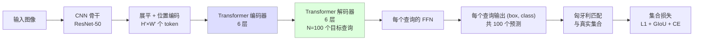
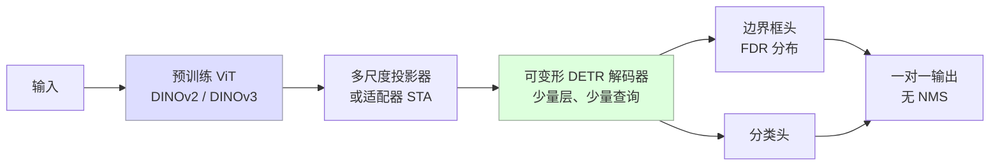

# 目标检测

> **英文原文：** [cv-knowledge-base/02_core_tasks/01_object_detection.md](../../cv-knowledge-base/02_core_tasks/01_object_detection.md)（本中文版供参考，内容以英文原文为准）

> **最后更新：** 2026年10月
> **难度级别：** 中级 → 高级
> **相关章节：** [开放词汇检测](../05_multimodal_vision_language/03_open_vocabulary_detection.md) · [语义分割](./02_semantic_segmentation.md) · [CNN 架构](../03_architectures/00_cnn_architectures.md) · [视觉 Transformer](../03_architectures/01_vision_transformers.md)

> **🆕 2026年10月更新：**
> - 新增 **2024–2026 年实时检测器** 小节：D-FINE、DEIM（CVPR 2025）、DEIMv2（DINOv3 特征）、RT-DETRv4（ECCV 2026）、**RF-DETR**（ICLR 2026；首个在 COCO 上超过 60 AP 的实时模型），以及 YOLOv12 → YOLOv13 → **YOLO26** 系列（无 NMS、无 DFL）。
> - 更正了此前关于 RF-DETR 的条目（它基于 LW-DETR，采用 DINOv2 骨干和权重共享神经架构搜索，而非 RT-DETR；最佳实时结果为 RF-DETR-2XL 在 T4 上 17.2 ms 下 60.1 AP）。
> - 在开放词汇章节中新增 **SAM 3**（Meta，2025年11月）作为可提示的概念检测器，以及 YOLOE（ICCV 2025）和 Rex-Omni（基于多模态大模型的检测）。
> - 扩充关键论文和 COCO 表格；新增优缺点条目，以及关于基准协议漂移、COCO 饱和与概念级检测的开放问题；新增延伸阅读。

---

## 概述

目标检测的任务是对图像中所有物体实例进行定位和分类，输出一组边界框 {(**b**_i, c_i, s_i)}，其中 **b**_i ∈ ℝ^4 为边界框（通常为 [x1, y1, x2, y2] 或 [cx, cy, w, h] 格式），c_i ∈ {1, …, K} 为类别标签，s_i ∈ [0,1] 为置信度分数。自 2014 年以来，COCO 基准 [Lin2014] 一直是主流评测协议，使用在 0.50 到 0.95 共十个 IoU 阈值上平均的平均精度均值（AP，也写作 mAP@[0.50:0.95]），以及 AP50 和 AP75。

2010 年代前半期由两种架构范式主导：**两阶段**检测器在第一阶段生成候选区域提议，在第二阶段对其分类/精修（R-CNN 系列 [Girshick2014, Girshick2015, Ren2015]）；**单阶段**检测器直接从规则的锚框网格预测边界框和类别，无需提议阶段（SSD [Liu2016]、YOLO [Redmon2016]、RetinaNet [Lin2017]）。核心矛盾——两阶段检测器更准但更慢，单阶段更快但精度更低——被双方的设计进步逐步消解，最终由无锚框检测器（FCOS [Tian2019]）和端到端（end-to-end）的 Transformer 检测器（DETR [Carion2020] 及其后继者）彻底化解。

第三波 **开放词汇（open-vocabulary）** 与 **定位（grounded）** 检测 [Li2022, Liu2023] 将重点从封闭集识别转向语言引导的检测，使检测器能够定位由自由文本短语描述的任意物体。Grounding DINO [Liu2023] 在 COCO 零样本上取得 52.5 AP，同时解决指代表达理解问题，消除了检测与视觉-语言对齐之间的边界。

2024 至 2026 年间又发生了两项转变。第一，**实时 DETR 在 COCO 精度-延迟帕累托前沿上超越了 YOLO 式 CNN**：D-FINE [Peng2024]、DEIM [Huang2025] 和 RF-DETR [Robinson2026] 在 T4 上约 10–17 ms 的延迟下达到 55–60 AP，主要得益于继承强大的预训练 ViT 特征（DINOv2、DINOv3），以及对边界框回归和一对一匹配的改进。YOLO 系列则以原生端到端设计作出回应（YOLOv10、YOLO26）。第二，可提示的 **概念检测** ——SAM 3 [Carion2025]——将开放词汇检测、实例分割与跟踪融合为一个模型，返回某个名词短语或示例所对应的 *全部* 实例。

---

## 两阶段检测器

### R-CNN 系列

**R-CNN** [Girshick2014]（CVPR 2014）：选择性搜索生成约 2000 个候选区域；每个区域经变形后送入 CNN 提取特征；逐类 SVM 对特征分类；线性回归器精修边界框坐标。训练与推理相互割裂；在 GPU 上每张图像需 47 秒。

**Fast R-CNN** [Girshick2015]（ICCV 2015）：通过 **RoI Pooling** 在所有提议之间共享卷积骨干——RoI Pooling 是在共享特征图上对每个提议执行的固定尺寸池化操作。单个 softmax 分类器和边界框回归器共享全连接层。除提议生成外实现端到端训练；约 200 ms/图像。

**Faster R-CNN** [Ren2015]（NeurIPS 2015）：用 **区域提议网络（Region Proposal Network, RPN）** 取代选择性搜索——RPN 是一个轻量全卷积网络，在特征图上滑动，在每个位置为一组锚框预测目标性分数和偏移量。RPN 与检测头共享骨干（四步交替训练或近似联合训练）。使用 ZF-net 时在 COCO 上以约 17 fps 取得 21.9 mAP@[0.50:0.95]，使用 ResNet-101 时为 27.2。

**特征金字塔网络（Feature Pyramid Network, FPN）** [Lin2017a]（CVPR 2017）：通过构建带横向连接的自顶向下通路来应对尺度变化，将粗糙但语义丰富的深层特征与精细且空间精确的浅层特征融合。生成多尺度特征图 {P2, P3, P4, P5, P6}，其中 P_k 的步长为 2^k。与 Faster R-CNN 和 ResNet-101 结合，FPN 在 COCO minival 上取得 36.2 mAP，且推理时间相对单尺度没有增加。

---

## 单阶段检测器

### SSD 与 YOLO 系列

**SSD** [Liu2016]（ECCV 2016）：在多个特征图（conv4_3 至 conv11_2）上放置不同尺度和长宽比的默认锚框，在一次前向传播中为每个锚框预测偏移量和类别分数。VGG-16 骨干；VOC 2007 上 74.3 mAP@0.50，COCO 上以 46 fps 取得 25.1 mAP@[0.50:0.95]。

**YOLOv1** [Redmon2016]（CVPR 2016）：将图像划分为 S×S 网格；每个单元格预测 B 个边界框和 C 个类别概率，将检测视为单一回归问题。受 GoogLeNet 启发的骨干；VOC 2007 上 63.4 mAP@0.50，45 fps。

**YOLOv2 / YOLO9000** [Redmon2017] 增加了批归一化、锚框、高分辨率分类预训练和多尺度训练。**YOLOv3** [Redmon2018] 使用 Darknet-53 骨干和类 FPN 的多尺度预测；COCO test 上 33.0 mAP@[0.50:0.95]。

**YOLOv4** [Bochkovskiy2020]（arXiv 2020）：系统整合了 bag-of-freebies（MixUp、CutMix、mosaic、自对抗训练）与 bag-of-specials（SPP、PAN、SAM）。CSPDarknet53 骨干；以 65 fps（V100）取得 43.5 mAP@[0.50:0.95]。

**YOLOv5**（Jocher，Ultralytics，2020）：非官方但被广泛采用；原生 PyTorch，基于锚框，CSP 骨干；约 43.3 mAP（YOLOv5x）。

**YOLOv8**（Jocher，Ultralytics，2023）：无锚框检测头、C2f 瓶颈、解耦的分类与回归；YOLOv8x 在 COCO val 上取得 53.9 mAP@[0.50:0.95]。

**YOLOv10** [Wang2024]（NeurIPS 2024）：双标签分配的无 NMS 训练；YOLOv10-X 以 CPU 上 29 ms 取得 54.4 mAP。

**YOLO11**（Ultralytics，2024）：相比 YOLOv8m 参数减少 22 %，同时 mAP 提升 1.3 %；YOLO11x 在 COCO val 上 54.7 mAP。

**YOLOv12** [Tian2025]（arXiv 2502.12524，2025年2月）：一种 *以注意力为中心* 的 YOLO，使用区域注意力（area attention）和残差高效层聚合（R-ELAN），同时保持 YOLO 级延迟；YOLOv12-X 达到 54.4 AP（5,910 万参数）。**YOLOv13**（arXiv 2506.17733，2025年6月）加入基于超图的自适应相关性增强以建模高阶特征相关；YOLOv13-X 报告 54.8 AP，参数量 6,400 万。

**YOLO26** [Jocher2026]（Ultralytics；技术报告 arXiv 2606.03748，2026年6月）：一个统一的模型家族，覆盖检测、实例/语义分割、姿态、分类和旋转框，围绕四项改动构建：(1) 通过可选的一对一检测头实现 **原生端到端无 NMS 推理**；(2) **移除分布焦点损失（Distribution Focal Loss, DFL）**，得到更轻、更便于导出的回归头；(3) 新训练方案，结合 **MuSGD**（来自大语言模型训练的 Muon 优化器与 SGD 的混合）、**渐进式损失（Progressive Loss）** 和 **STAL**（小目标感知标签分配）；(4) 任务特定的检测头（例如姿态任务使用 RLE）。YOLO26n–x 在 COCO val2017 上报告 **40.9–57.5 mAP**（无 NMS 端到端模式下为 40.1–56.9），在 T4 + TensorRT 上延迟为 **1.7–11.8 ms**，且 YOLO26n 的 CPU ONNX 推理比 YOLO11n 快最多 43 %。其开放词汇变体 YOLOE-26 支持文本与视觉提示。

### RetinaNet 与 Focal Loss

**RetinaNet** [Lin2017b]（ICCV 2017）：指出前景与背景锚框之间的类别不平衡是单阶段检测器精度差距的根本原因。提出 **focal loss（焦点损失）**——一种动态缩放的交叉熵，对易分负样本降权：

```latex
% 二分类的标准交叉熵
\text{CE}(p_t) = -\log(p_t)

% 带聚焦参数 \gamma 和平衡因子 \alpha 的焦点损失
\text{FL}(p_t) = -\alpha_t (1 - p_t)^{\gamma} \log(p_t)

% 若 y=1 则 p_t = p，否则为 1-p
% 默认值为 \gamma = 2, \alpha = 0.25
% (1-p_t)^\gamma 以指数方式降低易分样本的权重
% 难样本（p_t << 1）权重约为 1；易样本（p_t -> 1）权重约为 0
```

使用 ResNeXt-101-FPN 的 RetinaNet 在 COCO test-dev 上取得 40.8 mAP@[0.50:0.95]，超越此前所有单阶段检测器，并与同期最佳两阶段模型持平。

### 无锚框检测器

**FCOS** [Tian2019]（ICCV 2019）：将检测重新表述为稠密的逐像素预测。对每个前景像素 (x, y)，网络预测 (l, t, r, b)——到真实边界框左、上、右、下边的距离——以及用于抑制低质量框的中心度（centerness）分数。消除了所有锚框超参数。FCOS 使用 ResNeXt-101-FPN 取得 44.7 mAP，多尺度测试下为 49.0。

---

## 基于 Transformer 的检测器

**DETR** [Carion2020]（ECCV 2020）：将检测视为 **直接集合预测** 问题。CNN 骨干提取特征图；Transformer 编码器处理展平的空间特征；Transformer 解码器并行生成 N 个可学习的 **目标查询（object queries）**，每个查询经 FFN 解码为一个边界框和类别。匈牙利算法在预测与真实标注之间求二分匹配，从而消除 NMS。DETR-R50 训练 500 个 epoch 后在 COCO val 上取得 42.0 mAP。



**Deformable DETR** [Zhu2020]（ICLR 2021）：用 **可变形注意力** 取代全局注意力——每个查询在每个特征层级上只关注少量学习得到的参考点，将编码器复杂度从 O(N²) 降至 O(N·K)（K=4 个采样点）。收敛速度快 10 倍（50 个 epoch 对比 500 个）；ResNet-50 下 46.2 mAP。

**DAB-DETR** [Liu2022b] 将目标查询重新表述为动态锚框 (x, y, w, h)，为解码器交叉注意力提供空间先验。**DN-DETR** [Li2022b] 加入去噪训练以稳定二分匹配。

**DINO（Detection Transformer with Improved Denoising）** [Zhang2022]（ICLR 2023）：结合 DAB-DETR、DN-DETR 和可变形注意力，并采用混合查询选择策略；DINO-5scale-R50 在 12 个 epoch 内取得 49.0 mAP；DINO-Swin-L 在 COCO val 上取得 58.5 mAP。

**RT-DETR** [Zhao2024]（CVPR 2024）：将尺度内特征交互（带 IoU 感知查询选择的高效编码器）与跨尺度融合（类 PAN 颈部）解耦，实现实时推理。RT-DETR-R50 在 T4 GPU 上以 108 fps 取得 53.1 mAP；RT-DETR-R101 以 74 fps 取得 54.3 mAP——这是首个在精度和速度上都能与 YOLO 竞争的 DETR 系列模型。

### 实时 DETR 超越 YOLO（2024–2026）

**D-FINE** [Peng2024]（arXiv 2410.13842）将 DETR 的边界框回归重新定义为 **细粒度分布精修（Fine-grained Distribution Refinement, FDR）**：每个解码器层迭代地精修每条边的偏移量概率分布，而非直接回归坐标；**全局最优定位自蒸馏（Global Optimal Localization Self-Distillation, GO-LSD）** 将最后一层精修后的分布蒸馏到前面的层，且不增加推理开销。D-FINE-X 在仅用 COCO 训练时达到 55.8 AP，使用 Objects365 预训练时在 T4 上以 12.9 ms 达到 59.3 AP。

**DEIM** [Huang2025]（CVPR 2025）通过 **Dense O2O**（借助类 mosaic 的拼接增加每张图像中的目标数量，使一对一匹配产生更多正样本）和一种可匹配性感知损失来应对一对一匹配收敛慢的问题；DEIM-D-FINE-X 在 COCO 上达到 56.5 AP（使用 Objects365 预训练时为 59.5 AP），且训练周期明显更短。**DEIMv2**（arXiv 2509.20787，2025年9月；"Real-Time Object Detection Meets DINOv3"）对 S–X 尺寸通过轻量的空间调优适配器（STA）将 DINOv3 派生的 ViT 特征接入 DEIM，对超轻量尺寸则使用 HGNetv2：DEIMv2-X 以 5,030 万参数达到 57.8 AP，DEIMv2-Atto 仅用 50 万参数即可在移动设备上达到 23.8 AP。

**RT-DETRv4**（arXiv 2510.25257；已被 ECCV 2026 接收）在推理时保留轻量的 RT-DETR/D-FINE 检测器，但加入仅在训练时使用的蒸馏框架，将视觉基础模型的表征（DINOv3 ViT-B/16 教师）注入其中；RT-DETRv4-X 报告在 T4 上以 78 fps 达到 57.0 AP。

**RF-DETR** [Robinson2026]（Roboflow；arXiv 2511.09554；ICLR 2026）将 LW-DETR 检测器与 **DINOv2 ViT 骨干**（最小尺寸使用 PE-Core-T）结合，并在分辨率、patch 大小、解码器深度和查询数量上进行 **权重共享神经架构搜索（NAS）**，使一次训练即可得到整个帕累托模型族。在 Roboflow 的可复现基准中（所有模型均在 COCO val2017 上用 pycocotools 测量；T4、TensorRT FP16、batch 1），**RF-DETR-2XL 是首个超过 60 AP 的实时检测器（17.2 ms 下 60.1 AP）**，RF-DETR-N 在 2.3 ms 下达到 48.4 AP，该模型族在 RF100-VL 迁移基准（100 个多样化真实世界数据集）上同样领先。分割头和（预览版）关键点头共享同一 API。



因此，2025–26 年实时检测器的共同配方是：*基础模型特征 + 轻量可变形解码器 + 更好的边界框参数化/匹配 + 无 NMS 输出*，并针对 TensorRT 延迟而非 FLOPs 进行调优。

---

## 开放词汇与定位检测

**OWL-ViT** [Minderer2022]：采用 CLIP 式图文对齐；在图像 patch 上使用二分匹配损失；通过将文本查询与 patch 特征匹配实现零样本检测。

**Grounding DINO** [Liu2023]（arXiv 2303.05499）：将 DINO 检测器与来自 GLIP/CLIP 的定位预训练相结合。特征增强器在多个尺度上融合文本与图像特征；语言引导的查询选择从与文本相关的图像区域初始化目标查询；跨模态解码器进行紧密融合。Grounding DINO 取得 52.5 mAP（COCO 零样本，未使用 COCO 训练数据）和 63.0 mAP（COCO 微调）。作者：Shilong Liu、Zhaoyang Zeng、Tianhe Ren 等（2023）。

**SAM 3** [Carion2025]（Meta，arXiv 2511.16719，2025年11月）提出 **可提示概念分割（Promptable Concept Segmentation, PCS）**：给定一个简短名词短语和/或图像示例，它会检测、分割并（在视频中）跟踪 *所有* 匹配实例。一个以文本、几何和示例为条件的 DETR 式检测器与一个 SAM 2 式跟踪器共享视觉编码器（总参数量 8.48 亿）；可学习的 **存在性 token（presence token）** 将"该概念是否存在？"与定位解耦，提升了对相近短语的区分能力。借助覆盖 400 多万个独特概念的数据引擎训练，SAM 3 报告在 LVIS 上 53.6 box AP、在 COCO 上 56.4 box AP（DINO-X 分别为 52.4 / 56.0），并在新的 SA-Co 基准（27 万个独特概念）上达到人类表现的 75–80 %。SAM 3.1（2026年3月）加入"Object Multiplex"共享内存多目标跟踪（在 H100 上跟踪 128 个目标时快约 7 倍）。

**YOLOE** [Wang2025]（ICCV 2025）以 YOLO 级速度实现文本提示、视觉提示和无提示的开放词汇检测与分割，训练成本低于 YOLO-Worldv2。**Rex-Omni**（IDEA Research，arXiv 2510.12798，2025年10月）则在一个基于 Qwen2.5-VL 的 30 亿参数多模态大模型（MLLM）中，将检测表述为下一个点/下一个 token 预测，体现了检测与多模态大模型的融合。

> *更正（2026年10月）：* 本文件早期版本称 RF-DETR 是采用 DINOv2 骨干的 RT-DETR，并以 25 fps 达到 60.5 AP。实际上它基于 LW-DETR 构建，其公开的最佳实时结果为 60.1 AP（RF-DETR-2XL，T4 上 17.2 ms）；详见上文"实时 DETR"小节。

---

## 关键论文

| 论文 | 作者 | 年份 | 会议/期刊 | 主要贡献 |
|-------|---------|------|-------|-----------------|
| Rich Feature Hierarchies… (R-CNN) | Girshick et al. | 2014 | CVPR | 基于区域的 CNN；提议 + 分类流程 |
| Fast R-CNN | Girshick | 2015 | ICCV | RoI Pooling；端到端联合训练 |
| Faster R-CNN | Ren, He, Girshick, Sun | 2015 | NeurIPS | 区域提议网络；约 17 fps |
| Feature Pyramid Networks (FPN) | Lin, Dollár, Girshick et al. | 2017 | CVPR | 多尺度自顶向下特征金字塔 |
| Focal Loss / RetinaNet | Lin, Goyal, Girshick et al. | 2017 | ICCV | 焦点损失；单阶段达到两阶段精度 |
| FCOS | Tian, Shen, Chen, He | 2019 | ICCV | 无锚框逐像素预测；中心度 |
| YOLOv4 | Bochkovskiy, Wang, Liao | 2020 | arXiv | 系统整合 bag-of-freebies |
| End-to-End Object Detection (DETR) | Carion, Massa et al. | 2020 | ECCV | Transformer 集合预测；消除 NMS |
| Deformable DETR | Zhu, Su et al. | 2020 | ICLR 2021 | 可变形注意力；收敛快 10 倍 |
| DINO (Detection Transformer) | Zhang et al. | 2022 | ICLR 2023 | DAB+DN+可变形；Swin-L 58.5 mAP |
| RT-DETR | Zhao, Lv et al. | 2023 | CVPR 2024 | 实时 DETR；108 fps 下 53.1 mAP |
| Grounding DINO | Liu, Zeng, Ren et al. | 2023 | arXiv | 开放集检测；COCO 零样本 52.5 mAP |
| D-FINE | Peng, Li, Wu et al. | 2024 | arXiv | 细粒度分布精修 + GO-LSD 自蒸馏 |
| DEIM: DETR with Improved Matching | Huang, Lu, Cun et al. | 2024 | CVPR 2025 | Dense O2O 匹配；实时 DETR 快速收敛 |
| YOLOv12: Attention-Centric Real-Time Object Detectors | Tian, Ye, Doermann | 2025 | arXiv | 在 YOLO 级延迟下使用区域注意力 + R-ELAN |
| YOLOE: Real-Time Seeing Anything | Wang, Liu, Chen et al. | 2025 | ICCV | 文本/视觉/无提示的开放词汇 YOLO |
| Real-Time Object Detection Meets DINOv3 (DEIMv2) | Huang, Hou, Liu et al. | 2025 | arXiv | 将 DINOv3 特征用于实时 DETR；50 万–5,000 万参数 |
| RT-DETRv4 | Liao, Zhao, Shan et al. | 2025 | ECCV 2026 | 训练时将 DINOv3 蒸馏进轻量 DETR |
| SAM 3: Segment Anything with Concepts | Carion, Gustafson et al. | 2025 | arXiv | 可提示的概念检测/分割/跟踪；SA-Co 基准 |
| RF-DETR: Real-Time Detection Transformer | Robinson, Robicheaux, Popov, Ramanan, Peri | 2025 | ICLR 2026 | DINOv2 + LW-DETR + 权重共享 NAS；首个超过 60 AP 的实时模型 |
| Ultralytics YOLO26 | Jocher, Qiu et al. | 2026 | arXiv | 无 NMS、无 DFL 的 YOLO；MuSGD；多任务模型族 |

---

## 基准性能：COCO mAP 演进

| 模型 | 骨干网络 | COCO AP | AP50 | FPS (GPU) | 备注 |
|-------|----------|---------|------|-----------|-------|
| Fast R-CNN | VGG-16 | 19.7 | 35.9 | ~1 | COCO 2015 test |
| Faster R-CNN | ResNet-101 | 27.2 | 48.4 | 5 | 2015；单尺度 |
| SSD-300 | VGG-16 | 25.1 | 43.1 | 46 | 300² 输入 |
| YOLOv3 | Darknet-53 | 33.0 | 57.9 | 35 | COCO test-dev |
| RetinaNet | ResNeXt-101-FPN | 40.8 | 61.1 | 7 | COCO test-dev |
| YOLOv4 | CSPDarknet53 | 43.5 | 65.7 | 65 | V100 |
| Faster R-CNN + FPN | ResNet-101 | 36.2 | 59.1 | 6 | COCO minival |
| FCOS | ResNeXt-101-FPN | 44.7 | 64.1 | 14 | 多尺度测试 |
| DETR | ResNet-50 | 42.0 | 62.4 | 28 | 500 个 epoch |
| Deformable DETR | ResNet-50 | 46.2 | 65.2 | 19 | 50 个 epoch |
| DINO | Swin-L | 58.5 | 77.0 | — | COCO val |
| YOLOv8x | CSP+C2f | 53.9 | 71.0 | 52 | COCO val |
| RT-DETR-R101 | ResNet-101 | 54.3 | 72.7 | 74 | T4；实时 |
| Grounding DINO | Swin-L | 63.0 | 81.4 | — | COCO 微调 |
| D-FINE-X | HGNetv2 | 55.8 | — | ~78 | T4 12.9 ms；Objects365 预训练时 59.3 AP |
| DEIM-D-FINE-X | HGNetv2 | 56.5 | — | ~78 | T4 12.9 ms；CVPR 2025 |
| YOLOv12-X | R-ELAN + area attn | 54.4 | 71.1 | ~80 | T4 12.5 ms（据 YOLOv13 作者报告） |
| DEIMv2-X | DINOv3-derived ViT | 57.8 | — | ~73 | T4 13.75 ms；5,030 万参数 |
| RT-DETRv4-X | HGNetv2 (+VFM distill.) | 57.0 | 74.6 | 78 | T4 |
| YOLO26x | YOLO26 | 57.5 | — | ~85 | T4 11.8 ms；无 NMS 模式下 56.9 AP |
| RF-DETR-2XL | DINOv2 ViT (NAS) | 60.1 | 78.5 | ~58 | T4 17.2 ms；Roboflow 内部协议 |
| SAM 3 | Shared ViT encoder | 56.4 | — | — | 概念提示（文本/示例）；8.48 亿参数；非实时 |

---

## 优缺点

| 方面 | 优点 | 缺点 |
|--------|------|------|
| 两阶段（Faster R-CNN / FPN） | 精度高；提议阶段灵活；强基线 | 较慢；两阶段复杂；并非端到端无 NMS |
| 单阶段基于锚框（RetinaNet/SSD） | 快；架构简单；配合焦点损失校准良好 | 需手工设计锚框；难以处理极端长宽比 |
| 无锚框（FCOS/CenterNet） | 无锚框超参数；逐像素预测；易于迁移 | 重叠物体的中心度存在歧义；拥挤场景 AP 略低 |
| Transformer（DETR/RT-DETR） | 完全端到端（无 NMS）；全局上下文；可扩展到开放词汇 | 收敛慢；内存占用高；基础 DETR 的注意力为 O(N²) |
| 开放词汇（Grounding DINO） | 可检测任意文本描述的物体；零样本泛化 | 推理较慢；需要大规模定位预训练；文本精度受限 |
| 基于基础模型骨干的实时 DETR（D-FINE/DEIMv2/RF-DETR） | 无 NMS；2025–26 年最佳精度-延迟帕累托前沿；微调迁移能力强（RF100-VL） | 依赖大型预训练 ViT（许可、内存）；延迟数据对 TensorRT 版本和测试协议敏感 |
| 端到端 YOLO（YOLOv10/YOLO26） | CPU/边缘端延迟极低；导出简单；一个模型族覆盖多任务 | 无 NMS 模式比 NMS 模式低约 0.6–0.8 AP（YOLO26）；Ultralytics 模型采用 AGPL 许可 |
| 概念提示的基础检测器（SAM 3） | 可穷尽检测任意名词短语；与分割和跟踪统一 | 约 8.5 亿参数；在边缘端远非实时；在 SA-Co 上仅达到人类表现的 75–80 % |

---

## 开放问题与研究空白

- **无 NMS 方法的收敛速度：** 尽管 Deformable DETR 和 DN-DETR 将 DETR 所需的 500 个 epoch 降至 12–24 个，端到端 Transformer 检测器的收敛仍慢于基于锚框的方法；对集合匹配动力学的理论理解仍不完整。
- **小目标检测：** 在所有架构中，AP_S（小于 32² 像素的物体）都明显落后于 AP_M 和 AP_L；大规模使用高分辨率骨干特征在计算上仍代价过高。
- **领域泛化：** 在 COCO 上训练的检测器在素描、艺术或领域偏移图像上性能急剧下降；从照片级训练到开放世界部署的鸿沟尚未弥合。
- **高效开放词汇检测：** Grounding DINO 和 OWL-ViT 需要大型语言编码器，其推理开销占主导；将开放词汇能力蒸馏进紧凑检测器是活跃的挑战。
- **遮挡下的稠密预测：** 全景分割和实例分割解决了部分拥挤场景问题，但大规模的三维感知检测（考虑深度顺序和遮挡推理）仍缺乏稳健方案。
- **时序目标检测：** 将单帧检测扩展到视频、并在外观变化、遮挡和运动模糊下保持一致的轨迹身份，仍依赖事后跟踪启发式方法，而非联合端到端学习。
- **置信度分数的校准：** 高 AP 模型往往校准不佳——报告的置信度与真实精度不符；安全攸关的部署需要经过校准的不确定性估计。
- **基准协议漂移：** 2025–26 年的实时检测器在不同预训练（仅 COCO 或 Objects365）、分辨率、TensorRT 版本以及端到端或 NMS 模式下报告 COCO AP；同一检查点在不同厂商表格中可相差数个 AP。需要标准化、可复现的延迟-精度评测协议（以及 RF100-VL 等迁移评测套件）。
- **COCO 饱和与真实世界迁移：** 随着实时模型达到约 60 AP，COCO 上的进一步提升很小，且可能部分反映了对标注特性的拟合；在小规模、特定领域数据集上的微调效率正成为更有意义的目标。
- **概念级开放词汇检测：** SAM 3 表明穷尽式概念检测是可行的，但在细粒度或组合式短语（属性、关系、否定）上的表现仍远低于人类一致性水平，将其蒸馏进实时模型仍是开放问题。

---

## 延伸阅读

- [Faster R-CNN: Towards Real-Time Object Detection with Region Proposal Networks (Ren et al., 2015)](https://arxiv.org/abs/1506.01497)
- [Feature Pyramid Networks for Object Detection (Lin et al., 2017)](https://arxiv.org/abs/1612.03144)
- [Focal Loss for Dense Object Detection — RetinaNet (Lin et al., 2017)](https://arxiv.org/abs/1708.02002)
- [End-to-End Object Detection with Transformers — DETR (Carion et al., 2020)](https://arxiv.org/abs/2005.12872)
- [RT-DETR: DETRs Beat YOLOs on Real-time Object Detection (Zhao et al., 2024)](https://arxiv.org/abs/2304.08069)
- [Grounding DINO: Marrying DINO with Grounded Pre-Training (Liu et al., 2023)](https://arxiv.org/abs/2303.05499)
- [D-FINE: Redefine Regression Task in DETRs as Fine-grained Distribution Refinement (Peng et al., 2024)](https://arxiv.org/abs/2410.13842)
- [DEIM: DETR with Improved Matching for Fast Convergence (Huang et al., CVPR 2025)](https://arxiv.org/abs/2412.04234) · [DEIMv2（2025）](https://arxiv.org/abs/2509.20787)
- [RF-DETR: Real-Time Detection Transformer (Robinson et al., ICLR 2026)](https://arxiv.org/abs/2511.09554) · [代码与基准](https://github.com/roboflow/rf-detr)
- [RT-DETRv4 (Liao et al., ECCV 2026)](https://arxiv.org/abs/2510.25257)
- [Ultralytics YOLO26: Unified Real-Time End-to-End Vision Models (Jocher et al., 2026)](https://arxiv.org/abs/2606.03748)
- [SAM 3: Segment Anything with Concepts (Carion et al., 2025)](https://arxiv.org/abs/2511.16719)
