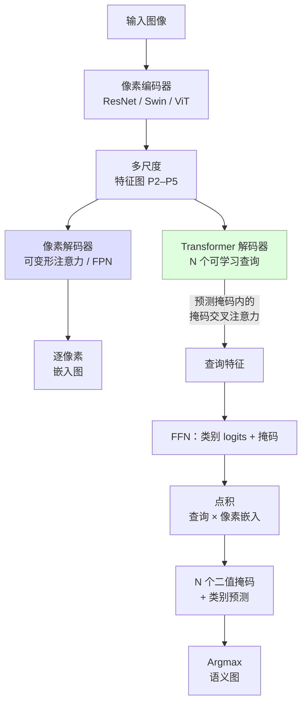

# 语义分割

> **英文原文：** [cv-knowledge-base/02_core_tasks/02_semantic_segmentation.md](../../cv-knowledge-base/02_core_tasks/02_semantic_segmentation.md)（本中文版供参考，内容以英文原文为准）

> **最后更新：** 2026年10月
> **难度级别：** 中级 → 高级
> **相关章节：** [实例与全景分割](./03_instance_panoptic_segmentation.md) · [Any-Model 范式（SAM/SAM2）](../12_research_frontier_2024_2026/02_any_model_paradigm.md) · [视觉 Transformer](../03_architectures/01_vision_transformers.md) · [CNN 架构](../03_architectures/00_cnn_architectures.md)

> **🆕 2026年10月更新：**
> - 新增 **SAM 3**（Meta，2025年11月）：文本/示例形式的 *概念* 提示将可提示分割转变为开放词汇（open-vocabulary）语义标注；SAM 3.1（2026年3月）将视频多目标跟踪提速约 7 倍。
> - 新增 **基于冻结基础模型特征的分割**：DINOv3（在冻结的 7B 骨干上仅用 *线性* 头即在 ADE20K 上达到 55.9 mIoU）与 **EoMT**（CVPR 2025 Highlight；仅编码器的朴素 ViT 分割器，使用 DINOv3-L 在 ADE20K 上以 137 FPS 达到 59.5 mIoU），以及其面向视频/冻结编码器的后续工作 VidEoMT（CVPR 2026）和 PMT。
> - 新增实时的 YOLO26-sem（Cityscapes 78.3–83.6 mIoU）以及新的基准/关键论文条目；修正了 SAM 的 arXiv 链接；更新了开放问题和延伸阅读。

---

## 概述

语义分割为图像中的每个像素分配一个类别标签，生成稠密的类别图 **S** ∈ {1, …, K}^(H×W)。与目标检测不同，它不区分同一类别的不同实例——属于"汽车"的所有像素都会获得相同的标签，无论图中有多少辆汽车。该任务同时要求高空间分辨率（准确的边界刻画）和深层语义抽象（场景理解），这一矛盾推动了过去十年稠密预测领域的大部分架构创新。

**全卷积网络（Fully Convolutional Networks, FCN）** [Long2015] 的奠基性洞见是用卷积层替代全连接分类头，借助双线性上采样实现任意分辨率下的端到端稠密预测。后续工作针对 FCN 的两个主要弱点展开：(1) 下采样过程中丢失的空间细节——通过跳跃连接（U-Net [Ronneberger2015]）和空洞（扩张）卷积（DeepLab [Chen2014]）解决；(2) 感受野有限、缺乏全局上下文——通过空洞空间金字塔池化（ASPP，DeepLabv3 [Chen2017]）、金字塔池化模块（PSPNet [Zhao2017]），并最终通过全局自注意力（SegFormer [Xie2021]、Mask2Former [Cheng2022]）解决。

**大规模可提示分割**（SAM [Kirillov2023]、SAM2 [Ravi2024]）的出现代表了一次范式转变：不再为每个语义类别训练任务特定模型，而是由单一基础模型（Foundation Model）接受几何提示（点、框、掩码），交互式地分割任意物体或区域。这一可提示范式在推理时消除了语义、实例和全景分割之间的区别，尽管将 SAM 适配到特定领域的语义标注仍需要提示工程或微调。SAM 3 [Carion2025]（2025年11月）通过接受 **概念提示**——简短名词短语或图像示例——并返回 *所有* 匹配实例的掩码，缩小了这一差距，从而可以直接根据文本对一组类别词汇进行分割。与此同时，DINOv3 [Simeoni2025] 等冻结的自监督编码器仅用线性头就能在 ADE20K 上取得有竞争力的结果，而 EoMT [Kerssies2025] 等仅编码器设计表明，一个带少量查询 token 的朴素 ViT 可以取代 Mask2Former 的像素解码器和 Transformer 解码器。

---

## 评测指标

**平均交并比（Mean Intersection-over-Union, mIoU）** 是主要指标：

```latex
% 类别 k 的 IoU
\text{IoU}_k = \frac{|\hat{S}_k \cap S_k|}{|\hat{S}_k \cup S_k|}
   = \frac{TP_k}{TP_k + FP_k + FN_k}

% 对全部 K 个类别取平均的 mIoU（部分协议忽略背景）
\text{mIoU} = \frac{1}{K} \sum_{k=1}^{K} \text{IoU}_k
```

**像素精度（Pixel Accuracy, PA）** 和 **平均像素精度（mean Pixel Accuracy, mPA）** 是次要指标。Cityscapes 使用 19 个评测类别；ADE20K 使用 150 个。

---

## 架构里程碑

### FCN 与编码器-解码器架构

**FCN** [Long2015]（CVPR 2015）：通过用 1×1 卷积替换全连接层，将 AlexNet/VGG/GoogLeNet 分类网络转换为全卷积网络，生成粗糙的预测图，再用学习得到的双线性核进行上采样。来自 pool3/pool4 的跳跃连接融合粗糙与精细特征。FCN-8s 在 PASCAL VOC 2012 上取得 67.2 mIoU。

**U-Net** [Ronneberger2015]（MICCAI 2015）：对称的编码器-解码器，其跳跃连接将对应的编码器特征图拼接（而非相加）到解码器层，最大限度地保留空间细节。为数据有限的生物医学分割而设计；通过基于裁剪的训练和重叠拼贴（overlap-tile）策略实现泛化。已被广泛用作各领域稠密预测的骨干。

**SegNet** [Badrinarayanan2017] 用最大池化索引传递（反池化）替代可学习的上采样，在保留精细边界结构的同时减少解码器内存。

### 扩张卷积与多尺度池化

**DeepLabv1** [Chen2014]（ICLR 2015）：引入 **空洞（扩张）卷积**，在不损失空间分辨率、不增加参数的情况下扩大感受野。并结合全连接 CRF 进行边界精修。

```latex
% 扩张率为 r 的空洞卷积：
% y[i] = \sum_k x[i + r \cdot k] \cdot w[k]
% r=1 即标准卷积；r=2 时感受野加倍
% 而参数量不变
```

**DeepLabv2** [Chen2018a] 引入 **空洞空间金字塔池化（Atrous Spatial Pyramid Pooling, ASPP）**：扩张率为 {6, 12, 18, 24} 的并行空洞卷积在多个尺度上探查特征图并加以融合，以捕获不同大小的物体。

**DeepLabv3** [Chen2017] 用全局平均池化和批归一化改进 ASPP；移除了 CRF。ResNet-101 骨干在 PASCAL VOC 2012 val 上取得 85.7 mIoU。

**DeepLabv3+** [Chen2018b]（ECCV 2018）：增加一个简单的解码器，利用编码器的低层特征（类似 U-Net 跳跃连接）精修 DeepLabv3 的粗糙输出，并使用深度可分离卷积提高效率。Xception 骨干在 PASCAL VOC 2012 上取得 89.0 mIoU。

**PSPNet** [Zhao2017]（CVPR 2017）：**金字塔池化模块** 在最终特征图上以 {1×1, 2×2, 3×3, 6×6} 四个尺度进行池化，以捕获全局和多尺度上下文，再与原始特征拼接并经过最后一个卷积。ResNet-101 在 PASCAL VOC 2012 上取得 85.98 mIoU。

### 基于 Transformer 的模型

**SETR** [Zheng2021]（CVPR 2021）：使用朴素 ViT 作为编码器（完全取代 CNN 骨干）并配以卷积解码器。证明了在获取大感受野方面全局自注意力优于扩张卷积；ADE20K 上 50.28 mIoU。

**SegFormer** [Xie2021]（NeurIPS 2021）：层次化的 Mix Transformer（MiT）编码器在不使用位置编码的情况下生成多尺度特征（避免了不同测试分辨率下的插值伪影）；轻量的全 MLP 解码器在不使用自注意力的情况下聚合所有编码器阶段的特征。SegFormer-B5 以 8,470 万参数取得 **Cityscapes val 84.0 mIoU** 和 **ADE20K 51.8 mIoU**。作者：Enze Xie、Wenhai Wang、Zhiding Yu、Anima Anandkumar、Jose M. Alvarez、Ping Luo。

**Mask2Former** [Cheng2022]（CVPR 2022）：适用于语义、实例和全景分割的通用架构。使用 **掩码交叉注意力（masked cross-attention）**——解码器查询只在其预测的前景掩码区域内进行注意力计算，避免背景像素带来的噪声。Transformer 解码器为 L=9 层；像素解码器使用多尺度可变形注意力。采用 Swin-L 骨干的 Mask2Former 在语义分割上取得 **ADE20K 57.7 mIoU** 和 **Cityscapes val 80.3 mIoU**。作者：Bowen Cheng、Ishan Misra、Alexander G. Schwing、Alexander Kirillov、Rohit Girdhar。

**OneFormer** [Jain2023]（CVPR 2023）：以任务 token（"semantic"、"instance"、"panoptic"）作为条件并前置于文本查询，联合在语义、实例和全景目标上训练单个模型。在三项任务上同时取得 SOTA，优于各任务的专用模型。

**EoMT——仅编码器掩码 Transformer（Encoder-only Mask Transformer）** [Kerssies2025]（CVPR 2025 Highlight；"Your ViT is Secretly an Image Segmentation Model"）：完全去除了适配器、像素解码器和 Transformer 解码器。可学习的查询 token 在 ViT 的最后若干块中与 patch token 拼接，使朴素 ViT 本身联合编码 patch 与查询；掩码由查询-patch 点积预测，而 **掩码退火（mask annealing）** 调度使掩码注意力只在训练中使用、在推理时去除。借助大型预训练 ViT（DINOv2/DINOv3），其精度可达到 Mask2Former 水平，而使用 ViT-L 时速度最多快约 4 倍。采用 DINOv3 ViT-L 骨干时，EoMT 报告 **在 ADE20K 512×512 上 59.5 mIoU（H100 上 137 FPS）**。后续工作将该思想扩展到视频（**VidEoMT**，CVPR 2026，比同类视频分割器最多快约 10 倍）以及 *冻结的* 基础编码器（**PMT**，Plain Mask Transformer，arXiv 2603.25398，2026），后者加入一个模仿 EoMT 最后几层的小型解码器，使骨干可以与其他任务共享。

**冻结的基础模型特征。** DINOv3 [Simeoni2025] 报告在冻结的 ViT-7B 上 **仅用线性头即在 ADE20K 上达到 55.9 mIoU**（蒸馏得到的 ViT-L 为 54.9），其作者还报告，当冻结的 7B 骨干与 Mask2Former 式解码器配合时可达约 63 mIoU——在不微调骨干的情况下达到最先进水平。这使设计问题从"选择哪种分割架构"转变为"选择哪个冻结编码器、配多轻的头"。

**实时语义分割。** Ultralytics 的 **YOLO26-sem** 变体（160 万–4,010 万参数）在 Cityscapes 上以 1024×2048 训练，报告 **78.3–83.6 mIoU（val）**，在 RTX 3090（PyTorch）上延迟为 4.4–48.9 ms，将接近 SegFormer-B5 的 Cityscapes 精度带入 YOLO 式部署栈。



---

## 基础分割模型

### SAM——Segment Anything Model

**SAM** [Kirillov2023]（ICCV 2023）：提出 **可提示分割** 范式。架构：(1) MAE 预训练的 ViT-H 图像编码器；(2) 用于点、框、掩码和文本的轻量提示编码器；(3) 带双向 Transformer 和多输出消歧头的掩码解码器。在 SA-1B 上训练——1,100 万张图像、超过 10 亿个掩码标注，由模型在环（model-in-the-loop）的标注引擎收集。SAM 支持点/框/文本提示的交互式分割，并预测多个掩码以处理歧义。在恰当提示下，向特定领域分割（医学、卫星）的零样本迁移能力很强。作者：Alexander Kirillov、Eric Mintun、Nikhila Ravi 等（Meta AI）。

### SAM2——图像与视频中的分割一切

**SAM2** [Ravi2024]（arXiv 2408.00714，2024）：通过加入 **流式记忆机制** 将 SAM 扩展到视频——包括记忆编码器、记忆库和记忆注意力模块，使掩码解码器以过去帧的特征和预测掩码为条件。提出 **可提示视觉分割（Promptable Visual Segmentation, PVS）** 任务：给定任意帧级提示，在所有帧上跟踪该掩码片段（masklet）。SAM2 使用层次化的 Hiera 图像编码器，在视频基准上比逐帧交互式标注的标注时间更短。作者：Nikhila Ravi、Valentin Gabeur、Yuan-Ting Hu 等（Meta AI）。

### SAM 3——基于概念的分割一切

**SAM 3** [Carion2025]（Meta Superintelligence Labs，arXiv 2511.16719，2025年11月）定义了 **可提示概念分割（Promptable Concept Segmentation, PCS）**：提示可以是一个简短名词短语（"yellow school bus"）、一个或多个图像示例，或两者兼有，模型必须分割图像或视频中该概念的 *每一个* 实例（对不存在的概念则不输出任何结果）。架构：一个以文本、几何和示例为条件的 DETR 式检测器，与一个 SAM 2 式基于记忆的跟踪器共享同一个视觉编码器（总参数量 8.48 亿）；**存在性 token（presence token）** 预测该概念是否出现，将识别与定位解耦。人机协同的数据引擎标注了 **超过 400 万个独特概念**，新的 **SA-Co** 基准包含 27 万个独特概念（是以往开放词汇基准的 50 倍以上）。SAM 3 在 SA-Co 上达到人类表现的 75–80 %（例如在 SA-Co/Gold 实例分割上为 54.1 cgF1，人类为 72.8），在 LVIS 上取得 48.5 mask AP。SAM/SAM 2 的经典几何提示（点、框、掩码）和交互式精修得以保留。**SAM 3.1**（2026年3月27日）加入 *Object Multiplex*，在共享内存的分桶中联合处理被跟踪的物体（在单块 H100 上跟踪 128 个物体时快约 7 倍），并在 7 个 VOS 基准中的 6 个上提升了结果。

对语义分割而言，SAM 3 意味着可以为每个类别发出一个文本提示并解决重叠，从而得到封闭集标签图——这把下文"SAM 的标签高效适配"问题转化为提示校准与 stuff 类覆盖的问题。

---

## 关键论文

| 论文 | 作者 | 年份 | 会议/期刊 | 主要贡献 |
|-------|---------|------|-------|-----------------|
| Fully Convolutional Networks (FCN) | Long, Shelhamer, Darrell | 2015 | CVPR | 首个端到端稠密预测；跳跃连接 |
| U-Net | Ronneberger, Fischer, Brox | 2015 | MICCAI | 对称编码器-解码器；拼接式跳跃连接 |
| DeepLabv1 | Chen, Papandreou et al. | 2014 | ICLR 2015 | 空洞卷积 + CRF |
| DeepLabv3+ | Chen, Zhu et al. | 2018 | ECCV | ASPP 解码器；Xception 骨干；VOC 89.0 |
| PSPNet | Zhao, Shi, Qi et al. | 2017 | CVPR | 金字塔池化模块；全局上下文 |
| SegFormer | Xie, Wang et al. | 2021 | NeurIPS | Mix Transformer + MLP 解码器；Cityscapes 84.0 |
| Mask2Former | Cheng, Misra et al. | 2022 | CVPR | 掩码交叉注意力；通用分割 |
| OneFormer | Jain et al. | 2023 | CVPR | 单一模型覆盖所有分割任务 |
| Segment Anything (SAM) | Kirillov, Mintun et al. | 2023 | ICCV | 可提示基础模型；SA-1B 含 10 亿掩码 |
| SAM 2 | Ravi, Gabeur et al. | 2024 | arXiv | 视频分割；流式记忆 |
| Your ViT is Secretly an Image Segmentation Model (EoMT) | Kerssies, Cavagnero et al. | 2025 | CVPR (Highlight) | 仅编码器的朴素 ViT 分割；掩码退火；最多快 4 倍 |
| DINOv3 | Siméoni, Vo et al. | 2025 | arXiv | 冻结的 7B 自监督骨干；线性头在 ADE20K 上 55.9 mIoU |
| SAM 3: Segment Anything with Concepts | Carion, Gustafson et al. | 2025 | arXiv | 可提示概念分割；存在性 token；SA-Co 基准 |
| VidEoMT: Your ViT is Secretly Also a Video Segmentation Model | Norouzi, Zulfikar, Cavagnero et al. | 2026 | CVPR | 仅编码器视频分割；最多快约 10 倍 |

---

## 基准性能

### Cityscapes 验证集（19 类，mIoU %）

| 模型 | 骨干网络 | mIoU (val) | 备注 |
|-------|----------|-----------|-------|
| FCN-8s | VGG-16 | 65.3 | 双线性上采样；PASCAL 预训练 |
| PSPNet | ResNet-101 | 81.2 | 金字塔池化模块 |
| DeepLabv3+ | Xception-65 | 82.1 | ASPP + 解码器 |
| SegFormer-B5 | MiT-B5 | 84.0 | Cityscapes val；无额外数据 |
| Swin-L UperNet | Swin-L | 83.1 | 标准 512² 训练 |
| Mask2Former | Swin-L | 83.3 | 通用模型；160k 次迭代 |
| Mask2Former | Swin-L (512²) | 80.3 | 标准 Cityscapes 训练 |
| YOLO26n-sem | YOLO26 | 78.3 | 160 万参数；RTX 3090 上 4.4 ms（Ultralytics 报告） |
| YOLO26x-sem | YOLO26 | 83.6 | 4,010 万参数；RTX 3090 上 48.9 ms（Ultralytics 报告） |

### ADE20K 验证集（150 类，mIoU %）

| 模型 | 骨干网络 | mIoU (val) | 参数量 | 备注 |
|-------|----------|-----------|--------|-------|
| FCN | ResNet-101 | 39.9 | 68 M | 基线 |
| PSPNet | ResNet-101 | 43.3 | 86 M | — |
| DeepLabv3+ | ResNet-101 | 44.1 | — | — |
| SETR-PUP | ViT-L | 50.3 | 308 M | ViT 编码器 |
| SegFormer-B4 | MiT-B4 | 50.3 | 64 M | 比 SETR 小 5 倍 |
| SegFormer-B5 | MiT-B5 | 51.8 | 85 M | — |
| Mask2Former | Swin-L | 57.7 | 216 M | 通用模型 |
| OneFormer | Swin-L | 57.0 | 219 M | 多任务条件化 |
| SegNeXt-L | MSCAN-L | 51.0 | 49 M | 高效；优于 Mask2Former-Swin-T |
| DINOv3 (linear head) | ViT-L/16 (frozen) | 54.9 | 300 M | 从 7B 蒸馏；骨干未微调 |
| DINOv3 (linear head) | ViT-7B/16 (frozen) | 55.9 | 6.7 B | 仅线性探测 |
| EoMT-L | DINOv3 ViT-L | 59.5 | ~300 M | 仅编码器；H100 上 137 FPS（512²） |
| DINOv3 + M2F-style decoder | ViT-7B/16 (frozen) | ~63 | >6.7 B | 据 DINOv3 作者报告 |

---

## 优缺点

| 方面 | 优点 | 缺点 |
|--------|------|------|
| 扩张 CNN（DeepLab） | 无需额外参数即可保持分辨率；针对稠密预测调优充分；推理快 | 不使用 ASPP 时全局上下文有限；不使用 CRF 时存在边界伪影 |
| 编码器-解码器（U-Net / SegFormer） | 通过跳跃连接恢复精细空间细节；解码器可扩展 | 解码器增加内存和计算；超高分辨率下跳跃特征可能含噪 |
| Transformer（Mask2Former） | 全局上下文；通用（语义 + 实例 + 全景）；SOTA 精度 | 计算量大；掩码注意力实现复杂；训练慢 |
| 基础模型（SAM） | 零样本；交互式；10 亿以上掩码训练数据；跨领域泛化 | 默认不是封闭集分类器；提示需要空间引导；非实时 |
| SAM2（视频） | 以极少额外标注扩展到跟踪；流式记忆高效 | 视频记忆库随序列长度增长；外观变化时存在边缘情况失败 |
| 仅编码器（EoMT/VidEoMT） | 架构极简；在相近精度下比 Mask2Former 快数倍；直接受益于更好的 ViT | 需要大型预训练 ViT；需微调骨干（PMT 解决冻结使用问题） |
| 概念提示（SAM 3） | 由文本得到开放词汇语义标签；穷尽式实例；支持图像 + 视频 | 约 8.5 亿参数；stuff 类和细粒度短语仍较弱；高分辨率下非实时 |

---

## 开放问题与研究空白

- **SAM 的标签高效适配：** SAM 的交互式分割极其强大，但要将其掩码转换为封闭集基准所需的语义标签，需要额外的分类头或文本提示，最佳适配策略仍是开放的设计问题。
- **实时通用分割：** 全分辨率下使用 Swin-L 的 Mask2Former 运行速度不足 2 fps；仅编码器设计（EoMT，2025）在数据中心 GPU 上以 >100 FPS 恢复了 Mask2Former 级精度，但在边缘硬件上以实时速度进行通用分割仍是开放问题。
- **弱监督分割：** 图像级标签或稀疏标注远比像素级标注便宜；利用 CLIP 规模的弱监督、在无逐像素标注情况下进行语义分割仍是活跃前沿。
- **长尾类别分割：** ADE20K 和 COCO-Stuff 包含极其稀有的语义类别（出现在不到 0.1 % 图像中的物体）；当前模型的逐类 IoU 方差很大，而整体 mIoU 指标掩盖了这一点。
- **高分辨率下的边界精度：** 由于解码器分辨率有限，即使最先进的模型在 4k 以上分辨率时也会预测出锯齿状边界；用于保持边界的层次化或隐式表示方法研究不足。
- **领域偏移与校准：** 在 Cityscapes 上训练的模型在恶劣天气、夜间和传感器偏移图像上性能大幅下降；分割的无监督领域自适应仍落后于监督性能。
- **文本提示的封闭集标注：** 将 SAM 3 逐概念的掩码转换为经过校准、互不重叠的语义图（尤其是道路、天空或植被等无定形的"stuff"类别）尚缺乏标准协议，且概念分数在不同提示之间未经校准。
- **冻结骨干与微调：** DINOv3 上的线性头已接近微调后的专用模型，但最佳结果仍需微调或加入重型解码器；如何在分割、深度与检测之间共享同一个冻结编码器而不损失精度，是一个活跃问题。
- **统一语义理解：** 理想情况下，单一模型应基于共享表征同时处理语义分割、实例分割、深度、法线和光流；此类"任意预测"多任务架构仍计算代价高且训练不稳定。

---

## 延伸阅读

- [Fully Convolutional Networks for Semantic Segmentation (Long et al., 2015)](https://arxiv.org/abs/1411.4038)
- [DeepLabv3+: Encoder-Decoder with Atrous Separable Convolution (Chen et al., 2018)](https://arxiv.org/abs/1802.02611)
- [SegFormer: Simple and Efficient Design for Semantic Segmentation with Transformers (Xie et al., 2021)](https://arxiv.org/abs/2105.15203)
- [Masked-attention Mask Transformer for Universal Image Segmentation — Mask2Former (Cheng et al., 2022)](https://arxiv.org/abs/2112.01527)
- [Segment Anything (Kirillov et al., 2023)](https://arxiv.org/abs/2304.02643)
- [SAM 2: Segment Anything in Images and Videos (Ravi et al., 2024)](https://arxiv.org/abs/2408.00714)
- [SAM 3: Segment Anything with Concepts (Carion et al., 2025)](https://arxiv.org/abs/2511.16719) · [代码与 SAM 3.1 发布说明](https://github.com/facebookresearch/sam3)
- [Your ViT is Secretly an Image Segmentation Model — EoMT (Kerssies et al., CVPR 2025)](https://arxiv.org/abs/2503.19108) · [VidEoMT（CVPR 2026）](https://arxiv.org/abs/2602.17807) · [PMT（2026）](https://arxiv.org/abs/2603.25398)
- [DINOv3 (Siméoni et al., 2025)](https://arxiv.org/abs/2508.10104)
