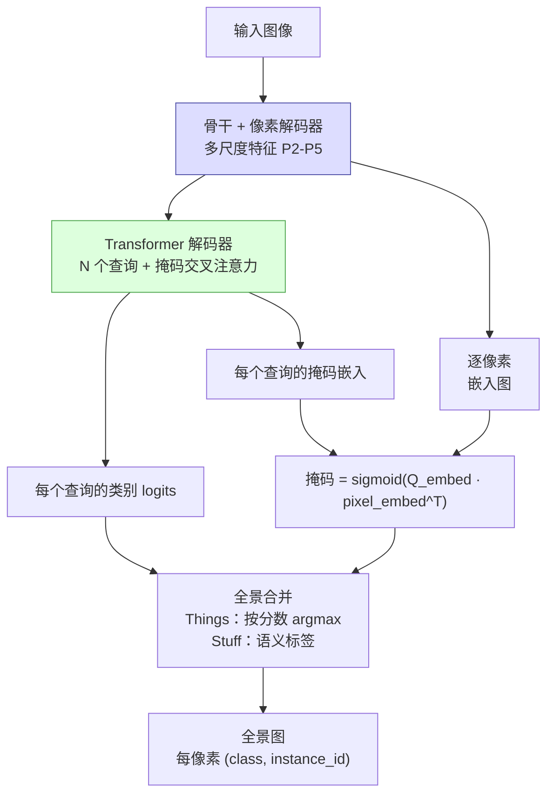

# 实例分割与全景分割

> **英文原文：** [cv-knowledge-base/02_core_tasks/03_instance_panoptic_segmentation.md](../../cv-knowledge-base/02_core_tasks/03_instance_panoptic_segmentation.md)（本中文版供参考，内容以英文原文为准）

> **最后更新：** 2026年10月
> **难度级别：** 高级
> **相关章节：** [语义分割](./02_semantic_segmentation.md) · [目标检测](./01_object_detection.md) · [视觉 Transformer](../03_architectures/01_vision_transformers.md) · [Any-Model 范式](../12_research_frontier_2024_2026/02_any_model_paradigm.md)

> **🆕 2026年10月更新：**
> - 新增 **仅编码器的通用分割**（EoMT，CVPR 2025 Highlight；VidEoMT，CVPR 2026）：朴素 ViT 以数倍速度达到 Mask2Former 式精度；配合 DINOv3 时报告 58.9 PQ（COCO 全景）和 49.9 mask AP（COCO 实例）。
> - 新增 **实时 DETR/YOLO 实例分割**：RF-DETR-Seg（ICLR 2026；在 T4 上 3.4–21.8 ms 下 40.3–49.9 mask AP）和 YOLO26-seg（33.9–47.0 mask AP，无 NMS）。
> - 新增 **SAM 3**（2025年11月），可根据文本/示例提示进行开放词汇、穷尽式的实例分割（LVIS 上 48.5 mask AP；SA-Co 基准），以及 SAM 3.1 多目标跟踪。
> - 更新了"当前 SOTA"表述、表格、关键论文、开放问题和延伸阅读。

---

## 概述

**实例分割（Instance segmentation）** 在目标检测的基础上，除边界框和类别标签外，还为每个检测到的物体实例预测像素级精确的二值掩码。两辆汽车会产生两个独立的掩码，每个掩码只覆盖对应那辆车的像素。**全景分割（Panoptic segmentation）** [Kirillov2019pan] 将对 **things**（可数物体：人、车、动物）的实例分割与对 **stuff**（无定形区域：天空、道路、植被）的语义分割统一起来，生成单一、一致的场景标注，其中每个像素恰好属于一个片段，带有语义类别，对 things 还带有唯一的实例 ID。

该领域的主导范式转变与检测领域类似：早期方法将问题分解为先检测后分割的流程（Mask R-CNN [He2017]、YOLACT [Bolya2019]）；后来的工作转向统一的基于查询的 Transformer 架构，由共享的可学习查询同时生成 thing 与 stuff 片段（Panoptic-DeepLab [Cheng2020]、Panoptic FPN [Kirillov2019fpn]、Mask2Former [Cheng2022]、OneFormer [Jain2023]）。统一的优势十分显著：在所有分割目标上联合训练的单一模型，其每参数精度优于三个专用模型，且一致的接口简化了下游系统设计。

**全景质量（Panoptic Quality, PQ）** 指标 [Kirillov2019pan] 提供了一个统一分数，同时反映识别能力（类别预测是否正确？）和分割质量（掩码形状是否准确？）。其乘法分解为 **分割质量（Segmentation Quality, SQ）** 与 **识别质量（Recognition Quality, RQ）**，清晰地区分了掩码边界精度与检测召回率，使其在模型分析中既可解释又可操作。

自 2025 年以来，该领域沿三个方向发展。(1) **简化：** EoMT [Kerssies2025] 等仅编码器模型表明，只要有强大的预训练 ViT（DINOv2/DINOv3），Mask2Former 的像素解码器和 Transformer 解码器在很大程度上是不必要的。(2) **实时部署：** DETR 式实时检测器加入了掩码头（RF-DETR-Seg [Robinson2026]），YOLO 系列实现了无 NMS（YOLO26），使 COCO mask AP 在 T4 上数十毫秒内接近 50。(3) **开放词汇：** SAM 3 [Carion2025] 可以在图像和视频中分割任意文本或示例概念的 *所有* 实例，使实例分割成为一种可提示的基础模型能力。

---

## 任务定义

**实例分割输出：**
- 一组 (mask_i, class_i, score_i) 元组，每个检测到的实例一个
- mask_i ∈ {0,1}^(H×W)，class_i ∈ {1,…,K_things}，score_i ∈ [0,1]
- 在 COCO 上用 AP@[0.50:0.95] 评测（使用掩码 IoU 阈值而非边界框 IoU）

**全景分割输出：**
- 单张图 (S, I) ∈ ({1,…,K} × ℤ_≥0)^(H×W)
- S[h,w] = 语义类别；I[h,w] = 实例 ID（stuff 为 0）
- 每个像素都被分配；不允许片段重叠

---

## 全景质量指标

```latex
% 全景质量分解为 SQ × RQ
\text{PQ} = \underbrace{\frac{\sum_{(p,g) \in \mathrm{TP}} \mathrm{IoU}(p,g)}{|\mathrm{TP}|}}_{\text{Segmentation Quality (SQ)}}
\times
\underbrace{\frac{|\mathrm{TP}|}{|\mathrm{TP}| + \frac{1}{2}|\mathrm{FP}| + \frac{1}{2}|\mathrm{FN}|}}_{\text{Recognition Quality (RQ)}}

% 匹配规则：当且仅当 IoU(p,g) > 0.5 时 (p,g) \in TP
% 注：IoU > 0.5 唯一确定匹配（不可能有两个预测
%     与同一个真实片段的 IoU 都超过 0.5）
% PQ_things 与 PQ_stuff 分别计算后取平均
```

实践中：
- **SQ** 衡量匹配片段的平均掩码重叠；强模型通常为 70–80
- **RQ** 等价于片段层面的 F1 分数；惩罚漏检和误检
- **PQ** = SQ × RQ；COCO 上的 SOTA 模型约为 58–60 PQ

---

## 架构里程碑

### Mask R-CNN

**Mask R-CNN** [He2017]（ICCV 2017）：典型的自顶向下实例分割模型。在 Faster R-CNN 基础上增加一个并行的 **掩码分支**——附加在每个 RoI 特征上的小型 FCN——为每个类别预测 K×28×28 的二值掩码。引入 **RoI Align** 替代 RoI Pooling：不再量化到整数网格位置，而是在精确对齐的浮点坐标上使用双线性插值，消除了损害掩码精度的错位伪影。

```latex
% RoI Align 在分数坐标处的双线性插值：
% 对特征图中的查询点 (x, y)：
% f(x,y) = \sum_{i,j \in \{0,1\}} (1 - |x - x_i|)(1 - |y - y_j|) \cdot v_{ij}
% 其中 (x_i, y_i) 为四个最近的整数网格点
% 这确保掩码分支的梯度流经精确的空间位置
```

使用 ResNet-101-FPN 的 Mask R-CNN 在 COCO test-dev 上取得 35.7 AP_mask（2017）。加入可变形卷积后提升到 37.5。作者：Kaiming He、Georgia Gkioxari、Piotr Dollár、Ross Girshick。

### YOLACT 与实时实例分割

**YOLACT** [Bolya2019]（ICCV 2019）：将实例分割重新表述为一小组 **原型掩码** 的线性组合：骨干生成 K=32 个全局原型掩码；同时，逐实例检测头预测 K 个线性组合系数。最终掩码 = sigmoid(P · c^T)，其中 P ∈ ℝ^(H×W×K) 为原型库，c ∈ ℝ^(1×K) 为该实例的系数。在 COCO test-dev 上以实时速度（Titan Xp 上 33.5 fps）取得 29.8 AP_mask。**YOLACT++** 加入掩码重打分和可变形卷积；34.1 AP。

**SOLOv2** [Wang2020]（NeurIPS 2020）：按位置分割物体（Segmenting Objects by Locations）。将图像划分为 S×S 网格单元；每个单元负责中心落在其中的实例。动态卷积机制从紧凑特征张量生成实例特定的掩码卷积核，并将其作用在掩码特征图上。将掩码学习与特征表示解耦，实现每个实例 O(1) 掩码预测的动态滤波机制。SOLOv2 使用 ResNet-101 在 COCO test-dev 上取得 39.7 AP_mask。作者：Xinlong Wang 等。

### 全景分割架构

**Panoptic FPN** [Kirillov2019fpn]（CVPR 2019）：在 Mask R-CNN 的 FPN 颈部增加语义分割分支。stuff 分支以加法融合将 FPN 特征上采样到 1/4 分辨率；thing 分支保留 Mask R-CNN 实例头。通过合并实例掩码（优先级更高）与 stuff 预测得到全景输出。R101-FPN 在 COCO val 上取得 40.9 PQ。

**Panoptic-DeepLab** [Cheng2020]（CVPR 2020）：自底向上方法，使用双解码器，分别进行实例中心预测和语义分割；实例中心被检测为局部极大值，像素被分配给最近的中心。Xception-71 骨干以实时速度在 COCO val 上取得 39.7 PQ；主要优势是无需 NMS 和 RoI 操作。

**MaskFormer** [Cheng2021]（NeurIPS 2021）：Mask2Former 的前身。由类 FPN 像素解码器生成逐像素嵌入；N 个可学习查询经 Transformer 解码器解码为 (类别, 掩码) 对；掩码由查询嵌入与逐像素嵌入的点积预测。在同一框架下统一语义与全景分割。在高 mIoU 的语义分割上超越了 Mask R-CNN。

**Mask2Former** [Cheng2022]（CVPR 2022）：2022 年至约 2024 年间所有分割任务的黄金标准，至今仍是参考的解码器设计。相对 MaskFormer 的关键改进是 **掩码交叉注意力**：不再进行全局注意力，而是将每个查询的交叉注意力限制在其预测的掩码区域内：

```latex
% 掩码交叉注意力（Mask2Former 公式 1）
X_l = \text{softmax}(\mathbf{M}_{l-1} + Q_l K_l^\top / \sqrt{d}) V_l + X_{l-1}

% 若像素 (h,w) 位于预测的前景掩码内，则 M_{l-1}[h,w] = 0
%              否则 = -inf（从注意力中屏蔽）
% 这将每个查询的上下文限制在其预测的物体区域内
```

使用 ResNet-50 的结果：COCO/ADE20K 上分别为全景 51.9 PQ、实例 44.2 AP、语义 57.7 mIoU。使用 Swin-L：COCO/ADE20K 上全景 57.8 PQ、实例 50.1 AP、语义 57.7 mIoU。

**OneFormer** [Jain2023]（CVPR 2023）：训练单个 Mask2Former 式模型，使用任务条件 token（"the task is {semantic/instance/panoptic}"）同时调制文本查询和损失函数。推理时选择相应的任务 token 即可切换模型行为。以单套权重在三项任务上均达到 Mask2Former 级 SOTA，在某些设置下优于任务专用模型。作者：Jitesh Jain、Jiachen Li、MangTik Chiu 等。



### 仅编码器的通用分割（2025–2026）

**EoMT** [Kerssies2025]（CVPR 2025 Highlight）将 N 个可学习查询 token 与 patch token 一起送入朴素 ViT 的最后若干块；类别 logits 来自查询 token，掩码来自查询-patch 点积，掩码注意力只在训练中使用，并在推理时被 *退火去除*。在 COCO 全景分割上（640×640，DINOv2 骨干，H100），EoMT-L 以 **128 FPS 达到 56.0 PQ**，EoMT-7B 达到 **58.4 PQ**，与 ViT-Adapter-7B + Mask2Former 持平但快约 2 倍。使用 DINOv3 骨干时，EoMT-L 在 1280×1280 下报告 **58.9 PQ**（全景）和 **49.9 mask AP**（实例）。**VidEoMT**（CVPR 2026）将仅编码器设计扩展到视频分割（比同类视频分割器最多快约 10 倍），**PMT**（2026）则将其适配到冻结的基础编码器。

### 实时实例分割（2025–2026）

**RF-DETR-Seg** [Robinson2026]（ICLR 2026）为经 NAS 搜索的 RF-DETR 模型族（DINOv2 骨干 + LW-DETR 解码器）加入掩码头。在 Roboflow 的可复现基准中（COCO val2017；T4、TensorRT FP16、batch 1），其范围从 **3.4 ms 下 40.3 mask AP（Nano）** 到 **21.8 ms 下 49.9 mask AP（2XL）**，而 YOLO11-seg 为 30.0–40.1。**YOLO26-seg**（Ultralytics，2026）在 YOLACT 式原型掩码基础上加入语义分割辅助损失和多尺度原型模块，并以无 NMS 端到端方式运行：在 T4 上 2.1–16.4 ms 下取得 33.9（n）至 47.0（x）mask AP。

### 开放词汇实例分割：SAM 3

**SAM 3** [Carion2025]（Meta，2025年11月）执行 **可提示概念分割（Promptable Concept Segmentation）**：对于一个名词短语或示例，它返回图像或视频中 *每一个* 匹配实例的掩码与身份。一个 DETR 式检测器（以存在性 token 将识别与定位分离）与一个 SAM 2 式跟踪器共享同一个视觉编码器（8.48 亿参数）。它报告 **LVIS 上 48.5 mask AP**，在 SA-Co/Gold 上 54.1 cgF1（人类：72.8）；其 SA-Co 基准（27 万个独特概念）使用 **cgF1**——一种分类门控的 F1，同时惩罚对不存在概念的预测——比 AP 更契合开放词汇的使用场景。SAM 3.1（2026年3月）使多目标视频跟踪在 128 个目标时快约 7 倍。

---

## 关键论文

| 论文 | 作者 | 年份 | 会议/期刊 | 主要贡献 |
|-------|---------|------|-------|-----------------|
| Mask R-CNN | He, Gkioxari, Dollár, Girshick | 2017 | ICCV | RoI Align + 掩码分支；实例分割基线 |
| Panoptic Segmentation (metric) | Kirillov, He, Girshick et al. | 2019 | CVPR | 全景质量（PQ）指标定义 |
| Panoptic FPN | Kirillov, Girshick et al. | 2019 | CVPR | 统一处理 things + stuff 的 FPN |
| YOLACT | Bolya, Zhou et al. | 2019 | ICCV | 基于原型的实时实例分割 |
| Panoptic-DeepLab | Cheng, Collins et al. | 2020 | CVPR | 自底向上；实例中心估计 |
| SOLOv2 | Wang, Kong et al. | 2020 | NeurIPS | 动态卷积核；COCO test-dev 39.7 AP |
| MaskFormer | Cheng, Schwing, Kirillov | 2021 | NeurIPS | 掩码分类统一框架 |
| Masked-Attention Mask Transformer (Mask2Former) | Cheng, Misra et al. | 2022 | CVPR | 掩码交叉注意力；COCO 57.8 PQ |
| OneFormer | Jain, Li et al. | 2023 | CVPR | 单一多任务模型；任务条件化 |
| Your ViT is Secretly an Image Segmentation Model (EoMT) | Kerssies, Cavagnero et al. | 2025 | CVPR (Highlight) | 仅编码器通用分割；ViT-7B 下 58.4 PQ |
| SAM 3: Segment Anything with Concepts | Carion, Gustafson et al. | 2025 | arXiv | 开放词汇穷尽式实例分割 + 跟踪；SA-Co |
| RF-DETR (incl. RF-DETR-Seg) | Robinson, Robicheaux et al. | 2025 | ICLR 2026 | 实时 DETR 实例分割；21.8 ms（T4）下 49.9 mask AP |
| VidEoMT | Norouzi, Zulfikar, Cavagnero et al. | 2026 | CVPR | 仅编码器视频分割 |

---

## 基准性能

### COCO val2017——实例分割（AP_mask @[0.50:0.95]）

| 模型 | 骨干网络 | AP_mask | AP_S | AP_M | AP_L | 备注 |
|-------|----------|---------|------|------|------|-------|
| Mask R-CNN | ResNet-50-FPN | 35.7 | 15.5 | 38.1 | 52.4 | 基线 |
| Mask R-CNN | ResNet-101-FPN | 36.1 | 16.4 | 38.8 | 53.1 | — |
| YOLACT-550 | ResNet-101 | 29.8 | 8.6 | 30.8 | 50.0 | 实时 33 fps |
| SOLOv2 | ResNet-101 | 39.7 | 17.3 | 42.9 | 57.4 | 动态卷积核 |
| Mask2Former | ResNet-50 | 44.2 | 22.8 | 47.3 | 66.1 | 通用模型 |
| Mask2Former | Swin-L | 50.1 | 29.9 | 53.7 | 72.1 | SOTA 单模型 |
| OneFormer | Swin-L | 50.0 | — | — | — | 多任务训练 |
| EoMT-L (1280²) | DINOv3 ViT-L | 49.9 | — | — | — | 仅编码器；H100 上 33 FPS |
| RF-DETR-Seg-2XL | DINOv2 ViT (NAS) | 49.9 | — | — | — | 实时；T4 上 21.8 ms（Roboflow 协议） |
| RF-DETR-Seg-N | DINOv2 ViT (NAS) | 40.3 | — | — | — | T4 上 3.4 ms |
| YOLO26x-seg | YOLO26 | 47.0 | — | — | — | 无 NMS；T4 上 16.4 ms（Ultralytics 报告） |

### COCO val2017——全景分割（PQ）

| 模型 | 骨干网络 | PQ | PQ_things | PQ_stuff | 备注 |
|-------|----------|----|-----------|---------|----|
| Panoptic FPN | ResNet-101 | 40.9 | 48.3 | 29.7 | Mask R-CNN + stuff 分支 |
| Panoptic-DeepLab | Xception-71 | 39.7 | 43.9 | 33.2 | 自底向上；实时 |
| MaskFormer | Swin-L | 52.7 | 58.5 | 44.0 | 掩码分类 |
| Mask2Former | ResNet-50 | 51.9 | 57.7 | 43.0 | 通用模型；50 个 epoch |
| Mask2Former | Swin-L | 57.8 | 64.2 | 48.1 | COCO val SOTA |
| OneFormer | Swin-L | 57.9 | 64.4 | 48.0 | 单一多任务模型 |
| Panoptic SegFormer | Swin-L | 56.2 | — | — | Test-dev |
| EoMT-L (640²) | DINOv2 ViT-L | 56.0 | — | — | 仅编码器；H100 上 128 FPS |
| EoMT-7B (640²) | DINOv2 ViT-7B | 58.4 | — | — | 与 ViT-Adapter-7B + M2F（58.4）持平，速度约为其 2 倍 |
| EoMT-L (1280²) | DINOv3 ViT-L | 58.9 | — | — | EoMT 最佳结果；H100 上 33 FPS |

---

## 优缺点

| 方面 | 优点 | 缺点 |
|--------|------|------|
| 自顶向下（Mask R-CNN） | 实例级精度高；置信度校准良好；生态成熟 | 两阶段；高分辨率下慢；全景分割需要额外的 stuff 头 |
| 自底向上（Panoptic-DeepLab / SOLO） | 推理快；无需 RoI 操作或 NMS；能较好处理重叠 | 实例分组错误；COCO AP 低于自顶向下方法 |
| 通用 Transformer（Mask2Former/OneFormer） | 单模型覆盖所有任务；SOTA 精度；统一训练 | 内存占用高；掩码注意力复杂；训练慢；需要大型骨干 |
| 基于原型（YOLACT） | 实时（33+ fps）；线性解码简单 | 掩码质量有限；难以处理小、细或被遮挡的物体 |
| 全景质量指标（PQ） | 统一；SQ/RQ 分解可解释；标准化 | 对过分割敏感；困难物体的 PQ 主导整体分数 |
| 仅编码器（EoMT） | 极简；在相同 PQ 下比 Mask2Former 快数倍；随更好的 ViT 扩展 | 需要大型预训练 ViT；小骨干下收益缩小 |
| 实时 DETR/YOLO 实例分割（RF-DETR-Seg、YOLO26-seg） | 在 T4 实时延迟下约 40–50 mask AP；无 NMS；易于导出 | 无 stuff 类别（仅实例）；对细长结构掩码分辨率有限 |
| 概念提示（SAM 3） | 任意文本/示例类别；穷尽式实例；视频跟踪 | 约 8.5 亿参数；非实时；在 stuff 和组合式短语上较弱 |

---

## 开放问题与研究空白

- **开放词汇全景分割：** 大多数全景模型只分割固定的 COCO things/stuff 类别集合；将全景分割与任意文本描述相关联是活跃前沿，早期工作包括 FC-CLIP 和 OpenSeg。SAM 3（2025）解决了针对 things 的穷尽式开放词汇 *实例* 分割，但包含无定形 stuff 在内的完整、无重叠的开放词汇全景图仍未解决。
- **视频实例与全景分割：** 将全景质量扩展到视频（VPQ、STQ）增加了时间一致性要求；当前方法在遮挡、外观变化以及长序列中的重识别方面表现欠佳。
- **高效通用模型：** Mask2Former 计算代价高（使用 Swin-L 时超过 2 亿参数）；仅编码器的 EoMT（2025）去除了大部分解码器开销，实时实例分割器（RF-DETR-Seg、YOLO26-seg）现已达到约 50 mask AP，但仍缺少一个能在边缘设备上以实时速度覆盖语义 + 实例 + 全景的轻量单一模型。
- **开放词汇分割的评测：** AP 忽略了对不存在概念的误检；SAM 3 的 cgF1 和 SA-Co 引入了概念级、感知存在性的评测，但开放词汇全景质量仍没有公认的协议。
- **拥挤场景处理：** 当物体严重遮挡或相互接触时，全景模型会混淆实例；对比式实例判别损失和深度感知分组很有前景，但尚未解决。
- **边界质量指标：** PQ 使用 IoU > 0.5 阈值，对边界精度不敏感；边界感知指标（BoundaryIoU [Cheng2021b]）尚未被标准化报告，掩盖了边缘定位方面的进展。
- **标注效率：** 像素级全景标注的成本约为边界框标注的 5 倍；将 SAM 与自动类别分配结合的交互式和半自动标注流程尚处于起步阶段。
- **实例 ID 的泛化：** 全景模型在每张图像中分配局部实例 ID，但不维持跨图像一致的身份；这限制了其在多视角三维理解和长视频分析中的应用。

---

## 延伸阅读

- [Mask R-CNN (He et al., 2017)](https://arxiv.org/abs/1703.06870)
- [Panoptic Segmentation — metric paper (Kirillov et al., 2019)](https://arxiv.org/abs/1801.00868)
- [YOLACT: Real-time Instance Segmentation (Bolya et al., 2019)](https://arxiv.org/abs/1904.02689)
- [SOLOv2: Dynamic and Fast Instance Segmentation (Wang et al., 2020)](https://arxiv.org/abs/2003.10152)
- [Masked-attention Mask Transformer — Mask2Former (Cheng et al., 2021)](https://arxiv.org/abs/2112.01527)
- [OneFormer: One Transformer to Rule Universal Image Segmentation (Jain et al., 2022)](https://arxiv.org/abs/2211.06220)
- [Your ViT is Secretly an Image Segmentation Model — EoMT (Kerssies et al., CVPR 2025)](https://arxiv.org/abs/2503.19108) · [EoMT 代码与 DINOv3 模型库](https://github.com/tue-mps/eomt)
- [VidEoMT: Your ViT is Secretly Also a Video Segmentation Model (Norouzi et al., CVPR 2026)](https://arxiv.org/abs/2602.17807)
- [SAM 3: Segment Anything with Concepts (Carion et al., 2025)](https://arxiv.org/abs/2511.16719)
- [RF-DETR: Real-Time Detection Transformer (Robinson et al., ICLR 2026)](https://arxiv.org/abs/2511.09554)
- [Ultralytics YOLO26 技术报告（Jocher et al., 2026）](https://arxiv.org/abs/2606.03748)
