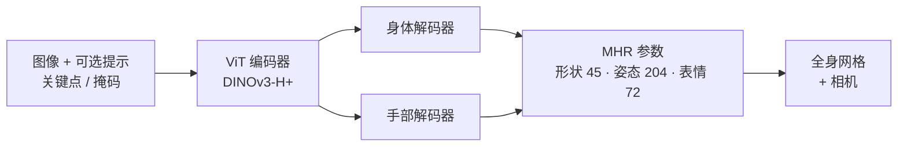

# 姿态估计：二维姿态、三维人体网格恢复与 6-DoF 物体姿态

> **英文原文：** [cv-knowledge-base/02_core_tasks/04_pose_estimation.md](../../cv-knowledge-base/02_core_tasks/04_pose_estimation.md)（本中文版供参考，内容以英文原文为准）

> **最后更新：** 2026年10月
> **难度级别：** 高级
> **相关章节：** [深度估计](./05_depth_estimation.md) | [光流与跟踪](./06_optical_flow_tracking.md) | [机器人感知](../06_robotics_and_embodied_ai/08_perception_for_robotics.md) | [三维视觉与场景理解](../04_3d_vision_and_scene/00_overview.md)

> **🆕 2026年10月更新：**
> - 新增 **SAM 3D Body**（Meta，2025年11月；论文 arXiv 2602.15989）：基于新的 **Momentum Human Rig（MHR）** 人体模型的可提示全身人体网格恢复（HMR），采用 DINOv3-H+ 骨干，在 3DPW 上 MPJPE 为 54.8 mm，在 EMDB 上为 61.7 mm。
> - 新增 2024–2026 年 **基础模型规模的 HMR** 浪潮：NLF（NeurIPS 2024）、Multi-HMR（ECCV 2024）、GVHMR（SIGGRAPH Asia 2024）、PromptHMR（CVPR 2025）、SMPLest-X（TPAMI 2025）、Human3R（2025），以及替代性人体模型（MHR、Anny）。
> - 新增 **以人为中心的基础模型** Sapiens（ECCV 2024）与 **Sapiens2**（ICLR 2026；10 亿张人体图像，最多 50 亿参数），以及实时端到端二维姿态估计（采用 RLE 的 YOLO26-pose；RF-DETR 关键点预览版）。
> - 新增无模型（model-free）6-DoF 姿态方法 **Any6D**（CVPR 2025）；新增基准条目、关键论文、开放问题与延伸阅读。

---

## 概述

姿态估计涵盖一系列密切相关的问题：从二维图像或视频推断关节体（人或动物）的空间构型，恢复完整的三维人体网格模型，以及估计刚体物体的六自由度（6-DoF）姿态。这些问题有一个共同的核心挑战：将本质上存在歧义的二维投影观测映射回结构化的三维量。过去十年，深度学习将每个子问题从手工特征流程转变为端到端可训练系统，而近期的基础模型方法能够以极少的任务特定微调在物体类别和场景类型之间泛化。

二维人体姿态估计旨在在图像空间中定位解剖学关键点（关节）。主流范式依赖 **热图回归（heatmap regression）**：对每个关键点，网络预测一张覆盖图像位置的高斯模糊概率图，并通过 soft-argmax 解码达到亚像素精度。存在两种相互竞争的范式。**自顶向下（Top-down）** 方法先检测边界框（人体检测），再在每个裁剪区域内估计单人关键点，受益于强的单实例上下文，但增加了检测延迟，且在裁剪区域重叠时表现欠佳。**自底向上（Bottom-up）** 方法同时检测所有关键点，并通过部件亲和场或关联嵌入向量将其分组为各个实例；它们推理更快，但更难训练，在精细定位上历来精度较低。最先进的自顶向下方法主导着各项基准：HRNet [Sun2019] 在整个网络中保持高分辨率特征图，而不是编码到低分辨率瓶颈再通过上采样恢复分辨率；更近期则有 ViTPose [Xu2022] 等朴素 ViT 估计器以及以人为中心的基础骨干（Sapiens），它们依靠大规模预训练取得优势。

三维人体姿态与形状恢复将关键点定位扩展到完整的网格级重建，通常以 SMPL 人体模型 [Loper2015] 进行参数化。SMPL 将网格分解为姿态参数（轴角形式的关节旋转，θ ∈ ℝ^72）和形状参数（PCA 系数，β ∈ ℝ^10），提供紧凑、可微的优化目标。里程碑式的 HMR [Kanazawa2018] 利用对有效人体形状的对抗先验，展示了从单张 RGB 图像端到端回归 SMPL 参数。VIBE [Kocabas2020] 等基于视频的方法对此进行了扩展，用 GRU 处理时序序列，并以动作捕捉数据进行判别以保证时间一致性。完全基于 Transformer 的 HMR 2.0 / 4D-Humans [Goel2023] 用基于 ViT 的骨干替代卷积编码器，大幅提升了精度和泛化能力。对于 6-DoF 物体姿态，FoundationPose [Wen2024] 代表了范式转变：单一统一模型通过在测试时学习神经物体表示，同时处理基于模型（model-based）与无模型（model-free）两种设置，无需针对类别重新训练。

自 2024 年以来，该领域被 **基础模型规模的可提示模型** 重塑。在数亿到十亿张人体图像上预训练的以人为中心的骨干（Sapiens [Khirodkar2024]、Sapiens2 [Khirodkar2026]）以单一表征同时服务于二维姿态、人体部件分割、法线和点图。在三维方面，单图像 HMR 转向大型 ViT/DINOv3 骨干、大规模伪标注数据引擎和新的人体模型：SAM 3D Body [Yang2026] 预测 Momentum Human Rig（MHR）网格，并接受 SAM 风格的关键点和掩码提示。与此同时，实时二维姿态估计已实现无 NMS 的端到端推理（YOLO26-pose）。

---

## 二维人体姿态估计

### 热图回归

标准表述为预测 K 张热图 H ∈ ℝ^{K×H×W}，每个关键点一张。关键点 k 位于 (x_k, y_k) 时，其真实热图为：

```latex
H_k(x, y) = \exp\!\left(-\frac{(x - x_k)^2 + (y - y_k)^2}{2\sigma^2}\right)
```

网络以预测热图与真实热图之间的逐像素 MSE 进行训练。推理时，关键点位置解码为：

```latex
\hat{p}_k = \arg\max_{(x,y)} H_k(x, y)
```

并通过泰勒展开或 soft-argmax 聚合进行亚像素精修。

### 自顶向下与自底向上

| 范式 | 方法示例 | 优点 | 缺点 |
|---|---|---|---|
| 自顶向下 | HRNet [Sun2019], SimpleBaseline [Xiao2018] | 单人精度更高 | 依赖检测器；开销随人数 N 增长 |
| 自底向上 | OpenPose [Cao2019], HigherHRNet | 单次推理速度快 | 分组步骤更难；拥挤场景中精度较低 |

### HRNet 架构

HRNet [Sun2019] 是姿态估计中最具影响力的自顶向下骨干。其关键创新是 **并行多分辨率分支**：从单一高分辨率分支开始，HRNet 不断添加较低分辨率分支，并通过反复的多尺度融合相互连接。与通过降低空间分辨率构建语义瓶颈的网络不同，HRNet 全程保持高分辨率表征，仅通过轻量的横向连接进行信息恢复。这避免了标准编码器-解码器设计固有的精度损失。

```
阶段 1：  [HR 分支]  （C 个通道，全分辨率）
阶段 2：  [HR 分支] — [LR 分支 × 2]，带跨尺度融合
阶段 3：  [HR 分支] — [LR 分支 × 2] — [LR 分支 × 4]
阶段 4：  [HR 分支] — ... — [LR 分支 × 8]
最终：    在 HR 输出上接热图头
```

### OpenPose 与部件亲和场

OpenPose [Cao2019] 引入了部件亲和场（Part Affinity Fields, PAFs）：编码肢体方向和位置的二维向量场，使得可以在不同个体之间对检测到的关键点进行贪心二分匹配。肢体 (j1, j2) 在点 p 处的 PAF 为：

```latex
\mathbf{L}_{c}(p) = \begin{cases} \mathbf{v} & \text{if } p \text{ on limb segment} \\ 0 & \text{otherwise} \end{cases}
```

其中 **v** = (p_{j2} − p_{j1}) / ‖p_{j2} − p_{j1}‖ 为单位方向向量。关联分数沿候选肢体线段对 PAF 进行积分。

### Transformer 与以人为中心的基础模型（2022–2026）

**ViTPose / ViTPose++** [Xu2022]（NeurIPS 2022 / TPAMI 2023）表明，带简单反卷积头的朴素 ViT 是强大的自顶向下姿态估计器；ViTPose++-H 在 COCO、AIC、MPII、AP-10K、APT-36K 和 COCO-WholeBody 上联合训练，在 256×192 下于 COCO val 达到 79.4 AP，并能在人体与动物关键点之间迁移。

**Sapiens** [Khirodkar2024]（Meta，ECCV 2024 最佳论文候选）在 **3 亿张自然场景人体图像** 上以 1024×1024 原生分辨率预训练 MAE ViT（3 亿–20 亿参数），然后针对稠密全身二维姿态、人体部件分割、深度和表面法线进行微调。**Sapiens2** [Khirodkar2026]（ICLR 2026；2026年4月发布）将预训练扩展到 **10 亿张人体图像**，模型规模从 1 亿到 50 亿参数（另有一个 4K 分辨率的 1B 变体），覆盖姿态、人体部件分割、表面法线、点图和人像抠图。

**实时端到端二维姿态。** Ultralytics **YOLO26-pose**（2026）集成了残差对数似然估计（Residual Log-Likelihood Estimation, RLE）用于关键点回归，并支持无 NMS 推理；YOLO26n–x-pose 报告 **57.2–71.6 AP**（COCO 关键点 val，OKS），在 T4 上延迟为 1.8–12.2 ms，Ultralytics 报告其相对 YOLO11-pose 最多提升 7.2 AP。Roboflow 的 **RF-DETR 关键点** 头（预览版）报告在 T4 上 9.7 ms 下达到 71.8 AP。

---

## SMPL 参数化人体模型

SMPL [Loper2015] 定义网格 M(β, θ) ∈ ℝ^{6890×3}，其中：
- **β ∈ ℝ^10**：形状 PCA 系数（身体身份）
- **θ ∈ ℝ^{72}**：轴角形式的关节旋转（24 个关节 × 3）

```latex
M(\beta, \theta) = W\!\left(T_P(\beta,\theta),\, J(\beta),\, \theta,\, \mathcal{W}\right)
```

其中 T_P 为施加形状与姿态后的模板，J(β) 为由形状回归得到的关节位置，W 为线性混合蒙皮函数。SMPL-X 将 SMPL 扩展到手部和面部表情。

**替代性人体模型（2025–2026）。** **MHR——Momentum Human Rig** [MHR2025]（Meta，arXiv 2511.15586）将骨骼结构与表面形状解耦，提供 45 个身份（形状）参数、204 个关节运动参数、72 个面部表情参数、七个细节层级（LOD）以及基于神经网络的姿态矫正形变；它是 SAM 3D Body 的输出表示。**Anny**（NAVER LABS）是一个源自 MakeHuman 的开放、可微人体模型，用单一拓扑覆盖从婴儿到老人的各类体型；一个预测 Anny 参数的 Multi-HMR 检查点于 2026年2月发布。SMPL(-X)、MHR 与 Anny 并存，使跨模型评测和转换成为一个现实问题。

---

## 三维人体网格恢复

### HMR（Kanazawa 2018）

HMR [Kanazawa2018] 使用迭代反馈回路（iterative error feedback, IEF），从 ResNet-50 编码器回归 SMPL 参数（θ、β、相机 π）。对抗判别器 D(θ, β) 区分回归得到的参数与真实动作捕捉姿态，在不需要成对三维标注的情况下提供数据驱动的先验。总损失为：

```latex
\mathcal{L}_{\text{HMR}} = \lambda_{\text{reproj}} \|\hat{x} - x\|_1 + \lambda_{\text{3D}} \|\hat{\Theta} - \Theta^*\|_2 - \lambda_{\text{adv}} \log D(\hat{\theta}, \hat{\beta})
```

### VIBE（Kocabas 2020）

VIBE [Kocabas2020] 将 HMR 扩展到视频，用 GRU 时序编码器处理逐帧 ResNet 特征。在 AMASS 动作捕捉数据集上训练的运动判别器区分自然运动序列与回归得到的运动序列，以保证时间上的合理性。VIBE 是从自然场景视频中学习连贯、无伪影三维人体运动的关键一步。

### HMR 2.0 / 4D-Humans（Goel 2023）

4D-Humans [Goel2023]（以 "Humans in 4D" 发表于 ICCV 2023）用经 MAE 预训练的 ViT-H/16 骨干替代卷积编码器，大幅提升了泛化能力。Transformer 架构对整幅图像上下文进行注意力计算，减少了在遮挡和不寻常视角下的系统性失败。该系统在视频中联合重建并跟踪多人，通过时间一致性模块关联逐帧的 SMPL 估计。HMR 2.0 在 3DPW 上取得最先进的 PA-MPJPE，并且比以往基于 CNN 的方法更好地泛化到自然场景图像。

### 基础模型规模与可提示的 HMR（2024–2026）

- **Multi-HMR** [Baradel2024]（ECCV 2024）：从单张图像一次性恢复多人全身（SMPL-X）网格并给出其在相机空间中的位置；赢得 CVPR 2024 RHOBIN 挑战赛三维人体重建赛道。
- **NLF——神经定位场（Neural Localizer Fields）** [Sarandi2024]（NeurIPS 2024）：学习一个可以查询身体表面或骨架上 *任意* 点的连续场，将关键点/网格约定各异的异构数据集统一为一个大规模训练混合。
- **GVHMR** [Shen2024]（SIGGRAPH Asia 2024）：利用 **重力-视角坐标（gravity-view coordinates）** 从单目视频中恢复以世界坐标为参考的人体运动，将运动与相机旋转解耦。
- **SMPLest-X** [Yin2025]（TPAMI 2025）：在 SMPLer-X 基础上对数据和模型规模进行"极致扩展"，用于表达性（身体 + 手 + 脸）人体姿态与形状估计。
- **PromptHMR** [Wang2025b]（CVPR 2025）：一种可提示的 HMR 模型，以空间和语义提示（例如目标人物的框和掩码）为条件，提升了在拥挤和交互场景中的鲁棒性。
- **Human3R** [Chen2025h]（arXiv 2510.06219）："Everyone Everywhere All at Once"——基于 CUT3R 流式三维重建模型，从视频中在线、前馈地联合重建多个人体及其周围的四维场景。

### SAM 3D Body（Meta，2025）

**SAM 3D Body（3DB）** [Yang2026]（Meta Superintelligence Labs；2025年11月19日与 SAM 3D Objects 一同发布检查点和数据；论文 arXiv 2602.15989）是一个 **可提示的单图像全身 HMR 模型**。它采用编码器-解码器架构，以 **MHR** 参数化估计身体、足部和手部（可由单独的手部解码器精修手部），并以 SAM 系列的风格接受辅助的 **二维关键点和掩码提示**。训练使用多阶段标注流程，结合可微优化、多视角几何、稠密关键点检测，以及一个挖掘罕见姿态和视角的数据引擎；数据集已公开。使用 DINOv3-H+（8.4 亿参数）骨干时，它报告 **3DPW 上 MPJPE 54.8 mm**、**EMDB 上 61.7 mm**、RICH 上 PVE 60.3 mm，以及 FreiHAND 手部 PA-MPJPE 5.5 mm，并在遮挡和不寻常视角下的定性效果优于 CameraHMR、NLF 和 HMR 2.0。



---

## 6-DoF 物体姿态估计

### 问题表述

给定一张 RGB(-D) 图像和物体模型（或参考图像），估计刚体变换 T = (R, t) ∈ SE(3)，其中 R ∈ SO(3) 为 3×3 旋转矩阵，t ∈ ℝ³ 为平移向量，表示物体在相机坐标系中的姿态。

### FoundationPose（Wen 2024）

FoundationPose [Wen2024] 作为 highlight 论文发表于 CVPR 2024，是一个用于 6D 姿态估计与跟踪的统一基础模型。主要创新：

1. **与模型无关的神经表示**：给定物体 CAD 模型或少量参考 RGBD 图像，在测试时学习神经物体场，无需重新训练。
2. **渲染-比较假设检验**：渲染多个姿态假设，并由基于 Transformer 的网络比较渲染外观与观测外观进行打分。
3. **姿态跟踪精修**：通过专门的精修模块跟踪帧间运动，实现视频中平滑的 6-DoF 跟踪。

FoundationPose 同时支持 **基于模型**（提供 CAD 模型）和 **无模型**（仅参考图像）两种设置，在标准基准上两者表现接近——这是面向机器人部署的重要实践进展。其官方代码库报告，截至 2024年3月，它在未见物体基于模型的姿态估计 BOP 排行榜上位列第一。


### 无模型的新物体姿态估计（2025–2026）

**Any6D** [Lee2025]（CVPR 2025）不再需要 CAD 模型或多视角参考采集：仅凭未知物体的 **一张 RGB-D 锚点图像**，即可在新场景中联合估计物体的 6-DoF 姿态 *和度量尺寸*，它借助图像到三维生成（InstantMesh）得到粗略物体模型，并基于 FoundationPose 式的渲染-比较进行姿态精修。与此同时，**SAM 3D Objects**（Meta，arXiv 2511.16624，2025年11月）等单图像三维生成器可在杂乱的自然场景中重建被掩码物体的形状、纹理 *以及布局（姿态）*，模糊了 6-DoF 姿态估计与图像到三维重建之间的界限。

---

## 评测指标

### 二维姿态：PCK 与 OKS/AP

**PCK（正确关键点百分比，Percentage of Correct Keypoints）：** 若预测关键点落在真实位置的阈值 τ 范围内，则视为"正确"。阈值通常按躯干尺寸或头部长度归一化：

```latex
\text{PCK}@\tau = \frac{1}{NK} \sum_{n=1}^{N} \sum_{k=1}^{K} \mathbf{1}\!\left[\|\hat{p}_{nk} - p_{nk}\|_2 \leq \tau \cdot d_n\right]
```

**OKS（目标关键点相似度，Object Keypoint Similarity）：** 用于 COCO AP 评测，类似于边界框的 IoU：

```latex
\text{OKS} = \frac{\sum_k \exp\!\left(-d_k^2 / 2s^2 \sigma_k^2\right) \cdot \delta(v_k > 0)}{\sum_k \delta(v_k > 0)}
```

其中 d_k 为预测与真实关键点 k 之间的欧氏距离，s 为物体尺度，σ_k 为每个关键点的标准差，v_k 为可见性标志。**AP**（平均精度）通过以 0.05 为步长、在 0.5 到 0.95 之间扫描 OKS 阈值计算。

### 三维姿态：MPJPE

**MPJPE（平均每关节位置误差，Mean Per-Joint Position Error）：** 预测与真实三维关节位置之间的平均欧氏距离（单位 mm）：

```latex
\text{MPJPE} = \frac{1}{NK} \sum_{n,k} \|\hat{J}_{nk} - J_{nk}\|_2
```

**PA-MPJPE（Procrustes 对齐的 MPJPE）：** 在计算误差前，先通过刚性 Procrustes 变换将预测与真实值对齐，从而将形状/关节角误差与全局朝向误差分离。

### 6-DoF 物体姿态：ADD 与 BOP 指标

**ADD(-S)：** 模型点平均距离（Average Distance of Model Points）——分别用预测姿态和真实姿态变换三维模型点后，两者之间的平均距离。对于对称物体，ADD-S 使用最小距离匹配。典型阈值：模型直径的 10%。

**BOP 基准**（Hodan 2018，持续更新）：使用 VSD（可见表面差异，Visible Surface Discrepancy）、MSSD 和 MSPD 指标，它们与渲染质量的校准更好；AR_VSD 目前是排行榜的主要指标。

---

## 关键论文

| 论文 | 作者 | 年份 | 会议/期刊 | 主要贡献 |
|---|---|---|---|---|
| OpenPose: Realtime Multi-Person 2D Pose Estimation Using Part Affinity Fields | Cao, Hidalgo, Simon, Wei, Sheikh | 2019 | IEEE TPAMI | 自底向上的 PAF 方法；首个开源实时多人系统 |
| Deep High-Resolution Representation Learning for Human Pose Estimation (HRNet) | Sun, Xiao, Liu, Wang | 2019 | CVPR | 全程保持高分辨率表征；最先进的自顶向下热图方法 |
| SMPL: A Skinned Multi-Person Linear Model | Loper, Mahmood, Romero, Pons-Moll, Black | 2015 | ACM ToG (SIGGRAPH Asia) | θ/β 参数化人体模型；网格恢复的基础表示 |
| End-to-End Recovery of Human Shape and Pose (HMR) | Kanazawa, Black, Jacobs, Malik | 2018 | CVPR | 首个带对抗姿态先验的端到端 SMPL 回归 |
| VIBE: Video Inference for Human Body Pose and Shape Estimation | Kocabas, Athanasiou, Black | 2020 | CVPR | GRU 时序模型 + AMASS 运动判别器用于视频网格恢复 |
| Humans in 4D: Reconstructing and Tracking Humans with Transformers (HMR 2.0) | Goel, Pavlakos, Rajasegaran, Kanazawa, Malik | 2023 | ICCV | 基于 ViT 的 HMR；联合视频跟踪；大规模 BEDLAM 训练数据 |
| FoundationPose: Unified 6D Pose Estimation and Tracking of Novel Objects | Wen, Yang, Kautz, Birchfield | 2024 | CVPR (Highlight) | 面向基于模型和无模型 6-DoF 姿态的基础模型；渲染-比较 |
| Sapiens: Foundation for Human Vision Models | Khirodkar et al. | 2024 | ECCV | 3 亿张人体图像的 MAE 预训练；1K 分辨率的姿态/分割/深度/法线 |
| Multi-HMR: Multi-Person Whole-Body Human Mesh Recovery in a Single Shot | Baradel et al. | 2024 | ECCV | 一次性多人 SMPL-X 恢复 |
| Neural Localizer Fields for Continuous 3D Human Pose and Shape Estimation (NLF) | Sárándi, Pons-Moll | 2024 | NeurIPS | 可查询的连续人体场；统一异构数据集 |
| World-Grounded Human Motion Recovery via Gravity-View Coordinates (GVHMR) | Shen et al. | 2024 | SIGGRAPH Asia | 用重力-视角坐标进行以世界为参考的视频 HMR |
| PromptHMR: Promptable Human Mesh Recovery | Wang, Sun, Patel, Daniilidis, Black, Kocabas | 2025 | CVPR | 带空间/语义提示的可提示 HMR |
| Any6D: Model-free 6D Pose Estimation of Novel Objects | Lee et al. | 2025 | CVPR | 从单张 RGB-D 锚点图像估计 6-DoF 姿态与尺寸 |
| SMPLest-X: Ultimate Scaling for Expressive Human Pose and Shape Estimation | Yin et al. | 2025 | TPAMI | 面向 SMPL-X 恢复的数据/模型扩展 |
| MHR: Momentum Human Rig | Meta | 2025 | arXiv | 骨骼与表面解耦的参数化人体模型；多细节层级；姿态矫正 |
| SAM 3D Body: Robust Full-Body Human Mesh Recovery | Yang, Kukreja, Pinkus et al. | 2026 | arXiv | 基于 MHR 的可提示全身 HMR；DINOv3 骨干；2025年11月发布 |
| Sapiens2 | Khirodkar, Wen, Martinez, Dong, Su, Saito | 2026 | ICLR | 10 亿张人体图像预训练；1 亿–50 亿参数 |

---

## 基准性能

| 模型 | 数据集 | 指标 | 分数 | 备注 |
|---|---|---|---|---|
| HRNet-W48 (top-down) | COCO test-dev | AP (OKS) | 75.5 | 单尺度，无额外训练数据 |
| ViTPose-H | COCO test-dev | AP (OKS) | 79.1 | ViT 骨干，大规模预训练 |
| HMR 2.0 | 3DPW test | PA-MPJPE (mm) | 44.5 | ViT-H 骨干，BEDLAM 训练 |
| VIBE | 3DPW test | PA-MPJPE (mm) | 56.5 | GRU 时序模型；发表时为最先进 |
| HMR (original) | Human3.6M | MPJPE (mm) | 88.0 | ResNet-50 骨干；单帧 |
| FoundationPose (model-based) | YCB-V | AR_VSD | 84.0 | 见 [Wen2024]；NVIDIA CUDA 推理 |
| FoundationPose (model-free) | YCB-V | AR_VSD | 76.0 | 仅参考图像设置 |
| ViTPose++-H | COCO val | AP (OKS) | 79.4 | 256×192；多数据集训练（官方仓库） |
| YOLO26x-pose | COCO val | AP (OKS) | 71.6 | 端到端无 NMS；T4 上 12.2 ms（Ultralytics） |
| RF-DETR Keypoint (preview) | COCO val | AP (OKS) | 71.8 | T4 上 9.7 ms（Roboflow 协议） |
| SAM 3D Body (DINOv3-H+) | 3DPW | MPJPE (mm) | 54.8 | 单图像；MHR 输出；官方检查点 |
| SAM 3D Body (DINOv3-H+) | EMDB | MPJPE (mm) | 61.7 | 同一检查点；RICH 上 PVE 60.3 mm |

*注：FoundationPose 的确切 BOP 分数因数据划分而异；所列数值来自原论文。*

---

## 优缺点

| 方面 | 优点 | 缺点 |
|---|---|---|
| 自顶向下二维姿态 | 单实例精度最高；上下文裁剪隔离个体 | 依赖上游检测器；开销随人数 O(N) 增长 |
| 自底向上二维姿态 | 单次推理；天然适应人群；延迟更低 | 依赖分组启发式；对遮挡/小实例精度较低 |
| 基于 SMPL 的网格恢复 | 紧凑、物理上合理的参数化；可微 | 不扩展（SMPL-X）时无法建模衣物、头发或手/脸 |
| 视频网格恢复（VIBE/HMR2.0） | 时间平滑；更好地处理单帧歧义 | 需要视频输入；内存随序列长度增长 |
| FoundationPose（基础模型） | 无需针对类别重新训练；可处理新物体；支持无模型设置 | 渲染-比较推理开销大；需要准确的分割 |
| 以人为中心的基础骨干（Sapiens/Sapiens2） | 一个高分辨率表征同时用于姿态、部件、法线、点图；自然场景泛化能力强 | 3 亿–50 亿参数；高分辨率推理开销大；仅限人体领域 |
| 可提示的基础 HMR（SAM 3D Body、PromptHMR） | 对遮挡/罕见姿态鲁棒；可通过提示进行用户引导的修正；全身 + 手部 | 骨干庞大；新人体模型（MHR）无法与 SMPL 基准直接比较；单图像（无时序模型） |
| 端到端实时二维姿态（YOLO26-pose） | 无 NMS；毫秒级延迟；部署简单 | 在 COCO 上比自顶向下 ViT 姿态模型低约 8 AP；仅 17 个 COCO 关键点 |

---

## 开放问题与研究空白

- **衣物与可变形表面：** SMPL 假设身体几乎无衣物；将参数化恢复扩展到任意衣物（SMPL+D、CAPE、ICON）在实时速率下仍未解决。
- **遮挡推理：** 二维和三维方法在严重遮挡下都会退化；学习感知遮挡的表征和人与人之间的深度排序是活跃领域。
- **第一人称与多相机融合：** 在 AR/VR 中从头戴式鱼眼相机（EgoBody、EgoHMR）实时估计全身姿态，是一个研究不足但实际重要的场景。
- **无标注的三维监督：** 自然场景中成对的二维-三维数据稀缺；利用多视角几何或神经渲染的弱监督和自监督方法在规模上仍然有限。
- **可变形或透明物体的 6-DoF 姿态：** 刚体姿态方法对软体、布料、液体或透明物体失效；类别级 6-DoF 估计尚处于起步阶段。
- **边缘设备上的实时 6-DoF 跟踪：** FoundationPose 的渲染-比较流程对 GPU 要求高；神经光场或隐式表示方法必须经过蒸馏才能用于嵌入式机器人。
- **身体+手+脸的统一重建：** 在视频帧率下进行 SMPL-X 恢复，并准确估计手指和面部表情，仍是重大挑战。
- **人体模型碎片化：** SMPL/SMPL-X、MHR（SAM 3D Body）与 Anny 如今并存；3DPW/EMDB 等基准假定 SMPL 拓扑，因此公平比较需要有损的模型间拟合。需要共享的评测协议或与拓扑无关的指标。
- **从单图像基础 HMR 到一致的四维人体：** SAM 3D Body 和 Sapiens2 都是逐图像的；如何将其鲁棒性与以世界为参考的时序模型（GVHMR、Human3R）及无漂移的场景重建结合起来，仍是开放问题。
- **数据引擎与伪标签偏差：** 现代 HMR 依赖来自优化和多视角拟合的伪标签；标注流程中的偏差（例如偏向常见体型和相机模型）如何传播到基础模型中，基本上尚未被度量。

---

## 延伸阅读

- [HRNet paper (arXiv:1902.09212)](https://arxiv.org/abs/1902.09212) — 深度高分辨率表征学习 [Sun2019]
- [4D-Humans / HMR 2.0 项目页](https://shubham-goel.github.io/4dhumans/) — 完整代码、预训练模型与演示 [Goel2023]
- [FoundationPose 项目（NVLabs）](https://github.com/NVlabs/FoundationPose) — NVIDIA 官方实现 [Wen2024]
- [SMPL 模型主页（MPI-IS）](https://smpl.is.tue.mpg.de/) — SMPL 官方下载及扩展模型 [Loper2015]
- [COCO Keypoints Challenge](https://cocodataset.org/#keypoints-2023) — 标准二维姿态基准及 OKS 指标定义
- [BOP Benchmark](https://bop.felk.cvut.cz/home/) — 采用 VSD/MSSD/MSPD 指标的 6-DoF 物体姿态排行榜
- [SAM 3D Body (arXiv:2602.15989)](https://arxiv.org/abs/2602.15989) · [代码与检查点](https://github.com/facebookresearch/sam-3d-body) — 可提示的全身 HMR [Yang2026]
- [MHR: Momentum Human Rig (arXiv:2511.15586)](https://arxiv.org/abs/2511.15586) — SAM 3D Body 使用的参数化人体模型 [MHR2025]
- [Sapiens (arXiv:2408.12569)](https://arxiv.org/abs/2408.12569) · [Sapiens2 (arXiv:2604.21681)](https://arxiv.org/abs/2604.21681) — 以人为中心的基础模型 [Khirodkar2024, Khirodkar2026]
- [Neural Localizer Fields (arXiv:2407.07532)](https://arxiv.org/abs/2407.07532) — 连续的三维人体姿态与形状 [Sarandi2024]
- [PromptHMR (arXiv:2504.06397)](https://arxiv.org/abs/2504.06397) — 可提示的人体网格恢复 [Wang2025b]
- [Any6D (arXiv:2503.18673)](https://arxiv.org/abs/2503.18673) — 新物体的无模型 6D 姿态 [Lee2025]
- [Ultralytics YOLO26 技术报告 (arXiv:2606.03748)](https://arxiv.org/abs/2606.03748) — 包含采用 RLE 的 YOLO26-pose
