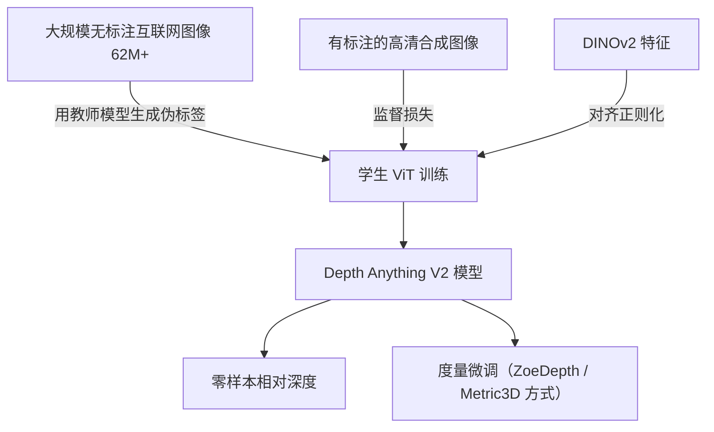
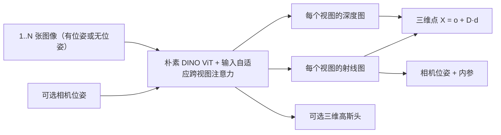

# 深度估计：单目、双目与基础模型

> **英文原文：** [cv-knowledge-base/02_core_tasks/05_depth_estimation.md](../../cv-knowledge-base/02_core_tasks/05_depth_estimation.md)（本中文版供参考，内容以英文原文为准）

> **最后更新：** 2026年10月
> **难度级别：** 高级
> **相关章节：** [姿态估计](./04_pose_estimation.md) | [三维视觉与场景理解](../04_3d_vision_and_scene/00_3d_representations.md) | [三维重建](./09_3d_reconstruction.md) | [Any-Model 范式](../12_research_frontier_2024_2026/02_any_model_paradigm.md) | [面向机器人的感知](../06_robotics_and_embodied_ai/08_perception_for_robotics.md)

> **🆕 2026年10月更新：**
> - 补充了本文此前缺失的 2024–2025 年一代深度基础模型：Marigold（基于扩散）、UniDepth/UniDepthV2 与 Depth Pro（无需内参的度量深度）、MoGe/MoGe-2（度量点图）、Video Depth Anything（长视频一致性）以及 FoundationStereo（零样本双目，CVPR 2025 最佳论文提名）。
> - 新增 **Depth Anything 3**（ByteDance Seed，2025年11月）一节：用一个朴素的 DINO Transformer 和单一的深度-射线目标统一处理单目、多视图以及有/无位姿输入，并提供面向长视频的 DA3-Streaming。
> - 2026 年发布：**MoGe-3**（2026年8月，稀疏体素细化以恢复精细细节）和 **Fast-FoundationStereo**（2025年12月，实时双目）。
> - 单目深度如今已与前馈式多视图几何（VGGT、π³、MapAnything）和四维重建（D4RT，CVPR 2026 最佳论文）相互交叠；参见[三维重建](./09_3d_reconstruction.md)。
> - 更新了关键论文、基准、优缺点、开放问题和延伸阅读。

---

## 概述

深度估计——推断相机到场景表面的距离——是连接二维图像与三维理解的基础计算机视觉任务。根据可用输入，该问题有几种形式：**单目**（单张图像或视频）、**双目**（同步且已校正的图像对）以及**多视图**（在时间或空间上重叠的视图）。单目深度本质上是病态的——一个给定的二维投影与无穷多个三维场景相容——因此基于学习的方法必须利用光度线索、遮挡模式和学习到的场景先验。双目深度估计受到对极几何更强的约束，但需要精确标定，并且在无纹理和反光表面上表现不佳。

该领域经历了四个不同的时代。[Eigen2014] 的开创性深度学习工作表明，多尺度 CNN 通过耦合全局上下文网络与局部细化网络，可以从单张图像预测逐像素深度，从根本上确立了数据驱动的深度估计。**自监督范式**随 Monodepth2 [Godard2019] 出现，它利用连续帧或双目帧之间的视图合成作为免费的训练信号，使得无需 LiDAR 真值即可进行大规模训练。**数据集混合**方法（MiDaS [Ranftl2020]、DPT [Ranftl2021]）表明，在多样化的多源数据上使用仿射不变损失函数进行训练，可以获得跨场景的稳健零样本泛化。最近，**大规模基础模型**（Depth Anything V1/V2 [Yang2024]、Metric3D [Wei2023]、ZoeDepth [Bhat2023]）在网络规模的训练范式下运行，无论是否恢复度量尺度，都正在接近通用深度估计。

**第五个时代**在 2024–2026 年成形。深度成为更广泛的**几何基础模型**的一种输出。扩散先验被重新用于稠密预测（Marigold [Ke2024]）。度量深度可以在内参未知的情况下恢复（UniDepth [Piccinelli2024]、Depth Pro [Bochkovskii2025]）。单目模型开始在度量尺度上预测完整的三维点图（MoGe-2 [Wang2025b]）。单个网络如今可以用同一套权重处理单张图像、一段视频或一组无序图像（Depth Anything 3 [Lin2025]）。至此，"单目深度"与"前馈式三维重建"（VGGT、π³、MapAnything；参见[三维重建](./09_3d_reconstruction.md)）之间的界线已基本消失。

双目深度占据互补的位置：给定已校正的双目图像对，沿水平对极线的视差估计可以高精度求解。RAFT-Stereo [Lipson2021] 将 RAFT 光流中的循环相关查找思想移植到双目，借助迭代细化达到了最先进的精度。尽管单目模型进步巨大，但在硬件允许时双目仍是首选，因为它的度量尺度更可靠，在无纹理表面上的表现也更好。双目也有了自己的基础模型：FoundationStereo [Wen2025] 将单目深度先验与代价体匹配相结合，能够跨领域零样本泛化。

---

## 问题形式化与损失函数

### 尺度不变损失（Eigen 2014）

早期深度 CNN 无法从单张图像恢复绝对度量尺度，这促使人们采用尺度不变回归。尺度不变对数损失 [Eigen2014] 为：

```latex
\mathcal{L}_{\text{SI}} = \frac{1}{n}\sum_i d_i^2 - \frac{\lambda}{n^2}\left(\sum_i d_i\right)^2, \quad d_i = \log \hat{y}_i - \log y_i
```

其中 y_i 是像素 i 处的真值深度，ŷ_i 是预测值，λ ∈ [0,1] 控制尺度不变程度（λ=1 时完全消除全局尺度）。该损失在后续工作中被广泛采用，至今仍是标准组件。

### 仿射不变损失（MiDaS）

在使用异构深度来源（双目、SfM 稀疏点、LiDAR、深度传感器）进行跨数据集训练时，深度值的尺度和偏移并不一致。MiDaS [Ranftl2020] 提出了一种仿射不变的形式化方法，在计算损失之前对预测和目标进行归一化：

```latex
\hat{d} = \frac{d - \text{median}(d)}{s(d)}, \quad \text{where} \quad s(d) = \frac{1}{n}\sum_i |d_i - \text{median}(d)|
```

训练最小化归一化预测与目标之间的尺度-偏移不变 MSE，从而能够在深度尺度互不兼容的数据上联合训练。

### 光度重建损失（Monodepth2）

Monodepth2 [Godard2019] 完全从单目视频（或双目）训练，不需要真值深度。对于源帧 I_s 和目标帧 I_t 及其相对位姿 T_{t→s}，通过使用预测深度 D_t 对 I_s 进行变形（warping）来计算合成的目标视图 Î_t：

```latex
\hat{I}_t(p) = I_s\!\left\langle K\, T_{t\to s}\, D_t(p)\, K^{-1}\, p \right\rangle
```

其中 ⟨·⟩ 表示双线性采样，K 为相机内参矩阵。光度损失结合了 L1 和 SSIM：

```latex
\mathcal{L}_{\text{photo}} = \alpha \cdot \frac{1 - \text{SSIM}(\hat{I}_t, I_t)}{2} + (1 - \alpha) \cdot \|\hat{I}_t - I_t\|_1
```

Monodepth2 增加了**自动掩码**（auto-masking，忽略那些用恒等变形能更好解释的像素，即帧间不移动的静止物体）和**多尺度平滑**以稳定训练。

---

## 关键架构

### MiDaS 与 DPT

MiDaS（Ranftl、Lasinger、Hafner、Schindler、Koltun；TPAMI 2022，arXiv 2019）使用仿射不变损失在多个数据集的混合上训练单一深度网络。3.0 版本（DPT [Ranftl2021]）用视觉 Transformer（ViT）替换了卷积骨干网络，将来自 ViT 不同阶段的多尺度 token 组装成稠密特征金字塔，再由卷积头解码。DPT-Large 相比其卷积版本取得了 28% 的相对提升，并在发表时刷新了 NYU Depth v2 和 KITTI 上的最佳成绩。

### Depth Anything V1 / V2（Yang 2024）

Depth Anything V1 [Yang2024a]（CVPR 2024）使用 ViT 骨干网络和来自 DINOv2 特征的语义特征对齐，将单目深度扩展到大规模互联网数据，在 150 万张有标注图像和 6200 万张伪标注互联网图像上训练。V2 [Yang2024b]（NeurIPS 2024）做出三项关键改变：(1) 用来自高质量渲染引擎的**照片级合成图像**替代真实标注图像，以消除标注噪声；(2) 扩大**教师模型**容量；(3) 通过大规模伪标注真实图像蒸馏出学生模型。其结果是更精细的边界刻画，并在困难场景（夜间、雾、反光）中显著提升了稳健性。Depth Anything V2 模型（ViT-S/B/L）已成为下游系统中零样本相对深度的事实标准。



### ZoeDepth（Bhat 2023）

ZoeDepth [Bhat2023] 在两阶段框架中结合相对深度和度量深度：首先在 12 个数据集上用 MiDaS 式的仿射不变损失进行预训练，然后微调轻量级的度量分箱（metric bins）头（每个领域一个——室内/室外），以米为单位预测绝对深度。度量分箱模块使用对数间隔的分箱中心，并为每张图像预测分箱宽度，在八个未见过的数据集上实现了前所未有的零样本度量迁移。

### Metric3D（Wei 2023）

Metric3D [Wei2023]（ICCV 2023）通过引入**规范相机空间变换**来解决度量深度估计问题：在预测深度之前将图像归一化到固定焦距，从而消除由不同相机内参造成的度量歧义。这使得可以在传感器特性差异极大的多个数据集上训练单一模型。Metric3D v2（arxiv 2404.15506）将其扩展为一个几何基础模型，使用 ViT-L/ViT-g 骨干网络联合预测度量深度和表面法向。

### RAFT-Stereo（Lipson 2021）

RAFT-Stereo [Lipson2021]（3DV 2021，最佳学生论文）将 RAFT 光流的循环全对场变换（recurrent all-pairs field transforms）架构应用于双目匹配。主要改动：(1) 在水平视差上构建一维代价体（利用对极校正）；(2) 多层级 GRU 架构，比单尺度 RAFT 更高效地在各尺度间传播上下文。RAFT-Stereo 在 SceneFlow 上达到亚像素精度，并显著降低了 ETH3D 和 KITTI 双目基准上的误差。

### Marigold：用于深度的扩散先验（Ke 2024）

Marigold [Ke2024]（CVPR 2024 Oral，最佳论文奖候选）将预训练的潜在扩散模型（Stable Diffusion）微调为一个以图像为条件的深度生成器。RGB 潜变量与加噪的深度潜变量拼接，仅使用纯合成数据微调 U-Net。生成器丰富的图像先验使其能用较小的训练集得到非常锐利、细节丰富的仿射不变深度。代价是需要多步采样和集成（ensembling）。后续工作将其蒸馏为一步或少数几步，例如 LCM 检查点。2025 年 5 月，作者用同一方案发布了 v1.1 深度与法向模型，以及本征图像分解（反照率、粗糙度、金属度、明暗）模型（"Marigold: Affordable Adaptation of Diffusion-Based Image Generators for Image Analysis"，arXiv 2505.09358）。

### 无需已知内参的度量深度：UniDepth 与 Depth Pro

**UniDepth** [Piccinelli2024]（CVPR 2024）直接从单张 RGB 图像预测度量三维点。一个自提示的**相机模块**预测稠密的相机表示（射线方向），深度头以此为条件，从而在测试时不再需要内参。**UniDepthV2**（arXiv 2502.20110，2025年2月）简化了设计，并增加了用于更锐利边界的边缘引导损失、置信度输出、灵活的宽高比以及非针孔相机模型（如鱼眼）。

**Depth Pro** [Bochkovskii2025]（Apple，ICLR 2025）的目标是*锐利*的零样本度量深度。一个多尺度 ViT 在多个尺度的重叠图像块上应用共享的块编码器，并将其融合为 1536×1536 的预测。一个独立的头仅凭图像本身估计焦距。作者报告在标准 GPU 上 0.3 秒即可生成一张 225 万像素的度量深度图，并在抠图和分割数据集上用新的基于边缘的指标衡量，取得了最先进的边界精度。

### 单目几何：MoGe、MoGe-2 与 MoGe-3（Microsoft，2025–2026）

**MoGe** [Wang2025a]（CVPR 2025 Oral）将单目深度重新表述为**仿射不变点图**预测（每个像素一个三维点，最多相差一个全局尺度和一个 z 方向偏移）。一个稳健的最优对齐求解器恢复该偏移，相机视场角则由点图计算得出。**MoGe-2** [Wang2025b]（NeurIPS 2025）在不牺牲相对几何精度的前提下加入了**度量尺度**。它将预测分解为相对点图加一个全局尺度。一个数据精炼流程借助锐利的合成监督来过滤和补全含噪的真实标注，从而恢复精细细节。其变体从 ViT-S（35M）到 ViT-L（≈330M），并包含可选的法向头。在 A100 上每张图像推理约 60 毫秒。**MoGe-3**（arXiv 2607.17967，2026年8月发布）加入了**自引导稀疏体素细化**以获得细节丰富的点图，提供 ViT-L（370M）和 ViT-G（1.25B）检查点。

```latex
% 点图形式化（MoGe 系列）：逐像素三维点，最多相差尺度 s 和 z 方向偏移 t_z
\hat{P}(u) \approx s \cdot P(u) + [0, 0, t_z]^\top
% MoGe-2 额外预测一个全局度量尺度 s_m，使得 P_metric = s_m \cdot \hat{P}_{rel}
```

### Depth Anything 3（Lin 2025）

Depth Anything 3 [Lin2025]（ByteDance Seed，arXiv 2511.10647，2025年11月）将 Depth Anything 系列从单张图像扩展到**任意数量的视图，无论相机位姿是否已知**。它做出了两个极简的设计选择：

1. **单个朴素 Transformer**（一个普通的 DINO 预训练 ViT）作为骨干网络。当输入多于一张图像时，*输入自适应的跨视图自注意力*会在视图之间重排 token，因此不需要专门的多视图架构。
2. **单一的深度-射线预测目标**取代了多任务几何模型中分离的深度、点图和位姿头。每个像素得到一个深度和一条射线（原点和方向），三维点由二者组合而成：

```latex
% 深度-射线表示：每个像素 u 的相机射线（原点 o、方向 d）和深度 D
X(u) = \mathbf{o}(u) + D(u)\, \mathbf{d}(u)
% 相机位姿和内参可以从预测的射线图中恢复，
% 也可以为了速度使用一个轻量的相机头
```

训练沿用 Depth Anything V2 的教师-学生方案，且只使用公开学术数据集。论文报告称，在一个新的视觉几何基准（位姿、任意视图几何、渲染）上，DA3 超越 VGGT，相机位姿精度平均提升约 35–44%，几何精度平均提升约 24–25%，具体数值取决于 arXiv 版本。在单目深度上它也优于 Depth Anything V2。已发布的系列包括 Giant（1.15B）、Large（0.35B）、Base（0.12B）和 Small（0.08B）四个任意视图模型、一个单目度量模型、一个单目相对深度模型，以及一个用于度量多视图几何的"Nested"Giant+Metric 模型。**DA3-Streaming**（2025年12月）借助滑动窗口，在不到 12 GB 的 GPU 显存内处理长视频。各模型许可证不同：Giant、Large 和 Nested 为 CC BY-NC 4.0；Base、Small、Metric 和 Mono 为 Apache 2.0。



### 视频深度：大规模下的时间一致性

将单图像模型逐帧应用会产生闪烁。**Video Depth Anything** [Chen2025]（CVPR 2025 Highlight）在 Depth Anything V2 之上增加了一个轻量的时空头和时间梯度一致性损失。借助基于关键帧的推理，它能处理任意长度的视频，并且比 DepthCrafter 等基于扩散的视频深度模型更快、更小。2025 年的更新加入了度量深度视频模型、Small/Base 变体以及免训练的流式模式。多视图几何模型（CUT3R、VGGT、π³、DA3）和四维模型（D4RT）如今也会在联合估计相机与几何的同时，顺带产生时间一致的视频深度。

### 双目基础模型：FoundationStereo（Wen 2025）

FoundationStereo [Wen2025]（NVIDIA，CVPR 2025 Oral，最佳论文提名）将基础模型的方案带到双目领域。它在一个约 100 万对的合成数据集上训练，并采用自动自筛选（self-curation）。一个**侧调（side-tuning）**适配器将来自冻结深度基础模型（Depth Anything V2）的单目先验注入特征骨干网络，长程上下文推理则用于过滤代价体。它在发布时位列 Middlebury 和 ETH3D 排行榜第一，并且无需针对每个领域微调即可零样本泛化。实时变体 **Fast-FoundationStereo** 于 2025 年 12 月推出。

---

## 评估指标

### 标准深度指标

设 d_i 为像素 i 的真值深度，d̂_i 为预测深度，共 N 个有效像素：

**绝对相对误差（AbsRel）：**
```latex
\text{AbsRel} = \frac{1}{N}\sum_{i} \frac{|\hat{d}_i - d_i|}{d_i}
```

**均方根误差（RMSE）：**
```latex
\text{RMSE} = \sqrt{\frac{1}{N}\sum_{i} (\hat{d}_i - d_i)^2}
```

**阈值精度（δ < threshold）：**
```latex
\delta_t = \% \text{ of pixels where } \max\!\left(\frac{\hat{d}_i}{d_i},\, \frac{d_i}{\hat{d}_i}\right) < t, \quad t \in \{1.25,\, 1.25^2,\, 1.25^3\}
```

对于相对深度评估（尺度有歧义的模型），标准做法是在计算 AbsRel 和 RMSE 之前，对每张图像进行最小二乘尺度对齐。

---

## 关键论文

| 论文 | 作者 | 年份 | 会议/期刊 | 主要贡献 |
|---|---|---|---|---|
| Depth Map Prediction from a Single Image using a Multi-Scale Deep Network | Eigen, Puhrsch, Fergus | 2014 | NeurIPS | 首个基于 CNN 的单目深度；尺度不变对数损失；多尺度由粗到细 |
| Digging into Self-Supervised Monocular Depth Estimation (Monodepth2) | Godard, Mac Aodha, Firman, Brostow | 2019 | ICCV | 光度自监督；自动掩码；最小重投影；无需 LiDAR |
| Towards Robust Monocular Depth Estimation: Mixing Datasets for Zero-shot Cross-dataset Transfer (MiDaS) | Ranftl, Lasinger, Hafner, Schindler, Koltun | 2022 | IEEE TPAMI | 用于多数据集训练的仿射不变损失；零样本泛化 |
| Vision Transformers for Dense Prediction (DPT) | Ranftl, Bochkovskiy, Koltun | 2021 | ICCV | 用于稠密预测的 ViT 骨干；多尺度 token 重组解码器 |
| Depth Anything: Unleashing the Power of Large-Scale Unlabeled Data | Yang, Kang, Huang, Xu, Feng, Zhao | 2024 | CVPR | 大规模半监督深度；DINOv2 特征对齐；6200 万伪标注图像 |
| Depth Anything V2 | Yang, Kang, Huang, Zhao, Xu, Feng, Zhao | 2024 | NeurIPS | 合成训练图像；扩大教师模型；更优的精细细节与稳健性 |
| ZoeDepth: Zero-shot Transfer by Combining Relative and Metric Depth | Bhat et al. | 2023 | arXiv | 两阶段：相对深度预训练 + 轻量度量头；零样本度量迁移 |
| Metric3D: Towards Zero-shot Metric 3D Prediction from A Single Image | Wei Yin, Chi Zhang et al. | 2023 | ICCV | 规范相机归一化消除多传感器度量歧义 |
| RAFT-Stereo: Multilevel Recurrent Field Transforms for Stereo Matching | Lipson, Teed, Deng | 2021 | 3DV | 通过一维代价体将 RAFT 用于双目；多层级 GRU；最佳学生论文 |
| Repurposing Diffusion-Based Image Generators for Monocular Depth Estimation (Marigold) | Ke, Obukhov, Huang, Metzger, Daudt, Schindler | 2024 | CVPR (Oral) | 将 Stable Diffusion 微调为深度估计器；仅用合成数据训练；细节极其锐利 |
| UniDepth: Universal Monocular Metric Depth Estimation | Piccinelli, Yang, Sakaridis, Segu, Li, Van Gool, Yu | 2024 | CVPR | 自提示相机模块；测试时无需内参即可得到度量三维点（V2：arXiv 2502.20110） |
| Depth Pro: Sharp Monocular Metric Depth in Less Than a Second | Bochkovskii, Delaunoy, Germain, Santos, Zhou, Richter, Koltun | 2025 | ICLR | 多尺度 ViT；零样本度量深度 + 焦距；0.3 秒生成 2.25 MP |
| MoGe: Unlocking Accurate Monocular Geometry Estimation for Open-Domain Images with Optimal Training Supervision | Wang, Xu et al. (Microsoft) | 2025 | CVPR (Oral) | 仿射不变点图；稳健对齐求解器；视场角恢复 |
| Video Depth Anything: Consistent Depth Estimation for Super-Long Videos | Chen, Guo, Zhu, Zhang, Huang, Feng, Kang | 2025 | CVPR (Highlight) | 在 DA-V2 上加入时空头；任意长视频的时间一致性 |
| FoundationStereo: Zero-Shot Stereo Matching | Wen, Trepte, Aribido, Kautz, Gallo, Birchfield | 2025 | CVPR (Oral) | 双目基础模型；100 万合成图像对；侧调注入单目先验；最佳论文提名 |
| MoGe-2: Accurate Monocular Geometry with Metric Scale and Sharp Details | Wang, Xu et al. (Microsoft) | 2025 | NeurIPS | 借助合成数据引导的标注精炼，得到度量尺度点图与锐利细节 |
| Depth Anything 3: Recovering the Visual Space from Any Views | Lin, Chen, Liew, Chen, Li, Shi, Feng, Kang | 2025 | arXiv 2511.10647 | 朴素 DINO Transformer + 深度-射线目标；任意视图深度与位姿；超越 VGGT 和 DA-V2 |
| Fine-Detail Monocular Geometry Estimation with Self-Guided Sparse Volumetric Refinement (MoGe-3) | Microsoft MoGe team | 2026 | arXiv 2607.17967 | 稀疏体素细化以获得细粒度点图几何；ViT-G 1.25B |

---

## 基准性能

| 模型 | 数据集 | 指标 | 分数 | 备注 |
|---|---|---|---|---|
| Depth Anything V2-L | NYU Depth v2 | AbsRel ↓ | 0.066 | 零样本；ViT-L 骨干 |
| Depth Anything V2-L | KITTI Eigen split | AbsRel ↓ | 0.046 | 零样本；ViT-L 骨干 |
| Monodepth2 (M+S) | KITTI Eigen split | AbsRel ↓ | 0.090 | 自监督；单目+双目训练 |
| ZoeDepth (NK model) | NYU Depth v2 | AbsRel ↓ | 0.075 | 度量深度；室内 |
| ZoeDepth (NK model) | KITTI | AbsRel ↓ | 0.053 | 度量深度；室外 |
| DPT-Large | NYU Depth v2 | AbsRel ↓ | 0.110 | 相对深度（尺度对齐后） |
| RAFT-Stereo | ETH3D stereo | Bad-1px ↓ | 0.86% | 双目；循环细化 32 次迭代 |
| Metric3D v2 (ViT-L) | KITTI | AbsRel ↓ | 0.045 | 零样本度量；规范相机 |
| UniDepthV2 | NYU Depth v2 | δ₁ ↑ | 98.8 | 零样本度量；不使用真值内参（仓库 README） |
| UniDepthV2 | KITTI | δ₁ ↑ | 98.9 | 零样本度量（仓库 README） |
| UniDepthV2 | ETH3D | δ₁ ↑ | 85.2 | 零样本度量；V1 为 18.5，体现了相机稳健性的提升 |
| FoundationStereo | Middlebury / ETH3D 排行榜 | 排名 | 第 1 | 发布时（2025年初）；零样本双目 |
| Depth Pro | — | 运行时间 | 0.3 s / 2.25 MP | 在标准 GPU 上输出度量深度 + 焦距 |
| Depth Anything 3 vs. VGGT | DA3 视觉几何基准 | 相对增益 ↑ | 位姿约 35–44%，几何约 24–25% | [Lin2025] 声称的平均相对提升；因 arXiv 版本而异 |

*分数来自各自论文或官方仓库；部分数值取决于评估协议细节（截断深度、稀疏或稠密真值、尺度对齐）。直接比较需要相同的协议。自 2025 年起，深度模型越来越多地在多数据集零样本评测套件（如 MoGe 和 DA3 的评测套件）上比较，而不仅仅是 NYU/KITTI。*

---

## 优缺点

| 方面 | 优点 | 缺点 |
|---|---|---|
| 单目深度（自监督） | 无需 LiDAR/深度传感器；可扩展到互联网视频；泛化良好 | 输出存在尺度歧义；在动态物体上性能下降；度量精度有限 |
| 深度基础模型（Depth Anything、MiDaS） | 出色的零样本泛化；单一模型适用于多样场景 | 仍是相对深度；尺度误差在下游三维任务中累积 |
| 度量深度（ZoeDepth、Metric3D） | 绝对深度可直接用于机器人/AR；跨场景零样本度量 | 对相机内参估计敏感；室内/室外领域划分仍具挑战 |
| 双目深度（RAFT-Stereo） | 由几何获得度量尺度；在有纹理表面上非常精确 | 需要双目硬件；在低纹理/透明区域失效；对标定敏感 |
| 基于扩散的深度（Marigold） | 细节异常锐利；来自图像生成器的强先验；小规模合成训练集即足够 | 不蒸馏时多步采样较慢；仅仿射不变；可能把纹理误当作几何 |
| 无需内参的度量 / 点图模型（UniDepth、Depth Pro、MoGe-2） | 无需标定即可从单张图像得到度量三维；联合估计视场角/焦距 | 在不寻常的开放域场景中尺度仍可能塌缩；最佳检查点常为非商用（CC BY-NC） |
| 任意视图几何模型（Depth Anything 3） | 一个模型覆盖单目、视频和多视图；输出深度、射线/位姿及可选三维高斯 | 最佳质量需要大模型（最高 1.4B）；Giant 检查点非商用；全局注意力显存随视图数增长 |
| 双目基础模型（FoundationStereo） | 零样本跨领域双目；排行榜级精度 | 比经典双目网络更重（实时需要 Fast-FoundationStereo / TensorRT） |

---

## 开放问题与研究空白

- **未标定单目相机的度量深度：** Metric3D 和 ZoeDepth 需要近似内参。UniDepth、Depth Pro 和 MoGe-2 如今会联合估计相机，但 2026 年的一项后续工作（arXiv 2606.02379）报告称，即便是 MoGe-2 在无约束的开放域场景中也会出现*尺度塌缩*，需要有针对性的数据来修正。对于任意相机和不寻常的场景尺度（航拍、微距、极小或极大的物体），可靠的度量尺度仍未解决。
- **自监督深度中的动态场景处理：** 光度损失对于运动物体违背了刚性世界假设；基于掩码和三维场景流的方法部分解决了这一问题，但增加了复杂性。
- **夜间与恶劣天气下的深度：** 在白天数据上训练的深度基础模型在弱光、雨、雾或雪中存在显著的领域差距；需要专门的训练方案和传感器融合。
- **透明与镜面表面的深度：** 玻璃、水、镜子和金属违背了光度损失背后的朗伯假设；双目、ToF 和结构光同样会失效；利用互补传感器进行深度补全是一个活跃的研究方向。
- **无需视频训练的时间一致性：** 逐帧应用单图像模型会产生闪烁的深度图。Video Depth Anything 和多视图模型（DA3、π³）在离线情况下已基本解决这一问题。在边缘硬件上以低延迟实现*因果、流式*的一致性仍是开放问题。
- **统一的单目 + 双目 + 多视图模型：** Depth Anything 3 和 MapAnything 在一个网络中统一了单目和多视图（有位姿或无位姿）几何。已知基线的校正双目仍使用单独的模型（FoundationStereo）。一个能从双目平滑退化到单目的单一模型，仍是开放的架构挑战。
- **精细细节与全局精度的权衡：** 基于扩散和基于细化的模型（Marigold、MoGe-3）在锐利度上胜出。前馈回归模型在速度和全局一致性上胜出。以视频帧率同时兼得二者仍未解决。
- **许可与可复现性：** 若干最强的检查点（DA3-Giant/Large、UniDepth、π³）以非商用许可发布，而训练数据配比差异很大。这使得公平比较和部署都更加复杂。
- **基准饱和与分布外泛化：** NYU 和 KITTI 基准已接近饱和；需要覆盖反光、细长和远距离物体的新评估协议，以暴露剩余的失效模式。

---

## 延伸阅读

- [Depth Anything V2 论文（arXiv:2406.09414）](https://arxiv.org/abs/2406.09414) — NeurIPS 2024 [Yang2024]
- [Depth Anything 项目主页](https://depth-anything-v2.github.io/) — 模型、演示与排行榜
- [MiDaS GitHub（isl-org）](https://github.com/isl-org/MiDaS) — 带有 DPT 变体的多数据集模型
- [RAFT-Stereo（princeton-vl）](https://github.com/princeton-vl/RAFT-Stereo) — 官方实现 [Lipson2021]
- [Metric3D v2 项目](https://jugghm.github.io/Metric3Dv2/) — 零样本度量深度与表面法向
- [Monodepth2 GitHub（nianticlabs）](https://github.com/nianticlabs/monodepth2) — 自监督深度基线 [Godard2019]
- [Depth Anything 3 论文（arXiv:2511.10647）](https://arxiv.org/abs/2511.10647) 与[代码](https://github.com/ByteDance-Seed/Depth-Anything-3) — 任意视图深度与位姿 [Lin2025]
- [MoGe / MoGe-2 / MoGe-3 GitHub（microsoft）](https://github.com/microsoft/MoGe) — 单目度量点图 [Wang2025a, Wang2025b]
- [Video Depth Anything GitHub](https://github.com/DepthAnything/Video-Depth-Anything) — CVPR 2025 Highlight [Chen2025]
- [Depth Pro GitHub（apple）](https://github.com/apple/ml-depth-pro) — ICLR 2025 [Bochkovskii2025]
- [UniDepth / UniDepthV2 GitHub](https://github.com/lpiccinelli-eth/UniDepth) — 以相机为条件的度量深度 [Piccinelli2024]
- [Marigold GitHub（prs-eth）](https://github.com/prs-eth/Marigold) — 基于扩散的深度、法向与本征分解 [Ke2024]
- [FoundationStereo GitHub（NVlabs）](https://github.com/NVlabs/FoundationStereo) — 零样本双目基础模型 [Wen2025]
