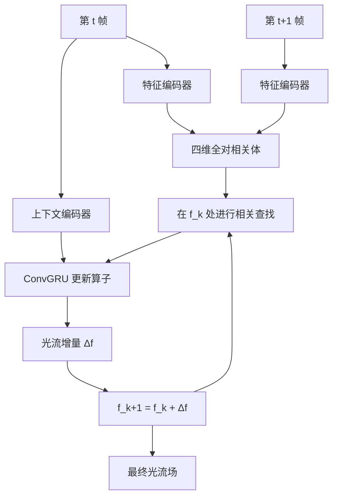
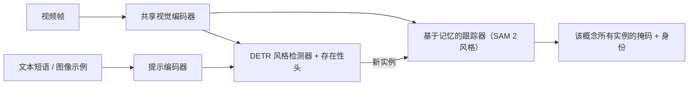

# 光流与视觉跟踪

> **英文原文：** [cv-knowledge-base/02_core_tasks/06_optical_flow_tracking.md](../../cv-knowledge-base/02_core_tasks/06_optical_flow_tracking.md)（本中文版供参考，内容以英文原文为准）

> **最后更新：** 2026年10月
> **难度级别：** 高级
> **相关章节：** [语义分割](./02_semantic_segmentation.md) | [深度估计](./05_depth_estimation.md) | [姿态估计](./04_pose_estimation.md) | [三维重建](./09_3d_reconstruction.md) | [四维与动态场景](../12_research_frontier_2024_2026/05_4d_and_dynamic_scenes.md) | [面向机器人的感知](../06_robotics_and_embodied_ai/08_perception_for_robotics.md)

> **🆕 2026年10月更新：**
> - 光流：新增 **SEA-RAFT**（ECCV 2024 Oral，最佳论文候选）和 **WAFT**（ICLR 2026 Oral）。WAFT 放弃代价体，改用高分辨率变形（warping），并报告在 Spring、Sintel 和 KITTI 上排名第一。
> - 点跟踪：新增 **CoTracker3**（用伪标注真实视频训练，数据量约少 1000 倍）、**BootsTAPIR/TAPNext/TAPNext++**（把跟踪视为下一个 token 预测）以及 **AllTracker**（ICCV 2025，稠密、高分辨率的长程跟踪）。
> - 三维/四维跟踪：**TAPVid-3D**、**SpatialTrackerV2**（ICCV 2025）和 **D4RT**（Google DeepMind，CVPR 2026 最佳论文），后者在一个模型中统一了深度、相机和三维对应关系查询。
> - 分割-跟踪：**SAM 3**（Meta，2025年11月）新增基于文本/示例的可提示*概念*分割与跟踪；**SAM 3.1 Object Multiplex**（2026年3月）加速了多目标跟踪。
> - 多目标跟踪（MOT）：新增 **MOTIP**（CVPR 2025，将跟踪视为上下文内 ID 预测）；更新了表格、开放问题和阅读清单。

---

## 概述

光流与视觉跟踪是理解视频时间动态的两个核心基本问题。**光流**估计相邻帧之间的瞬时二维位移场：对于帧 I_t 中的每个像素 p，光流向量 f(p) ∈ ℝ² 给出它在帧 I_{t+1} 中对应的像素位置。**跟踪**在更长的时间范围内工作，尽管存在遮挡、形变和外观变化，仍在视频序列中保持物体身份或点轨迹。

这两个任务密切相关。光流被用作跟踪线索（点跟踪就是光流在时间上的积分），而跟踪得到的对应关系又可以引导自监督光流训练。二者共同支撑着视频稳像、动作识别、自动驾驶和视频生成条件控制等下游应用。2020 年代见证了这两个问题的融合：CoTracker [Karaev2023] 等现代方法通过共享的 Transformer 联合跟踪任意点，而 SAM2 [Ravi2024] 将分割与跟踪统一到单一的流式记忆模型中。

在架构上，主导范式从经典变分方法（Lucas-Kanade、Horn-Schunck）转向以 FlowNet [Dosovitskiy2015] 为代表的深度学习，再转向代价体架构（PWC-Net [Sun2018]、RAFT [Teed2020]），如今又转向基于 Transformer 的联合跟踪（CoTracker、TAPIR [Doersch2023]）。RAFT 的关键洞见——构建全对（all-pairs）四维相关体，并用循环更新算子在其上迭代——从根本上改变了该领域，至今仍是大多数顶尖光流和双目方法的架构模板。

2024 至 2026 年间又发生了三项转变。第一，RAFT 模板被简化：SEA-RAFT [Wang2024] 使其更快、更准确，WAFT [Wang2026] 则表明代价体本身可以被高分辨率特征变形所取代。第二，点跟踪器从只用合成数据训练转向**伪标注真实视频**（CoTracker3 [Karaev2024]、BootsTAPIR），并转向序列模型形式（TAPNext）。第三，跟踪正与**四维重建**和**概念级分割**相融合。D4RT [Zhang2026]（CVPR 2026 最佳论文）在三维中回答任意时空对应查询，SAM 3 [Carion2025] 则在视频中检测、分割并跟踪由文本指定概念的每一个实例。

---

## 经典光流

### Lucas-Kanade（1981）

Lucas-Kanade（LK）算法假设亮度在局部窗口内满足**空间恒定性**，并对亮度恒定约束进行线性化：

```latex
I(p + \mathbf{f}, t+1) \approx I(p, t) + \nabla I \cdot \mathbf{f} + I_t = 0
```

对于 N×N 窗口，这会得到一个超定方程组，用最小二乘求解：

```latex
\mathbf{f} = \left(\sum_{p \in \Omega} \nabla I \nabla I^\top\right)^{-1} \sum_{p \in \Omega} \nabla I \cdot I_t
```

其中 2×2 矩阵即**结构张量**（Harris 矩阵）。LK 在无纹理区域（矩阵秩亏）和大位移下会失效。由粗到细的金字塔扩展可以处理大运动；该算法至今仍是经典特征跟踪器（如 KLT）的核心。

### Horn-Schunck（1981）

Horn-Schunck 增加了全局平滑正则项：

```latex
\mathcal{E}(\mathbf{f}) = \int \left[(I_x u + I_y v + I_t)^2 + \alpha^2(|\nabla u|^2 + |\nabla v|^2)\right] \, dp
```

通过欧拉-拉格朗日方程求最小值。这会产生全局平滑的光流，但会过度平滑物体边界处的运动不连续。

---

## 深度光流

### FlowNet / FlowNet2（Dosovitskiy 2015，Ilg 2017）

FlowNet [Dosovitskiy2015]（ICCV 2015）提出了首个端到端可训练的光流网络，证明 CNN 可以从 FlyingChairs 合成数据集中学会估计光流。论文提出了两个变体：FlowNetS（简单堆叠的双帧编码器）和 FlowNetC（在中间层特征之间加入显式相关层）。FlowNet2 [Ilg2017]（CVPR 2017）通过以下方式大幅提升精度：(1) 表明**数据课程**（训练日程）比架构更重要；(2) 堆叠多个 FlowNet 网络并加入中间的变形-细化步骤。FlowNet2 相比 FlowNetS 将估计误差降低了 50% 以上，同时还提供一个以 140 fps 运行的轻量快速变体（FlowNet2-s）。

### PWC-Net（Sun 2018）

PWC-Net [Sun2018]（CVPR 2018 Oral）将三种归纳偏置融合进一个紧凑模型：

1. **可学习的特征金字塔**：由共享编码器提取多尺度特征
2. **变形**：用上采样后的粗光流估计对第二帧的特征进行变形
3. **代价体**：在每个尺度上，在变形后的特征与第一帧特征之间构建局部相关体

```latex
\text{cv}(\mathbf{f}, d) = \mathbf{F}_1(p) \cdot \mathbf{F}_2(p + \mathbf{f} + d), \quad d \in [-D, D]^2
```

光流由代价体从粗到细分层解码。PWC-Net 比 FlowNet2 小 17 倍，却在 MPI Sintel 和 KITTI 2015 上超越了它，在 Sintel 分辨率图像上约达 35 fps。

### RAFT（Teed & Deng 2020）

RAFT [Teed2020]（ECCV 2020）是现代最具影响力的光流架构。其三个核心思想：

**全对四维相关体：** 与 PWC-Net 的局部相关不同，RAFT 在单一尺度上计算两帧所有像素对之间的相关，形成四维体 C ∈ ℝ^{H×W×H×W}。多尺度池化可以在不重新计算特征的情况下构建 4 层相关金字塔：

```latex
C(\mathbf{f}_1^i, \mathbf{f}_2^j) = \langle \mathbf{f}_1^i, \mathbf{f}_2^j \rangle, \quad \forall (i, j) \in [H \times W] \times [H \times W]
```

**循环迭代更新：** 一个 ConvGRU 从初始为零的估计开始迭代细化光流场。每次迭代时，在当前估计光流位置处进行相关查找，取得固定邻域的相关值，再与光流和上下文特征一起驱动 GRU 更新：

```latex
\mathbf{f}^{k+1} = \mathbf{f}^k + \Delta\mathbf{f}^k, \quad \Delta\mathbf{f}^k = \text{GRU}(\mathbf{h}^k, \mathbf{c}^k, \text{lookup}(C, \mathbf{f}^k))
```

**上下文网络：** 一个只作用于第一帧的独立编码器提供固定的上下文特征，在每个 GRU 步骤中注入。

RAFT 在发表时相比之前的最佳方法在 KITTI 2015 上将误差降低 16%（F1-all：5.10%），在 Sintel Final 上降低 30%（EPE：2.855 px）。RAFT 架构直接启发了 RAFT-Stereo [Lipson2021] 和 FlowFormer [Huang2022]。



### SEA-RAFT（Wang、Lipson & Deng 2024）

SEA-RAFT [Wang2024]（ECCV 2024 Oral，最佳论文奖候选）是对 RAFT 的"简单、高效、准确"改版，有三处改动：

1. **拉普拉斯混合损失：** 网络在预测光流的同时预测逐像素的不确定性。它用双分量拉普拉斯混合分布的负对数似然而非普通 L1 损失进行训练，从而减少对歧义像素的过拟合。
2. **直接回归初始光流：** 初始光流来自一个回归头而不是零，因此所需的 GRU 迭代次数大大减少。
3. 在 TartanAir 上进行**刚性光流预训练**，提升跨数据集泛化。

```latex
% 光流分量 f（均值为 \mu）的拉普拉斯混合似然示意
p(f) = \alpha \frac{1}{2b_1} e^{-|f-\mu|/b_1} + (1-\alpha)\frac{1}{2b_2} e^{-|f-\mu|/b_2}, \qquad \mathcal{L} = -\log p(f_{gt})
```

在 Spring 基准上，SEA-RAFT 报告 EPE 为 3.69、1 像素离群率为 0.36，分别比此前已发表的最佳结果低 22.9% 和 17.8%。在精度相近的方法中，它至少快 2.3 倍。

### WAFT：仅靠变形的场变换（Wang & Deng 2025）

WAFT [Wang2026]（arXiv 2506.21526；ICLR 2026 Oral）提出的问题是：是否真的需要四维代价体？它保留了 RAFT 的迭代更新元架构，但用当前光流估计对第二帧特征进行**高分辨率变形**来取代相关查找，随后更新网络直接将变形后的特征与第一帧特征进行比较。这消除了随分辨率增长的显存开销，允许高分辨率输入，并且可以与预训练骨干网络（Twins、Depth Anything V2、DINOv3）配合使用。作者报告其在 Spring、Sintel 和 KITTI 基准上排名第一，在 KITTI 上具有最佳的零样本泛化能力，并且推理速度比精度相近的方法快至多 4.1 倍。

---

## 用于视频合成的光流变形

光流的一个关键应用是在视频任务中进行**特征/帧变形**，包括视频目标分割、深度的时间一致性以及视频生成。给定源帧 I_s 和光流场 f_{s→t}：

```latex
\hat{I}_t(p) = I_s(p + \mathbf{f}_{s \to t}(p))
```

用双线性采样实现。在训练视频模型时，经光流变形的特征无需对所有历史帧做显式注意力即可提供时间对应关系。变形误差（光度一致性）也可以作为光流质量的代理指标：

```latex
\mathcal{L}_{\text{warp}} = \|I_t - \hat{I}_t\|_1 \cdot (1 - M_{\text{occ}})
```

其中 M_occ 是通过前向-后向一致性估计得到的遮挡掩码。

---

## 多目标跟踪（MOT）

### SORT（Bewley 2016）

SORT [Bewley2016]（ICIP 2016）确立了在线 MOT 的模板：对每一帧，(1) 通过**卡尔曼滤波器**（匀速模型）向前预测轨迹片段位置；(2) 在 IoU 代价矩阵上用**匈牙利算法**将检测与预测的轨迹片段关联；(3) 通过分数阈值创建/删除轨迹。SORT 以 260 Hz 运行，比同期方法快几个数量级，同时在 MOT2015 上精度与之相当。

### DeepSORT（Wojke 2017）

DeepSORT [Wojke2017]（ICIP 2017）扩展了 SORT，用组合度量取代纯 IoU 关联：IoU 距离 + 来自深度重识别（re-ID）嵌入的外观距离。一个在 Market-1501 行人重识别数据集上训练的 CNN 为每个检测框裁剪图提取 128 维描述子。关联在运动方面使用卡尔曼状态空间中的马氏距离，在外观方面使用余弦距离，二者通过最小代价线性分配结合。DeepSORT 以适度的计算开销显著减少了遮挡时的 ID 切换。

### ByteTrack（Zhang 2022）

ByteTrack [Zhang2022]（ECCV 2022）挑战了丢弃低置信度检测的常规做法。其关键洞见是：**每个检测框，包括低分框**，都携带有用信息。ByteTrack 执行两轮关联：首先通过 IoU 将高置信度检测（score > τ_high）与现有轨迹匹配，然后将**低置信度检测**（τ_low < score < τ_high）与第一轮中**未匹配的轨迹**匹配。这能找回被遮挡的物体，并在不增加误检的情况下提高召回率。ByteTrack 在 MOT17/20 上取得了最先进的 HOTA/MOTA，且相对基础检测器几乎不增加额外计算。

### MOTIP：将跟踪视为 ID 预测（Gao 2025）

在外观相似、运动非线性的基准（如 DanceTrack 和 SportsMOT）上，启发式关联（IoU + 卡尔曼 + re-ID 阈值）表现吃力。MOTIP [Gao2025]（CVPR 2025）端到端地学习关联。当前轨迹各自带有一个来自固定字典的可学习 **ID 嵌入**，构成上下文提示；一个 Transformer 解码器将每个新检测分类为已有 ID 之一或"新生"类别。于是跟踪变成了上下文内的 ID 分类，不需要手工调节的匹配规则。MOTIP 与端到端的 MOTR 系列一起，代表了从"检测后跟踪"启发式方法向学习式关联的转变。

---

## 点跟踪（Track-Any-Point）

### CoTracker（Karaev 2023）

CoTracker [Karaev2023]（arXiv 2023，ECCV 2024）将点跟踪重新表述为**多个共同跟踪点上的联合 Transformer 问题**。标准方法独立地跟踪各个点，忽略了它们之间的相互关联。CoTracker 将轨迹表示为 token 网格（位置、可见性、外观、相关特征），并用 Transformer 同时联合更新所有轨迹。这使轨迹在物理上保持一致——例如刚体上的点会协调一致地运动。CoTracker 可以联合跟踪多达 7 万个点，并在 TAP-Vid 基准上达到最先进水平。

### TAPIR（Doersch 2023）

TAPIR [Doersch2023]（ICCV 2023，Google DeepMind）提出了一个两阶段的任意点跟踪模型：(1) **逐帧独立初始化**，使用学习到的外观模型在每帧中独立寻找查询点的候选匹配；(2) **时间细化**，基于跨时间的局部相关上下文更新轨迹和查询特征。TAPIR 在 TAP-Vid DAVIS 上比之前的方法 AJ 绝对提升约 20%，并支持在长的高分辨率视频上快速推理。

### CoTracker3 与伪标注真实视频（Karaev 2024）

CoTracker3 [Karaev2024]（arXiv 2410.11831，2024年10月）简化了 CoTracker 的架构，并改变了训练方式。仅用合成数据（Kubric）训练会留下仿真到真实的差距。因此 CoTracker3 在大量无标注真实视频上运行若干现有跟踪器作为**教师**，并用它们的伪标签训练学生模型。它以比之前用真实数据训练的最佳跟踪器（BootsTAPIR）少约 **1000 倍的数据**达到了最先进的精度。它提供在线（滑动窗口）和离线（整段视频）两种变体；离线模型在 TAP-Vid DAVIS 上报告的 δ_avg^vis 为 76.9。

### BootsTAPIR、TAPNext 与 TAPNext++（Google DeepMind）

**BootsTAPIR** [Doersch2024]（ACCV 2024）在数百万段无标注视频上，以空间和时间变换下的自一致性目标对 TAPIR 进行自举（bootstrapping）训练。**TAPNext** [Zholus2025]（arXiv 2504.05579）把跟踪重新表述为**下一个 token 预测**。一个因果序列模型（带有循环状态空间层的 ViT）读取帧 token 和查询 token，并在线输出轨迹 token，不使用相关体、窗口化或测试时细化。这去除了大部分跟踪专用的归纳偏置。自举版本（BootsTAPNext）在 TAP-Vid DAVIS（首帧协议）上报告 65.25 AJ。**TAPNext++** 改进了长期跟踪、遮挡处理和重检测，据官方仓库，在 512×512 分辨率下于 DAVIS 上达到 67.0 AJ。

### AllTracker：稠密长程跟踪（Harley 2025）

AllTracker [Harley2025]（ICCV 2025）连接了光流与点跟踪。它为所有像素、在高分辨率下估计**查询帧与其他每一帧之间类似光流的对应场**。它使用一个低分辨率的循环网格，由二维卷积和时间注意力进行细化，然后上采样。训练数据混合了点跟踪和光流数据。精度随测试分辨率提高而提升（默认设置下报告 δ_avg 为 76.3，768×1024 下为 80.6）。这使得在数百帧上稠密跟踪每一个像素变得可行。

### 三维点跟踪与四维对应关系

在二维图像空间中跟踪点，会把物体运动与相机运动和遮挡混在一起。**TAPVid-3D** [Koppula2024]（NeurIPS 2024 数据集与基准赛道）提出了一个包含 4000 多段真实视频、超过 100 万条三维轨迹的基准。**SpatialTrackerV2** [Xiao2025]（ICCV 2025）从单目视频中进行三维点跟踪。它在一个端到端训练的前馈网络中，将三维运动分解为场景几何、相机自运动和逐点的物体运动，训练数据包括合成数据、RGB-D 数据和无标注视频。

**D4RT** [Zhang2026]（Google DeepMind 与 UCL、牛津大学合作；arXiv 2512.08924；**CVPR 2026 最佳论文**）通过单一的**查询接口**统一了深度、对应关系和相机估计。一个编码器将整段视频转换为全局场景表示。随后一个轻量解码器回答相互独立的查询，每个查询询问：在源帧像素 (u, v) 处看到的点，在目标时刻位于三维空间的何处，并以所选相机的坐标表示：

```latex
% D4RT 查询：源像素 (u,v)、源时刻 t_s、目标时刻 t_t、相机/参考时刻 t_c
\mathbf{X} = \mathrm{Dec}_\theta\big(\mathcal{F}(\text{video}),\; q = (u, v, t_s, t_t, t_c)\big) \in \mathbb{R}^3
% t_t = t_s = t_c  -> 深度 / 点图；   t_t \neq t_s -> 三维点轨迹（场景流）；
% 改变 t_c        -> 相机相对坐标，由此可恢复相机位姿
```

由于各查询相互独立，训练和推理开销随查询点数线性增长。DeepMind 报告其推理速度比之前的四维方法快 18–300 倍，在单个 TPU 芯片上处理一分钟视频约需 5 秒，并在动态场景基准上达到最先进精度。重建方面的内容请参见[三维重建](./09_3d_reconstruction.md)。

### 用于视频的 SAM2（Ravi 2024）

SAM 2 [Ravi2024]（arXiv 2408.00714，Meta AI）通过添加一个**按会话的流式记忆模块**，将 Segment Anything Model 扩展到视频，在帧间传播分割掩码。给定任意一帧上的用户提示（点击、框或掩码），SAM2 会在整个视频中前向和后向跟踪被提示的物体。记忆编码器存储来自过去帧的物体嵌入；记忆注意力机制在处理新帧时检索相关记忆。SAM2 在单一架构中统一了交互式图像分割和视频目标跟踪，在 SA-V、MOSE 和 LVOS 视频目标分割基准上达到最先进性能。SAM 2 发表于 ICLR 2025。改进的 **SAM 2.1** 检查点、训练代码和网页演示于 2024 年 9 月发布，2024 年 12 月又加入了逐对象独立推理和 `torch.compile` 加速。

### SAM 3：概念级分割与跟踪（Meta，2025）

SAM 3 [Carion2025]（"SAM 3: Segment Anything with Concepts"，arXiv 2511.16719，2025年11月）将可提示分割从*每个提示一个物体*推广到**可提示概念分割（Promptable Concept Segmentation, PCS）**。给定一个简短的名词短语（例如 "yellow school bus"）或图像示例，它会在整个视频中检测、分割并**跟踪该概念的每一个实例**。视觉提示（点、框、掩码）仍然受支持。这个 8.48 亿参数的模型将一个 DETR 风格的**检测器**与一个 SAM 2 风格的记忆**跟踪器**耦合在一起，二者共享同一个视觉编码器。一个*存在性头（presence head）*将识别（"该概念是否存在？"）与定位解耦。一个人机协同的数据引擎标注了超过 400 万个独特概念，配套的 **SA-Co** 基准涵盖约 27 万个概念（比早期基准多 50 倍以上）。SAM 3 在 SA-Co 上达到人类水平的约 75–80%，但在视频上差距更大。例如，在 SA-V 测试集上它的 cgF1 为 30.3，而人类为 53.1。**SAM 3.1 Object Multiplex**（2026年3月）加入了一种用于联合多目标跟踪的共享记忆方案，在精度相近的情况下显著更快。**SAM 3 Agent** 则将 SAM 3 与多模态大语言模型配合，用于处理复杂的指代表达。



---

## 评估指标

### 光流：EPE

**端点误差（End-Point Error, EPE）：** 预测光流向量与真值光流向量之间的平均欧氏距离：

```latex
\text{EPE} = \frac{1}{N}\sum_{i} \|\hat{\mathbf{f}}_i - \mathbf{f}_i\|_2
```

以像素为单位报告为平均 EPE（AEE）。**Fl-all** 指标（KITTI）统计 EPE > 3px 且 EPE > 真值幅值 5% 的像素百分比。

### MOT 指标：MOTA 与 HOTA

**MOTA（多目标跟踪准确度，Multiple Object Tracking Accuracy）：**

```latex
\text{MOTA} = 1 - \frac{\sum_t (FN_t + FP_t + \text{IDSW}_t)}{\sum_t \text{GT}_t}
```

MOTA 对漏检（FN）、误检（FP）和身份切换（IDSW）施以同等惩罚；它更偏重检测质量而非关联质量。

**HOTA（高阶跟踪准确度，Higher Order Tracking Accuracy）** [Luiten2021]：分解为检测准确度（DetA）和关联准确度（AssA）：

```latex
\text{HOTA} = \sqrt{\text{DetA} \cdot \text{AssA}}
```

HOTA 在多个定位阈值（α ∈ [0.05, 0.95]）上取平均，被认为是比 MOTA 更均衡的指标。

**IDF1：** 正确识别的检测数与真值检测总数和计算检测总数均值之比；衡量重识别质量。

---

## 关键论文

| 论文 | 作者 | 年份 | 会议/期刊 | 主要贡献 |
|---|---|---|---|---|
| An Iterative Image Registration Technique with an Application to Stereo Vision (Lucas-Kanade) | Lucas, Kanade | 1981 | IJCAI | 通过最小二乘块匹配实现基于空间恒定性的光流 |
| FlowNet: Learning Optical Flow with Convolutional Networks | Dosovitskiy, Fischer, Ilg et al. | 2015 | ICCV | 首个端到端 CNN 光流；FlowNetS/C；FlyingChairs 数据集 |
| FlowNet 2.0: Evolution of Optical Flow Estimation with Deep Networks | Ilg, Mayer, Saikia, Keuper, Dosovitskiy, Brox | 2017 | CVPR | 堆叠网络 + 数据课程；误差降低 50% 以上 |
| PWC-Net: CNNs for Optical Flow Using Pyramid, Warping, and Cost Volume | Sun, Yang, Liu, Kautz | 2018 | CVPR (Oral) | 可学习金字塔 + 变形 + 代价体；比 FlowNet2 小 17 倍 |
| RAFT: Recurrent All-Pairs Field Transforms for Optical Flow | Teed, Deng | 2020 | ECCV | 全对四维相关 + ConvGRU 迭代；在 Sintel 和 KITTI 上刷新最佳 |
| Simple Online and Realtime Tracking (SORT) | Bewley, Ge, Ott, Ramos, Upcroft | 2016 | ICIP | 卡尔曼滤波 + 匈牙利算法；260 Hz 实时 MOT |
| Simple Online and Realtime Tracking with a Deep Association Metric (DeepSORT) | Wojke, Bewley, Paulus | 2017 | ICIP | 外观 re-ID 嵌入 + 马氏距离-IoU 混合，减少 ID 切换 |
| ByteTrack: Multi-Object Tracking by Associating Every Detection Box | Zhang, Sun, Jiang et al. | 2022 | ECCV | 利用低置信度框的两轮关联；最先进的 HOTA/MOTA |
| CoTracker: It is Better to Track Together | Karaev, Rocco, Graham, Neverova, Vedaldi, Rupprecht | 2023 | arXiv / ECCV 2024 | 联合 Transformer 跟踪 7 万+ 点；感知相关性的协同跟踪 |
| TAPIR: Tracking Any Point with per-frame Initialization and temporal Refinement | Doersch, Yang, Vecerik et al. | 2023 | ICCV | 两阶段 TAP 模型；TAP-Vid DAVIS 上 AJ 提升约 20% |
| SAM 2: Segment Anything in Images and Videos | Ravi et al. | 2024 | arXiv / ICLR 2025 | 用于视频分割和目标跟踪的流式记忆；Meta AI |
| SEA-RAFT: Simple, Efficient, Accurate RAFT for Optical Flow | Wang, Lipson, Deng | 2024 | ECCV (Oral) | 拉普拉斯混合损失；回归初始光流；Spring 上 EPE 3.69；最佳论文候选 |
| CoTracker3: Simpler and Better Point Tracking by Pseudo-Labelling Real Videos | Karaev, Makarov, Wang, Neverova, Vedaldi, Rupprecht | 2024 | arXiv 2410.11831 | 在真实视频上用教师集成生成伪标签；数据量约少 1000 倍；在线/离线 |
| BootsTAP: Bootstrapped Training for Tracking-Any-Point | Doersch et al. (Google DeepMind) | 2024 | ACCV | 在无标注真实视频上对 TAPIR 进行自监督自举训练 |
| TAPVid-3D: A Benchmark for Tracking Any Point in 3D | Koppula et al. (Google DeepMind) | 2024 | NeurIPS D&B | 4000+ 段真实视频，100 万+ 条三维轨迹 |
| MOTIP: Multiple Object Tracking as ID Prediction | Gao, Qi, Wang | 2025 | CVPR | 将关联视为上下文内 ID 分类；端到端学习式 MOT |
| TAPNext: Tracking Any Point as Next Token Prediction | Zholus et al. (Google DeepMind) | 2025 | arXiv 2504.05579 | 因果序列模型跟踪器；无代价体；在线 |
| AllTracker: Efficient Dense Point Tracking at High Resolution | Harley et al. | 2025 | ICCV | 全像素长程对应场；统一光流与跟踪 |
| SpatialTrackerV2: 3D Point Tracking Made Easy | Xiao, Wang, Xue, Karaev et al. | 2025 | ICCV | 前馈三维跟踪，分解几何、自运动与物体运动 |
| SAM 3: Segment Anything with Concepts | Carion et al. (Meta) | 2025 | arXiv 2511.16719 | 可提示概念分割 + 跟踪；SA-Co 基准（27 万概念） |
| WAFT: Warping-Alone Field Transforms for Optical Flow | Wang, Deng | 2025 | ICLR 2026 (Oral) | 无代价体的高分辨率变形；在 Spring/Sintel/KITTI 上排名第一 |
| Efficiently Reconstructing Dynamic Scenes One D4RT at a Time | Zhang, Le Moing et al. (Google DeepMind, UCL, Oxford) | 2025 | CVPR 2026 (Best Paper) | 基于查询的四维深度、跟踪与相机模型；快 18–300 倍 |

---

## 基准性能

| 模型 | 数据集 | 指标 | 分数 | 备注 |
|---|---|---|---|---|
| RAFT | MPI Sintel Final | EPE ↓ | 2.855 | 泛化评估；32 次迭代 |
| RAFT | KITTI 2015 | F1-all ↓ | 5.10% | 在 KITTI 上微调；32 次迭代 |
| PWC-Net | MPI Sintel Final | EPE ↓ | 5.04 | 无测试时增强 |
| FlowNet2 | MPI Sintel Final | EPE ↓ | 6.02 | 堆叠 CNN；8 fps |
| ByteTrack | MOT17 test | HOTA ↑ | 63.1 | YOLOX 检测器；标准协议 |
| ByteTrack | MOT17 test | MOTA ↑ | 80.3 | 标准 MOT 协议 |
| DeepSORT | MOT16 test | MOTA ↑ | 61.4 | DPM 检测器；2017 年基线 |
| TAPIR | TAP-Vid DAVIS | AJ ↑ | 61.3 | 见 [Doersch2023] |
| CoTracker | TAP-Vid DAVIS | AJ ↑ | 60.6 | 7 万个联合点；[Karaev2023] |
| SEA-RAFT | Spring (test) | EPE ↓ / 1px ↓ | 3.69 / 0.36 | 比此前最佳低 22.9% / 17.8% [Wang2024] |
| BootsTAPIR | TAP-Vid DAVIS (first) | AJ ↑ | 62.4 | 官方 tapnet 仓库 |
| BootsTAPNext | TAP-Vid DAVIS (first) | AJ ↑ | 65.25 | 官方 tapnet 仓库 [Zholus2025] |
| TAPNext++ (512×512) | TAP-Vid DAVIS (first) | AJ ↑ | 67.0 | 官方 tapnet 仓库 |
| CoTracker3 (offline) | TAP-Vid DAVIS | δ_avg^vis ↑ | 76.9 | 官方仓库 [Karaev2024] |
| AllTracker | 点跟踪评测套件平均 | δ_avg ↑ | 76.3 / 80.6 | 默认 / 768×1024 测试分辨率 [Harley2025] |
| SAM 3 | SA-V test（概念跟踪） | cgF1 ↑ | 30.3 | 人类：53.1 [Carion2025] |

*各协议不同：TAP-Vid 的 "first" 在首个可见帧查询点，"strided" 每隔 5 帧查询一次；AJ 与 δ_avg^vis 不可互换。WAFT 和 D4RT 的主要结论（基准排名、加速倍数）在上文正文中给出，而未作为表格数值列出。*

---

## 优缺点

| 方面 | 优点 | 缺点 |
|---|---|---|
| RAFT 式全对光流 | 精度高；对大运动稳健；泛化强 | 四维相关体占用大量显存；推理比 PWC-Net 慢 |
| PWC-Net 式代价体 | 快；省显存；显式几何推理 | 局部搜索半径限制了大位移精度 |
| 联合点跟踪（CoTracker、TAPIR） | 物理一致的轨迹；借助联合上下文处理遮挡 | 计算量高于逐点跟踪；显存随跟踪点数增长 |
| 在线 MOT（SORT/ByteTrack） | 实时；新领域无需重新训练；实现简单 | 依赖外部检测器质量；没有全局轨迹优化 |
| 纯变形光流（WAFT） | 无代价体，显存随分辨率增长平缓；可接入强大的预训练骨干 | 对超大位移依赖良好的初始估计；较新，经受的检验较少 |
| 序列模型跟踪器（TAPNext） | 简单、在线、手工组件少；随数据扩展 | 需要大量（伪）标注数据；长时程仍可能漂移 |
| 概念提示式分割-跟踪（SAM 3） | 由文本短语对所有实例进行开放词汇检测 + 掩码 + 身份 | 模型较大（848M）；视频表现远低于人类；歧义短语需要 LLM 智能体 |
| 基于查询的四维模型（D4RT） | 一个模型覆盖深度、三维轨迹和相机；开销随查询数线性增长；非常快 | 训练规模接近专有级（TPU）；稠密输出需要大量查询；动态场景真值稀缺 |
| 学习式关联 MOT（MOTIP） | 能处理外观相似和非线性运动；无需手调阈值 | 需要带跟踪标注的训练数据；比 SORT 类跟踪器更重 |

---

## 开放问题与研究空白

- **长程光流与大位移：** 32 次迭代的标准 RAFT 在快速移动的小物体或镜头切换时仍可能失效；将全对相关扩展到高分辨率视频仍然代价高昂。
- **感知遮挡的光流：** 在帧间被遮挡的像素违背亮度恒定假设；随光流一同输出可靠的置信度/遮挡掩码仍不完善。
- **基于视频的无监督/自监督光流：** 光度监督可行，但在光照动态变化时会失效；与光学物理模型相结合是一个开放领域。
- **光流 + 深度 + 自运动的统一：** 从单目视频联合估计场景流（三维运动）、深度和相机自运动在理论上很优雅，但难以稳健训练。
- **长期点跟踪：** CoTracker 和 TAPIR 在超过几百帧的视频上性能都会下降。在线序列模型跟踪器（TAPNext++）和全像素跟踪器（AllTracker）延长了可跟踪时长，但在数分钟视频中经历长时间遮挡后的稳健重检测仍是开放问题。
- **无外观信息的多目标跟踪重识别：** ByteTrack 的两轮 IoU 方法在没有外观信息的拥挤场景中会失效。学习式关联（MOTIP）在 DanceTrack 类数据上有所帮助，但仍需要面向边缘部署的、更强且廉价的重识别。
- **开放词汇跟踪：** SAM 3 让基于文本提示的全实例检测、分割和跟踪变得实用。视频概念跟踪仍远低于人类水平（SA-V 测试集上 cgF1 为 30.3 对 53.1），组合式或关系式提示需要 LLM 参与（SAM 3 Agent）。
- **世界坐标系下的三维/四维跟踪：** 将相机运动与物体运动分离，并在遮挡中以度量三维跟踪点（TAPVid-3D、SpatialTrackerV2、D4RT）是一个快速发展的前沿。真实世界动态场景的真值稀缺，因此大多数方法仍依赖合成数据。
- **代价体是否必要？** WAFT 表明，对光流而言高分辨率变形可以取代全对相关。这一结论是否同样适用于双目、场景流和长程跟踪，是一个开放的架构问题。

---

## 延伸阅读

- [RAFT 论文（arXiv:2003.12039）](https://arxiv.org/abs/2003.12039) — ECCV 2020 最佳论文 [Teed2020]
- [ByteTrack GitHub（FoundationVision）](https://github.com/FoundationVision/ByteTrack) — 官方实现 [Zhang2022]
- [TAPIR 项目主页（DeepMind）](https://deepmind-tapir.github.io/) — 模型与 TAP-Vid 基准 [Doersch2023]
- [CoTracker GitHub（facebookresearch）](https://github.com/facebookresearch/co-tracker) — CoTracker 与 CoTracker3 [Karaev2023]
- [SAM2 GitHub（facebookresearch）](https://github.com/facebookresearch/sam2) — SAM2 官方实现 [Ravi2024]
- [PWC-Net GitHub（NVLabs）](https://github.com/NVlabs/PWC-Net) — NVIDIA 官方实现 [Sun2018]
- [SEA-RAFT GitHub（princeton-vl）](https://github.com/princeton-vl/SEA-RAFT) — ECCV 2024 Oral [Wang2024]
- [WAFT GitHub（princeton-vl）](https://github.com/princeton-vl/WAFT) — ICLR 2026 Oral [Wang2026]
- [TAPNet 仓库（google-deepmind）](https://github.com/google-deepmind/tapnet) — TAPIR、BootsTAPIR、TAPNext、TAPNext++、TAPVid-3D
- [AllTracker GitHub](https://github.com/aharley/alltracker) — ICCV 2025 [Harley2025]
- [SpatialTrackerV2 GitHub](https://github.com/henry123-boy/SpaTrackerV2) — ICCV 2025 [Xiao2025]
- [SAM 3 GitHub（facebookresearch）](https://github.com/facebookresearch/sam3) — 概念分割与跟踪；SAM 3.1 [Carion2025]
- [D4RT 论文（arXiv:2512.08924）](https://arxiv.org/abs/2512.08924) — CVPR 2026 最佳论文 [Zhang2026]
- [MOTIP GitHub（MCG-NJU）](https://github.com/MCG-NJU/MOTIP) — CVPR 2025 [Gao2025]
