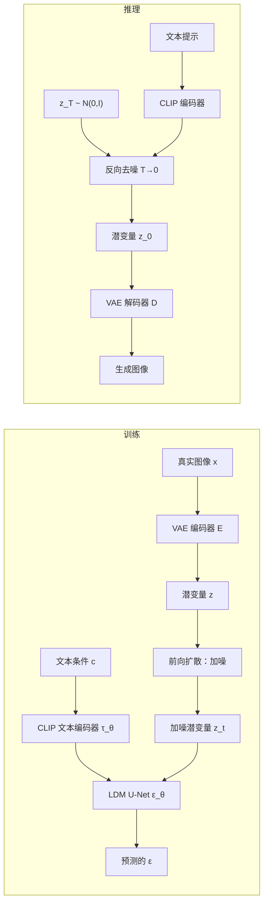

# 图像生成：GAN、VAE、扩散模型与可控合成

> **英文原文：** [cv-knowledge-base/02_core_tasks/07_image_generation.md](../../cv-knowledge-base/02_core_tasks/07_image_generation.md)（本中文版供参考，内容以英文原文为准）

> **最后更新：** 2026年10月
> **难度级别：** 高级
> **相关章节：** [扩散模型](../10_generative_vision/01_diffusion_models.md) | [GAN 与 VAE](../10_generative_vision/00_gans_and_vaes.md) | [视频生成](../10_generative_vision/02_video_generation.md) | [视频理解](./08_video_understanding.md) | [研究前沿 2024–2026](../12_research_frontier_2024_2026/02_any_model_paradigm.md)

> **🆕 2026年10月更新：**
> - 新增 2025–2026 年前沿系统一节。开放权重：**FLUX.1 Kontext** 和 **FLUX.2**（32B [dev]，2025年11月；[klein] 4B/9B，2026年1月）、**Qwen-Image**（20B MMDiT，2025年8月，随后推出 Edit、Layered 和 2512 版本；Qwen-Image-2.0 于 2026年2月发布预告）、**HunyuanImage 3.0**（总参数 80B 的 MoE，原生多模态自回归）以及 **Z-Image**（6B 单流 DiT，8 步 Turbo）。闭源：GPT-4o 原生图像生成、Google 的 Nano Banana 系列和 Seedream 4.0。
> - 统一生成与编辑（在一个模型中完成指令编辑/多参考图编辑）已取代分离的"生成器 + 适配器"流程，成为默认的产品形态。
> - 新增研究方向一节：下一尺度自回归（VAR）、表征对齐与表征自编码器（REPA、RAE）、像素空间"x 预测"扩散（JiT）以及一步生成的 MeanFlow。
> - 更新了关键论文、基准、优缺点和开放问题（视频生成：Sora 2、Veo 3.x、Wan 2.2；内容溯源/水印）。

---

## 概述

图像生成——从噪声、文本或部分观测中生成照片级逼真或风格可控的图像——自 2014 年以来经历了三次重大范式转变。第一次是**生成对抗网络（Generative Adversarial Network, GAN）**时代：生成器与判别器之间的对抗训练首次产生了清晰、多样的图像，并在 StyleGAN 系列 [Karras2019, Karras2020] 达到顶峰，该系列在高分辨率人脸上实现了前所未有的真实感和解耦能力。与此同时，**变分自编码器（Variational Autoencoder, VAE）** [Kingma2014] 提供了可处理的似然和平滑的潜空间，但历史上其输出比 GAN 更模糊。一个混合式的转折点是 VQGAN+Transformer [Esser2021]：它用 VQ-VAE 学习离散视觉码本，再用 Transformer 对其分布进行自回归建模，从而能够根据文本或布局条件进行高分辨率合成。

第二次范式转变来自**去噪扩散概率模型（Denoising Diffusion Probabilistic Models, DDPM）** [Ho2020] 及其后续工作，它们将生成重新表述为对高斯噪声的迭代去噪。扩散模型在两年内就在 FID 上超越了 GAN。关键的效率突破是**潜在扩散模型（Latent Diffusion Models, LDM）** [Rombach2022]，它将扩散过程移到预训练 VAE 编码器的压缩潜空间中，把计算开销降低了 2–4 个数量级，使大规模文本条件合成成为可能。基于 LDM 的 Stable Diffusion 让图像生成走向大众。SDXL [Podell2023] 通过 3 倍大的 UNet 和多编码器文本条件进一步提升了质量。

第三个范式是**流匹配（flow matching）基础模型**（FLUX.1 [Black Forest Labs 2024]）和一体化的文本-图像架构。FLUX 使用整流流匹配（rectified flow matching）——一条从噪声到数据更简单、更直的 ODE 轨迹——并以一个 12B 参数的混合多模态 Transformer（MM-DiT）联合处理文本和图像 token。这些模型为照片真实感和提示遵循树立了新的质量标杆。通过适配器（ControlNet [Zhang2023]、IP-Adapter [Ye2023]）实现的可控生成，把生成从开放式的创作工具变成了精确的设计工具。

第四个阶段——**统一的多模态生成与编辑**（2025–2026）——如今定义了前沿。OpenAI 的 GPT-4o 原生图像生成（2025年3月）和 Google 基于 Gemini 的"Nano Banana"模型（2025年8月起）表明，以 LLM 为中心的多模态模型可以通过对话生成和编辑图像，并具备强大的世界知识、文字渲染和多图一致性。开放权重系统随后跟进。FLUX.1 Kontext 和 FLUX.2 为整流流 Transformer 加入了上下文内编辑和多参考图编辑。Qwen-Image（20B MMDiT）在文字渲染（尤其是中文）方面领先。HunyuanImage 3.0 是一个 80B 参数的 MoE，在自回归多模态 LLM 内部原生地生成图像。研究界也重新审视了基础问题：表征对齐的潜空间（REPA、RAE）、像素空间扩散（JiT）、下一尺度自回归（VAR）以及一步流模型（MeanFlow）。

---

## 生成对抗网络

### GAN 基础

GAN [Goodfellow2014] 由生成器 G: ℤ → 𝒳 和判别器 D: 𝒳 → [0,1] 组成，通过极小极大博弈进行训练：

```latex
\min_G \max_D \; \mathbb{E}_{x \sim p_{\text{data}}}\!\left[\log D(x)\right] + \mathbb{E}_{z \sim p_z}\!\left[\log(1 - D(G(z)))\right]
```

实践中生成器使用非饱和损失。训练以不稳定著称：模式崩溃（G 只能产生有限的多样性）、梯度消失（D 过强），以及转置卷积带来的棋盘格伪影。

### StyleGAN（Karras 2019）

StyleGAN [Karras2019]（CVPR 2019）提出了一种**基于风格的生成器**，将高层属性（姿态、年龄）与随机细节（发丝、毛孔）解耦：

1. **映射网络 f: ℤ → 𝒲**：一个 8 层 MLP 将输入噪声 z 映射到中间潜空间 𝒲，该空间比 Z 更加解耦。
2. **自适应实例归一化（AdaIN）：** 在合成网络的每一层，风格向量 w ∈ 𝒲 通过学习到的仿射变换转化为缩放/偏置：

```latex
\text{AdaIN}(x_i, y) = y_{s,i} \frac{x_i - \mu(x_i)}{\sigma(x_i)} + y_{b,i}
```

3. **随机噪声输入：** 在每个合成层加入逐像素独立的噪声，控制细粒度纹理。

StyleGAN 在 FFHQ 1024×1024 上达到 4.40 的 FID。StyleGAN2 [Karras2020]（CVPR 2020）通过权重解调消除了典型的"水滴"伪影，并引入路径长度正则化以改善感知路径长度。

---

## 变分自编码器

VAE [Kingma2014] 参数化一个概率编码器 q_φ(z|x) 和解码器 p_θ(x|z)，并最大化 ELBO：

```latex
\mathcal{L}_{\text{ELBO}} = \mathbb{E}_{q_\phi(z|x)}\!\left[\log p_\theta(x|z)\right] - D_{\text{KL}}\!\left(q_\phi(z|x) \| p(z)\right)
```

重参数化技巧 z = μ + σ ⊙ ε, ε ~ N(0,I) 使梯度可以穿过采样操作。VAE 产生连续、可插值的潜空间，但由于 MSE 重建项，其重建结果较模糊。KL 散度强制形成结构化的先验，从而可以通过从 p(z) = N(0,I) 采样来生成。

**VQ-VAE** [van den Oord2017] 用离散的嵌入码本替代连续潜变量，学习一套视觉 token 词表。VQGAN [Esser2021] 在 VQ-VAE 目标中加入对抗判别器，显著锐化了重建结果，并使码本能在更高压缩率下使用。随后由 Transformer 对离散 token 序列进行自回归建模，支持百万像素级分辨率的条件生成。

---

## 扩散模型

### DDPM（Ho 2020）

DDPM [Ho2020]（NeurIPS 2020）定义了一个**前向过程**，在 T 步中逐渐用高斯噪声破坏数据：

```latex
q(x_t | x_{t-1}) = \mathcal{N}\!\left(x_t;\; \sqrt{1-\beta_t}\, x_{t-1},\; \beta_t \mathbf{I}\right)
```

方差调度为 β_1,...,β_T。借助重参数化技巧，可以直接从 x_0 采样 x_t：

```latex
q(x_t | x_0) = \mathcal{N}\!\left(x_t;\; \sqrt{\bar{\alpha}_t}\, x_0,\; (1 - \bar{\alpha}_t) \mathbf{I}\right), \quad \bar{\alpha}_t = \prod_{s=1}^t (1 - \beta_s)
```

训练一个 U-Net ε_θ(x_t, t) 来预测每一步加入的噪声 ε，最小化：

```latex
\mathcal{L}_{\text{DDPM}} = \mathbb{E}_{x_0, \epsilon, t}\!\left[\|\epsilon - \epsilon_\theta(\sqrt{\bar{\alpha}_t} x_0 + \sqrt{1 - \bar{\alpha}_t} \epsilon,\; t)\|^2\right]
```

生成过程从 x_T ~ N(0,I) 出发，利用反向过程 q(x_{t-1}|x_t) 迭代去噪。

### 潜在扩散模型（Rombach 2022）

LDM [Rombach2022]（CVPR 2022）在预训练的 VQ 正则化自编码器的潜空间 z = E(x) 中运行，将空间维度缩小 f ∈ {4, 8, 16} 倍。扩散模型 ε_θ(z_t, t, c) 通过交叉注意力以上下文 c（文本、分割图等）为条件：

```latex
\text{Attention}(Q, K, V) = \text{softmax}\!\left(\frac{QK^\top}{\sqrt{d}}\right) V, \quad Q = z_t W_Q,\; K = \tau_\theta(c) W_K,\; V = \tau_\theta(c) W_V
```

其中 τ_θ 是特定领域的编码器（文生图时为 CLIP 文本编码器）。LDM 的 FID 与像素空间 DDPM 相当，同时训练速度快 2–4 倍。



### SDXL（Podell 2023）

SDXL [Podell2023] 从以下方面改进 LDM：(1) 3 倍大的 U-Net 骨干网络，包含更多注意力块；(2) 两个文本编码器（OpenCLIP ViT-G + CLIP ViT-L），提供更丰富的条件；(3) 多宽高比训练；(4) 一个次级**精炼模型（refiner）**，在生成的潜变量上执行一次高噪声水平的扩散过程，在不改变构图的前提下锐化细节。

### FLUX.1（Black Forest Labs 2024）

FLUX.1 [BlackForestLabs2024] 是一个 12B 参数的文生图模型，采用**整流流匹配**——通过以流向量场为目标，训练模型预测从噪声到数据的尽可能直的路径：

```latex
\mathcal{L}_{\text{flow}} = \mathbb{E}_{t, x_0, x_1}\!\left[\|v_\theta(x_t, t) - (x_1 - x_0)\|^2\right], \quad x_t = (1-t)x_0 + t x_1
```

其架构是一个**混合多模态 Transformer（MM-DiT）**，在同一注意力层中联合处理文本和图像 token，取代了交叉注意力瓶颈。截至 2024 年，FLUX 在 GenEval 和其他人类偏好基准上达到了最先进的文生图保真度。FLUX.1 Kontext（2025）将其扩展为统一的生成与编辑。

---

## 前沿文生图与编辑系统（2025–2026）

### FLUX.1 Kontext 与 FLUX.2（Black Forest Labs）

**FLUX.1 Kontext** [BlackForestLabs2025]（2025年5月）在潜空间中执行**上下文内生成与编辑**。上下文图像的 token 与目标 token 拼接在同一个流匹配 Transformer 序列中，因此一个模型即可处理文生图、局部和全局指令编辑，以及多轮编辑中的角色/风格一致性。**FLUX.2**（2025年11月25日）扩展了这一方案。FLUX.2 [dev] 是一个 **32B 参数的流匹配 Transformer**，配有新的 FLUX.2 自编码器，并使用 Mistral Small 3.2（24B）视觉-语言模型进行文本编码和提示扩写（prompt upsampling）。它在一个检查点中同时支持文生图以及单参考图和**多参考图编辑**。蒸馏得到的 **FLUX.2 [klein]** 系列（4B 和 9B，2026年1月15日）面向实时生成。4B 模型采用 Apache 2.0 许可；9B 和 [dev] 模型采用非商用许可。

### Qwen-Image 系列（阿里巴巴 Qwen）

**Qwen-Image** [QwenTeam2025]（2025年8月，技术报告 arXiv 2508.02324）是一个以 Qwen2.5-VL 多模态编码器为条件的 **20B MMDiT**。其主要优势是复杂文字渲染，尤其是多行中文和混合文字排版，这得益于从无文字到段落级文字的渐进式课程学习。按月迭代推出了 **Qwen-Image-Edit**（2025年8月；Edit-2509 支持多图输入；Edit-2511 提升了身份一致性）、**Qwen-Image-Layered**（2025年12月，分解为可编辑的 RGBA 图层）和 **Qwen-Image-2512**（2025年12月，人物和纹理更真实）。以上均为 Apache 2.0 许可。**Qwen-Image-2.0** 于 2026 年 2 月发布预告，支持原生 2K 输出、长（约 1K token）排版指令以及统一的生成与编辑。

### HunyuanImage 3.0：原生多模态自回归（腾讯）

HunyuanImage 3.0 [Tencent2025]（2025年9月28日，arXiv 2509.23951）脱离了 DiT 流程。理解与生成被统一在**一个自回归多模态 MoE LLM** 中，该模型有 64 个专家，**总参数 80B，激活参数约 13B**。图像生成在语言模型内部原生完成，使其能利用世界知识并通过推理扩充简短的提示。发布时它是最大的开放权重图像生成 MoE。2026 年 1 月又推出了具备基于推理的提示改写和图生图编辑能力的 Instruct 版本及蒸馏（8 步）版本。基础模型的部署至少需要 3 张 80 GB GPU，这说明了"在 LLM 内部生成"方案的成本。

### Z-Image 与少步蒸馏（阿里巴巴通义）

**Z-Image**（arXiv 2511.22699，2025年11月）表明紧凑模型也能与大得多的模型竞争。它是一个 **6B 可扩展单流 DiT（Scalable Single-Stream DiT, S3-DiT）**，将文本、视觉语义和 VAE token 拼接为一个序列。**Z-Image-Turbo** 通过 Decoupled-DMD 加强化学习（DMDR）蒸馏到 **8 次函数评估（NFE）**，在 H800 上不到一秒即可完成生成，并可在 16 GB 显存的消费级 GPU 上运行。2025 年 12 月，它是 Artificial Analysis 文生图排行榜上排名最高的开放权重模型。

### 闭源前沿

- **GPT-4o 图像生成**（OpenAI，2025年3月；API 为 `gpt-image-1`，2025年4月）：在多模态 LLM 内部原生生成，具备非常强的指令遵循、文字渲染和对话式编辑能力。
- **Nano Banana**（Google；Gemini 2.5 Flash Image，2025年8月）和 **Nano Banana Pro**（基于 Gemini 3 Pro，2025年11月）：多图合成、保持身份一致的编辑、基于搜索的生成以及最高 4K 输出。输出带有 SynthID 水印。Google 的 Gemini API cookbook 后来列出了 Nano Banana 2 和 2.1 作为后续版本，具备"思考"（thinking）和搜索落地（search grounding）能力。
- **Seedream 4.0**（ByteDance Seed，2025年9月）：统一的生成与编辑，可快速输出高分辨率（最高 4K）图像。

| 系统 | 开发者 | 发布时间 | 架构 | 开放权重 |
|---|---|---|---|---|
| FLUX.1 Kontext | Black Forest Labs | 2025年5月 | 整流流 MM-DiT，上下文内编辑 | [dev] 非商用 |
| Qwen-Image | 阿里巴巴 Qwen | 2025年8月 | 20B MMDiT + Qwen2.5-VL 编码器 | 是（Apache 2.0） |
| HunyuanImage 3.0 | 腾讯 | 2025年9月 | 总 80B / 激活 13B 的自回归 MoE 多模态 LLM | 是（社区许可） |
| FLUX.2 [dev] | Black Forest Labs | 2025年11月 | 32B 流 Transformer + Mistral Small 3.2 VLM | 非商用 |
| Z-Image(-Turbo) | 阿里巴巴通义 | 2025年11月 | 6B 单流 DiT；8 步蒸馏 | 是 |
| FLUX.2 [klein] | Black Forest Labs | 2026年1月 | 4B / 9B 蒸馏版 | 4B 为 Apache 2.0 |
| GPT-4o image gen / gpt-image-1 | OpenAI | 2025年3–4月 | 多模态 LLM 原生生成 | 否 |
| Nano Banana / Pro | Google DeepMind | 2025年8月 / 11月 | Gemini 2.5 Flash / Gemini 3 Pro 图像生成 | 否 |

---

## 研究方向：分词器、潜空间与少步生成

### 下一尺度自回归（VAR）

VAR [Tian2024]（NeurIPS 2024 最佳论文）用**下一尺度预测**取代了光栅顺序的下一 token 预测。一个多尺度 VQ 分词器将图像表示为分辨率递增的 token 图，GPT 风格的 Transformer 以所有更粗尺度为条件，并行地预测整个尺度。这是第一个在 ImageNet FID 上击败强大扩散 Transformer 的 GPT 式自回归模型，采样速度也快得多，论文还展示了清晰的幂律缩放规律。

### 表征对齐与表征自编码器

**REPA** [Yu2025]（ICLR 2025）加入一个正则项，将 DiT 的中间隐状态与冻结自监督编码器（如 DINOv2）的特征对齐。这显著加快了 DiT/SiT 的训练。**RAE** [Zheng2025]（NYU，arXiv 2510.11690）更进一步，完全取代了 VAE。一个**冻结的预训练表征编码器**（DINOv2、SigLIP2）与一个训练得到的 ViT 解码器配对，扩散过程在这一语义潜空间中运行，并使用一个宽而浅的"DDT 头"（DiT^DH）。使用 DINOv2-B 编码器时，作者报告重建 rFID 为 0.57，仅训练 80 个 epoch 后生成 gFID 为 2.16（DiT^DH-XL）。他们的论点是，语义结构化的潜变量比仅为重建而训练的 VAE 潜变量更容易建模。

```latex
% REPA：将投影后的 DiT 隐状态 h_t（加噪输入）与干净图像的冻结编码器特征 y* 对齐
\mathcal{L} = \mathcal{L}_{\text{flow}} + \lambda\, \mathbb{E}\Big[-\tfrac{1}{N}\textstyle\sum_{n} \mathrm{sim}\big(y^*_{n},\, g_\phi(h_{t,n})\big)\Big]
```

### 像素空间扩散："让去噪模型去噪"（JiT）

JiT [Li2025]（Tianhong Li 与 Kaiming He，arXiv 2511.13720）用朴素的大图像块 ViT（"Just image Transformers"，例如在 256–512 像素下使用 16×16 或 32×32 的图像块）重新审视**像素空间**扩散，不使用分词器、预训练或辅助损失。其核心论点是网络应当**预测干净图像（x 预测）**，而不是预测噪声或速度。自然图像位于低维流形上，而噪声不是，因此只有在 x 预测下，高维的图像块 token 才易于处理。这挑战了"高分辨率扩散必须依赖潜在自编码器"的假设。

### 一步生成：MeanFlow

MeanFlow [Geng2025]（Geng、Deng、Bai、Kolter、He；arXiv 2505.13447）训练网络预测一个区间上的**平均速度**，而不是流匹配中的瞬时速度。这使其无需蒸馏即可一步（1-NFE）采样：

```latex
% 区间 [r, t] 上的平均速度，以及作为训练目标的 MeanFlow 恒等式
u(z_t, r, t) = \frac{1}{t-r}\int_r^t v(z_\tau, \tau)\, d\tau, \qquad
u(z_t, r, t) = v(z_t, t) - (t-r)\, \frac{d}{dt} u(z_t, r, t)
```

从零开始训练时，MeanFlow 在 ImageNet 256×256 上以单次函数评估报告 3.43 的 FID。它与一致性模型和 DMD 式蒸馏（如 Z-Image-Turbo 中所用）一起，缩小了一步生成与多步生成之间的差距。

---

## 可控生成

### ControlNet（Zhang 2023）

ControlNet [Zhang2023]（ICCV 2023）通过复制 U-Net 的编码器，并用**零初始化卷积**将其与原网络连接，为冻结的预训练扩散模型加入空间条件（边缘、深度图、分割、人体姿态、法向）：

```latex
\mathbf{y}_c = \mathcal{F}(x; \Theta) + \mathcal{Z}(\mathcal{F}(x + \mathcal{Z}(c; \Theta_{z1}); \Theta_c); \Theta_{z2})
```

其中 Z(·; ·) 是零卷积层（权重和偏置初始化为零）。在训练初期，零卷积输出为零，确保不会有有害梯度破坏预训练骨干网络。ControlNet 实现了像素级精确控制（例如以 Canny 边缘图或人体关键点骨架为条件），同时保留了基础模型的泛化能力。

### IP-Adapter（Ye 2023）

IP-Adapter [Ye2023]（arXiv 2023）仅用 2200 万额外参数，就为冻结的文生图模型实现了图像提示条件。一种**解耦的交叉注意力**机制在每个 U-Net 块中加入图像特征交叉注意力层（与文本交叉注意力分开）：

```latex
\text{Attn}(Q, K_{\text{text}}, V_{\text{text}}) + \lambda \cdot \text{Attn}(Q, K_{\text{img}}, V_{\text{img}})
```

图像特征由冻结的 CLIP 图像编码器提取，并投影到与 U-Net 交叉注意力维度相匹配的空间。IP-Adapter 可以泛化到共享同一基础模型的各种自定义微调模型，并可与 ControlNet 组合使用。

---

## 评估指标

### FID（Fréchet Inception Distance）

FID [Heusel2017] 在 InceptionV3 特征空间中度量真实图像与生成图像特征分布之间的距离：

```latex
\text{FID} = \|\mu_r - \mu_g\|^2 + \text{Tr}\!\left(\Sigma_r + \Sigma_g - 2(\Sigma_r \Sigma_g)^{1/2}\right)
```

FID 越低 → 分布越真实。FID 对样本数量和图像分辨率敏感；比较需要相同的评估协议。常用阈值：对无条件生成而言，FID < 5 被认为非常优秀。

### Inception Score（IS）

```latex
\text{IS} = \exp\!\left(\mathbb{E}_{x}\left[D_{\text{KL}}\!\left(p(y|x) \| p(y)\right)\right]\right)
```

IS 奖励高条件置信度（图像清晰）和高边缘熵（多样性）。IS 不如 FID 可靠，且对所选的 Inception 模型敏感。

### CLIPScore

对于文生图，CLIPScore [Hessel2021] 度量生成图像与文本提示的 CLIP 嵌入之间的余弦相似度：

```latex
\text{CLIPScore}(I, T) = \max(100 \cdot \cos(\mathbf{e}_I, \mathbf{e}_T), 0)
```

CLIPScore 越高 → 文本-图像对齐越好。局限：CLIP 存在已知偏差，且无法捕捉空间或组合方面的准确性。

---

## 关键论文

| 论文 | 作者 | 年份 | 会议/期刊 | 主要贡献 |
|---|---|---|---|---|
| Generative Adversarial Networks | Goodfellow, Pouget-Abadie, Mirza et al. | 2014 | NeurIPS | 用于隐式生成模型的极小极大对抗训练 |
| Auto-Encoding Variational Bayes (VAE) | Kingma, Welling | 2014 | ICLR | ELBO 目标；重参数化技巧；连续潜空间生成 |
| A Style-Based Generator Architecture for GANs (StyleGAN) | Karras, Laine, Aila | 2019 | CVPR | 映射网络；AdaIN；解耦的 𝒲 空间；随机噪声 |
| Taming Transformers for High-Resolution Image Synthesis (VQGAN) | Esser, Rombach, Ommer | 2021 | CVPR (Oral) | VQ 码本 + 对抗训练 + 自回归 Transformer |
| Denoising Diffusion Probabilistic Models (DDPM) | Ho, Jain, Abbeel | 2020 | NeurIPS | 马尔可夫扩散前向过程；噪声预测 U-Net；超越 GAN |
| High-Resolution Image Synthesis with Latent Diffusion Models (LDM/SD) | Rombach, Blattmann, Lorenz, Esser, Ommer | 2022 | CVPR | 在 VAE 潜空间中扩散；交叉注意力条件；计算量降低约 100 倍 |
| SDXL: Improving Latent Diffusion Models for High-Resolution Image Synthesis | Podell, English, Lacey et al. | 2023 | arXiv | 3 倍大的 U-Net；双文本编码器；精炼阶段 |
| Adding Conditional Control to Text-to-Image Diffusion Models (ControlNet) | Zhang, Rao, Agrawala | 2023 | ICCV | 面向冻结扩散模型的零卷积空间条件适配器 |
| IP-Adapter: Text Compatible Image Prompt Adapter | Ye, Zhang, Liu, Han, Yang | 2023 | arXiv | 解耦交叉注意力实现图像提示条件；2200 万参数 |
| Visual Autoregressive Modeling: Scalable Image Generation via Next-Scale Prediction (VAR) | Tian, Jiang, Yuan, Peng, Wang | 2024 | NeurIPS (Best Paper) | 由粗到细的下一尺度预测；GPT 式自回归在 ImageNet 上超越 DiT |
| Representation Alignment for Generation: Training Diffusion Transformers Is Easier Than You Think (REPA) | Yu et al. | 2025 | ICLR | 将 DiT 隐状态与冻结 SSL 特征对齐；收敛大幅加快 |
| FLUX.1 Kontext: Flow Matching for In-Context Image Generation and Editing in Latent Space | Black Forest Labs | 2025 | arXiv | 序列拼接的上下文 token；统一生成与多轮编辑 |
| Mean Flows for One-step Generative Modeling (MeanFlow) | Geng, Deng, Bai, Kolter, He | 2025 | arXiv 2505.13447 | 平均速度训练；从零训练在 ImageNet 256 上 1-NFE FID 3.43 |
| Qwen-Image Technical Report | Qwen Team (Alibaba) | 2025 | arXiv 2508.02324 | 20B MMDiT；复杂文字与中文渲染达最先进水平；编辑变体 |
| HunyuanImage 3.0 Technical Report | Tencent Hunyuan | 2025 | arXiv 2509.23951 | 总参数 80B 的 MoE 原生多模态自回归生成 |
| Diffusion Transformers with Representation Autoencoders (RAE) | Zheng, Ma, Tong, Xie | 2025 | arXiv 2510.11690 | 以冻结 DINOv2/SigLIP2 编码器 + ViT 解码器作为扩散潜空间 |
| Back to Basics: Let Denoising Generative Models Denoise (JiT) | Li, He | 2025 | arXiv 2511.13720 | 采用 x 预测的像素空间大图像块 ViT 扩散；无需分词器 |
| Z-Image (technical report) | Tongyi-MAI (Alibaba) | 2025 | arXiv 2511.22699 | 6B 单流 DiT；通过 Decoupled-DMD + RL 得到 8 步 Turbo |

---

## 基准性能

| 模型 | 数据集/基准 | 指标 | 分数 | 备注 |
|---|---|---|---|---|
| StyleGAN2 | FFHQ 256×256 | FID ↓ | 3.8 | 无条件；如 [Karras2020] 所报告 |
| StyleGAN2 | FFHQ 1024×1024 | FID ↓ | 2.84 | 无条件高分辨率生成 |
| DDPM | CIFAR-10 uncond | FID ↓ | 3.17 | 像素空间；1000 步扩散 |
| LDM (f=4) | CelebA-HQ 256 | FID ↓ | 5.11 | 潜在扩散；200 步 DDIM |
| Stable Diffusion 2.1 | COCO (30K val) | CLIPScore ↑ | 31.9 | 文生图；CLIP ViT-L/14 |
| SDXL | PartiPrompts | FID ↓ | ~14.0 | 未按精确协议公开报告；仅供参考 |
| FLUX.1-dev | GenEval Overall | Accuracy ↑ | 0.66 | 提示遵循基准；12B 参数 |
| ControlNet (SD1.5) | COCO val2017 | FID ↓ | ~16.0 | Canny 条件；仅供参考，对协议敏感 |
| MeanFlow (XL) | ImageNet 256 类别条件 | FID ↓ (1-NFE) | 3.43 | 一步生成，从零训练 [Geng2025] |
| RAE: DiT^DH-XL + DINOv2-B | ImageNet 类别条件 | gFID ↓ | 2.16 | 仅 80 个 epoch；rFID 0.57（官方仓库）[Zheng2025] |
| Z-Image-Turbo | Artificial Analysis T2I Arena | 排名 | 总第 8，开放权重第 1 | 2025年12月；基于 Elo 的人类偏好 |

*注：许多 FLUX 和 SDXL 的分数并未按标准化 FID 协议报告；人类偏好评估（ELO 评分、用户研究）越来越受青睐。到 2026 年，前沿文生图系统主要在公开的偏好竞技场（如 Artificial Analysis、LMArena）以及组合性或文字渲染评测套件（GenEval、DPG-Bench、OneIG-Bench、LongText-Bench）上比较，而厂商报告的数字常常使用不完全相同的协议。*

---

## 优缺点

| 方面 | 优点 | 缺点 |
|---|---|---|
| 基于 GAN 的生成（StyleGAN） | 推理极快（单次前向）；高分辨率人脸质量出色；潜空间可控 | 训练不稳定；存在模式崩溃风险；对多样提示的泛化有限 |
| VAE/VQGAN | 似然可处理；插值平滑；离散 token 支持 LLM 式建模 | 缺少对抗组件时视觉质量低于 GAN/扩散；码本崩溃 |
| 扩散模型（LDM/SD/SDXL） | 多样性高；文本-图像对齐出色；训练稳定；可与适配器组合 | 迭代推理慢（10–50 步）；显存占用大；难以精确控制空间布局 |
| 流匹配（FLUX） | ODE 路径更直 → 推理步数更少；扩展性更好；多模态联合注意力 | 模型极大（12B+）；显存需求高；专有细节未完全公开 |
| 统一生成 + 编辑（FLUX.2、Qwen-Image-Edit、Nano Banana） | 一个模型完成文生图、指令编辑和多参考图合成；身份一致性强 | 参数量 20–32B+；多轮编辑中的编辑局部性和身份漂移问题；许可各异 |
| 原生多模态自回归生成（HunyuanImage 3.0、GPT-4o） | 生成过程中可利用世界知识和推理；对话式编辑 | 部署成本很高（80B MoE 至少需 3×80 GB GPU）；比蒸馏后的 DiT 慢 |
| 少步 / 紧凑模型（Z-Image-Turbo、MeanFlow、FLUX.2 [klein]） | 在消费级 GPU 上亚秒级生成；部署成本低 | 蒸馏导致多样性下降；在困难提示上的质量上限低于最大模型 |

---

## 开放问题与研究空白

- **组合式生成失败：** 当前文生图模型在属性绑定（例如"一个红色立方体在一个蓝色球体旁边"）、否定和空间关系上表现不佳；结构化场景图条件是一个活跃方向。
- **不损失质量的推理加速：** 蒸馏（一致性模型、SDXL-Lightning、TurboEdit）可实现 1–4 步生成，但在高引导尺度下质量仍落后于完整扩散；流匹配模型部分缓解了这一问题。
- **三维一致性与多视图生成：** 从多个视点生成一致的图像（三维重建和 NeRF 初始化所需）仍具挑战；分数蒸馏采样（SDS）方法存在过饱和与模糊问题。
- **超越适配器的细粒度可控性：** ControlNet 提供结构控制，但同时对内容、风格、身份和空间布局进行无伪影的联合优化仍未解决。
- **超越 FID 的评估：** 在文生图中 FID 与人类偏好相关性较差；需要更好的指标来衡量属性绑定、计数准确性和组合理解。
- **记忆与版权：** 大型扩散模型会记忆训练样本；量化并缓解非预期的复现，是一个尚未解决的技术和法律挑战。
- **视频生成一致性：** 将图像生成扩展到时间一致的视频，同时保持逐帧质量和长程连贯性，仍是前沿挑战。自 2025 年以来，Sora 2（OpenAI）、Veo 3/3.1（Google，原生音频）以及开放权重的 Wan 2.2（总参数 27B 的 MoE，含高噪声和低噪声专家，Apache 2.0）大幅改善了物理合理性和音画同步，但分钟级的一致性和可控性仍是开放问题（参见[视频生成](../10_generative_vision/02_video_generation.md)）。
- **应该使用哪种潜空间？** RAE、REPA 和 JiT 挑战了标准的 VAE 潜空间。生成应当在语义编码器空间、重建潜空间还是原始像素中进行，以及这一选择如何影响文字渲染和精细细节保真度，目前尚无定论。
- **长篇排版与布局：** 短文本渲染如今已基本解决（Qwen-Image、Nano Banana Pro、GPT-4o）。由约 1K token 指令生成的密集多段落版式、信息图和精确的多语言排版仍容易出错。
- **溯源与滥用：** 消费级规模、照片级逼真且保持身份的编辑引发了深度伪造和归属问题。部分厂商部署了水印（如 SynthID）和 C2PA 元数据，但它们并不能抵御所有变换，且大多数开放权重模型都没有采用。

---

## 延伸阅读

- [LDM / Stable Diffusion 论文（arXiv:2112.10752）](https://arxiv.org/abs/2112.10752) — CVPR 2022 [Rombach2022]
- [DDPM 项目主页（Ho et al.）](https://hojonathanho.github.io/diffusion/) — NeurIPS 2020 [Ho2020]
- [ControlNet 论文（arXiv:2302.05543）](https://arxiv.org/abs/2302.05543) — ICCV 2023 [Zhang2023]
- [FLUX.1 官方 GitHub（black-forest-labs）](https://github.com/black-forest-labs/flux) — 官方推理代码与模型卡
- [Taming Transformers / VQGAN 项目主页](https://compvis.github.io/taming-transformers/) — CVPR 2021 [Esser2021]
- [IP-Adapter GitHub（tencent-ailab）](https://github.com/tencent-ailab/IP-Adapter) — 官方实现 [Ye2023]
- [FLUX.2 GitHub（black-forest-labs）](https://github.com/black-forest-labs/flux2) — FLUX.2 [dev] 与 [klein] 推理代码
- [Qwen-Image GitHub（QwenLM）](https://github.com/QwenLM/Qwen-Image) — Qwen-Image、Edit、Layered、2512 [QwenTeam2025]
- [HunyuanImage-3.0 GitHub（Tencent-Hunyuan）](https://github.com/Tencent-Hunyuan/HunyuanImage-3.0) — 原生多模态自回归 MoE [Tencent2025]
- [Z-Image GitHub（Tongyi-MAI）](https://github.com/Tongyi-MAI/Z-Image) — 6B 单流 DiT 及 Turbo
- [RAE GitHub](https://github.com/bytetriper/RAE) — 表征自编码器 [Zheng2025]
- [JiT GitHub](https://github.com/LTH14/JiT) — 像素空间 x 预测扩散 [Li2025]
- [MeanFlow GitHub](https://github.com/Gsunshine/meanflow) — 一步生成建模 [Geng2025]
- [VAR 论文（arXiv:2404.02905）](https://arxiv.org/abs/2404.02905) — NeurIPS 2024 最佳论文 [Tian2024]
