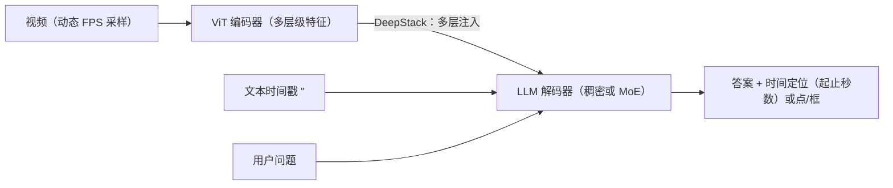

# 视频理解：动作识别、时序定位与视频-语言模型

> **英文原文：** [cv-knowledge-base/02_core_tasks/08_video_understanding.md](../../cv-knowledge-base/02_core_tasks/08_video_understanding.md)（本中文版供参考，内容以英文原文为准）

> **最后更新：** 2026年10月
> **难度级别：** 高级
> **相关章节：** [自监督学习](../03_architectures/03_self_supervised_learning.md) | [光流与跟踪](./06_optical_flow_tracking.md) | [图像生成](./07_image_generation.md) | [多模态视觉-语言](../05_multimodal_vision_language/00_overview.md) | [多模态大模型 2025–2026](../12_research_frontier_2024_2026/03_multimodal_llm_2025_2026.md)

> **🆕 2026年10月更新：**
> - 自监督视频：**V-JEPA 2**（Meta，2025年6月；1B 参数 ViT-g，SSv2 冻结探针 77.3%，以及用于零样本机器人规划的动作条件版本 V-JEPA 2-AC）和 **V-JEPA 2.1**（2026年3月；稠密、时间一致的特征）。
> - 开放视频大模型：**Qwen2.5-VL → Qwen3-VL**（2025年9–10月；原生 256K 上下文，可扩展至 1M，Interleaved-MRoPE，文本-时间戳对齐）和 **Qwen3.5**（2026年2月，早期融合多模态）、**InternVL3/3.5**、**PerceptionLM** + PLM-VideoBench，以及 **Molmo2**（视频指点与跟踪）。
> - 闭源长视频：Gemini 2.5 Pro 在 Video-MME 上报告 84.8%；Gemini 3 Pro（2025年11月）同样以 Video-MME 作为主要视频基准。
> - 基准：Video-MME（CVPR 2025）现已成为事实上的长视频问答标准；在基准表中新增 MLVU、LongVideoBench、TempCompass 和 PLM-VideoBench。
> - 更新了关键论文、基准性能、优缺点和开放问题。

---

## 概述

视频理解涵盖一大类任务——动作识别、时序动作定位、视频问答、稠密视频描述和检索——它们都要求模型同时对空间外观和时间动态进行推理。与静态图像理解不同，视频模型必须处理时间冗余（相邻帧高度相关）、长程依赖（一个动作的含义可能取决于几分钟前发生的事件），以及同时存在的多个语义相关的时间粒度。

主流架构的演进分为三个阶段。**3D CNN 时代**始于 C3D [Tran2015]，并因 I3D [Carreira2017] 而发生变革：I3D 将成熟的二维 ImageNet 架构（Inception-V1）"膨胀"（inflate）为三维，把所有 2×2 卷积滤波器扩展为 2×2×2 的时空卷积核，从而可以迁移 ImageNet 预训练权重，并确立了 Kinetics 数据集作为标准基准的地位。SlowFast [Feichtenhofer2019] 利用时间频率分离：Slow 通路以高语义分辨率处理稀疏帧，Fast 通路以较少通道数处理稠密帧，同时捕捉外观和细粒度运动。**Transformer 时代**随 TimeSformer [Bertasius2021] 到来，它表明纯自注意力（"分离式时空注意力"）可以匹敌甚至超越 3D CNN，并能在测试时处理长得多的片段。**自监督/掩码建模时代**以 VideoMAE [Tong2022] 和 V-JEPA [Assran2024] 为代表，它们将掩码自编码应用于视频 token，证明了数据高效的预训练能够很好地迁移到下游识别任务。

大规模**视频-语言模型**（InternVideo [Wang2022]、Video-LLaMA、VideoChat）将视觉-语言对比学习（CLIP）和指令微调扩展到视频，实现了开放式视频问答。长视频理解方面最显著的进展是 **Gemini 1.5 Pro** [Google2024]，它借助混合专家（Mixture-of-Experts）和高效注意力，在一次前向传播中处理多达 100 万个 token——在标准分辨率下约相当于 1 小时视频——从而无需切分或重新编码即可在极长视频中检索信息。这种数百万 token 上下文范式，与分层或滑动窗口视频模型相比，代表了一种从根本上不同的长视频理解方法。

自 2025 年起，这一范式扩展到了开放权重模型。Qwen3-VL [Bai2025] 支持原生 256K token 上下文（可扩展至 1M），并使用显式时间戳 token，在数小时的视频中实现秒级时间定位。InternVL3.5、PerceptionLM 和 Molmo2 提供了完全或部分开放的替代方案，而 Gemini 2.5/3 将闭源模型在 Video-MME 上的准确率推高到 80% 以上。在表征方面，V-JEPA 2 [Assran2025] 表明，一个在互联网规模视频上训练的 10 亿参数自监督视频编码器，在以运动为中心的识别任务上可以匹敌甚至超越图像-文本编码器。经过动作条件后训练后，它还能支持机器人操作规划，从而将视频理解与世界模型（World Model）联系起来。

---

## 动作识别：架构家族

### 双流与 3D CNN 背景

双流网络 [Simonyan2014] 确立了光流能为 RGB 帧提供互补的运动信息；融合 RGB 流和光流能显著提升动作识别。I3D [Carreira2017] 将其推广：两个 I3D 网络（一个处理 RGB，一个处理光流）在预测层面进行融合。

### I3D：膨胀 3D 卷积网络（Carreira & Zisserman 2017）

I3D [Carreira2017]（CVPR 2017）通过从 ImageNet 自举来解决视频数据稀缺问题：

- 所有二维卷积滤波器 N×N → N×N×N（增加时间维度，权重复制并按 1/N 重新缩放）
- 最大池化和批归一化同样膨胀到三维
- 将 Inception-V1（GoogLeNet）架构膨胀，在 ImageNet 上预训练，在 Kinetics-400 上微调

I3D 在 HMDB-51 上达到 80.2%，在 UCF-101 上达到 97.9%（含光流流），确立了 Kinetics-400 作为核心预训练数据集的地位。该论文还提出并发布了 Kinetics-400 数据集（400 个类别，约 24 万个 YouTube 片段）。

```latex
\text{3D conv output: } z[t, h, w, c] = \sum_{\tau, i, j, c'} W[\tau, i, j, c', c] \cdot x[t+\tau, h+i, w+j, c']
```

### SlowFast 网络（Feichtenhofer 2019）

SlowFast [Feichtenhofer2019]（ICCV 2019）从灵长类视觉皮层（P 细胞和 M 细胞）获得生物学启发，设计了两条并行通路：

- **Slow 通路：** 采样 T=8 帧，通道宽度 C 较大，以低时间频率捕捉语义/外观内容
- **Fast 通路：** 采样 8T=64 帧，通道宽度 C/8 较小（参数约少 8 倍），以高帧率捕捉细粒度时间动态

从 Fast 到 Slow 的横向连接将时间上下文融合进语义流：

```latex
\mathbf{f}_{\text{fused}} = \mathbf{f}_{\text{slow}} \| \text{Conv}(\mathbf{f}_{\text{fast}})
```

SlowFast 在 Kinetics-400 上达到 79.8% 的 top-1 准确率，并在 AVA 上展现出强大的动作检测性能。可分离通路的设计计算高效：Fast 通路只占约 20% 的参数，却贡献了大部分时间判别能力的提升。

### TimeSformer（Bertasius 2021）

TimeSformer [Bertasius2021]（ICML 2021）通过在空间和时间上分解自注意力，将视觉 Transformer 应用于视频。论文评估了五种注意力方案，最佳的是**分离式时空注意力**：先做时间注意力（在同一空间位置上跨所有时间步），再做空间注意力（在同一时间步上跨所有位置）。这将联合时空注意力 O(T²·HW) 的开销降低为 O(T² + (HW)²)：

```latex
\tilde{z}^{(\ell)} = \text{MSA}_{\text{time}}(z^{(\ell-1)}) \quad \text{then} \quad z^{(\ell)} = \text{MSA}_{\text{space}}(\tilde{z}^{(\ell)})
```

TimeSformer-L（长版本）以 224×224 处理 96 帧片段，在 Kinetics-400 上达到 80.7%。由于不含卷积，它可以在测试时直接处理 1 分钟以上的片段而无需改动架构，这相对 3D CNN 是一个显著的实用优势。

---

## 自监督视频预训练

### VideoMAE（Tong 2022）

VideoMAE [Tong2022]（NeurIPS 2022 Spotlight）将掩码自编码应用于视频，以极高的掩码率（90–95%）掩盖**三维时空管道（tube）**形式的 token（而非单独的帧）。主要发现：

- 视频中的时间冗余意味着仅做空间掩码是不够的；去除连续时空块的管道掩码迫使模型进行非平凡的预测
- 90% 的掩码率最优；75% 时任务过于简单
- 仅在 3,400 段视频（SSv2）上预训练的 VideoMAE，就能达到与在数百万图像上预训练的模型相当的性能
- 非对称编码器-解码器：ViT 编码器只处理未被掩码的 token；轻量解码器重建所有像素值

VideoMAE 在 Kinetics-400（ViT-L 为 81.5%）、Something-Something v2（70.8%）和 AVA 动作检测上刷新了最佳成绩，表明对视频任务而言，自监督预训练可以匹敌甚至超越有监督的 ImageNet 预训练。


### V-JEPA（Assran 2024）

V-JEPA [Assran2024]（Meta AI，2024）反对将像素重建作为预训练目标。它改为在**抽象特征空间**中预测：给定被掩码的视频上下文，预测被掩码区域的 ViT 特征而不是原始像素。预测器以被掩码 token 的位置为条件，必须"想象"出合理的抽象内容。

JEPA（联合嵌入预测架构，Joint Embedding Predictive Architecture）目标通过 EMA 目标编码器避免平凡解（预测器路径不需要停止梯度）：

```latex
\mathcal{L}_{\text{JEPA}} = \mathbb{E}\!\left[\|s_\theta(z_{\text{context}}, \text{mask}) - \text{sg}(z_{\text{target}})\|^2\right]
```

V-JEPA 使用多块掩码（移除多个连续块）。与 VideoMAE 不同，它不重建像素。预训练的 V-JEPA 模型在标签高效的设置（少样本、冻结骨干）中迁移效果极佳，使用冻结的 ViT-H 骨干在 Kinetics-400 上达到 81.9%。V-JEPA 2（2025）扩展到互联网规模的视频数据，并支持机器人场景中的规划。

### V-JEPA 2 与 V-JEPA 2.1（Meta，2025–2026）

**V-JEPA 2** [Assran2025]（arXiv 2506.09985，2025年6月）沿四个维度扩展 JEPA 目标：数据（超过 100 万小时的互联网视频外加图像）、模型规模（从 ViT-L 300M 到 ViT-g 1B）、训练时长，以及分辨率和片段长度（通过渐进式训练）。使用冻结编码器和注意力探针（attentive probe），它报告 **SSv2 上 77.3%**（此前最佳为 69.7%）、**Diving-48 上 90.2%**，以及 **Epic-Kitchens-100 动作预测上 39.7 的 recall@5**（此前最佳为 27.6）。与 LLM 对齐后，它在 TempCompass 上达到 76.9%，在 MVP 视频问答上达到 44.5%。**V-JEPA 2-AC** 是一个动作条件预测器，在不到 62 小时的无标注 DROID 机器人视频上后训练得到。将其用于以图像为目标的模型预测控制时，它能在新实验室的 Franka 机械臂上零样本完成到达、抓取和抓放任务，在作者的测试中优于 Octo 和 Cosmos 基线。

```latex
% V-JEPA 2-AC：在表征空间中进行基于能量的规划（对动作序列 a_{1:T} 使用 CEM）
a^*_{1:T} = \arg\min_{a_{1:T}} \big\| P_\phi(a_{1:T}; E_\theta(x_{t}), s_t) - E_\theta(x_{\text{goal}}) \big\|_1
```

**V-JEPA 2.1**（arXiv 2603.14482，2026年3月）以**稠密、时间一致的特征**为目标。它加入了作用于所有 token 的稠密预测损失、多层深度自监督以及多模态分词器，模型规模从 ViT-B（80M）到 2B 的 ViT-G。其目的是让 JEPA 特征能服务于稠密视频任务（如跟踪、分割、深度），而不仅仅是片段级识别。

---

## 时序动作定位

时序动作定位（Temporal Action Localization, TAL）要求在未剪辑视频中检测动作实例的起止时间，通常输出提议（t_start, t_end, 类别, 置信度）。该领域已从滑动窗口分类器演进到稠密的无锚框方法：

- **两阶段方法**（BSN [Lin2018]、BMN）先生成时间提议，再对每个提议分类
- **单阶段/无锚框方法**（AFSD [Lin2021]）直接回归起止时间，无需显式提议
- **基于 Transformer 的方法**（ActionFormer [Zhang2022]、TemporalMaxer）用自注意力处理多尺度时间特征，在 THUMOS-14 和 ActivityNet 上达到最先进水平

**指标：** THUMOS 在 IoU 阈值 [0.3:0.1:0.7] 上取平均 mAP，ActivityNet 在 [0.5, 0.75, 0.95] 上取平均。THUMOS-14 在 IoU 0.5 下的 mAP 是最常被引用的单一数字。

---

## 视频-语言模型

### InternVideo（Wang 2022）

InternVideo [Wang2022]（arXiv，2022年12月）是一个视频基础模型，统一了两个互补的自监督目标：

1. **掩码视频建模**（VideoMAE 式）：对空间外观的生成式理解
2. **视频-语言对比学习**（CLIP 式）：与文本的判别式对齐

一个可学习的**跨模态协调器**学习为下游任务融合这两类表征。InternVideo 在发表时于涵盖识别、检索、问答和时刻检索的 39 个视频数据集上达到最先进水平。InternVideo2（2024）通过 6B 参数模型和多阶段训练进一步扩展。

### 长视频理解：Gemini 1.5 Pro

Gemini 1.5 Pro [Google2024]（2024年2月发布）在单次前向传播中处理多达 100 万个 token（后续 API 版本扩展到 200 万），在默认分辨率下约相当于 1 小时视频。其架构使用**混合专家（MoE）**高效管理参数预算。主要视频能力：

- 无需切分即可处理长达一小时的视频
- 在 10.5 小时视频中实现近乎完美的大海捞针式检索（2M token 上下文下召回率 99.8%）
- 对整部电影内容进行指令遵循
- 同时在音频、字幕和视觉帧之间进行跨模态推理

这与此前将长视频切分为重叠窗口或构建分层摘要的方法形成对比。单体式上下文方法简化了流程，避免了片段边界处的信息丢失，但每次查询所需的计算量远高于分层方法。其后继者 Gemini 2.5 Pro（报告 Video-MME 84.8%）和 Gemini 3 Pro（2025年11月）保留了这种长上下文设计，并加入了更强的视频推理（"思考"）能力。

### 开放视频大模型（2025–2026）

**Qwen2.5-VL**（2025年2月）引入了动态 FPS 采样，并在多模态 RoPE 中加入**绝对时间**编码，使模型能够将事件定位到秒级。**Qwen3-VL** [Bai2025]（2025年9–10月；技术报告 arXiv 2511.21631）提供稠密（2B–32B）和 MoE（30B-A3B、235B-A22B）规格，每种规格都有 Instruct 版和"Thinking"版。与视频相关的改动包括：

- **Interleaved-MRoPE：** 时间、高度和宽度频率在整个旋转频谱上交错分配，而不是分配到连续频段，从而改善长时程视频推理。
- **文本-时间戳对齐：** 用与帧 token 交错的显式文本时间戳取代早先的 T-RoPE，实现精确的时间定位。
- **DeepStack：** 将多层级 ViT 特征注入 LLM 的多个层。
- **原生 256K 上下文，可扩展至 1M**（YaRN），声称能在数小时长的视频中以秒级索引实现完整召回。

**Qwen3.5**（2026年2月；0.8B 至 397B-A17B）转向在数万亿多模态 token 上进行**早期融合**训练，使视觉成为基础 LLM 的原生能力，而非外挂适配器。

上海人工智能实验室的 **InternVL3**（2025年4月）和 **InternVL3.5**（2025年8月，arXiv 2508.18265；最大 241B-A28B）加入了原生多模态预训练、Cascade RL 以及用于高效视频推理的视觉分辨率路由器。Meta 的 **PerceptionLM** [Cho2025]（2025年4月，arXiv 2504.13180；1B/3B/8B）在完全开放、部分人工标注的细粒度视频数据上训练。它配套发布了 **PLM-VideoBench**，测试细粒度活动、"什么/哪里/何时/如何"类视频问答以及时空定位描述。AI2 的 **Molmo2**（arXiv 2601.10611；4B/8B）加入了**视频指点与跟踪**：模型在空间和时间上输出点来为答案提供依据，并在指代视频分割与跟踪（MeViS、Ref-YT-VOS）上进行评估。



---

## 评估基准

### Kinetics

Kinetics-400/600/700 [Carreira2017, Smaira2020] 是主流的动作识别基准，由涵盖 400/600/700 个动作类别的 10 秒 YouTube 片段组成。**Top-1 准确率**是标准指标。Kinetics-700-2020 约有 65 万个训练片段。模型通常在 Kinetics 上预训练，再针对其他任务微调。

### Something-Something v2（SSv2）

SSv2 [Goyal2017] 包含 22 万个众包的短视频片段（2–6 秒），标注了 174 个细粒度时间关系标签（例如 "moving something from left to right"）。SSv2 强调**时间推理**而非外观：物体被刻意泛化为"something"，因此模型无法利用物体身份走捷径。SSv2 上的 Top-1 准确率被认为是比 Kinetics 更严格的时间理解测试。

### 其他基准

| 基准 | 任务 | 主要指标 |
|---|---|---|
| THUMOS-14 | 时序动作定位 | mAP @ IoU 0.5 |
| ActivityNet-1.3 | 时序动作定位 + 稠密描述 | 平均 mAP |
| TAP-Vid (DAVIS, Kinetics) | 点跟踪 | 平均 Jaccard（AJ） |
| EgoSchema | 长视频问答（第一人称） | 准确率 |
| Video-Bench | 视频问答（多任务） | 准确率 |
| MVBench | 20 个视频理解子任务 | 准确率 |
| Video-MME (CVPR 2025) | 多领域视频问答；900 段视频（254 小时），2,700 个问答；11 秒至 1 小时 | 准确率（有/无字幕） |
| MLVU | 多任务长视频理解 | M-avg 准确率 |
| LongVideoBench | 长上下文交错式视频-语言问答 | 准确率 |
| TempCompass | 时间感知（速度、方向、顺序） | 准确率 |
| PLM-VideoBench | 细粒度问答、时空定位描述 | 依任务而定 |

---

## 关键论文

| 论文 | 作者 | 年份 | 会议/期刊 | 主要贡献 |
|---|---|---|---|---|
| Quo Vadis, Action Recognition? A New Model and the Kinetics Dataset (I3D) | Carreira, Zisserman | 2017 | CVPR | 膨胀 3D 卷积网络；Kinetics-400 数据集；双流 I3D |
| SlowFast Networks for Video Recognition | Feichtenhofer, Fan, Malik, He | 2019 | ICCV | 慢/快双通路时间采样；横向融合 |
| Is Space-Time Attention All You Need for Video Understanding? (TimeSformer) | Bertasius, Wang, Torresani | 2021 | ICML | 分离式时空注意力；无卷积的视频 ViT |
| VideoMAE: Masked Autoencoders are Data-Efficient Learners for Self-Supervised Video Pre-Training | Tong, Song, Wang, Wang | 2022 | NeurIPS (Spotlight) | 90% 掩码的管道重建；数据高效的视频自监督学习 |
| V-JEPA: Video Joint-Embedding Predictive Architecture | Assran et al. (Meta AI) | 2024 | Meta AI Tech Report | 在特征空间（而非像素）中预测；冻结骨干达最先进水平 |
| InternVideo: General Video Foundation Models via Generative and Discriminative Learning | Wang et al. (Shanghai AI Lab) | 2022 | arXiv | 统一掩码建模 + 对比学习；在 39 个数据集上达最先进水平 |
| Gemini 1.5: Unlocking Multimodal Understanding Across Millions of Tokens | Google DeepMind | 2024 | Google Technical Report | 100 万+ token 上下文；MoE 架构；小时级视频理解 |
| Video-MME: The First-Ever Comprehensive Evaluation Benchmark of Multi-modal LLMs in Video Analysis | Fu et al. | 2025 | CVPR | 跨时长的 900 段视频 / 2,700 个专家问答；事实上的长视频基准 |
| Qwen2.5-VL Technical Report | Qwen Team (Alibaba) | 2025 | arXiv 2502.13923 | 动态 FPS + 绝对时间 MRoPE；秒级事件定位 |
| PerceptionLM: Open-Access Data and Models for Detailed Visual Understanding | Cho et al. (Meta) | 2025 | arXiv 2504.13180 | 完全开放的视频大模型方案；PLM-VideoBench |
| V-JEPA 2: Self-Supervised Video Models Enable Understanding, Prediction and Planning | Assran et al. (Meta) | 2025 | arXiv 2506.09985 | 1B JEPA 编码器；SSv2 探针 77.3%；V-JEPA 2-AC 零样本机器人规划 |
| InternVL3.5: Advancing Open-Source Multimodal Models in Versatility, Reasoning, and Efficiency | Shanghai AI Lab | 2025 | arXiv 2508.18265 | Cascade RL；最大 241B-A28B；高效视觉 token 路由 |
| Qwen3-VL Technical Report | Qwen Team (Alibaba) | 2025 | arXiv 2511.21631 | 256K→1M 上下文；Interleaved-MRoPE；文本-时间戳对齐；DeepStack |
| Molmo2 | Allen Institute for AI | 2026 | arXiv 2601.10611 | 具备时空指点与跟踪能力的开放视频大模型 |
| V-JEPA 2.1: Unlocking Dense Features in Video Self-Supervised Learning | Meta FAIR | 2026 | arXiv 2603.14482 | 稠密预测损失 + 深度自监督；最大 2B ViT-G |

---

## 基准性能

| 模型 | 数据集 | 指标 | 分数 | 备注 |
|---|---|---|---|---|
| I3D (RGB+Flow) | Kinetics-400 | Top-1 Acc ↑ | 75.7% | 双流；2017 年基线 |
| SlowFast R101 (8×8) | Kinetics-400 | Top-1 Acc ↑ | 79.8% | 无额外数据；[Feichtenhofer2019] |
| TimeSformer-L | Kinetics-400 | Top-1 Acc ↑ | 80.7% | 96 帧；ImageNet-21K 预训练 |
| VideoMAE ViT-L/16 | Kinetics-400 | Top-1 Acc ↑ | 85.2% | MAE 预训练；微调 |
| VideoMAE ViT-H/14 | Something-Something v2 | Top-1 Acc ↑ | 75.4% | 时间推理基准 |
| V-JEPA ViT-H/16 | Kinetics-400 | Top-1 Acc ↑ | 81.9% | 冻结骨干探针（线性） |
| V-JEPA ViT-H/16 | Something-Something v2 | Top-1 Acc ↑ | 71.4% | 冻结骨干，微调头部 |
| InternVideo-V2 (6B) | Kinetics-400 | Top-1 Acc ↑ | 92.1% | 完全微调；大规模预训练 |
| V-JEPA 2 ViT-g | Something-Something v2 | Top-1 Acc ↑ | 77.3% | 冻结编码器 + 注意力探针 [Assran2025] |
| V-JEPA 2 ViT-g | Diving-48 | Top-1 Acc ↑ | 90.2% | 冻结编码器 + 注意力探针 |
| V-JEPA 2 ViT-g | Epic-Kitchens-100 anticipation | Recall@5 ↑ | 39.7 | 此前最佳为 27.6 |
| V-JEPA 2 + LLM | TempCompass | Accuracy ↑ | 76.9% | 结合 8B LLM 的视频问答 |
| GPT-4o | Video-MME | Accuracy ↑ | 71.9% | Video-MME 官方仓库（2024年6月刷新） |
| Gemini 2.5 Pro | Video-MME | Accuracy ↑ | 84.8% | Google 报告（2025年5月） |

*V-JEPA 冻结骨干分数来自 Meta AI 2024 技术报告；V-JEPA 2 数据来自官方仓库。InternVideo2 的分数可能包含测试时增强。视频大模型的分数由厂商报告，取决于帧预算、分辨率以及是否使用字幕。*

---

## 优缺点

| 方面 | 优点 | 缺点 |
|---|---|---|
| 3D CNN（I3D、SlowFast） | 强时间归纳偏置；通过二维膨胀实现计算高效 | 时间感受野有限；片段长度固定；难以扩展到长视频 |
| 视频 Transformer（TimeSformer、基于 ViT） | 全局时间注意力；可扩展到更长片段；从图像 ViT 迁移效果更好 | 注意力开销随 T×H×W 个 token 呈二次增长；稠密时间采样时显存占用高 |
| 自监督视频预训练（VideoMAE、V-JEPA） | 无需标注视频；少样本迁移出色；可在领域内数据上训练 | 预训练计算量大；V-JEPA 的抽象预测更难诊断 |
| 长上下文视频大模型（Gemini 1.5） | 无需切分即可处理完整长度视频；多模态推理（音频、文本、视频） | 每次查询的计算/显存开销巨大；闭源；不适合实时应用 |
| 开放视频大模型（Qwen3-VL、InternVL3.5、Molmo2） | 开放权重；256K–1M 上下文；时间戳/点定位；可微调 | 大型 MoE 模型部署成本高；基准由厂商报告；会幻觉出时间细节 |
| 动作条件视频世界模型（V-JEPA 2-AC） | 基于潜在预测的零样本规划；所需机器人数据很少 | 时间跨度短；对相机摆放位置敏感；基于采样的规划速度慢 |

---

## 开放问题与研究空白

- **高效的长视频理解：** O(T²) 注意力的 Transformer 对小时级视频而言代价过高。开放模型现已达到 256K–1M token（Qwen3-VL），但部署成本高昂。token 压缩、线性注意力、分层记忆以及检索增强或智能体式方法（通过工具调用查找并重看片段）仍是活跃的替代方向。
- **基准饱和与数据泄漏：** 闭源模型在 Video-MME 上已超过 80%，而多项选择基准常常可以部分依靠单帧或语言先验解决。较新的评测套件强调细粒度时间定位（PLM-VideoBench、TempCompass），但稳健、无污染的长视频评估仍然缺乏。
- **稠密时空定位：** 回答*在哪里*和*何时*（随时间变化的点、框、掩码），而不仅仅是*是什么*，正在兴起（Molmo2、基于 SAM 3 的智能体）。将视频大模型与稠密跟踪器和分割器统一起来仍是开放问题。
- **细粒度时间推理：** 当前模型在计数、时长估计和对顺序敏感的动作（例如"5 秒内先 A 再 B 再 C"）上仍然吃力；Something-Something 仍未被完全解决。
- **多粒度视频理解：** 一个能同时处理片段级、镜头级和剧集级语义、而无需独立解码器的统一模型，目前尚未得到清晰定义。
- **第一人称视频：** Epic-Kitchens 和 Ego4D 暴露了第一人称动作识别中的系统性失败；手-物交互领域仍比第三人称基准更难。
- **因果与反事实视频推理：** 模型能回答"发生了什么"，却不能回答"为什么"或"如果……会发生什么"；STAR 和 CausalVid 等探测数据集正在揭示这些局限。
- **视频生成与理解的统一：** 生成式视频模型（Sora、CogVideoX）与理解模型共享时间表征；一个能同时惠及两者的统一架构仍是开放的架构问题。
- **开放式视频问答的评估：** 依赖多项选择的基准会因训练出的答案偏差而迅速饱和；用 LLM 评判自由生成的答案又带来了其自身的校准难题。

---

## 延伸阅读

- [I3D 论文（arXiv:1705.07750）](https://arxiv.org/abs/1705.07750) — CVPR 2017，Kinetics 数据集 [Carreira2017]
- [VideoMAE GitHub（MCG-NJU）](https://github.com/MCG-NJU/VideoMAE) — NeurIPS 2022 Spotlight [Tong2022]
- [V-JEPA 论文与代码（Meta AI）](https://github.com/facebookresearch/jepa) — 特征空间预测架构 [Assran2024]
- [InternVideo2 GitHub（OpenGVLab）](https://github.com/OpenGVLab/InternVideo) — 视频基础模型套件 [Wang2022]
- [SlowFast GitHub（facebookresearch）](https://github.com/facebookresearch/SlowFast) — 官方实现 [Feichtenhofer2019]
- [Gemini 1.5 技术报告（Google）](https://arxiv.org/abs/2403.05530) — 长上下文多模态模型 [Google2024]
- [V-JEPA 2 / 2.1 GitHub（facebookresearch）](https://github.com/facebookresearch/vjepa2) — 自监督视频世界模型 [Assran2025]
- [Qwen3-VL GitHub（QwenLM）](https://github.com/QwenLM/Qwen3-VL) — 开放视频大模型；技术报告 arXiv:2511.21631 [Bai2025]
- [Video-MME 基准](https://github.com/MME-Benchmarks/Video-MME) — CVPR 2025 长视频问答基准
- [Perception Models（PE + PLM）](https://github.com/facebookresearch/perception_models) — Perception Encoder、PerceptionLM、PLM-VideoBench [Cho2025]
- [InternVL GitHub（OpenGVLab）](https://github.com/OpenGVLab/InternVL) — InternVL3 / 3.5
- [Molmo2 GitHub（allenai）](https://github.com/allenai/molmo2) — 视频指点与跟踪视觉-语言模型
