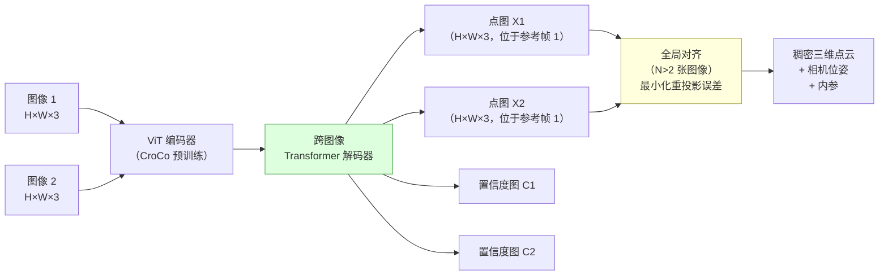
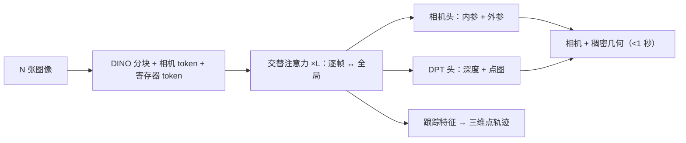

# 三维重建

> **英文原文：** [cv-knowledge-base/02_core_tasks/09_3d_reconstruction.md](../../cv-knowledge-base/02_core_tasks/09_3d_reconstruction.md)（本中文版供参考，内容以英文原文为准）

> **最后更新：** 2026年10月
> **难度级别：** 高级
> **相关章节：** [运动恢复结构与 SLAM](../04_3d_vision_and_scene/03_sfm_and_slam.md) · [神经辐射场](../04_3d_vision_and_scene/01_nerf_and_variants.md) · [高斯泼溅](../04_3d_vision_and_scene/02_gaussian_splatting.md) · [深度估计](./05_depth_estimation.md) · [三维生成](../04_3d_vision_and_scene/04_3d_generation.md) · [四维与动态场景](../12_research_frontier_2024_2026/05_4d_and_dynamic_scenes.md) · [研究前沿](../12_research_frontier_2024_2026/00_overview_latest.md)

> **🆕 2026年10月更新：**
> - **前馈式多视图 Transformer** 已取代成对点图，成为最先进方法。新增 Fast3R 和 CUT3R（CVPR 2025）；**VGGT**（CVPR 2025 最佳论文）；其后继者 **π³**（ICLR 2026，无参考视图）、**MapAnything**（3DV 2026，度量尺度，可接受可选先验）、**Depth Anything 3**（2025年11月）和腾讯的 **WorldMirror**；以及 2026 年的扩展性工作 **VGGT-Ω**（CVPR 2026 Oral）和 **VGG-T³**（CVPR 2026，线性时间，1000 张图像 54 秒）。
> - **动态/四维重建：** MonST3R（ICLR 2025）、MegaSaM（CVPR 2025）以及 **D4RT**（Google DeepMind，**CVPR 2026 最佳论文**）。D4RT 是一个基于查询的模型，可输出深度、三维轨迹和相机，比以往方法快 18–300 倍。
> - **单图像 / 生成式三维：** **SAM 3D**（Meta，2025年11月；CVPR 2026 荣誉提名）和 **TRELLIS.2**（"Native and Compact Structured Latents for 3D Generation"，**CVPR 2026 最佳学生论文**）。
> - 修复了失效的交叉链接；更新了关键论文、基准表、优缺点、开放问题和延伸阅读。

---

## 概述

三维重建是从一张或多张二维图像推断物理场景或物体几何的问题，目标是恢复一种编码形状、深度且通常还包含外观的表示——点云、网格、体素网格、有符号距离场或辐射场。该领域涵盖一个谱系：从需要标定相机和稠密图像重叠的经典多视图几何流程，到仅凭光度监督即可恢复表面几何的神经隐式表示，再到只需少量未标定图像、一次前向传播即可推断三维结构的前馈式 Transformer 模型。

占主导地位的经典方法——**运动恢复结构（Structure from Motion, SfM）** [Schönberger2016] 加 **多视图立体（Multi-View Stereo, MVS）** [Seitz2006]——分两个阶段完成重建：(1) 通过在图像间匹配稀疏局部特征（SIFT、SuperPoint）估计相机位姿；(2) 通过多视图之间的光度一致性估计稠密深度图。COLMAP [Schönberger2016] 是事实上的黄金标准 SfM+MVS 流程。由 MVSNet [Yao2018] 开创的基于学习的 MVS 范式，用学习到的代价体和循环正则化取代手工设计的光度一致性，提升了精度和稳健性。

**神经隐式表示**在 2020–2022 年间彻底改变了重建质量。NeRF [Mildenhall2020] 为新视角合成优化一个连续的辐射函数（密度 + 颜色）；NeuS [Wang2021] 和 VolSDF [Yariv2021] 围绕有符号距离函数重新构建了 NeRF 式的体渲染，使得可以通过 Marching Cubes 精确提取表面。这些逐场景优化方法每个场景需要数十到数百张图像以及数小时的计算。

近期最重要的进展是**前馈式几何模型**的出现。DUSt3R [Wang2024] 将所有成对几何问题——深度、位姿、内参——重新表述为**点图回归**：给定一对图像，一个 ViT 编码器-解码器直接回归出两个对齐的三维点云（每张图像一个），二者表示在同一坐标系中，且不需要任何相机标定输入。MASt3R [Leroy2024] 为 DUSt3R 增加了稠密局部特征输出，可以同时完成度量重建和图像匹配。这些模型代表了一次范式转变，类似于 DETR 之于检测：用端到端学习取代手工设计的几何流程。

从 2025 年起，成对形式让位于**多视图前馈 Transformer**，它们可以联合处理数十到数百张图像。VGGT [Wang2025]（CVPR 2025 最佳论文）在一秒内回归所有视图的相机、深度、点图和轨迹。π³、MapAnything 和 Depth Anything 3 消除了参考视图偏置，加入了度量尺度和可选几何先验，并简化了预测目标。2026 年，前沿转向**扩展性与长序列**（VGGT-Ω、VGG-T³）以及**动态四维场景**：CVPR 2026 最佳论文 D4RT [Zhang2026] 通过单一查询接口从视频中重建深度、三维运动和相机。与此同时，**生成式单图像三维**（SAM 3D、TRELLIS.2）如今已能从一张照片生成完整、带纹理的物体资产和场景布局。

---

## 评估指标

**倒角距离（Chamfer Distance, CD）：** 度量双向的点云接近程度：

```latex
% 预测点集 P 与真值 Q 之间的倒角距离：
\text{CD}(P, Q) = \frac{1}{|P|} \sum_{p \in P} \min_{q \in Q} \|p - q\|_2
                + \frac{1}{|Q|} \sum_{q \in Q} \min_{p \in P} \|p - q\|_2

% 越低越好；在 DTU 上以 mm 计，在 ShapeNet 上以 cm 计
% 对称；不惩罚拓扑错误
```

**阈值 τ 下的 F-Score：** 衡量表面完整性与准确性的精确率-召回率权衡：

```latex
% 精确率：落在任一真值点 τ 范围内的预测点比例
\text{Prec}(\tau) = \frac{1}{|P|}\sum_{p \in P} \mathbb{1}\bigl[\min_{q \in Q}\|p-q\|_2 < \tau\bigr]

% 召回率：落在任一预测点 τ 范围内的真值点比例
\text{Rec}(\tau)  = \frac{1}{|Q|}\sum_{q \in Q} \mathbb{1}\bigl[\min_{p \in P}\|p-q\|_2 < \tau\bigr]

% F-Score
F(\tau) = \frac{2 \cdot \text{Prec}(\tau) \cdot \text{Rec}(\tau)}{\text{Prec}(\tau) + \text{Rec}(\tau)}

% 常用阈值：\tau = 1mm（DTU），对角线长度的 1%（ShapeNet）
```

---

## 经典多视图立体

### COLMAP

**COLMAP** [Schönberger2016]（CVPR 2016）：增量式 SfM + 基于图像块的 MVS 流程。SfM 阶段：SIFT 特征提取 → 穷举或词汇树匹配 → 基于 RANSAC 的本质/基础矩阵估计 → 光束法平差（bundle adjustment）。MVS 阶段：利用相邻视图间的光度一致性为每张图像估计深度图，再通过几何一致性过滤进行融合。COLMAP 至今仍是 3D 高斯泼溅和 NeRF 训练流程的参考方法。作者：Johannes L. Schönberger、Jan-Michael Frahm。

**局限：** 需要 ≥20–50 张有足够重叠的图像；在低纹理、反光表面或重复图案下失效；大场景需要数小时计算。

### MVSNet

**MVSNet** [Yao2018]（ECCV 2018）：首个端到端的基于学习的 MVS。骨干 CNN 从 N=5 个输入视图中提取特征图；利用 D=256 个深度假设平面上的单应变换，将所有源视图变形到参考视图的相机视锥中，构建可微的**代价体**；三维 CNN 对代价体进行正则化并回归出深度图。主要贡献：(1) 可微的单应变形；(2) 基于方差的跨视图代价度量。在 DTU 基准上达到最先进水平；无需微调即可泛化到 Tanks and Temples。作者：Yao Yao、Zixin Luo、Shiwei Li 等。

**RNN-MVSNet / PatchmatchNet** [Wang2021b] 用循环（GRU）或迭代 PatchMatch 取代三维 CNN 正则化，从而支持更高分辨率并降低显存。

---

## 单视图三维重建

**Pixel2Mesh** [Wang2018]（ECCV 2018）：通过图卷积网络迭代形变一个二十面体球来从单张 RGB 图像预测三维三角网格，图卷积网络借助透视投影融合图像特征。由粗到细的级联在三个分辨率上进行形变。在 ShapeNet 上用倒角距离和 F-Score@1% 评估。作者：Nanyang Wang、Yinda Zhang 等。

**Occupancy Networks** [Mescheder2019]：以图像特征为条件学习连续的隐式占用函数 f: ℝ^3 → [0,1]；通过 Marching Cubes 提取表面。比网格形变在拓扑上更灵活。

**LRM——大型重建模型（Large Reconstruction Model）** [Hong2023]（ICLR 2024）：首个大规模单图像三维重建模型。ViT 图像编码器从单张输入图像提取特征；带有相机条件交叉注意力的多层 Transformer 解码器回归出三平面（triplane）NeRF 表示（三个轴对齐的二维特征平面），再从中解码几何与外观。在来自 Objaverse 和 MVImgNet 的约 100 万个多视图物体上训练。在单 GPU 上约 5 秒即可由单张图像得到照片级的新视角合成和可提取的网格（TSDF 融合）。参数量 5 亿。作者：Yicong Hong、Kai Zhang、Jiuxiang Gu、Sai Bi 等。arXiv 2311.04400。

**TRELLIS 与 TRELLIS.2** [Xiang2025]（微软研究院与清华大学、中国科学技术大学合作）。TRELLIS（CVPR 2025）提出了**结构化三维潜变量**：携带特征的稀疏体素，可解码为高斯、辐射场或网格。**TRELLIS.2**（"Native and Compact Structured Latents for 3D Generation"，arXiv 2512.14692，**CVPR 2026 最佳学生论文**）用 **O-Voxel** 取代等值面场（SDF、FlexiCubes）。O-Voxel 是一种无场（field-free）的稀疏"全能体素"（omni-voxel）结构，同时编码几何与 PBR 材质属性，并能处理开放、非流形和封闭表面。一个稀疏压缩 VAE 实现 16 倍下采样，使一个完整纹理化的 1024³ 资产只需约 **9.6K 个潜变量 token**。一个在公开三维数据上训练的 **4B 参数流匹配**生成器输出 512³–1536³ 分辨率、带 PBR 纹理的网格。

**SAM 3D** [SAM3DTeam2025]（Meta，"SAM 3D: 3Dfy Anything in Images"，arXiv 2511.16624，2025年11月；列入 CVPR 2026 最佳论文荣誉提名）面向**真实场景中被遮挡、杂乱**的单张图像，而不是干净的物体渲染图。**SAM 3D Objects** 从带掩码的物体预测逐物体的几何、纹理和位姿/布局，从而能够由一张照片重建完整场景。**SAM 3D Body** 恢复人体形状和姿态。训练将合成预训练与真实世界对齐相结合，并借助一个人类和模型在环（in-the-loop）的数据引擎；据二手报道，该引擎在近 100 万张图像上标注了约 314 万个网格。Meta 报告称，在真实世界物体和场景上，其人类偏好胜率相对以往方法至少为 5:1。

---

## 神经隐式表面重建

**NeRF** [Mildenhall2020]（ECCV 2020）：一个 MLP f_θ(x, d) → (c, σ) 将三维点位置 **x** 和视线方向 **d** 映射为颜色 **c** 和体密度 σ。体渲染沿每条射线对 c·σ 积分得到二维像素颜色；通过渲染方程反向传播，仅用带位姿的 RGB 图像即可训练该 MLP。几何可以提取为 σ 取最大值处的表面，但 NeRF 的密度场并不是真正的表面表示。

**NeuS** [Wang2021]（NeurIPS 2021）：用**有符号距离函数（Signed Distance Function, SDF）** f_θ(x) → s ∈ ℝ 取代体密度，其中 s = 0 即为表面。一个 logistic 函数将 SDF 转换为密度，确保体渲染中的权重函数在零水平集处无偏地取峰值。这使得可以通过 Marching Cubes 精确提取表面。NeuS 在 DTU 上的平均倒角距离为 **0.77 mm**（使用掩码）和 **0.84 mm**（不使用掩码），显著优于 IDR（0.90）和 NeRF（1.54）。作者：Peng Wang、Lingjie Liu、Yuan Liu 等。

```latex
% 由 SDF 得到 NeuS 密度（简化形式）：
\sigma(t) = \frac{d}{dt}\Phi_s(f(p(t)))

% \Phi_s(x) = \text{sigmoid}(-x/s) 是 logistic 分布的累积分布函数
% s 是可学习的尺度参数（训练过程中逐渐减小）
% 权重函数 w(t) = T(t) \cdot \sigma(t) 在 SDF 零点处取峰值，
% 即使存在遮挡也无偏，这与以往基于 NeRF 的方法不同
```

**VolSDF** [Yariv2021]（NeurIPS 2021）：独立提出了以拉普拉斯分布密度对 SDF 进行体渲染的方法。在 DTU 上倒角距离为 **0.86 mm**。引入了一种不透明度近似，无需精细/粗糙两级网络即可进行解析的射线采样。

**HF-NeuS** [Wang2022]：通过将粗糙几何（SDF）与精细纹理位移解耦来增加高频细节，改善了细长结构的重建。

**基于 3DGS 的表面重建**（2024）：SuGaR [Guédon2024] 和 2DGS [Huang2024] 为三维高斯泼溅（3D Gaussian Splatting）加入表面约束（将高斯绑定到网格面上，或将高斯压扁为二维圆盘），从而能从多视图图像快速重建表面，质量可与 NeRF 相当。贴合表面的高斯表示在 2026 年仍是活跃课题。据报道，ECCV 2026 最佳论文 "Heat Kernel Textures — the Geodesic Gaussians That Do Not Splat"（Foti、Korkmaz、Zafeiriou、Birdal；伦敦帝国理工学院）提出了一种通过热核（测地）高斯在表面上定义的纹理表示，而不是使用泼溅的三维基元。

---

## 前馈式几何基础模型

### DUSt3R

**DUSt3R** [Wang2024]（CVPR 2024）："Dense and Unconstrained Stereo 3D Reconstruction"（稠密无约束立体三维重建）。给定两张图像 (I_1, I_2)，一个 ViT 编码器（CroCo 预训练 [Weinzaepfl2022]）分别处理每张图像；一个跨图像 Transformer 解码器输出两个**点图** X_1 ∈ ℝ^(H×W×3) 和 X_2 ∈ ℝ^(H×W×3)，均表示在图像 1 的参考坐标系中。每张图像中的每个像素都被映射到一个带置信度的三维点。不需要相机内参、外参或重叠信息。对于 N>2 张图像，一个全局对齐过程通过快速梯度下降，在共享的全局坐标系下最小化所有成对点图之间的重投影误差。随后从点图中解析地恢复相机位姿和内参。arXiv 2312.14132。作者：Shuzhe Wang、Vincent Leroy、Yohan Cabon、Boris Chidlovskii、Jérôme Revaud（NAVER LABS Europe）。



### MASt3R

**MASt3R** [Leroy2024]（ECCV 2024）："Grounding Image Matching in 3D with MASt3R"。为 DUSt3R 增加一个**稠密局部特征头**，在输出点图的同时输出描述子图。匹配损失在三维一致的对应点处最大化特征相似度，从而可以同时进行度量三维重建和视觉匹配。MASt3R 在多个位姿估计和视觉定位基准上优于 DUSt3R，并提供一个完整的 SfM 流程（MASt3R-SfM），无需任何先验特征匹配器。在标准基准上，相机旋转误差在 2–3° 以内，平移误差在 1–2% 以内。作者：Vincent Leroy、Yohan Cabon、Jérôme Revaud。

### 多视图前馈：Fast3R、CUT3R 与 VGGT（2025）

**Fast3R** [Yang2025]（CVPR 2025）将 DUSt3R 推广到 N 个视图。所有图像由一个 Transformer 联合处理，消除了 O(N²) 的成对推理和全局对齐，并可在一次前向传播中扩展到 1000 多张图像。**CUT3R** [Wang2025c]（CVPR 2025；Wang、Zhang、Holynski、Efros、Kanazawa）走了相反的**在线**路线。一个有状态的循环模型随每个新帧更新持久的场景状态，并逐帧输出度量点图和相机位姿。它可以处理视频和无序照片集，无论静态还是动态，并能查询虚拟的未见视图以推断未观测区域。

**VGGT** [Wang2025]（Visual Geometry Grounded Transformer；Wang、Chen、Karaev、Vedaldi、Rupprecht、Novotny；牛津 VGG 与 Meta AI；**CVPR 2025 最佳论文**）是一个约 10 亿参数的 Transformer。它可以从一个、几个或数百个视图中直接推断**相机外参和内参、深度图、点图和三维点轨迹**，通常不到一秒，且不需要全局对齐步骤。每一帧由 DINO 分块，并加入一个**相机 token** 和若干寄存器（register）token。网络随后**交替进行逐帧自注意力和跨所有帧的全局自注意力**。相机头从相机 token 回归内参和外参，DPT 头则输出稠密深度、点图和跟踪特征。第一帧定义世界坐标系。VGGT 的预测质量足以直接初始化光束法平差和三维高斯泼溅（导出为 COLMAP 格式），2025 年 7 月还发布了可商用许可的 VGGT-1B-Commercial 检查点。



### 无参考视图、度量与通用模型（2025–2026）

- **π³** [Wang2026a]（上海人工智能实验室 / 浙江大学；arXiv 2507.13347；**ICLR 2026**）认为锚定到指定参考视图是一种有害的归纳偏置。一个完全**置换等变**的 Transformer 在没有参考帧的情况下，为每个视图预测仿射不变的相机位姿和尺度不变的*局部*点图。这使其对输入顺序稳健，并在相机位姿、单目与视频深度以及点图精度上达到最先进水平。**Pi3X**（2025年12月）加入了卷积头（减少网格状伪影）、可选的位姿/内参/深度条件、连续置信度以及近似度量尺度。
- **MapAnything** [Keetha2026]（Meta Reality Labs 与 CMU；arXiv 2509.13414；**3DV 2026**）是一个"通用"度量模型。它接受图像以及内参/射线、位姿和深度中的任意可选子集，回归出一种**分解式**表示：逐视图的深度、射线图、位姿以及一个全局**度量尺度因子**。一个模型覆盖超过 12 项任务：未标定 SfM、已标定 MVS、单目度量深度、定位、深度补全等。它同时发布了 CC BY-NC 和 Apache 2.0 两种许可的检查点。
- **Depth Anything 3** [Lin2025]（ByteDance Seed，2025年11月）使用带输入自适应跨视图注意力的朴素 DINO ViT 和单一的**深度-射线**目标，报告相对 VGGT 平均提升约 35–44% 的位姿精度和 24–25% 的几何精度。参见[深度估计](./05_depth_estimation.md)。
- **WorldMirror**（HunyuanWorld-Mirror，腾讯，arXiv 2510.10726，2025年10月）加入了**任意先验提示（any-prior prompting）**：将可用的位姿、内参和深度编码为 token 并注入模型。一次前向传播即可输出点云、多视图深度、相机、表面法向和**三维高斯**。

```latex
% MapAnything 对视图 i 的分解式输出（示意）：
X_i(u) = s \cdot \big( R_i\, ( D_i(u)\, \mathbf{r}_i(u) ) + \mathbf{t}_i \big)
% D_i：沿射线 r_i(u) 的相对尺度深度；(R_i, t_i)：位姿；s：单一的全局度量尺度
```

### 扩展性与长序列（2026）

对所有 token 进行全局注意力使 VGGT 式模型的开销随视图数呈二次增长。两篇 CVPR 2026 论文着眼于规模问题：

- **VGGT-Ω** [Wang2026b]（arXiv 2605.15195；CVPR 2026 Oral；Wang、Chen、Zhang、Karaev、Schönberger、Labatut、Bojanowski、Novotny、Vedaldi、Rupprecht）表明前馈式重建随模型容量和数据**可预测地扩展**。实现这一点依靠：一个能处理动态场景的标注流程、一个自监督训练协议、单一的稠密预测头，以及取代大部分全局注意力的高效场景 token。它的训练显存约为 VGGT 的 30%，监督训练数据多 15 倍，在 Sintel 上的相机估计比此前最佳结果提升 77%。
- **VGG-T³** [Elflein2026]（NVIDIA、Vector Institute、多伦多大学；arXiv 2602.23361；CVPR 2026）用**测试时训练（test-time training）**取代全局注意力。不断增长的键值记忆被压缩进一个固定大小的 MLP，使离线重建的开销随视图数**线性**增长。它在 **54 秒**内重建一个 1000 张图像的集合（比 softmax 注意力基线快 11.6 倍），点图误差与 VGGT 相当，并支持通过查询学到的场景 MLP 来定位新图像。

流式变体（CUT3R 的循环状态、带 KV 缓存的因果 VGGT 式 Transformer、DA3-Streaming 的滑动窗口，以及分块再对齐的流程）以牺牲少量精度为代价，在长视频或大范围输入上保持显存有界。CVPR 2026 上的一系列工作（例如面向因果 VGGT 模型的 KV 缓存压缩、基于测试时训练的长序列重建）正针对此类缓存的显存增长问题。

### 动态场景与四维重建

- **MonST3R** [Zhang2025a]（ICLR 2025）通过**为每个时间步**估计一个点图，将 DUSt3R 扩展到动态视频。它在稀缺的带位姿动态数据上微调，输出随时间变化的点云、逐帧相机、视频深度和运动掩码。
- **MegaSaM** [Li2025]（Google DeepMind、加州大学伯克利分校、密歇根大学；CVPR 2025 Oral）是一个基于优化的流程。一个可微的光束法平差系统（DROID-SLAM 一脉）以单目深度先验初始化，从随手拍摄的动态视频中稳健且快速地估计相机、焦距和一致的视频深度。
- **D4RT** [Zhang2026]（Zhang、Le Moing 等；Google DeepMind、UCL、牛津大学；arXiv 2512.08924；**CVPR 2026 最佳论文**）是完全前馈的。视频编码器构建全局场景表示，一个轻量解码器回答相互独立的**时空查询**（源像素、源时刻、目标时刻、相机时刻），输出一个三维位置。同一接口即可给出静态和动态场景的深度图、点云、稠密三维轨迹（包括穿过遮挡的轨迹）以及完整相机参数。开销随查询数线性增长。DeepMind 报告其推理比以往方法快 18–300 倍（在单个 TPU 芯片上处理一分钟视频约 5 秒），并在动态基准上达到最先进精度。查询形式参见[光流与跟踪](./06_optical_flow_tracking.md)。

---

## 关键论文

| 论文 | 作者 | 年份 | 会议/期刊 | 主要贡献 |
|-------|---------|------|-------|-----------------|
| COLMAP (SfM + MVS) | Schönberger, Frahm | 2016 | CVPR | 黄金标准的增量式 SfM + 基于图像块的 MVS |
| MVSNet | Yao, Luo, Li et al. | 2018 | ECCV | 可微代价体；学习式 MVS |
| Pixel2Mesh | Wang, Zhang et al. | 2018 | ECCV | 基于 GCN 的单图像网格形变 |
| NeRF | Mildenhall, Tancik et al. | 2020 | ECCV | 体渲染神经辐射场 |
| NeuS | Wang, Liu et al. | 2021 | NeurIPS | 无偏 SDF 体渲染；DTU 0.77mm |
| VolSDF | Yariv, Gu et al. | 2021 | NeurIPS | 由 SDF 得到拉普拉斯密度；DTU 0.86mm |
| LRM: Large Reconstruction Model | Hong, Zhang et al. | 2023 | ICLR 2024 | 单图像三平面 NeRF；5 亿参数；5 秒 |
| DUSt3R | Wang, Leroy et al. | 2023 | CVPR 2024 | 点图回归；无需相机标定 |
| MASt3R | Leroy, Cabon, Revaud | 2024 | ECCV 2024 | DUSt3R + 稠密匹配；SfM 流程 |
| MonST3R | Zhang, Herrmann et al. | 2024 | ICLR 2025 | 面向动态视频的逐时间步点图；相机 + 运动掩码 |
| Fast3R | Yang, Sax, Liang et al. | 2025 | CVPR 2025 | 一次前向完成 N 视图 DUSt3R；1000+ 张图像 |
| CUT3R | Wang, Zhang, Holynski, Efros, Kanazawa | 2025 | CVPR 2025 | 带持久状态的循环式在线三维/四维感知 |
| MegaSaM | Li et al. | 2025 | CVPR 2025 (Oral) | 从随手拍摄的动态视频稳健估计相机 + 一致深度 |
| TRELLIS (Structured 3D Latents) | Xiang et al. | 2025 | CVPR 2025 | 可解码为 GS/NeRF/网格的稀疏结构化潜变量 |
| VGGT | Wang, Chen, Karaev, Vedaldi, Rupprecht, Novotny | 2025 | CVPR 2025 (Best Paper) | 交替注意力 Transformer；<1 秒输出相机、深度、点和轨迹 |
| π³ | Wang, Zhou, Zhu et al. (Shanghai AI Lab) | 2025 | ICLR 2026 | 置换等变、无参考视图的几何；Pi3X 更新 |
| MapAnything | Keetha, Müller, Schönberger et al. (Meta, CMU) | 2025 | 3DV 2026 | 支持可选先验的通用度量重建；12+ 项任务 |
| WorldMirror (HunyuanWorld-Mirror) | Liu et al. (Tencent) | 2025 | arXiv 2510.10726 | 任意先验提示；点、深度、相机、法向、3DGS |
| Depth Anything 3 | Lin, Chen, Liew et al. (ByteDance Seed) | 2025 | arXiv 2511.10647 | 朴素 ViT + 深度-射线目标；在位姿和几何上超越 VGGT |
| SAM 3D: 3Dfy Anything in Images | SAM 3D Team (Meta) | 2025 | arXiv 2511.16624; CVPR 2026 HM | 真实场景单图像物体/场景及人体重建 |
| Efficiently Reconstructing Dynamic Scenes One D4RT at a Time | Zhang, Le Moing et al. (Google DeepMind) | 2025 | CVPR 2026 (Best Paper) | 基于查询的四维重建 + 跟踪；快 18–300 倍 |
| Native and Compact Structured Latents for 3D Generation (TRELLIS.2) | Xiang et al. (Tsinghua, MSR, USTC) | 2025 | CVPR 2026 (Best Student Paper) | O-Voxel；16 倍压缩 VAE；4B 流模型；PBR 网格 |
| VGG-T³ | Elflein et al. (NVIDIA, Vector, U. Toronto) | 2026 | CVPR 2026 | 以测试时训练替代全局注意力；随视图数线性；1000 张图像 54 秒 |
| VGGT-Ω | Wang, Chen, Zhang et al. (Oxford, Meta) | 2026 | CVPR 2026 (Oral) | 前馈三维的可预测扩展；30% 训练显存；15 倍数据 |

---

## 基准性能

### DTU 数据集——倒角距离（mm，越低越好）

| 方法 | CD（使用掩码） | CD（不使用掩码） | 类型 |
|--------|---------------|-----------------|------|
| COLMAP | 0.50 | — | 经典 MVS |
| MVSNet | ~0.45 | — | 学习式 MVS（稠密） |
| NeRF | 1.54 | 1.49 | 神经隐式 |
| IDR | 0.90 | — | 神经隐式 |
| NeuS | **0.77** | 0.84 | SDF 体渲染 |
| VolSDF | 0.86 | — | SDF 拉普拉斯密度 |
| HF-NeuS | 0.76 | — | SDF + 高频 |
| DUSt3R | 未公开报告 | — | 前馈点图 |

### ShapeNet——单图像三维（倒角距离 × 10^3，越低越好）

| 方法 | 平均 CD | F@1% | 备注 |
|--------|---------|------|-------|
| Pixel2Mesh | 0.591 | — | 网格形变；13 个 ShapeNet 类别 |
| Occupancy Networks | 0.551 | — | 隐式函数 |
| LRM | 未公开报告逐类结果 | — | 基于 NeRF；定性上最先进 |

### Tanks and Temples——F-Score（%，越高越好）

| 方法 | Intermediate | Advanced | 备注 |
|--------|-------------|---------|-------|
| COLMAP | 42.1 | 27.2 | 经典 MVS |
| MVSNet | 43.5 | — | 未经微调即泛化 |
| PatchmatchNet | 53.2 | 32.6 | 迭代 PatchMatch |
| DUSt3R | 未在 Tanks 上公开报告 | — | 架构面向无约束场景 |

### 前馈相机位姿——AUC@3°（越高越好）

| 方法 | HiRoom | ETH3D | DTU | 7Scenes | ScanNet++ | 备注 |
|--------|--------|-------|-----|---------|-----------|-------|
| DA3-Nested-Giant-Large（射线头） | 84.4 | 52.6 | 93.9 | 29.5 | 89.4 | DA3 官方仓库评估流程 |
| DA3-Nested-Giant-Large（相机头） | 80.3 | 48.4 | 94.1 | 28.5 | 85.0 | 相机头更快；精度略低 |

*DA3 的 README 指出，DA3-Large 在该评测套件上的结果与 VGGT 相当。跨论文的位姿数字（VGGT、π³、MapAnything）使用不同的帧采样方式，无法直接比较。*

### 前馈与四维模型的效率

| 方法 | 设置 | 报告速度 | 备注 |
|--------|---------|----------------|-------|
| VGGT | 数十个视图 | 每个场景 < 1 秒 | 官方仓库；显存随视图数呈二次增长 |
| VGG-T³ | 1000 张图像 | 54 秒 | 比 softmax 注意力基线快 11.6 倍；随视图数线性增长 |
| D4RT | 1 分钟视频 | 单个 TPU 芯片约 5 秒 | 比以往四维方法快 18–300 倍（DeepMind） |
| VGGT-Ω | 训练 | 约为 VGGT 训练显存的 30% | 在 Sintel 上相机精度比此前最佳提升 77% |

---

## 优缺点

| 方面 | 优点 | 缺点 |
|--------|------|------|
| 经典 MVS（COLMAP） | 原理成熟；无需训练数据；流程完整；精度高 | 需要标定相机；在低纹理/反光表面失效；速度慢 |
| 学习式 MVS（MVSNet） | 对外观变化更稳健；可跨场景泛化 | 仍需要来自 SfM 的相机位姿；深度图融合存在伪影 |
| 神经隐式（NeuS/VolSDF） | 细长结构精确；可微；单场景过拟合 | 逐场景优化（数小时）；需要标定且带位姿的图像；无法实时 |
| 前馈式（DUSt3R/MASt3R） | 无需标定；推理快；可处理稀疏视图；零样本泛化 | 重建比逐场景方法粗糙；大场景可扩展性有限 |
| 单图像（LRM/Pixel2Mesh） | 无需多视图；速度快；大规模训练 | 单视图深度存在歧义；会幻觉出被遮挡的几何 |
| 多视图前馈 Transformer（VGGT、π³、MapAnything、DA3） | 数秒内为 1 到数百张无位姿图像输出相机 + 稠密几何；是 BA/3DGS 的良好初始化 | 注意力显存呈二次增长；极长序列上会漂移；最佳权重常为非商用 |
| 四维前馈（D4RT、MonST3R、CUT3R） | 能处理运动物体；从随手拍摄的视频联合得到深度、轨迹和相机 | 动态真值稀缺；对快速非刚性运动的精度仍有限 |
| 生成式单图像三维（SAM 3D、TRELLIS.2） | 从一张图像得到完整的纹理资产 / PBR 网格；被遮挡部分合理 | 幻觉出的几何不是测量结果；尺度和布局存在歧义；模型较重 |

---

## 开放问题与研究空白

- **大规模室外重建：** DUSt3R 和 MASt3R 是为物体级和房间级场景设计的。Fast3R、VGG-T³（1000 张图像 54 秒）和流式模型已推进到数千帧。在不退回到光束法平差的情况下，对城市规模或驾驶日志进行全局一致、无漂移的前馈重建仍是开放问题。
- **前馈与优化之争：** 前馈模型（VGGT、π³、DA3）如今常被用来初始化甚至取代 COLMAP，但最精确的流程仍会用光束法平差进行细化。单纯扩大规模（VGGT-Ω）能否弥合剩余的精度差距，是一个开放的经验性问题。
- **动态与非刚性四维重建：** D4RT、MonST3R 和 MegaSaM 能处理运动物体，但真实世界的四维真值稀缺，评估严重依赖合成数据（如 Sintel），高度非刚性或快速运动仍然困难。
- **重建与生成：** 生成式模型（SAM 3D、TRELLIS.2）能令人信服地幻觉出未见几何。在将此类输出用于测量或机器人之前，需要能区分"观测到的表面"与"想象出的表面"的校准不确定性。
- **精确的表面法向与细长结构：** 神经 SDF 难以重建细长物体（草、头发、电线），因为零水平集会退化；在表面附近结合 NeRF 密度、在边界处使用 SDF 的混合表示正在被探索，但尚未标准化。
- **实时神经重建：** 3D 高斯泼溅实现了实时渲染，但重建仍需数分钟到数小时的优化；在场景尺度上真正实时的神经重建（例如用于机器人或 AR）尚未解决。
- **材质与外观解耦：** 大多数重建方法将几何与表面外观混为一谈；在光照未知的情况下从多视图图像中分离本征反照率、表面法向和光照（逆渲染）仍是开放问题。
- **对真实场景纹理的泛化：** 在合成/精选数据上训练的学习式 MVS 和前馈模型，可能在材质不寻常的真实场景中失效；领域随机化和自监督自适应策略尚不完善。
- **不确定性量化：** 表面重建模型很少提供逐点的不确定性估计；对于机器人操作和 AR 场景理解而言，经过校准的三维置信度图至关重要，因为错误的几何可能带来危险。
- **与场景语义的融合：** 大多数几何重建流程与类别无关；大规模地联合重建几何与语义标签（全景三维重建），尤其是在开放词汇（open-vocabulary）设置下，是一个新兴研究方向。

---

## 延伸阅读

- [COLMAP: Structure-from-Motion Revisited（Schönberger & Frahm, 2016）](https://openaccess.thecvf.com/content_cvpr_2016/papers/Schonberger_Structure-From-Motion_Revisited_CVPR_2016_paper.pdf)
- [MVSNet: Depth Inference for Unstructured Multi-view Stereo（Yao et al., 2018）](https://arxiv.org/abs/1804.02505)
- [NeuS: Learning Neural Implicit Surfaces by Volume Rendering（Wang et al., 2021）](https://arxiv.org/abs/2106.10689)
- [LRM: Large Reconstruction Model for Single Image to 3D（Hong et al., 2023）](https://arxiv.org/abs/2311.04400)
- [DUSt3R: Geometric 3D Vision Made Easy（Wang et al., 2024）](https://arxiv.org/abs/2312.14132)
- [MASt3R: Grounding Image Matching in 3D（Leroy et al., 2024）](https://arxiv.org/abs/2406.09756)
- [VGGT: Visual Geometry Grounded Transformer（Wang et al., CVPR 2025 最佳论文）](https://github.com/facebookresearch/vggt) — 代码、VGGT-1B-Commercial，以及 VGGT-Ω 的链接
- [π³: Permutation-Equivariant Visual Geometry Learning（arXiv:2507.13347）](https://github.com/yyfz/Pi3) — ICLR 2026；Pi3X
- [MapAnything: Universal Feed-Forward Metric 3D Reconstruction（arXiv:2509.13414）](https://github.com/facebookresearch/map-anything) — 3DV 2026
- [Depth Anything 3（arXiv:2511.10647）](https://github.com/ByteDance-Seed/Depth-Anything-3) — 任意视图深度-射线几何
- [D4RT: Efficiently Reconstructing Dynamic Scenes One D4RT at a Time（arXiv:2512.08924）](https://arxiv.org/abs/2512.08924) — CVPR 2026 最佳论文
- [VGGT-Ω（arXiv:2605.15195）](https://arxiv.org/abs/2605.15195) — CVPR 2026 Oral
- [VGG-T³: Offline Feed-Forward 3D Reconstruction at Scale（arXiv:2602.23361）](https://arxiv.org/abs/2602.23361) — CVPR 2026
- [CUT3R: Continuous 3D Perception Model with Persistent State（arXiv:2501.12387）](https://arxiv.org/abs/2501.12387) — CVPR 2025
- [Fast3R: Towards 3D Reconstruction of 1000+ Images in One Forward Pass（arXiv:2501.13928）](https://arxiv.org/abs/2501.13928) — CVPR 2025
- [SAM 3D Objects（facebookresearch）](https://github.com/facebookresearch/sam-3d-objects) — 论文 arXiv:2511.16624
- [TRELLIS.2（microsoft）](https://github.com/microsoft/TRELLIS.2) — CVPR 2026 最佳学生论文；arXiv:2512.14692
