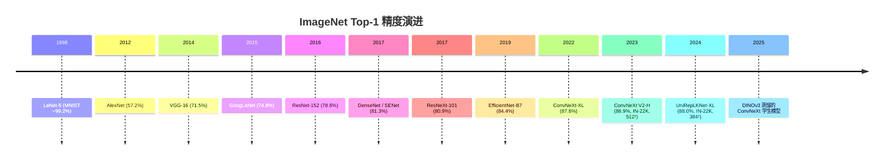

# CNN 架构：从 LeNet 到 ConvNeXt

> **英文原文：** [cv-knowledge-base/03_architectures/00_cnn_architectures.md](../../cv-knowledge-base/03_architectures/00_cnn_architectures.md)（本中文版供参考，内容以英文原文为准）

> **最后更新：** 2026年10月
> **难度级别：** 中级 → 高级
> **相关章节：**
> - [图像分类](../02_core_tasks/00_image_classification.md)
> - [视觉 Transformer](./01_vision_transformers.md)
> - [混合架构](./02_hybrid_architectures.md)
> - [高效架构](../09_efficiency_and_deployment/01_efficient_architectures.md)

> **🆕 2026年10月更新：**
> - 新增章节 **ConvNeXt 之后的发展（2023–2026）**：ConvNeXt V2（FCMAE + GRN）、大卷积核 UniRepLKNet、DenseNets Reloaded（RDNet）、OverLoCK（CVPR 2025 Oral）以及 MambaOut（CVPR 2025）。
> - 卷积网络作为**基础模型的蒸馏学生模型**：DINOv3（Meta，2025年8月）发布了从其 7B ViT 教师模型蒸馏得到的 ConvNeXt-T/S/B/L 骨干网络（蒸馏代码于2025年11月发布）。
> - 扩充了关键论文、基准性能表与时间线（ConvNeXt V2-H 88.9%、UniRepLKNet-XL 88.0%）；更新了 CNN 专用自监督学习的开放问题（FCMAE、基于 ConvNeXt V2 的 LeJEPA）。

---

## 概述

卷积神经网络（Convolutional Neural Networks, CNN）构成了现代计算机视觉的基础骨干网络家族，其谱系从 Yann LeCun 的 LeNet-5（1998）一路延续到 ConvNeXt 家族（Liu et al., CVPR 2022）。在这段历程中，主导性的设计语汇逐渐收敛为一小组相互正交的原则：**感受野管理**（步幅、空洞、池化）、**跳跃/残差连接**（He et al., 2016）、**归一化策略**（Batch Norm、Layer Norm、Group Norm）、**通道注意力**（Hu et al., 2018）、**深度可分离卷积**（Howard et al., 2017）以及**复合缩放**（Tan & Le, 2019）。每个时代的突破性架构，基本都可以理解为在给定参数量/FLOPs 预算下对这些基本单元的有章法的组合。

ImageNet 大规模视觉识别挑战赛（ILSVRC）在 2010 年至 2017 年间是具有决定性意义的基准，把十余年的架构进展浓缩进了八届比赛。AlexNet 在 2012 年的胜利证明，用 GPU 训练的深层 CNN 能够大幅超越以往基于手工特征的基线；VGGNet 表明仅使用 3×3 卷积堆叠深度就是一个强有力的缩放维度；GoogLeNet 证明多尺度并行分支（Inception 模块）可以在增加深度的同时减少参数；ResNet 通过恒等捷径连接解决了梯度消失障碍，使 100 层以上的网络能够常规训练。此后的后 ResNet 时代——DenseNet、ResNeXt、SENet、EfficientNet、ConvNeXt——可以看作是一系列系统性消融研究，分别探索宽度、基数（cardinality）、通道重标定，以及 CNN 归纳偏置与源自 Transformer 的训练配方之间的对齐。

一个关键且仍然活跃的研究问题是：CNN 与视觉 Transformer 究竟属于同一类基本表征，还是它们的归纳偏置（局部空间连接 vs. 全局自注意力）会产生性质不同的学习表征 [Liu2022]。ConvNeXt 在不使用任何注意力机制的情况下，通过现代化 ResNet-50 的训练配方即达到了 Swin Transformer 的精度，这表明 2021–2022 年间观察到的 ViT 优势在很大程度上源于训练配方的差异，而非架构上的必然。这一观察推动了与 Transformer 主流并行的混合架构和纯卷积研究。自 2023 年以来，这一方向产出了面向卷积网络的掩码自编码器预训练（ConvNeXt V2）、大卷积核与动态卷积核设计（UniRepLKNet、OverLoCK），以及对状态空间视觉模型的尖锐质疑（MambaOut）。到 2025–2026 年，卷积骨干网络越来越多地通过**蒸馏 ViT 基础模型**（如 DINOv3）为 ConvNeXt 学生模型而获得，以便高效部署。

---

## 核心设计原则

### 感受野

在卷积核大小统一为 $k$、步幅为 1 的 CNN 中，第 $l$ 层单元的感受野为：

```
RF(l) = 1 + l * (k - 1)
```

当使用步幅为 $s$ 的跨步卷积或池化时，感受野增长会加快。实践中，较深的层具有很大的理论感受野，但其有效感受野（即通过梯度幅值真正影响单元输出的区域）要小得多 [Luo2016]。空洞（atrous）卷积以空洞率 $d$ 将感受野扩展为：

```
RF_dilated(l) = 1 + l * d * (k - 1)
```

且不增加参数量，从而能够在不损失空间分辨率的情况下进行密集预测。

### 跳跃连接与残差学习

ResNet 的核心恒等捷径 [He2016] 为：

```
y = F(x, {W_i}) + x
```

其中 $F$ 表示待学习的残差映射。当输入与输出维度不同时，使用线性投影 $W_s$：

```
y = F(x, {W_i}) + W_s * x
```

这种形式保证了梯度可以沿恒等路径流动，使优化地形更加平滑，从而使 50 到 1000 层以上的网络能够训练而不发生退化。

### 深度可分离卷积

使用卷积核 $K \in \mathbb{R}^{k \times k \times C_{in} \times C_{out}}$ 的标准卷积，其计算代价为 $O(k^2 \cdot C_{in} \cdot C_{out} \cdot H \cdot W)$。深度可分离分解 [Howard2017] 将其替换为：

1. 深度卷积（每个输入通道一个滤波器）：代价 $O(k^2 \cdot C_{in} \cdot H \cdot W)$
2. 逐点（1×1）卷积：代价 $O(C_{in} \cdot C_{out} \cdot H \cdot W)$

缩减比例：$\frac{1}{C_{out}} + \frac{1}{k^2}$，当 $k=3$ 时通常约为 8–9 倍。

### 复合缩放（EfficientNet）

[Tan2019] 通过复合系数 $\phi$，将沿深度 $d$、宽度 $w$ 和分辨率 $r$ 三个维度的缩放形式化：

```
d = alpha^phi
w = beta^phi
r = gamma^phi

subject to: alpha * beta^2 * gamma^2 ≈ 2
            alpha >= 1, beta >= 1, gamma >= 1
```

该约束保证 $\phi$ 每增加 1，总 FLOPs 大约增长为原来的 2 倍（即按 $2^\phi$ 缩放）。常数 $\alpha, \beta, \gamma$ 通过在 $\phi = 1$ 时的小规模网格搜索确定。

---

## 架构谱系

### LeNet-5（LeCun et al., 1998）
用于手写数字识别（MNIST）的开创性架构。使用 $5\times5$ 卷积层、平均池化、tanh 激活以及全连接分类器。它确立了"卷积 → 池化 → 全连接"的流水线，此后十余年一直是标准范式。MNIST 上的 Top-1：约 99.2%。

### AlexNet（Krizhevsky et al., 2012）
以 15.3% 的 top-5 错误率赢得 ILSVRC 2012（第二名：26.2%）。关键创新：ReLU 激活（取代 tanh/sigmoid）、用于正则化的 dropout、数据增强（随机裁剪、翻转、颜色抖动），以及通过模型并行切分在两块 GTX 580 GPU 上训练。架构：5 个卷积层 + 3 个全连接层，约 60M 参数。这一结果开启了计算机视觉的现代深度学习时代。

### VGGNet（Simonyan & Zisserman, 2014/ICLR 2015）
系统性研究表明，仅用 $3\times3$ 卷积堆叠深度即可获得有竞争力的精度。VGG-16 与 VGG-19 在 ImageNet 上达到 71.5% 的 top-1。关键洞见：两个堆叠的 $3\times3$ 卷积与一个 $5\times5$ 卷积的感受野相同，但参数更少，且多了一个非线性。尽管参数量约为 138M，VGG 统一的设计使其在数年间成为迁移学习的首选骨干网络。

### GoogLeNet / Inception-v1（Szegedy et al., 2015）
提出了 Inception 模块：$1\times1$、$3\times3$、$5\times5$ 卷积与 $3\times3$ 最大池化的并行分支，沿通道维拼接。$1\times1$ 卷积被用作较宽卷积之前的降维瓶颈。仅用约 6.8M 参数（对比 AlexNet 的 60M）就在 ImageNet 上达到 74.8% 的 top-1 和 6.67% 的 top-5 错误率。Inception 家族随后发展出 v2（Batch Norm）、v3（分解卷积）以及 Inception-ResNet 等变体。

### ResNet（He et al., CVPR 2016）
引入恒等捷径连接，使 1000 层以上网络的训练成为可能。ResNet-152 以 3.57% 的 top-5 错误率（集成）、78.57% 的 top-1（单模型）赢得 ILSVRC 2015。ResNet-50 约达到 77.15% 的 top-1。瓶颈设计（1×1→3×3→1×1 卷积）降低了更深变体的计算量。它可以说是影响最大的 CNN 架构，至今仍被广泛用作检测、分割和自监督学习中的骨干网络。

### DenseNet（Huang et al., CVPR 2017，最佳论文奖）
将残差连接扩展为密集连接：在密集块内，每一层都接收所有前序层的特征图。对一个有 $L$ 层的网络，共有 $L(L+1)/2$ 条直接连接。优势：特征复用、缓解梯度消失、减少参数量。DenseNet-201 以显著更少的参数达到与 ResNet-152 相当的 ImageNet 精度。DenseNet-BC（瓶颈 + 压缩）进一步降低了 FLOPs。

### ResNeXt（Xie et al., CVPR 2017）
引入**基数**（cardinality，即并行变换路径的数量），作为与深度和宽度并列的第三个缩放维度。基数为 $C$ 的 ResNeXt 块聚合 $C$ 个独立变换：

```
y = sum_{i=1}^{C} T_i(x) + x
```

这在数学上等价于分组卷积。ResNeXt-101（32×4d）达到 80.9% 的 top-1，在相近 FLOPs 下比 ResNet-101 高约 1.5%。ResNeXt 构成了 ILSVRC 2016 亚军方案的基础。

### SENet（Hu et al., CVPR 2018）
压缩-激励（Squeeze-and-Excitation, SE）模块通过两步过程引入通道注意力：(1) **压缩（squeeze）**：全局平均池化生成通道描述子；(2) **激励（excitation）**：两个带 sigmoid 的全连接层生成逐通道的缩放权重。SE-ResNet-154 在 ImageNet 上达到 81.32% 的 top-1。SE 模块赢得了 ILSVRC 2017 第一名，将 top-5 错误率降至 2.251%。SE 机制开销极小（额外参数 <1%），被现代架构广泛嵌入。

### EfficientNet（Tan & Le, ICML 2019）
提出用神经架构搜索（NAS）找到基础架构（EfficientNet-B0），再进行复合缩放。EfficientNet-B7 在 ImageNet 上达到 **84.4% top-1 / 97.1% top-5**，同时比当时最好的卷积网络（GPipe）小 8.4 倍、快 6.1 倍。复合系数的形式使单个模型家族即可覆盖从移动端到服务器端的完整谱系（B0–B7）。EfficientNetV2 [Tan2021] 进一步引入 Fused-MBConv 模块和渐进式训练，达到 87.3% top-1。

### ConvNeXt（Liu et al., CVPR 2022）
"A ConvNet for the 2020s" 通过采用 Swin Transformer 的训练配方和架构微观决策，逐步现代化 ResNet-50：(1) patchify 主干（4×4 不重叠卷积），(2) 深度 7×7 卷积，(3) 倒置瓶颈，(4) GELU 激活，(5) 用 Layer Norm 取代 Batch Norm，(6) 更少的归一化层，(7) 分离的下采样层。ConvNeXt-XL 在 ImageNet 上达到 **87.8% top-1**（使用 ImageNet-22K 预训练），与 Swin-L 持平或更优，同时保留了卷积网络的简洁性。这一结果表明，2021 年 CNN 与 Transformer 之间的性能差距在很大程度上是训练配方造成的假象。

---

## ConvNeXt 之后的发展（2023–2026）

2022 年之后，*通用*骨干网络的前沿决定性地转向了 ViT（参见[视觉 Transformer](./01_vision_transformers.md)），但纯卷积网络仍沿四个方向保持活跃的研究：适配卷积的自监督预训练、超大卷积核、重新审视较早的连接模式，以及充当 ViT 基础模型的紧凑**学生模型**。

### ConvNeXt V2（Woo et al., CVPR 2023）
ConvNeXt V2 [Woo2023] 将架构与**全卷积掩码自编码器（Fully Convolutional Masked Autoencoder, FCMAE）**协同设计：预训练期间用稀疏卷积处理被掩码的区域，使卷积网络只看到可见像素，与 MAE 的非对称编码器相对应。作者在将 MAE 应用于 ConvNeXt 时观察到*特征坍塌*（大量失效/冗余通道），因此加入了**全局响应归一化（Global Response Normalization, GRN）**——一个几乎不增加参数、可增强通道间特征竞争的层：

```
G(X)_c = || X_c ||_2                      # 每个通道的全局 L2 聚合
N(X)_c = G(X)_c / mean_c' G(X)_c'         # 跨通道的除法归一化
X_c    <- gamma * (X_c * N(X)_c) + beta + X_c
```

该家族涵盖从 Atto（3.7M，76.7%）到 Huge（660M，仅 IN-1K 时 86.3%）的规模；ConvNeXt V2-H 经 ImageNet-22K 微调后在 512² 下达到 **88.9% top-1**，是 ConvNeXt 系列中最强的结果。FCMAE 是针对下文开放问题中"掩码图像建模（MIM）只适用于 ViT"这一问题的首个被广泛采用的答案。

### 大卷积核网络：UniRepLKNet（Ding et al., CVPR 2024）
继 RepLKNet 和 SLaK 之后，**UniRepLKNet** [Ding2024] 认为大卷积核能够"不加深即可看得更广"（see wide without going deep），并提出了大卷积核卷积网络的四条设计准则，采用结构重参数化（膨胀重参数化块，在推理时将并行的小卷积核/空洞分支合并为一个大卷积核）。UniRepLKNet-XL 达到 **88.0%** 的 ImageNet top-1（384²，IN-22K），ADE20K 上 55.6 mIoU，COCO 上 56.4 box AP；同一架构配合特定模态的预处理即可迁移到音频、视频、点云和时间序列。其期刊扩展版发表于 IEEE TPAMI（2025）。

### DenseNets Reloaded：RDNet（Kim et al., ECCV 2024）
RDNet [Kim2024] 以现代训练配方和模块重设计重新审视 DenseNet，认为**拼接（concatenation）**是被低估而非逊于加法。RDNet-L 达到 84.8%（224²，IN-1K），在 384² 下达到 85.8%，在相近 FLOPs 下可与 Swin、ConvNeXt 和 DeiT-III 竞争。

### 纯卷积网络中的自顶向下注意力：OverLoCK（Lou & Yu, CVPR 2025 Oral）
OverLoCK [Lou2025] 加入了受生物启发的"*先概览、后细看*"通路：Base-Net 编码低/中层特征，轻量级 Overview-Net 生成粗粒度全局上下文作为自顶向下的引导，Focus-Net 则借助 **ContMix**——一种在保持局部性的同时注入长程依赖的上下文混合动态卷积——进行精细感知。OverLoCK-B 在 16.7 GFLOPs 下达到 85.1% top-1。

### MambaOut：门控 CNN vs. SSM（Yu & Wang, CVPR 2025）
MambaOut [Yu2025] 从 Mamba 块中移除 SSM，只保留**门控 CNN**（Gated CNN）块（以深度卷积作为 token 混合器的门控 MLP），并表明这一纯卷积家族在 ImageNet 上优于视觉 Mamba 模型（MambaOut-Small：84.1%，48.5M 参数）。作者据此认为，SSM 对短序列分类并非必要，但可能对长序列/密集任务有用（参见[状态空间模型](./05_state_space_models.md)）。

### 卷积网络作为基础模型的蒸馏学生
在基础模型规模上，Google DeepMind 2023 年的一项研究（"ConvNets Match Vision Transformers at Scale"）报告称，在 JFT-4B 上预训练的 NFNet 遵循与 ViT 相当的计算量–精度缩放规律，最大模型经微调后达到约 90.4% 的 ImageNet top-1 [Smith2023]。然而在实践中，2025–2026 年 CNN 更常见的角色是**便于部署的学生模型**：**DINOv3** [Simeoni2025]（Meta，2025年8月）发布了从其在 LVD-1689M 上训练的 6.7B 参数 ViT-7B 教师模型蒸馏得到的 ConvNeXt-Tiny/Small/Base/Large 骨干网络（29M–198M 参数），ConvNeXt 蒸馏代码于 2025 年 11 月发布。从 ViT 教师蒸馏得到的 CNN 特征继承了教师的大部分密集特征质量，同时保留了卷积在边缘硬件上的延迟优势（参见[高效架构](../09_efficiency_and_deployment/01_efficient_architectures.md)）。聚合式（agglomerative）ViT/混合学生模型（RADIO）在[混合架构](./02_hybrid_architectures.md)中介绍。

---

## 架构图示

### ResNet 残差块


### CNN 架构演进时间线



---

## 关键论文

| 论文 | 作者 | 年份 | 会议/期刊 | 主要贡献 |
|-------|---------|------|-------|-----------------|
| Gradient-Based Learning Applied to Document Recognition | LeCun, Bottou, Bengio, Haffner | 1998 | Proc. IEEE | LeNet-5：用于数字识别的奠基性"卷积-池化-全连接"流水线 |
| ImageNet Classification with Deep CNNs (AlexNet) | Krizhevsky, Sutskever, Hinton | 2012 | NeurIPS | 深层 CNN + GPU 训练 + ReLU + dropout；突破 ILSVRC 2012 |
| Very Deep Convolutional Networks (VGGNet) | Simonyan, Zisserman | 2015 | ICLR | 基于 3×3 卷积的系统性深度研究；强大的迁移基线 |
| Deep Residual Learning for Image Recognition (ResNet) | He, Zhang, Ren, Sun | 2016 | CVPR | 恒等捷径使 152 层网络成为可能；ILSVRC 2015 top-5 3.57% |
| Densely Connected Convolutional Networks (DenseNet) | Huang, Liu, van der Maaten, Weinberger | 2017 | CVPR | 用于特征复用的密集连接；CVPR 2017 最佳论文 |
| Aggregated Residual Transformations (ResNeXt) | Xie, Girshick, Dollár, Tu, He | 2017 | CVPR | 将基数作为新的缩放维度；分组卷积 |
| Squeeze-and-Excitation Networks (SENet) | Hu, Shen, Sun | 2018 | CVPR | 通过压缩-激励实现通道注意力；ILSVRC 2017 冠军 |
| EfficientNet: Rethinking Model Scaling | Tan, Le | 2019 | ICML | 深度/宽度/分辨率的复合缩放；B7：84.4% top-1 |
| A ConvNet for the 2020s (ConvNeXt) | Liu, Mao, Wu, Feichtenhofer, Darrell, Xie | 2022 | CVPR | 现代化 ResNet 追平 Swin Transformer；87.8% top-1 |
| ConvNeXt V2: Co-designing and Scaling ConvNets with Masked Autoencoders | Woo, Debnath, Hu, Chen, Liu, Kweon, Xie | 2023 | CVPR | FCMAE 自监督预训练 + GRN；V2-H 88.9% top-1 |
| ConvNets Match Vision Transformers at Scale | Smith, Brock, Berrada, De | 2023 | arXiv | 在 JFT-4B 上 NFNet 的缩放规律与 ViT 相当；微调后约 90.4% top-1 |
| UniRepLKNet: A Universal Perception Large-Kernel ConvNet | Ding, Zhang, Ge, Zhao, Song, Yue, Shan | 2024 | CVPR | 大卷积核设计准则；跨模态通用 |
| DenseNets Reloaded (RDNet) | Kim, Heo, Han | 2024 | ECCV | 现代化的密集拼接，可与 Swin/ConvNeXt 竞争 |
| MambaOut: Do We Really Need Mamba for Vision? | Yu, Wang | 2025 | CVPR | 门控 CNN（Mamba 去掉 SSM）在 ImageNet 上胜过视觉 Mamba |
| OverLoCK | Lou, Yu | 2025 | CVPR (Oral) | 带上下文混合动态卷积核的自顶向下注意力卷积网络 |
| DINOv3 | Siméoni, Vo, Seitzer, et al. | 2025 | arXiv | 7B 自监督 ViT 教师蒸馏为 ConvNeXt-T/S/B/L 学生模型 |

---

## 基准性能

| 模型 | 数据集 | 指标 | 得分 | 备注 |
|-------|---------|--------|-------|-------|
| AlexNet | ImageNet-1K | Top-1 精度 | 57.2% | 从头训练，单模型 |
| VGG-16 | ImageNet-1K | Top-1 精度 | 71.5% | 中心裁剪评估 |
| GoogLeNet / Inception-v1 | ImageNet-1K | Top-1 精度 | 74.8% | 约 6.8M 参数 |
| ResNet-50 | ImageNet-1K | Top-1 精度 | 77.15% | 标准训练配方 |
| ResNet-152 | ImageNet-1K | Top-5 错误率 | 3.57% | 集成；ILSVRC 2015 冠军 |
| SENet-154 | ImageNet-1K | Top-1 精度 | 81.32% | 224×224 中心裁剪 |
| ResNeXt-101 (32×4d) | ImageNet-1K | Top-1 精度 | 80.9% | 分组卷积，基数=32 |
| EfficientNet-B7 | ImageNet-1K | Top-1 精度 | 84.4% | NAS 基础架构 + 复合缩放 |
| EfficientNetV2-L | ImageNet-1K | Top-1 精度 | 85.7% | 使用 ImageNet-21K 预训练 |
| ConvNeXt-XL | ImageNet-1K | Top-1 精度 | 87.8% | ImageNet-22K 预训练 + 微调 |
| ConvNeXt V2-H | ImageNet-1K | Top-1 精度 | 86.3% | FCMAE 预训练，仅 IN-1K，224² |
| ConvNeXt V2-H | ImageNet-1K | Top-1 精度 | 88.9% | FCMAE + IN-22K 微调，512² |
| UniRepLKNet-XL | ImageNet-1K | Top-1 精度 | 88.0% | IN-22K 预训练，384² |
| RDNet-L | ImageNet-1K | Top-1 精度 | 84.8% | IN-1K，224²；384² 下 85.8% |
| OverLoCK-B | ImageNet-1K | Top-1 精度 | 85.1% | IN-1K，224²，16.7 GFLOPs |
| MambaOut-Small | ImageNet-1K | Top-1 精度 | 84.1% | 门控 CNN，无 SSM，48.5M 参数 |

---

## 优缺点

| 方面 | 优点 | 缺点 |
|--------|------|------|
| 归纳偏置 | 强局部性与平移等变性；在小数据集上表现出色 | 固定的局部感受野限制了全局上下文建模；感受野增长缓慢，需要堆叠大量层 |
| 计算效率 | 高度优化的 CUDA 内核；硬件利用率高；结构化稀疏 | 大模型（VGG、ResNet-152）参数量大；深度卷积可能受限于显存带宽 |
| 可扩展性 | 复合缩放（EfficientNet）提供了有原则的 FLOPs/精度权衡 | 即使使用 IN-22K 预训练，公开的 ImageNet 结果也停滞在 88–89% 左右（ConvNeXt V2-H 88.9%）；十亿参数级的基础模型领域由 ViT 主导，CNN 主要作为蒸馏学生模型使用 |
| 训练稳定性 | Batch Norm + 残差连接使优化简单直接；超参数规律已被充分理解 | Batch Norm 需要足够大的批量；批量很小时性能下降 |
| 迁移学习 | 丰富、通用的特征；框架支持广泛 | 在需要长程上下文的任务上，预训练 CNN 特征的泛化可能不如 ViT |

---

## 开放问题与研究空白

1. **无注意力的全局上下文**：纯卷积架构能否在没有二次代价的情况下，像自注意力一样有效地捕获长程依赖？卷积核高达 51×51 的大卷积核网络（RepLKNet、SLaK）在探索这一方向，但尚未在大规模密集预测任务上弥合性能差距。

2. **有效感受野的利用**：深层 CNN 中理论感受野与有效感受野之间的差距仍未被充分理解。在何种深度和宽度下，增大理论感受野的收益会递减？如何通过架构选择最大化有效感受野？

3. **CNN 缩放定律**：EfficientNet 提供了一个启发式的复合缩放规则，但该领域缺乏可与 Transformer 相比的严格理论缩放定律。在十亿参数规模上，将 CNN 性能刻画为参数、数据和计算量的函数，是一个开放的实证挑战。

4. **Batch Normalization 的替代方案**：Batch Norm 带来不理想的训练/测试差异和对批量大小的依赖。Layer Norm 和 Group Norm 部分解决了这一问题，但在某些 CNN 架构上性能落后。保留 BN 优化优势而无其局限性的有原则的替代方案，是一个活跃的研究领域。

5. **鲁棒性与分布外泛化**：CNN 以易受纹理偏置 [Geirhos2019] 和分布偏移影响而著称。尽管数据增强（AugMix、RandAugment）和对抗训练能提高鲁棒性，CNN 脆弱性的根本原因以及有原则的缓解策略仍是开放问题。

6. **CNN 专用的自监督预训练**：掩码图像建模方法（MAE、BEiT）由于基于 patch 级处理，主要惠及 ViT。ConvNeXt V2 的 FCMAE（对可见像素使用稀疏卷积 + GRN）表明 MIM *可以*用于卷积网络，而无启发式技巧的目标函数如 LeJEPA（Balestriero & LeCun，2025年11月）也报告了基于 ConvNeXt V2-H 骨干的结果。然而在最大规模（DINOv3、Web-SSL）上，自监督训练仍在 ViT 上进行，再通过蒸馏迁移到 CNN；十亿参数规模的原生 CNN 自监督学习在很大程度上仍未被探索。

7. **超越复合缩放的架构搜索**：找到 EfficientNet-B0 的 NAS 方法计算代价高昂，且可能无法跨领域泛化。面向多样部署约束（边缘 TPU、移动 NPU、服务器 GPU）、能发现新结构单元（超越倒置瓶颈和深度可分离卷积）的硬件感知可微分 NAS，仍是一个前沿方向。

8. **从 ViT 基础模型向 CNN 的蒸馏**：DINOv3 表明 ConvNeXt 学生模型可以继承 7B ViT 教师的大部分质量，但在归纳偏置改变后，教师的*密集*特征质量（分割、深度、对应关系）能保留多少，以及何种学生架构是此类蒸馏的最佳目标，尚未得到充分刻画。

9. **何时需要全局混合？** MambaOut 和 OverLoCK 表明，门控卷积或动态卷积在 ImageNet 分类上可以匹敌甚至超过 SSM/注意力 token 混合器。识别真正离不开全局混合的任务（长视频、高分辨率密集预测、多模态融合）是一个开放的实证问题。

---

## 延伸阅读

- [He et al., Deep Residual Learning for Image Recognition (arXiv:1512.03385)](https://arxiv.org/abs/1512.03385)
- [Tan & Le, EfficientNet: Rethinking Model Scaling for CNNs (ICML 2019)](https://proceedings.mlr.press/v97/tan19a.html)
- [Liu et al., A ConvNet for the 2020s (CVPR 2022 / arXiv:2201.03545)](https://arxiv.org/abs/2201.03545)
- [Hu et al., Squeeze-and-Excitation Networks (CVPR 2018)](https://openaccess.thecvf.com/content_cvpr_2018/html/Hu_Squeeze-and-Excitation_Networks_CVPR_2018_paper.html)
- [Aman's AI Journal – CNN 架构（cs231n 综述）](https://aman.ai/cs231n/cnn-arch/)
- [Papers With Code – ImageNet 基准](https://paperswithcode.com/sota/image-classification-on-imagenet)
- [Woo et al., ConvNeXt V2 (arXiv:2301.00808) 及代码](https://github.com/facebookresearch/ConvNeXt-V2)
- [Ding et al., UniRepLKNet (arXiv:2311.15599) 及代码](https://github.com/AILab-CVC/UniRepLKNet)
- [Kim et al., DenseNets Reloaded / RDNet (arXiv:2403.19588)](https://github.com/naver-ai/rdnet)
- [Yu & Wang, MambaOut: Do We Really Need Mamba for Vision? (arXiv:2405.07992)](https://github.com/yuweihao/MambaOut)
- [Lou & Yu, OverLoCK (arXiv:2502.20087)](https://github.com/LMMMEng/OverLoCK)
- [Smith et al., ConvNets Match Vision Transformers at Scale (arXiv:2310.16764)](https://arxiv.org/abs/2310.16764)
- [DINOv3 代码库，含蒸馏的 ConvNeXt 骨干网络 (arXiv:2508.10104)](https://github.com/facebookresearch/dinov3)
