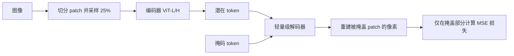
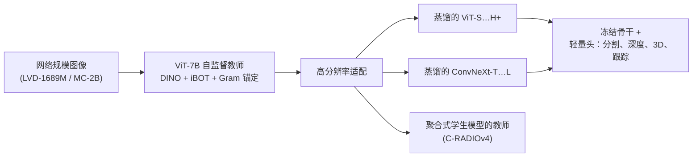

# 视觉表征的自监督学习

> **英文原文：** [cv-knowledge-base/03_architectures/03_self_supervised_learning.md](../../cv-knowledge-base/03_architectures/03_self_supervised_learning.md)（本中文版供参考，内容以英文原文为准）

> **最后更新：** 2026年10月
> **难度级别：** 高级
> **相关章节：**
> - [视觉 Transformer](./01_vision_transformers.md)
> - [多模态架构](./04_multimodal_architectures.md)
> - [世界模型](../06_robotics_and_embodied_ai/02_world_models.md)
> - [大型视觉-语言模型](../05_multimodal_vision_language/02_large_vision_language_models.md)

> **🆕 2026年10月更新：**
> - **DINOv3**（Meta，2025年8月）：在 LVD-1689M 上以 **Gram 锚定**（Gram anchoring）训练的 7B ViT，并蒸馏为 ViT/ConvNeXt 模型家族；另有卫星影像（SAT-493M）模型及 2026 年的后续工作（CHMv2、元数据引导的适配）。
> - **扩展无语言的自监督学习**：Web-SSL / Web-DINO（在 20 亿张网络图像上从 0.3B 扩展到 7B）在 VQA 上追平 CLIP 式编码器；使用富文本数据时，OCR 和图表理解也能追平。
> - 新增章节 **规模化及更远的自监督学习（2025–2026）**：Franca（完全开放数据）、LeJEPA（无启发式技巧的 SIGReg）、V-JEPA 2（2025年6月）和 V-JEPA 2.1（2026年3月），以及作为竞争性预训练路线的生成式 AIMv2。
> - 更新了关键论文、基准性能、对比学习 vs. MIM 之争以及开放问题。

---

## 概述

自监督学习（Self-Supervised Learning, SSL）已成为大规模预训练视觉表征的主导范式，绕开了对昂贵人工标注的需求。其核心思想是定义一个*前置任务*（pretext task），其监督信号完全来自数据本身，迫使网络作为副产品学到具有语义意义的特征。与全监督方法不同，SSL 表征能在更广泛的下游任务分布上泛化，而在足够规模上训练的模型在线性探测、微调和迁移基准上往往能匹敌甚至超过监督基线。

该领域分化为两大类。**对比方法**（contrastive methods）显式地在嵌入空间中拉近同一图像不同增强视图的表征，同时推远不同图像的表征。InfoNCE 目标用噪声对比估计框架将其形式化。对比方法需要谨慎处理负样本——要么通过大批量（SimCLR），要么通过记忆库/动量编码器（MoCo），要么通过聚类分配（SwAV）。**非对比方法**（BYOL、SimSiam、Barlow Twins、VICReg）完全去除负样本对，转而依靠架构不对称、指数移动平均（EMA）教师或协方差正则化来防止表征坍塌。第三类是**掩码图像建模（Masked Image Modeling, MIM）**，它受 BERT 启发，通过重建被掩盖的 patch 来学习，使前置任务与基于增强的一致性解耦。

**自蒸馏**方法（DINO、DINOv2）的出现模糊了这一界限：它们将来自动量教师的知识蒸馏与自监督的对比式目标相结合，产生了具有显著涌现特性的表征，例如能感知物体的注意力图。较新的**联合嵌入预测架构**（Joint-Embedding Predictive Architecture, I-JEPA）预测被掩盖区域的抽象潜在表征而非原始像素，避免了像素空间 MIM 模型偏向低层纹理的倾向。对比方法与 MIM 之间持续的争论集中在这样一个观察上：MIM 表征需要微调才能发挥其质量（线性探测较差），而对比和自蒸馏特征可以线性分离类别，但可能对密集预测任务所需的整体场景理解欠拟合。

2025–2026 年，前沿问题变成了**规模**。DINOv3 在约 17 亿张精选图像上训练 7B 参数的 ViT，并用 *Gram 锚定*防止密集特征退化。Web-SSL 表明，扩展到 7B 参数和 20 亿张网络图像的无语言 SSL 在 VLM 内部可以追平 CLIP 式编码器。V-JEPA 2/2.1 将潜在预测推广到互联网规模的视频和机器人规划。与此同时，LeJEPA 重新审视理论并完全去除了防坍塌的启发式技巧，Franca 则表明完全使用开放数据也能实现有竞争力的 SSL。

---

## 对比方法

### InfoNCE 损失

InfoNCE（噪声对比估计）损失是大多数对比式 SSL 方法的数学支柱。给定查询嵌入 $q$ 和一组键 $\{k_0, k_1, \ldots, k_K\}$，其中 $k_0$ 为正（同一图像）键：

```latex
L_{\text{InfoNCE}} = -\log \frac{\exp(q \cdot k_0 / \tau)}{\sum_{i=0}^{K} \exp(q \cdot k_i / \tau)}
```

其中 $\tau$ 是温度超参数。该损失等价于最大化两个视图之间互信息的一个下界 [Oord2018]。负样本数量 $K$ 对梯度信号的质量起决定性作用。

### MoCo（动量对比）

[He2020] MoCo 通过**动量编码器**和**先进先出（FIFO）队列**将字典大小与批量大小解耦。动量编码器参数 $\theta_k$ 以查询编码器 $\theta_q$ 的指数移动平均进行更新：

```latex
\theta_k \leftarrow m \cdot \theta_k + (1 - m) \cdot \theta_q, \quad m \approx 0.999
```

MoCo v2 加入了投影头和更强的数据增强；MoCo v3 将该框架适配到以 patch 为输入的视觉 Transformer，在 ImageNet 上用 ViT-B/16 达到 76.5% 的线性探测精度 [Chen2021MoCov3]。

### SimCLR

[Chen2020] SimCLR 使用大批量（最多 8192）且不使用记忆库。一个非线性投影头 $g(\cdot)$ 将表征映射到对比损失空间：

```latex
L_{i,j} = -\log \frac{\exp(\text{sim}(z_i, z_j)/\tau)}{\sum_{k=1}^{2N} \mathbf{1}_{[k \neq i]} \exp(\text{sim}(z_i, z_k)/\tau)}
```

SimCLR 确立了：(1) 投影头很重要，(2) 增强的多样性至关重要（随机裁剪 + 颜色抖动 + 高斯模糊），(3) 更大的批量能得到更好的表征。

### SwAV

[Caron2020] SwAV 通过 Sinkhorn-Knopp 分配引入**在线聚类**，将视图映射到一组原型（prototype），并在编码空间而非嵌入空间中强制跨视图一致性。这使多裁剪训练（在两个全局视图之外加入许多小裁剪）成为可能，用 ResNet-50 在线性探测下达到 75.3% 的 ImageNet top-1。

---

## 非对比方法

非对比方法避免显式的负样本对，这简化了训练，但需要防止**模式坍塌**（所有输出映射到同一向量）的机制。

### BYOL

[Grill2020] BYOL（Bootstrap Your Own Latent）使用**两个不对称网络**：带预测头的在线网络 $f_\theta$，以及通过 EMA 更新的目标网络 $f_\xi$。在线网络被训练去预测目标网络对另一种增强视图的表征：

```latex
L_{\text{BYOL}} = \|q_\theta(z_\theta) - \text{sg}(z'_\xi)\|_2^2
```

其中 $\text{sg}(\cdot)$ 表示停止梯度。BYOL 用 ResNet-50 达到 74.3% top-1；扩展到 ResNet-200×2 时达到 79.6%。动量目标是防止坍塌的关键机制。

### SimSiam

[Chen2021SimSiam] SimSiam 去除了 EMA 教师，只在一个分支上使用停止梯度。分析表明它隐式地执行了 EM：预测器求出目标分布的均值，从而在没有动量的情况下防止坍塌。用 ResNet-50 在 ImageNet 上达到 71.3% top-1。

### Barlow Twins

[Zbontar2021] Barlow Twins 促使两个增强视图表征之间的互相关矩阵接近单位矩阵：

```latex
L_{\text{BT}} = \sum_i (1 - C_{ii})^2 + \lambda \sum_i \sum_{j \neq i} C_{ij}^2
```

这一去相关目标天然地避免了坍塌。达到 73.2% top-1，与 VICReg 相当。

### VICReg

[Bardes2022] VICReg 将目标拆分为三项：方差正则化（保持每个维度的标准差高于阈值）、不变性（最小化增强视图之间的 MSE）以及协方差（使非对角协方差项趋于零）。目标明确且可解释；用 ResNet-50 同样达到 73.2% top-1。发表于 ICLR 2022。

---

## 自蒸馏方法

### DINO

[Caron2021] DINO（Self-DIstillation with NO labels，无标签自蒸馏）应用知识蒸馏，教师与学生采用相同架构，但教师权重是学生的 EMA。对教师 logits 的中心化操作和对学生 logits 的锐化操作防止了坍塌。**涌现特性**：用 DINO 训练的 ViT 自注意力头在没有任何分割监督的情况下自发地分割出前景物体。用 ViT-S/8 在 k-NN 评估下达到 80.1% top-1。

### DINOv2

[Oquab2023] DINOv2 通过以下方式扩展 DINO：(1) 用基于聚类的流水线过滤得到的 1.42 亿张精选图像数据集（LVD-142M），(2) ViT-g/14 骨干网络，(3) DINO + iBOT 的混合目标。在 ImageNet-1k 线性探测下达到 **86.5% top-1**——超过了弱监督方法。其特征只需极少的适配即可迁移到深度估计、语义分割和实例检索。后续一个使用**寄存器 token** 训练的变体（参见[视觉 Transformer](./01_vision_transformers.md)）消除了高范数伪影 token，用 ViT-g/14 达到 87.1% 的线性探测精度。

### DINOv3

[Simeoni2025] DINOv3（Meta FAIR，2025年8月）将 DINOv2 配方从在 1.42 亿张图像上训练的 1.1B 参数 ViT-g，扩展为约 6 倍大的模型和约 12 倍多的数据。它在 **LVD-1689M**（约 17 亿张精选网络图像）上训练 **ViT-7B/16**（6.7B 参数；40 层、宽度 4096、SwiGLU FFN、4 个寄存器 token、2D RoPE）。在这一规模上的关键障碍是**密集特征在长时间训练中退化**：ImageNet 线性精度等全局指标持续上升，而 patch 级特征变得嘈杂并失去局部性。DINOv3 提出了 **Gram 锚定**，将学生的 patch 相似度结构正则化到一个较早的、其密集特征仍然干净的"Gram 教师"检查点：

```latex
L_{\text{Gram}} = \left\| X_S X_S^{\top} - X_G X_G^{\top} \right\|_F^2
```

其中 $X_S, X_G \in \mathbb{R}^{P \times d}$ 分别是学生和 Gram 教师经 L2 归一化的 patch 特征。只有*二阶*结构（哪些 patch 彼此相似）受到约束，因此全局特征仍可自由提升。随后进行一个简短的高分辨率适配阶段，然后将 7B 教师**蒸馏**为 ViT-S/S+/B/L/H+（21M–840M）和 ConvNeXt-T/S/B/L 学生模型。其主要论点是：**冻结**的 DINOv3 骨干网络加上轻量级预测头，在分割、深度、3D 对应关系和视频跟踪等密集任务上匹敌或超过专用和弱监督编码器（DINOv2、SigLIP 2、Perception Encoder）。另有单独在 **SAT-493M** 卫星影像上训练的 ViT-7B 和 ViT-L。官方代码库中的后续工作包括 Canopy Height Maps v2（冠层高度图 v2，2026年3月）和元数据引导的适配配方（"Who Needs Labels?"，2026年6月）。DINOv3 骨干网络还被用作聚合式模型（如 C-RADIOv4）的教师（参见[混合架构](./02_hybrid_architectures.md)）。

---

## 掩码图像建模

### BEiT

[Bao2022] BEiT（Bidirectional Encoder Representations from Image Transformers）通过离散 VAE（dVAE）将图像 token 化，并训练 ViT 预测被掩盖 patch 的视觉 token——与 BERT 直接类比。在 ImageNet 上线性探测精度为 56.7%（需要微调才能发挥实力）。

### MAE

[He2022] 掩码自编码器（Masked Autoencoders）使用**非对称编码器-解码器**：重量级 ViT 编码器只处理可见 patch（通常为 25% 的 token），轻量级解码器重建被掩盖 patch 的原始像素值。尽管掩码率很高（75%），这种不对称性仍使训练很高效。用 ViT-H 达到 68.0% 线性探测 / **87.8% 微调**精度。MAE 从根本上挑战了"像素级目标缺乏信息量"的观点。



### I-JEPA

[Assran2023] I-JEPA（图像联合嵌入预测架构）预测目标块的**抽象潜在表征**（而非原始像素）。上下文编码器看到未被掩盖的 patch；一个以块位置为条件的预测器预测目标编码器对被掩盖块的表征。目标编码器上的停止梯度防止了坍塌：

```latex
L_{\text{I-JEPA}} = \sum_{b} \|\hat{s}_b - \text{sg}(s_b)\|_2^2
```

I-JEPA 在线性探测和少样本设置下优于 MAE，同时在 ViT-H 上训练速度快 5 倍。发表于 CVPR 2023。

---

## 规模化及更远的自监督学习（2025–2026）

### 扩展无语言的视觉表征学习（Web-SSL）

[Fan2025] Web-SSL（Meta FAIR / NYU / Princeton，2025年4月）探讨 CLIP 式编码器在 VLM 中的优势究竟来自*语言监督*，还是仅仅来自*网络规模的数据*。它在 **MC-2B**（从 MetaCLIP 数据池中抽取的 20 亿张网络图像，不含文本）上训练 0.3B 到 7B 参数的 DINOv2 式 **Web-DINO** 模型（以及最高 3B 的 Web-MAE）。其发现如下：

1. 纯视觉 SSL 随模型规模和数据量持续提升，直到 7B 都未观察到饱和。
2. 在足够规模下，Web-DINO 作为 VLM 视觉编码器使用时，在广泛的 VQA 评测集上匹敌或超过语言监督的编码器。
3. 将预训练数据过滤为**富文本图像**（"light"子集为约 50% 含文字的图像，"heavy"子集为约 1.3% 的图表/文档图像）可显著提升 OCR 和图表理解。这表明 SSL 模型在 OCR 上的差距是*数据分布*上的差距，而非语言上的差距。

### Franca：完全开放的视觉基础模型

[Venkataramanan2025] Franca（valeo.ai / UTN / UvA，2025年7月）被定位为首个数据、代码和权重完全开放的视觉基础模型。它在公开的 ImageNet-21K 和 LAION-600M 上训练，并提出了**嵌套 Matryoshka 聚类**（多粒度原型头）、**RASA**（Relative-Absolute Spatial Attention，从密集特征中去除位置偏差）以及 **CyclicMask** 掩码。代码库报告称 Franca 在 B 和 L 规模上匹敌或超过 DINOv2（例如 ViT-L/14 在 518² 下使用 RASA 时 IN-1K 线性精度为 85.2%），不过该比较并非在相同数据上进行。

### LeJEPA：可证明、无启发式技巧的 JEPA

[Balestriero2025] LeJEPA（Balestriero & LeCun，2025年11月）认为，JEPA 式 SSL 不应依赖其惯用的一系列启发式技巧（停止梯度、EMA 教师、预测器不对称）。它证明了**各向同性高斯**嵌入分布能最小化下游预测风险，并通过 **SIGReg**（Sketched Isotropic Gaussian Regularization，草图化各向同性高斯正则化）来施加这一分布，即让嵌入的一维随机投影与高斯分布相匹配：

```latex
L_{\text{LeJEPA}} = L_{\text{pred}} + \lambda \cdot \frac{1}{M}\sum_{m=1}^{M} T\!\left(\{a_m^{\top} z_i\}_{i=1}^{N},\ \mathcal{N}(0,1)\right)
```

其中 $a_m$ 为随机单位方向，$T$ 为单变量拟合优度统计量。该方法只有一个权衡超参数 $\lambda$，时间和内存均为线性，并适用于 ViT 和卷积网络（ConvNeXt V2）。在 8 个数据集的线性探测平均值上，在 IN-1K 上预训练 100 个 epoch 的 ViT-L 优于训练 300 个 epoch 的 I-JEPA ViT-H。

### 视频 SSL：V-JEPA 2 与 V-JEPA 2.1

[Assran2025] **V-JEPA 2**（Meta，2025年6月）将基于互联网视频的潜在预测预训练扩展到 ViT-g（1B）。它在运动理解（冻结骨干探测下 Something-Something v2 上 77.3%，对比 InternVideo2-1B 的 69.7%）和动作预测（Epic-Kitchens-100 上 39.7%，对比此前最佳 27.6%）上报告了新的最佳结果。借助少量机器人交互数据，动作条件化的 **V-JEPA 2-AC** 能在 Franka 机械臂上进行零样本的抓取-放置规划（参见[世界模型](../06_robotics_and_embodied_ai/02_world_models.md)）。**V-JEPA 2.1**（2026年3月）针对 JEPA 特征在*密集*任务上的经典弱点，引入密集预测损失（Dense Predictive Loss）和深度自监督（Deep Self-Supervision），发布了 384² 分辨率下从 ViT-B 到 ViT-G（2B）的模型。

### 生成式与聚合式替代方案

目前有两条非 SSL 路线在争夺"通用视觉编码器"的角色。**AIMv2** [Fini2025]（Apple，CVPR 2025 Highlight）以*多模态自回归*目标预训练 ViT：一个因果解码器先重建图像 patch，再生成描述文本。AIMv2-3B 在冻结主干下达到 89.5% 的 ImageNet top-1。**聚合式蒸馏**（RADIO；参见[混合架构](./02_hybrid_architectures.md)）把 DINOv3 等 SSL 模型当作多个教师之一。与此同时，Perception Encoder 表明，仅靠对比式图文训练就能在*中间*层获得强大的密集特征（参见[多模态架构](./04_multimodal_architectures.md)）。



---

## 对比学习 vs. MIM：核心之争

对比/自蒸馏方法与 MIM 之间的张力集中在**线性可分性 vs. 表征完整性**的权衡上：

| 性质 | 对比式（DINO、SimCLR） | MIM（MAE、BEiT） |
|---|---|---|
| 线性探测 | 强（80%+） | 弱（56-68%） |
| 微调上限 | 良好 | 优秀（87.8%） |
| 密集预测（分割、深度） | 良好（DINO 注意力图） | 很好 |
| 训练效率 | 中等（大批量或 EMA） | 高（稀疏编码器） |
| 前置任务 | 视图不变性 | 局部像素/token 重建 |
| 涌现分割 | 有（DINO） | 较弱 |

DINOv2 通过结合 DINO + iBOT（逐 token 施加的 MIM 式目标）部分解决了这一问题，同时获得了强线性探测**和**密集预测能力。

**2025–2026 年现状。** 争论已基本从"对比 vs. MIM"转向"**哪种监督信号最能扩展为单一冻结编码器**"。DINOv3 表明，一旦控制住密集特征退化（Gram 锚定），自蒸馏 + MIM 的混合方案可以扩展到 7B 参数。Web-SSL 表明，在大规模下获得 VLM 级特征并不需要语言监督。Perception Encoder 和 SigLIP 2 表明，图文编码器可以通过中间层或加入自蒸馏和掩码预测损失来恢复密集特征质量。各种配方正在趋同：SigLIP 2 在对比目标上加入 SSL 损失，而 DINOv3 则在对比式编码器自己的基准上与之比较。

---

## 关键论文

| 论文 | 作者 | 年份 | 会议/期刊 | 主要贡献 |
|---|---|---|---|---|
| MoCo v2 | He, Fan, Wu, Xie, Girshick | 2020 | arXiv | 动量编码器 + 队列，将批量与字典大小解耦 |
| SimCLR | Chen, Kornblith, Norouzi, Hinton | 2020 | ICML | 带投影头的大批量对比学习 |
| BYOL | Grill, Strub, Altché et al. | 2020 | NeurIPS | EMA 教师，无需负样本 |
| SwAV | Caron, Misra, Mairal et al. | 2020 | NeurIPS | 在线聚类 + 多裁剪训练 |
| SimSiam | Chen, He | 2021 | CVPR | 停止梯度足以防止坍塌 |
| Barlow Twins | Zbontar, Jing, Misra et al. | 2021 | ICML | 互相关矩阵趋近单位矩阵的正则化 |
| DINO | Caron, Touvron, Misra et al. | 2021 | ICCV | 自蒸馏；ViT 中的涌现分割 |
| VICReg | Bardes, Ponce, LeCun | 2022 | ICLR | 显式的方差/不变性/协方差项 |
| MAE | He, Chen, Xie, Li et al. | 2022 | CVPR | 非对称编码器-解码器，75% 掩码率 |
| BEiT | Bao, Dong, Piao, Wei | 2022 | ICLR | 离散视觉 token 预测（图像版 BERT） |
| I-JEPA | Assran, Duval, Misra et al. | 2023 | CVPR | 预测抽象潜在表征而非像素 |
| DINOv2 | Oquab, Darcet, Moutakanni et al. | 2023 | TMLR | 1.42 亿精选数据集 + DINO+iBOT；线性 86.5% |
| ConvNeXt V2 (FCMAE) | Woo, Debnath, Hu et al. | 2023 | CVPR | 全卷积掩码自编码器 + GRN |
| Vision Transformers Need Registers | Darcet, Oquab, Mairal, Bojanowski | 2024 | ICLR | 寄存器 token 消除自监督 ViT 中的伪影 token |
| Scaling Language-Free Visual Representation Learning (Web-SSL) | Fan, Tong, Zhu et al. | 2025 | arXiv | 在 MC-2B 上将 Web-DINO 从 0.3B 扩展到 7B；纯视觉 SSL 在 VQA 上追平 CLIP |
| AIMv2 | Fini, Shukor, Li et al. | 2025 | CVPR (Highlight) | 多模态自回归预训练；冻结主干 89.5% |
| V-JEPA 2 | Assran, Bardes, Fan et al. | 2025 | arXiv | 1B 规模的视频 JEPA；动作条件化规划 |
| Franca | Venkataramanan, Pariza, Salehi et al. | 2025 | arXiv | 完全开放的 SSL；嵌套 Matryoshka 聚类、RASA |
| DINOv3 | Siméoni, Vo, Seitzer et al. | 2025 | arXiv | 在 LVD-1689M 上训练的 7B ViT；Gram 锚定；蒸馏模型家族 |
| LeJEPA | Balestriero, LeCun | 2025 | arXiv | SIGReg 各向同性高斯正则化；无启发式技巧 |
| V-JEPA 2.1 | Meta FAIR | 2026 | arXiv | 面向视频的密集预测损失 + 深度自监督 |

---

## 基准性能

| 模型 | 数据集 | 指标 | 得分 | 备注 |
|---|---|---|---|---|
| SimCLR (RN-50) | ImageNet | 线性 Top-1 | 69.3% | 批量 4096 |
| MoCo v3 (ViT-B/16) | ImageNet | 线性 Top-1 | 76.5% | [He2021MoCov3] |
| BYOL (RN-50) | ImageNet | 线性 Top-1 | 74.3% | EMA 教师 |
| BYOL (RN-200×2) | ImageNet | 线性 Top-1 | 79.6% | 更宽/更深 |
| SwAV (RN-50) | ImageNet | 线性 Top-1 | 75.3% | 多裁剪 |
| Barlow Twins (RN-50) | ImageNet | 线性 Top-1 | 73.2% | [Zbontar2021] |
| VICReg (RN-50) | ImageNet | 线性 Top-1 | 73.2% | ICLR 2022 |
| DINO (ViT-S/8) | ImageNet | k-NN Top-1 | 78.3% | 无线性头 |
| BEiT (ViT-B/16) | ImageNet | 线性 Top-1 | 56.7% | 微调：83.2% |
| MAE (ViT-H/14) | ImageNet | 线性 Top-1 | 68.0% | 微调：87.8% |
| DINOv2 (ViT-g/14) | ImageNet | 线性 Top-1 | 86.5% | LVD-142M 预训练 |
| I-JEPA (ViT-H/14) | ImageNet | 线性 Top-1 | ~77% | 比 MAE 快 5 倍 |
| DINOv2 + 寄存器 (ViT-g/14) | ImageNet | 线性 Top-1 | 87.1% | [Darcet2024] |
| Franca (ViT-L/14, 518², RASA) | ImageNet | 线性 Top-1 | 85.2% | 公开数据（LAION-600M） |
| AIMv2-3B (448²) | ImageNet | 冻结主干 Top-1 | 89.5% | 自回归多模态预训练 |
| V-JEPA 2 (ViT-g) | Something-Something v2 | 探测 Top-1 | 77.3% | 此前最佳 69.7%（InternVideo2-1B） |
| V-JEPA 2 (ViT-g) | Epic-Kitchens-100 | 动作预测 | 39.7% | 此前最佳 27.6% |
| LeJEPA (ViT-L, IN-1K, 100 ep.) | 8 个迁移数据集 | 平均线性探测 | 79.48 | 对比 I-JEPA ViT-H（300 ep.）的 78.50 |

---

## 优缺点

| 方面 | 优点 | 缺点 |
|---|---|---|
| 对比式（MoCo/SimCLR） | 线性探测强；理论成熟；有负样本时无坍塌风险 | 需要大批量或记忆库；对增强选择敏感 |
| 非对比式（BYOL/SimSiam） | 不需要负样本；训练流程更简单 | 对架构变化脆弱；不仔细调参有坍塌风险 |
| MIM（MAE/BEiT） | 微调上限优秀；可扩展；高效（稀疏编码器） | 线性探测差；表征可能编码低层纹理 |
| 自蒸馏（DINO/DINOv2） | 综合迁移能力最佳；涌现分割；开箱即用效果强 | EMA 使训练较慢；对中心化/锐化温度敏感 |
| 非对比冗余消减（Barlow/VICReg） | 目标可解释；无负样本、无动量 | 线性探测略低于顶尖对比方法 |
| 十亿级自蒸馏（DINOv3/Web-DINO） | 最佳的冻结密集特征；无需标签或描述文本；可蒸馏为小模型 | 计算量和精选数据需求极大；需要 Gram 锚定/寄存器来保持密集特征干净 |
| 无启发式技巧的 JEPA（LeJEPA） | 单一超参数；有理论支撑；与架构无关 | 尚未在十亿参数/网络规模上得到验证 |

---

## 开放问题与研究空白

1. **非对比方法的坍塌理论**：关于停止梯度 + 预测器为何能在 SimSiam 中防止坍塌的形式化证明仍不完整；在大规模 ViT 上会出现经验性的不稳定 [Chen2021SimSiam]。

2. **MIM 中线性探测与微调的差异**：MAE 的线性探测（68%）与微调（87.8%）之间存在约 20 个百分点的差距，表明其表征是非线性可分的。从理论上理解这种几何结构是一个开放问题。

3. **最优掩码策略**：MAE 使用随机掩码；结构化掩码（如 BEiT 中的块掩码、语义掩码）可能更好地捕获组合结构。有原则地选择掩码模式仍未解决。

4. **面向视频和 3D 的 SSL**：将 MIM 和对比方法扩展到时空体（视频）和点云是活跃的研究方向；简单的扩展无法有效捕获时间动态或 3D 几何。

5. **数据精选 vs. 规模扩展**：DINOv2 表明 1.42 亿精选数据优于数十亿未精选数据。DINOv3（LVD-1689M）和 Web-SSL（MC-2B）表明，在十亿规模*上*进行精选依然有回报，而且数据分布（如富文本图像）决定了哪些能力会涌现。最优的数据选择策略——尤其是面向特定领域应用（卫星、医疗、机器人）时——仍未被充分理解。

6. **与语言监督的融合**：SSL（无标签）与弱监督视觉-语言预训练（带噪声的描述文本）之间的界限正在模糊。Web-SSL 表明在大规模下获得 VLM 级特征并*不必需*语言，而 SigLIP 2 则在对比训练中加入 SSL 损失。如何最好地结合纯图像 SSL 信号与图文信号，而不牺牲二者各自独特的监督信号，仍未解决。

7. **对涌现特性的理论理解**：DINO 自发的前景分割在经验上令人瞩目，但缺乏理论解释。ViT 的 [CLS] token 注意力究竟为何会自组织为物体级的图，仍是一个开放问题。

8. **大规模下的密集特征退化**：DINOv3 记录了在 7B 规模上长时间 SSL 训练会提升全局指标而使 patch 级特征退化，并用 Gram 锚定在经验上修复了这一问题。退化为何发生，以及是否存在能在构造上避免它的目标函数，仍是开放问题。

9. **大规模下的理论优先 SSL**：LeJEPA 提供了可证明、无启发式技巧的目标函数，但它在网络规模和 7B 参数下能否与高度工程化的配方（DINOv3）竞争尚未得到检验。

10. **密集视频 SSL**：V-JEPA 2 在运动理解和规划上表现出色，但需要专门的后续工作（V-JEPA 2.1）才能获得密集、时间一致的特征。能同时产生强大的全局视频语义和密集时空特征的单一目标函数仍然缺失。

---

## 延伸阅读

- [He et al., *Masked Autoencoders Are Scalable Vision Learners*, CVPR 2022](https://arxiv.org/abs/2111.06377)
- [Oquab et al., *DINOv2: Learning Robust Visual Features without Supervision*, TMLR 2023](https://arxiv.org/abs/2304.07193)
- [Assran et al., *Self-Supervised Learning from Images with a Joint-Embedding Predictive Architecture*, CVPR 2023](https://arxiv.org/abs/2301.08243)
- [Caron et al., *Emerging Properties in Self-Supervised Vision Transformers (DINO)*, ICCV 2021](https://arxiv.org/abs/2104.14294)
- [Zbontar et al., *Barlow Twins: Self-Supervised Learning via Redundancy Reduction*, ICML 2021](https://arxiv.org/abs/2103.03230)
- [自监督表征学习综述（A Survey on Self-Supervised Representation Learning），arXiv 2023](https://arxiv.org/abs/2308.11455)
- [Siméoni et al., *DINOv3*, arXiv 2025 (2508.10104)](https://github.com/facebookresearch/dinov3)
- [Fan et al., *Scaling Language-Free Visual Representation Learning* (Web-SSL), arXiv 2025 (2504.01017)](https://github.com/facebookresearch/webssl)
- [Venkataramanan et al., *Franca: Nested Matryoshka Clustering for Scalable Visual Representation Learning*, arXiv 2025 (2507.14137)](https://github.com/valeoai/Franca)
- [Balestriero & LeCun, *LeJEPA: Provable and Scalable Self-Supervised Learning Without the Heuristics*, arXiv 2025 (2511.08544)](https://github.com/rbalestr-lab/lejepa)
- [Assran et al., *V-JEPA 2*, arXiv 2025 (2506.09985)，以及 V-JEPA 2.1 (2603.14482)](https://github.com/facebookresearch/vjepa2)
- [Fini et al., *Multimodal Autoregressive Pre-training of Large Vision Encoders* (AIMv2), CVPR 2025](https://github.com/apple/ml-aim)
