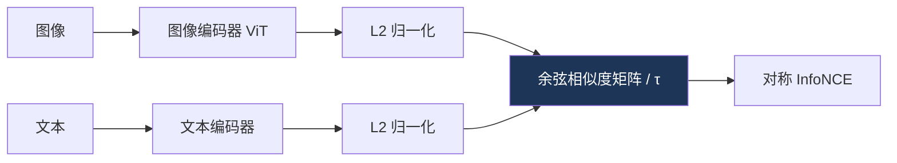
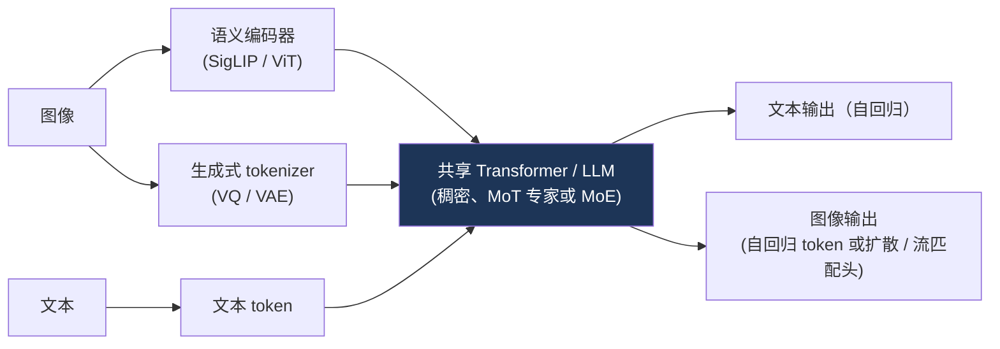

# 多模态架构

> **英文原文：** [cv-knowledge-base/03_architectures/04_multimodal_architectures.md](../../cv-knowledge-base/03_architectures/04_multimodal_architectures.md)（本中文版供参考，内容以英文原文为准）

> **最后更新：** 2026年10月
> **难度级别：** 中级
> **相关章节：**
> - [大型视觉-语言模型](../05_multimodal_vision_language/02_large_vision_language_models.md)
> - [自监督学习](./03_self_supervised_learning.md)
> - [视觉-语言预训练（VLP）模型](../05_multimodal_vision_language/01_vlp_models.md)
> - [VLA 模型](../06_robotics_and_embodied_ai/01_vla_models.md)

> **🆕 2026年10月更新：**
> - **第二代对比式编码器**：SigLIP 2（2025年2月；多语言、NaFlex、解码器 + 自监督损失）、Perception Encoder（2025年4月；最佳特征位于中间层）以及 MetaCLIP 2（NeurIPS 2025 Spotlight；全球多语言数据）。
> - 新增章节 **统一理解与生成**：Chameleon → Transfusion、Show-o/Show-o2、Janus-Pro（解耦编码器）、BAGEL（MoT，2025年5月）、Emu3/Emu3.5（纯下一 token 预测）。
> - 新增章节 **原生多模态骨干网络（2025–2026）**：原生分辨率 ViT + MLP 连接器 + DeepStack（Qwen3-VL）、早期融合的混合线性注意力 LLM（Qwen3.5，2026年2月），以及混合 Mamba-Transformer 全模态模型（Nemotron 3 Nano Omni）。
> - 更新了关键论文、基准性能、优缺点与开放问题。

---

## 概述

多模态架构学习跨模态——最主要是视觉与语言——的联合表征，通过以下三种机制之一对齐它们的嵌入空间：**对比对齐**（拉近匹配的图文对，推远不匹配的）、**交叉注意力融合**（让一种模态在 Transformer 内部关注另一种模态），或**早期融合**（将各模态 token 拼接成一个序列）。机制的选择决定了模型擅长什么：对比式双编码器（CLIP）擅长检索和零样本分类，但不能生成文本；交叉注意力模型（Flamingo）和早期融合模型（GPT-4o）支持开放式生成和推理。这些架构是[大型视觉-语言模型](../05_multimodal_vision_language/02_large_vision_language_models.md)中各类大型 VLM 的基础，加上动作头后则成为[VLA 模型](../06_robotics_and_embodied_ai/01_vla_models.md)中的视觉-语言-动作模型（Vision-Language-Action, VLA）。

关键性工作是 **CLIP** [Radford2021]，它表明在 4 亿对带噪声的网络图文对上进行对比训练，可以得到一个表征*与语言语义对齐*的视觉编码器，只需将类别名嵌入为文本提示即可实现零样本迁移。CLIP 将识别从"预测固定的标签集合"重新定义为"与任意文本进行匹配"，其图像编码器成为下游 VLM 的默认感知前端。本文推导对比目标，比较三种融合范式，并综述将冻结编码器连接到 LLM 的连接器设计（Q-Former、Perceiver Resampler）。随后介绍 2025–2026 年的格局。第二代对比式编码器（SigLIP 2、Perception Encoder、MetaCLIP 2）增加了多语言能力、原生分辨率和密集特征。**统一**模型（Janus-Pro、BAGEL、Show-o2、Emu3.5）既能理解也能生成图像。**原生多模态**骨干网络（Qwen3.5、Nemotron 3 Nano Omni）从预训练阶段起就融合各模态，并越来越多地使用混合线性注意力或 Mamba-Transformer 层。

---

## 对比对齐

CLIP 和 ALIGN [Jia2021] 训练一个双编码器——图像编码器 `f`（ViT 或 ResNet）和文本编码器 `g`（Transformer）——通过在 `N×N` 相似度矩阵上的对称 InfoNCE 损失，最大化批内匹配对的余弦相似度，最小化不匹配对的余弦相似度：

```
# 图像和文本嵌入均经 L2 归一化；τ = 可学习温度
logits = (I_emb @ T_embᵀ) / τ           # N×N
loss_i2t = cross_entropy(logits, labels=arange(N))      # 按行
loss_t2i = cross_entropy(logits.T, labels=arange(N))    # 按列
loss = (loss_i2t + loss_t2i) / 2
```

对比目标随批量大小（更多负样本）和数据量扩展，但 softmax 归一化将批量大小与损失耦合在一起；**SigLIP** [Zhai2023] 用逐对的 **sigmoid** 损失取而代之，将二者解耦，在小批量和大批量下均提高了效率。



CLIP ViT-L/14 达到约 75–76% 的零样本 ImageNet top-1——对于一个从未见过 ImageNet 标签的模型而言相当出色。

### 第二代对比式编码器（2025）

对比式双编码器仍是 VLM 的默认前端，但 2025 年的编码器加入了辅助目标、多语言能力和原生分辨率：

- **SigLIP 2** [Tschannen2025]（Google，2025年2月）保留 sigmoid 损失，并加入**图像描述/指代表达解码器损失**（LocCa 式）、**自蒸馏与掩码预测**损失（在视觉-语言模型内部引入 SSL）以及**在线数据精选**。它使用多语言 Gemma tokenizer（25.6 万词表）和去偏数据。提供 B（86M）、L（303M）、So400m 和 g（1B）几种规模，以及在可变序列长度下保持原生长宽比的 **NaFlex** 变体。g-opt/16 模型在 384² 下达到 85.0% 的零样本 ImageNet 精度，其密集/定位质量也优于 SigLIP。
- **Perception Encoder（PE）** [Bolya2025]（Meta，2025年4月）表明，经过精心扩展的*纯对比式*图像/视频编码器（PE-Core，最高 G/14，零样本 ImageNet 85.4%）本身已包含强大的 OCR、VQA、检测和深度特征，但它们位于**中间层**而非输出层。两种**对齐微调**变体将这些特征提取出来：**PE-Lang**（与 LLM 对齐以用于 VLM，配合 PerceptionLM 使用）和 **PE-Spatial**（为密集预测而对齐）。音视频版 PE-AV 于 2025 年 12 月发布。
- **MetaCLIP 2** [Chuang2025]（Meta，NeurIPS 2025 Spotlight）是首个基于**全球（非英语）网络数据**从头训练 CLIP 的配方。它解决了"多语言诅咒"（curse of multilinguality）——即多语言 CLIP 在英语任务上不如纯英语 CLIP——使英语与非英语数据相互促进。其 ViT-bigG-14 在文化多样的 CVQA-LOCAL 零样本基准上达到 62.0。

作为生成式替代方案，**AIMv2** [Fini2025]（Apple，CVPR 2025）用*多模态自回归*解码器取代对比损失，先重建图像 patch 再生成描述 token，以冻结的 3B 主干达到 89.5% 的 ImageNet top-1（参见[自监督学习](./03_self_supervised_learning.md)）。

---

## 交叉注意力融合

**Flamingo** [Alayrac2022]（NeurIPS 2022）通过两个可训练组件将冻结的视觉编码器连接到冻结的 LLM：一个将数量可变的视觉特征压缩为固定数量 token 的 **Perceiver Resampler**，以及交错插入 LLM、让文本 token 关注视觉 token 的**门控交叉注意力**层。这在保留 LLM 语言能力的同时将其与图像关联起来，实现了少样本的上下文多模态学习。**BLIP-2** [Li2023] 使用轻量级 **Q-Former**——一组可学习的查询 token，对冻结的图像特征进行交叉注意力并输入 LLM——作为高效连接器，这曾是开源 VLM 中占主导的适配器模式。

---

## 早期融合与统一编码器

**CoCa** [Yu2022] 在一个编码器-解码器中结合对比与描述生成目标。**ImageBind** [Girdhar2023] 仅利用与图像配对的数据，就将*六种*模态（图像、文本、音频、深度、热成像、IMU）对齐到共享空间，实现了涌现的跨模态检索。原生多模态模型（GPT-4o、Gemini）将早期融合推向极致，在交错的图像-文本-音频 token 流上端到端（end-to-end）训练。适配器 vs. 交叉注意力 vs. 早期融合这一分类，直接对应[大型视觉-语言模型](../05_multimodal_vision_language/02_large_vision_language_models.md)中的成本/能力权衡。

---

## 统一理解与生成

同时*理解*和*生成*图像的单一模型必须解决一个表征上的矛盾：理解需要**语义化、抽象**的视觉特征（类 CLIP/SigLIP），而生成需要**忠实于像素、高度压缩**的潜在表示（VQ token 或 VAE 潜变量）。2024–2026 年的各种设计主要区别在于如何化解这一矛盾：

| 设计 | 视觉表示 | 生成机制 | 代表模型 |
|---|---|---|---|
| 早期融合离散 token | 双向共用一个 VQ tokenizer | 自回归下一 token 预测 | Chameleon（2024）、Emu3（2024）、Emu3.5（2025） |
| 同一 Transformer 中的自回归文本 + 扩散图像 | 连续 VAE 潜变量 | 在同一 Transformer 内进行扩散 / 流匹配（flow matching） | Transfusion（ICLR 2025）、Show-o（ICLR 2025，离散扩散）、Show-o2（NeurIPS 2025，在 3D 因果 VAE 潜变量上进行流匹配） |
| 解耦编码器 | 理解用语义编码器，生成用 VQ tokenizer | 自回归（或整流流，JanusFlow） | Janus（2024）、Janus-Pro（2025年1月） |
| 混合 Transformer 专家（Mixture-of-Transformers） | ViT 特征 + VAE 潜变量，在共享序列上使用各自独立的专家权重 | 在生成专家中进行流匹配 | BAGEL（2025年5月） |

- **Emu3** [Wang2024] 从头训练一个 Transformer，完全基于对 token 化的图像、视频和文本进行下一 token 预测。**Emu3.5** [BAAI2025]（BAAI，2025年10月）将其扩展到超过 10 万亿个交错的视觉-语言 token（主要是视频帧 + 转录文本），将模型定位为"世界学习者"（world learner），并提出**离散扩散适配（Discrete Diffusion Adaptation, DiDA）**，把逐 token 的顺序解码转化为并行的双向预测，使图像推理快约 20 倍。
- **Janus / Janus-Pro** [Chen2025]（DeepSeek）认为单一视觉编码器无法同时胜任两种角色，因此在单个自回归 Transformer 之后*解耦*视觉编码（理解用 SigLIP 式编码器，生成用 VQ tokenizer）。
- **BAGEL** [Deng2025]（ByteDance Seed，2025年5月；激活参数 7B / 总参数 14B）在交错序列上使用混合 Transformer 专家（Mixture-of-Transformer-Experts），并报告了大规模交错预训练带来的*涌现*能力：自由形式的图像编辑、多视角合成和世界导航。它报告的 MMMU 为 55.3，GenEval 为 0.82（使用提示改写时为 0.88）。



---

## 原生多模态骨干网络（2025–2026）

在理解方面，开源 VLM 的"适配器"模板已收敛为**原生分辨率 ViT → 轻量级 MLP 合并器 → LLM**（Q-Former 已基本不再使用）。目前有两种常见的改进：

- **多层级视觉特征。** Qwen3-VL（2025年9–10月）加入了 **DeepStack**，将多个 ViT 层的特征输入 LLM。这与 Perception Encoder"中间层蕴含最佳通用特征"的发现相一致。它还使用 **Interleaved-MRoPE** 联合编码时间/高度/宽度位置，并用文本时间戳进行视频定位（参见[视觉 Transformer](./01_vision_transformers.md)）。
- **前沿规模的早期融合。** Llama 4（Meta，2025年4月）和 **Qwen3.5**（阿里巴巴，2026年2月）作为*原生*多模态模型训练，而不是在训练完成的 LLM 上再外挂视觉。Qwen3.5 称其采用"在数万亿多模态 token 上的早期融合训练"，并报告其超过了独立的 Qwen3-VL 系列。Qwen3.5 建立在 **Gated DeltaNet** 线性注意力层与稀疏 MoE 相结合的基础上，其混合布局沿袭自 Qwen3-Next（2025年9月）。因此，多模态骨干网络本身就是一个线性/全注意力混合模型（参见[状态空间模型](./05_state_space_models.md)）。
- **混合 Mamba-Transformer 全模态模型。** NVIDIA 的 **Nemotron 3 Nano Omni**（总参数 30B / 激活 3B，混合 Mamba-Transformer MoE）可处理文本、图像、视频和音频，使用 C-RADIOv4-H 作为视觉编码器、Parakeet 处理音频，并用高效视频采样（Efficient Video Sampling）处理长视频。这将线性时间的序列层引入了长多模态上下文。

---

## 关键论文

| 论文 | 作者 | 年份 | 会议/期刊 | 主要贡献 |
|-------|---------|------|-------|-----------------|
| CLIP | Radford, Kim, Hallacy, et al. | 2021 | ICML | 对比式图文预训练；零样本迁移 |
| ALIGN | Jia, Yang, Xia, et al. | 2021 | ICML | 将对比式视觉-语言学习扩展到 18 亿对噪声数据 |
| Flamingo | Alayrac, Donahue, Luc, et al. | 2022 | NeurIPS | Perceiver Resampler + 门控交叉注意力；少样本 |
| BLIP-2 | Li, Li, Savarese, Hoi | 2023 | ICML | 连接冻结 LLM 的 Q-Former |
| ImageBind | Girdhar, El-Nouby, Liu, et al. | 2023 | CVPR | 通过与图像配对的对齐绑定 6 种模态 |
| SigLIP | Zhai, Mustafa, Kolesnikov, Beyer | 2023 | ICCV | 用于高效扩展的 sigmoid 对比损失 |
| Chameleon | Chameleon Team (Meta) | 2024 | arXiv | 基于 token 的早期融合混合模态模型 |
| Emu3: Next-Token Prediction is All You Need | Wang et al. (BAAI) | 2024 | arXiv | 单一 Transformer，对图像/视频/文本进行下一 token 预测 |
| Transfusion | Zhou, Yu, Babu, et al. | 2025 | ICLR | 在同一 Transformer 中进行自回归文本 + 扩散图像建模 |
| Show-o / Show-o2 | Xie, Mao, Bai, et al. / Xie, Yang, Shou | 2025 | ICLR / NeurIPS | 单一 Transformer 实现自回归理解 + 扩散/流匹配生成 |
| Janus-Pro | Chen, Wu, Liu, et al. (DeepSeek) | 2025 | arXiv | 理解与生成分别使用解耦的视觉编码器 |
| SigLIP 2 | Tschannen, Gritsenko, Wang, et al. | 2025 | arXiv | 多语言 sigmoid 编码器 + 解码器/自监督损失；NaFlex |
| Perception Encoder | Bolya, Huang, Sun, et al. | 2025 | arXiv | 最佳特征位于中间层的对比式编码器；PE-Lang/Spatial |
| AIMv2 | Fini, Shukor, Li, et al. | 2025 | CVPR (Highlight) | 多模态自回归编码器预训练 |
| BAGEL (Emerging Properties in Unified Multimodal Pretraining) | Deng et al. (ByteDance Seed) | 2025 | arXiv | MoT 统一模型；涌现的编辑与世界导航能力 |
| Meta CLIP 2: A Worldwide Scaling Recipe | Chuang et al. (Meta) | 2025 | NeurIPS (Spotlight) | 在全球多语言数据上从头训练 CLIP |
| Emu3.5: Native Multimodal Models are World Learners | BAAI Emu team | 2025 | arXiv | 10 万亿+交错 token；DiDA 并行解码 |
| Qwen3-VL Technical Report | Qwen Team | 2025 | arXiv | DeepStack 多层级特征；Interleaved-MRoPE |

---

## 基准性能

| 模型 | 任务 | 指标 | 得分 | 备注 |
|-------|------|--------|-------|-------|
| CLIP ViT-L/14 | 零样本 ImageNet | Top-1 | ~75–76% | 未使用 ImageNet 标签 [Radford2021] |
| SigLIP | 零样本 ImageNet | Top-1 | 强，批量效率高 | Sigmoid 损失 [Zhai2023] |
| Flamingo-80B | 少样本 VQAv2 | 准确率 | SOTA（2022） | 上下文多模态学习 |
| BLIP-2 | 零样本 VQAv2 | 准确率 | 强，高效 | Q-Former + 冻结 LLM |
| ImageBind | 跨模态检索 | 召回率 | 涌现的零样本能力 | 6 种模态 |
| SigLIP 2 g-opt/16 (384²) | 零样本 ImageNet | Top-1 | 85.0% | COCO T→I 56.1 / I→T 72.8 [Tschannen2025] |
| SigLIP 2 So400m/16 NaFlex | 零样本 ImageNet | Top-1 | 83.5% | 原生长宽比，序列长度 256 |
| PE-Core G/14 (448²) | 零样本 ImageNet | Top-1 | 85.4% | 仅对比训练 [Bolya2025] |
| MetaCLIP 2 ViT-bigG-14 (378²) | 零样本 CVQA-LOCAL | 准确率 | 62.0 | 全球数据，见过 290 亿对样本 |
| AIMv2-3B (448²) | ImageNet（冻结主干） | Top-1 | 89.5% | 自回归预训练 [Fini2025] |
| BAGEL（激活 7B） | MMMU / GenEval | 准确率 / 得分 | 55.3 / 0.82（使用改写时 0.88） | 统一理解与生成 |

---

## 优缺点

| 方面 | 优点 | 缺点 |
|--------|------|------|
| 对比式双编码器（CLIP） | 检索快、零样本、可扩展 | 不能生成；组合/空间推理弱 |
| 交叉注意力（Flamingo） | 可生成、少样本、保留 LLM 能力 | 参数更多；训练更重 |
| 适配器/Q-Former（BLIP-2） | 高效，复用冻结模型 | 连接器可能成为视觉细节的瓶颈 |
| 早期融合（GPT-4o/Gemini） | 最丰富的交错推理能力 | 计算量巨大；闭源；难以研究 |
| 原生分辨率 ViT + MLP + 多层级特征（Qwen3-VL） | 简洁，在 OCR/文档/视频上表现强；开放权重 | 视觉 token 数随分辨率增长；LLM 上下文开销 |
| 统一理解与生成（BAGEL、Janus-Pro、Show-o2） | 一个模型完成 VQA、文生图和编辑；涌现的世界建模能力 | 语义与像素表示之间存在冲突；在最高水平上生成质量仍落后于专用扩散模型 |
| 原生多模态混合骨干网络（Qwen3.5、Nemotron 3 Omni） | 线性时间层使长视频/音频上下文的成本可承受 | 架构较新、研究较少；内核/工具链成熟度不足 |

---

## 开放问题与研究空白

- **组合与空间推理。** 对比嵌入会纠缠属性并遗漏关系（参见[空间智能](../12_research_frontier_2024_2026/06_spatial_intelligence.md)）。
- **连接器设计。** 开源 VLM 已基本收敛为在原生分辨率 ViT 之上使用 MLP 投影器，并辅以多层级特征注入（DeepStack）。这是否最优、如何读取编码器的中间层（参见 Perception Encoder），以及如何为长视频压缩视觉 token，仍有争论。
- **模态平衡。** 联合训练往往偏向占主导的模态；有原则的平衡方法尚未解决。
- **超越图文。** 在没有每对模态配对数据的情况下扩展 ImageBind 式的多模态对齐十分困难。
- **负样本采样与数据质量。** 对比学习的性能对批次构成和数据精选高度敏感（参见[视觉中的缩放定律](../12_research_frontier_2024_2026/01_scaling_laws_vision.md)）。
- **统一生成与理解。** 统一模型（BAGEL、Janus-Pro、Show-o2、Emu3.5）现已具备竞争力，但在共享视觉表示上尚无共识：单一 tokenizer vs. 解耦编码器 vs. MoT 专家。联合训练是否真的在理解与生成之间产生*协同效应*，而不仅仅是共存，仍未解决。
- **多语言与文化覆盖。** MetaCLIP 2 和 SigLIP 2 表明全球数据不必损害英语性能，但对文化多样概念的评估（如 CVQA）仍然很少。
- **线性时间多模态骨干网络。** 混合线性注意力或 Mamba-Transformer LLM（Qwen3.5、Nemotron 3 Omni）降低了长上下文成本。循环状态层在极长的交错序列中能保留多少细粒度视觉细节，尚未得到充分衡量（参见[状态空间模型](./05_state_space_models.md)）。

---

## 延伸阅读

- [CLIP (arXiv:2103.00020)](https://arxiv.org/abs/2103.00020) —— 从语言监督中学习可迁移的视觉模型
- [Flamingo (arXiv:2204.14198)](https://arxiv.org/abs/2204.14198) —— 少样本视觉语言模型
- [BLIP-2 (arXiv:2301.12597)](https://arxiv.org/abs/2301.12597) —— Q-Former 自举预训练
- [ImageBind (arXiv:2305.05665)](https://arxiv.org/abs/2305.05665) —— 六种模态的统一嵌入空间
- [SigLIP (arXiv:2303.15343)](https://arxiv.org/abs/2303.15343) —— 用于语言-图像预训练的 sigmoid 损失
- [SigLIP 2 (arXiv:2502.14786)](https://github.com/google-research/big_vision/blob/main/big_vision/configs/proj/image_text/README_siglip2.md) —— 带 NaFlex 的多语言编码器
- [Perception Encoder 与 PerceptionLM (arXiv:2504.13181, 2504.13180)](https://github.com/facebookresearch/perception_models) —— 中间层特征、PE-AV
- [Meta CLIP 2 (arXiv:2507.22062)](https://github.com/facebookresearch/metaclip) —— 全球范围的 CLIP 扩展配方
- [BAGEL (arXiv:2505.14683)](https://github.com/ByteDance-Seed/Bagel) —— 统一多模态预训练中的涌现特性
- [Janus / Janus-Pro / JanusFlow](https://github.com/deepseek-ai/Janus) —— 面向统一模型的解耦视觉编码
- [Show-o / Show-o2 (arXiv:2408.12528, 2506.15564)](https://github.com/showlab/Show-o) —— 统一理解与生成的单一 Transformer
- [Emu3.5 (arXiv:2510.26583)](https://github.com/baaivision/Emu3.5) —— 作为世界学习者的原生多模态模型
- [Qwen3-VL (arXiv:2511.21631)](https://github.com/QwenLM/Qwen3-VL) 与 [Qwen3.5](https://github.com/QwenLM/Qwen3.5) —— 原生分辨率 VLM 与早期融合混合骨干网络
