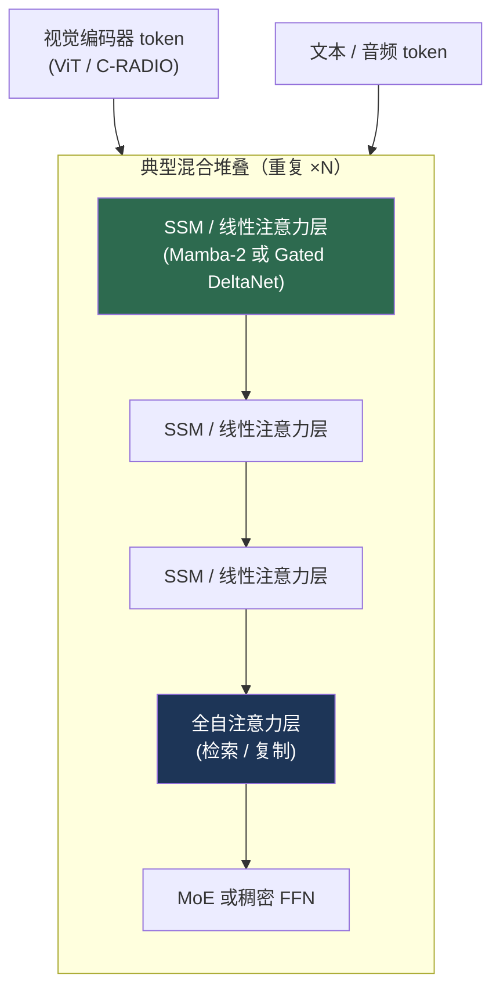

# 面向视觉的状态空间模型

> **英文原文：** [cv-knowledge-base/03_architectures/05_state_space_models.md](../../cv-knowledge-base/03_architectures/05_state_space_models.md)（本中文版供参考，内容以英文原文为准）

> **最后更新：** 2026年10月
> **难度级别：** 高级
> **相关章节：**
> - [视觉 Transformer](./01_vision_transformers.md)
> - [混合架构](./02_hybrid_architectures.md)
> - [高效架构](../09_efficiency_and_deployment/01_efficient_architectures.md)

> **🆕 2026年10月更新：**
> - 新增小节介绍 **Mamba-2 / SSD**（ICML 2024；状态空间与注意力的对偶性）、**Gated DeltaNet**（ICLR 2025）和 **Mamba-3**（arXiv，2026年3月，"推理优先"的 SSM）。
> - 新增章节 **2025 年的视觉 SSM：混合、质疑与寄存器**：MambaVision（CVPR 2025）、MambaOut（CVPR 2025）、Mamba® 寄存器（CVPR 2025）、Vision-LSTM。
> - 新增章节 **基础模型规模的 Mamba/注意力混合架构**：Jamba、Nemotron-H → Nemotron 3（混合 Mamba-Transformer MoE，包括 Nano Omni 多模态模型）、Qwen3-Next/Qwen3.5（Gated DeltaNet 混合架构，原生多模态）。
> - 更新了关键论文、基准性能、优缺点与开放问题。

---

## 概述

状态空间模型（State Space Models, SSM）是自注意力在长序列和高分辨率视觉任务上的主要挑战者，以**线性时间的序列建模**取代注意力的二次代价。SSM 通过一个由连续时间线性动力学控制、并为数字计算而离散化的潜在循环状态，将输入序列映射为输出。使 SSM 具备竞争力的突破是 **S4** [Gu2022]——它将有原则的 HiPPO 初始化与高效的对角加低秩参数化相结合——以及 **Mamba** [Gu2023]，后者加入了*依赖输入的（选择性）*参数和硬件感知的并行扫描，在保持 O(N) 复杂度和每 token O(1) 推理内存的同时，弥合了在语言任务上与 Transformer 长期存在的质量差距。

对视觉而言，其吸引力十分明显：自注意力相对 token 数的 O(N²) 代价是高分辨率下的主要瓶颈，而这正是密集预测和机器人感知需要工作的场景。视觉 SSM（Vim、VMamba）通过双向和多方向扫描，将 Mamba 固有的一维因果扫描适配到图像的二维非因果结构，以显著更低的内存和更快的高分辨率吞吐量达到与 Swin 相当的精度。本文推导 SSM 的数学基础、选择性扫描的创新、视觉适配，以及线性时间模型胜过注意力的适用范围。

到 2025–2026 年，局面变得更加微妙。在 ImageNet 规模的分类上，不含任何 SSM 的门控 CNN（MambaOut）即可追平视觉 Mamba，而最强的视觉 SSM 骨干网络是与注意力结合的**混合模型**（MambaVision）。然而在基础模型规模上，**Mamba/线性注意力 + 注意力的混合堆叠**已成为主流的大语言模型和多模态设计：NVIDIA 的 Nemotron-H 和 Nemotron 3 系列（包括 Nemotron 3 Nano Omni 视觉-音频模型），以及阿里巴巴基于 Gated DeltaNet 构建的原生多模态 Qwen3.5。在这些模型中，线性时间层负责处理由图像、视频和文本 token 组成的长交错序列。

---

## 数学基础

SSM 对具有潜在状态 `h(t)` 的连续系统建模：

```
h'(t) = A h(t) + B x(t)
y(t)  = C h(t) + D x(t)        （D 通常 = 0，即直接馈通项）
```

为了将其应用于步长为 Δ 的离散 token，**零阶保持（Zero-Order Hold, ZOH）离散化**给出：

```
Ā = exp(ΔA)
B̄ = (ΔA)⁻¹ (exp(ΔA) − I) (ΔB)
hₜ = Ā hₜ₋₁ + B̄ xₜ
yₜ = C hₜ
```

这允许一种**对偶视角**：*循环*形式（每步 O(1) 内存，适合推理）以及等价的、带结构化卷积核的*全局卷积*形式（可并行训练，类似 Transformer）。S4 [Gu2022]（ICLR 2022，杰出论文荣誉提名）通过用 **HiPPO-LegS** 矩阵初始化 `A`（借助正交多项式投影实现有原则的长程记忆），并将其分解为**对角加低秩（Diagonal-Plus-Low-Rank, DPLR）**形式，使卷积变得高效，将卷积核计算代价从 O(N²) 降至 O(N log N)。

### 选择性：Mamba

S4 是**线性时不变（Linear Time-Invariant, LTI）**的——`A, B, C` 固定不变，因此模型无法根据内容调节其记忆。**Mamba** [Gu2023] 使 `B`、`C` 和 `Δ` 成为输入的函数（只有 `A` 保持固定）：

```
Bₜ = Linear_B(xₜ);  Cₜ = Linear_C(xₜ);  Δₜ = softplus(Linear_Δ(xₜ))
```

`Δ` 上的选择性使模型可以*忽略*无关 token（Δ→0，不更新状态）或*记住*重要 token。但依赖输入的参数破坏了卷积形式所依赖的时不变性，迫使模型采用循环扫描。Mamba 借助**硬件感知并行扫描**保持其高速：结合律前缀扫描（O(log N) 深度）、**内核融合**（将离散化 + 扫描 + 投影放在一个 CUDA 内核中，避免在 HBM 中物化扩展后的状态），以及反向传播中的**重计算**。其结果是推理吞吐量比同等规模的 Transformer 高约 5 倍，且每 token 内存为 O(1)。


### Mamba-2、Gated DeltaNet 与 Mamba-3

**Mamba-2** [Dao2024]（ICML 2024）将每个头的 `A` 限制为标量乘单位矩阵，从而使选择性 SSM 与某种形式的**掩码线性注意力**完全等价。作者将其称为*结构化状态空间对偶（Structured State Space Duality, SSD）*：

```
y = (L ∘ C Bᵀ) x,    L_ij = Π_{k=j+1..i} a_k  （当 i ≥ j），否则为 0
  （L 是 1-半可分的因果衰减掩码；C Bᵀ 起到 Q Kᵀ 的作用）
```

这种对偶性使模型在训练时可以使用以矩阵乘法为主的分块算法（利用 Tensor Core），而在推理时保留循环形式，并支持大得多的状态维度（通常为 64–128，而 Mamba-1 为 16）。**Gated DeltaNet** [Yang2025]（ICLR 2025，NVIDIA）将 Mamba-2 式的门控（快速遗忘）与 **delta 规则**（对状态中的键-值关联进行定向覆写）相结合，相比 Mamba-2 改进了上下文召回能力。此后它被 Qwen3-Next（2025年9月）、Qwen3.5（2026年2月）和 Olmo Hybrid（2026年3月）采用。**Mamba-3** [Lahoti2026]（arXiv，2026年3月；Lahoti, Li, Chen, Wang, Bick, Kolter, Dao, Gu）从*推理优先*的视角重新审视 SSM 设计，目标是在单位解码计算量和内存下获得更好的质量。其实现位于官方 `state-spaces/mamba` 代码库中。

---

## 视觉适配

图像是二维且非因果的，而 Mamba 的扫描是一维且因果的。两种领先的视觉 SSM 以不同方式解决这一问题：

**Vision Mamba（Vim）** [Zhu2024]（ICML 2024）以 ViT 方式切分图像 patch、加入位置嵌入，并通过**双向** Vim 块（前向 + 反向扫描结合）处理 token，使任何 token 都不会有不对称的上下文。在 1248×1248 分辨率下，Vim **比 DeiT 快 2.8 倍**，并**少用 86.8% 的 GPU 显存**。Vim-S（26M）达到 80.5% top-1，在相近规模下略胜 DeiT-S（79.8%）。

**VMamba** [Liu2024]（NeurIPS 2024 Spotlight）提出了带 **Cross-Scan** 模块的**二维选择性扫描（2D Selective Scan, SS2D）**：特征图被展开为*四条*一维序列（两个对角方向及其反向），每条序列分别经过选择性 SSM 后再合并——使每个 patch 都能从全部四个空间方向获得上下文，类似二维卷积。VMamba-T（约 31M）达到 82.5%，在相近 FLOPs 下超过 Swin-T（81.2%），并在各规模上稳定领先 0.4–1.3 个百分点。

---

## 2025 年的视觉 SSM：混合、质疑与寄存器

2025 年的文献（其中许多发表于 CVPR 2025）给早期对纯视觉 SSM 的热情降了温：

- **MambaVision** [Hatamizadeh2025]（CVPR 2025，NVIDIA）得出结论：最佳视觉骨干网络是*混合*型的。它在高分辨率处使用卷积阶段，随后使用重新设计的 Mamba 混合器（增加了一个不含 SSM 的对称分支，以恢复因因果扫描而丢失的全局上下文），并在每个后期阶段的**最后几层放置自注意力模块**。它确立了 top-1/吞吐量的帕累托前沿（MambaVision-T 以 6,298 img/s 达到 82.3%；使用 IN-21K 的 L3 在 512² 下达到 88.1%），并可迁移到 COCO 和 ADE20K（参见[混合架构](./02_hybrid_architectures.md)）。
- **MambaOut** [Yu2025]（CVPR 2025）完全移除 SSM，只保留门控 CNN 块。它在概念上论证 SSM 适合**长序列且自回归**的任务，而 ImageNet 分类并非如此；并在实验上表明 MambaOut 在 ImageNet 上胜过视觉 Mamba 模型（MambaOut-Small 84.1%）。它也承认，对于在高分辨率下使用长 token 序列的检测/分割，SSM 仍可能有帮助。
- **Mamba®（"Vision Mamba ALSO Needs Registers"）** [Wang2025]（CVPR 2025）在 Vision Mamba 的特征图中发现了与 ViT 类似的高范数伪影 token。均匀插入的寄存器 token 可以消除这些伪影并提高精度（官方代码库中 Mamba®-B 为 83.0%，-L 为 83.6%），同时也使更大规模的视觉 SSM 能够稳定训练。
- **Vision-LSTM（ViL）** [Alkin2024] 采用 xLSTM 的矩阵记忆循环块，每对块交替扫描方向。它是一个与之竞争的线性时间循环骨干网络（ViL-B 82.4%），表明"在二维 patch 上进行一维循环"的设计空间比 Mamba 本身更宽广。

2025 年的总体共识是：纯 SSM 在 **224² 分类上没有精度优势**。它们的价值在于 O(N) 代价至关重要的高分辨率、长视频和长上下文多模态场景，而且通常以带有少量注意力层的**混合模型**形式实现。

---

## 基础模型规模的 Mamba/注意力混合架构

2024–2026 年的决定性进展发生在大型语言和多模态骨干网络中，随后又反哺视觉领域。纯 SSM 大语言模型在上下文检索和复制方面落后于 Transformer。少量全注意力层即可修复这一问题，同时 SSM/线性层保留了大部分计算和 KV 缓存上的节省：

| 模型（日期） | 序列混合器 | 备注 |
|---|---|---|
| Jamba（AI21，2024年3月） | Mamba + 注意力（1 层注意力 : 7 层 Mamba）+ MoE | 早期的生产规模混合模型；长上下文 |
| Nemotron-H（NVIDIA，2025年4月） | 以 Mamba-2 为主，少量自注意力层 | 用 Mamba 替换大多数注意力层的混合 Mamba-Transformer 模型家族 |
| Nemotron Nano 2 VL（NVIDIA，2025） | 混合 Mamba-Transformer LLM + 视觉编码器 | 面向文档和视频的 12B VLM，采用高效视频采样（Efficient Video Sampling） |
| Qwen3-Next-80B-A3B（阿里巴巴，2025年9月） | Gated DeltaNet + 全注意力 + 超稀疏 MoE | 面向长上下文效率的混合注意力 |
| Qwen3.5（阿里巴巴，2026年2月） | Gated DeltaNet 混合 + 稀疏 MoE | **原生多模态**（在数万亿多模态 token 上进行早期融合训练）；从 0.8B 到 397B-A17B |
| Nemotron 3 Nano / Super / Ultra（NVIDIA，2025–2026） | 混合 Mamba-Transformer（Latent）MoE | Nano 31.6B/激活 3.6B；Super 120.6B/激活 12.7B；Ultra 550B/激活 55B，于 GTC 2026 发布，1M 上下文 |
| Nemotron 3 Nano Omni（NVIDIA，2026） | 混合 Mamba-Transformer MoE，30B/激活 3B | 文本、图像（C-RADIOv4-H 编码器）、视频和音频输入 |



对视觉而言，这意味着 **SSM 已从图像编码器转移到多模态序列模型中**。图像编码器仍是 ViT 或混合模型（C-RADIO、SigLIP），而由图像、视频帧和音频组成的长交错 token 流则由混合 Mamba/线性注意力骨干网络处理，其中大多数层的状态为每 token O(1)。

---

## 关键论文

| 论文 | 作者 | 年份 | 会议/期刊 | 主要贡献 |
|-------|---------|------|-------|-----------------|
| Efficiently Modeling Long Sequences (S4) | Gu, Goel, Ré | 2022 | ICLR (Outstanding HM) | HiPPO 初始化 + DPLR；高效的长程 SSM |
| Mamba | Gu, Dao | 2023 | arXiv→COLM 2024 | 选择性 SSM + 硬件感知并行扫描 |
| Vision Mamba (Vim) | Zhu, Liao, Zhang, et al. | 2024 | ICML | 面向非因果视觉的双向 SSM |
| VMamba | Liu, Tian, Zhao, et al. | 2024 | NeurIPS (Spotlight) | 二维选择性扫描（Cross-Scan、SS2D） |
| HiPPO | Gu, Dao, Ermon, Rudra, Ré | 2020 | NeurIPS | S4 背后的多项式投影记忆理论 |
| Jamba | Lieber, Lenz, et al. (AI21) | 2024 | arXiv | 生产级混合 Transformer-Mamba MoE |
| Transformers are SSMs (Mamba-2) | Dao, Gu | 2024 | ICML | 结构化状态空间对偶；适配 Tensor Core 的 SSM |
| Vision-LSTM (ViL) | Alkin, Beck, Pöppel, Hochreiter, Brandstetter | 2024 | arXiv | xLSTM 作为通用视觉骨干网络 |
| Gated Delta Networks | Yang, Kautz, Hatamizadeh | 2025 | ICLR | 门控 + delta 规则；被 Qwen3-Next/Qwen3.5 采用 |
| MambaVision | Hatamizadeh, Kautz | 2025 | CVPR | 卷积 + Mamba + 注意力的混合视觉骨干网络 |
| MambaOut | Yu, Wang | 2025 | CVPR | 不含 SSM 的门控 CNN 在 ImageNet 上胜过视觉 Mamba |
| Mamba®: Vision Mamba ALSO Needs Registers | Wang, Wang, Ren, et al. | 2025 | CVPR | 寄存器消除视觉 SSM 中的伪影 |
| Nemotron-H | NVIDIA | 2025 | arXiv | 混合 Mamba-Transformer 大语言模型家族 |
| Mamba-3 | Lahoti, Li, Chen, et al. | 2026 | arXiv | 推理优先的状态空间模型 |

---

## 基准性能

| 模型 | 参数量 | ImageNet top-1 | 效率说明 | 参考文献 |
|-------|--------|----------------|-----------------|-----------|
| Vim-S | 26M | 80.5% | 在 1248² 下比 DeiT 快 2.8 倍、显存减少 86.8% | [Zhu2024] |
| Vim-B | 98M | 81.9% | — | [Zhu2024] |
| VMamba-T | 31M | 82.5% | 相近 FLOPs 下比 Swin-T 高 1.3 个百分点 | [Liu2024] |
| VMamba-S | 50M | 83.6% | — | [Liu2024] |
| VMamba-B | 89M | 83.9% | 比 Swin-B 高 0.4 个百分点 | [Liu2024] |
| MambaVision-T | 31.8M | 82.3% | 6,298 img/s；卷积+Mamba+注意力混合 | [Hatamizadeh2025] |
| MambaVision-B | 97.7M | 84.2% | 3,670 img/s | [Hatamizadeh2025] |
| MambaVision-L3-512-21K | 739.6M | 88.1% | IN-21K 预训练，512² | [Hatamizadeh2025] |
| MambaOut-Small（无 SSM） | 48.5M | 84.1% | 门控 CNN 对照 | [Yu2025] |
| Mamba®-B | — | 83.0% | Vim + 寄存器（代码库，改进的训练配方） | [Wang2025] |
| ViL-B（Vision-LSTM） | — | 82.4% | 基于 xLSTM 的循环骨干网络 | [Alkin2024] |

*复杂度：自注意力为 O(N²)；SSM 相对序列长度为 O(N)（使用并行扫描训练时为 O(N·D²)，D≪N）。*

---

## 优缺点

| 方面 | 优点 | 缺点 |
|--------|------|------|
| 线性复杂度 | O(N)，相比注意力的 O(N²)；可扩展到高分辨率 | 相对状态维度 D 为二次（D 通常较小） |
| 推理内存 | 每 token O(1)（循环状态） | 选择性扫描需要定制的 CUDA 内核 |
| 长程建模 | 以 HiPPO 为基础的记忆；在长序列上表现强 | 工具链/生态不如 Transformer 成熟 |
| 视觉精度 | 在相近 FLOPs 下超过 Swin（VMamba） | 多方向扫描增加了设计复杂度 |
| SSM + 注意力混合 | 在保留大部分线性时间节省的同时保持检索/复制能力；现已成为 Nemotron 3 和 Qwen3.5 的标准配置 | 层比例和放置位置是经验性的；需要维护两套内核栈 |
| 分类任务上的必要性 | — | MambaOut 表明，在 224² 下不含 SSM 的门控 CNN 可匹敌或超过视觉 Mamba |

---

## 开放问题与研究空白

- **规范的二维扫描。** 对于如何为二维图像施加一维顺序尚无共识；Cross-Scan 有效但较为特设（ad hoc）。
- **大规模预训练。** 在大规模自监督预训练（MAE/DINO 式，参见[自监督学习](./03_self_supervised_learning.md)）下，视觉 SSM 能否匹敌 Transformer，研究尚不充分。
- **硬件支持。** SSM 内核在各类加速器上的优化程度不如注意力；可移植性和端侧支持滞后。
- **SSM-注意力混合。** 在大语言模型/多模态骨干网络中，带有少量全注意力层的混合架构已成为默认选择（Jamba、Nemotron-H/3、Qwen3-Next/3.5）。对于*视觉编码器*，最优比例和放置位置仍是经验性的：MambaVision 将注意力放在后期阶段的末尾（参见[混合架构](./02_hybrid_architectures.md)）。
- **SSM 在视觉中究竟何处有用。** MambaOut 认为 SSM 对短序列分类是不必要的。在控制训练配方和计算量的前提下，证明其在高分辨率密集预测、长视频和长多模态上下文中优势的严格证据仍然有限。
- **伪影与寄存器。** Mamba® 表明视觉 SSM 也会像 ViT 一样产生高范数伪影 token。为何循环模型同样会把全局信息分配给背景 token，尚无解释。
- **密集预测。** 用于检测/分割的 SSM 骨干网络前景可观，但验证程度不如 Swin。
- **理论理解。** 对选择性机制学到了什么，以及其相对于注意力的表达能力，理解仍不完整。
- **多模态 SSM。** 混合 Mamba-Transformer 和 Gated DeltaNet 骨干网络现已作为多模态模型发布（Nemotron Nano 2 VL、Nemotron 3 Nano Omni、Qwen3.5）。固定大小的循环状态在长交错图像/视频序列中能保留多少细粒度视觉细节，以及如何对此进行基准评测，仍是开放问题。

---

## 延伸阅读

- [Mamba (arXiv:2312.00752)](https://arxiv.org/abs/2312.00752) —— 选择性状态空间，线性时间序列建模
- [S4 (arXiv:2111.00396)](https://arxiv.org/abs/2111.00396) —— 面向长序列的结构化状态空间
- [Vision Mamba / Vim (arXiv:2401.09417)](https://arxiv.org/abs/2401.09417) —— 面向视觉的双向 SSM
- [VMamba (arXiv:2401.10166)](https://arxiv.org/abs/2401.10166) —— 二维选择性扫描视觉状态空间模型
- [HiPPO (arXiv:2008.07669)](https://arxiv.org/abs/2008.07669) —— S4/Mamba 背后的记忆理论
- [Mamba-2 (arXiv:2405.21060) 与 Mamba-3 (arXiv:2603.15569)](https://github.com/state-spaces/mamba) —— SSD 对偶性与推理优先的 SSM
- [Gated DeltaNet (arXiv:2412.06464)](https://github.com/NVlabs/GatedDeltaNet) —— 门控 + delta 规则，用于 Qwen3-Next/Qwen3.5
- [MambaVision (arXiv:2407.08083)](https://github.com/NVlabs/MambaVision) —— 混合 Mamba-Transformer 视觉骨干网络
- [MambaOut (arXiv:2405.07992)](https://github.com/yuweihao/MambaOut) —— 视觉真的需要 Mamba 吗？
- [Mamba® (arXiv:2405.14858)](https://github.com/wangf3014/Mamba-Reg) —— 视觉 Mamba 也需要寄存器
- [Vision-LSTM (arXiv:2406.04303)](https://github.com/NX-AI/vision-lstm) —— xLSTM 作为通用视觉骨干网络
- [NVIDIA Nemotron 模型](https://github.com/NVIDIA-NeMo/Nemotron) —— 混合 Mamba-Transformer MoE 大语言模型及全模态/视觉-语言模型
