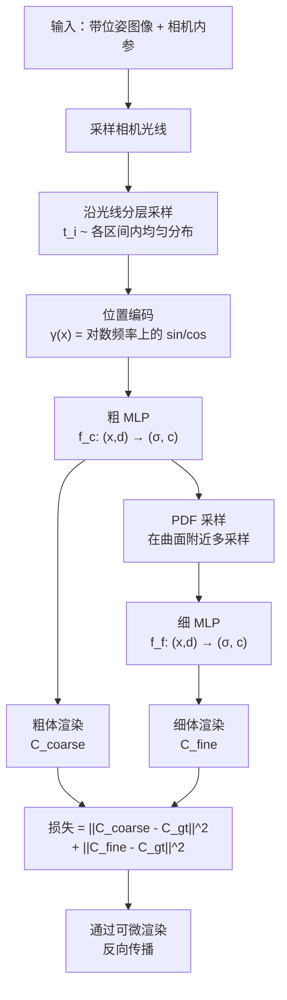

# 神经辐射场：NeRF 及其变体

> **英文原文：** [cv-knowledge-base/04_3d_vision_and_scene/01_nerf_and_variants.md](../../cv-knowledge-base/04_3d_vision_and_scene/01_nerf_and_variants.md)（本中文版供参考，内容以英文原文为准）

> **最后更新：** 2026年10月
> **难度级别：** 高级
> **相关章节：** [3D 表示](./00_3d_representations.md) · [高斯泼溅](./02_gaussian_splatting.md) · [SfM 与 SLAM](./03_sfm_and_slam.md)

> **🆕 2026年10月更新：**
> - 纯 NeRF 研究已基本进入平台期。本次修订新增一节，介绍 **NeRF 思想在 2025–2026 年的去向**：通过光线追踪对显式基元进行精确体渲染（EVER、3DGRT/3DGUT、Radiant Foam），以及“无 3D 偏置”的视角合成（LVSM，ICLR 2025 Oral）。
> - 前馈几何模型（VGGT，CVPR 2025 最佳论文；Depth Anything 3）如今在许多辐射场管线中取代 COLMAP 成为位姿前端。见 [SfM 与 SLAM](./03_sfm_and_slam.md)。
> - 相应扩充了关键论文、基准性能、开放问题与延伸阅读。

---

## 概述

神经辐射场（Neural Radiance Fields, NeRF）由 Mildenhall、Srinivasan、Tancik、Barron、Ramamoorthi 和 Ng 在 ECCV 2020 提出，是 2020 年代 3D 计算机视觉中最具变革性的思想之一。其核心洞见是：一个从位置和视角方向映射到颜色和密度的连续 5D 函数，用 MLP 编码，并通过对带位姿 2D 图像进行可微体渲染来优化，就能重建照片级真实的 3D 场景。这开启了一个全新的研究范式。原始论文发表后三年内便催生了数百篇后续工作，针对其主要局限：训练与渲染缓慢、不同尺度下的混叠伪影、在无界室外场景中表现不佳，以及无法跨场景泛化。

NeRF 的发展脉络清晰。原始 NeRF（2020）证明了照片级合成的可行性，但在高端 GPU 上需要 1–5 天训练，每帧渲染需数秒。Mip-NeRF（Barron et al., ICCV 2021）通过投射抗混叠的圆锥截体（conical frustum）而非无限细的光线来解决混叠问题，使误差减半。Mip-NeRF 360（Barron et al., CVPR 2022）借助场景收缩和基于提议网络的采样器，将其扩展到无界室外场景。Instant-NGP（Müller et al., SIGGRAPH 2022）实现了关键的工程突破：用多分辨率哈希网格替代 MLP 瓶颈，把训练时间缩短到约 5 分钟。随后，Zip-NeRF（Barron et al., ICCV 2023）结合了 Mip-NeRF 360 的抗混叠能力与 Instant-NGP 的速度。

尽管进展迅速，在实时新视角合成方面，NeRF 范式已在很大程度上被 3D 高斯泼溅（Kerbl et al., SIGGRAPH 2023）取代。后者以 100+ FPS 达到与 NeRF 相当或更好的质量，而 NeRF 约为 1 FPS。不过，NeRF 在以下方面依然重要：(1) 需要解析平滑几何的场景（基于 SDF 的 NeRF）；(2) 生成式 3D 模型（DreamFusion、LRM）；(3) 作为理解神经场景表示的理论基础。

---

## 体渲染方程

NeRF 的核心是体渲染积分，它计算相机光线 $\mathbf{r}(t) = \mathbf{o} + t\mathbf{d}$ 的期望颜色 $C(\mathbf{r})$：

```
# 体渲染积分（连续形式）
C(r) = ∫_{t_n}^{t_f}  T(t) · σ(r(t)) · c(r(t), d) dt

其中：
  T(t) = exp( -∫_{t_n}^{t} σ(r(s)) ds )   ← 透射率（直到 t 为止未发生碰撞的概率）
  σ(r(t))                                  ← r(t) 处的体密度
  c(r(t), d)                               ← r(t) 处沿方向 d 发出的辐射

# 离散近似（求积，N 个采样点）：
C_hat(r) = Σ_{i=1}^{N}  T_i · (1 - exp(-σ_i · δ_i)) · c_i

其中：
  T_i = exp( -Σ_{j=1}^{i-1} σ_j · δ_j )   ← 累积透射率
  δ_i = t_{i+1} - t_i                       ← 采样间隔宽度
  α_i = 1 - exp(-σ_i · δ_i)                ← alpha 合成权重
```

该积分对产生 $(\sigma, c)$ 的 MLP 参数 $\theta$ 可微，因此可以通过以下损失进行端到端（end-to-end）训练：

```
L = Σ_{r ∈ R} || C_hat(r) - C_gt(r) ||_2^2
```

其中 $R$ 是从带位姿图像中采样的训练光线集合。

---

## NeRF 架构与训练

原始 NeRF 采用**层次化采样**策略，包含粗、细两个 MLP。粗网络使用分层采样得到粗略的密度估计；细网络再通过逆 CDF 采样，在期望密度高的区域更密集地采样。两个网络联合训练。



**位置编码：** NeRF 用傅里叶特征对 $(x,y,z)$ 和 $(\theta, \phi)$ 进行编码，使 MLP 能够表示高频空间细节：

```
# 位置编码
γ(p) = [sin(2^0 π p), cos(2^0 π p),
         sin(2^1 π p), cos(2^1 π p),
         ...
         sin(2^{L-1} π p), cos(2^{L-1} π p)]

其中位置 (x,y,z) 取 L=10，方向 (d) 取 L=4
```

这种编码受到神经网络频谱偏置研究 [Rahaman et al. 2019] 的启发，至关重要：没有它，MLP 会收敛到模糊的低频解。

---

## Mip-NeRF：抗混叠的圆锥截体 [Barron2021]

Jonathan T. Barron、Ben Mildenhall、Matthew Tancik、Peter Hedman、Ricardo Martin-Brualla 和 Pratul P. Srinivasan（Google Research）在 ICCV 2021 发表了 Mip-NeRF。其洞见是：光线是一种零宽度的抽象，实际成像区域是一个**圆锥截体**（截头圆锥段），其横截面随距离变化。当训练图像跨越多个尺度，或同一场景在不同距离下被观察时，基于光线的 NeRF 会产生混叠，因为同一个查询点被要求表示差异巨大的空间范围。

Mip-NeRF 用**积分位置编码（integrated positional encoding, IPE）** 来近似截体：它不编码点 $\mu$，而是编码刻画截体的高斯分布 $\mathcal{N}(\mu, \Sigma)$，并解析地计算傅里叶特征的期望：

```
# 积分位置编码
E[γ(x)] for x ~ N(μ, Σ)

= [sin(2^k π μ) exp(-2^{2k-1} π^2 Σ_{jj}),
   cos(2^k π μ) exp(-2^{2k-1} π^2 Σ_{jj})]

← 方差较大时高频分量被抑制
```

由此得到单 MLP 模型（去掉了粗/细层次结构）。在原始基准上，它比 NeRF 快 7%、误差低 17%；在新的多尺度评测集上误差低 60%。

---

## Mip-NeRF 360：无界场景 [Barron2022]

Barron、Mildenhall、Verbin、Srinivasan 和 Hedman（Google Research）在 CVPR 2022 将抗混叠 NeRF 扩展到**无界室外场景**。360° 场景的主要挑战在于：(a) 内容距离差异巨大（从近处前景到无穷远）；(b) 相机可以朝向任意方向；(c) 天空和背景没有清晰的深度。

他们的方案结合了三个要素：
1. **非线性场景收缩**：对 $||x|| > 1$ 的点使用 $\text{contract}(x) = x / ||x||$，把无界世界坐标映射到有界球 $\{x : ||x|| \leq 2\}$ 内
2. **基于提议的采样**：一个小型 MLP 产生深度上的概率分布来引导采样，它通过直方图损失训练，而非通过体渲染训练
3. **基于失真的正则化器**：惩罚分布在大区间上的权重分布，抑制无界场景中常见的“漂浮物”（floater）伪影

在 Mip-NeRF 360 数据集（同一论文提出，包含 9 个室外和室内无界场景）上，Mip-NeRF 360 的均方误差比 Mip-NeRF 降低了 57%。

---

## Instant-NGP：哈希编码的突破 [Müller2022]

Thomas Müller、Alex Evans、Christoph Schied 和 Alexander Keller（NVIDIA）在 SIGGRAPH 2022 发表了 Instant Neural Graphics Primitives，并获得**最佳论文奖**。NeRF 的根本瓶颈在于 MLP 必须足够大才能编码全部场景内容，因而速度慢。Instant-NGP 用可训练特征向量组成的**多分辨率哈希表**替代 MLP 层，从而将编码容量与计算解耦。

```
# 多分辨率哈希编码
对查询点 x ∈ R^3：
  对每个分辨率层级 l = 1..L：
    1. 计算分辨率 r_l = floor(N_min * b^l) 下的体素角点
    2. 对每个角点做哈希：h(v) = (v_x XOR v_y*p_1 XOR v_z*p_2) mod T
       其中 T = 哈希表大小，p_1,p_2 为大素数
    3. 在哈希后的角点处查找特征向量
    4. 三线性插值 → 特征 f_l ∈ R^F
  拼接特征：[f_1, ..., f_L] → 小型 MLP → (σ, c)

关键：哈希冲突通过梯度下降隐式解决——
冲突的条目对其特征取平均，这之所以可行，是因为
空间上邻近的位置发生冲突时具有相似的特征。
```

结果：在单张 NVIDIA RTX 3090 上，NeRF 训练在**约 5 分钟**内收敛（原始 NeRF 约需 12 小时）。NeRF-Synthetic 上的 PSNR 从 31.01 dB 提升到 33.18 dB。该系统还在统一的“神经图形基元”框架下处理有符号距离函数、神经图像和神经体。

---

## Zip-NeRF：结合 Mip-NeRF 与哈希网格 [Barron2023]

Barron、Mildenhall、Verbin、Srinivasan 和 Hedman（Google Research）在 ICCV 2023 发表了 Zip-NeRF，解决一个不兼容问题：Instant-NGP 使用点采样（会混叠），而 Mip-NeRF 360 使用积分位置编码（抗混叠但慢）。Zip-NeRF 提出**多重采样（multisampling）**：在截体横截面内沿一个圆放置少量点样本，用它们来近似圆锥截体上的 IPE，再对这些样本的哈希网格查找结果取平均。这一方法再与 Mip-NeRF 360 的提议网络和失真正则化器结合。

结果：误差比单独的 Instant-NGP 或 Mip-NeRF 360 低 8–77%，训练速度比 Mip-NeRF 360 快 24 倍。Zip-NeRF 代表了 3DGS 出现之前纯 NeRF 新视角合成质量的巅峰。

---

## 为何 3DGS 在实时新视角合成上取代了 NeRF

尽管 Zip-NeRF 达到了最先进的质量，NeRF 从根本上无法以超过约 1–5 FPS 的速度渲染，因为每条光线都需要数百次 MLP 查询。3DGS（Kerbl et al. 2023）能以 100+ FPS 达到相当的质量（PSNR 相差 0.5–1 dB 以内），原因在于：

1. **显式基元**：3D 高斯被直接泼溅到屏幕上，无需光线步进
2. **GPU 光栅化**：基于图块的排序和 alpha 合成与 GPU 着色器管线完美契合
3. **致密化**：自适应的高斯分裂/剪枝使表示在需要的地方增长，相当于 NeRF 的细采样，却没有逐帧开销

NeRF 仍在以下方面保有优势：(1) 大场景的内存效率（MLP 权重远小于数百万个高斯）；(2) 用于网格化/物理的几何更干净；(3) 作为前馈 3D 模型的架构骨干（LRM 使用 NeRF 解码器）；(4) 文本到 3D（SDS 损失需要可微渲染，而 NeRF 天然提供这一点）。

---

## NeRF 思想的去向（2025–2026）

到 2025–2026 年，已很少有新论文单纯提出 MLP 辐射场。NeRF 的核心思想（把体渲染作为可微成像模型、位置/哈希编码、通过积分足迹实现抗混叠）被吸收进三条后继路线。

### 1. 显式基元的精确体渲染

3DGS 通过对投影后的 2D 椭圆排序并进行 alpha 混合来近似体渲染。这会导致“跳变”（popping）和随视角变化的有效密度，且无法原生处理畸变相机或卷帘快门相机。若干工作在保留显式基元的同时，恢复了 NeRF 物理上正确的体积分：

- **EVER: Exact Volumetric Ellipsoid Rendering** [Mai2024]（Mai, Hedman, Kopanas, Verbin, Futschik, Xu, Kuester, Barron, Zhang）对恒定密度椭球进行光线追踪，并*精确地*计算仅发射的体渲染积分。作者报告其在 RTX 4090 上 720p 约 30 FPS，无跳变，并支持散焦模糊和鱼眼相机。他们还报告在 Zip-NeRF 数据集上取得了实时方法中的最先进结果。
- **3DGRT** [MoenneLoccoz2024, SIGGRAPH Asia 2024] 利用硬件 RT 核心对高斯粒子进行光线追踪，支持次级光线（反射、折射、阴影）。**3DGUT** [Wu2025, CVPR 2025 Oral] 使用无迹变换（unscented transform），在保持光栅化速度的同时支持任意畸变和时间相关（卷帘快门）的相机。两者均来自 NVIDIA，且 3DGUT 已集成到 `gsplat` 中。
- **Radiant Foam** [Govindarajan2025]（Govindarajan, Rebain, Yi, Tagliasacchi）把体表示为带有逐单元密度和颜色的 Delaunay/Voronoi 单元网格，从而能对体场进行实时可微的*光线追踪*，而不需要泼溅中的近似。

从这个意义上说，“NeRF 对 3DGS”的二元对立已让位于一个设计空间。其坐标轴包括：基元（MLP 场、高斯、椭球、单元）、渲染器（光线步进、光线追踪、光栅化）以及体积分的精确程度。

### 2. 最小 3D 归纳偏置的学习式渲染

**LVSM: A Large View Synthesis Model with Minimal 3D Inductive Bias** [Jin2025, ICLR 2025 Oral]（Jin, Jiang, Tan, Zhang, Bi, Zhang, Luan, Snavely, Xu）完全舍弃了显式辐射场。一个 Transformer 把带位姿的输入视图和目标相机的 Plücker 光线直接映射为目标视图像素。在稀疏视图、可泛化的设置下，仅解码器变体在 RealEstate10K（256×256）上达到 29.67 dB PSNR。LVSM 及相关模型表明，只要数据足够，高质量新视角合成并不需要体渲染。代价是它们放弃了一个显式、可查询的 3D 场景。

### 3. 无需位姿的前端

辐射场管线传统上以 COLMAP SfM 开始。自 VGGT [Wang2025, CVPR 2025 最佳论文] 以来，前馈几何模型（VGGT、π³、MapAnything、Depth Anything 3）越来越多地在数秒内提供相机和初始几何。VGGT 可以直接导出为 COLMAP 格式供 `gsplat` 训练使用。这消除了 NeRF 历史上的一个实际瓶颈：缓慢且脆弱的位姿估计步骤（见 [03_sfm_and_slam.md](./03_sfm_and_slam.md)）。

---

## 关键论文

| 论文 | 作者 | 年份 | 会议/期刊 | 主要贡献 |
|-------|---------|------|-------|-----------------|
| NeRF: Representing Scenes as Neural Radiance Fields for View Synthesis | Mildenhall, Srinivasan, Tancik, Barron, Ramamoorthi, Ng | 2020 | ECCV | 5D 辐射场 + 可微体渲染；从带位姿图像实现照片级新视角合成 |
| Mip-NeRF: A Multiscale Representation for Anti-Aliasing Neural Radiance Fields | Barron, Mildenhall, Tancik, Hedman, Martin-Brualla, Srinivasan | 2021 | ICCV | 圆锥截体采样 + 积分位置编码；误差降低 17–60% |
| Mip-NeRF 360: Unbounded Anti-Aliased Neural Radiance Fields | Barron, Mildenhall, Verbin, Srinivasan, Hedman | 2022 | CVPR | 面向无界场景的场景收缩 + 提议网络 + 失真正则化器 |
| Instant Neural Graphics Primitives with a Multiresolution Hash Encoding | Müller, Evans, Schied, Keller | 2022 | SIGGRAPH | 哈希网格编码；约 5 分钟训练；SIGGRAPH 最佳论文 |
| Zip-NeRF: Anti-Aliased Grid-Based Neural Radiance Fields | Barron, Mildenhall, Verbin, Srinivasan, Hedman | 2023 | ICCV | 用多重采样结合 Mip-NeRF 360 与哈希网格；比 Mip-NeRF 360 快 24 倍 |
| 3D Gaussian Splatting for Real-Time Radiance Field Rendering | Kerbl, Kopanas, Leimkühler, Drettakis | 2023 | SIGGRAPH | 用显式高斯取代 NeRF；1080p 下 100+ FPS 实时渲染 |
| Block-NeRF: Scalable Large Scene Neural View Synthesis | Tancik et al. (Waymo) | 2022 | CVPR | 通过带外观条件的独立分块子网络实现城市尺度 NeRF |
| Deformable Neural Radiance Fields (Nerfies) | Park et al. | 2021 | ICCV | 面向非刚性运动主体（自拍视频）的可变形模板 NeRF |
| EVER: Exact Volumetric Ellipsoid Rendering for Real-time View Synthesis | Mai, Hedman, Kopanas, Verbin, Futschik, Xu, Kuester, Barron, Zhang | 2024 | arXiv | 光线追踪椭球并精确体渲染；无跳变；720p 约 30 FPS |
| LVSM: A Large View Synthesis Model with Minimal 3D Inductive Bias | Jin, Jiang, Tan, Zhang, Bi, Zhang, Luan, Snavely, Xu | 2025 | ICLR（Oral） | 不依赖显式辐射场的 Transformer 新视角合成；仅解码器与编码器-解码器两种变体 |
| 3DGUT: Enabling Distorted Cameras and Secondary Rays in Gaussian Splatting | Wu et al. (NVIDIA) | 2025 | CVPR（Oral） | 基于无迹变换的光栅化，支持畸变/卷帘快门相机 |
| Radiant Foam: Real-Time Differentiable Ray Tracing | Govindarajan, Rebain, Yi, Tagliasacchi | 2025 | arXiv | 通过实时可微光线追踪渲染体单元网格场 |

---

## 基准性能

| 模型 | 数据集 | 指标 | 得分 | 备注 |
|-------|---------|--------|-------|-------|
| NeRF | NeRF-Synthetic (Blender) | PSNR | 31.01 dB | 原始版本，约 10 万次迭代，约 1 天训练 |
| Instant-NGP | NeRF-Synthetic | PSNR | 33.18 dB | 约 5 分钟训练；哈希网格编码 |
| Mip-NeRF | NeRF-Synthetic | PSNR | 33.09 dB | 单 MLP；抗混叠截体 |
| Mip-NeRF 360 | Mip-NeRF 360 Dataset | PSNR | 27.69 dB | 无界室内+室外场景 |
| Zip-NeRF | Mip-NeRF 360 Dataset | PSNR | 28.54 dB | NeRF 家族在该基准上的最佳结果 |
| 3DGS | Mip-NeRF 360 Dataset | PSNR | 27.21 dB | 质量相当，100+ FPS 对比约 1 FPS |
| Mip-Splatting | Mip-NeRF 360 Dataset | PSNR | 27.92 dB | 抗混叠的 3DGS 变体 |
| LVSM（仅解码器） | RealEstate10K (256×256) | PSNR | 29.67 dB | 可泛化的稀疏视图新视角合成；无显式 3D 场（与逐场景各行设置不同） |
| EVER | Zip-NeRF Dataset | — | 实时方法中的 SOTA（作者声称） | RTX 4090 上 720p 约 30 FPS |

---

## 优缺点

| 方面 | 优点 | 缺点 |
|--------|------|------|
| 原始 NeRF | 照片级真实；无需显式几何；仅靠图像监督 | 训练 12 小时以上；每帧渲染数秒；逐场景优化 |
| 哈希网格 NeRF（Instant-NGP） | 训练快（约 5 分钟）；质量高；开源 CUDA 实现 | 渲染仍仅约 1–10 FPS；需要 GPU；逐场景 |
| Mip-NeRF 家族 | 正确的多尺度抗混叠；能干净地处理缩放变化 | 实现复杂；提议网络带来开销；无法实时渲染 |
| 光线追踪的显式体表示（EVER、3DGRT、Radiant Foam） | 精确的体积分；实时；支持畸变相机和次级效果 | 比泼溅慢；常需 RT 硬件；工具生态较小 |
| 大型视角合成模型（LVSM） | 前馈、可泛化；稀疏视图质量强 | 无显式 3D 场景；需要大量训练数据和算力；外推能力有限 |

---

## 开放问题与研究空白

- **实时 NeRF：** 隐式 MLP 查询与实时渲染之间的根本冲突把该领域推向了 3DGS。把 NeRF 烘焙为网格（BakingNeRF）或体素（PlenOctrees）提供了部分解决方案，但失去了表示的紧凑性。
- **可泛化 NeRF：** 逐场景优化不适合实际部署。前馈模型（pixelNeRF、MVSNeRF、LRM）需要在大规模 3D 数据集上训练，而这类数据仍然稀缺且获取成本高。截至 2025–2026 年，在大规模多视图视频语料上训练的 LVSM 式模型和前馈高斯预测器已在很大程度上取代了可泛化 NeRF。对于可泛化的新视角合成，是否还需要显式体表示，如今是一个活跃的研究问题。
- **精确性与速度：** 光线追踪的显式体表示（EVER、3DGRT、Radiant Foam）恢复了精确体渲染，但在普通硬件上的吞吐量仍落后于光栅化 3DGS。把精确渲染与泼溅级速度统一起来仍是开放问题。
- **动态 NeRF：** 扩展到动态场景要么需要逐帧优化（代价高），要么需要学习时间一致性（困难）。可变形 NeRF 方法（Nerfies、D-NeRF、HyperNeRF）适用于短片段，但难以处理大幅运动。
- **场景编辑：** NeRF 的隐式特性使语义编辑困难——修改一个物体需要全局修改 MLP 权重。组合式 NeRF 方法（ObjectNeRF、NSG）部分解决了这一问题。
- **室外/大规模场景：** Mip-NeRF 360 可以处理单个室外场景；真正的大规模（街区、城市）场景需要层次化架构（Block-NeRF、Mega-NeRF），并面临内存和一致性方面的工程挑战。
- **几何提取：** 把 NeRF 密度转换为曲面是一个病态问题——密度 ≠ SDF，朴素的 Marching Cubes 会产生噪声网格。基于 SDF 的 NeRF 变体（NeuS、VolSDF）改善了这一点，但增加了复杂度。
- **光度标定：** NeRF 假设内参和外参已知；处理未知/不完善的相机模型（镜头畸变、卷帘快门、自动曝光）需要在训练中仔细地进行位姿优化。

---

## 延伸阅读

- [NeRF 项目主页](https://www.matthewtancik.com/nerf) — 原始论文、视频和代码
- [Instant-NGP GitHub（NVlabs）](https://github.com/NVlabs/instant-ngp) — 带 GUI 的 CUDA 实现
- [NeRF Explosion 2020 博客（Dellaert）](https://dellaert.github.io/NeRF/) — 早期 NeRF 变体综述
- [Jon Barron 的主页](https://jonbarron.info/mipnerf360/) — Mip-NeRF 360 项目主页及结果
- [Zip-NeRF ICCV 2023 报告（YouTube）](https://www.youtube.com/watch?v=Sk3wU-VMoCI) — 作者演讲
- [神经场综述（Xie et al. 2022, arXiv）](https://arxiv.org/abs/2111.11426) — 100 多页的全面综述
- [LVSM GitHub](https://github.com/Haian-Jin/LVSM) — ICLR 2025 Oral；无需显式 3D 的大型视角合成
- [EVER 训练代码](https://github.com/half-potato/ever_training) — 精确的体椭球渲染
- [Radiant Foam GitHub](https://github.com/theialab/radfoam) — 体单元网格的实时可微光线追踪
- [3DGRUT GitHub（NVIDIA）](https://github.com/nv-tlabs/3dgrut) — 3DGRT / 3DGUT 参考实现
