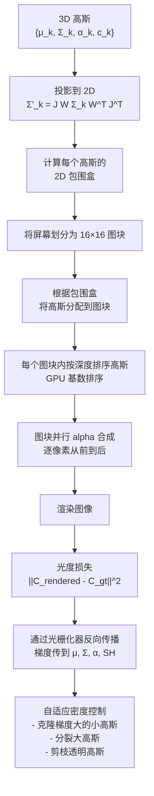
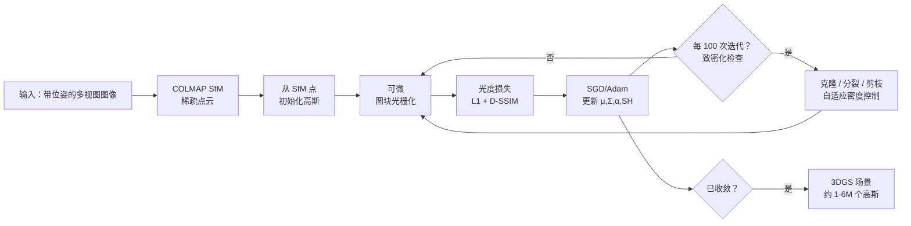

# 3D 高斯泼溅：实时新视角合成

> **英文原文：** [cv-knowledge-base/04_3d_vision_and_scene/02_gaussian_splatting.md](../../cv-knowledge-base/04_3d_vision_and_scene/02_gaussian_splatting.md)（本中文版供参考，内容以英文原文为准）

> **最后更新：** 2026年10月
> **难度级别：** 高级
> **相关章节：** [NeRF 及其变体](./01_nerf_and_variants.md) · [3D 表示](./00_3d_representations.md) · [4D 与动态场景](../12_research_frontier_2024_2026/05_4d_and_dynamic_scenes.md)

> **🆕 2026年10月更新：**
> - **前馈 3DGS** 走向成熟：AnySplat（SIGGRAPH Asia 2025）从无位姿图像预测高斯与相机位姿。Depth Anything 3 和 WorldMirror（ICML 2026）为通用几何模型增加了高斯输出头。Apple 的 SHARP（2025年12月）能在一秒内从单张照片生成度量尺度的 3D 高斯。
> - **超越泼溅**：NVIDIA 的 3DGRT（光线追踪）和 3DGUT（CVPR 2025 Oral）支持畸变/卷帘快门相机和次级光线。3DGUT 已集成进 `gsplat`；到 2026 年，`gsplat` 还提供 MCMC 致密化（3DGS-MCMC，NeurIPS 2024 Spotlight）、多 GPU 渲染和 LiDAR 光栅化。
> - **标准化**：Khronos `KHR_gaussian_splatting` glTF 扩展获得正式批准，World Labs 的 Spark 等网页渲染器支持该格式。
> - **ECCV 2026 最佳论文**（HKTex）把高斯基元的思想搬到网格曲面上，成为不泼溅的“测地高斯”。CVPR 2026 最佳论文 D4RT 推进了前馈式动态 4D 重建。
> - 新增章节，并补充了关键论文、基准性能、开放问题与延伸阅读。

---

## 概述

3D 高斯泼溅（3D Gaussian Splatting, 3DGS）由 Bernhard Kerbl、Georgios Kopanas、Thomas Leimkühler 和 George Drettakis（INRIA Sophia Antipolis）在 SIGGRAPH 2023 提出，是继 NeRF 之后新视角合成领域最重要的实用进展。该方法把场景表示为数百万个各向异性 3D 高斯基元的集合，并通过可微的基于图块（tile）的光栅化进行渲染，在实现实时渲染（1080p 下 100+ FPS）的同时，达到甚至超过 NeRF 级别的照片真实感。与 NeRF 的隐式 MLP 不同，3DGS 是显式表示：高斯在几何上可解释、可直接编辑，且渲染时无需任何光线步进。

3DGS 论文一经发表便在计算机视觉界赢得广泛赞誉，并催生了一个发展极快的生态。发表后一年内，数百篇论文把它扩展到动态场景（4D-GS、SC-GS）、语义理解（LangSplat）、曲面重建（2DGS）、抗混叠（Mip-Splatting）、机器人抓取、医学成像和自动驾驶等方向。相对 NeRF 的速度优势（推理快约 100 倍）使其成为 2024–2026 年交互式 3D 场景表示的事实标准。

与 NeRF 相比，核心权衡在于：3DGS 以内存效率（数百万个高斯 × 每个约 60 字节 = 每个场景数百 MB）换取渲染速度，以曲面质量（高斯并不显式建模曲面）换取感知图像质量。这些权衡推动了活跃的变体研究：2DGS 改善曲面，Mip-Splatting 解决抗混叠，Scaffold-GS 提供结构化表示。

---

## 数学基础：各向异性 3D 高斯

每个高斯基元 $\mathcal{G}_k$ 由以下参数定义：
- **均值** $\mu_k \in \mathbb{R}^3$ —— 3D 位置
- **协方差** $\Sigma_k \in \mathbb{R}^{3\times3}$（半正定）—— 形状与朝向
- **不透明度** $\alpha_k \in [0, 1]$ —— 透明程度
- **颜色** $c_k$，以**球谐（Spherical Harmonic, SH）系数**表示 —— 视角相关外观

```
# 3D 高斯密度函数
G_k(x) = exp(-0.5 * (x - μ_k)^T Σ_k^{-1} (x - μ_k))

# 协方差参数化（保证半正定）：
Σ_k = R_k S_k S_k^T R_k^T

其中：
  R_k ∈ SO(3) — 旋转矩阵（以四元数 q_k 存储）
  S_k = diag(s_x, s_y, s_z) — 轴对齐的缩放矩阵

# 2D 投影（泼溅）到相机平面：
Σ'_k = J W Σ_k W^T J^T

其中 W ∈ R^{3x3} 为世界到相机的旋转
      J ∈ R^{2x3} 为射影变换的雅可比矩阵

# 通过球谐函数表示视角相关颜色：
c_k(d) = Σ_{l=0}^{L} Σ_{m=-l}^{l}  f_k^{lm} · Y_l^m(d)

其中 Y_l^m 为实球谐基函数
      L=3（3 阶 SH，每个颜色通道 16 个系数 = 每个高斯 48 个浮点数）
```

---

## 基于图块的可微光栅化

NeRF 通过光线步进渲染；3DGS 则通过**泼溅**渲染：把每个 3D 高斯投影为屏幕上的 2D 椭圆，并从前到后进行合成。这一过程可以映射到 GPU 光栅化硬件上：



像素 $p$ 按深度排序观察各高斯时的 alpha 合成公式为：

```
# Alpha 合成（从前到后）
C(p) = Σ_{i=1}^{N} c_i · α̃_i · Π_{j=1}^{i-1} (1 - α̃_j)

其中 α̃_i = α_i · exp(-0.5 (p - μ'_i)^T (Σ'_i)^{-1} (p - μ'_i))
             ← 投影椭圆在像素 p 处的高斯权重
```

**自适应密度控制（Adaptive Density Control, ADC）：** 训练过程中，3DGS 监控位置梯度的大小 $||\nabla_{\mu_k} \mathcal{L}||$。在重建不足的区域中梯度较大的高斯会被：
- **克隆**（复制并施加轻微扰动）——如果它们较小，以覆盖更多空间
- **分裂**（由从其概率密度中采样得到的两个更小的高斯替代）——如果它们较大，以提升细节
不透明度低于阈值 $\epsilon$ 的高斯会被**剪枝**。这一自适应过程使表示从 SfM 初始化（通常约 10 万个点）在训练中增长到 100 万–600 万个高斯。

---

## 训练管线



对于有界室内场景，在单张 RTX 3090 上训练通常需要 30–60 分钟。

---

## 关键变体

### Scaffold-GS [Lu2023, CVPR 2024 Highlight]

Lu、Yu、Xu、Xiangli 等人引入**锚点**作为结构化支架。高斯不再自由漂浮，而是由一组稀疏的、可学习的锚点通过以视角方向和距离为条件的 MLP 即时预测出神经高斯。这降低了冗余，改善了视角相关效果，并对稀疏视点更加鲁棒。锚点的生长/剪枝策略类似于 ADC，但作用于锚点而非单个高斯。

### Mip-Splatting [Yu2024, CVPR 2024 最佳学生论文]

Zehao Yu、Anpei Chen、Binbin Huang、Torsten Sattler 和 Andreas Geiger（MPI 图宾根）解决了 3DGS 中的混叠问题。标准 3DGS 使用 2D 膨胀滤波器，在极端缩放级别下会产生伪影（高斯变得过小或过大）。Mip-Splatting 引入了：
1. **3D 平滑滤波器**，约束每个高斯的尺寸不小于训练视图的最大采样频率
2. **2D Mip 滤波器**（盒式滤波器近似），替代膨胀滤波器

结果：放大和缩小时都很干净，没有漂浮物或锯齿。获得 CVPR 2024 最佳学生论文。

### 2DGS [Huang2024, SIGGRAPH 2024]

Huang、Yu、Chen、Geiger、Gao 提出 **2D 高斯泼溅**：不使用体积式的 3D 高斯，而使用与曲面相切的 **2D 平面高斯圆盘**（面元，surfel）。2D 高斯定义在局部切平面（u、v 轴）中，沿法向厚度为零。这带来了：
- 视角一致的几何（不同于 3DGS：其密度与视角无关，但外观与视角相关）
- 由圆盘朝向自然得到的曲面法向
- 更好的网格提取（在相当质量下比基于 SDF 的方法快 100 倍）
光栅化时需要透视正确的光线-面元求交。

### LangSplat [Qin2023]

Minghan Qin、Wanhua Li、Jiawei Zhou、Haoqian Wang 和 Hanspeter Pfister 把 **CLIP 语言特征**嵌入 3DGS。每个高斯额外携带一个位于场景特定压缩 CLIP 空间（通过场景自编码器训练得到）中的特征向量。开放词汇（open-vocabulary）3D 查询（例如“找到咖啡杯”）通过在查询尺度上渲染语言场并计算与文本嵌入的相似度来回答。应用包括机器人操作、场景理解和物体检索。

---

## 动态 3DGS 变体

### 4D 高斯泼溅 [Wu2023]

Guanjun Wu 等人通过引入 **4D 形变场**把 3DGS 扩展到动态场景：维护一组规范空间中的 3D 高斯，由一个学习得到的网络预测每个高斯在时刻 $t$ 的时间条件形变 $(\delta\mu, \delta R, \delta S)$。这避免了逐帧存储独立的高斯，单目动态场景的渲染速度约 80 FPS。形变网络是带时空编码的 MLP。

### SC-GS：稀疏控制的高斯泼溅 [Huang2024b, CVPR 2024]

Yi-Hua Huang、Yang-Tian Sun 等人（CVMI Lab / 蚂蚁研究院）提出了一个更结构化的动态模型。SC-GS 不让所有高斯独立形变（这样难以保持时间一致性），而是使用学习紧凑 6 自由度变换基的**稀疏控制点**。稠密高斯通过学习得到的权重，从邻近控制点插值得到自身的形变。这产生了时间一致、可编辑的动态场景——用户可以操控控制点轨迹来编辑运动。

---

## 2025–2026 年进展

### 优化：作为 MCMC 的 3DGS [Kheradmand2024, NeurIPS 2024 Spotlight]

Kheradmand、Rebain、Sharma、Sun、Tseng、Isack、Kar、Tagliasacchi 和 Yi 把自适应密度控制中启发式的克隆/分裂/剪枝规则重新解释为**随机梯度朗之万动力学**（Stochastic Gradient Langevin Dynamics, SGLD）采样。高斯被视为来自一个与场景证据成正比的分布的样本。致密化变为把低不透明度高斯“重定位”到高不透明度位置，由高斯数量的硬上限约束，同时向位置注入噪声。

```
# 3DGS-MCMC 更新（示意）
μ_k ← μ_k - λ_lr ∇_{μ_k} L  +  λ_noise · σ(α_k) · ε ,   ε ~ N(0, Σ_k)
# σ(α_k)：噪声主要施加于“死亡”/低不透明度的高斯
# 死亡高斯（α_k < ε）被重定位到采样得到的存活高斯处；总数 N ≤ N_max
```

其结果是对初始化鲁棒（随机初始化也可行）、具有明确的内存预算，且漂浮物更少。到 2026 年，MCMC 致密化已成为 `gsplat` 中与原始 ADC 并列的标准策略。

### 渲染：光线追踪与无迹变换（NVIDIA）

- **3DGRT** [MoenneLoccoz2024, SIGGRAPH Asia 2024]：利用包围网格和硬件 BVH 遍历对高斯粒子进行光线追踪。这支持反射、折射、阴影和任意相机模型，代价是速度低于光栅化。
- **3DGUT** [Wu2025, CVPR 2025 Oral]：用**无迹变换**（unscented transform）取代 EWA 式的局部仿射投影 $\Sigma' = J W \Sigma W^T J^T$。每个 3D 高斯的 sigma 点经由精确的（可能是非线性、时间相关的）相机模型投影，再对投影结果重新拟合一个 2D 高斯。它保持了光栅化速度，同时支持鱼眼、强镜头畸变以及**卷帘快门**传感器（对自动驾驶和机器人数据至关重要）。混合方案“3DGRUT”用 3DGUT 渲染主光线、用 3DGRT 渲染次级光线。

```
# 3D 高斯 N(μ, Σ) 经相机模型 π(·) 的无迹投影
Sigma 点：x_0 = μ ;  x_{±i} = μ ± sqrt((n+λ) Σ)_i ,  i = 1..n (n = 3)
投影：    y_j = π(x_j)              ← 任意畸变 / 卷帘快门模型
重新拟合：μ' = Σ_j w_j y_j ;  Σ' = Σ_j w_j (y_j - μ')(y_j - μ')^T
```

3DGUT 于 2025 年 4 月集成进 `gsplat`。2026 年间，`gsplat`（Apache-2.0）又加入了正交相机 3DGUT、多 GPU 稠密渲染、稀疏活跃图块光栅化、LiDAR 光栅化，以及新的针孔/鱼眼/FTheta 相机模型。它实际上已成为该领域的参考训练库。

### 前馈高斯泼溅

逐场景优化（30–60 分钟）正越来越多地被直接输出高斯的网络取代，或由这类网络提供初始化：

- **AnySplat** [AnySplat2025, SIGGRAPH Asia 2025 / ACM TOG]：输入一组*未标定、无位姿*的图像。一个带三个输出头的 Transformer 几何编码器预测高斯参数、深度和相机位姿。可微体素化模块把像素对齐的高斯合并为体素化高斯，几何由预训练 VGGT 提供的伪标签监督。更早的无位姿工作包括 NoPoSplat。
- **Depth Anything 3** [Lin2026, ICLR 2026]（字节跳动 Seed）和 **WorldMirror** [WorldMirror2025, ICML 2026]（腾讯混元）为通用的任意视图几何模型增加了 3D 高斯输出。相机、深度、法向和泼溅高斯在一次前向传播中同时得到，且 WorldMirror 还可接受可选的位姿、内参或深度先验。
- **SHARP** [Apple, arXiv 2512.10685, “Sharp Monocular View Synthesis in Less Than a Second”] 通过一次前向传播从单张照片回归出*度量尺度*的 3D 高斯场景（在普通 GPU 上 <1 s），可对邻近视点实时渲染。作者报告其 LPIPS 比此前最佳模型低 25–34%，DISTS 低 21–43%，并具有跨数据集的零样本泛化能力。

这把 3DGS 与 [03_sfm_and_slam.md](./03_sfm_and_slam.md) 中描述的前馈重建浪潮直接联系起来：VGGT 式骨干提供几何，轻量输出头再将其转化为泼溅高斯。

### 标准化与部署

Khronos Group 正式批准了 **`KHR_gaussian_splatting`** glTF 2.0 扩展，贡献者来自 Cesium、Niantic Spatial、Esri、NVIDIA、华为、Autodesk 以及独立开发者。泼溅点以 `POINTS` 图元存储，包含 `POSITION`、四元数 `ROTATION`、线性 `SCALE`、线性 `OPACITY` 以及 0–3 阶 SH 系数，因此 3DGS 资产可以在地理空间工具（Cesium、Esri）、AR 工具和 DCC 工具之间流转。在网页端，World Labs 开源的 **Spark** 渲染器（THREE.js，MIT）可以把 PLY/SPZ/SPLAT/KSPLAT/SOG 格式的泼溅数据与网格一同渲染，包括在移动 GPU 上。

### 不泼溅的高斯：HKTex（ECCV 2026 最佳论文）

**Heat Kernel Textures** [Foti2026]（Foti, Korkmaz, Zafeiriou, Birdal；帝国理工学院）获得了 ECCV 2026 最佳论文奖。其思想与 3DGS 相呼应：从图像拟合一组可自适应致密化和剪枝的、类高斯的可学习基元。但这些基元以各向异性热核（测地高斯）的形式*内蕴地存在于三角网格之上*，从不被泼溅到图像平面。这为网格纹理免去了 UV 展开、接缝和纹素密度畸变。其数学形式见 [00_3d_representations.md](./00_3d_representations.md)。

### 动态场景：迈向前馈 4D

CVPR 2026 最佳论文 **“Efficiently Reconstructing Dynamic Scenes One D4RT at a Time”**（Google DeepMind、UCL、牛津大学）训练单个 Transformer，从动态场景视频中联合推断深度、时空对应关系和相机参数。这预示着用前馈 4D 重建取代逐片段的 4D-GS 优化。详见 [4D 与动态场景](../12_research_frontier_2024_2026/05_4d_and_dynamic_scenes.md)。

---

## 机器人：LangSplat 与空间推理

3DGS 的实时渲染与语义特征相结合，为具身智能（Embodied AI）开辟了新途径。LangSplat 使机器人无需重新渲染场景即可进行开放词汇的 3D 空间查询。后续工作嵌入了更多特征：用于抓取的可供性（affordance）场、实例分割（Gaussian Grouping）以及用于导航的占用信息。显式的高斯基元结构也便于与物理仿真集成——高斯可以与刚体或可变形体部件关联，用于操作规划。

---

## 关键论文

| 论文 | 作者 | 年份 | 会议/期刊 | 主要贡献 |
|-------|---------|------|-------|-----------------|
| 3D Gaussian Splatting for Real-Time Radiance Field Rendering | Kerbl, Kopanas, Leimkühler, Drettakis | 2023 | SIGGRAPH | 各向异性 3D 高斯 + 图块光栅化；100+ FPS 实时新视角合成 |
| Scaffold-GS: Structured 3D Gaussians for View-Adaptive Rendering | Lu, Yu, Xu, Xiangli et al. | 2023（CVPR 2024 Highlight） | CVPR 2024 | 基于锚点的神经高斯；降低冗余，改善视角相关效果 |
| Mip-Splatting: Alias-free 3D Gaussian Splatting | Yu, Chen, Huang, Sattler, Geiger | 2024 | CVPR（最佳学生论文） | 3D 平滑 + 2D Mip 滤波器；消除缩放混叠 |
| 2D Gaussian Splatting for Geometrically Accurate Radiance Fields | Huang, Yu, Chen, Geiger, Gao | 2024 | SIGGRAPH | 2D 平面面元；视角一致的几何；干净的网格提取 |
| LangSplat: 3D Language Gaussian Splatting | Qin, Li, Zhou, Wang, Pfister | 2023 | arXiv/CVPR | 每个高斯携带 CLIP 语言特征；开放词汇 3D 查询 |
| 4D Gaussian Splatting for Real-Time Dynamic Scene Rendering | Wu, Yi, Fang, Xie, Zhang et al. | 2023 | arXiv（CVPR 2024） | 规范高斯上的时间形变场；动态场景约 80 FPS |
| SC-GS: Sparse-Controlled Gaussian Splatting for Editable Dynamic Scenes | Huang, Sun, Yang, Lyu, Cao, Qi | 2024 | CVPR | 稀疏控制点 + 稠密高斯插值；可编辑的动态场景 |
| DreamGaussian: Generative Gaussian Splatting for Efficient 3D Content Creation | Tang, Ren et al. | 2023 | ICLR 2024 Oral | 以 3DGS 作为文本/图像到 3D 的优化目标；2 分钟生成 |
| 3D Gaussian Splatting as Markov Chain Monte Carlo | Kheradmand, Rebain, Sharma, Sun, Tseng, Isack, Kar, Tagliasacchi, Yi | 2024 | NeurIPS（Spotlight） | 以 SGLD 视角看待致密化；重定位 + 高斯数量预算；对初始化鲁棒 |
| 3D Gaussian Ray Tracing (3DGRT) | Moenne-Loccoz et al. (NVIDIA) | 2024 | SIGGRAPH Asia | 用硬件光线追踪渲染高斯粒子；支持次级光线 |
| 3DGUT: Enabling Distorted Cameras and Secondary Rays in Gaussian Splatting | Wu et al. (NVIDIA) | 2025 | CVPR（Oral） | 无迹变换投影；在光栅化中支持鱼眼和卷帘快门 |
| AnySplat: Feed-forward 3D Gaussian Splatting from Unconstrained Views | InternRobotics group (authors per repo) | 2025 | SIGGRAPH Asia (TOG) | 从未标定图像集前馈预测高斯 + 相机，无需位姿 |
| Sharp Monocular View Synthesis in Less Than a Second (SHARP) | Apple | 2025 | arXiv | 单张图像 → 度量尺度 3D 高斯，<1 s；LPIPS 比此前最佳低 25–34% |
| Heat Kernel Textures: the Geodesic Gaussians That Do Not Splat | Foti, Korkmaz, Zafeiriou, Birdal | 2026 | ECCV（最佳论文） | 网格上的内蕴热核“高斯”；无 UV 纹理 |

---

## 基准性能

| 模型 | 数据集 | 指标 | 得分 | 备注 |
|-------|---------|--------|-------|-------|
| 3DGS | Mip-NeRF 360 | PSNR | 27.21 dB | 1080p 下 100+ FPS；30–60 分钟训练 |
| 3DGS | Tanks & Temples | PSNR | 23.14 dB | 室外大场景 |
| Mip-Splatting | Mip-NeRF 360 | PSNR | 27.92 dB | 比原版 3DGS 高 0.71 dB |
| Scaffold-GS | Mip-NeRF 360 | PSNR | 27.70 dB | 在无纹理区域表现更好 |
| 2DGS | DTU | Chamfer Distance | 0.48 mm | 曲面重建；优于基于 NeRF 的方法 |
| LangSplat | LERF Benchmark | Relevancy@1 | 未公开报告 | 相对 LERF 有定性改进 |
| 4D-GS (Wu et al.) | Neural 3D Video | PSNR | 31.97 dB | 动态；约 80 FPS |
| SHARP | 多个数据集（零样本） | LPIPS / DISTS | 比此前最佳低 25–34% / 21–43% | 单张图像；<1 s；作者声称 |
| EVER（光线追踪椭球） | Zip-NeRF dataset | — | 实时方法中的 SOTA（作者声称） | RTX 4090 上 720p 约 30 FPS |

---

## 优缺点

| 方面 | 优点 | 缺点 |
|--------|------|------|
| 速度与质量 | 1080p 下 100+ FPS 实时渲染；PSNR 与 Mip-NeRF 360 相当；训练快（30–60 分钟） | 逐场景优化；内存大（每个场景数百 MB 到数 GB） |
| 几何 | 显式基元；可编辑；易与物理集成；可锚定到曲面 | 默认无显式曲面法向；无纹理区域有漂浮物和针状高斯 |
| 可扩展性 | 生态丰富；易于附加语义/语言特征；动态扩展成熟 | 不同缩放级别下存在混叠（Mip-Splatting 已解决）；拓扑处理能力有限 |
| 前馈 3DGS（AnySplat、DA3、SHARP） | 秒级甚至更快；无需位姿；可扩展到随手拍摄 | 保真度低于逐场景优化；视角外推有限；像素对齐带来冗余 |
| 互操作性（2026） | 已获批的 glTF 扩展；成熟的库（gsplat）和网页渲染器（Spark） | 压缩/LOD/流式传输尚未标准化；SH 占比高的文件依然很大 |

---

## 开放问题与研究空白

- **内存压缩：** 一个包含 300 万个高斯的典型 3DGS 场景，每个高斯约 60 字节，未压缩约 180 MB。对于 AR/VR 流式传输而言，这难以承受。紧凑表示（向量量化、剪枝、神经压缩）是活跃的研究方向。
- **曲面质量：** 虽然 2DGS 改善了曲面重建，但高斯基元本质上是密度而非曲面。将 3DGS 与网格拓扑紧密耦合（例如 Gaussian Mesh Splatting）仍是开放问题。
- **可泛化 3DGS：** 与 NeRF 一样，3DGS 需要逐场景优化。前馈 3DGS 预测（Splatter Image、pixelSplat、MVSplat）最初是一个新兴方向。到 2025–2026 年，无位姿和单图像变体（AnySplat、DA3、WorldMirror、SHARP）已能在数秒甚至更短时间内产出可用的泼溅高斯。剩余差距包括：达到逐场景优化的保真度、处理大幅视角外推，以及避免冗余的像素对齐高斯。
- **相机模型的通用性：** 3DGUT/3DGRT 能处理畸变和卷帘快门相机。在训练中联合标定这类模型，以及在前馈预测器中做到这一点，仍是开放问题。
- **长时动态场景：** 当前的动态 3DGS 方法（4D-GS、SC-GS）只适用于短片段（数秒）。数小时长或流式的场景记录需要在线/增量的高斯管理。
- **语义场集成：** LangSplat 及相关方法已开始回答开放词汇的空间查询，但在单一高斯场中同时结合语义、物理和实时渲染仍具挑战。
- **多尺度渲染：** 要在差异极大的缩放级别（从卫星视角到厘米级）下渲染 3DGS 场景而不降低质量，需要类似 mipmap 的层次化高斯表示。
- **拓扑感知表示：** 高斯难以表示拓扑变化（例如物体分裂、遮挡边界）。为动态编辑处理这类转变在很大程度上尚未解决。

---

## 延伸阅读

- [3DGS 官方仓库（INRIA）](https://github.com/graphdeco-inria/gaussian-splatting) — 参考实现与预训练模型
- [3DGS 项目主页](https://www-sop.inria.fr/reves/Basilic/2023/KKLD23/) — 论文、补充材料和视频
- [Awesome 3D Gaussian Splatting（GitHub）](https://github.com/MrNeRF/awesome-3D-gaussian-splatting) — 3DGS 论文精选列表
- [Mip-Splatting GitHub（Autonomous Vision）](https://github.com/autonomousvision/mip-splatting) — 代码及 CVPR 2024 最佳学生论文材料
- [LangSplat 项目主页](https://langsplat.github.io/) — 嵌入语言特征的高斯泼溅
- [4DGS 项目主页（Wu et al.）](https://guanjunwu.github.io/4dgs/) — 动态高斯泼溅及视频
- [gsplat（nerfstudio）](https://github.com/nerfstudio-project/gsplat) — 参考 CUDA 库；支持 3DGUT、MCMC、多 GPU
- [3DGRUT GitHub（NVIDIA）](https://github.com/nv-tlabs/3dgrut) — 3DGRT 与 3DGUT 实现
- [3DGS-MCMC GitHub（UBC）](https://github.com/ubc-vision/3dgs-mcmc) — NeurIPS 2024 Spotlight 代码
- [AnySplat GitHub](https://github.com/InternRobotics/AnySplat) — 无需位姿的前馈高斯
- [SHARP GitHub（Apple）](https://github.com/apple/ml-sharp) — 单图像度量高斯，<1 s
- [KHR_gaussian_splatting（Khronos glTF）](https://github.com/KhronosGroup/glTF/tree/main/extensions/2.0/Khronos/KHR_gaussian_splatting) — 已获批的交换格式
- [Spark（World Labs）](https://github.com/sparkjsdev/spark) — THREE.js 高斯泼溅渲染器
- [HKTex GitHub](https://github.com/circle-group/hktex) — ECCV 2026 最佳论文代码
