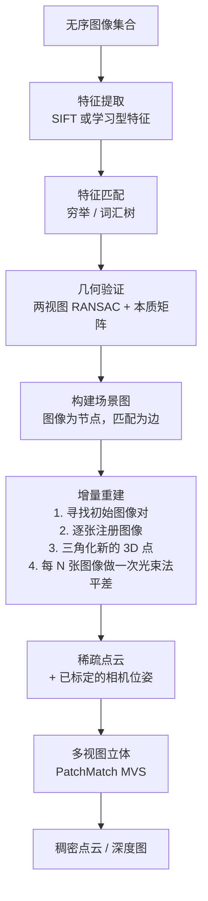
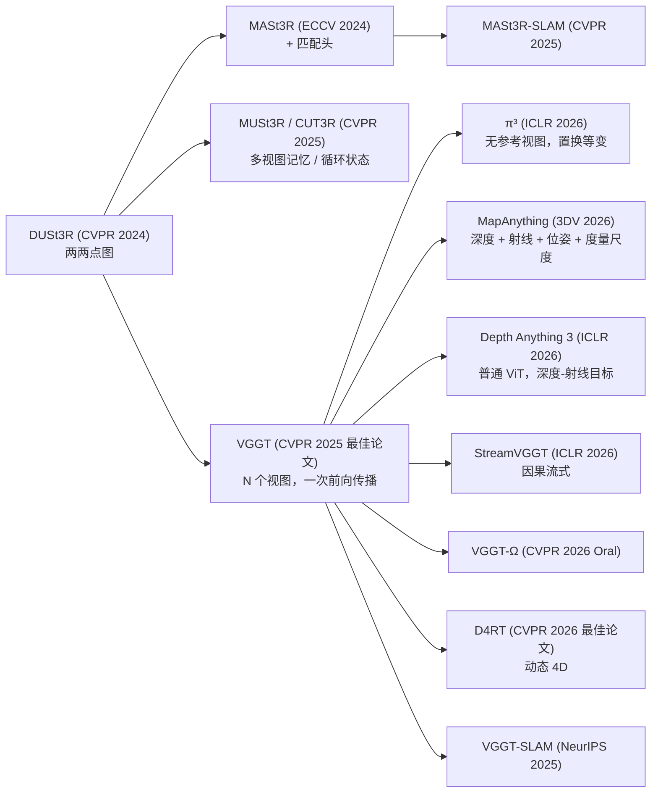

# 运动恢复结构与 SLAM

> **英文原文：** [cv-knowledge-base/04_3d_vision_and_scene/03_sfm_and_slam.md](../../cv-knowledge-base/04_3d_vision_and_scene/03_sfm_and_slam.md)（本中文版供参考，内容以英文原文为准）

> **最后更新：** 2026年10月
> **难度级别：** 高级
> **相关章节：** [3D 重建（核心任务）](../02_core_tasks/09_3d_reconstruction.md) · [高斯泼溅](./02_gaussian_splatting.md) · [3D 表示](./00_3d_representations.md) · [4D 与动态场景](../12_research_frontier_2024_2026/05_4d_and_dynamic_scenes.md)

> **🆕 2026年10月更新：**
> - 新增一节，介绍**前馈多视图重建**：VGGT（CVPR 2025 最佳论文）及其后继者，即 π³（ICLR 2026）、MapAnything（3DV 2026）、Depth Anything 3（ICLR 2026）、WorldMirror（ICML 2026）和 VGGT-Ω（CVPR 2026 Oral）；并涵盖流式/记忆模型（CUT3R、MUSt3R、StreamVGGT）。
> - **动态场景**：CVPR 2026 最佳论文 D4RT（Google DeepMind/UCL/牛津）从动态视频中联合推断深度、对应关系和相机。
> - 新增一节，介绍**基于基础模型（Foundation Model）的 SLAM**：MASt3R-SLAM（CVPR 2025，实时、稠密、无需标定）和 VGGT-SLAM（NeurIPS 2025，SL(4) 子图对齐）。
> - **经典工具链**：GLOMAP 全局 SfM（ECCV 2024）并入 **COLMAP 4.0**（2026），同时加入 ALIKED + LightGlue 支持。COLMAP 4.1–4.2 增加了 GPU 光束法平差后端和 LoMa 学习特征。
> - 扩充了关键论文、基准性能、优缺点、开放问题与延伸阅读。

---

## 概述

运动恢复结构（Structure from Motion, SfM）与同步定位与建图（Simultaneous Localization and Mapping, SLAM）是从视觉输入中恢复 3D 场景几何和相机位姿的基础技术。SfM 离线处理无序图像集合，通过光束法平差（bundle adjustment）联合估计相机内参、外参和稀疏 3D 结构。SLAM 在线（或准在线）处理视频流，维护实时地图并实时定位相机。过去十年，这两个领域都经历了深刻变革：从纯经典的手工设计管线（SIFT、RANSAC、光束法平差），到深度学习增强的系统，再到最近将整个管线纳入单个神经网络的端到端学习方法。

以 COLMAP [Schönberger2016] 为代表的经典 SfM 管线，用经过数十年优化的手工算法仔细求解每个子问题（特征检测、描述、匹配、几何验证、增量重建、光束法平差），从而获得高精度。这种鲁棒性和精度至今仍是离线 3D 重建管线的金标准，NeRF 和 3DGS 都把它用作预处理。然而，经典管线速度慢（大型数据集需数小时），并且在低纹理、重复图案或宽基线情况下很脆弱。

深度学习从多个角度攻克这些问题：学习型特征检测器/描述子（SuperPoint [DeTone2018]、D2-Net）、学习型匹配（SuperGlue [Sarlin2020, CVPR]、LightGlue [Lindenberger2023, ICCV]），以及端到端 SLAM 系统（DROID-SLAM [Teed2021, NeurIPS]）。最激进的变革是 DUSt3R [Wang2024, CVPR] 及其后继者 MASt3R [Leroy2024, ECCV]，它们完全抛弃了传统管线——一个 Transformer 直接从图像对回归稠密 3D 点图，无需已知相机参数。2025–2026 年，这条路线从图像对扩展到任意视图集合。VGGT [Wang2025] 因能在单次前向传播中为多达数百个视图预测相机、深度、点图和轨迹而获得 CVPR 2025 最佳论文奖。随后涌现了一批后继模型，SLAM 系统（MASt3R-SLAM、VGGT-SLAM）如今也建立在这些重建先验之上。经典 SfM 也在同步演进：全局 SfM（GLOMAP）成为 COLMAP 4 中的一等建图器。

---

## 经典 SfM：COLMAP

Johannes L. Schönberger 和 Jan-Michael Frahm（北卡罗来纳大学教堂山分校）在 CVPR 2016 发表了 **“Structure-from-Motion Revisited”**，这是 COLMAP 的基础参考文献；COLMAP 是使用最广泛的开源 SfM 系统。COLMAP 提供了从无序图像到已标定相机位姿和稠密 3D 重建的端到端管线。

### 管线概览



### 光束法平差

SfM 的核心优化是**光束法平差**（BA）——联合最小化所有相机中所有观测 3D 点的重投影误差：

```
# 光束法平差目标：
min_{P_j, X_i}  Σ_{(i,j) ∈ visibility}  ρ( || π(P_j, X_i) - x_{ij} ||^2 )

其中：
  P_j ∈ SE(3)        — 图像 j 的相机位姿（旋转 + 平移）
  X_i ∈ R^3         — 3D 点位置
  x_{ij} ∈ R^2      — 观测到的 2D 关键点位置
  π(P_j, X_i)       — 投影函数（相机模型）
  ρ(·)              — 鲁棒损失（Cauchy/Huber，用于降低外点权重）

通过 Levenberg-Marquardt 配合稀疏线性求解器（Schur 补）求解，
利用雅可比矩阵的块稀疏结构。
```

COLMAP 的增量方法逐个注册相机，三角化新点并频繁运行局部 BA，最后运行全局 BA。它没有内置回环检测（这一点不同于 SLAM 系统）。

### 全局 SfM：GLOMAP 与 COLMAP 4 [Pan2024, ECCV 2024]

Linfei Pan、Dániel Baráth、Marc Pollefeys 和 Johannes L. Schönberger 在 *“Global Structure-from-Motion Revisited”*（ECCV 2024）中重新审视了**全局 SfM**。GLOMAP 从视图图中同时估计所有相机的旋转和位置。其关键改变是一个**全局定位**（global positioning）步骤：联合优化相机中心和 3D 点，取代了早期全局管线中脆弱的平移平均阶段，随后再进行全局 BA。据报告，GLOMAP 比增量式 COLMAP 快 1–2 个数量级，精度持平或更好。2026 年，独立仓库在完全并入 **COLMAP 4.0** 后被归档。COLMAP 4.0 提供增量式、层次式和**全局**三种建图器，并加入了 ALIKED 特征以及面向 SIFT/ALIKED 的 LightGlue 匹配。后续版本又增加了 GPU 加速的光束法平差后端（“Caspar”，4.1）、用于 360° 图像的球面相机模型，以及通过 ONNX 运行的 LoMa 学习特征（4.2）。

### COLMAP MVS

在 SfM 之后，COLMAP 的多视图立体（MVS）步骤在深度图融合框架中应用 **PatchMatch** 来生成稠密重建。每张参考图像通过评估小图块在相邻视图间的光度一致性来估计深度图，然后把逐图像的深度融合为一致的点云。

---

## 特征检测与匹配的演进

### 经典方法：SIFT [Lowe2004]

SIFT（尺度不变特征变换）20 年来一直是主导性的手工检测器-描述子。它在尺度空间极值处（DoG）检测关键点，计算 128 维的梯度直方图描述子，对尺度、旋转和部分光照变化具有不变性。

### 学习型方法：SuperPoint [DeTone2018]

Daniel DeTone、Tomasz Malisiewicz 和 Andrew Rabinovich（Magic Leap）在 CVPR 2018 Deep Vision 研讨会上提出了 **SuperPoint**。SuperPoint 是一种基于单应自适应的自监督方法：先在合成几何图形上训练基础检测器 **MagicPoint**，再通过随机单应变换将其域适应到真实图像。该网络在单次前向传播中联合检测兴趣点并计算 256 维描述子。

训练使用**单应自适应**（homographic adaptation）：对每张训练图像施加多个随机单应 $H_1, \ldots, H_K$，在每张变换后的图像中检测关键点，把检测结果变换回原始坐标并聚合，从而得到用于自监督训练的伪真值关键点位置。

### 学习型匹配：SuperGlue [Sarlin2020, CVPR 2020]

Paul-Edouard Sarlin、Daniel DeTone、Tomasz Malisiewicz 和 Andrew Rabinovich（苏黎世联邦理工学院 + Magic Leap）在 CVPR 2020（Oral）提出了特征**匹配**网络 **SuperGlue**。给定两幅图像的关键点和描述子，SuperGlue 把匹配表述为最优传输问题，并通过 Sinkhorn 算法可微地求解。关键点首先与其位置和描述子一起被嵌入，然后由一个**图神经网络（GNN）** 处理，该网络通过图像间的交叉注意力交换关于共视结构的信息。

```
# SuperGlue 匹配管线：
1. 编码：位置编码（位置 + 得分）→ 初始描述子
2. GNN：L 层自注意力（图像内部）+ 交叉注意力（图像之间）
3. 最终 MLP 头 → 匹配描述子
4. 计算得分矩阵 S_{ij} = <d_i, d_j>
5. Sinkhorn 算法 → 软分配矩阵 P（为无法匹配的点设置“垃圾箱”）
6. 互为最近邻：从 P 中选出匹配
```

### 高效匹配：LightGlue [Lindenberger2023, ICCV 2023]

Philipp Lindenberger、Paul-Edouard Sarlin 和 Marc Pollefeys（苏黎世联邦理工学院）在 ICCV 2023 发表了 **LightGlue**。LightGlue 是 SuperGlue 的即插即用替代品，具有自适应计算能力：它预测逐点置信度，同时剪掉无法匹配的点（在网络早期）和网络深度（对简单图像对提前停止）。结果是在简单图像对（视觉重叠大）上比 SuperGlue 快 4–10 倍，同时在困难图像对上保持精度。LightGlue 还具有更好的训练稳定性和更低的内存占用。

---

## 经典 SLAM：ORB-SLAM2 与 ORB-SLAM3

### ORB-SLAM2 [Mur-Artal2017]

Raúl Mur-Artal 和 Juan D. Tardós（萨拉戈萨大学）在 IEEE Transactions on Robotics（TRO）2017 发表了 **ORB-SLAM2**。它是被引用最多的经典 SLAM 系统，支持单目、双目和 RGB-D 相机，具备实时回环检测和重定位能力。

架构：
- **跟踪线程**：利用 ORB 特征，通过 PnP 加 RANSAC 估计相机位姿
- **局部建图线程**：三角化新的地图点，执行局部 BA
- **回环线程**：通过 DBoW2 词汇树检测回环，用 Sim(3) 位姿图优化校正累积漂移

### ORB-SLAM3 [Campos2021]

Carlos Campos、Richard Elvira、Juan J. Gómez Rodríguez、José M.M. Montiel 和 Juan D. Tardós 把 ORB-SLAM2 扩展为 ORB-SLAM3（IEEE TRO, 2021, DOI: 10.1109/TRO.2021.3075644）。主要新增内容：
- **视觉-惯性（VI-SLAM）**：在 IMU 初始化阶段通过最大后验估计实现紧耦合的 IMU 融合，而不是把 IMU 当作独立系统
- **多地图 SLAM**：维护一个地图集（atlas），用于从跟踪失败中恢复以及多会话建图
- **鱼眼镜头模型**：支持机器人和汽车中常见的宽视场相机

---

## 深度视觉 SLAM：DROID-SLAM [Teed2021, NeurIPS 2021]

Zachary Teed 和 Jia Deng（普林斯顿大学）在 NeurIPS 2021（Oral）提出了 **DROID-SLAM**，获得了广泛认可。DROID-SLAM 是一个深度端到端 SLAM 系统，其关键架构洞见是**稠密光束法平差（Dense Bundle Adjustment, DBA）层**——一个集成在深度网络中的可微光束法平差，使梯度能够从渲染损失反向流经 BA 求解器。

```
# DROID-SLAM 管线：
输入：视频帧 {I_t}
1. 特征提取：上下文网络 + 外观网络（基于 ResNet）
2. 相关体：跨帧特征图之间的稠密 L2 相似度
3. 更新算子（基于 GRU）：
   隐藏状态 h_t → 预测逐像素光流修正量 (Δu)
   以及置信权重 (w_t)
4. 稠密光束法平差层：
   min_{G_t, D_t}  Σ_{(i,j) ∈ frame_pairs}  Σ_p  w_{ij,p} · ||u_{ij,p} - Π(G_i, G_j, D_i, p)||^2
   其中 G_t ∈ SE(3)，D_t = 逆深度图
   作为稀疏最小二乘系统求解（Gauss-Newton）
5. 输出：相机位姿 {G_t} + 深度图 {D_t}
```

在单目视频上训练的 DROID-SLAM 在测试时通过修改观测模型即可泛化到双目和 RGB-D。它相比经典方法（ORB-SLAM2/3）和此前的深度 SLAM（DeepV2D）有大幅提升，灾难性失败更少。

---

## 基于高斯表示的神经 SLAM

### SplaTAM [Keetha2024, CVPR 2024]

Nikhil Keetha、Jay Karhade 等人（卡内基梅隆大学）提出了 **SplaTAM**，以 3D 高斯作为地图表示实现稠密 RGB-D SLAM。相机跟踪在固定高斯参数的情况下，针对相机位姿最小化光度 + 深度渲染损失；建图则在固定位姿的情况下优化高斯参数。利用已知深度在未观测到的像素处添加新的高斯。与 ORB-SLAM 的稀疏地图不同，3DGS 表示可以提取稠密彩色地图并进行高质量渲染。

### MonoGS [Matsuki2024, CVPR 2024 Highlight + 最佳演示奖]

Hidenobu Matsuki、Riku Murai 等人（帝国理工学院）在 **MonoGS** 中把高斯 SLAM 扩展到单目相机（无深度传感器），这需要同时进行跟踪、从深度估计初始化高斯，以及从各向同性到各向异性的高斯细化。MonoGS 同时获得了 CVPR 2024 Highlight 和最佳演示奖。

---

## DUSt3R 与 MASt3R：端到端 3D 重建

### DUSt3R [Wang2024, CVPR 2024]

Shuzhe Wang、Vincent Leroy、Yohann Cabon、Boris Chidlovskii 和 Jerome Revaud（NAVER LABS Europe）在 CVPR 2024 发表了 **DUSt3R**（Dense and Unconstrained Stereo 3D Reconstruction）。DUSt3R 是一种截然不同的方法——它把整个几何 3D 视觉表述为**点图回归**问题：

```
# DUSt3R 表述：
输入：两张图像 I_1, I_2（任意、未标定、位姿未知）
输出：
  X^{1→1} ∈ R^{H×W×3}  （I_1 在 I_1 坐标系下的点图）
  X^{2→1} ∈ R^{H×W×3}  （I_2 在 I_1 坐标系下的点图）
  conf_1, conf_2         （置信度图）

架构：ViT 编码器 → 交叉注意力 Transformer → 两个 DPT 解码器

从点图中恢复：
  - 相机内参（由点图几何得到）
  - 相对位姿（比较 X^{1→1} 和 X^{2→1}）
  - 深度图（||X^{i→1}[u,v]||_2）
  - 稠密对应（argmin ||X^{1→1}[u,v] - X^{2→1}[u',v']||）

多图像：连接两两之间的图 → 通过最小二乘进行全局对齐
```

DUSt3R 无需相机标定或位姿初始化——它适用于任意顺序的任意图像对。它在单目与多视图深度估计以及相对位姿估计基准上取得了最先进的结果。

### MASt3R [Leroy2024, ECCV 2024]

Vincent Leroy、Yohann Cabon 和 Jerome Revaud（NAVER LABS Europe）在 ECCV 2024 把 DUSt3R 扩展为 **MASt3R**（Matching And Stereo 3D Reconstruction）。MASt3R 为 DUSt3R 增加了稠密局部特征匹配头，实现图像间的像素级对齐匹配。这是通过增加一个额外的解码头以及一个在 3D 点图空间中运行的快速匹配算法实现的。MASt3R 在以匹配为中心的任务（无地图重定位）上显著优于 DUSt3R，同时保持了重建质量；它还提出了 MASt3R-SfM——一个基于 MASt3R 两两预测构建的完整 SfM 管线。

---

## 前馈多视图重建（2025–2026）

DUSt3R/MASt3R 是两两成对的模型，因此包含大量图像的场景仍需要全局对齐步骤。2025–2026 年的新一代模型去掉了这一步：一个网络联合摄入*所有*视图。



### VGGT：Visual Geometry Grounded Transformer [Wang2025, CVPR 2025 最佳论文]

Jianyuan Wang、Minghao Chen、Nikita Karaev、Andrea Vedaldi、Christian Rupprecht（牛津 VGG）和 David Novotny（Meta AI）提出了 **VGGT**，一个约 1B 参数的前馈 Transformer。给定一张、几张或数百张图像，它直接预测**相机内参和外参、深度图、点图以及稠密 3D 点轨迹**，通常耗时不到一秒。

```
# VGGT（示意）
输入：图像 {I_1..I_N}，经 DINO 切块 → token；每帧另加相机 token 与 register token
骨干：L 个交替注意力（Alternating-Attention）块
           帧内自注意力      （I_i 内部的 token）
           全局自注意力      （跨所有帧的 token）
输出头： 相机头    → (q_i, t_i, f_i)      — 旋转四元数、平移、视场角
         DPT 头    → 深度 D_i、点图 X_i（在第 1 帧坐标系下）、置信度
         跟踪头    → 用于 CoTracker 式点跟踪的特征
损失：L = L_camera + L_depth + L_pmap + λ L_track   （多任务；第一帧为参考帧）
可选：将预测结果送入 BA 进一步细化
```

作者发现，冗余的目标（深度 + 相机 vs. 点图）是互补的，并且把预测的深度与预测的相机结合起来，得到的 3D 点比单独使用点图头更准确。VGGT 的预测可以导出为 COLMAP 格式，因此可作为 3DGS 训练之前 SfM 的即插即用替代。训练代码于 2025 年 7 月发布。另有单独授权的 **VGGT-1B-Commercial** 检查点，允许商业（非军事）用途。

### 后继模型

- **π³** [Wang2025b, ICLR 2026]（上海人工智能实验室、浙江大学、上海创智学院）认为 VGGT 对固定参考帧的依赖是一种损害鲁棒性的归纳偏置。它采用**完全置换等变**的架构，不指定参考视图，预测仿射不变的相机位姿和尺度不变的局部点图。作者报告其在位姿、视频深度和点图基准上取得最先进结果。Pi3X（2025年12月）增加了条件输入和近似度量尺度。
- **MapAnything** [Keetha2026, 3DV 2026]（Meta Reality Labs + CMU）是一个“通用”的度量重建模型。它接受图像以及内参、位姿和深度的*任意*子集，输出分解后的深度、局部射线图、位姿和一个全局**度量尺度因子**。一个模型覆盖 12 种以上任务（未标定 SfM、已标定 MVS、深度补全、定位）。代码采用 Apache-2.0，权重同时提供 CC-BY-NC 和 Apache 许可版本。
- **Depth Anything 3** [Lin2026, ICLR 2026]（字节跳动 Seed）表明，一个*普通*的 DINO 式 ViT 配合单一的**深度-射线**目标，就足以完成任意视图的几何估计；它仅使用公开学术数据，通过教师-学生蒸馏训练。作者报告，在其新的视觉几何基准上，相对 VGGT 的位姿精度平均提升 35.7%，几何精度平均提升 23.6%。DA3 还支持前馈 3DGS，以及在 <12 GB 显存下运行的长视频 DA3-Streaming。
- **WorldMirror** [WorldMirror2025, ICML 2026]（腾讯混元）加入了*任意先验提示*：可选的位姿、内参和深度被编码为 token。它在一次前向传播中输出点图、深度、相机、曲面法向和 3D 高斯。
- **VGGT-Ω** [Wang2026, CVPR 2026 Oral]（牛津 VGG + Meta）是 VGGT 的直接后继，于 2026 年 5 月发布，提供 1B 参数的检查点，包括一个文本对齐变体。官方仓库报告的峰值显存从 1 帧约 6 GB 到 500 帧约 43 GB（A100，624×416）。

### 流式与基于记忆的变体

- **CUT3R** [Wang2025c, CVPR 2025]（Q. Wang, Zhang, Holynski, Efros, Kanazawa）是一个带**持久状态**的循环模型：状态逐帧更新，并读出为共享坐标系下的度量点图。它可处理视频或无序照片、静态或动态场景，并能查询未观测到的虚拟视角。
- **MUSt3R** [Cabon2025, CVPR 2025]（NAVER LABS）是 DUSt3R 的对称多视图扩展，借助多层记忆机制在线预测位姿和结构。
- **StreamVGGT** [StreamVGGT2025, ICLR 2026] 是采用因果注意力并缓存记忆 token 的 VGGT，用于增量式、逐帧的 4D 重建。

### 动态场景：D4RT（CVPR 2026 最佳论文）

**“Efficiently Reconstructing Dynamic Scenes One D4RT at a Time”**（Google DeepMind、伦敦大学学院、牛津大学，作者包括 Andrew Zisserman）获得 **CVPR 2026 最佳论文奖**，从约 1.6 万篇投稿中脱颖而出。单个 Transformer 从一段动态场景视频中联合推断深度、时空对应关系和相机参数。这统一了 MegaSaM（CVPR 2025 最佳论文荣誉提名）等动态 SfM 系统借助优化管线处理的多个任务。截至获奖时，二手来源报告其代码和权重尚未公开发布。

---

## 基于基础模型的 SLAM（2025–2026）

### MASt3R-SLAM [Murai2025, CVPR 2025]

Riku Murai、Eric Dexheimer 和 Andrew J. Davison（帝国理工学院）以两视图 MASt3R 先验为基础，从零构建了一个**实时单目稠密 SLAM** 系统。其组成部分包括：

1. **点图匹配**：基于射线误差，对 MASt3R 点图进行高效的迭代投影匹配。
2. **跟踪与局部融合**：将点图以滑动加权平均的方式融合进关键帧。
3. **图构建与回环检测**：利用 MASt3R 编码器特征（ASMK）进行检索。
4. 在**通用中心相机模型**下对关键帧位姿进行**二阶全局优化**。只假设存在唯一的相机中心，因此无需参数化标定。

它以 **约 15 FPS** 运行，能给出全局一致的位姿和稠密几何。在已知标定的情况下，它在多个基准（TUM RGB-D、EuRoC、ETH3D-SLAM、7-Scenes）上达到最先进精度，并适用于内参未知或变化的真实场景视频。

### VGGT-SLAM [Maggio2025, NeurIPS 2025]

Dominic Maggio、Hyungtae Lim 和 Luca Carlone（MIT SPARK）用 VGGT 构建子图，并对它们进行增量和全局对齐。他们的关键观察是：对于**未标定**的单目相机，重建只能确定到一个 15 自由度的**射影**歧义，而不是 7 自由度的相似变换。因此，子图和回环通过在 **SL(4)** 流形上优化的单应变换来对齐：

```
# VGGT-SLAM 因子图（示意）
节点：    H_k ∈ SL(4)  （子图 k 的 4×4 射影变换，det = 1）
因子：    由重叠帧得到的相对 H_{k,k+1}；回环 H_{i,j}
min_{H}  Σ_{(i,j)} || Log( H_{ij}^{-1} · H_i^{-1} H_j ) ||^2_Ω
```

这使得处理长视频成为可能，而单独使用 VGGT 会因 GPU 显存不足而无法处理。

---

## 关键论文

| 论文 | 作者 | 年份 | 会议/期刊 | 主要贡献 |
|-------|---------|------|-------|-----------------|
| Structure-from-Motion Revisited (COLMAP) | Schönberger, Frahm | 2016 | CVPR | 基于 SIFT 的增量式 SfM；离线管线的金标准 |
| SuperPoint: Self-Supervised Interest Point Detection and Description | DeTone, Malisiewicz, Rabinovich | 2018 | CVPR DeepVision | 基于单应自适应的自监督关键点检测器 |
| SuperGlue: Learning Feature Matching with Graph Neural Networks | Sarlin, DeTone, Malisiewicz, Rabinovich | 2020 | CVPR（Oral） | 注意力 GNN + Sinkhorn 最优传输用于特征匹配 |
| ORB-SLAM2: An Open-Source SLAM System for Monocular, Stereo, and RGB-D | Mur-Artal, Tardós | 2017 | IEEE TRO | 基于 ORB 特征的经典 SLAM；回环检测；重定位 |
| ORB-SLAM3: Visual, Visual-Inertial, and Multimap SLAM | Campos, Elvira, Gómez, Montiel, Tardós | 2021 | IEEE TRO | 视觉-惯性紧耦合；多地图集；鱼眼 |
| DROID-SLAM: Deep Visual SLAM for Monocular, Stereo, and RGB-D | Teed, Deng | 2021 | NeurIPS（Oral） | 可微稠密光束法平差；可端到端训练的 SLAM |
| LightGlue: Local Feature Matching at Light Speed | Lindenberger, Sarlin, Pollefeys | 2023 | ICCV | 自适应深度/宽度剪枝；比 SuperGlue 快 4–10 倍 |
| DUSt3R: Geometric 3D Vision Made Easy | Wang, Leroy, Cabon, Chidlovskii, Revaud | 2024 | CVPR | ViT 点图回归；无需已知位姿/内参 |
| Grounding Image Matching in 3D with MASt3R | Leroy, Cabon, Revaud | 2024 | ECCV | DUSt3R + 稠密匹配头；无需标定的度量 SfM |
| SplaTAM: Splat, Track & Map 3D Gaussians for Dense RGB-D SLAM | Keetha et al. | 2024 | CVPR | 以 3DGS 作为 SLAM 地图；联合高斯优化与相机跟踪 |
| Global Structure-from-Motion Revisited (GLOMAP) | Pan, Baráth, Pollefeys, Schönberger | 2024 | ECCV | 相机与点的全局定位；比 COLMAP 快 1–2 个数量级；已并入 COLMAP 4 |
| VGGT: Visual Geometry Grounded Transformer | Wang, Chen, Karaev, Vedaldi, Rupprecht, Novotny | 2025 | CVPR（最佳论文） | 对 1 到数百个视图在 <1 s 内前馈预测相机、深度、点图和轨迹 |
| MASt3R-SLAM: Real-Time Dense SLAM with 3D Reconstruction Priors | Murai, Dexheimer, Davison | 2025 | CVPR | 基于 MASt3R、无需标定的实时（约 15 FPS）稠密单目 SLAM |
| Continuous 3D Perception Model with Persistent State (CUT3R) | Wang, Zhang, Holynski, Efros, Kanazawa | 2025 | CVPR | 循环持久状态；为静态/动态场景在线输出度量点图 |
| MUSt3R: Multi-view Network for Stereo 3D Reconstruction | Cabon et al. (NAVER LABS) | 2025 | CVPR | 带多层记忆的对称多视图 DUSt3R |
| VGGT-SLAM: Dense RGB SLAM Optimized on the SL(4) Manifold | Maggio, Lim, Carlone | 2025 | NeurIPS | 面向未标定 VGGT SLAM 的射影（15 自由度）子图对齐 |
| π³: Permutation-Equivariant Visual Geometry Learning | Wang, Zhou et al. | 2026 | ICLR | 无参考视图、置换等变的多视图几何 |
| Depth Anything 3: Recovering the Visual Space from Any Views | Lin et al. (ByteDance Seed) | 2026 | ICLR | 普通 ViT + 深度-射线目标；任意视图的深度、位姿和 3DGS |
| MapAnything: Universal Feed-Forward Metric 3D Reconstruction | Keetha et al. (Meta, CMU) | 2026 | 3DV | 可选多模态输入；分解式度量输出；12 种以上任务 |
| Efficiently Reconstructing Dynamic Scenes One D4RT at a Time | Google DeepMind, UCL, Oxford | 2026 | CVPR（最佳论文） | 单个 Transformer 从动态视频推断深度、对应关系和相机 |

---

## 基准性能

| 模型 | 数据集 | 指标 | 得分 | 备注 |
|-------|---------|--------|-------|-------|
| COLMAP (SIFT) | ETH3D | F1（稀疏 SfM） | ~0.62 | 经典方法；慢但准确 |
| COLMAP + SuperGlue | ETH3D | F1 | ~0.76 | 比 SIFT 高 14 个点 |
| ORB-SLAM2 (Mono) | TUM RGB-D | ATE RMSE (m) | 0.016 | 单目；存在尺度歧义 |
| ORB-SLAM3 (Mono+IMU) | EuRoC | ATE RMSE (m) | 0.007 | 视觉-惯性；最佳经典方法 |
| DROID-SLAM (Mono) | TUM RGB-D | ATE RMSE (m) | 0.010 | 深度方法；在困难场景中比经典方法好 2–5 倍 |
| DUSt3R | ScanNet（位姿估计） | RRA@15° | 91.3% | 无已知相机参数 |
| MASt3R | Map-free Reloc. | 位置误差中位数 | ~0.14m | SOTA；优于 SuperGlue+COLMAP |
| SplaTAM | TUM RGB-D | ATE RMSE (m) | 0.009 | 稠密高斯地图 + 轨迹 |
| GLOMAP | 多个 SfM 基准 | 相对 COLMAP 的运行时间 | 快 10–100 倍 | 精度持平或更好（作者声称） |
| VGGT (1B) | Co3D | 相机位姿 AUC@30 | ≈90 | 前馈，无 BA；据官方仓库 |
| Depth Anything 3 | 作者的视觉几何基准 | 位姿 / 几何精度 | 相对 VGGT 平均 +35.7% / +23.6% | 作者声称 |
| MASt3R-SLAM | TUM RGB-D, EuRoC, ETH3D-SLAM, 7-Scenes | 吞吐量 | ~15 FPS | 实时稠密；已知标定时达 SOTA（作者声称） |

---

## 优缺点

| 方面 | 优点 | 缺点 |
|--------|------|------|
| 经典 SfM（COLMAP） | 精度高；借助 RANSAC 保持鲁棒；经过广泛验证；模块化管线 | 慢（大型数据集需数小时）；在低纹理场景中脆弱；需要特征重叠 |
| 深度匹配（SuperGlue/LightGlue） | 能处理宽基线、重复纹理、低光照；精度达到最先进水平 | 需要 GPU；不可解释；训练需要真值匹配 |
| 端到端（DUSt3R/MASt3R） | 无需相机标定；能处理无约束的真实场景图像；单次前向传播 | 内存开销大（ViT）；单对图像比经典方法慢；大量图像仍需全局对齐 |
| 前馈多视图（VGGT、π³、MapAnything、DA3） | 数秒内联合处理所有视图；无需全局对齐；输出相机 + 稠密深度 + 轨迹；是很好的 SfM/3DGS 初始化 | 显存随视图数增长（VGGT-Ω 处理 500 帧约需 43 GB）；精度仍可通过 BA 细化提升；部分权重许可受限 |
| 基于基础模型的 SLAM（MASt3R-SLAM、VGGT-SLAM） | 无需标定；稠密地图；在真实场景视频上鲁棒 | 速度低于经典 VIO；需要 GPU；漂移/射影歧义需显式处理 |

---

## 开放问题与研究空白

- **神经 SfM 的可扩展性：** DUSt3R/MASt3R 能高效处理图像对，但对数千张图像进行全局对齐仍是计算瓶颈，需要类似基于图的 SfM 的层次化或分布式方法。VGGT 类模型去掉了两两对齐，但全局注意力的开销随 token 总数二次增长。流式方法（StreamVGGT、CUT3R、DA3-Streaming）和子图方法（VGGT-SLAM）以牺牲全局一致性换取内存，城市尺度的前馈重建仍未解决。
- **前馈与优化之争：** 前馈重建模型如今是很强的初始化工具，但 BA 细化仍能提升精度。学习模型能否在不做测试时优化的情况下，在大规模高分辨率图像集合上达到 COLMAP/GLOMAP 的精度，仍是开放问题；如何有原则地融合二者（在 BA 中引入学习先验）同样如此。
- **动态与 4D 重建：** D4RT（CVPR 2026 最佳论文）表明，单个前馈模型可以从动态视频中恢复深度、对应关系和相机。长时程、多物体的动态以及可复现的开源基线仍是空白。
- **长期 SLAM：** 经典的 ORB-SLAM3 支持多会话建图，但难以应对感知混淆（视觉相似但几何不同的地点）。深度地点识别（NetVLAD、基于 SuperPoint 的方法）部分解决了这一问题。
- **动态环境：** 所有 SfM/SLAM 方法都假设世界是静态的。处理运动物体（行人、车辆）需要显式的动态分割（Mask-SLAM、DynaSLAM）或概率滤波，显著增加复杂度。
- **实时 3DGS SLAM：** SplaTAM 和 MonoGS 在线优化高斯，但比 ORB-SLAM3 慢。以 ORB-SLAM3 的速度实现具备稠密地图质量的实时高斯 SLAM 是一个重要的开放问题。MASt3R-SLAM 在稠密点图 SLAM 上达到约 15 FPS，但没有照片级地图，也没有 IMU 融合。
- **单目的度量尺度：** 单目 SfM 和 SLAM 只能恢复相差一个尺度的场景结构。没有 IMU 或已知物体尺寸时，无法得到度量尺度。来自单目深度估计模型（DPT、Depth Anything）的深度先验提供了部分解决方案。
- **恶劣条件：** 雨、雾、夜间和运动模糊会严重降低所有现有方法的性能。面向自动驾驶的全天候鲁棒 SLAM 需要跨模态融合（LiDAR、雷达）和学习得到的鲁棒性。
- **隐私保护 SfM：** 特征描述子会泄露视觉信息。隐私保护定位的密码学方法（使用量化或哈希描述子）正在出现，但尚不成熟。

---

## 延伸阅读

- [COLMAP 文档](https://colmap.github.io/) — 全面的用户指南和 API 参考
- [SuperGlue 项目主页（Magic Leap）](https://psarlin.com/superglue/) — 论文、幻灯片和预训练模型
- [LightGlue GitHub（ETH CVG）](https://github.com/cvg/LightGlue) — 代码和基准
- [DROID-SLAM GitHub（Princeton VL）](https://github.com/princeton-vl/DROID-SLAM) — 参考实现
- [DUSt3R GitHub（NAVER）](https://github.com/naver/dust3r) — 带演示的代码
- [MASt3R GitHub（NAVER）](https://github.com/naver/mast3r) — 包含 MASt3R-SfM 管线
- [VGGT GitHub（Meta / 牛津 VGG）](https://github.com/facebookresearch/vggt) — CVPR 2025 最佳论文；训练代码和商用检查点
- [VGGT-Ω GitHub](https://github.com/facebookresearch/vggt-omega) — CVPR 2026 Oral 后继模型
- [π³ GitHub](https://github.com/yyfz/Pi3) — 置换等变几何（ICLR 2026）；Pi3X
- [MapAnything GitHub（Meta）](https://github.com/facebookresearch/map-anything) — 通用度量重建；为众多基线提供统一封装
- [Depth Anything 3 GitHub（字节跳动 Seed）](https://github.com/ByteDance-Seed/Depth-Anything-3) — 任意视图的深度/位姿/3DGS
- [WorldMirror GitHub（腾讯混元）](https://github.com/Tencent-Hunyuan/HunyuanWorld-Mirror) — 任意先验提示的重建（ICML 2026）
- [MASt3R-SLAM GitHub](https://github.com/rmurai0610/MASt3R-SLAM) — CVPR 2025 实时稠密 SLAM
- [VGGT-SLAM GitHub（MIT SPARK）](https://github.com/MIT-SPARK/VGGT-SLAM) — SL(4) 子图 SLAM
- [COLMAP 发布页](https://github.com/colmap/colmap/releases) — 集成 GLOMAP 全局建图器的 4.x 版本
