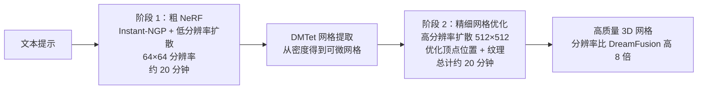
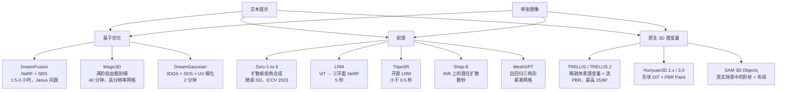

# 3D 内容生成：文本到 3D 与图像到 3D

> **英文原文：** [cv-knowledge-base/04_3d_vision_and_scene/04_3d_generation.md](../../cv-knowledge-base/04_3d_vision_and_scene/04_3d_generation.md)（本中文版供参考，内容以英文原文为准）

> **最后更新：** 2026年10月
> **难度级别：** 高级
> **相关章节：** [3D 生成（生成式视觉）](../10_generative_vision/03_3d_generation.md) · [高斯泼溅](./02_gaussian_splatting.md) · [3D 表示](./00_3d_representations.md) · [空间智能](../12_research_frontier_2024_2026/06_spatial_intelligence.md)

> **🆕 2026年10月更新：**
> - 新增一节，介绍如今已成为主导范式的**原生 3D 潜变量生成模型**，涵盖 TRELLIS（CVPR 2025 Spotlight，SLAT 潜变量）和 **TRELLIS.2**（“Native and Compact Structured Latents for 3D Generation”，**CVPR 2026 最佳学生论文**；O-Voxel、4B 流 Transformer，最高 1536³ 并带 PBR 材质）。
> - **Hunyuan3D** 系列：2.0（2025年1月）、2.1（2025年6月，首个完全开源的 PBR 管线）、2.5、Omni（2025年9月，可控生成）以及 3.0（2025年9月，1536³，通过腾讯云提供服务）。另涵盖 TripoSG 和 Direct3D-S2（NeurIPS 2025）。
> - **SAM 3D**（Meta，2025年11月）：SAM 3D Objects（从单张图像得到形状、纹理和布局，对遮挡鲁棒）和 SAM 3D Body（基于 Momentum Human Rig 的可提示人体网格恢复）。
> - 从物体到世界：HunyuanWorld 1.0 以及 World Labs 的 Marble/Spark。更新了管线对比图、关键论文、基准性能、优缺点和开放问题。

---

## 概述

3D 内容生成——根据文本描述或单张图像创建 3D 资产——是计算机视觉和计算机图形学中最具商业意义的开放问题之一。该领域分化为两大范式：**基于优化的方法**，使用 2D 扩散先验来监督 3D 优化（DreamFusion、Magic3D）；以及**前馈方法**，直接在 3D 数据上训练大型 Transformer 或扩散模型，在单次前向传播中预测 3D 结构（LRM、TripoSR、Shap-E）。后者凭借速度优势（秒级 vs. 小时级）如今在实际应用中占主导地位，但需要大规模 3D 训练数据。

DreamFusion [Poole2022] 确立了 SDS（Score Distillation Sampling，分数蒸馏采样）损失，作为将 2D 扩散知识蒸馏到 3D 表示中的机制：优化一个 NeRF，使其从所有视点渲染的图像都像预训练文本到图像扩散模型的合理输出。这是一项概念性突破，使得无需任何 3D 监督即可实现文本到 3D；但它存在臭名昭著的 **Janus 问题**（多面伪影）、过饱和以及优化缓慢（每个物体 1.5–3 小时）等问题。Magic3D [Lin2023] 通过两阶段由粗到细的方法提升了质量；DreamGaussian [Tang2023] 用 3D 高斯取代 NeRF，实现了约 2 分钟的生成。

前馈方法于 2023 年兴起：Zero-1-to-3 [Liu2023]（通过微调扩散模型，从单张图像进行视点条件的新视角合成）、LRM [Hong2023]（大型 Transformer 在 5 秒内直接从单张图像预测 NeRF）以及 TripoSR [Tochilkin2024]（改进了数据与训练的开源 LRM）。Shap-E 和 Point-E（OpenAI）分别探索了直接生成隐式函数和点云。MeshGPT [Siddiqui2024] 以自回归的原生网格生成补上了最后一环。

从 2025 年起，第三种范式成为主导：**原生 3D 潜变量生成**。一个 3D VAE 把资产压缩为结构化（通常是稀疏体素或向量集）潜变量，再以图像或文本为条件，直接在该潜空间中训练大型扩散/流 Transformer。TRELLIS [Xiang2025]、Hunyuan3D 2.x [Tencent2025]、TripoSG [Li2025] 和 Direct3D-S2 [Wu2025b] 确立了这一范式。TRELLIS.2 [Xiang2026] 将其扩展到任意拓扑和最高 1536³ 的 PBR 材质，获得了 **CVPR 2026 最佳学生论文奖**。Meta 的 SAM 3D [SAM3DTeam2025] 则把问题从干净的物体图像推向带遮挡和布局的*真实场景*。

---

## 分数蒸馏采样（SDS）

DreamFusion 的核心贡献是 **SDS 损失**——一种把冻结的 2D 扩散模型 $\epsilon_\phi$ 用作 3D 优化“神谕”的方法：

```
# 分数蒸馏采样（SDS）损失
给定：
  θ         — 3D 表示参数（NeRF 权重）
  g(θ, c)   — 可微渲染器（为相机 c 生成图像 x）
  ε_φ(x_t, t, y) — 冻结的预训练扩散模型，文本为 y
  t         — 扩散时间步 ~ Uniform(t_min, t_max)
  ε         — 高斯噪声

算法：
  1. 渲染图像：x = g(θ, c)，c 为随机相机位姿
  2. 加噪：x_t = √ᾱ_t · x + √(1-ᾱ_t) · ε
  3. 预测噪声：ε̂_φ = ε_φ(x_t, t, y)   （不对 φ 求梯度）
  4. 对 θ 的 SDS 梯度：
     ∇_θ L_SDS = E_{t,ε,c} [ w(t) · (ε̂_φ(x_t, t, y) - ε) · ∂x/∂θ ]

关键：这并不是通过扩散模型反向传播——它把预测的噪声
     作为伪梯度方向，并以 w(t) 加权。
     U-Net 的雅可比 ∂ε̂_φ/∂x 被丢弃（代价高，且经验上有害）。

直观理解：每一步，扩散模型都在说“这张渲染图看起来有噪声；
          把 3D 场景朝这个方向移动，让它看起来更像文本描述”。
```

SDS 损失有一些众所周知的病态问题：**过饱和**（扩散模型映射到高置信度的模式）、**过度平滑**（多个视图被独立监督，产生平均化伪影）以及 **Janus 问题**（见下文）。ProlificDreamer [Wang2023] 用**变分分数蒸馏（Variational Score Distillation, VSD）** 改进了 SDS，把渲染图像视为一个分布而非一个点，从而获得更高保真度的结果。

### Janus 问题

Janus 问题（以罗马双面神命名）是基于 SDS 的 3D 生成的典型失败模式：3D 表示从任何视点都能产生看似合理的 2D 图像，但场景**没有一致的 3D 结构**——每个视点各自独立地“看起来像”提示词，导致物体出现多个正面（例如头部四周都能看到人脸）或几何不一致。

```
# Janus 问题的根本原因：
2D 扩散先验 p_φ(x | y) 独立地为每个渲染视图打分。
它没有机制来强制视图之间的 3D 一致性。
一个在几何体各个侧面都贴上人脸纹理的 3D 表示，
能在所有方位角上最小化 SDS 损失，但在几何上毫无意义。

缓解手段：
- 位姿条件扩散（Zero123）：以相对相机位姿为条件
- 3D 感知扩散模型（在多视图数据上训练）
- 几何正则化器（深度平滑、法向一致性）
- 多视图 SDS：同时评估多个视图（MVDream）
```

---

## DreamFusion [Poole2022]

Ben Poole、Ajay Jain、Jonathan T. Barron 和 Ben Mildenhall（Google Brain / Google Research）于 2022 年 9 月以 arXiv 预印本形式提出 DreamFusion（发表于 ICLR 2023）。它把 NeRF 与 Imagen 文本到图像扩散模型（作为先验）结合起来。NeRF 初始化时密度集中在一个球附近，然后优化约 1 万–1.5 万次迭代。额外的正则化项包括：法向一致性（相邻点应有相似法向）、朝向损失（密度应朝向相机）以及背景正则化。无纹理区域通过采样随机反照率颜色作为“无纹理”基线来处理。

DreamFusion 需要使用大型预训练文本到图像模型（Imagen，未公开），这最初限制了其可复现性。后续工作使用了公开可用的模型（Stable Diffusion、DeepFloyd IF）。

---

## Magic3D [Lin2023, CVPR 2023]

Chen-Hsuan Lin、Jun Gao、Luming Tang、Towaki Takikawa、Xiaohui Zeng、Xun Huang、Karsten Kreis、Sanja Fidler、Ming-Yu Liu 和 Tsung-Yi Lin（NVIDIA）在 CVPR 2023 发表了 Magic3D。它通过引入**两阶段由粗到细的管线**，解决了 DreamFusion 优化慢和分辨率低的问题：



DMTet（Deep Marching Tetrahedra，深度行进四面体）使得可以从初始粗网格出发进行可微的网格优化。Magic3D 的分辨率比 DreamFusion 高 8 倍（512 vs. 64 的监督分辨率），优化速度快 2 倍（40 分钟 vs. 1.5 小时以上）。用户研究显示，61.7% 的用户更偏好它而非 DreamFusion。

---

## Zero-1-to-3 [Liu2023, ICCV 2023]

Ruoshi Liu、Rundi Wu、Basile Van Hoorick、Pavel Tokmakov、Sergey Zakharov 和 Carl Vondrick（哥伦比亚大学）在 ICCV 2023 提出了 Zero-1-to-3。Zero-1-to-3 并不从零生成 3D，而是使用在 Objaverse 上微调的大型预训练图像扩散模型（Stable Diffusion），在指定的相对相机位姿 $(\Delta R, \Delta T)$ 下，从单张图像生成物体的**新视角**。

```
# Zero-1-to-3 表述：
输入：单张图像 I_ref，相对相机位姿 (ΔR, Δt)
输出：新视角图像 I_novel

架构：
  - 在 Objaverse 渲染图上微调的 Stable Diffusion U-Net
  - 条件：I_ref 的 CLIP 特征 + (ΔR, Δt)，通过交叉注意力注入
  - 在 80 万个物体 × 多个位姿对上训练

应用：
  - 直接使用：单图像新视角合成
  - 3D 重建：以 Zero-1-to-3 为扩散先验进行分数蒸馏
    （Zero123-XL、One-2-3-45）
```

尽管仅在合成的 Objaverse 数据上训练，Zero-1-to-3 对真实场景图像和绘画展现了强大的零样本泛化能力。它成为一系列单图像 3D 重建方法的基础。

---

## LRM：大型重建模型 [Hong2023]

Yicong Hong、Kai Zhang、Jiuxiang Gu、Sai Bi、Yang Zhou、Difan Liu、Feng Liu、Kalyan Sunkavalli、Trung Bui 和 Hao Tan（Adobe Research）于 2023 年 11 月以 arXiv 预印本形式提出 LRM（Large Reconstruction Model）。LRM 是首个**前馈式大规模 3D 重建模型**：单次前向传播即可在约 5 秒内从一张图像预测完整的 NeRF。

```
# LRM 架构：
输入：单张图像 I ∈ R^{256×256×3}

1. 图像编码器：DINOv2 ViT-L（冻结）→ 图像 token [cls, patch_1,...,patch_N]
2. 交叉注意力：图像 token → 3D 三平面 token
   - 三平面：三个正交的 2D 特征平面（XY、XZ、YZ）
   - 每个平面：192 × 192 × C 分辨率
3. NeRF 解码器：在查询点处插值三平面特征 → MLP → (密度, 颜色)
4. 体渲染 → 预测视图，用于光度损失

训练：约 100 万个 3D 物体（Objaverse 合成数据 + MVImgNet 真实数据）
      使用相机条件解码器进行多视图监督
推理：单张 GPU 上 5 秒
```

LRM 基于 Transformer 的架构（5 亿参数）能够在大规模 3D 数据上学习几何先验，从而泛化到各种真实场景输入图像。

---

## TripoSR [Tochilkin2024]

Dmitry Tochilkin、David Pankratz、Zexiang Liu、Zixuan Huang、Adam Letts、Yangguang Li、Ding Liang、Christian Laforte、Varun Jampani 和 Yan-Pei Cao（Tripo AI + Stability AI）发布了 TripoSR（arXiv，2024年3月），这是一个基于 LRM 架构、采用 MIT 许可的开源大型重建模型。相对 LRM 的主要改进：
- **更好的数据处理**：改进的渲染管线，更以物体为中心的裁剪
- **训练改进**：改进的损失加权，更好的背景增强
- **速度**：从单张图像生成 3D 网格不到 0.5 秒
- **开源**：完整代码和权重均已发布，不同于 LRM

TripoSR 在定量和定性上均优于其他开源单图像 3D 方法，并被广泛部署于商业 3D 生成工作流中。

---

## DreamGaussian [Tang2023, ICLR 2024 Oral]

Jiaxiang Tang 等人发表了 DreamGaussian（ICLR 2024 Oral），在基于 SDS 的生成中用 3D 高斯泼溅取代 NeRF 作为优化目标。关键创新：
1. **渐进式致密化**：对于生成任务，高斯的分裂/克隆比 NeRF 的占用剪枝收敛更快
2. **网格提取 + UV 细化**：高斯优化完成后，通过对高斯不透明度运行 Marching Cubes 提取带纹理网格，再利用 2D 扩散先验在 UV 空间中细化纹理

结果：约 2 分钟完成生成，而 DreamFusion/Magic3D 需要 1.5 小时以上。速度提升来自 3DGS 更快的渲染，以及显式基元带来的更直接的优化地形。

---

## Shap-E 与 Point-E（OpenAI）

Heewoo Jun 和 Alex Nichol（OpenAI）发布了两个文本到 3D 系统：

**Point-E**（2022）：两阶段管线——文本到图像模型先生成单个渲染视图，再由以该图像为条件的点云扩散模型生成 3D 点云。速度快，但受限于点云质量。

**Shap-E**（2023，arXiv:2305.02463）：训练一个**作用于隐式神经表示（INR）的潜在扩散模型**。编码器把 3D 资产（来自 ShapeNet/Cap3D）映射为一个表示该物体的小型 MLP 的潜向量。随后，条件扩散模型在给定文本或图像输入时采样新的潜向量。同一潜变量既可解码为带纹理网格，也可解码为 NeRF。Shap-E 能在数秒内生成 3D 资产，但质量低于基于优化的方法。

---

## MeshGPT [Siddiqui2024, CVPR 2024]

Yawar Siddiqui、Antonio Alliegro、Alexey Artemov 等人在 CVPR 2024 发表了 MeshGPT。MeshGPT 不是先生成密度场再提取网格，而是直接**自回归地生成三角网格**——3D 图形的原生表示。

```
# MeshGPT 管线：
1. 图卷积编码器：三角网格 → 逐三角形特征
2. 残差向量量化（RVQ）：压缩三角形特征 → 离散 token
3. GPT 式 Transformer 解码器：
   自回归地预测下一个三角形 token
   （顶点三元组编码为排序后的 (v1, v2, v3) 元组）
4. VQ-VAE 解码器：token → 三角形几何

训练：在 ShapeNet + 3D-FUTURE 上监督训练
输出：边缘锐利的紧凑网格，约 150–300 个三角形
      （而 Marching Cubes 会生成 10,000+ 个）

关键优势：网格类似美术师创建的拓扑——
          高效、干净、具有合理的边环
```

MeshGPT 的形状覆盖率比此前的网格生成方法高 9%，FID 提升 30 个点。它尚不能处理纹理或复杂场景。

---

## 原生 3D 潜变量生成模型（2025–2026）

### TRELLIS：结构化 3D 潜变量 [Xiang2025, CVPR 2025 Spotlight]

Jianfeng Xiang、Zelong Lv、Sicheng Xu、Yu Deng、Ruicheng Wang、Bowen Zhang、Dong Chen、Xin Tong 和 Jiaolong Yang（清华大学、中国科学技术大学、微软研究院）提出了 **SLAT（Structured LATent，结构化潜变量）**。每个资产被表示为稀疏 $64^3$ 网格中的一组活跃体素，每个体素携带一个由稠密多视图 DINOv2 特征聚合得到的潜向量。不同的解码器可以把*同一个* SLAT 映射为 3D 高斯、辐射场或网格。

```
# TRELLIS 两阶段整流流（rectified flow）生成（示意）
阶段 1（结构）：  稀疏结构流 Transformer      → 被占据的体素集合 {p_i} ⊂ {0..63}^3
阶段 2（潜变量）：稀疏流 Transformer（SLAT）  → 在每个 p_i 处得到 z_i ∈ R^C
解码：            D_GS(z) | D_RF(z) | D_Mesh(z)  ← 高斯 / 辐射场 / 网格
整流流：          x_t = (1 - t) x_0 + t ε ;  最小化 E || v_θ(x_t, t, cond) - (ε - x_0) ||^2
```

参数量最高达 2B 的模型（TRELLIS-text-xlarge）在包含 50 万个物体的 TRELLIS-500K 数据集上训练；TRELLIS-image-large 有 1.2B 参数。生成只需数秒，支持局部 3D 编辑，并以 MIT 许可发布。

### TRELLIS.2：原生且紧凑的结构化潜变量 [Xiang2026, CVPR 2026 最佳学生论文]

TRELLIS.2（清华大学、微软研究院、中国科学技术大学、Microsoft AI）解决了 SLAT 的两个局限：对 2D 特征聚合的依赖，以及基于 SDF/占用的解码器对封闭曲面的假设。其主要贡献是：

- **O-Voxel**：一种*无场*（field-free）稀疏体素结构，原生编码几何和 **PBR 材质**属性。它能处理开放曲面、非流形几何和封闭的内部结构。
- **稀疏压缩 VAE**：把 O-Voxel 压缩到紧凑的潜空间，因此在高分辨率下所需 token 大幅减少。
- 在该潜空间上训练的 **约 4B 参数的流匹配 Transformer**，可在 $512^3$、$1024^3$ 或 $1536^3$ 分辨率下生成资产。官方仓库报告，在 H100 上生成形状加材质分别约需 3 s、17 s 和 60 s。代码和权重采用 MIT 许可。

### Hunyuan3D（腾讯）

腾讯的 Hunyuan3D 系列是部署最广泛的*开源*原生 3D 管线。它将几何与纹理解耦：

- **Hunyuan3D 2.0**（2025年1月，arXiv 2501.12202）：**Hunyuan3D-DiT** 是作用于 ShapeVAE 向量集潜变量的基于流的扩散 Transformer，另有多视图纹理扩散模型 **Hunyuan3D-Paint**。变体包括 2mini（0.6B）、2mv（多视图输入）以及 Turbo/FlashVDM 加速版本（2025年3月）。
- **Hunyuan3D 2.1**（2025年6月，arXiv 2506.15442）被其作者称为首个完全开源的 **PBR** 资产管线。它包括形状模型（3.3B）和能生成反照率、金属度和粗糙度贴图的 PBR 纹理模型（2B），并一同发布了数据处理和训练代码。
- **Hunyuan3D 2.5**（技术报告 2025年6月）和 **Hunyuan3D-Omni**（2025年9月，arXiv 2509.21245）分别是更高保真度的扩展版本，以及基于 2.1 构建的可控框架。Omni 支持点云、体素、骨架和包围盒控制。
- **Hunyuan3D 3.0**（2025年9月16日发布）：据腾讯公告，其几何分辨率达 1536³，精度约为此前版本的 3 倍。它通过 Hunyuan3D 引擎和腾讯云 API 提供，而非开放权重。

### 其他开源原生 3D 生成器

- **TripoSG** [Li2025]（VAST）：作用于 SDF VAE 潜变量（2,048 个 token）的 1.5B 整流流 Transformer。VAE 在约 200 万个图像-SDF 对上，以 SDF 损失、曲面法向损失和 eikonal 损失训练；MIT 许可。
- **Direct3D-S2** [Wu2025b, NeurIPS 2025]（DreamTech）：为稀疏体 DiT 引入了**空间稀疏注意力（Spatial Sparse Attention）**，报告前向加速 3.9 倍、反向加速 9.6 倍。这使得仅用 8 张 GPU 即可训练 1024³ 的 SDF 生成；MIT 许可。

### SAM 3D：3Dfy Anything in Images [SAM3DTeam2025]

Meta 的 SAM 3D（2025年11月19日发布，arXiv 2511.16624）把 SAM 的理念——可提示的模型、配合模型在环（model-in-the-loop）的数据引擎训练——带入 3D 领域。它包含两个模型：

- **SAM 3D Objects** 从单张自然图像重建被掩码物体的**形状、纹理和布局**（相机坐标系下的物体位姿和尺度）。它对遮挡和杂乱背景鲁棒，多个物体可以组合成一个场景。Meta 的数据引擎让人类对模型生成的候选进行排序和挑选，为近 100 万张真实图像产出了约 314 万个网格。训练是渐进式的：先在合成数据上预训练，再在真实图像上后训练，以弥合仿真到真实的差距。Meta 提出了 **SA-3DAO**（3D Artist Objects）基准，并报告在人类偏好测试中显著胜过此前的单图像方法（有报道称胜率 ≥5:1）。代码和权重以 SAM License 发布。
- **SAM 3D Body** 是可提示（掩码、2D 关键点）的全身人体网格恢复模型，包括手和脚。它使用新的 **Momentum Human Rig（MHR）**，这是一种把骨架与表面形状解耦的参数化模型。

据报道，SAM 3D 入选了 CVPR 2026 最佳论文荣誉提名。Meta 指出，当前的局限包括一次只能预测一个物体，以及无法推理物理接触或相互穿插。

### 从物体到世界

原生 3D 生成器越来越多地服务于**世界生成**。腾讯的 **HunyuanWorld 1.0**（2025年7月）生成可探索、可用于仿真的 3D 世界。World Labs 的 **Marble** 产品生成持久的 3D 世界；World Labs 还维护着开源的 THREE.js 高斯泼溅渲染器 **Spark**，这也反映出世界生成在多大程度上依赖泼溅高斯作为输出格式。WorldMirror（ICML 2026）和其他前馈重建模型打通了从生成视频到 3D 的闭环。见 [空间智能](../12_research_frontier_2024_2026/06_spatial_intelligence.md)。

---

## 管线对比



---

## 关键论文

| 论文 | 作者 | 年份 | 会议/期刊 | 主要贡献 |
|-------|---------|------|-------|-----------------|
| DreamFusion: Text-to-3D using 2D Diffusion | Poole, Jain, Barron, Mildenhall | 2022 | ICLR 2023 | SDS 损失；借助 2D 扩散先验优化 NeRF；无需 3D 数据的文本到 3D |
| Magic3D: High-Resolution Text-to-3D Content Creation | Lin, Gao, Tang et al. (NVIDIA) | 2023 | CVPR | 两阶段：粗 NeRF → 精细 DMTet 网格；分辨率高 8 倍，速度比 DreamFusion 快 2 倍 |
| Zero-1-to-3: Zero-shot One Image to 3D Object | Liu, Wu, Van Hoorick et al. | 2023 | ICCV | 微调扩散模型实现位姿条件新视角合成；无需 3D 监督即可实现图像到 3D |
| LRM: Large Reconstruction Model for Single Image to 3D | Hong, Zhang et al. (Adobe) | 2023 | arXiv（ICLR 2024） | 5 亿参数 ViT Transformer；5 秒内预测三平面 NeRF；在 100 万个物体上训练 |
| TripoSR: Fast 3D Object Reconstruction from a Single Image | Tochilkin, Pankratz et al. (Tripo AI / Stability AI) | 2024 | arXiv | 开源 LRM 变体；<0.5 秒；MIT 许可 |
| DreamGaussian: Generative Gaussian Splatting for 3D Content Creation | Tang, Ren et al. | 2023 | ICLR 2024（Oral） | 以 3DGS 作为 SDS 目标；网格提取 + UV 细化；2 分钟生成 |
| Shap-E: Generating Conditional 3D Implicit Functions | Jun, Nichol (OpenAI) | 2023 | arXiv | 作用于 INR 权重的潜在扩散；数秒内完成文本/图像到 3D |
| MeshGPT: Generating Triangle Meshes with Decoder-Only Transformers | Siddiqui, Alliegro, Artemov et al. | 2024 | CVPR | 自回归三角形序列生成；紧凑的美术品质网格 |
| ProlificDreamer: High-Fidelity and Diverse Text-to-3D via VSD | Wang et al. | 2023 | NeurIPS | 变分分数蒸馏；质量高于 SDS；减轻过饱和 |
| Structured 3D Latents for Scalable and Versatile 3D Generation (TRELLIS) | Xiang, Lv, Xu, Deng, Wang, Zhang, Chen, Tong, Yang | 2025 | CVPR（Spotlight） | SLAT 稀疏体素潜变量；最高 2B 的整流流 Transformer；多格式解码 |
| Hunyuan3D 2.0: Scaling Diffusion Models for High Resolution Textured 3D Assets Generation | Tencent Hunyuan3D Team | 2025 | arXiv | 向量集潜变量上的形状 DiT + 多视图 Paint 模型；开放权重 |
| Hunyuan3D 2.1: From Images to High-Fidelity 3D Assets with Production-Ready PBR Material | Tencent Hunyuan3D Team | 2025 | arXiv | 完全开源的 PBR 管线（反照率/金属度/粗糙度）；发布训练代码 |
| TripoSG: High-Fidelity 3D Shape Synthesis using Large-Scale Rectified Flow Models | Li et al. (VAST) | 2025 | arXiv | 基于 SDF VAE 的 1.5B 整流流；约 200 万训练对 |
| Direct3D-S2: Gigascale 3D Generation Made Easy with Spatial Sparse Attention | Wu et al. (DreamTech) | 2025 | NeurIPS | 空间稀疏注意力；用 8 张 GPU 实现 1024³ SDF 生成 |
| SAM 3D: 3Dfy Anything in Images | SAM 3D Team (Meta) | 2025 | arXiv | 真实场景单图像的形状、纹理和布局；数据引擎；SA-3DAO 基准 |
| Native and Compact Structured Latents for 3D Generation (TRELLIS.2) | Xiang et al. (Tsinghua, MSR, USTC, Microsoft AI) | 2026 | CVPR（最佳学生论文） | 带 PBR 的 O-Voxel；任意拓扑；最高 1536³ 的 4B 流模型 |

---

## 基准性能

| 模型 | 数据集 | 指标 | 得分 | 备注 |
|-------|---------|--------|-------|-------|
| LRM | GSO (Google Scanned Objects) | PSNR（新视角） | 未公开报告 | 论文中为定性比较 |
| TripoSR | GSO | PSNR | 未公开报告 | 声称优于开源 LRM 变体 |
| Zero-1-to-3 | GSO | PSNR（新视角） | 20.13 dB | 单张图像，留出的测试视图 |
| DreamGaussian | — | CLIP 相似度 | 0.287 | 文本到 3D；2 分钟 vs. DreamFusion 1.5 小时 |
| MeshGPT | ShapeNet | FID（网格质量） | 提升 30 个点 | 相对此前的网格生成方法 |
| DreamFusion | — | CLIP R-Precision | ~0.75 | 文本对齐；可见 Janus 问题 |
| Shap-E | ShapeNet Eval | FID | 未公开报告 | 生成更快但质量较低 |
| TRELLIS.2 (4B) | — | 生成时间（H100） | ~3 s @512³ / ~17 s @1024³ / ~60 s @1536³ | 形状 + PBR 材质；据官方仓库 |
| Direct3D-S2 | — | 注意力加速（SSA） | 前向 3.9× / 反向 9.6× | 相对稀疏体上的稠密注意力；作者声称 |
| SAM 3D Objects | SA-3DAO + 人类偏好 | 相对此前方法的胜率 | ≥5:1（据报道） | 单张真实场景图像；Meta 声称 |

---

## 优缺点

| 方面 | 优点 | 缺点 |
|--------|------|------|
| 基于优化（SDS） | 无需 3D 训练数据；文本/图像条件非常灵活；可利用最新的 2D 扩散质量 | 慢（数分钟到数小时）；Janus 问题；过饱和；每个物体都需重新优化 |
| 前馈（LRM/TripoSR） | 快（<1 秒到 5 秒）；确定性；易于规模化部署；可从大数据中泛化 | 需要大规模 3D 训练数据集；复杂场景细节有限；训练与测试分布不匹配 |
| 原生网格生成（MeshGPT） | 紧凑、干净的美术品质拓扑；可直接用于渲染/仿真 | 局限于类 ShapeNet 物体；尚不能生成纹理；泛化有限 |
| 原生 3D 潜变量流模型（TRELLIS.2、Hunyuan3D、TripoSG） | 高分辨率几何（最高 1536³）；PBR 材质；数秒到一分钟；多个模型开放权重 | 生产中仍需重新网格化/重拓扑；需要大规模 3D 数据集；许可各异（部分仅提供 API） |
| 真实场景重建-生成（SAM 3D） | 能处理遮挡、杂乱背景和场景布局；可提示 | 一次只处理一个物体；无物理接触推理；受 SAM License 条款约束 |

---

## 开放问题与研究空白

- **Janus 问题在规模化场景下仍未解决：** 多视图一致的生成从根本上需要多视图扩散训练（MVDream、Zero123++）或显式的 3D 一致性约束。当前方法在复杂提示词上仍会出现类似 Janus 的伪影。
- **纹理质量与细节：** 与基于优化的方法相比，前馈方法（LRM、TripoSR）产生的纹理较模糊。大规模生成高频纹理是一个关键的开放问题。带 PBR 输出头的原生 3D 模型（Hunyuan3D 2.1、TRELLIS.2）已大幅缩小这一差距。可重光照的、物理正确的材质，以及无 UV 的纹理表示（参见 [00_3d_representations.md](./00_3d_representations.md) 中的 ECCV 2026 最佳论文 HKTex）是下一个前沿。
- **场景生成（不只是物体）：** 3D 生成大多聚焦于单个物体。文本到场景（具有空间关系、背景和光照的多个物体）依然困难；SceneWiz3D 和 Set-the-Scene 是早期尝试。2025–2026 年，SAM 3D 增加了从真实图像获取的逐物体布局，世界生成系统（HunyuanWorld、Marble）则能生成可探索的场景。组合式、可编辑、物理一致的多物体场景仍是开放问题。
- **拓扑与生产可用性：** O-Voxel（TRELLIS.2）能处理开放曲面和非流形曲面。直接从生成器得到美术级拓扑、UV、绑定和部件分解，在很大程度上仍未解决。
- **物理合理性：** 生成的 3D 资产常常违反物理规律——部件悬空、几何相互穿插、比例错误。在生成过程中引入物理先验或基于仿真的反馈是一个新兴方向。
- **视频到 3D：** 鉴于视频数据极为丰富，从单目视频（而非带位姿的多视图数据）学习 3D 生成极具价值，但需要解决外观与几何之间的歧义。
- **可控生成：** 对生成的 3D 资产进行细粒度控制（形状、材质、部件铰接）的能力有限。文本过于粗糙，无法精确指定几何；需要类似 CAD 的控制接口。
- **评测指标：** PSNR/FID/CLIP 相似度无法同时充分衡量 3D 一致性、几何精度和感知质量，目前缺乏统一的 3D 生成基准。SAM 3D 的 SA-3DAO 及其 Hugging Face 排行榜（2026）是迈向真实图像评测的一步，但大多数原生 3D 论文仍依赖用户研究和内部比较。

---

## 延伸阅读

- [DreamFusion 项目主页（Google）](https://dreamfusion3d.github.io/) — 论文、视频和 SDS 讲解
- [Zero-1-to-3 GitHub（Columbia CVLab）](https://github.com/cvlab-columbia/zero123) — 代码和预训练模型
- [TripoSR GitHub（VAST-AI）](https://github.com/VAST-AI-Research/TripoSR) — 开源代码，MIT 许可
- [DreamGaussian GitHub](https://github.com/dreamgaussian/dreamgaussian) — ICLR 2024 Oral 实现
- [MeshGPT 项目主页](https://nihalsid.github.io/mesh-gpt/) — 论文和生成结果
- [Shap-E GitHub（OpenAI）](https://github.com/openai/shap-e) — 代码和模型权重
- [TRELLIS GitHub（微软）](https://github.com/microsoft/TRELLIS) — SLAT、TRELLIS-500K，CVPR 2025 Spotlight
- [TRELLIS.2 GitHub（微软）](https://github.com/microsoft/TRELLIS.2) — O-Voxel，CVPR 2026 最佳学生论文（MIT 许可）
- [Hunyuan3D-2.1 GitHub（腾讯）](https://github.com/Tencent-Hunyuan/Hunyuan3D-2.1) — 开源 PBR 资产管线
- [Hunyuan3D-Omni GitHub（腾讯）](https://github.com/Tencent-Hunyuan/Hunyuan3D-Omni) — 可控生成
- [SAM 3D Objects GitHub（Meta）](https://github.com/facebookresearch/sam-3d-objects) — 真实场景单图像 3D；SA-3DAO
- [SAM 3D Body GitHub（Meta）](https://github.com/facebookresearch/sam-3d-body) — 基于 MHR 的可提示人体网格恢复
- [TripoSG GitHub（VAST）](https://github.com/VAST-AI-Research/TripoSG) — 1.5B 整流流形状模型
- [Direct3D-S2 GitHub](https://github.com/DreamTechAI/Direct3D-S2) — NeurIPS 2025 稀疏注意力超大规模生成
