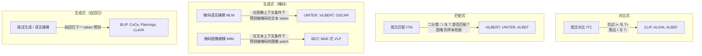

# 多模态视觉-语言学习：概述与基础

> **英文原文：** [cv-knowledge-base/05_multimodal_vision_language/00_overview.md](../../cv-knowledge-base/05_multimodal_vision_language/00_overview.md)（本中文版供参考，内容以英文原文为准）

> **最后更新：** 2026年10月
> **难度级别：** 中级
> **相关章节：** [VLP 模型](./01_vlp_models.md) | [大型视觉-语言模型](./02_large_vision_language_models.md) | [开放词汇检测](./03_open_vocabulary_detection.md) | [文档与 OCR](./04_document_and_ocr.md)

> **🆕 2026年10月更新：**
> - 新增 2025–2026 年这一代视觉编码器，它们如今为大多数 VLM 提供视觉特征：SigLIP 2（多语言、NaFlex、稠密特征损失）、Meta 的 Perception Encoder（PE-Core/Lang/Spatial）以及 DINOv3（7B 自监督教师模型，配有 `dino.txt` 文本对齐）。
> - 在时代时间线中加入了**原生多模态、经强化学习调优的“思考型”VLM**（Qwen3-VL、InternVL3.5、Qwen3.5、Gemini 3、GPT-5.x、Claude Opus 4.5/4.7）以及**概念提示式感知**（SAM 3）。
> - 新增**视觉作为压缩通道**一节（DeepSeek-OCR 的“光学上下文压缩”），并讨论了自适应视觉 token 预算。
> - 更新了关键论文、基准性能（厂商报告的 2025–2026 年 MMMU / MMMU-Pro 数据）以及开放问题。

---

## 概述

多模态视觉-语言学习（Multimodal Vision-Language Learning）研究如何对视觉与语言信息进行联合建模，以支持需要同时理解两种模态的任务——视觉问答（VQA）、图像描述（image captioning）、图文检索、指代表达理解（grounded referring expression comprehension）等。该领域起源于 2015–2017 年间关于视觉问答和图像描述的早期工作；从 2019–2020 年开始，BERT 式 Transformer 预训练被大规模应用于视觉-语言数据，领域由此经历了根本性的范式转变。

视觉-语言学习区别于单模态学习的核心挑战是**模态鸿沟（modality gap）**：视觉与语言表示位于语义上相异的嵌入空间，需要不同的 token 化策略（patch 特征 vs. wordpiece token），并且所携带信息的粒度差异极大（像素编码连续的外观；词语编码离散的符号概念）。弥合这一鸿沟既需要在架构上决定如何组合两路信息流，也需要能迫使表示对齐的训练目标。主要的对齐范式包括：**对比式**（CLIP、ALIGN——拉近匹配对、推远不匹配对）、**生成式**（为图像生成描述或预测被掩码的文本 token），以及**匹配式**（二分类：该图文对是否匹配？）。

2019 至 2026 年间 VLP 模型的演进可以概括为三种相继出现的架构：（1）**双编码器（dual-encoder）**模型（CLIP、ALIGN），独立编码图像和文本——检索速度快，但无法建模细粒度的跨模态交互；（2）**融合编码器（fusion-encoder）**模型（ViLBERT、UNITER、OSCAR、ALBEF），对图文联合表示施加交叉注意力——在理解类任务上能力强，但大规模检索较慢；（3）**生成式 VLM**（BLIP、CoCa、Flamingo、LLaVA、GPT-4V），在跨模态编码器之上增加自回归语言解码器，从而支持开放式生成和多轮对话。第三种范式如今占据主导地位，详见[大型视觉-语言模型](./02_large_vision_language_models.md)。

到 2026 年末，这些范式之间的边界进一步模糊。对比式双编码器并未消失，而是变成了生成式 VLM 的*视觉塔（vision tower）*，并借鉴其他范式加入了额外目标进行再训练：SigLIP 2 [Tschannen2025] 在 sigmoid 对比损失之上加入了描述式解码器损失以及自蒸馏/掩码预测损失；Meta 的 Perception Encoder [Bolya2025] 表明，对比训练编码器的最佳特征位于*中间*层，可以通过对齐把它们“提取”出来用于语言（PE-Lang）或稠密空间任务（PE-Spatial）。与此同时，前沿系统转向了**原生多模态（native multimodality）**（从预训练起就对文本、图像和视频 token 进行早期融合，例如 Qwen3.5），以及**经强化学习调优的“思考”模式**——在图像上进行推理，有时还会在推理过程中调用放大、搜索等工具（参见[大型视觉-语言模型](./02_large_vision_language_models.md)）。

---

## 模态鸿沟

模态鸿沟指的是视觉表示与语言表示在嵌入空间中组织方式上的结构性差异：

```
模态鸿沟的来源：
  1. Token 化：
     - 图像：连续的高维像素网格
       Token 化方式：CNN 区域特征（早期 VLP）、网格特征，或
       ViT patch token（现代 VLP）
     - 文本：离散的符号序列
       Token 化方式：wordpiece/BPE 子词 token
  
  2. 信息密度：
     - 一幅 224x224 图像包含约 50K 像素，但只有约 196 个有意义的 ViT token
     - 一条描述在 10-30 个 token 中编码 10-20 个有意义的概念
     - 不匹配：一个视觉区域可能对应多个词，反之亦然
  
  3. 语义粒度：
     - 视觉特征：局部（纹理、边缘）、中层（部件）、全局（场景）
     - 语言 token：句法（词性）、语义（命名实体）、语用
     - 若无显式对齐训练，则不存在天然对应关系

  4. 预训练中的领域差异：
     - 图像编码器在 ImageNet 上预训练（分类）
     - 语言编码器在文本语料上预训练
     - 二者各自的归纳偏置相互背离：卷积编码
       空间局部性；Transformer 编码全局上下文
```

针对对比模型（CLIP）的实证研究发现，即使经过联合训练，模态鸿沟仍然存在：在二维可视化（PCA/t-SNE）中，匹配图文对的图像嵌入与文本嵌入之间形成一道“鸿沟”，相隔大约一个标准差。这一鸿沟反映了两个编码器不同的归纳偏置，检索增强架构和交叉注意力融合可在一定程度上缓解它。

---

## 对齐目标与预训练任务

现代 VLP 模型会组合使用以下四类预训练任务：



**图文对比（ITC）**：给定一个包含 N 个（图像，文本）对的批次，最大化匹配对的余弦相似度，最小化不匹配对的相似度。InfoNCE 损失为：

```
L_ITC = -(1/N) * sum_i [
  log exp(s(I_i, T_i) / tau)
  / sum_j exp(s(I_i, T_j) / tau)
]  -- 图像到文本方向

其中 s = 余弦相似度，tau = 可学习的温度参数
```

**图文匹配（ITM）**：在融合表示之上的二分类器预测一个（图像，文本）对是否匹配。困难负样本挖掘（从批内选择 ITC 相似度高的负样本）使该任务更具判别力。

**掩码语言建模（MLM）**：对文本 token 施加标准的 BERT 式掩码，但上下文中包含图像 token——模型必须利用视觉上下文来预测被掩码的词（例如，给定一张狗的图片，预测“[MASK] is walking in the garden”）。

**描述生成（LM）**：在通过交叉注意力条件化于图像特征的情况下，逐 token 自回归地生成描述。可自然扩展到开放式生成。

---

## 区域特征 vs. 网格特征 vs. Patch 特征

VLP 架构多样性的一个主要维度在于如何对视觉信息进行 token 化：

```
1. 区域特征（2016–2021）：
   - 由 Faster R-CNN 检测得到的物体区域（bottom-up 特征，Anderson 2018）
   - 36–100 个区域候选；每个编码为 2048 维 pool5 特征 + 框坐标
   - 优点：语义化、与物体对齐；在 VQA 和指代表达任务上表现好
   - 缺点：慢（需要单独的检测器）；离散化偏差；没有背景信息
   - 使用者：ViLBERT, LXMERT, UNITER, OSCAR, VinVL

2. 网格特征（2020–2021）：
   - 卷积骨干网络（ResNet）在均匀空间网格（如 7x7）上的激活
   - 无检测步骤；更简单；包含更多背景上下文
   - 优点：快；没有检测器瓶颈
   - 缺点：语义结构较弱；较难与名词短语对齐
   - 使用者：CLIP（ViT 网格 token）、PixelBERT

3. Patch 特征（2021 至今）：
   - ViT patch：将图像划分为 14x14 或 16x16 像素的 patch；展平
   - 标准的 Transformer token 化；没有局部性归纳偏置
   - 优点：可端到端训练；可扩展到任意分辨率；与 LLM 范式一致
   - 缺点：需要大规模数据从零学习局部性
   - 使用者：CLIP ViT-L/14、BLIP-2 Q-Former、LLaVA、InternVL……

趋势：区域特征在很大程度上已被 patch 特征取代（2022+）；端到端 ViT
  编码器主导现代 VLM。定位类任务仍可通过 resampler/Q-Former 压缩
  受益于与区域对齐的特征。

4. 原生/动态分辨率 patch 特征（2024–2026）：
   - NaViT 式打包：每幅图像按原生长宽比产生可变数量的 patch
   - 使用者：Qwen2-VL/2.5-VL/3-VL、SigLIP 2 NaFlex、PaddleOCR-VL 编码器
   - 多层级融合：Qwen3-VL 的 “DeepStack” 将多个 ViT 层的特征注入
     LLM，而不仅仅使用最后一层
   - 自适应预算：InternVL3.5 的视觉分辨率路由器（Visual Resolution Router）为
     每个 patch 选择压缩率；DeepSeek-OCR 将一页文档压缩为几百个 token
```

### 视觉作为压缩通道（2025–2026）

2025 年的一个出人意料的发现，颠倒了人们常抱怨的“图像占用太多 token”的说法。**DeepSeek-OCR** [Wei2025] 将长文本渲染为图像，并考察解码器重建文本至少需要多少个*视觉* token：当压缩比（文本 token 数 / 视觉 token 数）低于 10× 时，作者报告的 OCR 精度约为 97%，在 20× 时降至约 60%。其设想的用途是“光学上下文压缩（optical context compression）”——将较早的对话或长文档存储为渲染图像，以模拟 LLM 记忆的遗忘曲线。论文本身指出仅凭 OCR 并不能完全验证这一想法，但它重新诠释了模态鸿沟：对于文字密集的内容，视觉编码器可能是比分词器*更*节省 token 的通道。

---

## 零样本能力

大规模 VLP 预训练的一大优势是**零样本迁移（zero-shot transfer）**：无需任何任务特定的训练样本即可解决下游任务。

**零样本图像分类**（CLIP 式）：将类别名定义为文本提示（“a photo of a {class}”），对图像和类别名分别编码，预测余弦相似度最高的类别。在 ImageNet 上，CLIP ViT-L/14 无需任何微调即可达到 75.5% 的 top-1 准确率。

**零样本图文检索**：按与查询图像的余弦相似度对描述语料进行排序（反之亦然）。CLIP、ALIGN 和 CoCa 无需微调即可在 MSCOCO 上取得有竞争力的 Recall@1。

**零样本 VQA**：自回归 VLM（Flamingo、BLIP-2）在零个上下文示例的情况下回答 VQA 问题，可与 2020 年的监督模型相媲美。

---

## 向 VLM 和 VLA 的演进

从 VLP 模型到现代视觉-语言模型（Vision-Language Model, VLM）以及面向机器人的视觉-语言-动作模型（Vision-Language-Action, VLA）的发展轨迹，体现了模型规模和能力范围的双重扩展：

```
第 1 时代（2019–2021）：融合编码器
  BERT 规模（1.1 亿–4 亿参数）；区域特征；任务特定头
  任务：经微调的 VQA、检索、描述生成
  代表：ViLBERT, UNITER, OSCAR, ALBEF

第 2 时代（2022–2023）：双编码器对比 + 生成
  大型 ViT 编码器（4 亿–10 亿）；网络规模数据（LAION, CC12M）
  任务：零样本分类、检索、生成
  代表：CLIP, ALIGN, BLIP, CoCa, BLIP-2

第 3 时代（2023–2026）：以 LLM 为骨干的 VLM
  LLM 作为解码器（7B–70B+ 参数）；视觉指令微调；多图/视频
  任务：开放式问答、推理、代码、工具使用
  代表：LLaVA-1.5, InternVL2, Qwen-VL, GPT-4V, Gemini, Claude 3
  -> 参见 ./02_large_vision_language_models.md

第 4 时代（2024–2026）：面向具身智能（Embodied AI）的 VLA
  在 VLM 输出空间中加入动作 token；机器人操作与导航
  代表：RT-2, OpenVLA, pi0, GR-2
  -> 参见 ../06_robotics_and_embodied_ai/

第 5 时代（2025–2026）：原生多模态推理模型 + 概念级感知
  在文本/图像/视频上进行早期融合预训练；强化学习“思考”模式；256K–1M 上下文；
  GUI/计算机操作智能体；“用图像思考（thinking with images）”式工具调用
  代表：Qwen3-VL, InternVL3.5, Qwen3.5, Gemma 4, GPT-5/5.5,
    Gemini 3/3.1, Claude Opus 4.5/4.7
  感知侧：SAM 3（分割文本所指定概念的每一个实例），
    DINOv3 / PE / SigLIP 2 作为视觉塔
  VLM 骨干直接在 VLA 中复用（例如 GR00T N1.5/N1.6 中的 Eagle VLM）
```

---

## 关键论文

| 论文 | 作者 | 年份 | 会议/期刊 | 主要贡献 |
|-------|---------|------|-------|-----------------|
| ViLBERT | Lu et al. | 2019 | NeurIPS | 双流 BERT；协同注意力 Transformer；多任务 VLP |
| LXMERT | Tan & Bansal | 2019 | EMNLP | 三编码器模型（语言、视觉、跨模态）；5 种预训练任务 |
| UNITER | Chen et al. | 2020 | ECCV | 通用图文表示；词-区域对齐 |
| OSCAR | Li et al. | 2020 | ECCV | 以物体标签作为锚点，桥接视觉与语言语义 |
| VinVL | Zhang et al. | 2021 | arXiv/CVPR | 改进物体检测器得到更强视觉特征；VQA 新 SOTA |
| CLIP | Radford et al. | 2021 | ICML | 在 4 亿图文对上进行对比预训练；强大的零样本分类 |
| ALIGN | Jia et al. | 2021 | ICML | 18 亿含噪图文对；以规模取代精选 |
| ALBEF | Li et al. | 2021 | NeurIPS | ITC + ITM + MLM；动量蒸馏；困难负样本挖掘 |
| BLIP | Li et al. | 2022 | ICML | 自举式描述过滤；统一理解与生成 |
| CoCa | Yu et al. | 2022 | arXiv/TMLR | 对比 + 描述生成损失；单一模型覆盖所有 VL 任务 |
| BLIP-2 | Li et al. | 2023 | ICML | Q-Former 桥接冻结的 ViT 与冻结的 LLM；指令跟随 |
| SigLIP 2 | Tschannen et al. | 2025 | arXiv (Google DeepMind) | Sigmoid 对比 + 解码器 + 自蒸馏损失；多语言；保持原生长宽比的 NaFlex 变体 |
| Perception Encoder | Bolya et al. | 2025 | arXiv (Meta FAIR) | 最佳嵌入位于中间层；PE-Core/Lang/Spatial 系列 |
| DINOv3 | Siméoni et al. | 2025 | arXiv (Meta FAIR) | 在 LVD-1689M 上训练的 7B 自监督教师；Gram anchoring；`dino.txt` 零样本文本对齐 |
| Qwen3-VL | Bai et al. (Qwen Team) | 2025 | arXiv | Interleaved-MRoPE、DeepStack、文本-时间戳对齐；原生 256K 上下文 |
| DeepSeek-OCR | Wei, Sun, Li | 2025 | arXiv | 将视觉 token 用作长文本的光学压缩通道 |
| SAM 3 | Carion et al. | 2026 | ICLR | 基于名词短语或示例的可提示概念分割（Promptable Concept Segmentation） |

---

## 基准性能

| 模型 | 任务 | 数据集 | 指标 | 分数 |
|-------|------|---------|--------|-------|
| CLIP ViT-L/14 | 零样本分类 | ImageNet | Top-1 Acc | 75.5% |
| ALIGN | 图像→文本检索 | MSCOCO 5K | R@1 | 77.0% |
| ALBEF | VQA | VQAv2 test-std | VQA Acc | 75.84% |
| BLIP | 图像描述 | NoCaps | CIDEr | 113.2 |
| BLIP | VQA | VQAv2 test-dev | VQA Acc | 78.25% |
| CoCa | 零样本分类 | ImageNet | Top-1 Acc | 86.3% |
| BLIP-2 (FlanT5-XXL) | VQA | VQAv2 test-dev | VQA Acc | 82.19% |
| BLIP-2 (Vicuna-13B) | 零样本 VQA | OK-VQA | VQA Acc | 45.9% |
| InternVL3.5-241B-A28B | 多模态推理 | MMMU (val) | Acc | 77.7（开发者报告） |
| Qwen3-VL-235B-A22B (Thinking) | 多模态推理 | MMMU | Acc | 80.6（技术报告） |
| GPT-5 (high reasoning) | 多模态推理 | MMMU | Acc | 84.2（厂商报告） |
| Gemini 3 Pro | 多模态推理 | MMMU-Pro | Acc | 81%（厂商报告） |
| SAM 3 | 概念分割 | SA-Co/Gold | cgF1 | 54.1（人类：72.8） |

*2025–2026 年的各行数据由厂商/开发者报告，所用提示方式、推理预算和评测框架各不相同；它们彼此之间以及与较早的行之间都不能严格比较。*

---

## 优缺点

| 方面 | 优点 | 缺点 |
|--------|------|------|
| **对比预训练（CLIP 式）** | 检索快；零样本能力强；可扩展到网络数据 | 缺乏细粒度跨模态交互；在组合式 VQA 上较弱 |
| **融合编码器预训练（BERT 式）** | 在理解任务（VQA、ITM）上表现强；能捕捉跨模态句法 | 推理慢（对联合序列做完整注意力）；生成能力差 |
| **生成式 VLP（BLIP、CoCa）** | 理解 + 生成统一于一个模型；可进行指令微调 | 描述质量依赖含噪的网页 alt 文本；解码器显存占用大 |
| **基于区域的 token 化** | 语义结构化；直接与物体对应 | 需要现成的检测器；检测器误差会传播；固定 36 个区域 |
| **基于 patch 的 token 化（ViT）** | 可扩展到任意分辨率；端到端；与 LLM 一致 | 高分辨率图像 token 数量多；局部无结构 |
| **原生多模态 + 强化学习推理（2025–2026）** | 推理、长视频、GUI 智能体能力最强；一个模型覆盖多种任务 | 训练成本巨大；“思考”增加延迟；跨厂商评测难以比较 |

---

## 开放问题与研究空白

- **模态鸿沟的持续存在**：即使经过大规模对比训练，图像和文本嵌入在联合嵌入空间中仍处于不同的簇。这限制了需要精确属性或空间对应关系的任务中的细粒度对齐。
- **组合推理**：当前 VLP 模型在否定（“a photo without a dog”）、序数计数和复杂空间关系上系统性失败，即使经过针对基准的调优也是如此。原因可能在于数据分布：网络图文对很少表达组合式否定或精确计数。
- **VLM 对齐的数据效率**：最先进的 VLM 需要数百万条指令微调样本（LLaVA-665K）。实现高质量视觉指令跟随所需的最少数据量尚未被充分刻画。
- **跨语言与跨文化 VLP**：大多数大型 VLP 模型以英语为中心；多语言扩展需要平行图文语料或与语言无关的视觉表示，而这两者目前都尚不完全令人满意。
- **高效的视觉定位（grounding）**：将 VLP 模型输出与具体图像区域关联（定位式生成、指向文本中提到的物体）需要重量级检测头或专门架构；目前还没有成为标准的轻量级定位机制。
- **时序建模**：下一个前沿是将 VLP 从静态图文扩展到视频-文本和长文档理解，这需要高效的时序注意力和更长的上下文窗口。2025–2026 年的模型（Qwen3-VL、Gemini 3）报告了在 256K–1M token 上下文下处理小时级视频的能力，但真正的时序推理（因果关系、事件计数）仍远弱于帧级识别。
- **“思考型”VLM 的忠实性**：经强化学习调优的推理模式提高了 MMMU 类分数，但文本思维链究竟是基于像素（而非语言先验）在推理，这一点基本未被度量。
- **概念级定位差距**：SAM 3 在 SA-Co 上达到约人类 cgF1 的 75–80%，其作者指出模型对领域外概念术语的泛化较弱；细粒度、组合式的名词短语仍然困难。
- **光学压缩的局限**：DeepSeek-OCR 表明通过图像可实现约 10× 的近乎无损文本压缩，但这一方法能否从 OCR 延伸到基于压缩上下文的推理和检索，尚未经过检验。

---

## 延伸阅读

- [Lu et al. (2019), "ViLBERT: Pretraining Task-Agnostic Visiolinguistic Representations," NeurIPS 2019](https://arxiv.org/abs/1908.02265)
- [Li et al. (2021), "Align before Fuse: Vision and Language Representation Learning with Momentum Distillation," NeurIPS 2021](https://arxiv.org/abs/2107.07651)
- [Li et al. (2022), "BLIP: Bootstrapping Language-Image Pre-training for Unified Vision-Language Understanding and Generation," ICML 2022](https://arxiv.org/abs/2201.12086)
- [Radford et al. (2021), "Learning Transferable Visual Models From Natural Language Supervision (CLIP)," ICML 2021](https://arxiv.org/abs/2103.00020)
- [Yu et al. (2022), "CoCa: Contrastive Captioners are Image-Text Foundation Models," TMLR 2022](https://arxiv.org/abs/2205.01068)
- [Zhang et al. (2024), "MM-LLMs: Recent Advances in MultiModal Large Language Models," 综述](https://arxiv.org/abs/2401.13601)
- [Tschannen et al. (2025), "SigLIP 2: Multilingual Vision-Language Encoders with Improved Semantic Understanding, Localization, and Dense Features"](https://arxiv.org/abs/2502.14786)
- [Bolya et al. (2025), "Perception Encoder: The best visual embeddings are not at the output of the network"](https://arxiv.org/abs/2504.13181)
- [Siméoni et al. (2025), "DINOv3"](https://arxiv.org/abs/2508.10104)
- [Qwen Team (2025), "Qwen3-VL Technical Report"](https://arxiv.org/abs/2511.21631)
- [Wei, Sun, Li (2025), "DeepSeek-OCR: Contexts Optical Compression"](https://arxiv.org/abs/2510.18234)
- [Carion et al. (2026), "SAM 3: Segment Anything with Concepts," ICLR 2026](https://arxiv.org/abs/2511.16719)
