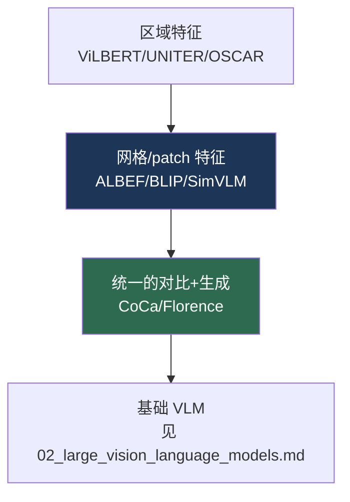

# 视觉-语言预训练（VLP）模型

> **英文原文：** [cv-knowledge-base/05_multimodal_vision_language/01_vlp_models.md](../../cv-knowledge-base/05_multimodal_vision_language/01_vlp_models.md)（本中文版供参考，内容以英文原文为准）

> **最后更新：** 2026年10月
> **难度级别：** 中级
> **相关章节：**
> - [概述：视觉-语言](./00_overview.md)
> - [大型视觉-语言模型](./02_large_vision_language_models.md)
> - [多模态架构](../03_architectures/04_multimodal_architectures.md)
> - [开放词汇检测](./03_open_vocabulary_detection.md)

> **🆕 2026年10月更新：** 经典 VLP 时代本身的内容没有变化；新增一个简短小节，说明其训练目标（ITC、描述生成/语言建模、掩码预测、蒸馏）如何在 2025 年的编码器 SigLIP 2 和 Perception Encoder 中被重新组合，并相应补充了关键论文和延伸阅读条目。

---

## 概述

视觉-语言预训练（Vision-Language Pretraining, VLP）指 LLM 出现之前的一代模型（大约 2019–2022 年）：它们通过在成对数据上训练的 Transformer 编码器学习图文联合表示，然后针对下游任务进行微调，包括视觉问答（VQA）、图文检索、图像描述、视觉推理（NLVR2）和视觉蕴含。这些模型早于[大型视觉-语言模型](./02_large_vision_language_models.md)中“VLM = 视觉编码器 + LLM”的范式，但确立了此后所有多模态模型都继承的训练目标——图文对比（ITC）、图文匹配（ITM）和掩码语言建模（MLM）。理解 VLP 至关重要，因为它在架构上的争论（区域特征 vs. 网格特征 vs. patch 特征；单流 vs. 双流融合；编码器 vs. 编码器-解码器）直接塑造了现代 VLM 与 VLA 的设计空间。

其发展轨迹分为三个阶段。**区域特征时代**（ViLBERT、LXMERT、UNITER、OSCAR、VinVL）依赖一个冻结的物体检测器（Faster R-CNN）提取区域特征，把检测到的物体当作视觉“单词”——能力强，但速度慢，并受限于检测器的词表。**端到端时代**（ALBEF、BLIP、SimVLM）去掉了检测器，改用网格或 patch 特征并联合训练视觉骨干，引入动量蒸馏和自举式描述生成来应对含噪的网络数据。**统一时代**（CoCa、Florence）在一个模型中结合对比与生成目标，预示了向基础 VLM 的汇聚。本文梳理这些模型、它们的训练目标及其对下游的影响。

---

## 预训练目标

VLP 模型组合使用少量几种训练目标：

```
# 图文对比（ITC）：对齐匹配对（CLIP 式）
L_ITC = InfoNCE(image_emb, text_emb)

# 图文匹配（ITM）：在融合后的 [CLS] 上做二分类
L_ITM = BCE( head(fuse(image, text)), is_match )

# 掩码语言建模（MLM）：在给定图像的条件下预测被掩码的 token
L_MLM = CE( predict(masked_text | image), true_tokens )
```

ALBEF 的洞见是**先对齐再融合（align before fuse）**：先在单模态编码器上施加 ITC，再用交叉注意力融合以进行 ITM/MLM——从而提升融合表示的质量。BLIP 加入了**描述生成（LM）**损失和 **CapFilt** 自举方案。

---

## 三个时代

### 区域特征模型

**ViLBERT** [Lu2019]（NeurIPS 2019）和 **LXMERT** [Tan2019]（EMNLP 2019）采用**双流（dual-stream）**架构：视觉（基于 Faster R-CNN 区域特征）与语言各用一个 Transformer，并通过协同注意力相连。**UNITER** [Chen2020]（ECCV 2020）在拼接的区域 token 与词 token 上使用**单流（single-stream）** Transformer，并加入词-区域对齐。**OSCAR** [Li2020]（ECCV 2020）注入物体*标签*作为锚点以简化对齐；**VinVL** [Zhang2021]（CVPR 2021）表明*更好的区域特征*（更强的检测器）能显著提升所有下游任务——凸显了检测器瓶颈。

### 端到端模型

**ALBEF** [Li2021]（NeurIPS 2021）去掉了检测器，使用 ViT 提取网格特征，采用 ITC 对齐，并用**动量蒸馏（momentum distillation）**对网络监督信号去噪。**BLIP** [Li2022]（ICML 2022）通过多模态编码器-解码器混合结构统一了理解与生成，并提出 **CapFilt**（由描述器生成合成描述，再由过滤器剔除含噪描述），以自举方式获得更干净的数据。**SimVLM** [Wang2022] 在大规模上使用单一的前缀语言建模（prefix-LM）目标。

### 统一模型

**CoCa** [Yu2022]（Contrastive Captioner，对比描述器）在一个编码器-解码器中结合了对比损失（图文对齐）和描述生成损失（生成式），得到一个在检索和生成上都很强的模型。**Florence**（Microsoft）将自身定位为跨越空间、时间和模态的“基础模型（Foundation Model）”。



### 遗产：VLP 目标在 2025–2026 年视觉编码器中的延续

随着转向基于 LLM 的 VLM，VLP 的训练目标“菜单”并没有消失，而是被吸收进了这些 VLM 所使用的*视觉塔*之中。**SigLIP 2** [Tschannen2025]（Google DeepMind，2025年2月）在 SigLIP 的 sigmoid 图文损失基础上，加入了 LocCa 式的**解码器损失**（描述生成和指代表达预测，即 CoCa/BLIP 一脉），以及用于获得更好稠密特征的**自蒸馏和掩码预测**损失；它发布了 ViT-B（86M）、L（303M）、So400m 和 g（1B）检查点，配有多语言分词器，并提供保持原生长宽比的 **NaFlex** 变体。Meta 的 **Perception Encoder（PE）** [Bolya2025] 表明，纯对比训练的模型在其*中间*层中已经包含了强大的语言对齐特征和空间特征，并通过对齐微调将其暴露为 PE-Lang（用于多模态大模型）和 PE-Spatial（用于稠密预测）。这两项成果都呼应了 ALBEF“先对齐再融合”和 CoCa“对比 + 生成”的洞见，只不过如今是在十亿级图像规模上。

---

## 关键论文

| 论文 | 作者 | 年份 | 会议/期刊 | 主要贡献 |
|-------|---------|------|-------|-----------------|
| ViLBERT | Lu, Batra, Parikh, Lee | 2019 | NeurIPS | 基于区域特征的双流协同注意力 VLP |
| LXMERT | Tan, Bansal | 2019 | EMNLP | 用于 VQA/推理的跨模态编码器 |
| UNITER | Chen, Li, Yu, et al. | 2020 | ECCV | 带词-区域对齐的单流 VLP |
| OSCAR | Li, Yin, Li, et al. | 2020 | ECCV | 以物体标签作为语义锚点 |
| ALBEF | Li, Selvaraju, Gotmare, et al. | 2021 | NeurIPS | 先对齐再融合 + 动量蒸馏 |
| BLIP | Li, Li, Xiong, Hoi | 2022 | ICML | 统一理解/生成 + CapFilt |
| CoCa | Yu, Wang, Vasudevan, et al. | 2022 | TMLR | 在一个编码器-解码器中结合对比与描述生成 |
| SigLIP 2 | Tschannen, Gritsenko, Wang, et al. | 2025 | arXiv | Sigmoid ITC + 解码器（描述生成/指代）+ 自蒸馏；多语言；NaFlex |
| Perception Encoder | Bolya, Huang, Sun, et al. | 2025 | arXiv | 仅对比预训练；将中间层特征对齐到语言和空间任务 |

---

## 基准性能

| 模型 | VQAv2 (test-std) | NLVR2 | TR/IR @COCO | 备注 |
|-------|------------------|-------|-------------|-------|
| UNITER-L | ~73.4 | ~79.5 | 强 | 区域特征 [Chen2020] |
| VinVL | ~76.6 | ~83.1 | SOTA（2021） | 更好的区域特征 [Zhang2021] |
| ALBEF | ~75.8 | ~83.1 | 强 | 无检测器 [Li2021] |
| BLIP | ~78.3 | ~82.2 | 检索 SOTA | CapFilt 自举 [Li2022] |
| CoCa | ~82.3 | — | SOTA | 另有 ImageNet 91.0%（冻结） [Yu2022] |

*分数为近似值，且依赖于评测协议。*

---

## 优缺点

| 方面 | 优点 | 缺点 |
|--------|------|------|
| 区域特征 | 与物体对应，在 VQA 上表现强 | 检测器瓶颈；慢；词表固定 |
| 端到端（ALBEF/BLIP） | 无需检测器，更快，可扩展 | 需要仔细处理噪声（CapFilt/动量） |
| 统一（CoCa） | 一个模型兼顾检索 + 生成 | 模型更大，训练更复杂 |
| 仅编码器 VLP | 判别类任务强 | 无法生成开放式文本（相比基于 LLM 的 VLM） |

---

## 开放问题与研究空白

- **检测器的遗产。** 区域特征提供了物体级的定位，而基于 patch 的 VLM 部分丢失了这一点；如何低成本地恢复细粒度定位仍是开放问题（与[开放词汇检测](./03_open_vocabulary_detection.md)相关）。
- **含噪的网络监督。** CapFilt 和动量蒸馏都是启发式方法；对图文对进行有原则的去噪尚未解决（参见[视觉中的缩放定律](../12_research_frontier_2024_2026/01_scaling_laws_vision.md)）。
- **组合推理。** VLP 模型会利用数据集偏差；真正的组合式理解依然薄弱。
- **统一判别式与生成式目标。** CoCa 将二者结合，但最优的平衡和架构尚无定论。
- **向具身任务的迁移。** VLP 表示与基于 LLM 的 VLM 在迁移到控制（VLA）时的差异尚缺乏研究。
- **评测污染。** VQAv2/NLVR2 排行榜趋于饱和，并受标注伪影影响。
- **哪种目标组合最优？** SigLIP 2 和 PE 采用截然不同的方案（多损失 vs. 仅对比加对齐微调）都取得了强劲结果；在同等数据和算力下的受控比较仍然缺失。

---

## 延伸阅读

- [ALBEF (arXiv:2107.07651)](https://arxiv.org/abs/2107.07651) — 先对齐再融合
- [BLIP (arXiv:2201.12086)](https://arxiv.org/abs/2201.12086) — 自举式语言-图像预训练
- [CoCa (arXiv:2205.01917)](https://arxiv.org/abs/2205.01917) — 对比描述器
- [UNITER (arXiv:1909.11740)](https://arxiv.org/abs/1909.11740) — 通用图文表示
- [VinVL (arXiv:2101.00529)](https://arxiv.org/abs/2101.00529) — 重新审视 VLP 中的视觉表示
- [SigLIP 2 (arXiv:2502.14786)](https://arxiv.org/abs/2502.14786) — 多目标、多语言视觉-语言编码器
- [Perception Encoder (arXiv:2504.13181)](https://arxiv.org/abs/2504.13181) — 来自对比预训练的中间层嵌入
