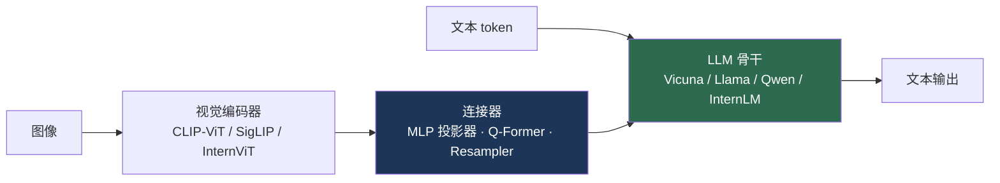
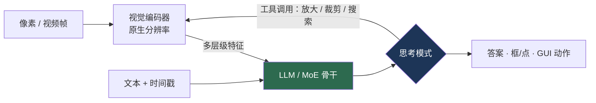

# 大型视觉-语言模型（LMM）

> **英文原文：** [cv-knowledge-base/05_multimodal_vision_language/02_large_vision_language_models.md](../../cv-knowledge-base/05_multimodal_vision_language/02_large_vision_language_models.md)（本中文版供参考，内容以英文原文为准）

> **最后更新：** 2026年10月
> **难度级别：** 高级
> **相关章节：**
> - [多模态架构](../03_architectures/04_multimodal_architectures.md)
> - [多模态大模型 2025–2026](../12_research_frontier_2024_2026/03_multimodal_llm_2025_2026.md)
> - [VLA 模型](../06_robotics_and_embodied_ai/01_vla_models.md)
> - [文档与 OCR](./04_document_and_ocr.md)

> **🆕 2026年10月更新：**
> - 新增 **“2025–2026 年新一代模型”** 一节：Qwen3-VL（Interleaved-MRoPE、DeepStack、文本-时间戳对齐、256K→1M 上下文）、InternVL3/3.5（Cascade RL、视觉分辨率路由器、解耦部署）、Qwen3.5（原生早期融合多模态）、NVIDIA Eagle 2.5，以及 Gemma 4 开放模型。
> - 更新了闭源前沿：GPT-5 / GPT-5.5、Gemini 3 Pro / 3.1 Pro、Claude Opus 4.5 / 4.7（首个支持高分辨率图像输入的 Claude）。
> - 新增 **“思考型 VLM”** 模式：经强化学习调优的推理模式、“用图像思考”式工具调用，以及 GUI/计算机操作智能体。
> - 新增 2025–2026 年基准表（MMMU、MMMU-Pro、Video-MMMU、ScreenSpot-Pro、OSWorld；厂商报告），并补充了关键论文和开放问题。

---

## 概述

大型多模态模型（Large Multimodal Model, LMM，或称大型视觉-语言模型）将自回归 LLM 扩展为可接受交错的图像（以及越来越多的视频/音频）输入，并生成以视觉内容为依据的自由文本。它们是现代 AI 系统的感知前端，也是 [VLA 模型](../06_robotics_and_embodied_ai/01_vla_models.md)中 VLA 的直接前身——RT-2 和 Gemini Robotics 就是带有动作头的 LMM。该领域围绕一个关键的架构维度展开：一类是 **CLIP 适配器（模块化）模型**，通过轻量级连接器把预训练视觉编码器接到预训练 LLM 上（LLaVA、InstructBLIP）；另一类是从一开始就在交错数据上训练的**原生多模态模型**（Flamingo、GPT-4o、Gemini）。

2023–2026 年的发展轨迹是开源与闭源模型的快速趋同。LLaVA 一脉证明，在冻结的 CLIP 编码器与开源 LLM 之间使用一个*简单*的投影，并用适量的指令数据训练，就能以极小的成本接近闭源模型的质量；随后 InternVL 将开源视觉编码器扩展到 60 亿参数，进一步缩小差距。与此同时，闭源模型（GPT-4o、Gemini 1.5/2.0）推动了原生多模态、实时音视频以及百万 token 级视频上下文。本文梳理架构分类，追溯主要模型家族，并在标准 LMM 基准套件（MMBench、MMMU、MathVista、DocVQA、RefCOCO）上进行比较。

在 2025 年年中到 2026 年 10 月之间，又发生了三项转变。（1）**原生多模态进入开源模型**：Qwen3.5（2026年2月）在文本、图像和视频 token 上进行早期融合训练，而不是在训练完成的 LLM 上外挂视觉塔，其发布说明称其表现优于专门的 Qwen3-VL 系列。（2）**基于强化学习的推理**成为标配：几乎每个前沿 VLM 都同时提供 “Instruct” 和 “Thinking” 变体，强化学习阶段（InternVL3.5 中的 MPO/GSPO、Qwen3.5 中的大规模智能体强化学习）推动了 MMMU 类基准的提升。（3）**智能体式感知**：VLM 如今可以操作 GUI、输出有定位依据的框/点，并在推理过程中对图像调用工具（放大、裁剪、搜索）。由于 MMBench/DocVQA 趋于饱和，评测转向了 MMMU-Pro、Video-MMMU、ScreenSpot-Pro 和 OSWorld。

---

## 架构分类



**CLIP 适配器（模块化）。** 冻结（或轻度微调）的视觉编码器产生视觉 token，再由**连接器（connector）**映射到 LLM 的嵌入空间。连接器设计从简单的 **MLP 投影器**（LLaVA-1.5），到 **Q-Former**（BLIP-2，一组通过交叉注意力关注图像特征的可学习查询 token），再到 **Perceiver Resampler**（Flamingo）。训练通常分两阶段：（1）在图像-描述数据上预训练连接器以对齐模态；（2）在多模态对话上进行视觉指令微调。

**原生多模态。** 像 Flamingo [Alayrac2022] 这样的模型在冻结的 LLM 中交错插入交叉注意力层以关注图像，并在网络规模的交错图文数据上训练；GPT-4o 和 Gemini 则以端到端方式进行多模态训练，支持交错的图文推理以及（对 GPT-4o 而言）实时音视频交互。融合机制的细节参见[多模态架构](../03_architectures/04_multimodal_architectures.md)。

---

## 主要模型家族

### LLaVA 一脉

**LLaVA** [Liu2023]（NeurIPS 2023）提出了*视觉指令微调（visual instruction tuning）*：使用 GPT-4 生成的多模态指令数据 + 从 CLIP-ViT 到 Vicuna 的简单线性投影。**LLaVA-1.5** 将线性投影器换成两层 MLP，加入学术任务数据和更高分辨率，成为强大而廉价的基线。**LLaVA-1.6 / LLaVA-NeXT** 增加了动态高分辨率（“AnyRes” 切块）和更强的 LLM。**LLaVA-OneVision** 在一个模型中统一了单图、多图和视频理解，并实现跨模态迁移。这一脉的意义在于方法论：它证明了可以低成本、可复现地构建有竞争力的 LMM。

### InternVL

**InternVL** [Chen2024c]（CVPR 2024）扩展了*视觉*一侧，通过渐进式对齐策略将 60 亿参数的 **InternViT-6B** 与 LLM 配对。**InternVL 1.5 / 2 / 2.5** 成为领先的开源 LMM，其中 InternVL2.5 在 MMMU 和 MMBench 上达到或超过了一些闭源模型——这是开源与闭源差距到 2025 年已基本弥合的最明确证据。

### 闭源前沿

**GPT-4V → GPT-4o**（OpenAI）从具备视觉能力的 GPT-4 发展为原生多模态的 “omni” 模型，支持交错图文和实时音视频。**Gemini 1.5 Pro**（Google）引入了 **100 万 token 上下文窗口**，使长视频理解成为可能（通过视频“大海捞针”检索验证），并在 **Gemini 2.0 Flash** 中得到延续。**Qwen-VL / Qwen2-VL**（阿里巴巴）采用动态分辨率编码，在文档理解和中文内容上表现突出。2025–2026 年的前沿动态见[多模态大模型 2025–2026](../12_research_frontier_2024_2026/03_multimodal_llm_2025_2026.md)。

---

## 2025–2026 年新一代模型

### 开放权重模型

**Qwen3-VL** [Bai2025]（阿里巴巴 Qwen 团队；2025年9–10月发布，2025年11月发布技术报告）涵盖稠密的 2B/4B/8B/32B 以及 MoE 的 30B-A3B / 235B-A22B 模型，每种都有 Instruct 和 Thinking 版本，原生支持 **256K token** 的交错上下文，可扩展到 1M。三项架构改动针对长视频与精细细节：

```
Qwen3-VL 架构更新（依据官方仓库 / 技术报告）：
  1. Interleaved-MRoPE：以交错方式在时间、高度和宽度上分配
     旋转位置编码频率（而 Qwen2-VL 的 M-RoPE 采用连续分块）
     -> 更好的长时程视频位置编码
  2. DeepStack：将来自多个 ViT 深度的视觉特征注入到
     LLM 的连续若干层，而不仅仅在输入处使用 ViT 最后一层
     -> 更精细的细节，更紧密的图文对齐
  3. 文本-时间戳对齐：在帧 token 之间交错插入显式的文本时间戳
     （取代 T-RoPE） -> 秒级事件定位
```

它还将 OCR 扩展到 32 种语言，增加了 2D/3D 定位，并提供“用图像思考（thinking with images）”的 cookbook，其中模型会在推理过程中调用图像放大工具。技术报告给出 235B-A22B 模型的 MMMU 为 78.7（Instruct）和 80.6（Thinking）。

**InternVL3 / InternVL3.5** [Wang2025]（上海人工智能实验室；2025年4月 / 8月）。InternVL3 引入了*原生多模态预训练*和可变视觉位置编码。InternVL3.5 增加了 **Cascade RL**（离线 MPO 预热，随后在线 GSPO）、为每个 patch 选择 token 压缩率的**视觉分辨率路由器（Visual Resolution Router, ViR）**，以及将视觉编码器和 LLM 放在不同 GPU 上的**解耦视觉-语言部署（Decoupled Vision-Language Deployment, DvD）**。作者报告相比 InternVL3 推理速度最高提升 4.05×，InternVL3.5-241B-A28B 的 MMMU 为 77.7，是发布时开源模型的最佳结果；此外还提供了基于 GPT-OSS-20B 的变体。

**Qwen3.5 → Qwen3.6 → Qwen3.8**（2026年2–8月）。Qwen3.5-397B-A17B（2026年2月16日）统一了 LLM 与 VLM 两条产品线：在“数万亿多模态 token”上进行早期融合训练，采用 **Gated DeltaNet（线性注意力）+ 稀疏 MoE** 的混合骨干，支持 201 种语言，并在智能体环境中进行强化学习。更小的稠密/MoE 规格（0.8B–122B-A10B）在 2026年2–3月相继发布；Qwen3.6（2026年4月）和 Qwen3.8（2026年8月；27B 和 2.4T-A95B）沿用同一架构，侧重智能体任务。

**其他开放模型家族。** NVIDIA **Eagle 2.5**（NeurIPS 2025）面向长上下文视频/图像理解，是 GR00T N1.5 的 VLM 骨干，其原生分辨率变体用于 GR00T N1.6（参见 [VLA 模型](../06_robotics_and_embodied_ai/01_vla_models.md)）。Google **Gemma 4**（2026年4月，Apache 2.0）提供原生多模态的开放模型，从端侧 E2B/E4B 变体到 31B 稠密模型。紧凑型编码器也日趋成熟：SigLIP 2、Meta 的 Perception Encoder / PerceptionLM（1B/3B/8B，使用开放数据）以及 DINOv3 都是常用的视觉塔（参见 [VLP 模型](./01_vlp_models.md)）。

### 闭源前沿（2025–2026）

| 模型 | 开发者 | 发布时间 | 与视觉相关的说明（厂商报告） |
|-------|-----------|---------|-----------------------------------------|
| GPT-5 | OpenAI | 2025年8月 | 统一推理模型；MMMU 84.2（high 推理） |
| Gemini 3 Pro | Google DeepMind | 2025年11月 | MMMU-Pro 81%、Video-MMMU 87.6%、ScreenSpot-Pro 72.7% |
| Claude Opus 4.5 | Anthropic | 2025年11月 | OSWorld 66.3%（计算机操作）；MMMU 80.7% |
| Gemini 3.1 Pro | Google DeepMind | 2026年2月 | Gemini 3 Pro 的后继者；约 100 万 token 多模态上下文 |
| Claude Opus 4.7 | Anthropic | 2026年4月 | 首个支持高分辨率图像的 Claude：长边从 1,568 px 提升到 2,576 px（约 3.75 MP） |
| GPT-5.5 | OpenAI | 2026年4月 | OpenAI 发布表中 MMMU-Pro 为 81.2%（不使用工具）/ 83.2%（使用工具） |

定性趋势是趋同：前沿闭源模型与最佳开放模型（Qwen3.5/3.8、InternVL3.5）在 MMMU 类基准上如今只差几个点，而剩余较大的差距在于 GUI 智能体能力、长视频以及高分辨率精细细节。



---

## 关键论文

| 论文 | 作者 | 年份 | 会议/期刊 | 主要贡献 |
|-------|---------|------|-------|-----------------|
| Flamingo | Alayrac, Donahue, Luc, et al. | 2022 | NeurIPS | 通过 Perceiver Resampler + 门控交叉注意力处理交错图文 |
| BLIP-2 | Li, Li, Savarese, Hoi | 2023 | ICML | 桥接冻结编码器与 LLM 的 Q-Former 连接器 |
| LLaVA | Liu, Li, Wu, Lee | 2023 | NeurIPS | 视觉指令微调；简单投影器 + Vicuna |
| InternVL | Chen, Wu, Wang, et al. | 2024 | CVPR | InternViT-6B；扩展开源视觉编码器 |
| Qwen2-VL | Wang, Bai, Tan, et al. | 2024 | arXiv | 动态分辨率编码；文档/多语言能力强 |
| Eagle 2.5 | Chen et al. (NVIDIA) | 2025 | NeurIPS | 长上下文 VLM；GR00T N1.5 的骨干 |
| InternVL3.5 | Wang et al. (Shanghai AI Lab) | 2025 | arXiv | Cascade RL；视觉分辨率路由器；解耦部署 |
| Qwen3-VL | Bai et al. (Qwen Team) | 2025 | arXiv | Interleaved-MRoPE、DeepStack、文本-时间戳对齐；256K 上下文 |

---

## 基准性能

| 模型 | MMBench | MMMU | MathVista | DocVQA | 备注 |
|-------|---------|------|-----------|--------|-------|
| LLaVA-1.5-13B | ~67 | ~36 | ~27 | — | 低成本、可复现的基线 |
| InternVL2.5-78B | ~88 | ~70 | ~72 | ~95 | 开源前沿（近似值） |
| Qwen2-VL-72B | ~86 | ~64 | ~70 | ~96 | 文档理解能力强 |
| GPT-4o | ~83 | ~69 | ~63 | ~92 | 原生多模态，实时 |
| Gemini 1.5 Pro | ~80 | ~62 | ~63 | ~93 | 100 万 token 视频上下文 |

*分数为近似值，随评测协议/版本而变化，且更新很快——仅供参考，请查阅当前排行榜。RefCOCO（指代定位）针对具备定位能力的变体单独报告。*

**2025–2026 年模型（更难的基准）。** 对前沿模型而言，MMBench 和 DocVQA 已接近饱和，因此报告转向 MMMU / MMMU-Pro（专家级多学科推理）、Video-MMMU、ScreenSpot-Pro（GUI 定位）和 OSWorld（计算机操作）。

| 模型 | MMMU | MMMU-Pro | Video-MMMU | GUI / 智能体 | 备注 |
|-------|------|----------|------------|-------------|-------|
| InternVL3.5-241B-A28B | 77.7 | — | — | — | 开放权重；开发者报告 |
| Qwen3-VL-235B-A22B (Thinking) | 80.6 | — | — | — | 开放权重；技术报告 |
| GPT-5 (high) | 84.2 | — | — | — | 厂商报告 |
| Claude Opus 4.5 | 80.7 | — | — | OSWorld 66.3% | 厂商报告 |
| Gemini 3 Pro | — | 81% | 87.6% | ScreenSpot-Pro 72.7% | 厂商报告 |
| GPT-5.5 | — | 81.2%（不使用工具） | — | — | 厂商报告；独立评测框架（如 Vals.ai）给出的绝对数值不同 |

*不可直接比较：各厂商的推理预算、工具使用、提示格式和基准版本均不相同。*

---

## 优缺点

| 方面 | 优点 | 缺点 |
|--------|------|------|
| CLIP 适配器（LLaVA） | 低成本、可复现、迭代快 | 受限于冻结编码器；细粒度感知较弱 |
| 原生多模态（GPT-4o/Gemini） | 交错推理、实时、长上下文 | 权重闭源；算力消耗巨大；不透明 |
| 扩展开源编码器（InternVL） | 缩小与闭源的差距；开放权重 | 6B 编码器沉重；训练昂贵 |
| Q-Former（BLIP-2） | 高效压缩视觉 token | 较难训练；可能成为细节瓶颈 |
| 原生早期融合（Qwen3.5、Gemini） | 无需独立的 VLM 产品线；保留文本能力；智能体能力强 | 需要在混合数据上从零训练；非常昂贵 |
| 强化学习“思考”模式 | 在 MMMU/MathVista 类推理上提升显著 | 延迟和成本更高；推理忠实性难以验证 |

---

## 开放问题与研究空白

- **空间与细粒度感知。** LMM 在精确空间关系以及小物体/文字细节上仍会失败（参见[空间智能](../12_research_frontier_2024_2026/06_spatial_intelligence.md)）。
- **幻觉。** 物体与属性幻觉依然存在；定位与忠实性仍未解决。
- **视觉 token 效率。** 高分辨率图像会使 token 数量暴增；最优压缩方式（Q-Former vs. 切块 vs. 池化）尚无定论。
- **大规模视频。** 超越关键帧采样、具备真正时序推理的长视频理解仍不成熟，即便在 100 万 token 上下文下也是如此。
- **评测可信度。** 基准污染和对格式的过拟合会抬高分数；稳健的评测是一个开放的方法论问题。
- **连接器设计。** 对于最佳的编码器→LLM 连接器尚无共识；这一选择会实质性地影响感知保真度。
- **统一的任意到任意（any-to-any）。** 真正统一处理图像、视频、音频和动作（迈向 VLA）的模型仍处于早期。
- **有依据的推理。** 经强化学习调优的“思考”能提高基准分数，但推理链是否真正基于视觉、而非受语言先验驱动，几乎没有得到良好度量。
- **自适应视觉计算。** InternVL3.5 的 ViR 等路由器以及 token 剪枝（参见[模型压缩](../09_efficiency_and_deployment/00_model_compression.md)）以启发式方式决定 token 预算；有原则的、依查询而定的分配仍是开放问题。
- **跨厂商评测。** 厂商报告的 MMMU-Pro / OSWorld 数据使用不同的评测框架和工具设置，因此对独立、可复现评测的需求日益增长。

---

## 延伸阅读

- [LLaVA (arXiv:2304.08485)](https://arxiv.org/abs/2304.08485) — 视觉指令微调
- [BLIP-2 (arXiv:2301.12597)](https://arxiv.org/abs/2301.12597) — Q-Former 连接器
- [InternVL (arXiv:2312.14238)](https://arxiv.org/abs/2312.14238) — 扩展开源视觉编码器
- [Flamingo (arXiv:2204.14198)](https://arxiv.org/abs/2204.14198) — 交错式少样本多模态学习
- [Qwen2-VL (arXiv:2409.12191)](https://arxiv.org/abs/2409.12191) — 动态分辨率多模态模型
- [Qwen3-VL Technical Report (arXiv:2511.21631)](https://arxiv.org/abs/2511.21631) — Interleaved-MRoPE、DeepStack、256K 上下文
- [InternVL3.5 (arXiv:2508.18265)](https://arxiv.org/abs/2508.18265) — Cascade RL、视觉分辨率路由器、解耦部署
- [Eagle 2.5 (arXiv:2504.15271)](https://arxiv.org/abs/2504.15271) — NVIDIA 的长上下文前沿 VLM
- [Qwen3.5 / 3.6 / 3.8 仓库](https://github.com/QwenLM/Qwen3.5) — 原生多模态开放模型（2026）
- [Qwen3-VL 仓库与 cookbook](https://github.com/QwenLM/Qwen3-VL) — 定位、GUI 智能体、用图像思考
