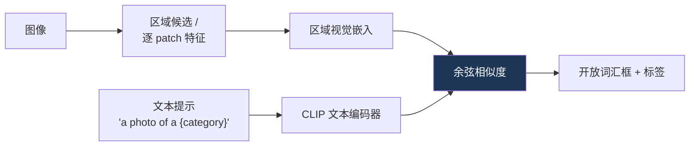
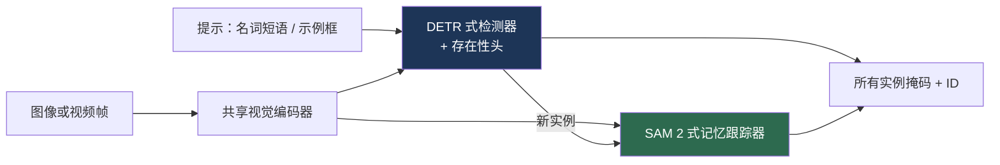

# 开放词汇检测与分割

> **英文原文：** [cv-knowledge-base/05_multimodal_vision_language/03_open_vocabulary_detection.md](../../cv-knowledge-base/05_multimodal_vision_language/03_open_vocabulary_detection.md)（本中文版供参考，内容以英文原文为准）

> **最后更新：** 2026年10月
> **难度级别：** 高级
> **相关章节：**
> - [目标检测](../02_core_tasks/01_object_detection.md)
> - [“Anything” 模型范式](../12_research_frontier_2024_2026/02_any_model_paradigm.md)
> - [VLP 模型](./01_vlp_models.md)
> - [大型视觉-语言模型](./02_large_vision_language_models.md)

> **🆕 2026年10月更新：**
> - 新增 **SAM 3** 一节（Meta，2025年11月；ICLR 2026）：在图像和视频中对名词短语或示例所指的*每一个*实例进行可提示概念分割（Promptable Concept Segmentation），SA-Co 基准（27 万个概念），以及 SAM 3.1 的 Object Multiplex（2026年3月）。
> - 新增 2025 年的检测器：**LLMDet**（CVPR 2025 highlight，利用 LLM 生成描述进行监督）、**YOLOE**（ICCV 2025，实时的文本/视觉/无提示模式）、**DINO-X**，以及以多模态大模型作为检测器的模型（**Rex-Omni**、Qwen3-VL 定位、NVIDIA LocateAnything，ECCV 2026）。
> - 基准表补充了来自 SAM 3、LLMDet 和 YOLOE 发布的 LVIS / COCO / SA-Co 数据；修订了开放问题（分割已基本追平检测；概念级与人类的差距仍然存在）。

---

## 概述

开放词汇（open-vocabulary）检测（OVD）与分割旨在定位并识别*训练时未见过*的物体类别，这些类别在推理时由任意文本指定。这打破了经典检测器（R-CNN、YOLO、DETR——参见[目标检测](../02_core_tasks/01_object_detection.md)）的根本约束：后者只能在训练时定义的固定标签集合中进行预测。其关键思路是用**与语言嵌入空间的对齐**取代闭集分类头：区域的视觉特征与文本嵌入（通常来自 CLIP）进行匹配，因此任何可用语言表达的概念都能成为候选类别。这将检测重新表述为视觉-语言定位（grounding）问题，并且是[“Anything” 模型范式](../12_research_frontier_2024_2026/02_any_model_paradigm.md)中通用分割模型在定位层面的对应物。

该领域沿两种策略分化。**嵌入对齐方法**（ViLD、RegionCLIP、OWL-ViT）将区域特征蒸馏或对齐到 CLIP 的文本空间，从而继承 CLIP 的开放词汇知识。**定位预训练方法**（GLIP、Grounding DINO）将检测重新表述为短语定位，并在大规模检测 + 定位 + 描述数据上预训练，统一了检测与指代表达理解。第三条实用路线（Detic、YOLO-World）强调通过图像级标签扩展词表或追求实时效率。本文梳理这些方法、它们的基准（LVIS、ODinW），以及定位质量与语义覆盖之间的开放挑战。

自 2025 年以来，又有两条路线重塑了这一领域。以 SAM 3 为代表的**概念提示式分割基础模型**，将开放词汇检测、实例分割和视频跟踪合并到一个可提示模型中，并依托拥有数百万概念标签的数据引擎进行训练。**基于多模态大模型（MLLM）的检测器**（Rex-Omni、Qwen3-VL、LocateAnything）把框或点当作视觉-语言模型输出的 token，用速度换取更丰富的语言理解能力（指代表达、属性推理）。

---

## 嵌入对齐方法

**ViLD** [Gu2021]（ICLR 2022）将 CLIP 图像嵌入蒸馏到一个两阶段检测器中：类别无关的区域候选网络生成候选框，区域特征被训练为与 CLIP 的图像嵌入（ViLD-image）以及类别名的文本嵌入（ViLD-text）相匹配。推理时，通过嵌入新类别的名称来检测新类别。**RegionCLIP** 通过区域-文本预训练将 CLIP 扩展到区域级对齐。**OWL-ViT** [Minderer2022]（ECCV 2022）和 **OWLv2** 采用基于 ViT 的单阶段方法：在 CLIP 预训练的 ViT 上加检测头，并在检测数据上微调，实现高效的开放词汇检测和单样本（以图像为条件）检测。OWLv2 通过在伪标注上的自训练进行扩展。

---

## 定位预训练方法

**GLIP** [Li2022b]（CVPR 2022）统一了目标检测与短语定位：它将检测重新表述为区域特征与文本提示中词语的对齐，在 2700 万定位对（包括带自训练框的图文数据）上进行预训练。这带来了强大的零样本迁移能力，以及一个同时用于检测和指代的单一模型。**Grounding DINO** [Liu2023b] 将 DINO 这一 DETR 式检测器与定位预训练相结合，实现了基于任意文本的强大开集检测，并成为 **Grounded-SAM**（文本 → 框 → 经 SAM 得到掩码）中的检测部分。这些模型擅长语言驱动的定位，但比嵌入对齐检测器更重。

---

## 扩展与效率

**Detic** [Zhou2022]（ECCV 2022）通过在图像级标签（ImageNet-21k）上训练*分类器*，将可检测词表扩展到约 2.1 万类，从而将定位与分类解耦，并避免了为稀有类别标注框的需求。**YOLO-World** [Cheng2024]（CVPR 2024）通过将 CLIP 文本嵌入重参数化进 YOLO 检测器，并配合视觉-语言路径聚合网络，把开放词汇检测带入**实时**领域，以 YOLO 的速度取得较高的 LVIS 零样本 AP——这对机器人和边缘部署很重要。

**YOLOE** [Wang2025b]（ICCV 2025）在一个实时 YOLO 中统一了三种提示类型下的检测与分割：用于文本提示的*可重参数化区域-文本对齐*（Re-parameterizable Region-Text Alignment, RepRTA）、用于视觉提示的*语义激活视觉提示编码器*（Semantic-Activated Visual Prompt Encoder, SAVPE），以及用于内置大词表无提示模式的*惰性区域-提示对比*（Lazy Region-Prompt Contrast, LRPC）。重参数化之后，它的行为与闭集 YOLO 相同，没有额外推理开销；作者报告 YOLOE-v8-S 在 LVIS 上比 YOLO-Worldv2-S 高 3.5 AP，训练成本低 3 倍、推理快 1.4 倍。**LLMDet** [Fu2025]（CVPR 2025 highlight）将一个 Grounding-DINO 式检测器与 LLM 协同训练，由 LLM 生成区域级短描述和图像级长描述（GroundingCap-1M），提升了稀有类别 AP；它已合并进 Hugging Face `transformers`（v4.55）。**DINO-X**（IDEA Research，2024–2025）将 Grounding DINO 一脉扩展为统一的开放世界模型，并提供无提示的“检测一切”模式。

---

## 概念级分割：SAM 3（2025–2026）

**SAM 3** [Carion2026]（Meta，2025年11月20日发布；ICLR 2026）定义了**可提示概念分割（Promptable Concept Segmentation, PCS）**：给定一个简短名词短语（“yellow school bus”）、图像示例，或二者兼有，返回图像或视频中*所有*匹配实例的掩码和身份。这正是开放词汇检测加分割的问题，只是要求穷尽式的实例召回与跟踪。

- **架构（8.48 亿参数）：** 检测器与跟踪器共享一个视觉编码器。检测器基于 DETR，以文本、几何信息和示例为条件；跟踪器继承了 SAM 2 基于记忆的编码器-解码器。一个**存在性 token/头（presence token/head）**先判断概念*是否*存在，再进行定位，这有助于区分相近的提示（“a player in white” vs. “a player in red”）。
- **数据：** 一个人工 + 模型在环的数据引擎标注了超过 **400 万个独特概念**，包括困难负样本。新的 **SA-Co** 基准包含 **27 万个独特概念**，比此前的开放词汇基准多 50 倍以上。
- **结果（官方仓库）：** LVIS 上掩码 AP 48.5、框 AP 53.6，COCO 上 AP 56.4，SA-Co/Gold 上掩码 cgF1 为 54.1，而人类为 72.8，即约为人类表现的 75–80%。
- **SAM 3.1（2026年3月27日）：** *Object Multiplex* 将被跟踪的物体分组到固定容量的桶中联合处理，在单张 H100 上处理 128 个物体时，相比 2025年11月的版本提速约 7 倍。
- **相关工作：** SAM 3D（Meta，2025年11月）可将单张图像中的物体和人体提升到 3D；DINOv3 的 `dino.txt` 头基于冻结的自监督骨干提供零样本开放词汇分割。参见[“Anything” 模型范式](../12_research_frontier_2024_2026/02_any_model_paradigm.md)。

## 以多模态大模型作为开放词汇检测器

另一条并行趋势是让多模态 LLM 直接输出坐标。**Rex-Omni**（IDEA Research，2025年10月）是一个 3B 的 MLLM，通过“下一个点预测（next point prediction）检测任意物体”，将检测、指点、关键点和 OCR 框都表述为下一 token 预测，先进行 SFT，再进行 GRPO。**Qwen3-VL** 可输出相对坐标的框和点，并支持 3D 定位。NVIDIA 的 **LocateAnything**（基于 Eagle；已被 ECCV 2026 接收）是一个通用视觉-语言定位模型。这些模型处理长且组合式的指代表达远优于基于 CLIP 嵌入的检测器，但速度更慢，并且在稠密、穷尽式的 LVIS 类评测上通常落后于专用检测器（可对比 SAM 3 表格中 Gemini 2.5 在 SA-Co 上的低分）。

---

## 关键论文

| 论文 | 作者 | 年份 | 会议/期刊 | 主要贡献 |
|-------|---------|------|-------|-----------------|
| ViLD | Gu, Lin, Kuo, Cui | 2021 | ICLR 2022 | 将 CLIP 嵌入蒸馏到检测器中 |
| GLIP | Li, Zhang, Zhang, et al. | 2022 | CVPR | 统一检测与短语定位预训练 |
| OWL-ViT | Minderer, Gritsenko, Stone, et al. | 2022 | ECCV | 基于 ViT 的开放词汇与单样本检测 |
| Detic | Zhou, Girdhar, Joulin, et al. | 2022 | ECCV | 借助图像级标签实现 2.1 万类检测 |
| Grounding DINO | Liu, Zeng, Ren, et al. | 2023 | arXiv→ECCV 2024 | 定位式 DETR；Grounded-SAM 的基础 |
| YOLO-World | Cheng, Song, Ge, et al. | 2024 | CVPR | 实时开放词汇检测 |
| LLMDet | Fu et al. | 2025 | CVPR (highlight) | 利用 LLM 生成的区域与图像描述协同训练检测器 |
| YOLOE | Wang, Liu, Chen, et al. | 2025 | ICCV | 支持文本、视觉或无提示的实时检测+分割 |
| Rex-Omni | IDEA Research | 2025 | arXiv | 通过下一个点预测实现检测的 3B MLLM |
| SAM 3 | Carion, Gustafson, Hu, et al. | 2025 | ICLR 2026 | 可提示概念分割；存在性头；SA-Co 基准 |

---

## 基准性能

| 模型 | 基准 | 指标 | 分数 | 备注 |
|-------|-----------|--------|-------|-------|
| ViLD | LVIS | AP_rare（新类） | ~16.1 | 两阶段蒸馏 [Gu2021] |
| GLIP-L | LVIS / ODinW | 零样本 AP | 强 | 定位预训练 [Li2022b] |
| OWLv2 | LVIS | 零样本 AP | SOTA（2023） | 自训练扩展 |
| Detic | LVIS | AP_rare | ~24+ | 图像级监督 [Zhou2022] |
| YOLO-World-L | LVIS | 零样本 AP | ~35 AP @ 实时 | 边缘友好 [Cheng2024] |
| YOLOE-v8-L | LVIS minival | fixed AP（文本） | 35.9（AP_r 33.2） | T4/TensorRT 上 102.5 FPS [Wang2025b] |
| LLMDet Swin-L | LVIS minival | fixed AP | 51.1（AP_r 45.1） | LLM 监督 [Fu2025] |
| DINO-X | LVIS / COCO | 框 AP | 52.4 / 56.0 | 取自 SAM 3 发布中的表格 |
| OWLv2 | LVIS / COCO | 框 AP | 45.5 / 46.1 | 部分在 LVIS 上训练（SAM 3 表格） |
| SAM 3 | LVIS / COCO | 框 AP | 53.6 / 56.4 | 8.48 亿参数 [Carion2026] |
| SAM 3 | LVIS | 掩码 AP | 48.5 | 零样本实例分割 |
| SAM 3 | SA-Co/Gold | 掩码 cgF1 | 54.1（人类 72.8） | 概念级、含 27 万概念的基准 |

*数值为近似值；LVIS 稀有类 AP 是开放词汇检测的标准指标。较新的行取自官方仓库；各行的评测划分（minival vs. val）以及训练数据与 LVIS 的重叠情况各不相同。*

---

## 优缺点

| 方面 | 优点 | 缺点 |
|--------|------|------|
| 嵌入对齐（ViLD/OWL） | 继承 CLIP 知识；简单 | 定位质量受限于候选框/CLIP |
| 定位预训练（GLIP/G-DINO） | 语言驱动的定位能力强；支持指代 | 重；较慢；数据密集 |
| 图像级扩展（Detic） | 低成本获得超大词表 | 稀有类别定位较弱 |
| 实时（YOLO-World） | 可部署于边缘/机器人 | 上限低于重量级定位模型 |
| 概念分割（SAM 3） | 一个提示即可得到穷尽实例 + 掩码 + 视频跟踪 | 约 0.85B 参数；仅支持简短名词短语；领域外术语较弱 |
| MLLM 检测器（Rex-Omni、Qwen3-VL） | 丰富的语言与推理能力；支持指代和指点 | 自回归解码慢；穷尽式召回较弱 |

---

## 开放问题与研究空白

- **定位与识别之间的差距。** 开放词汇识别的进展快于开放词汇*定位*；新类别的框仍不够精确。
- **CLIP 的局限会传导。** CLIP 在空间和组合方面的弱点（参见[空间智能](../12_research_frontier_2024_2026/06_spatial_intelligence.md)）限制了检测器的性能。
- **长尾与稀有类别。** LVIS 稀有类 AP 仍远低于常见类 AP。
- **分割追平检测。** 开放词汇*分割*（OV-Seg、OpenSeeD）的成熟度长期落后于检测；SAM 3 在简短名词短语上基本弥合了这一差距，但长且组合式的描述仍需与 MLLM 配合使用（官方仓库展示了将 SAM 3 作为 MLLM 工具的用法）。
- **概念级与人类的差距。** 在 SA-Co/Gold 上 SAM 3 的 cgF1 为 54.1，而人类为 72.8；其作者还报告了模型对领域外概念术语（如专业词汇）的泛化较弱。
- **统一 MLLM 与检测器的优势。** 如何将 MLLM 检测器的语言理解能力与 DETR/YOLO 式检测器的速度和召回结合起来，仍未解决。
- **提示敏感性。** 性能随提示措辞而变化；稳健的提示方法尚未解决。
- **重量级模型的实时化。** 将 GLIP/Grounding-DINO 的精度带入实时边缘预算仍是开放问题（与[机器人感知](../06_robotics_and_embodied_ai/08_perception_for_robotics.md)相关）。

---

## 延伸阅读

- [ViLD (arXiv:2104.13921)](https://arxiv.org/abs/2104.13921) — 基于视觉-语言蒸馏的开放词汇检测
- [GLIP (arXiv:2112.03857)](https://arxiv.org/abs/2112.03857) — 定位式语言-图像预训练
- [Grounding DINO (arXiv:2303.05499)](https://arxiv.org/abs/2303.05499) — 开集检测 Transformer
- [Detic (arXiv:2201.02605)](https://arxiv.org/abs/2201.02605) — 检测两万个类别
- [YOLO-World (arXiv:2401.17270)](https://arxiv.org/abs/2401.17270) — 实时开放词汇检测
- [SAM 3 (arXiv:2511.16719)](https://arxiv.org/abs/2511.16719) 与[官方仓库](https://github.com/facebookresearch/sam3) — Segment Anything with Concepts；SAM 3.1 发布说明
- [LLMDet (arXiv:2501.18954)](https://arxiv.org/abs/2501.18954) — LLM 监督下的开放词汇检测
- [YOLOE (arXiv:2503.07465)](https://arxiv.org/abs/2503.07465) — 实时“看见一切”
- [DINO-X (arXiv:2411.14347)](https://arxiv.org/abs/2411.14347) — 统一的开放世界目标检测与理解
- [Rex-Omni (arXiv:2510.12798)](https://arxiv.org/abs/2510.12798) — 通过下一个点预测检测任意物体
