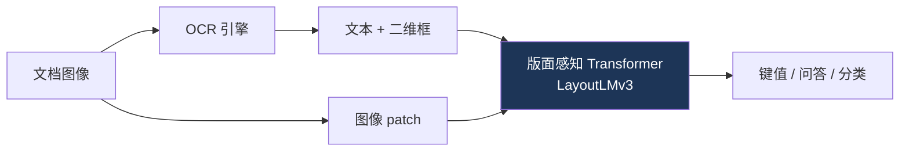
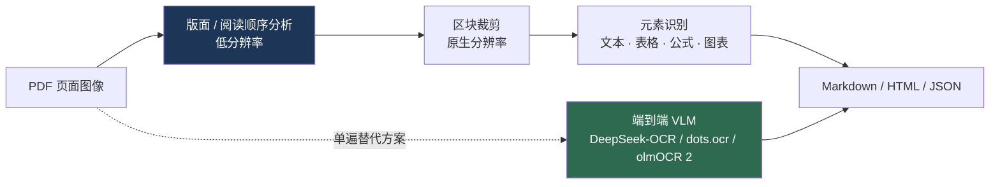

# 文档理解与 OCR

> **英文原文：** [cv-knowledge-base/05_multimodal_vision_language/04_document_and_ocr.md](../../cv-knowledge-base/05_multimodal_vision_language/04_document_and_ocr.md)（本中文版供参考，内容以英文原文为准）

> **最后更新：** 2026年10月
> **难度级别：** 高级
> **相关章节：**
> - [大型视觉-语言模型](./02_large_vision_language_models.md)
> - [概述：视觉-语言](./00_overview.md)
> - [多模态大模型 2025–2026](../12_research_frontier_2024_2026/03_multimodal_llm_2025_2026.md)

> **🆕 2026年10月更新：**
> - 新增 **2025–2026 年紧凑型端到端文档解析器浪潮**一节：DeepSeek-OCR（光学上下文压缩）与 DeepSeek-OCR 2、PaddleOCR-VL 0.9B（→ 1.5 → 1.6）、dots.ocr / dots.mocr、olmOCR 2（以单元测试为奖励的强化学习），以及 MinerU2.5。
> - 新基准：**OmniDocBench**（v1.5/v1.6，页面级解析）和 **olmOCR-Bench**（7,000+ 单元测试）；新增一张经核实的 olmOCR-Bench 对比表。
> - 通用 VLM 更新：Qwen3-VL 将 OCR 扩展到 32 种语言，并支持长文档结构解析。
> - 修正了“专用流水线将消失”的论断：约 1–3B 的专用解析器如今在页面级解析上以极低成本超越了大得多的通用 VLM。

---

## 概述

文档 AI 位于视觉、语言与版面的交叉点：任务是阅读并推理结构化的视觉文档——表单、发票、收据、科学论文、表格、图表和信息图——其中*空间版面*承载着纯 OCR 文本会丢弃的语义信息。该领域经历了三种范式。第一，**先 OCR 再语言**的流水线，将识别出的文本（及其二维位置）输入版面感知的 Transformer（LayoutLM 系列）。第二，**免 OCR（OCR-free）**的端到端模型（Donut、Pix2Struct）直接读取像素并生成结构化输出，消除了脆弱且会传播错误的 OCR 阶段。第三，**通用 VLM**（Qwen2-VL、InternVL、GPT-4o）将文档理解吸收为众多能力之一，利用高分辨率编码原生地读取密集文本——这如今是主导方法（参见[大型视觉-语言模型](./02_large_vision_language_models.md)）。

核心技术挑战是**高分辨率密集文本感知**：一页文档可能包含数千个字符，所需的有效分辨率远高于自然图像 VLM 通常使用的分辨率，这迫使人们采用切块/动态分辨率方案，并导致视觉 token 数量暴增。第二个挑战是*结构化输出*：文档需要阅读顺序、表格结构和键值抽取，而不仅仅是自由文本。本文梳理版面感知、免 OCR 和基于 VLM 的方法，相关基准（DocVQA、ChartQA、InfographicVQA、OCRBench），以及稳健结构抽取方面尚未解决的问题。

---

## 版面感知模型

**LayoutLM** [Xu2020]（KDD 2020，Microsoft）为 BERT 加入了**二维位置嵌入**（token 边界框坐标），并在 IIT-CDIP 文档语料上预训练。**LayoutLMv2** 加入了图像嵌入和空间感知自注意力；**LayoutLMv3** [Huang2022b]（ACM MM 2022）用一个作用于 patch + 文本 token 的多模态 Transformer 统一了文本与图像掩码，摆脱了对独立 CNN 的依赖，成为表单/收据理解（FUNSD、CORD）的强大骨干。这些模型仍需要上游 OCR 引擎，并继承其错误。

---

## 免 OCR 端到端模型

**Donut** [Kim2022]（ECCV 2022）是一个免 OCR 的编码器-解码器：Swin 视觉编码器读取原始页面，Transformer 解码器直接生成结构化输出（JSON），并借助合成文档生成（SynthDoG）进行训练。**Pix2Struct** [Lee2023]（ICML 2023）通过将网页截图解析为简化 HTML 进行预训练，这种“截图到结构”的目标可以很好地迁移到图表、UI 和文档。**Nougat** [Blecher2023]（Meta）面向学术 PDF，将页面图像转换为标记语言（LaTeX/Markdown）以处理科学文档。**GOT-OCR2.0**（2024）是一个紧凑的通用 OCR-2.0 模型，以统一的端到端方式处理文本、公式、表格和乐谱。

---

## 基于 VLM 的文档理解

现代通用 VLM 将阅读视为多模态推理的一个特例，如今在文档基准上处于领先地位。**Qwen2-VL** 使用**朴素动态分辨率（naive dynamic resolution）**（每幅图像的视觉 token 数可变），擅长密集文本和多语言文档；**InternVL** 使用动态高分辨率切块；**GPT-4o** 和 **Gemini** 原生读取文档。趋势是*专用文档流水线的消失*，被通用 VLM 所吸收——不过专用的免 OCR 模型在结构化抽取和端侧使用方面仍有价值。**Qwen3-VL**（2025）将 OCR 支持从 10 种语言扩展到 32 种，提升了对模糊/倾斜/低光照的鲁棒性，能处理生僻字和古文字，并能将长文档结构解析为 HTML 式的版面格式。

---

## 2025–2026 年浪潮：紧凑型端到端文档解析器

“通用 VLM 将吸收文档 AI”的预测只对了一半。从 2025 年年中开始，出现了一批**小型（0.9B–7B）、专门面向文档的 VLM**：它们一次性读取整页并输出结构化的 Markdown/HTML/JSON（文本、表格、公式、阅读顺序），在页面级解析基准上超越了大得多的通用 VLM，同时足够便宜，可以处理数百万份 PDF（例如用于构建 LLM 预训练语料）。

- **DeepSeek-OCR** [Wei2025]（DeepSeek-AI，2025年10月）。一个 *DeepEncoder*（用于高分辨率局部感知的窗口注意力 → 16× 卷积 token 压缩器 → 全局注意力）为 DeepSeek3B-MoE-A570M 解码器提供输入。其定位是“上下文光学压缩”：当文本 token 数在视觉 token 数的 10 倍以内时，OCR 精度约 97%，在 20 倍时约 60%。在 OmniDocBench 上，它以每页少于 800 个视觉 token 超越了 GOT-OCR2.0 和 MinerU2.0。**DeepSeek-OCR 2**（“Visual Causal Flow”，2026年1月）重新设计了编码器，使视觉 token 的排列顺序更接近人类的阅读方式。
- **PaddleOCR-VL** [Cui2025]（百度，2025年10月）。一个 0.9B 的 VLM，将 NaViT 式动态分辨率编码器与 ERNIE-4.5-0.3B 语言模型配对，支持 109 种语言以及文本、表格、公式和图表；由独立的版面分析阶段为元素级识别提供输入。**PaddleOCR-VL-1.5**（2026年1月）报告在 OmniDocBench v1.5 上达到 94.5%，**PaddleOCR-VL-1.6**（2026年5月）在架构不变的情况下报告在 OmniDocBench v1.6 上达到 96.3%。
- **dots.ocr**（rednote hilab，2025年7月）。一个基于 1.7B LLM 的单一 VLM，通过切换提示完成版面检测和内容识别，并保持阅读顺序；在低资源语言上表现强劲。后更名/扩展为 **dots.mocr**（2026年3月，约 3B），另有 **dots.mocr-svg** 变体可将图表和示意图转换为 SVG 代码。
- **olmOCR 2** [Poznanski2025]（Ai2，2025年10月）。olmOCR-2-7B-1025 在 Qwen2.5-VL-7B 基础上微调，然后采用**以二元单元测试为奖励的 GRPO 强化学习**（文本存在/缺失、阅读顺序、表格单元格、数学公式渲染），这些测试由真实页面的合成 HTML 重渲染生成。它在 olmOCR-Bench 上得分 82.4，在数学、表格和多栏版面上的提升最大；模型、代码和数据完全开放。
- **MinerU2.5** [Niu2025]（上海人工智能实验室 / OpenDataLab，2025年9月）。一个约 1.2B 的**解耦式由粗到细**解析器：先在降采样页面上进行全局版面分析，再对裁剪区域进行原生分辨率识别，避免了以高分辨率编码整页的 token 开销；2026 年又发布了 “MinerU2.5 Pro” 报告。

**新基准。** **OmniDocBench**（OpenDataLab，CVPR 2025）评测多样化 PDF 的页面级解析（文本编辑距离、表格 TEDS、公式 CDM、阅读顺序），2026 年的结果多使用其 v1.5 和 v1.6 修订版。**olmOCR-Bench**（Ai2，2025年5月）在约 1,400 份文档（arXiv 论文、旧扫描件、表格、页眉/页脚、多栏、小字号文本）上包含 7,000 多个二元单元测试，检验的是事实是否正确，而非编辑距离。

---

## 关键论文

| 论文 | 作者 | 年份 | 会议/期刊 | 主要贡献 |
|-------|---------|------|-------|-----------------|
| LayoutLM | Xu, Li, Cui, et al. | 2020 | KDD | 面向文档的二维位置嵌入 |
| LayoutLMv3 | Huang, Lv, Cui, et al. | 2022 | ACM MM | 统一的文本-图像掩码；基于 patch |
| Donut | Kim, Hong, Yim, et al. | 2022 | ECCV | 免 OCR 的图像到 JSON 文档解析 |
| Pix2Struct | Lee, Joshi, Turc, et al. | 2023 | ICML | 截图到 HTML 的预训练 |
| Nougat | Blecher, Cucurull, Scialom, Stojnic | 2023 | arXiv (Meta) | 学术 PDF → 标记语言 |
| Qwen2-VL | Wang, Bai, Tan, et al. | 2024 | arXiv | 动态分辨率；文档理解 SOTA |
| MinerU2.5 | Niu et al. | 2025 | arXiv | 解耦式由粗到细的 1.2B 文档解析器 |
| PaddleOCR-VL | Cui et al. (Baidu) | 2025 | arXiv | 0.9B NaViT + ERNIE-4.5-0.3B；109 种语言 |
| DeepSeek-OCR | Wei, Sun, Li | 2025 | arXiv | 光学上下文压缩；DeepEncoder + 3B MoE 解码器 |
| olmOCR 2 | Poznanski, Soldaini, Lo | 2025 | arXiv | 以单元测试为奖励的文档 OCR 强化学习 |
| dots.ocr | rednote hilab | 2025 | arXiv | 在一个基于 1.7B LLM 的 VLM 中统一版面与识别 |

---

## 基准性能

| 模型 | DocVQA (ANLS) | ChartQA | InfoVQA | 备注 |
|-------|---------------|---------|---------|-------|
| LayoutLMv3 | ~83 (DocVQA) | — | — | 依赖 OCR [Huang2022b] |
| Donut | ~67–72 | — | — | 免 OCR [Kim2022] |
| Pix2Struct-L | ~76 | ~58 | ~40 | 截图预训练 [Lee2023] |
| Qwen2-VL-72B | ~96 | ~88 | ~84 | VLM，动态分辨率 |
| GPT-4o | ~92 | ~85 | — | 原生多模态 |

*ANLS = 平均归一化 Levenshtein 相似度（Average Normalized Levenshtein Similarity）；分数为近似值，且依赖版本。*

**olmOCR-Bench（总体通过率，%）**——数值取自 olmOCR 仓库中的表格（* = 由相应模型作者报告的数值）：

| 系统 | 总体 | 表格 | 旧扫描件数学 | 多栏 | 备注 |
|--------|---------|--------|----------------|--------------|-------|
| Mistral OCR API | 72.0 | 60.6 | 67.5 | 71.3 | 商业 API |
| MinerU 2.5.4* | 75.2 | 84.9 | 54.6 | 78.2 | 解耦式解析器 |
| DeepSeek-OCR | 75.7 | 80.2 | 73.6 | 66.4 | 光学压缩 |
| Marker 1.10.1 | 76.1 | 72.9 | 66.8 | 80.0 | 流水线工具 |
| PaddleOCR-VL* | 80.0 | 84.1 | 71.0 | 79.9 | 0.9B |
| olmOCR 2 (v0.4.0) | 82.4 | 84.9 | 82.3 | 83.7 | 7B，以单元测试为奖励的强化学习 |
| Chandra OCR 0.1.0* | 83.1 | 88.0 | 80.3 | 81.2 | Datalab |

**OmniDocBench（总体，开发者报告）：** PaddleOCR-VL-1.5 为 94.5%（v1.5，2026年1月）；PaddleOCR-VL-1.6 为 96.3%（v1.6，2026年5月）。基准版本不同，跨版本比较需谨慎。

---

## 优缺点

| 方面 | 优点 | 缺点 |
|--------|------|------|
| 版面感知（LayoutLM） | 结构化抽取能力强；显式利用版面 | OCR 错误传播；流水线复杂 |
| 免 OCR（Donut/Pix2Struct） | 端到端，无 OCR 阶段；稳健 | 需要高分辨率；较难训练 |
| 通用 VLM | SOTA、统一、多语言 | 算力消耗巨大；精确结构输出较弱 |
| 专用 OCR-2.0（GOT） | 紧凑、可端侧运行、支持公式/表格 | 覆盖面比通用 VLM 窄 |
| 紧凑型文档 VLM（2025–2026） | 在页面解析上超越通用 VLM；在 PDF 语料规模上成本低 | 针对基准调优；开放式文档推理较弱 |
| 可验证奖励的强化学习（olmOCR 2） | 直接优化关键事实（表格、数学、顺序） | 需要合成真值；单元测试只覆盖部分属性 |

---

## 开放问题与研究空白

- **高分辨率 token 暴增。** 阅读密集页面会使视觉 token 数量膨胀；高效的高分辨率编码尚未解决（参见[大型视觉-语言模型](./02_large_vision_language_models.md)）。
- **结构化输出的保真度。** VLM 能很好地读取文本，但生成精确表格/JSON 结构并不可靠。
- **阅读顺序与长文档。** 多页、复杂版面的推理依然薄弱。
- **图表与示意图推理。** 基于图表（ChartQA）和信息图的数值推理落后于文本问答。
- **手写体与低资源文字。** 跨文字系统和手写体的稳健识别尚不成熟。
- **抽取中的幻觉。** VLM 可能编造文档中不存在的字段值——这对金融/法律用途至关重要。
- **评测。** 基准侧重问答，而非忠实的端到端结构化抽取。OmniDocBench 和 olmOCR-Bench（2025）部分解决了这一问题，但分数取决于版本、匹配协议以及外围流水线（渲染、旋转、重试）。
- **基准饱和。** 顶尖解析器在 OmniDocBench 上已超过 90%；更难的真实场景划分（扫描件、手写、拍摄的页面）和跨页表格成为新的前沿。
- **超越 OCR 的光学压缩。** DeepSeek-OCR 式的压缩视觉上下文能否支持对长文档的*推理*（而不仅是转写），尚未经过检验。

---

## 延伸阅读

- [LayoutLMv3 (arXiv:2204.08387)](https://arxiv.org/abs/2204.08387) — 统一的文本-图像文档预训练
- [Donut (arXiv:2111.15664)](https://arxiv.org/abs/2111.15664) — 免 OCR 文档理解
- [Pix2Struct (arXiv:2210.03347)](https://arxiv.org/abs/2210.03347) — 截图解析预训练
- [Nougat (arXiv:2308.13418)](https://arxiv.org/abs/2308.13418) — 面向学术文档的神经光学理解
- [GOT-OCR2.0 (arXiv:2409.01704)](https://arxiv.org/abs/2409.01704) — 通用 OCR 理论
- [DeepSeek-OCR (arXiv:2510.18234)](https://arxiv.org/abs/2510.18234) — 上下文光学压缩；[DeepSeek-OCR 2 (arXiv:2601.20552)](https://arxiv.org/abs/2601.20552)
- [PaddleOCR-VL (arXiv:2510.14528)](https://arxiv.org/abs/2510.14528) — 0.9B 多语言文档 VLM；[PaddleOCR 仓库](https://github.com/PaddlePaddle/PaddleOCR)
- [olmOCR 2 (arXiv:2510.19817)](https://arxiv.org/abs/2510.19817) — 面向文档 OCR 的单元测试奖励；[olmOCR-Bench](https://github.com/allenai/olmocr/tree/main/olmocr/bench)
- [MinerU2.5 (arXiv:2509.22186)](https://arxiv.org/abs/2509.22186) — 面向高分辨率文档解析的解耦式 VLM
- [dots.ocr (arXiv:2512.02498)](https://arxiv.org/abs/2512.02498) — 在一个 VLM 中完成多语言版面与内容解析
- [OmniDocBench](https://github.com/opendatalab/OmniDocBench) — 页面级文档解析基准
