# 具身智能：概述与生态路线图

> **英文原文：** [cv-knowledge-base/06_robotics_and_embodied_ai/00_overview_roadmap.md](../../cv-knowledge-base/06_robotics_and_embodied_ai/00_overview_roadmap.md)（本中文版供参考，内容以英文原文为准）

> **最后更新：** 2026年10月
> **难度级别：** 研究前沿
> **相关章节：**
> - [VLA 模型（视觉-语言-动作）](./01_vla_models.md)
> - [三维视觉与场景表示](../04_3d_vision_and_scene/00_3d_representations.md)
> - [多模态视觉-语言模型](../05_multimodal_vision_language/00_overview.md)
> - [研究前沿 2024–2026](../12_research_frontier_2024_2026/04_vla_embodied_2025_2026.md)

> **🆕 2026年10月更新：**
> - 新增 **2025–2026 年范式转变** 一节：基于真实世界经验的 VLA 强化学习后训练（π\*0.6 / Recap、πRL、SimpleVLA-RL）、具身推理 + VLA 的"智能体式"系统栈（Gemini Robotics 1.5 / ER 1.5）、**世界动作模型（World Action Model）**（DreamZero、Cosmos Policy），以及大规模人类视频预训练（GR00T N1.7 中的 EgoScale）。
> - 更新了产业格局：π0.5 开源、π\*0.6、GR00T N1.5 → N1.6 → N1.7、Gemini Robotics 1.5 / ER 1.5 / On-Device、Figure Helix + Figure 03、TRI 大型行为模型（Large Behavior Model，并应用于 Boston Dynamics Atlas）、Hugging Face SmolVLA/LeRobot、Generalist GEN-0/GEN-1、Cosmos 2.5 → Cosmos 3、V-JEPA 2/2.1、Genie 3。
> - 更正了 GR00T N1 的参数量（论文描述的是 2.2B 模型，并未描述 34B 版本），并修复了失效的交叉链接。
> - 新增 LIBERO 时代的基准结果行（目前已接近饱和，约 97–98%），以及新的关键论文、优缺点条目、开放问题和延伸阅读。

---

## 概述

具身智能（Embodied AI）指这样一类系统：它们通过传感器感知物理环境，构建该环境的内部表示，利用学习得到的或符号化的模型在这些表示之上进行推理，然后执行改变世界状态的动作。与纯感知型 AI（图像分类器、检测器）或纯生成型 AI（大语言模型、扩散模型）不同，具身系统是闭环的：每一个动作都会改变未来的观测，使学习问题从根本上不满足独立同分布（non-i.i.d.）。该领域是三门历史上相互独立的学科——计算机视觉、自然语言处理与控制理论——的交汇；截至 2026 年，由于大规模机器人基础模型（Foundation Model）的兴起以及高灵巧度硬件的商品化，这种交汇已显著加速。

具身场景之所以本质上困难，在于多个长尾分布的叠加。视觉世界是开放的（新物体、新场景、新光照），指令语言具有组合性与歧义性，而物理交互的动力学引入了接触丰富的非线性，难以进行解析处理。一个在固定厨房台面上达到 97% 成功率的操作策略——如 RT-1 [Brohan2022]——在台面高度改变十厘米或出现一种新颜色的杯子时，通常就会失败。弥合这种脆弱性鸿沟，是 2025–2026 年该领域的核心研究问题。

该领域既是一项科学计划，也是一场产业竞赛。UC Berkeley BAIR、CMU、Stanford 和 ETH Zurich 等学术团体持续产出基础性的算法进展——从模仿学习、离线强化学习到世界模型（World Model）和基于扩散的策略。与此同时，Physical Intelligence (π)、Figure AI、1X Technologies、Boston Dynamics、Agility Robotics、NVIDIA、Google DeepMind、Toyota Research Institute 和 Generalist AI 等资金雄厚的公司正将这些进展转化为可部署的系统。由 RT-2 [Brohan2023] 开创、如今已成为标准做法的"大规模互联网预训练 + 机器人轨迹数据"的结合，意味着学术原型与产业部署之间的差距正以机器人史上前所未有的速度缩小。

2025 年中至 2026 年 10 月，领域重心向三个方向转移。第一，**基于强化学习的后训练** 对数十亿参数的 VLA 变得切实可行，既可在仿真中进行（SimpleVLA-RL、πRL），也可在真实机器人上进行（Physical Intelligence 的 π\*0.6 与 Recap）[PI2025Recap]。第二，**推理与执行被拆分到专门化的模型中**：由具身推理 VLM 负责规划、调用工具并监控进度，由 VLA 负责执行（Gemini Robotics 1.5 + Gemini Robotics-ER 1.5）[GoogleDeepMind2025b]。第三，**视频世界模型被改造为策略**：联合预测未来视频与动作的"世界动作模型"（NVIDIA DreamZero、Cosmos Policy）在 2026 年初登顶真实世界通用策略排行榜 [Ye2026]。LIBERO 等仿真基准已接近饱和（若干开源模型约 97–98%），推动评测转向分布式真实机器人竞技场以及基于世界模型的策略评估。

---

## 感知 → 推理 → 动作 流水线

具身智能体的经典分解将处理过程分为三层，尽管现代端到端（end-to-end）方法有意模糊了这些边界。

```mermaid
graph TD
    A["原始传感器输入\nRGB · 深度 · 触觉 · 本体感觉"] --> B["感知模块"]
    B --> C["场景表示\n3DGS · 占用 · 关键点 · 语义地图"]
    C --> D{"推理层"}
    D --> E["VLA 路径\n视觉-语言-动作\nRT-2 · π0.5 / π*0.6 · GR00T N1.x · Gemini Robotics 1.5"]
    D --> F["世界模型路径\n潜空间 / 视频动力学预测\nV-JEPA 2 · Dreamer 4 · Cosmos · Genie 3"]
    D --> G["模块化路径\nLLM / ER-VLM 规划器 + 专用策略\nSayCan · Code-as-Policies · Gemini Robotics-ER 1.5"]
    F --> W["世界动作模型\n联合预测视频 + 动作\nDreamZero · Cosmos Policy"]
    E --> H["动作输出\n关节角 · 末端位姿 · 力/力矩"]
    W --> H
    F --> H
    G --> H
    H --> I["机器人执行"]
    I -->|"闭环反馈"| A
    I -->|"用于强化学习后训练的经验"| E
    style E fill:#2d6a4f,color:#fff
    style F fill:#1d3557,color:#fff
    style G fill:#7b2d8b,color:#fff
    style W fill:#9c6644,color:#fff
```



### 感知模块

感知模块将原始传感器数据流转换为下游推理可以使用的结构化表示。在 2022–2023 年，主流范式是将感知视为嵌入在策略内部的一个可学习特征提取步骤（例如 RT-1 [Brohan2022] 中经 FiLM 条件化的 EfficientNet）。到 2025 年，首选做法是使用共享的预训练视觉编码器——通常是 SigLIP 或 DINOv2 主干——生成与语言模型主干兼容的语义 token，使视觉表示能够受益于互联网规模的预训练。深度传感器和腕部触觉传感器日益成为标配；点云和力/力矩信号通过轻量级投影器整合进 token 序列。

2025–2026 年，趋势进一步转向 **将整个"物理 AI"VLM 复用为感知栈**。GR00T N1.6 用一个在具身推理任务上训练的 NVIDIA Cosmos-Reason-2B 变体替换了其 Eagle 主干，GR00T N1.7 则使用 Cosmos-Reason2-2B（Qwen3-VL 架构），并以原生宽高比编码图像 [NVIDIA2026]。在稠密、时间一致的特征比语言对齐更重要的场合，则使用自监督视频编码器（V-JEPA 2 / 2.1 [Assran2025]）和图像编码器（DINOv3）。

场景表示涵盖不同的抽象层次：
- **三维高斯泼溅（3D Gaussian Splatting, 3DGS）：** 紧凑、可渲染的场景模型，支持新视角合成与空间查询；越来越多地用于仿真到真实迁移和场景记忆 [Kerbl2023]。
- **占用栅格与体素表示：** 用于避障和可达性规划的显式空间地图。
- **关键点与以物体为中心的表示：** 稀疏但语义明确；被基于 DIFT 的对应方法和 Transporter 网络所使用。
- **语义地图：** 附带物体标签的俯视布局；被 LLM 规划器用于导航。

### 推理层

在推理层有三类架构相互竞争：

**VLA（视觉-语言-动作，Vision-Language-Action）路径。** 端到端范式。在预训练的视觉-语言模型之上扩展一个动作头，直接输出机器人动作。关键设计选择包括：(a) 如何表示动作——离散 token 分箱 [Brohan2023, Kim2024]、连续回归或流匹配（flow matching）[Black2024]；(b) 是生成动作块（未来动作序列）还是单步预测。这一路径目前在灵巧操作基准上取得最佳结果。其弱点在于以策略频率（50 Hz 以上）运行数十亿参数模型的计算代价。自 2025 年以来，VLA 越来越多地采用 **三阶段** 训练——大规模预训练、在任务数据上的监督后训练，以及基于自主经验和人类纠正的强化学习（π\*0.6 / Recap）[PI2025Recap]。

**世界模型路径。** 世界模型并不直接从观测映射到动作，而是先学习环境的潜在动力学模型，再在潜空间中规划动作。DreamerV3 [Hafner2023] 证明单一世界模型可通过在"梦境"推演中进行基于模型的强化学习，掌握跨多个领域的 150 余项任务（2025 年发表于 *Nature*）；Dreamer 4（2025 年 9 月）则完全基于离线数据，在一个可扩展的视频世界模型内部训练出能获得钻石的 Minecraft 智能体 [Hafner2025]。NVIDIA 的 Cosmos [2025] 将这一思路扩展到物理 AI；其 2026 年的后继者 Cosmos 3 在单一的全模态 Mixture-of-Transformers 模型家族中统一了推理、世界预测、域迁移与动作生成 [NVIDIA2026Cosmos3]。V-JEPA 系列工作 [LeCun 团队] 追求在联合嵌入空间而非像素空间中进行预测；V-JEPA 2-AC 在约 62 小时机器人视频上后训练后，可在 Franka 机械臂上零样本规划抓取-放置 [Assran2025]。2026 年其与 VLA 的差距大幅缩小：基于视频扩散主干的 **世界动作模型**（DreamZero，基于 Wan2.1-14B；Cosmos Policy，基于 Cosmos-Predict2）联合预测未来帧与动作，据报道在 2026 年 2 月位列 RoboArena 和 MolmoSpaces 排行榜第一 [Ye2026]。Genie 3（2025 年 8 月）等交互式生成世界模型主要被用作智能体的训练和评测环境，而非控制器。

**模块化（LLM 规划器 + 专用策略）路径。** LLM 被用作高层规划器，将自然语言任务分解为子目标，再由训练好的专用策略或运动基元执行。SayCan [Ahn2022] 提出了用价值函数可供性（affordance）来落地 LLM 输出的关键思想：LLM 对候选技能描述的合理性打分，学习得到的可供性函数对其可行性打分，二者之积决定下一步动作。Code as Policies [Liang2023] 更进一步，生成可执行的 Python 程序，将感知 API 和运动基元作为库函数调用，无需任务特定训练数据即可实现空间推理和循环逻辑。这一路径在 2025–2026 年的新形态是以 **具身推理 VLM** 作为编排器：Gemini Robotics-ER 1.5（开发者可通过 Gemini API 使用）负责空间定位、进度估计和工具调用（如网页搜索），并将自然语言子步骤分派给 Gemini Robotics 1.5 VLA [GoogleDeepMind2025b]；在 NVIDIA 技术栈中，Cosmos Reason 1/2 扮演相同角色。

### 动作表示

操作机器人的动作空间通常是一个 7 自由度向量（三维末端执行器位置、三维姿态、夹爪开度），人形机器人则是完整的关节角向量（20–50+ 自由度）。核心的设计张力在于表达能力与训练稳定性之间：

```
# 离散 token 化（RT-2、OpenVLA）
action_bins = 256  # 每个维度
action_token = discretize(action, bins=action_bins)  # 有损，但与语言模型兼容

# 连续回归（Octo、简单行为克隆；OpenVLA-OFT 使用 L1 回归）
action = MLP(latent)  # 单峰，可能对多模态示范取平均

# 扩散 / 流匹配（π₀、π0.5、GR00T N1.x、SmolVLA）
# 流匹配学习向量场 v_θ(x_t, t)，使得
# dx_t/dt = v_θ(x_t, t)，从噪声 x_0 ~ N(0,I) 积分到动作 x_1
action_chunk = flow_match(latent, noise=torch.randn(H, action_dim))

# 混合方式（π0.5 + 知识隔离，2025）：主干在离散 FAST token 上训练；
# 流匹配动作专家在训练时对 VLM 施加停止梯度（stop-gradient）
```

流匹配 [Lipman2022] 正在成为灵巧操作中首选的动作头设计，因为它避免了离散化伪影，能自然地处理多模态动作分布，并且比基于分数的扩散采样更快。2025 年有两项改进在实践中尤为重要：**实时分块（Real-Time Chunking, RTC）**[Black2025RTC]，它将下一个动作块视为一个以已提交动作为条件的补全（inpainting）问题，从而使推理延迟不再导致动作块边界处的抖动；以及跨具身（cross-embodiment）共享的 **相对（状态增量）动作空间**——包括人手——已被 GR00T N1.6/N1.7 采用 [NVIDIA2026]。

---

## 2025–2026 年的范式转变

### 1. VLA 的强化学习后训练

模仿学习将策略的上限限制在大致等同于示范者的水平，并使其对自身错误十分脆弱。2025 年，多个团队证明对大型 VLA 进行强化学习微调既可行又有益：

- **基于结果奖励的仿真强化学习。** RL4VLA（NeurIPS 2025）发现 PPO 微调相比 SFT 能提升语义与执行层面的泛化；SimpleVLA-RL（基于 veRL 构建）与 VLA-RL 以稀疏成功奖励对 OpenVLA-OFT 类模型施加 GRPO/PPO 式更新；RIPT-VLA 从少量示范出发进行交互式后训练。
- **面向流匹配 VLA 的强化学习。** πRL（2025 年 10 月）通过学习的噪声网络（*Flow-Noise*）或 ODE→SDE 转换（*Flow-SDE*），使确定性的流 ODE 可用于策略梯度训练，将少样本 SFT 的 π0.5 在 ManiSkill3 多任务套件上的成功率从 40.1% 提升至 90.9% [RLinf2025piRL]。
- **基于经验的真实世界强化学习。** Physical Intelligence 的 **π\*0.6**（2025 年 11 月）使用 **Recap**（RL with Experience and Corrections via Advantage-conditioned Policies，基于经验与纠正、通过优势条件化策略进行的强化学习）：在示范、自主运行和人类纠正的混合数据上训练的价值函数产生优势值，用于对策略进行条件化；该公司报告称，在制作意式浓缩咖啡、叠衣服和组装纸箱等任务上，吞吐量提升一倍以上，失败率大约减半 [PI2025Recap]。
- **基础设施。** RLinf（及 RLinf-VLA，RSS 2026）已成为常用的开源框架；到 2026 年中，它已支持对 π0/π0.5、GR00T N1.6/N1.7 的强化学习以及基于世界模型的强化学习（WoVR），Isaac Lab 3.0 也采用它进行 VLA 后训练。

### 2. 具身推理 + 智能体式编排

Gemini Robotics 1.5（2025 年 9 月）推出了一个"会思考"的 VLA，在行动前先产生自然语言推理，并引入 **运动迁移（Motion Transfer）** 机制，使单个检查点即可控制 ALOHA、双臂 Franka 和 Apptronik Apollo 人形机器人；Gemini Robotics-ER 1.5 充当高层"大脑"，并通过 Gemini API 广泛开放 [GoogleDeepMind2025b]。这种"ER-VLM 规划器 + VLA 执行器"的模式与 Figure Helix 的 System 2 / System 1 划分以及 NVIDIA GR00T 的双系统相呼应，但此时的规划器是一个能够使用工具的通用前沿模型。

### 3. 视频世界模型成为策略

在互联网规模数据上预训练的视频扩散模型已经编码了丰富的物理先验。2025–2026 年，它们以三种方式被改造：(a) 作为 **合成数据引擎**（NVIDIA DreamGen / GR00T-Dreams、Cosmos-Transfer2.5）[Jang2025]；(b) 作为 **策略评估器**（Ctrl-World；DeepMind 在基于 Veo 的世界模拟器中评估 Gemini Robotics 策略）；(c) 直接作为 **世界动作模型**（Cosmos Policy、DreamZero、Fast-WAM）。参见[世界模型](./02_world_models.md)。

### 4. 大规模人类视频

GR00T N1.7（2026）除机器人数据外，还在 **2 万小时 EgoScale 第一人称人类视频** 上进行预训练；由于其相对末端执行器动作空间在人类与机器人之间共享，操作先验可从人类视频迁移 [NVIDIA2026]。BeingBeyond 的 Being-H0.5 以及 Generalist AI 的 GEN-0/GEN-1 也采用类似的以人为中心或超大规模真实世界数据的策略。参见[跨具身学习](./04_cross_embodiment.md)。

### 5. 开放模型生态

在前沿实验室之外，开放权重已成为常态：openpi（π0、π0-FAST、π0.5；自 2025 年 9 月起支持 PyTorch）、Isaac GR00T N1.5/N1.6/N1.7（N1.7 采用 Apache 2.0 许可）、SmolVLA（450M）与 LeRobot 策略库（到 2026 年还收录了 X-VLA、WALL-OSS、EO-1、MolmoAct2 等）、OpenVLA-OFT，以及中国的开源 VLA（InternVLA-M1、X-VLA、WALL-OSS、Galaxea G0）。

---

## 产业与学术格局（2025–2026）

### 产业实验室与公司

**Physical Intelligence (π)** —— 2024 年由 Sergey Levine、Chelsea Finn、Karol Hausman、Brian Ichter、Pete Florence 等人创立。发布了 π₀（2024 年 10 月）[Black2024] 和 π₀.5（2025 年 4 月）[Hejna2025]，后者在训练中从未见过的全新家庭环境中实现了有意义的泛化。其关键技术创新是在 PaliGemma 主干之上进行流匹配动作生成。截至 2024 年底融资约 4.7 亿美元。后续工作包括：**知识隔离（Knowledge Insulation）**（2025 年 5 月），在离散 FAST token 上训练 VLM 主干，同时使其不受动作专家梯度的影响；**实时分块**（2025 年 6 月，NeurIPS 2025）及其训练时变体（2025 年 12 月）；在 openpi 中开源 **π0.5** 权重（2025 年 9 月）；采用 Recap 从经验中进行强化学习的 **π\*0.6**（2025 年 11 月）；以及 2026 年面向长时程 VLA 控制的多尺度具身记忆 **MEM**。据报道，该公司于 2025 年 11 月完成了约 6 亿美元的新一轮融资。

**Figure AI** —— 发布了 Helix VLA（2025 年 2 月），这是首个面向全身人形灵巧操作、完全运行于机载嵌入式 GPU 的 VLA。Helix 将一个 70 亿参数的 VLM"System 2"（7–9 Hz）与一个以 200 Hz 运行、覆盖 35 自由度上半身动作空间的 8000 万参数视觉运动"System 1"Transformer 相结合。Helix 是首个同时在两台共享长时程任务的机器人上运行的 VLA。Figure 02 机器人部署于 BMW Spartanburg 工厂，累计运行 1,250+ 小时，为 30,000 辆汽车装载了 90,000+ 个零件 [FigureAI2025]。2025 年结束了与 OpenAI 的合作，以运营完全自研的 AI 技术栈，并于 2025 年 10 月推出面向家庭和商业用途的重新设计的 **Figure 03** 人形机器人。

**1X Technologies** —— 专注于家庭场景人形机器人（NEO）和商用平台（EVE）。OpenAI 是其投资方和早期合作伙伴。研究重点是全身控制以及基于自然语言的长时程任务完成。2025 年 10 月开放 NEO 的消费者预订，并使用学习得到的 **1X World Model** 进行策略评估。

**Boston Dynamics** —— 电动 Atlas（第三代）于 2025 年进入初步工业部署。Spot 仍是全球部署最广泛的四足平台。研究重点包括模型预测控制、跑酷式全身运动，以及与 VLA 式任务规划的整合。2025 年 8 月，Boston Dynamics 与 TRI 展示了由 **大型行为模型（Large Behavior Model）** 控制 Atlas 进行长时程全身操作；在 CES 2026 上，Boston Dynamics 宣布与 Google DeepMind 合作，将 Gemini Robotics 模型引入 Atlas。

**NVIDIA** —— 发布了 GR00T N1（2025 年 3 月）[NVIDIA2025]，一个面向人形机器人的开放双系统基础模型；论文描述的是已发布的 GR00T-N1-2B 模型（22 亿参数，其中 13.4 亿位于 Eagle-2 VLM）。随后推出 **GR00T N1.5**（2025 年中：冻结的 Eagle 2.5 VLM、FLARE 目标、DreamGen 合成轨迹；GR-1 任务上的语言跟随成功率 93.3%，N1 为 46.6%）、**GR00T N1.6**（Cosmos-Reason-2B VLM、规模翻倍的 32 层 DiT、状态相对动作块、额外数千小时遥操作（teleoperation）数据）以及 **GR00T N1.7**（2026；Cosmos-Reason2-2B / Qwen3-VL 主干、相对末端执行器动作空间、2 万小时 EgoScale 人类视频、Apache 2.0）[NVIDIA2026]。Cosmos 世界模型平台从 Cosmos-Predict2.5 / Transfer2.5（2025 年 10 月）和 Cosmos-Reason2（2025 年 12 月）演进到 **Cosmos 3**（2026 年 5–6 月：Super 64B、Nano 16B、Edge 4B）。NVIDIA 还推出了 Jetson AGX Thor 机载计算机（2025 年 8 月）、Isaac Lab 训练框架以及 **DreamZero** 世界动作模型（2026 年 2 月）。

**Google DeepMind** —— RT 系列（RT-1、RT-2、RT-X）确立了 VLA 范式 [Brohan2022, Brohan2023]。2025 年 3 月，DeepMind 发布了 Gemini Robotics [GoogleDeepMind2025]——一个基于 Gemini 2.0、具备先进灵巧操作能力的 VLA，以及用于具身空间推理的 Gemini Robotics-ER。Gemini Robotics On-Device 于 2025 年 6 月发布，仅需 50–100 次示范即可适应新任务。**Gemini Robotics 1.5** 与 **Gemini Robotics-ER 1.5** 于 2025 年 9 月推出（会思考的 VLA、跨具身运动迁移、ER 模型可通过 Gemini API 使用）[GoogleDeepMind2025b]。在世界模型方面，DeepMind 发布了 **Genie 3**（2025 年 8 月；实时 720p/24 fps 交互式世界，具有分钟级一致性）、SIMA 2 智能体（2025 年 11 月），以及用于评估 Gemini Robotics 策略的基于 Veo 的世界模拟器（2025 年 12 月）。

**Toyota Research Institute (TRI)** —— 发表了《A Careful Examination of Large Behavior Models for Multitask Dexterous Manipulation》（2025 年 7 月）[TRI2025]，这是一项严谨且具有统计功效的研究，对象是在约 1,700 小时机器人数据上预训练的扩散 Transformer 大型行为模型（LBM），报告称预训练 LBM 达到给定性能所需的任务特定数据显著少于单任务策略。

**Hugging Face（LeRobot）** —— 发布了 **SmolVLA**（2025 年 6 月），一个在社区贡献的 LeRobot 数据集上训练、可在消费级硬件上运行的 4.5 亿参数 VLA [Shukor2025]；并维护 LeRobot 库及其数据集格式（v3：Parquet + MP4），后者已成为机器人学习数据的 PyTorch 原生标准。

**Generalist AI** —— 发布了 **GEN-0**（2025 年 11 月），一个在超大规模专有真实世界操作数据上训练、据称表现出缩放定律行为的具身基础模型，随后于 2026 年 4 月发布 **GEN-1**。

**Meta FAIR / AMI Labs** —— Meta 发布了 V-JEPA 2 / V-JEPA 2-AC（2025 年 6 月）和 V-JEPA 2.1（2026 年 3 月）。Yann LeCun 于 2025 年底离开 Meta，创立 AMI Labs（Advanced Machine Intelligence），据报道该公司在 2026 年完成了一轮大规模融资，致力于 JEPA 式世界模型。

**中国生态** —— 智元机器人（AgiBot；GO-1、Genie Envisioner 世界模型）、字节跳动 Seed（GR-3，2025 年 7 月）、上海人工智能实验室（InternVLA-M1）、清华大学智能产业研究院（X-VLA）、自变量机器人（X Square Robot；WALL-OSS）、星海图（Galaxea；G0 + Open-World 数据集）以及宇树（Unitree）硬件，共同构成了一个密集的开放权重生态；其中多个模型已被收录进 LeRobot。

**UC Berkeley BAIR** —— RT-1/RT-2 背后研究团队（Pieter Abbeel、加入 PI 之前的 Sergey Levine）、OpenVLA [Kim2024] 以及离线强化学习、模仿学习和机器人学习基础性工作的所在地。BAIR 拥有 50 多名教职人员和 300 多名研究生。

**CMU 机器人研究所** —— 足式运动、不确定性下的规划以及接触丰富操作等基础性工作的发源地。Dean Pomerleau 的自动驾驶传承在 CMU 自动驾驶团队中延续。

**Stanford 以人为中心机器人实验室与 IRIS 实验室** —— Diffusion Policy [Chi2023]（与 Columbia 合作）和 OpenVLA-OFT [Kim2025OFT] 的贡献者，并活跃于灵巧手操作、可变形物体操作以及 VLA 泛化基准等方向。

---

## 关键开放研究问题（2026）

### 数据效率与示范瓶颈

大语言模型受益于一种本质上被动的数据源——互联网上的文本。机器人领域没有对应物。精心整理的机器人轨迹代价高昂：收集训练 RT-1 所用的 13 万条示范，动用了 13 台机器人、耗时 17 个月 [Brohan2022]。弥合机器人数据与 LLM 预训练数据之间约 12 万倍的差距，是最大的单一瓶颈。当前策略包括：(a) 借助物理仿真器（Isaac Sim、MuJoCo）与域随机化进行仿真到真实迁移；(b) 人类视频预训练（GR00T N1 使用了 300 万段第一人称视频片段；GR00T N1.7 增加了 2 万小时 EgoScale 人类视频）；(c) 跨具身数据共享（Open X-Embodiment [OpenXEmbodiment2023]）；(d) **视频世界模型数据引擎**（DreamGen、Cosmos-Transfer2.5）；(e) 通过强化学习 **从自主经验中学习**（π\*0.6）。有公司报告拥有 10⁵ 小时量级的专有操作数据集（Generalist GEN-0），这表明对资金雄厚的参与者而言差距开始缩小，但对学术界并非如此。

### 对新物体与新场景的泛化

最先进的 VLA 在分布外物体上仍表现出陡峭的性能断崖。π₀ 在分布内与新物体设置之间下降约 14 个百分点（相对下降约 19%）；ACT 下降约 42 个百分点（相对下降约 88%）[benchmarkpaper2024]。要获得与人类相当的分布偏移鲁棒性（人类只需观察几秒钟就能操作新物体），需要更丰富的场景理解，甚至可能需要物理常识先验。基于 LIBERO 构建的扰动套件（如 LIBERO-Plus、LIBERO-PRO）表明，在标准 LIBERO 上得分约 97% 的模型，在相机、光照或布局变化下性能可能急剧下降。

### 长时程任务完成

大多数 VLA 基准涉及 10–30 秒、包含 1–3 个子步骤的回合。真实世界的家务或工厂装配涉及在数分钟乃至数小时内完成的数十个步骤，需要持久记忆、失败时重新规划以及多步推理。π₀.5 [Hejna2025] 在这方面取得了进展，π\*0.6 在一个工作日的大部分时间内连续运行意式咖啡任务，显式记忆机制（PI 的 MEM、MemER）也于 2026 年出现，但长时程可靠性仍明显低于人类水平。

### 安全的物理交互

在人类环境中运行的机器人必须避免伤人、损坏物体和违反物理约束。当前的学习型策略没有形式化的安全保证，失败模式可能是灾难性的。控制理论中的安全证书（控制屏障函数）、不确定性感知规划和异常检测是活跃的研究方向；此外，Gemini Robotics 系列还在规划器层面使用与最初 Gemini Robotics 一同发布的 ASIMOV 基准进行语义安全评估。

### 实时 VLA 推理

一个 550 亿参数的 VLA 若不进行激进的模型压缩，无法在机载计算平台上以 50 Hz 运行。知识蒸馏、量化和投机解码等方法正被从 LLM 服务迁移到 VLA 部署中。FAST 分词器 [FAST2025] 可通过离散余弦变换在频域压缩动作序列，以 5 倍更少的训练计算量达到 π₀ 的性能。实时分块 [Black2025RTC] 在执行过程中隐藏推理延迟，Jetson AGX Thor（2025）将 Blackwell 级算力带到机载端，GR00T N1.7 则提供完整的 ONNX/TensorRT 导出以支持边缘部署。世界动作模型的开销依然很高（DreamZero 报告在 GB200 上借助 DiT 缓存每次推理约 0.6 秒）。

### 多机器人协作

当前大多数系统假设只有一台机器人。真实的工厂和家庭场景越来越需要多台机器人共享任务、交换状态估计并避免碰撞。Figure AI 的 Helix 展示了两台机器人在共享任务上的协作 [FigureAI2025]，但有原则的多智能体机器人学习在很大程度上仍未解决。

### 仿真到真实迁移的保真度

物理仿真器仍无法准确建模软体交互、液体动力学以及接触丰富的操作（例如插入 USB 插头）。针对这些接触模式弥合仿真与真实之间的差距，对于数据高效训练至关重要。生成式"仿真到真实"增强（Cosmos-Transfer2.5 将仿真器渲染结果转换为照片级真实视频）缩小了视觉差距，但并未缩小接触动力学差距。

### 前沿评测

随着 LIBERO 趋于饱和（π0.5 96.85%、GR00T N1.6 ≈97%、X-VLA 98.1%、OpenVLA-OFT 97.1%），社区正转向分布式真实机器人评测（RoboArena）、大规模仿真家居基准（BEHAVIOR-1K、RoboCasa）以及 **基于世界模型的策略评估**（Veo 世界模拟器、Ctrl-World、1X World Model）。这类代理评测给出的策略排名是否与真实部署一致，仍是一个开放问题。

---

## 关键论文

| 论文 | 作者 | 年份 | 发表载体 | 主要贡献 |
|-------|---------|------|-------|-----------------|
| RT-1: Robotics Transformer for Real-World Control at Scale | Brohan et al. | 2022 | CoRL / RSS 2023 | 在 13 万示范数据集上使用 TokenLearner + Transformer；700+ 任务上成功率 97% |
| Do As I Can, Not As I Say: Grounding Language in Robotic Affordances (SayCan) | Ahn et al. | 2022 | CoRL | 以可供性价值函数落地的 LLM 规划器 |
| RT-2: Vision-Language-Action Models Transfer Web Knowledge to Robotic Control | Brohan et al. (Zitkovich et al.) | 2023 | CoRL | 在机器人数据上协同微调 VLM；机器人策略中涌现出思维链 |
| Open X-Embodiment: Robotic Learning Datasets and RT-X Models | Open X-Embodiment Collaboration | 2023 | ICRA 2024 (Best Paper) | 包含 22 种具身、527 项技能、16 万条回合的跨具身数据集及 RT-X |
| π₀: A Vision-Language-Action Flow Model for General Robot Control | Black et al. | 2024 | arXiv (Physical Intelligence) | 基于 PaliGemma 的流匹配动作头；50 Hz 灵巧操作 |
| OpenVLA: An Open-Source Vision-Language-Action Model | Kim et al. | 2024 | CoRL | 在 Open X-Embodiment 上训练的 7B 开放权重 VLA；在 BridgeV2 上与 RT-2 持平 |
| GR00T N1: An Open Foundation Model for Generalist Humanoid Robots | NVIDIA (Bjorck et al.) | 2025 | arXiv 2503.14734 | 带扩散 Transformer 动作解码器的双系统人形基础模型（发布版 2.2B） |
| Gemini Robotics: Bringing AI into the Physical World | Google DeepMind | 2025 | arXiv | 基于 Gemini 2.0 的灵巧操作 VLA；多具身迁移 |
| π₀.₅: a Vision-Language-Action Model with Open-World Generalization | Physical Intelligence | 2025 | arXiv 2504.16054 | 在异构任务 + 网络数据上协同训练，实现对新环境的泛化 |
| Fine-Tuning Vision-Language-Action Models: Optimizing Speed and Success (OpenVLA-OFT) | Kim, Finn, Liang | 2025 | arXiv 2502.19645 | 并行解码 + 动作分块 + L1 回归；LIBERO 平均 97.1% |
| SmolVLA: A Vision-Language-Action Model for Affordable and Efficient Robotics | Shukor et al. (Hugging Face) | 2025 | arXiv 2506.01844 | 在社区数据上训练的 4.5 亿参数 VLA；异步推理 |
| V-JEPA 2: Self-Supervised Video Models Enable Understanding, Prediction and Planning | Assran et al. (Meta FAIR) | 2025 | arXiv 2506.09985 | 潜空间动作条件世界模型；零样本 Franka 抓取-放置 |
| A Careful Examination of Large Behavior Models for Multitask Dexterous Manipulation | Toyota Research Institute | 2025 | arXiv 2507.05331 | 对扩散 Transformer LBM 预训练进行严谨的统计评估 |
| Gemini Robotics 1.5: Pushing the Frontier of Generalist Robots with Advanced Embodied Reasoning, Thinking, and Motion Transfer | Google DeepMind | 2025 | arXiv 2510.03342 | 会思考的 VLA + ER 1.5 编排器；跨具身运动迁移 |
| πRL: Online RL Fine-tuning for Flow-based Vision-Language-Action Models | RLinf team | 2025 | arXiv 2510.25889 | Flow-Noise / Flow-SDE 使流式 VLA 可用 PPO/GRPO 训练 |
| π\*0.6: a VLA That Learns From Experience | Physical Intelligence | 2025 | arXiv 2511.14759 | Recap：基于自主运行 + 人类纠正的优势条件化强化学习 |
| DreamZero: World Action Models Are Zero-Shot Policies | Ye et al. (NVIDIA) | 2026 | arXiv 2602.15922 | 14B 视频扩散世界动作模型；RoboArena / MolmoSpaces 第一（2026 年 2 月） |

---

## 基准性能

| 系统 | 基准 | 指标 | 得分 | 备注 |
|--------|-----------|--------|-------|-------|
| RT-1 | 分布内（700 条指令） | 成功率 | 97% | 13 台 EDR 机器人，厨房任务 |
| RT-1 | 未见过的指令 | 成功率 | 76% | 比次优基线高 24% |
| RT-2-PaLI-X-55B | 未见过的物体（困难） | 成功率 | 62% | RT-1 基线约 32% |
| RT-2-PaLM-E-12B | 未见过的物体（困难） | 成功率 | 62% | 两个变体平均持平 |
| RT-2-PaLI-X-55B | Language Table（仿真） | 成功率 | 90% | 此前 SOTA 为 77% |
| OpenVLA | Google Robot 任务 | 平均成功率 | 85.0 ± 4.6% | RT-2-X 为 78.3 ± 5.4% |
| π₀ | 分布内（4 任务宏平均） | 成功率 | ~72% | 清洗盘子、海绵、袋子、短裤 |
| π₀ | 未见物体（实例 + 空间分布外） | 成功率 | ~59% | 比分布内下降约 13 个百分点 |
| ACT | 分布内（同一基准） | 成功率 | ~48% | 在未见物体上下降约 42 个百分点 |
| GR00T N1 | 仿真 + 真实（综合） | 任务成功 | 比基线高 40% | 合成 + 真实数据混合 |
| GR00T N1.5 | GR-1 语言跟随任务 | 成功率 | 93.3% | GR00T N1 为 46.6%（NVIDIA 报告） |
| OpenVLA-OFT | LIBERO（4 个套件平均） | 成功率 | 97.1% | 按套件分别微调 |
| π0.5 (openpi) | LIBERO（4 个套件平均） | 成功率 | 96.85% | Spatial 98.8 / Object 98.2 / Goal 98.0 / Long 92.4 |
| GR00T N1.6 | LIBERO（4 个套件平均） | 成功率 | ≈97.0% | 97.65 / 98.45 / 97.5 / 94.35（代码仓库报告） |
| X-VLA-0.9B | LIBERO | 成功率 | 98.1% | 软提示跨具身 VLA |
| π0.5 + πRL | ManiSkill3 多任务 | 成功率 | 40.1% → 90.9% | 少样本 SFT → 强化学习（Flow-SDE） |
| π\*0.6 (Recap) | 意式咖啡 / 叠衣 / 纸箱组装（真实） | 吞吐量 | 相比仅 SFT 提升 >2 倍 | 公司报告；失败率大约减半 |

---

## 优缺点

| 方面 | 优点 | 缺点 |
|--------|------|------|
| 端到端 VLA 方法 | 单一模型处理感知 + 语言 + 动作；受益于互联网预训练；涌现泛化能力 | 推理计算代价高；需要大型机器人数据集；失败模式不透明 |
| 模块化（LLM 规划器 + 技能） | 规划步骤可解释；易于替换专用策略；技能可组合 | 误差在模块间累积；LLM 可能幻觉出不可行的计划；需要落地机制 |
| 基于世界模型的规划 | 通过潜空间想象实现样本高效；支持前瞻；理论上有原则 | 世界模型存在仿真到真实差距；接触丰富任务的潜空间规划尚未解决；训练较慢 |
| 仿真到真实训练（Isaac Sim / MuJoCo） | 可无限生成数据；可安全探索失败；域随机化 | 物理保真度不足（接触、可变形物体、液体）；渲染真实感落后于 VLM 编码器的要求 |
| 跨具身数据集（Open X-Embodiment） | 机器人间正迁移；降低每台机器人的数据需求；使通用策略成为可能 | 动作空间异构使联合训练复杂；各实验室数据集质量参差不齐 |
| VLA 的强化学习后训练（Recap、πRL、SimpleVLA-RL） | 超越示范者水平；提升吞吐量与恢复能力；利用自主经验 | 需要奖励/价值模型或成功检测器；真实世界强化学习缓慢且需要重置/人工监督；存在奖励投机风险 |
| 世界动作模型（DreamZero、Cosmos Policy） | 继承视频预训练的物理先验；零样本泛化强；内置未来预测可用于规划 | 规模巨大（5–14B+ 视频主干）；延迟高；生成的未来可能违背物理 |

---

## 开放问题与研究空白

- **无需仿真的物理常识：** 机器人如何仅凭视觉、在没有任何物理交互的情况下，建模新物体的质量、柔顺性和易碎性，以规划安全的抓取？
- **失败检测与恢复：** 当前 VLA 以开环方式执行计划；要从任务中途的失败（物体掉落、抓取失败、意外障碍）中稳健地闭环恢复，需要实时异常检测与重新规划。
- **触觉-视觉-本体感觉融合：** 力/力矩与触觉信号对精细操作（如轴孔装配、插头插入）至关重要，但很少被整合进 VLA 架构；跨异构传感器模态的可学习跨模态注意力仍是开放问题。
- **无灾难性遗忘的终身学习：** 已部署的机器人应在不削弱已学技能的前提下吸收新技能；现有持续学习方法无法扩展到通用策略所需的任务多样性。
- **学习型策略的形式化安全验证：** 控制屏障函数与形式化方法假设动力学可解析；将安全证书扩展到在部分可观测环境中运行的黑盒神经策略，在理论上仍未解决。
- **物理量的语言落地：** 基于 LLM 的规划器能流畅地推理物体，却难以处理物理量级（"施加 5 牛顿的力"、"倾斜 15 度"）——弥合符号语言与定量物理推理之间的鸿沟仍是开放问题。
- **可扩展的多机器人协作：** 将单机器人 VLA 扩展到共享任务、协商角色并维持无碰撞调度的异构机器人群体，需要新的智能体间通信架构和共享世界模型。
- **真实世界强化学习的奖励与价值：** Recap 式强化学习依赖价值函数和成功标签；跨任务（而非逐任务）学习通用且校准良好的进度/价值估计器尚未解决，而物理世界中的奖励投机代价高昂。
- **可信的代理评测：** 随着 LIBERO 类仿真趋于饱和，世界模型模拟器和众包竞技场在多大程度上能预测真实部署性能仍属未知。
- **高效的世界动作模型：** 让基于视频主干的策略在边缘硬件上以控制频率运行（蒸馏、跳过测试时想象——如 Fast-WAM 所研究的那样）是一个系统与学习交叉的开放问题。

---

## 延伸阅读

- [RT-1 项目页与论文](https://robotics-transformer1.github.io/) —— RT-1 原始论文与数据集细节
- [Open X-Embodiment 项目页](https://robotics-transformer-x.github.io/) —— 跨具身数据集与 RT-X 模型
- [Physical Intelligence π₀ 博客文章](https://www.pi.website/blog/pi0) —— 官方发布文章，含架构细节与演示视频
- [NVIDIA GR00T N1 白皮书](https://d1qx31qr3h6wln.cloudfront.net/publications/GR00T%20N1%20Whitepaper.pdf) —— 双系统架构的完整技术说明
- [Google DeepMind Gemini Robotics](https://deepmind.google/discover/blog/gemini-robotics-brings-ai-into-the-physical-world/) —— 2025 年 3 月发布，含灵巧操作结果
- [Gemini Robotics arXiv](https://arxiv.org/pdf/2503.20020) —— Gemini Robotics 与 Gemini Robotics-ER 技术论文
- [Gemini Robotics 1.5 技术报告（arXiv 2510.03342）](https://arxiv.org/abs/2510.03342) —— 会思考的 VLA、ER 1.5 与运动迁移
- [openpi 代码仓库](https://github.com/Physical-Intelligence/openpi) —— 开源的 π0 / π0-FAST / π0.5 权重与微调代码
- [π\*0.6 / Recap（arXiv 2511.14759）](https://arxiv.org/abs/2511.14759) —— 基于经验与纠正的 VLA 强化学习
- [Isaac GR00T 代码仓库](https://github.com/NVIDIA/Isaac-GR00T) —— GR00T N1.5 / N1.6 / N1.7 代码、检查点与发布说明
- [NVIDIA Cosmos（Cosmos 3）](https://github.com/NVIDIA/Cosmos) —— 面向物理 AI 的全模态世界基础模型
- [LeRobot](https://github.com/huggingface/lerobot) —— 开源机器人学习库、数据集格式与策略库（SmolVLA、π0.5、GR00T、X-VLA …）
- [RLinf](https://github.com/RLinf/RLinf) —— 用于 VLA 后训练的开源强化学习基础设施（πRL、RLinf-VLA）
- [TRI 大型行为模型（arXiv 2507.05331）](https://arxiv.org/abs/2507.05331) —— 对多任务扩散策略的细致实证研究
- [DreamZero](https://github.com/dreamzero0/dreamzero) —— 世界动作模型代码与检查点
