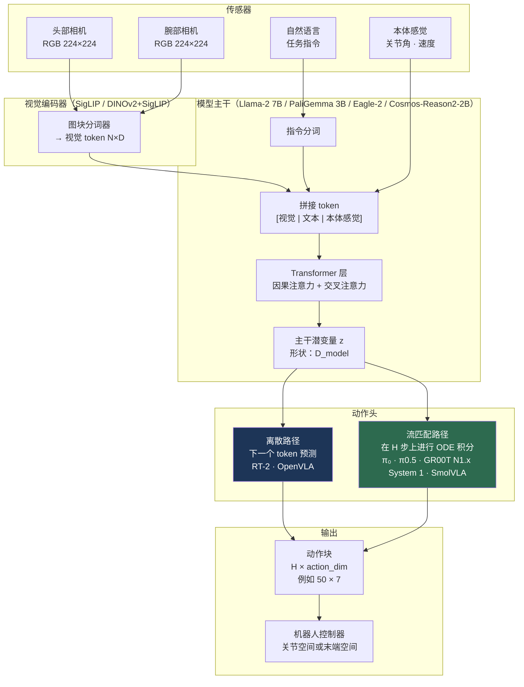
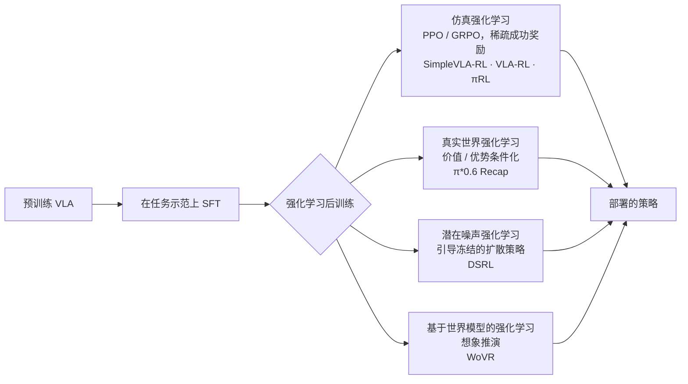

# 视觉-语言-动作（VLA）模型

> **英文原文：** [cv-knowledge-base/06_robotics_and_embodied_ai/01_vla_models.md](../../cv-knowledge-base/06_robotics_and_embodied_ai/01_vla_models.md)（本中文版供参考，内容以英文原文为准）

> **最后更新：** 2026年10月
> **难度级别：** 研究前沿
> **相关章节：**
> - [具身智能概述与路线图](./00_overview_roadmap.md)
> - [多模态视觉-语言模型](../05_multimodal_vision_language/00_overview.md)
> - [研究前沿 2024–2026](../12_research_frontier_2024_2026/04_vla_embodied_2025_2026.md)
> - [数据集与基准](../11_datasets_and_benchmarks/02_3d_and_robotics_datasets.md)

> **🆕 2026年10月更新：**
> - 新增以下模型的技术摘要：**π0.5（已开源）+ 知识隔离**、**π\*0.6 / Recap**、**Gemini Robotics 1.5 / ER 1.5 / On-Device**、**GR00T N1.5 → N1.6 → N1.7**、**SmolVLA**、**OpenVLA-OFT**、**TRI 大型行为模型**，更新了 **Figure Helix** 的细节，并概述了 2025–2026 年的开源 VLA 生态（X-VLA、InternVLA-M1、GR-3、WALL-OSS、MolmoAct2）。
> - 新增 **VLA 强化学习微调** 一节（RL4VLA、VLA-RL、RIPT-VLA、SimpleVLA-RL、πRL、DSRL、Recap、基于世界模型的强化学习），并附方法对比表。
> - 新增动作头相关内容：知识隔离、实时分块（RTC）、离散扩散动作解码。
> - 更正了 GR00T N1 的相关事实（发布模型为 2.2B；论文中没有 34B 版本；作者为 Bjorck et al.）；新增 LIBERO 时代的基准结果行并指出其饱和现象；更新了开放问题与延伸阅读。

---

## 概述

视觉-语言-动作（Vision-Language-Action, VLA）模型是一类神经网络架构，它以视觉观测和自然语言指令共同作为机器人控制策略的条件，直接将动作作为模型输出生成。VLA 的决定性特征是将感知、语言理解和动作生成置于单一可微分计算图之中——与将三者视为独立子系统的模块化流水线相对。这一设计选择源于这样一个假设：在互联网视觉-语言数据上进行大规模预训练所得到的表示，可以有益地迁移到机器人控制中 [Brohan2023]；同时也源于一个经验观察：涌现能力（多步推理、对新物体的泛化）出现在用网络数据训练的 VLA 中，而不出现在纯机器人数据训练的策略中。

在架构上，所有 VLA 都共享三个组件。第一，**视觉编码器** 将一张或多张 RGB 图像（有时还包括深度、腕部相机或本体感觉读数）映射为视觉 token 序列。第二，**语言模型主干** 处理交错的视觉与文本 token，生成丰富的上下文表示。第三，**动作头** 将主干最后的隐藏状态映射为机器人动作。区分不同 VLA 的设计选择包括：(a) 主干的规模与预训练方式；(b) 动作头的架构与输出格式；(c) 将机器人轨迹与互联网规模预训练数据衔接起来的数据流水线。

该领域发展迅速。RT-1 [Brohan2022]（2022 年末）在 13 万条内部示范上从零训练了一个紧凑的 Transformer，在固定厨房环境中取得了令人印象深刻的结果，但没有网络预训练。RT-2 [Brohan2023]（2023 年中）证明，在机器人数据上协同微调一个 55B 视觉-语言模型，可以将互联网知识——包括物体概念和思维链推理——迁移到机器人策略中，在未见物体上的成功率比 RT-1 提高一倍以上。2024–2025 年的这一代模型引入了流匹配（flow matching）动作头（π₀ [Black2024]）、开放权重模型（OpenVLA [Kim2024]），以及专为人形机器人设计的双系统架构（GR00T N1 [NVIDIA2025]）。到 2026 年中，VLA 已在商业场景中部署——BMW 工厂、家庭试点——研究前沿已转向长时程泛化、端侧推理效率和多机器人协作。2025 年末至 2026 年 10 月这一时期由三项进展定义：(i) VLA 的 **强化学习后训练**，以 Physical Intelligence 的 π\*0.6 为代表，它借助 Recap 算法从自身部署经验中不断改进 [PI2025Recap]；(ii) 前沿系统中 **具身推理** 与 **动作生成** 的分离（Gemini Robotics-ER 1.5 编排 Gemini Robotics 1.5 VLA）[GoogleDeepMind2025b]；(iii) 丰富的 **开放权重生态**——openpi 中的 π0.5、GR00T N1.5/N1.6/N1.7、SmolVLA、OpenVLA-OFT、X-VLA——它们将标准 LIBERO 基准推高到约 97–98%，迫使领域转向更困难的真实世界评测（RoboArena）以及基于世界模型的策略评估。

---

## 架构深入解析

### 视觉编码器

早期 VLA（RT-1）使用经 FiLM 条件化的 EfficientNet-B3，每帧提取 81 个图像 token，并在每个残差层以语言嵌入对视觉特征进行条件化。这样无需预训练 VLM 主干即可产生与任务相关的表示。现代 VLA 则复用预训练 VLM 的视觉编码器：PaliGemma 中的 SigLIP-400M（被 π₀ [Black2024] 使用）、OpenVLA [Kim2024] 中融合的 DINOv2 + SigLIP 编码器，以及 GR00T N1 的 Eagle-2 主干中的 SigLIP-2 [NVIDIA2025]。其优势在于，这些编码器已经表示了从数十亿图文对中学到的语义物体类别、可供性和空间关系，从而减少了所需的机器人特定视觉学习量。2025–2026 年的新一代模型越来越多地采用 **具身推理 VLM** 作为完整的感知-语言栈：GR00T N1.6 使用 NVIDIA 内部的 Cosmos-Reason-2B 变体，GR00T N1.7 使用 Cosmos-Reason2-2B（Qwen3-VL 架构），二者都以原生宽高比编码图像而无需填充 [NVIDIA2026]；SmolVLA 则使用截断的 SmolVLM2，并减少每帧视觉 token 数以提升效率 [Shukor2025]。

多相机配置是灵巧操作的常态：头部/外部相机提供全局上下文，腕部相机提供与任务相关的近距离细节。GR00T N1 和 π₀ 都处理多视角 RGB 流。相机 token 通常被展平，并在送入 Transformer 主干之前置于语言 token 之前。

### 语言模型主干

主干为 VLA 提供"推理引擎"。其规模已大幅增长：

| 时期 | VLA | 主干 | 参数量 |
|-----|-----|----------|--------|
| 2022 | RT-1 | 自定义 Transformer | 35M |
| 2023 | RT-2 | PaLI-X / PaLM-E | 12B–55B |
| 2024 | OpenVLA | Llama 2 (Prismatic-7B) | 7B |
| 2024 | π₀ | PaliGemma | 3B |
| 2025 | GR00T N1 (GR00T-N1-2B) | Eagle-2 (SigLIP-2 + SmolLM2) | 总计 2.2B（VLM 1.34B） |
| 2025 | π0.5 | 基于 PaliGemma 的 VLM + 动作专家 | ~3B 量级 |
| 2025 | SmolVLA | SmolVLM2（截断）+ 流匹配专家 | 450M |
| 2025 | GR00T N1.5 | Eagle 2.5（冻结）+ DiT | 3B |
| 2025 | Gemini Robotics 1.5 | Gemini（规模未公开） | — |
| 2025 | X-VLA | 软提示 Transformer 编码器 + 流匹配 | 0.9B |
| 2025 | GR00T N1.6 | Cosmos-Reason-2B 变体 + 32 层 DiT | 3B |
| 2026 | GR00T N1.7 | Cosmos-Reason2-2B (Qwen3-VL) + 16 层 DiT | 3B |

主干处理一个扁平的 token 序列：`[image tokens] [task description tokens] [history tokens]`，其最后一层的输出被动作头使用。对于离散动作 VLA（RT-2、OpenVLA），主干的语言建模头被直接复用来预测动作 token。对于连续动作 VLA（π₀、GR00T N1），主干产生一个潜向量，用于条件化一个独立的生成式动作头。

### 动作头设计

这是架构上最多样化的组件。主要有三种范式：

#### 离散 token 化（RT-2、OpenVLA）

每个动作维度被离散化为覆盖动作范围的 256 个区间，每个区间映射到现有 LLM 词表中的一个 token（这些 token 是从使用频率最低的词表条目中"挪用"的）。随后主干像预测文本 token 一样对动作 token 进行自回归预测，使训练过程与标准的下一个 token 预测完全一致。

```
# RT-2 / OpenVLA 动作 token 化
action_range = [-1, 1]   # 每个维度归一化
n_bins = 256
bin_id = floor((action + 1) / 2 * n_bins)  # [0, 255] 中的整数
token_id = vocab_offset + bin_id           # 映射到 LLM 词表
```

**优点：** 无需改动架构；可利用 LLM 的世界知识实现上下文内泛化。  
**缺点：** 离散化有损；逐维独立采样忽略了动作间的相关性；被挪用的 token 可能干扰语言表示。

#### 连续回归（Octo、ACT）

一个轻量级 MLP 或 Transformer 头将主干的输出潜变量直接映射为连续动作向量（或一个短动作块）。通常使用均方误差或行为克隆进行训练。

```
# 动作块预测（ACT 风格）
action_chunk = MLP(z_backbone)  # 形状：(H, action_dim)
loss = MSE(action_chunk, demonstration_chunk)
```

**优点：** 精确的连续输出；推理速度快。  
**缺点：** 单峰——无法表示双峰或多峰动作分布，在包含多种有效策略的示范上会出现"平均化"失败模式。

#### 流匹配（π₀、GR00T N1）

流匹配 [Lipman2022] 定义一个向量场 `v_θ(x_t, t)`，沿直线概率流将样本从源分布（高斯噪声）输运到目标动作分布。模型通过将预测流回归到条件流来训练：

```
# 流匹配训练目标
# x_0 ~ N(0, I)：噪声样本
# x_1：来自示范的目标动作
# x_t = (1 - t) * x_0 + t * x_1   （线性插值，t ~ U[0,1]）
# 条件 c：来自主干的视觉 + 语言潜变量

loss = ||v_θ(x_t, t, c) - (x_1 - x_0)||^2

# 推理：从 t=0 积分 ODE 到 t=1
# dx/dt = v_θ(x_t, t, c)
# 实践中，π₀ 使用 10 个 Euler 步即可
```

由于流匹配同时对整个动作块 `(H, action_dim)` 进行采样，它能捕捉动作块内部的时间相关性，并在不发生模式平均的情况下处理多模态分布。π₀ 一次生成 H=50 个未来动作，以 50 Hz 执行，提供 1 秒的前瞻。在消费级 GPU 上约 73 ms 的推理时间使其可用于实时控制。

**优点：** 连续、多模态、时间上连贯的动作块；无离散化伪影；采样快（一次 ODE 求解，约 10 步）。  
**缺点：** 推理延迟略高于单步回归；需要额外的动作专家模块（π₀ 约 3 亿参数）。

#### 混合方式：知识隔离（π0.5 + KI，2025）

将随机初始化的动作专家与预训练 VLM 联合训练，会使动作专家的噪声梯度流入主干，损害其语义知识并拖慢训练。**知识隔离（Knowledge Insulation）**[Driess2025] 用普通的下一个 token 预测在离散 FAST 动作 token（以及网络数据）上训练 VLM 主干，同时让流匹配动作专家在 **停止梯度（stop-gradient）** 下读取主干特征。推理时使用快速的连续专家。openpi 的 π0.5-DROID 检查点即以此方式训练，据报道推理速度快且语言跟随能力良好。

```
# 知识隔离（示意）
L = CE(VLM(o, ℓ) -> FAST_tokens(a))            # 主干以 token 形式学习动作
  + CE(VLM(o, ℓ) -> web/VQA targets)           # 保留 VLM 知识
  + || v_ψ(x_t, t, sg[h_VLM]) - (x_1 - x_0) ||²  # 动作专家；sg = 停止梯度
```

#### 离散扩散动作解码（2025）

另一种替代方案保持动作为离散 token，但在 VLM Transformer 内部使用 **掩码离散扩散** 而非从左到右的自回归进行解码（例如 Discrete Diffusion VLA，arXiv 2508.20072），从而在仍保持单一交叉熵训练主干的同时，对整个动作块进行并行、迭代式的细化。

#### 实时分块（RTC，2025）

动作分块策略会开环执行 H 步；如果计算下一个动作块所需时间超过控制周期，简单切换就会导致停顿或不连续。**实时分块（Real-Time Chunking）**[Black2025RTC]（NeurIPS 2025）在当前动作块执行的 *同时* 生成下一个动作块：冻结将在推理延迟期间执行的动作，并用引导式流匹配采样器对其余部分进行 **补全（inpainting）**；其训练时变体（arXiv 2512.05964）在训练过程中直接以已提交的前缀为条件，消除了推理时的引导开销。RTC 封装随 GR00T N1.6 工具链一同公布，RLinf 也在 2026 年增加了对仿真（LIBERO）和真实 Franka 机器人的 RTC 支持。

---

## VLA 推理栈



---

## 逐个模型的技术摘要

### RT-1 (Brohan et al., 2022, CoRL / RSS 2023)

RT-1 首次证明，一个紧凑的（3500 万参数）Transformer 在大规模真实机器人示范上训练后，可以在固定环境中实现广泛的任务覆盖。该架构使用 FiLM 条件化将语言嵌入注入 EfficientNet-B3 视觉编码器的每个残差块，每帧生成 81 个语言条件化的视觉 token。随后 TokenLearner 模块通过可学习的加权池化将其压缩为 8 个 token，大幅缩短送入 8 层 Transformer 主干的序列长度。六帧图像被拼接（6 × 8 = 共 48 个 token），Transformer 输出一个 11 维离散动作 token（三维平移、三维旋转、夹爪、底座 x/y/偏航、回合终止），每一维离散化为 256 个区间。

**训练数据：** 使用 13 台 EDR 机器人在厨房环境中历时 17 个月收集的 13 万个回合。每个回合都标注了自然语言指令。

**结果：** 在 700 多条已见指令上成功率 97%；在未见指令上 76%（比最佳基线高 24%）；有干扰物时 83%；背景变化时 59%。

**主要局限：** 无互联网预训练；对新物体、新场景或具身变化很脆弱；语言条件化基于 FiLM（早期融合）而非注意力，限制了组合泛化。

---

### RT-2 (Brohan et al. / Zitkovich et al., 2023, CoRL)

RT-2 是确立 VLA 范式的关键论文。它在机器人轨迹数据与原始互联网 VLM 训练任务（视觉问答、图像描述）的混合数据上，协同微调两个预训练视觉-语言模型——PaLI-X（5B 和 55B 版本）和 PaLM-E-12B。动作以文本 token 表示：每个动作维度离散化为 256 个区间，这些区间作为特殊 token 添加到 VLM 词表中。

协同微调目标是在文本和动作 token 上进行标准的下一个 token 预测，使机器人轨迹在优化器看来与文本序列无异。这使模型在获得动作生成能力的同时，保持其语言和视觉理解能力。

**涌现行为：** RT-2 表现出多步思维链推理（例如，可以被提示先推理哪个物体可回收再去拿取），并能迁移来自网络预训练的物理/语义知识（例如，即使机器人训练数据中从未出现"狮子"，也能正确理解"拿起狮子玩具"）。

**结果：** RT-2-PaLI-X-55B 和 RT-2-PaLM-E-12B 在未见物体任务上的平均成功率都约为 62%，而 RT-1 基线约为 32%。在 Language Table 仿真基准上，RT-2 达到 90% 的成功率，此前最先进水平为 77%。

**主要局限：** 离散动作 token 化引入有损量化，并将各维度视为独立；模型权重未公开；推理需要部署 55B 模型。

---

### Open X-Embodiment / RT-X (Open X-Embodiment Collaboration, 2023, ICRA 2024 — Best Paper)

RT-X 并非单一模型，而是一个协作构建的数据集与模型家族，汇集了来自 21 个机构的 22 种不同机器人具身，涵盖 527 种不同技能和 160,266 个任务回合。其核心假设是：跨具身数据提供了单一具身数据集无法提供的正则化和覆盖面，在这种混合数据上训练的策略会表现出"正迁移"——在任何单一具身上的表现都优于仅用该具身数据训练的模型。

发布了两个模型变体（RT-1-X 和 RT-2-X），都在完整的 Open X-Embodiment 混合数据上训练。OpenVLA 后来证明，在相同混合数据上训练的 7B 开放权重模型在若干基准上可以达到 RT-2-X 的性能 [Kim2024]。

**关键洞见：** 在数据稀缺的情况下，跨具身训练可以替代规模；一台在 Franka 机械臂上见过叠衣服的机器人，可以将部分结构迁移到另一种机械臂上。

---

### π₀ (Black et al., 2024, Physical Intelligence)

π₀ 是首个在真正灵巧的操作任务——叠衣服、拉开袋子拉链、整理桌面——上展现出竞争力的 VLA，这些任务需要平滑、高频、多关节的协调，而非离散的抓取-放置动作。其关键架构创新是 **动作专家**：一个约 3 亿参数的独立 Transformer 模块，它与流匹配噪声向量一起处理 PaliGemma 主干的输出潜变量，并输出连续动作块。

主干是 PaliGemma（30 亿参数，Google 基于 SigLIP + Gemma 构建的开放 VLM），提供视觉和语言理解。动作专家随机初始化，与主干联合训练（主干以较低学习率微调）。推理时，通过对 ODE `dx/dt = v_θ(x_t, t, c)` 进行 10 步 Euler 积分来求解流匹配，同时生成 H=50 个未来动作。这在消费级硬件上带来约 73 ms 的推理延迟，足以进行实时控制。

**训练数据：** 来自多种机器人平台（单臂、双臂、移动操作机器人）、超过 10,000 小时的机器人轨迹数据，带有自然语言指令标注。

**结果（独立基准，[benchmarkpaper2024]）：**
- 分布内（4 任务宏平均）：成功率约 72%
- 空间分布外：约 67%（−5 个百分点）
- 未见物体（实例 + 空间分布外）：约 59%（−13 个百分点）
- 对比：ACT 分布内为 48%，在未见物体上降至约 6%

**主要局限：** 训练数据为专有且未公开；模型本身并非完全开放权重；推理延迟（73 ms）使其在没有投机解码或蒸馏的情况下无法高于约 14 Hz 运行。

---

### OpenVLA (Kim et al., 2024, CoRL)

OpenVLA 是首个在标准基准上达到 RT-2 性能的完全开放权重、开放数据的 VLA。主干为 Prismatic-7B，它将 Llama 2（7B）与一个融合视觉编码器结合，该编码器组合了 DINOv2-ViT-L（1.1B）和 SigLIP-ViT-So400M（400M）。融合编码器比任一单独编码器产生更丰富的视觉表示，结合了 DINOv2 的空间/几何特征与 SigLIP 的语义、语言对齐特征。动作按每维 256 个区间离散化（7 自由度机械臂为 7 维），并以自回归方式预测，与 RT-2 的输出格式一致。

模型在完整的 Open X-Embodiment 数据集（97 万条轨迹）上训练，使其在发布时成为训练数据最广泛的开放权重机器人策略。模型权重和训练代码均以宽松许可证发布。

**结果：**
- Google Robot 任务：平均成功率 85.0 ± 4.6%（RT-2-X：78.3 ± 5.4%）
- BridgeV2（零样本）：在未见任务上成功率 56–65%
- OpenVLA 和 RT-2-X 在这些基准上都显著优于 RT-1-X 和 Octo

**主要局限：** 离散动作 token 化限制了灵巧性；7B 参数主干推理需要 ≥20 GB 显存的 GPU；采用单步预测而非动作块。

---

### GR00T N1 (NVIDIA, March 2025, arXiv)

GR00T N1 引入了一种明确受认知科学中 System 1 / System 2 区分启发的双系统架构。System 2（慢速、深思熟虑）是 Eagle-2 VLM（SigLIP-2 视觉编码器 + SmolLM2 语言主干；在已发布的 GR00T-N1-2B 模型中有 13.4 亿参数），以约 10 Hz 运行，解读多视角 RGB 观测和自然语言指令，并生成高层上下文向量。System 1（快速、自动）是一个以 50+ Hz 运行的扩散 Transformer（DiT）运动控制器，以 System 2 的上下文向量和当前本体感觉状态为条件，生成流畅、连续的关节位置轨迹。

DiT 动作解码器使用自适应层归一化，同时以扩散时间步和 System 2 上下文为条件，并通过一个可学习的线性投影头（"Action Decoder"）生成特定具身的动作，将潜在轨迹映射为可变自由度人形机器人（从 10 自由度双臂到 50+ 自由度全身系统）的关节位置指令。

**训练数据：** 50,000+ 条机器人轨迹 + 300 万段第一人称人类视频片段 + Isaac Sim 合成轨迹。NVIDIA 的合成数据流水线（GR00T Blueprint）可在 11 小时内生成 78 万条轨迹。

**结果：** 结合合成与真实训练数据时，任务成功率比基线提升 40%（基于 NVIDIA 内部基准）。已发布的 2.2B 参数变体（1.34B VLM + 约 860M DiT）可在 Hugging Face 获取。*更正（2026 年 10 月）：* 本文件早期版本描述了一个 34B 的"完整"GR00T N1；GR00T N1 论文仅描述了 2.2B 的 GR00T-N1-2B 模型。

**主要优势：** 专为人形机器人全身控制设计；公开发布模型权重；强大的合成数据基础设施；以真实的全身控制频率运行。

---

### π₀.5 (Physical Intelligence, April 2025, arXiv 2504.16054)

π₀.5 扩展了 π₀，实现了对训练中从未见过的全新家庭环境的有意义泛化。核心训练变化是 **异构协同训练**：模型同时在机器人操作轨迹、高层语义预测任务（给定图像预测下一步该做什么）和网络规模视觉-语言数据上训练。消融实验表明，网络数据是对分布外物体泛化最重要的单一因素，而跨机器人数据对通用任务能力至关重要。

相对 π₀ 的架构变化包括：用 AdaRMSNorm（自适应 RMS 归一化）替代基于 MLP 的扩散时间步融合；将机器人状态在 `[-1, 1]` 上离散化为 256 个区间，并作为离散 token 加入语言前缀（而非作为原始浮点数），据报道这能稳定训练。

**关键结果：** π₀.5 能在全新的家庭中（新家具、新物体、新光照）成功执行家务操作任务，而无需任何针对环境的微调——这是之前的 VLA 无法可靠展示的能力。

**2025 年后续进展。** π0.5 采用分层方式训练：同一模型先用语言预测一个高层语义子任务，再预测低层动作块。其训练混合数据包括网络数据（图像描述、VQA、检测）、口头指令、子任务标签、跨具身机器人数据、多环境静态机器人数据，以及约 400 小时的移动操作数据。2025 年 9 月，Physical Intelligence 在 **openpi** 中发布了 π0.5 基础及微调检查点（LIBERO、DROID），并提供 PyTorch 支持；π0.5-LIBERO 检查点在四个 LIBERO 套件上的平均成功率为 96.85%（Spatial / Object / Goal / Long 分别为 98.8 / 98.2 / 98.0 / 92.4）。

---

### Helix (Figure AI, 2025)

Helix（2025 年 2 月发布）是 Figure AI 面向 Figure 02 平台全身人形灵巧操作的专有 VLA。在架构上它是一个双系统：**System 2** 是一个源自开放权重模型的 70 亿参数 VLM，以 7–9 Hz 运行，负责场景与语言理解；**System 1** 是一个 8000 万参数的交叉注意力视觉运动 Transformer，以 200 Hz 运行，以来自 System 2 的潜向量为条件，在 35 自由度动作空间上输出连续控制。Figure 报告其训练使用了约 500 小时带自动标注指令的遥操作数据。其显著特点包括：(a) 完全运行于机载嵌入式低功耗 GPU（无云端推理）；(b) 同时输出对整个人形上半身——手腕、躯干、头部以及各个手指——的高频连续控制；(c) 支持双机器人协作，两台搭载 Helix 的机器人共同完成一项涉及双方都从未接触过的物体的长时程操作任务。

Helix 是 Figure AI 在 2025 年结束与 OpenAI 的合作、转而构建完全自研 AI 栈之后完全自主开发的。在 BMW 南卡罗来纳州 Spartanburg 工厂的商业部署已累计运行 1,250+ 小时，为 30,000 辆汽车装载了 90,000+ 个零件。

Helix 尚未公开报告其在标准学术基准上的数值。2025 年间，Figure 发布了 Helix 在物流包裹处理和家务任务上的扩展，并于 2025 年 10 月推出围绕 Helix 构建的重新设计的 **Figure 03** 人形机器人（新增手部触觉传感与相机，面向家庭的设计）；BMW 的 Figure 02 机队在完成部署周期后已退役。

---

### OpenVLA-OFT (Kim, Finn, Liang, Feb 2025, arXiv 2502.19645)

OpenVLA-OFT 研究的是 **如何微调** VLA，而非如何预训练它。将 OpenVLA 的自回归 256 区间解码替换为：(a) 在一次前向传播中 **并行解码** 整个动作块；(b) 采用 **L1 回归** 目标的连续动作；(c) 面向多视角输入的基于 FiLM 的语言条件化——这使 LIBERO 平均成功率从 76.5% 提升到 **97.1%**，并将动作生成吞吐量提高约 26 倍。该方案（OFT）被广泛用作 VLA 强化学习工作（SimpleVLA-RL、RLinf）的 SFT 起点。

---

### SmolVLA (Shukor et al., Hugging Face, June 2025, arXiv 2506.01844)

SmolVLA 是一个 **4.5 亿参数** 的 VLA，设计目标是能在单张 GPU 上训练并在消费级硬件上运行。它截断了 SmolVLM2 主干（只使用较低层，作者发现这对控制已经足够），减少每帧视觉 token，并增加一个交替使用自注意力与交叉注意力的流匹配动作专家。预训练仅使用社区贡献的、在低成本机械臂（SO-100/101）上采集的 LeRobot 数据集。其 **异步推理** 栈将动作预测与执行解耦，使机器人在动作块之间不会空闲。据报道，SmolVLA 在 LIBERO、Meta-World 和真实 SO-100 任务上可与大得多的 VLA（π0、OpenVLA）竞争，并且是 LeRobot 中的默认 VLA。

---

### GR00T N1.5 / N1.6 / N1.7 (NVIDIA, 2025–2026)

NVIDIA 大约每六个月迭代一次 GR00T，所有版本均以约 30 亿参数的检查点形式在 Isaac-GR00T 代码仓库中发布 [NVIDIA2026]：

| 版本 | VLM 主干 | 动作头 | 数据 / 训练变化 | 报告效果 |
|---|---|---|---|---|
| N1.5（2025 年中） | Eagle 2.5，在预训练和后训练中均 **冻结**；简化的 MLP 适配器 | 流匹配 DiT | 在人类第一人称视频上使用 FLARE（未来潜在表示对齐）；DreamGen 合成神经轨迹 | GR-1 任务上语言跟随 93.3%，N1 为 46.6%；少样本与新物体泛化更好 |
| N1.6（2025 年末） | 内部 Cosmos-Reason-2B 变体；解冻 VLM 顶部 4 层；原生宽高比图像 | 规模翻倍的 DiT（32 层 vs. 16 层） | 状态相对动作块；额外数千小时遥操作数据（双臂 YAM、AgiBot Genie-1 等）；RTC/异步封装 | LIBERO 平均约 97%；提供 BEHAVIOR-1K 与 Unitree G1 移动操作检查点 |
| N1.7（2026） | Cosmos-Reason2-2B (Qwen3-VL) | 流匹配 DiT（16 层），动作时域 40，状态/动作维度 132 | **机器人与人类共享的相对末端执行器动作空间**；2 万小时 EgoScale 人类视频；Apache 2.0；可导出 ONNX/TensorRT 至 Jetson Thor/Orin | 与 N1.6 相当，泛化与语言跟随有所提升 |

这一演进轨迹颇具启发性：NVIDIA 从通用 VLM 转向 **物理推理 VLM**（Cosmos Reason），从绝对动作空间转向 **相对动作空间**，并从仅用机器人数据转向 **大规模人类视频**。

---

### Gemini Robotics 1.5, ER 1.5 and On-Device (Google DeepMind, 2025)

- **Gemini Robotics On-Device**（2025 年 6 月）是一个经过优化、可在机器人本地低延迟运行的 VLA；DeepMind 报告其可通过 50–100 次示范适应新任务，并可迁移到双臂 Franka 和 Apptronik Apollo 平台。受信测试者通过 Gemini Robotics SDK（Safari SDK）访问。
- **Gemini Robotics 1.5**（2025 年 9 月）是一个"会思考"的 VLA：在行动之前，它可以输出一段内部自然语言推理轨迹，将指令分解为短时程步骤，从而改善多步任务表现和可解释性。**运动迁移（Motion Transfer, MT）** 训练方案使不同具身之间的运动对齐，单个检查点即可控制 ALOHA、双臂 Franka 和 Apollo，在一台机器人上示范的技能能零样本迁移到其他机器人上 [GoogleDeepMind2025b]。
- **Gemini Robotics-ER 1.5** 是具身推理"编排器"：它执行指点、二维/三维定位、轨迹以及成功/进度估计，能调用网页搜索等工具，并向 VLA 下达自然语言指令。它是首个通过 Gemini API 向开发者广泛开放的 Gemini Robotics 模型，DeepMind 报告其在 15 个具身推理基准组成的套件上达到最先进水平。

这种 **智能体式双模型设计**（ER 规划器 + VLA 执行器）将 Helix 和 GR00T 的双系统思想，从固定的潜在接口推广为支持工具使用的语言接口。

---

### π\*0.6 and Recap (Physical Intelligence, November 2025)

π0.6 是升级后的基础 VLA（主干和动作专家均大于 π0.5）；**π\*0.6** 则是在 π0.6 基础上进一步用 **Recap**（*RL with Experience and Corrections via Advantage-conditioned Policies*，基于经验与纠正、通过优势条件化策略的强化学习）训练的版本 [PI2025Recap]。其流程为：(1) 在多样化数据上用离线强化学习进行预训练；(2) 部署到任务上，收集自主运行回合，并在机器人出错时收集 **专家遥操作纠正**；(3) 在全部数据上训练一个分布式 **价值函数**（预测进度/距成功所需时间）；(4) 计算优势值，并以二值化的 **改进指示变量** 为条件训练策略；推理时以"高优势"为条件。

```
# 优势条件化的策略改进（示意，参照 Recap）
A(o_t, a_t) ≈ V(o_{t+k}) - V(o_t) + r_{t:t+k}        # 基于价值的优势估计
I_t = 1[A(o_t, a_t) > ε]                              # 改进指示变量
L = - log π_θ(a_t | o_t, ℓ, I_t)                       # 在全部数据上的监督损失，
                                                       # 以 I_t 为条件
# 推理：采样 a ~ π_θ(· | o, ℓ, I = 1)（可选地使用 CFG 式引导）
```

由于策略是在全部数据上用监督损失而非策略梯度训练的，Recap 可扩展到数十亿参数的流匹配 VLA。Physical Intelligence 报告称，π\*0.6 在最困难的任务（制作意式浓缩咖啡、折叠多样衣物、组装纸箱）上吞吐量提高一倍以上、失败率大约减半，成功率超过 90%，并能连续运行数小时（例如从清晨到深夜提供咖啡服务）。这些是公司自行报告的结果，没有独立基准验证。

---

### Large Behavior Models (TRI, July 2025, arXiv 2507.05331)

TRI 的《A Careful Examination of Large Behavior Models for Multitask Dexterous Manipulation》因其 **方法论** 而值得关注：在真实和仿真的双臂任务上进行盲测、随机化的 A/B 评估，并给出统计置信区间。其 LBM 是扩散 Transformer 策略（语言条件化、多相机），在约 1,700 小时机器人数据（TRI 遥操作数据、OXE 子集和仿真数据）上预训练。报告的发现：预训练提升了鲁棒性和成功率，微调后的 LBM 达到目标性能所需的任务特定数据显著少于单任务基线——但收益比宣传性演示所暗示的要小，需要细致的评估才能检测出来。2025 年 8 月，Boston Dynamics 与 TRI 展示了由 LBM 控制电动 Atlas 人形机器人进行长时程全身操作。

---

### The 2025–2026 Open-VLA Ecosystem (brief)

| 模型 | 机构 | 核心思想 |
|---|---|---|
| GR-3 (Jul 2025, arXiv 2507.15493) | ByteDance Seed | 与网络视觉-语言数据和人类 VR 轨迹协同训练的大型 VLA；双臂移动机器人 |
| InternVLA-M1 (Oct 2025, arXiv 2510.13778) | Shanghai AI Lab | 空间引导的 VLA：先进行空间定位预训练，再进行空间提示的动作后训练 |
| X-VLA (Oct 2025, arXiv 2510.10274) | Tsinghua AIR et al. | 按具身设置 **软提示**；0.9B；LIBERO 98.1%；仅通过学习提示即可适配新机器人 |
| WALL-OSS (Sep 2025, arXiv 2509.11766) | X Square Robot | 混合离散与流匹配动作的 MoE 动作头；统一的跨层级思维链 |
| Galaxea G0 (Sep 2025, arXiv 2509.00576) | Galaxea | 双系统 VLA + Galaxea Open-World 数据集 |
| MolmoAct2 (2026, arXiv 2605.02881) | Allen AI | 面向真实世界部署的完全开放"动作推理模型"家族 |
| DreamZero (Feb 2026, arXiv 2602.15922) | NVIDIA | 世界动作模型（视频扩散主干）——见[世界模型](./02_world_models.md) |

---

## VLA 的强化学习微调（2025–2026）

监督式模仿继承了示范者的上限，并受误差累积之苦。强化学习微调可同时解决这两个问题，并在 2025 年成为继预训练和 SFT 之后的第三个标准训练阶段。VLA 特有的关键挑战包括：(a) **似然**：流匹配头没有可解析的动作对数概率；(b) **奖励**：真实世界中的成功检测；(c) **系统**：GPU 并行仿真器或物理机器人上的推演必须与数十亿参数的更新交替进行。



| 方法 | 年份 | 基础策略 | 强化学习形式 | 亮点 |
|---|---|---|---|---|
| RL4VLA ("What Can RL Bring to VLA Generalization?") | 2025 (NeurIPS) | OpenVLA | 仿真中的 PPO | 相比 SFT，强化学习提升语义与执行泛化；视觉鲁棒性相近 |
| VLA-RL | 2025 | OpenVLA | 使用学习的机器人过程奖励模型的在线 PPO | 将轨迹级强化学习建模为多轮对话 |
| RIPT-VLA | 2025 | QueST, OpenVLA-OFT | 基于稀疏二值奖励的交互式后训练（留一法 PPO） | 从极少示范中获得显著提升 |
| SimpleVLA-RL | 2025 (arXiv 2509.09674) | OpenVLA-OFT | 在 veRL 上进行 GRPO 式结果奖励强化学习 | 在 LIBERO / RoboTwin 数据稀缺条件下大幅提升；出现"pushcut"新行为 |
| πRL | 2025 (arXiv 2510.25889) | π0, π0.5 | 借助 Flow-Noise 或 Flow-SDE 似然的 PPO/GRPO | π0.5 ManiSkill3 多任务 40.1% → 90.9%；MetaWorld MT50 43.8% → 70.7% |
| DSRL | 2025 (arXiv 2506.15799) | 扩散 / 流策略（含 π0） | 在策略的 **潜在噪声空间** 中进行 SAC；基础权重冻结 | 黑盒、样本高效的引导 |
| Self-Improving Embodied Foundation Models | 2025 (NeurIPS, arXiv 2509.15155) | Google DeepMind EFMs | 由模型自身给出"剩余步数"奖励；自主练习 | 自我改进比增加模仿数据更样本高效 |
| Recap (π\*0.6) | 2025 (arXiv 2511.14759) | π0.6 | 优势条件化策略、分布式价值函数、人类纠正 | 复杂任务上真实世界吞吐量提升 >2 倍 |
| WoVR | 2026 (arXiv 2602.13977) | VLAs | 在作为模拟器的学习世界模型中进行强化学习 | 降低真实/仿真推演成本 |

开源的 **RLinf** 框架（RLinf-VLA，RSS 2026；OSDI 2026 系统论文）在多种仿真器（ManiSkill、LIBERO、RoboTwin、BEHAVIOR、Isaac Lab）和真实机器人上支持上述大部分算法，并被 Isaac Lab 3.0 采用于 VLA 后训练。

---

## 模型对比表

| 模型 | 主干 | 动作头 | 数据规模 | 是否开源 | 主要优势 | 主要劣势 |
|-------|----------|-------------|------------|-------------|--------------|--------------|
| RT-1 | FiLM-EfficientNet + 自定义 Transformer (35M) | 离散 256 区间 token，11 维 | 13 万回合，13 台机器人，17 个月 | 否 | 在已知任务上成功率高（97%）；3 Hz 高效推理 | 无网络预训练；对新物体/场景脆弱 |
| RT-2 | PaLI-X 55B 或 PaLM-E 12B | 离散动作 token（VLM 词表） | 机器人数据 + 互联网 VLM 数据 | 否 | 涌现思维链；在未见物体上比 RT-1 提升 2 倍 | 55B 推理成本；离散动作；专有权重 |
| OpenVLA | Prismatic-7B (Llama-2 + DINOv2 + SigLIP) | 每维离散 256 区间 token | 97 万回合（Open X-Embodiment） | 是（权重 + 代码） | 首个达到 RT-2 水平的开放权重 VLA；基准表现强 | 离散动作头；无动作分块；7B 推理显存 |
| π₀ | PaliGemma 3B | 流匹配动作专家（约 3 亿参数），H=50 动作块 | 10,000+ 小时专有多机器人数据 | 部分（公开架构描述；权重未完全公开） | 灵巧高频操作；多模态动作分布；50 Hz | 专有数据；73 ms 推理延迟；开放世界泛化有限 |
| GR00T N1 | Eagle-2（总计 2.2B，VLM 1.34B） | 扩散 Transformer (DiT) + 特定具身的动作解码器 | 5 万条轨迹 + 300 万段第一人称视频 + Isaac Sim 合成数据 | 是（2.2B 版本在 HuggingFace） | 人形全身控制；强大的仿真到真实流水线；支持可变自由度 | 发布时基准数据仅限内部评估 |
| π0.5 | 基于 PaliGemma（~3B 量级） | 流匹配专家（+ 采用 KI 的 FAST token） | 异构：机器人、移动操作、网络、口头指令 | 是（openpi，2025 年 9 月） | 对未见家庭的开放世界泛化；分层子任务预测 | 训练数据专有；长时程可靠性仍有限 |
| π\*0.6 | π0.6（大于 π0.5） | 流匹配专家，优势条件化 | π0.6 数据 + 自主经验 + 人类纠正 | 否 | 从部署中学习；复杂任务吞吐量 >2 倍 | 需要价值模型、纠正与逐任务强化学习；仅有公司报告结果 |
| Gemini Robotics 1.5 | Gemini（未公开） | 专有 | 多具身（ALOHA、Franka、Apollo） | 否（ER 1.5 通过 API 提供） | 先思考后行动；运动迁移；带工具的 ER 编排 | 权重封闭；第三方评估有限 |
| GR00T N1.6 / N1.7 | Cosmos-Reason(2)-2B | 流匹配 DiT，相对动作 | 10k+ 小时机器人数据；N1.7 增加 2 万小时人类视频 | 是（N1.7 为 Apache 2.0） | 强大的开源基线（LIBERO 约 97%）；支持边缘部署 | 以人形为中心；通用真实世界表现低于前沿闭源模型 |
| SmolVLA | SmolVLM2（截断），450M | 流匹配专家 | 社区 LeRobot 数据集 | 是 | 可在消费级 GPU/CPU 上运行；异步推理 | 在复杂灵巧任务上上限较低 |
| OpenVLA-OFT | Prismatic-7B | 并行解码的连续动作块（L1） | OXE + 任务数据 | 是 | LIBERO 97.1%；比 OpenVLA 快 26 倍 | 7B 显存占用；单具身微调 |
| Helix (Figure) | 7B VLM (S2) + 80M 视觉运动模型 (S1) | 200 Hz 连续 35 自由度 | 约 500 小时遥操作（报告值） | 否 | 机载全上半身人形控制 | 无学术基准数值 |

---

## 关键论文

| 论文 | 作者 | 年份 | 发表载体 | 主要贡献 |
|-------|---------|------|-------|-----------------|
| RT-1: Robotics Transformer for Real-World Control at Scale | Brohan, Brown et al. | 2022 | CoRL / RSS 2023 | 首个大规模 Transformer 机器人策略；13 万示范训练；700+ 任务上 97% |
| RT-2: Vision-Language-Action Models Transfer Web Knowledge to Robotic Control | Brohan/Zitkovich et al. | 2023 | CoRL | 用于机器人控制的 VLM 协同微调；"动作即文本 token"范式；涌现思维链 |
| Open X-Embodiment: Robotic Learning Datasets and RT-X Models | Open X-Embodiment Collaboration | 2023 | ICRA 2024 (Best Paper) | 22 种具身、527 项技能的跨具身数据集；机器人间正迁移 |
| OpenVLA: An Open-Source Vision-Language-Action Model | Kim et al. | 2024 | CoRL | 首个在标准基准上达到 RT-2 水平的开放权重、开放数据 7B VLA |
| π₀: A Vision-Language-Action Flow Model for General Robot Control | Black et al. | 2024 | arXiv (Physical Intelligence) | 流匹配动作头；PaliGemma 主干；50 Hz 灵巧操作 |
| GR00T N1: An Open Foundation Model for Generalist Humanoid Robots | NVIDIA (Bjorck et al.) | 2025 | arXiv 2503.14734 | 双系统（VLM + DiT）人形基础模型；2.2B 版本开放权重 |
| π₀.5: a Vision-Language-Action Model with Open-World Generalization | Physical Intelligence | 2025 | arXiv 2504.16054 | 在异构 + 网络数据上协同训练，实现对新家庭的泛化 |
| Gemini Robotics: Bringing AI into the Physical World | Google DeepMind | 2025 | arXiv | 基于 Gemini 2.0 的灵巧操作 VLA；用于空间推理的 Gemini-ER |
| FAST: Efficient Action Tokenization for Vision-Language-Action Models | Physical Intelligence | 2025 | arXiv | 基于 DCT 的频域动作分词器；相比 π₀ 流匹配训练提速 5 倍 |
| Fine-Tuning Vision-Language-Action Models: Optimizing Speed and Success (OpenVLA-OFT) | Kim, Finn, Liang | 2025 | arXiv 2502.19645 | 并行解码 + 分块 + L1 回归；LIBERO 97.1% |
| Knowledge Insulating Vision-Language-Action Models: Train Fast, Run Fast, Generalize Better | Driess et al. (Physical Intelligence) | 2025 | arXiv 2505.23705 | 在 VLM（在 FAST token 上训练）与流匹配专家之间施加停止梯度 |
| SmolVLA: A Vision-Language-Action Model for Affordable and Efficient Robotics | Shukor et al. | 2025 | arXiv 2506.01844 | 4.5 亿参数 VLA；社区数据；异步推理 |
| Real-Time Execution of Action Chunking Flow Policies (RTC) | Black, Galliker, Levine | 2025 | NeurIPS 2025 (arXiv 2506.07339) | 面向流策略的基于补全的实时分块 |
| A Careful Examination of Large Behavior Models for Multitask Dexterous Manipulation | Toyota Research Institute | 2025 | arXiv 2507.05331 | 对扩散 LBM 预训练进行统计上严谨的评估 |
| SimpleVLA-RL: Scaling VLA Training via Reinforcement Learning | Li et al. | 2025 | arXiv 2509.09674 | 在 veRL 上对 VLA 进行结果奖励强化学习 |
| Gemini Robotics 1.5: Pushing the Frontier of Generalist Robots with Advanced Embodied Reasoning, Thinking, and Motion Transfer | Google DeepMind | 2025 | arXiv 2510.03342 | 会思考的 VLA、ER 1.5 编排器、运动迁移 |
| X-VLA: Soft-Prompted Transformer as Scalable Cross-Embodiment Vision-Language-Action Model | Zheng et al. | 2025 | arXiv 2510.10274 | 具身软提示；0.9B；LIBERO 98.1% |
| πRL: Online RL Fine-tuning for Flow-based Vision-Language-Action Models | RLinf team | 2025 | arXiv 2510.25889 | 用 Flow-Noise / Flow-SDE 对 π0/π0.5 进行 PPO/GRPO |
| π\*0.6: a VLA That Learns From Experience | Physical Intelligence | 2025 | arXiv 2511.14759 | Recap 优势条件化真实世界强化学习 |

---

## 基准性能

| 模型 | 数据集 / 基准 | 指标 | 得分 | 备注 |
|-------|---------------------|--------|-------|-------|
| RT-1 | 700+ 已见任务（真实机器人） | 成功率 | 97% | 13 台 EDR 机器人，厨房领域 |
| RT-1 | 未见指令 | 成功率 | 76% | 比最佳基线高 24% |
| RT-1 | 干扰物体 | 成功率 | 83% | 相同设置，增加视觉干扰物 |
| RT-2-PaLI-X-55B | 未见物体（困难，真实机器人） | 成功率 | 62% | RT-1 基线约 32% |
| RT-2-PaLM-E-12B | 未见物体（困难，真实机器人） | 成功率 | 62% | 平均与 PaLI-X-55B 持平 |
| RT-2-PaLI-X-55B | Language Table（仿真） | 成功率 | 90% | 此前 SOTA 为 77% |
| RT-2-PaLI-X-55B | 符号理解（涌现） | 成功率 | 82% | 未显式训练；由网络预训练迁移而来 |
| OpenVLA | Google Robot 任务 | 平均成功率 | 85.0 ± 4.6% | RT-2-X：78.3 ± 5.4% |
| OpenVLA | BridgeV2（零样本） | 成功率 | 56–65% | Widow-X 机器人，未见任务划分 |
| π₀ | 分布内 4 任务宏平均 | 成功率 | ~72% | 清洗盘子、海绵、拉开袋子、叠短裤 |
| π₀ | 空间分布外 | 成功率 | ~67% | 比分布内低 5 个百分点 |
| π₀ | 未见物体（实例 + 空间分布外） | 成功率 | ~59% | 比分布内低 13 个百分点；ACT 下降 42 个百分点 |
| GR00T N1 | 仿真 + 真实综合（内部） | 任务成功 | 比基线高 40% | 合成 + 真实数据组合 |
| Helix (Figure AI) | 商业基准（BMW） | 运行小时数 | 1,250+ 小时 | 90,000+ 个零件；未公开报告相对学术任务的基准数据 |
| GR00T N1.5 | GR-1 语言跟随 | 成功率 | 93.3% | N1 为 46.6%（NVIDIA 报告） |
| OpenVLA-OFT | LIBERO（4 套件平均） | 成功率 | 97.1% | 微调后的 OpenVLA 为 76.5% |
| π0.5 (openpi) | LIBERO（4 套件平均） | 成功率 | 96.85% | 98.8 / 98.2 / 98.0 / 92.4 |
| GR00T N1.6 | LIBERO（4 套件平均） | 成功率 | ≈97.0% | 97.65 / 98.45 / 97.5 / 94.35 |
| X-VLA-0.9B | LIBERO / Simpler-WidowX | 成功率 | 98.1% / 95.8% | 代码仓库报告 |
| π0 + πRL | MetaWorld MT50 | 成功率 | 50.8% → 85.8% | 少样本 SFT → 强化学习（Flow-Noise） |
| π0.5 + πRL | ManiSkill3 多任务 | 成功率 | 40.1% → 90.9% | 少样本 SFT → 强化学习（Flow-SDE） |
| π\*0.6 (Recap) | 真实咖啡 / 衣物 / 纸箱任务 | 吞吐量、失败率 | 吞吐量 >2 倍；失败约减半 | 公司报告 |
| DreamZero-DROID | RoboArena（真实、众包） | 排行榜名次 | 第 1（2026 年 2 月） | 仅在 DROID 上训练的世界动作模型 |

---

## 优缺点

| 方面 | 优点 | 缺点 |
|--------|------|------|
| 离散动作 token 化（RT-2、OpenVLA） | 架构简单；充分利用 LLM 生成栈；易于实现；预测时受益于 LLM 世界知识 | 量化有损；逐维独立采样忽略动作相关性；挪用的词表 token 可能干扰语义表示 |
| 流匹配 / 扩散动作头（π₀、GR00T N1） | 连续输出；处理多模态分布；时间连贯的动作块；灵巧操作性能最先进 | 额外的架构组件（约 3 亿参数）；10 步 ODE 积分增加约 60–70 ms 延迟；训练比交叉熵更复杂 |
| 大型 VLM 主干（RT-2 55B） | 涌现泛化更强；语言理解更丰富；新物体识别更好 | 55B 推理成本使机载部署不可行；需要模型并行；微调代价高 |
| 开放权重 VLA（OpenVLA、GR00T N1 2.2B） | 可复现；社区可微调；便于学术基准评测；降低部署门槛 | 规模较小限制泛化；发布版本可能落后专有版本数月至数年 |
| 跨具身训练（Open X-Embodiment） | 机器人间正迁移；降低每台机器人的数据需求；表示更鲁棒 | 动作空间异构（关节角 vs. 末端位姿 vs. 增量动作）使联合训练复杂；数据集质量和标注一致性参差不齐 |
| 强化学习后训练（Recap、πRL、SimpleVLA-RL） | 超越示范者表现；学会恢复；提升速度/吞吐量 | 需要奖励或价值模型；真实世界强化学习代价高且安全攸关；仿真强化学习可能无法迁移 |
| 小型 VLA（SmolVLA、X-VLA-0.9B） | 可在普通硬件上训练与运行；迭代快；学术界易于使用 | 语义泛化和长时程任务的容量较低 |
| ER 规划器 + VLA 执行器（Gemini Robotics 1.5） | 语言接口可解释；可使用工具；复用前沿模型的推理能力 | 双模型延迟；语言接口处的错误；模型封闭 |

---

## 开放问题与研究空白

- **大规模下弥合离散与连续动作表示：** 离散 token 化保留了 VLM 结构但损失动作保真度；流匹配获得了保真度但失去了下一个 token 预测的简洁性。同时兼顾二者的有原则方法——可能通过向量量化潜动作空间或自适应 token 化——仍是开放问题。
- **大型主干的端侧推理：** 在嵌入式硬件（如 NVIDIA Jetson Orin、40 TOPS NPU）上以 50 Hz 部署 7B+ 参数的 VLA，需要激进的量化、投机解码或专用推理引擎。2025 年发布的 Gemini Robotics On-Device 是重要一步，但将该方法推广到各种架构仍未解决。
- **接触丰富与可变形物体操作：** 主要在抓取-放置任务上训练的 VLA，在插入、轴孔装配、布料操作或倒液体等任务上泛化很差。这些任务需要将力反馈整合进 VLA 回路，目前尚无架构能稳健地处理。
- **人类示范与机器人执行之间的动作分布偏移：** 通过遥操作收集的示范带有人类运动伪影（犹豫、超调、重试），对机器人模仿而言并非最优。从不完美示范中提取意图而非轨迹级行为，是一个活跃的研究方向（参见 DAgger 变体、隐式行为克隆）。
- **有原则的不确定性量化：** VLA 没有良好校准的不确定性估计。策略应能识别自己何时处于分布外，并请求人工干预或尝试保守的回退——这是当前自回归和流匹配动作头都无法提供的能力。
- **共享主干权重中的多任务干扰：** 在文本任务和机器人控制上协同微调 VLM，存在语言能力灾难性遗忘以及机器人任务之间相互干扰的风险。最优的数据混合比例和训练课程在理论上尚未被充分理解。
- **评测标准化：** 该领域缺乏一个类似 ImageNet 或 BOP 的、被普遍采用的操作基准。每篇论文使用不同的机器人平台、任务和成功标准，使跨论文比较不可靠。社区驱动的工作（LIBERO、SimplerEnv、RoboSuite）在 2025 年被广泛使用，但 LIBERO 现已饱和（许多模型约 97–98%），扰动变体显示这些分数背后的泛化很脆弱。分布式真实机器人评测（RoboArena，arXiv 2506.18123）、大型家居仿真器（BEHAVIOR-1K、RoboCasa）以及基于世界模型的评估（Veo 世界模拟器、Ctrl-World）是 2026 年的候选方案。
- **用于强化学习的奖励、价值与成功检测：** Recap 及相关方法依赖价值函数和成功标签。要让强化学习扩展到少数精选任务之外，需要通用的跨任务进度估计器——可能由 ER-VLM 提供。
- **记忆与长上下文：** VLA 通常只以一帧或少数几帧为条件。多尺度记忆（PI 的 MEM，2026；MemER，ICLR 2026）是针对需要记住数分钟前所做之事的任务的早期解决方案。

---

## 延伸阅读

- [RT-1 论文（arXiv 2212.06817）](https://arxiv.org/abs/2212.06817) —— Robotics Transformer 原始论文，含完整架构与训练细节
- [RT-2 论文（arXiv 2307.15818）](https://arxiv.org/abs/2307.15818) —— 用于机器人控制的 VLM 协同微调；策略中涌现思维链
- [π₀ 论文（arXiv 2410.24164）](https://arxiv.org/abs/2410.24164) —— 流匹配动作头；PaliGemma 主干；灵巧操作结果
- [OpenVLA 论文（arXiv 2406.09246）](https://arxiv.org/abs/2406.09246) —— 开放权重 7B VLA；完整训练流水线与基准结果
- [GR00T N1 论文（arXiv 2503.14734）](https://arxiv.org/abs/2503.14734) —— 双系统人形基础模型；Isaac Sim 合成数据流水线
- [π₀.5 论文（arXiv 2504.16054）](https://arxiv.org/abs/2504.16054) —— 通过异构协同训练实现开放世界泛化
- [openpi 代码仓库](https://github.com/Physical-Intelligence/openpi) —— 开源的 π0 / π0-FAST / π0.5 检查点及 LIBERO/DROID 结果
- [知识隔离（arXiv 2505.23705）](https://arxiv.org/abs/2505.23705) —— 训练快、运行快、泛化更好
- [实时分块（arXiv 2506.07339）](https://arxiv.org/abs/2506.07339) —— 动作分块流策略的实时执行
- [π\*0.6 / Recap（arXiv 2511.14759）](https://arxiv.org/abs/2511.14759) —— 一个从经验中学习的 VLA
- [Gemini Robotics 1.5（arXiv 2510.03342）](https://arxiv.org/abs/2510.03342) —— 会思考的 VLA、ER 1.5 与运动迁移
- [Gemini Robotics-ER cookbook](https://github.com/google-gemini/cookbook/blob/main/quickstarts/gemini-robotics-er.ipynb) —— 通过 Gemini API 使用 ER 1.5
- [Isaac GR00T](https://github.com/NVIDIA/Isaac-GR00T) —— GR00T N1.5/N1.6/N1.7 发布说明、检查点与基准
- [SmolVLA（arXiv 2506.01844）](https://arxiv.org/abs/2506.01844) —— 经济高效的开源 VLA
- [OpenVLA-OFT（arXiv 2502.19645）](https://arxiv.org/abs/2502.19645) —— 面向 VLA 的优化微调方案
- [πRL（arXiv 2510.25889）](https://arxiv.org/abs/2510.25889) 与 [RLinf](https://github.com/RLinf/RLinf) —— 基于流的 VLA 的强化学习微调
- [SimpleVLA-RL（arXiv 2509.09674）](https://arxiv.org/abs/2509.09674) —— 面向 VLA 的开源强化学习框架
- [TRI LBM 研究（arXiv 2507.05331）](https://arxiv.org/abs/2507.05331) —— 对大型行为模型的细致考察
