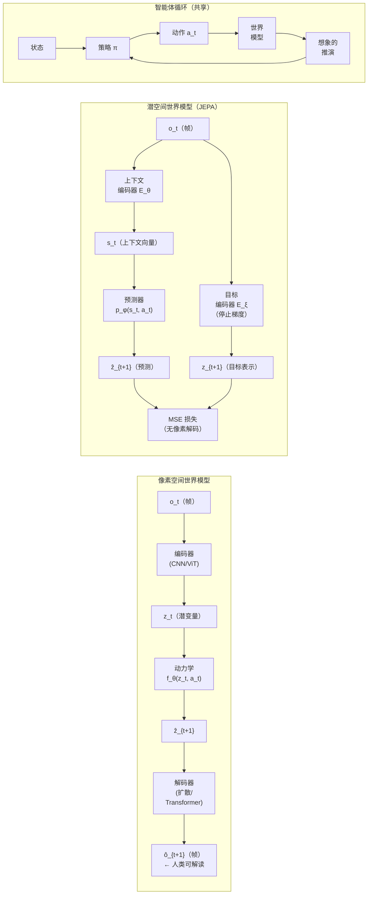

# 面向具身智能的世界模型

> **英文原文：** [cv-knowledge-base/06_robotics_and_embodied_ai/02_world_models.md](../../cv-knowledge-base/06_robotics_and_embodied_ai/02_world_models.md)（本中文版供参考，内容以英文原文为准）

> **最后更新：** 2026年10月
> **难度级别：** 研究前沿
> **相关章节：**
> - [视觉-语言-动作模型](./01_vla_models.md)
> - [优缺点与路线图](./07_pros_cons_roadmaps.md)
> - [生成式视觉——视频扩散与生成](../10_generative_vision/02_video_generation.md)
> - [自监督表示学习](../03_architectures/03_self_supervised_learning.md)

> **🆕 2026年10月更新：**
> - 新增 **Dreamer 4**（在可扩展世界模型内部仅凭离线数据获得 Minecraft 钻石），并注明 DreamerV3 于 2025 年发表于 *Nature*。
> - 新增 **Genie 3**（实时 720p/24 fps 交互式世界，2025 年 8 月），以及 Project Genie、SIMA 2 和基于 Genie 3 的 Waymo World Model；提及 World Labs Marble。
> - 扩展了 JEPA 系列：更正 V-JEPA 2 的作者（Assran et al.），新增 V-JEPA 2.1（2026 年 3 月）、JEPA-WMs 和 LeJEPA；提及 AMI Labs。
> - 扩展了 Cosmos：Predict2.5 / Transfer2.5 / Reason 1–2、**Cosmos Policy** 以及 **Cosmos 3**（2026 年 5–6 月，统一的全模态推理器 + 生成器，含动作输出）。
> - 新增 **用于机器人数据生成与策略评估的世界模型**（DreamGen、Ctrl-World、基于 Veo 的 Gemini Robotics 评估、Genie Envisioner、1X World Model、WoVR）和 **世界动作模型**（UVA、WorldVLA、Cosmos Policy、DreamZero、Fast-WAM）两节。
> - 更新了表格、开放问题与延伸阅读；修复了失效的交叉链接。

---

## 概述

**世界模型（World Model）** 是一个学习得到的内部模拟器：给定当前状态 $s_t$ 和动作 $a_t$，它预测未来状态 $s_{t+1}$ 的分布——并通过推演（rollout）预测任意长度的未来。该术语源于认知科学 [Craik 1943]，但在现代机器学习中的兴起要归功于 [Ha & Schmidhuber 2018]，他们将卷积 VAE 与 LSTM 结合，让智能体完全在潜空间中"做梦"推演。核心假设是：拥有紧凑而准确的世界模型的智能体可以高效规划、跨任务迁移知识，并在无需穷尽式环境交互的情况下习得技能——这可能是通往纯无模型强化学习所缺乏的样本效率与鲁棒性的一条道路。

该领域围绕一个基础性的架构张力分化为两派：**像素空间预测**（生成照片级真实的未来帧）与 **潜空间预测**（预测未来状态的抽象表示而不解码到像素）。像素空间模型——以 NVIDIA Cosmos [Agarwal et al. 2025] 和 DIAMOND [Alonso et al. 2024] 等视频扩散方法为代表——生成人类可解读的推演，对仿真到真实流水线和调试很有用，但计算代价高，且可能幻觉出视觉上可信但物理上不合理的场景。潜空间模型——以 JEPA 家族 [LeCun 2022; Assran et al. 2023; Bardes et al. 2024] 和 DreamerV3 [Hafner et al. 2023] 为代表——有意丢弃感知细节，将预测集中在对规划重要的因果变量上。它们每次推演的代价低得多，但产生的状态不可解释，并且必须解决一个更难的问题：定义一种既可预测又对动作有信息量的表示。

Yann LeCun 的立场论文《A Path Towards Autonomous Machine Intelligence》[LeCun 2022] 明确了研究议程：世界模型是自主智能体缺失的关键要素，应通过基于能量学习的联合嵌入预测架构（Joint-Embedding Predictive Architecture, JEPA）而非生成式像素合成来训练。这一论点直接挑战了端到端视觉-语言-动作（VLA）模型的主流范式，并引发了一场富有成效的争论，这场争论在 2026 年仍在塑造该领域。

到 2026 年 10 月，两大阵营在实践中已部分趋同。在生成式一侧，实时交互式世界模型（Genie 3）和数十亿参数的物理 AI 视频模型（Cosmos-Predict2.5、Cosmos 3）成为机器人策略的 **训练与评测环境**，而视频扩散主干被微调为联合预测未来帧与动作的 **世界动作模型（World Action Model）**（Cosmos Policy、DreamZero），并在 2026 年初登顶真实世界通用策略排行榜。在潜空间一侧，V-JEPA 2-AC 展示了一个主要在互联网视频上预训练的模型在真实机器人上进行零样本规划，V-JEPA 2.1 改进了稠密特征，Dreamer 4 则表明智能体可以完全在学习得到的世界模型内部、仅凭离线数据进行训练。LeCun 离开 Meta 创立 AMI Labs（2026）表明，潜空间世界模型如今也已成为一项商业押注。

---

## 像素空间与潜空间的二分

### 像素空间世界模型

像素空间模型直接预测未来观测 $\hat{o}_{t+1} \approx o_{t+1}$：

```
目标函数（像素重建）：
  L_pixel = E[ || o_{t+1} - f_θ(o_t, a_t) ||^2 ]
            或
  L_VDM   = E[ || ε - ε_θ(x_t, t, o_t, a_t) ||^2 ]   （扩散变体）
```

**优点：** 生成的帧可以作为下游规划器的渲染观测，或作为下游策略的合成训练数据；视觉一致性可直接用 FID/FVD 评估。**缺点：** 像素生成计算代价高；模型在像素重建误差很低的同时经常违反物理定律；表示将感知因素（光照、纹理）与因果因素（物体位置、速度）纠缠在一起。

### 潜空间世界模型

潜空间模型在嵌入空间中预测未来的 *表示* $\hat{z}_{t+1} \approx \text{sg}(z_{t+1})$，从不解码到像素：

```
JEPA 目标函数（无像素生成）：
  L_JEPA = || s_θ(context) - p_φ(z_{target}) ||^2
            其中  z_{target} = E_ξ(x_{target})  （对目标编码器 E_ξ 停止梯度）
```

```
RSSM 目标函数（DreamerV3）：
  L = E[ -log p_θ(o_t | h_t, z_t)          （重建）
        + β_1 KL[q_φ(z_t|h_t,o_t) || p_θ(z_t|h_t)]   （表示）
        + β_2 L_reward + β_3 L_continue ]
```

Dreamer 系列使用的 RSSM（循环状态空间模型，Recurrent State Space Model）维护一个确定性的循环状态 $h_t$（GRU），并结合随机的类别型潜变量 $z_t$，更新方式为 $h_t = f(h_{t-1}, z_{t-1}, a_{t-1})$。

### 流水线对比（Mermaid）



---

## DreamerV3：大规模固定超参数世界模型

DreamerV3 [Hafner et al. 2023, arXiv 2301.04104] 是迄今最全面的证明：单一世界模型架构在 **固定超参数** 下即可掌握涵盖连续控制、Atari、BSuite、Minecraft 等在内的 150 多项任务。此前的 Dreamer 版本 [DreamerV1: Hafner et al. 2020; DreamerV2: Hafner et al. 2021] 需要针对领域调参；DreamerV3 通过对输入进行 symlog 变换、KL 平衡和 free-bits 正则化消除了这一需求。

**架构：** 采用 32 类别 × 32 类的类别型表示（$z_t \in \{0,1\}^{32 \times 32}$）的 RSSM、隐藏维度为 4096 的 GRU，以及分别用于重建、奖励和回合延续的解码头。**想象推演** 使用 RSSM 在潜空间中生成 15 步序列用于 actor-critic 更新，在策略改进期间从不查询真实环境。

**关键结果：**

- 首个 **在没有人类数据或课程的情况下从零开始** 在 Minecraft 中收集钻石的算法（钻石需要约 20 分钟的因果动作链）——但由于 RSSM 的有限时域，收集频率较低（在报告的时域内大约每 10 个回合 1 次）
- Atari 100k 平均 HNS ≈ 112%（归一化均值），归一化中位数 ≈ 49%
- 在 DMControl 连续控制任务上稳定达到或超过专用基线
- 在单张 GPU 上训练，无需针对环境搜索超参数

**局限：** 长时程信用分配仍有问题（Minecraft 结果令人印象深刻，但并非每回合都可靠）；RSSM 固定的 GRU 记忆限制了有效规划深度；对于随机性强、视觉复杂的环境，想象的保真度会下降。

DreamerV3 于 2025 年发表于 *Nature*（"Mastering diverse control tasks through world models"）。

### Dreamer 4（2025）：在可扩展世界模型内部训练智能体

Dreamer 4 [Hafner, Yan, Lillicrap 2025, arXiv 2509.24527] 用一个 **可扩展的 Transformer 视频世界模型** 取代 RSSM，该模型采用 *shortcut forcing* 目标训练，可在单张 GPU 上实现少步、实时的交互式生成；随后 **完全在想象中** 通过强化学习训练智能体。据报道，它是首个 **仅凭离线数据**（一个固定的人类游戏数据集，无需在线环境交互）在 Minecraft 中获得钻石的智能体，且世界模型能从相对较少的带动作标签数据中准确捕捉复杂的物体交互，其大部分知识来自无标签视频。Dreamer 4 是"Dreamer"强化学习谱系与 Genie/Cosmos 视频生成谱系之间的重要桥梁，也为在线交互代价高昂的机器人场景提供了模板。

---

## I-JEPA：图像的表示空间预测

I-JEPA（基于图像的联合嵌入预测架构）[Assran et al., CVPR 2023, arXiv 2301.08243] 是 LeCun JEPA 论点在图像上的首次大规模验证。I-JEPA 既不重建像素（如 MAE [He et al. 2022]），也不强制视角不变性（如 DINO [Caron et al. 2021]），而是从单个上下文块预测多个目标图像块的 *表示*。

**架构：** 两个 ViT 编码器（上下文编码器 $E_\theta$ 和指数移动平均目标编码器 $E_\xi$），外加一个窄的预测器网络 $p_\phi$。上下文块是随机采样的连续区域；目标块是从图像其余部分采样的 4 个不重叠区域。预测器以目标位置的位置嵌入为条件，以避免忽略位置这一平凡解。

```
掩码策略：
  上下文：1 个大块  （约 15% 的 token）
  目标：  4 个块    （约 85% 的 token）
  损失：仅在表示空间中计算 L2——不进行像素重建
```

**基准结果（ViT-H/14，ImageNet-1K，论文报告）：**

- 线性探测 top-1：**77.5%**——在相同架构上优于 MAE ViT-H（77.2%），同时训练速度快 **10 倍**（不到 1,200 GPU 小时，而 MAE ViT-H 约 12,000）
- 训练吞吐优势：比 iBOT ViT-S/16 快 **2.5 倍**；比 MAE ViT-H/14 快 **10 倍以上**
- 物体计数（CLEVR/Count）：大幅优于 DINO 和 iBOT，表明其结构表示更丰富
- 深度预测（CLEVR/Dist）：同样表现强劲，表明潜空间预测比视角不变方法更好地捕捉三维几何

关键洞见在于：在特征空间中进行预测迫使模型学习 *语义* 结构而非低层纹理；基于视角的对比方法所鼓励的不变性可能丢弃有用信息，而像素重建则把容量浪费在感知细节上。

---

## V-JEPA：将 JEPA 扩展到视频

V-JEPA [Bardes et al. 2024, arXiv 2404.08471] 将 I-JEPA 扩展到时间域。V-JEPA 不预测空间图块，而是在特征空间中预测 **被掩码的时空管道（tube）**——视频 token 的完整三维体——使用基于 ViT 的编码器-预测器架构，作用于视频且不带动作条件。

**掩码策略：** 时空掩码以沿时间轴对齐的管道形式移除 75–90% 的视频 token，迫使模型对运动连续性进行推理。

**基准结果（ViT-H/16，仅在视频上训练）：**

| 基准 | 指标 | V-JEPA 得分 | 此前最佳 |
|---|---|---|---|
| Kinetics-400 | Top-1 准确率 | 81.9% | ~78%（视频模型） |
| Something-Something v2 | Top-1 准确率 | 72.2% | ~62%（视频模型） |
| ImageNet-1K（无图像微调） | Top-1 准确率 | 77.9% | ~72%（视频模型） |

在 Something-Something v2 上 +10 个点的提升尤为重要：该基准奖励的是 **物理动力学理解**（例如"把某物从右拉到左"）而非静态场景识别，证实了在表示空间中预测有助于涌现物理理解。

### V-JEPA 2（2025）

V-JEPA 2 [Assran, Bardes, Fan, Garrido et al., arXiv 2506.09985, Meta FAIR, 2025 年 6 月] 将该框架扩展到 **动作条件预测与机器人规划**。这个 12 亿参数的模型采用两阶段训练：(1) 在 100 万小时以上的视频上进行自监督视频预测；(2) 在来自 Droid 数据集 [Khazatsky et al. 2024] 的约 62 小时无标签机器人视频上进行动作条件微调（V-JEPA 2-AC）。

**关键结果：**

- Something-Something v2：**77.3%** top-1（运动理解）
- Epic-Kitchens-100 动作预期：**39.7%** recall@5（最先进，超越任务专用模型）
- 在两个新实验室环境中的 Franka 机械臂上零样本抓取-放置：使用目标图像条件规划，成功率 **65–80%**，且未从这些环境收集任何任务特定数据
- 官方代码仓库报告的其他探测结果：Diving48 90.2%；MVP 视频问答 44.5%；TempCompass 76.9%（与 LLM 对齐时）

V-JEPA 2 首次给出了可信的证据：一个主要在被动互联网视频上训练的潜空间世界模型，可以通过潜空间规划迁移到 **主动机器人控制**。规划使用交叉熵方法（CEM）在动作序列上搜索，以最小化预测潜变量与目标图像潜变量之间的 L1 距离。

### V-JEPA 2.1、JEPA-WMs 与 LeJEPA（2025–2026）

- **V-JEPA 2.1**（2026 年 3 月在官方代码仓库发布）改变了训练方案，以学习高质量、时间一致的 **稠密** 特征：可见 token 与被掩码 token 都参与的稠密预测损失、在编码器多个深度施加的深度自监督、多模态（图像 + 视频）分词器，以及进一步的模型/数据扩展。
- **JEPA-WMs**（"What Drives Success in Physical Planning with Joint-Embedding Predictive World Models?"，Meta，arXiv 2512.24497）针对规划任务，以 DINO-WM 和 V-JEPA 2-AC 为基线，系统地消融了 JEPA 世界模型的各组成部分（编码器选择、预测器、规划器）。
- **LeJEPA**（Balestriero & LeCun，arXiv 2511.08544）提出了一个有理论依据的 JEPA 目标——对嵌入施加草图化各向同性高斯正则化（Sketched Isotropic Gaussian Regularisation, SIGReg）——在去除停止梯度和 EMA 教师等启发式技巧的同时实现稳定扩展。

---

## Genie：从无标签视频中学习生成式交互环境

Genie [Bruce et al., ICML 2024 **最佳论文奖**, arXiv 2402.15391] 完全基于互联网上 2D 平台游戏的无标签视频训练一个交互式世界模型，不使用任何真实动作标签。该模型有 110 亿参数，是首个达到基础模型规模的 **潜动作** 世界模型。

**架构：** 三个组件：
1. **时空视频分词器**——将原始帧转换为离散 token
2. **潜动作模型（Latent Action Model, LAM）**——一个 VQ-VAE，从相邻帧对中推断一个小型离散潜动作码本（编码器看到帧，解码器在给定历史和推断动作的条件下预测下一帧）
3. **自回归动力学模型**——以潜动作 token 为条件预测未来 token

LAM 无需监督、纯粹依靠时间一致性就学到了可解释的动作基元（例如 MOVE_LEFT、JUMP）。推理时，用户可以逐帧选择潜动作来控制生成的环境。

**对机器人学的意义：** Genie 证明了以动作为基础的世界模型可以从被动视频中自举，从而绕开带标签机器人轨迹的数据瓶颈。如果在机器人视频上预训练，其潜动作空间可能迁移到机器人具身上。

### Genie 2（2024 年 12 月）

Genie 2 [Parker-Holder et al., DeepMind, 2024 年 12 月 4 日发布] 将这一概念扩展到由单张图像生成的 **三维环境**。主要进展：

- 以单张输入图像为条件，生成物理一致的交互式三维世界
- 在 10–60 秒内保持世界持久性，并出现涌现行为：物体交互、角色动画、对其他智能体的建模
- 在大规模、多样化的互联网视频数据集上训练
- 展示了较小模型所不具备的规模涌现能力

截至 2026 年 6 月，Genie 2 尚未公开发布，也尚无经同行评审的基准数据；以上内容基于 DeepMind 2024 年 12 月的博客公告。

### Genie 3（2025 年 8 月）及其后继

Genie 3 [Google DeepMind，2025 年 8 月 5 日发布] 是该系列中首个 **实时** 运行的世界模型：它根据文本提示生成可导航的交互式环境，分辨率 **720p、帧率 24 fps**，可在 **数分钟** 内保持视觉一致性（对约一分钟前访问过的区域具有视觉记忆）。它新增了 **可提示的世界事件**——在推演过程中用文本命令改变天气、引入物体或角色——使其成为一个反事实的"假设"引擎。其一致性源自逐帧自回归生成中的涌现，而非显式的三维表示。DeepMind 使用 Genie 3 环境来训练和评估其 SIMA 通用游戏智能体；SIMA 2（2025 年 11 月，基于 Gemini 构建）同样在 Genie 3 生成的世界中进行了演示。

2026 年 1 月，通过 **Project Genie**（面向美国 Google AI Ultra 订阅用户的实验性原型）扩大了访问范围；2026 年 2 月，Waymo 介绍了基于 Genie 3 构建、用于模拟罕见驾驶场景的 **Waymo World Model**。Genie 3 没有附带量化基准的公开技术报告；以上事实来自 DeepMind 与 Waymo 的公告。

**相关的三维世界生成器。** World Labs 的 **Marble**（2025 年 11 月商业发布）可根据文本、图像或视频生成持久的、可下载的三维世界（高斯泼溅 / 网格）——这是相对于 Genie 逐帧自回归方法的一种 *显式* 三维替代方案，由于输出可导入物理引擎，因此对机器人仿真颇具吸引力。

---

## DIAMOND：面向 Atari 的扩散世界模型

DIAMOND（DIffusion As a Model Of eNvironment Dreams）[Alonso, Jelley, Micheli, Kanervisto, Storkey, Pearce, Fleuret; NeurIPS 2024 Spotlight, arXiv 2405.12399] 认为，对于在世界模型内部进行的强化学习而言 **视觉细节很重要**，标准的离散潜变量模型（IRIS、DreamerV3）会丢弃决定奖励结果的信息（例如 Asterix 中子弹的位置）。

**架构：** 用一个完整的扩散模型（EDM 形式 [Karras et al. 2022]）替换离散潜变量解码器，以历史帧和动作为条件生成下一帧。推演是一系列去噪后的帧；强化学习智能体直接观察这些帧。

**Atari 100k 结果（平均 HNS，26 个游戏）：**

| 模型 | 平均 HNS | IQM |
|---|---|---|
| DIAMOND (2024) | **1.46** | **0.64** |
| STORM [Shamsian et al. 2024] | 1.266 | — |
| DreamerV3 [Hafner 2023] | 1.097 | — |
| IRIS [Micheli et al. 2023] | 1.046 | — |

DIAMOND 在 26 个游戏中的 11 个上达到超人水平。EDM 形式至关重要：标准 DDPM 在长推演中会退化，而 EDM 的噪声自适应训练能保持视觉连贯性。

**局限：** 推理慢——每个环境步需要多次去噪，目前难以用于实时机器人部署。

---

## NVIDIA Cosmos：物理 AI 世界基础模型

Cosmos [Agarwal et al., NVIDIA, arXiv 2501.03575，2025 年 1 月 CES 发布] 是首个面向 **物理 AI**（自动驾驶 + 机器人）的、可商用且以开放许可发布的世界基础模型平台。与研究原型不同，Cosmos 提供端到端系统：

**组件：**

1. **Cosmos Tokenizer**——因果图像/视频神经分词器；压缩率比先前分词器高 8 倍、处理速度快 12 倍；保持时间因果性（时刻 $t$ 的 token 不关注 $t+1$）
2. **自回归 WFM 家族**——基于 Transformer、在 token 化视频上进行下一个 token 预测；变体包括 Nano（边缘/实时）、Super（基线）、Ultra（最高质量）
3. **扩散 WFM 家族**——用于高保真生成的连续视频扩散模型
4. **Isaac Sim 集成**——Cosmos 生成的合成轨迹为 NVIDIA Isaac Lab 的并行强化学习训练以及 GR00T-Dreams/GR00T-Mimic 数据引擎蓝图提供数据

**训练数据：** 涵盖机器人、自动驾驶、工业和人机交互领域的 2000 万小时真实世界视频（约 9,000 万亿 token）。采用 NVIDIA 开放模型许可（允许商用）。

**物理 AI 定位：** Cosmos 被定位为一个 *数据引擎*——其推演为机器人策略训练提供多样化、物理一致的合成训练数据，以弥合真实到仿真的差距，而不是作为策略本身。这与 DreamerV3 或 DIAMOND 等面向强化学习的世界模型在用途上有质的不同。

### Cosmos 2025–2026：Predict2.5、Transfer2.5、Reason、Policy 与 Cosmos 3

| 发布 | 日期 | 内容 |
|---|---|---|
| Cosmos-Reason1 (arXiv 2503.15558) | 2025 年 3 月 | 经 SFT + 强化学习训练的物理常识 / 具身推理 VLM；长思维链 |
| Cosmos-Transfer1 / Cosmos-Predict2 | 2025 年上半年 | 多 ControlNet 仿真到真实迁移；新一代视频 WFM |
| Cosmos-Predict2.5 (arXiv 2511.00062) | 2025 年 10 月 | **基于流** 的模型，统一 Text2World、Image2World 与 Video2World；以 Cosmos-Reason1 作为文本编码器；2B 和 14B；机器人动作条件与多视角（AgiBot）变体；DMD2 蒸馏 |
| Cosmos-Transfer2.5 | 2025 年 10 月 | 用于仿真到真实及真实到真实增强的多 ControlNet（边缘、深度、分割、模糊）；蒸馏的边缘模型（2026 年 2 月） |
| Cosmos-Reason2（2B、8B；2026 年 4 月新增 32B） | 2025 年 12 月 | 后继推理 VLM；Cosmos-Reason2-2B 是 GR00T N1.7 的 VLM 主干 |
| **Cosmos Policy** (arXiv 2601.16163) | 2026 年 1 月 | 将 Cosmos-Predict2-2B 微调为视觉运动策略，输出动作、未来状态（图像 + 本体感觉）和价值；支持 best-of-N 基于模型的规划；给出 LIBERO、RoboCasa 和 ALOHA 结果 |
| **Cosmos 3** | 2026 年 5–6 月 | 全模态 Mixture-of-Transformers 家族（Super 64B、Nano 16B，自 2026 年 7 月起还有 Edge 4B）。单一模型提供 **Reasoner** 接口（输出文本）和 **Generator** 接口（输出视觉、声音和动作）：世界预测、迁移、动作条件前向动力学以及策略（如 Cosmos3-Nano-Policy-DROID） |

这一演进——从 2025 年分立的预测 / 迁移 / 推理模型，到 2026 年一个能推理、模拟和行动的单一模型——与下文讨论的世界模型与 VLA 的融合相呼应。

---

## 作为机器人数据引擎和策略评估器的世界模型

除规划之外，学习型世界模型在机器人领域的三种用途在 2025–2026 年趋于成熟：

1. **合成轨迹生成。** NVIDIA 的 **DreamGen**（arXiv 2505.12705；GR00T-Dreams 蓝图）在目标机器人上微调视频世界模型，用新指令提示它生成"神经轨迹"，再用逆动力学模型或潜动作模型为其标注伪动作，并在其上训练策略——从而实现从未遥操作过的行为和环境。GR00T N1.5 纳入了 DreamGen 数据。**Genie Envisioner**（AgiBot，arXiv 2508.05635）将视频扩散世界模型、动作解码器和神经模拟器打包成一个统一的操作平台。
2. **策略评估。** 真实机器人评测缓慢且噪声大。**Ctrl-World**（arXiv 2510.10125）是一个可控的多视角世界模型，可在想象中推演通用策略（如 π0.5）以对其排序，并为策略改进生成数据。Google DeepMind 在 **基于 Veo 的世界模拟器**（arXiv 2512.10675）中评估了 Gemini Robotics 策略，包括分布外和安全场景。1X 使用其 **1X World Model** 评估 NEO 策略。
3. **想象中的强化学习。** **WoVR**（arXiv 2602.13977）将世界模型用作 VLA 强化学习后训练的可靠模拟器，Dreamer 4 则在 Minecraft 中端到端地实现了这一点。

大型视频模型还表现出 **涌现的零样本视觉推理能力**（"Video models are zero-shot learners and reasoners"，Veo 3，arXiv 2509.20328）：分割、边缘检测、迷宫求解和简单的物理推理都从生成式预训练中涌现出来，支持了视频模型可作为通用视觉与物理基础模型的观点。

---

## 世界动作模型（2025–2026）

**世界动作模型（World Action Model, WAM）**——也称视频-动作模型——联合建模未来观测与动作，通常做法是在预训练的视频扩散 Transformer 上添加动作 token 或动作头：

```
WAM 目标函数（示意）：
  p_θ(o_{t+1:t+H}, a_{t:t+H-1} | o_{≤t}, ℓ)
  L = L_video（对未来潜变量去噪）+ λ · L_action（对动作块去噪 / 回归）
  推理：（可选）想象未来帧并解码动作；或跳过想象，
        直接从视频主干的特征中解码动作
```

| 模型 | 日期 | 主干 | 备注 |
|---|---|---|---|
| UVA — Unified Video Action Model (arXiv 2503.00200) | 2025 (RSS) | 联合潜在视频-动作扩散 | 解耦解码使得无需生成视频即可输出动作 |
| WorldVLA (arXiv 2506.21539) | 2025 | 自回归 VLA + 世界模型 | 在一个自回归模型中同时生成动作和图像 |
| Cosmos Policy (arXiv 2601.16163) | 2026 年 1 月 | Cosmos-Predict2-2B | 在潜在帧中编码动作、未来状态和价值；通过 best-of-N 进行规划 |
| DreamZero (arXiv 2602.15922) | 2026 年 2 月 | Wan2.1-I2V-14B（也支持 Wan2.2-5B） | 仅在 DROID 上训练；据报道在 RoboArena 和 MolmoSpaces 上排名第一（2026 年 2 月）；在 GB200 上借助 DiT 缓存推理约 0.6 秒；可少样本适配新具身（AgiBot、YAM） |
| Fast-WAM (arXiv 2603.16666) | 2026 年 3 月 | 视频扩散 WAM | 探讨测试时的未来想象是否必要；跳过想象可大幅降低延迟 |
| Being-H0.7 (arXiv 2605.00078) | 2026 年 4 月 | 基于第一人称人类视频的潜在 WAM | 具备未来感知的潜在推理（NeurIPS 2026） |

到 2026 年中，综述论文（"World Action Models: The Next Frontier in Embodied AI"，arXiv 2605.12090）已将 WAM 视为与 VLA 和基于规划的世界模型并列的第三类方法。其吸引力在于继承了互联网视频中的物理与时间先验；其代价在于规模和延迟（5–14B+ 参数），以及想象出的未来可能在物理上是错误的。

---

## JEPA 与生成式世界模型：核心争论

这场争论集中在关于世界模型应当优化什么的两种互不相容的先验信念上：

| 维度 | JEPA（LeCun 学派） | 生成式 / 像素空间 |
|---|---|---|
| **主要目标** | 预测抽象表示；不进行像素合成 | 预测 / 生成未来观测 |
| **架构** | 编码器 + 预测器（无解码器） | 编码器 + 解码器（扩散/自回归/VQ-VAE） |
| **避免坍缩** | EMA 目标编码器；VICReg/VIC | 重建损失；VQ 瓶颈 |
| **可解释性** | 潜空间对人类不透明 | 生成的帧人类可读 |
| **样本效率** | 高（紧凑潜变量，推演快） | 较低（解码器训练开销） |
| **仿真到真实** | 需要潜变量到动作的映射 | 可为下游生成相机图像 |
| **扩展行为** | 正在改进（V-JEPA 2 达 12 亿参数 / 100 万+ 小时视频；V-JEPA 2.1 扩展），但公开的缩放定律很少 | 已被证明（Cosmos 2000 万小时视频；Cosmos 3 最高 64B；Genie 3 实时） |
| **作为机器人策略（2026）** | 目标图像规划（V-JEPA 2-AC，CEM） | 世界动作模型（DreamZero、Cosmos Policy） |
| **物理合理性** | 无真值保证 | 针对 FID/FVD 优化；可能违反物理 |

**混合趋势（2025–2026）：** 多个团队融合了两种范式。V-JEPA 2-AC [Assran et al. 2025] 在潜空间中预测，但增加了一个动作条件的后训练阶段——实质上是一个带有轻量生成头的 JEPA。DIAMOND [Alonso et al. 2024] 生成像素，但将其用作强化学习观测，而非策略主干的训练目标。逐渐形成的共识是：对于机器人控制 **纯像素生成是不必要的**，但 **某种形式的回到可观测空间的解码** 对于仿真数据生成和可解释性仍然有用。2026 年世界动作模型的结果使这一图景更加复杂：即使推理时丢弃生成的像素（Fast-WAM），生成式视频预训练似乎也是策略的极佳 *初始化*，这表明争论的焦点与其说是训练信号的模态，不如说是哪种表示最能迁移到动作。

---

## 关键论文

| 论文 | 作者 | 年份 | 发表载体 | 主要贡献 |
|---|---|---|---|---|
| Mastering Diverse Domains through World Models (DreamerV3) | Hafner, Pasukonis, Ba, Lillicrap | 2023 | arXiv 2301.04104; *Nature* 2025 | 固定超参数的 RSSM 世界模型；首次从零获得 Minecraft 钻石；150+ 任务评估 |
| Self-Supervised Learning from Images with a Joint-Embedding Predictive Architecture (I-JEPA) | Assran, Duval, Misra et al. | 2023 | CVPR | 预测抽象图块表示而非像素；效率超过 MAE；物体级特征更优 |
| Revisiting Feature Prediction for Learning Visual Representations from Video (V-JEPA) | Bardes, Garrido, Ponce et al. | 2024 | arXiv (Meta AI) | 视频 JEPA；在特征空间中进行掩码时空预测；SSv2 上最先进（+10 个点） |
| Genie: Generative Interactive Environments | Bruce, Dennis, Edwards, Parker-Holder et al. | 2024 | ICML (Best Paper) | 基于无标签 2D 视频的 110 亿参数世界模型；无监督潜动作码本 |
| Diffusion for World Modeling: Visual Details Matter in Atari (DIAMOND) | Alonso, Jelley, Micheli et al. | 2024 | NeurIPS Spotlight | 面向 Atari 的扩散世界模型；平均 HNS 1.46——世界模型训练智能体中的新 SOTA |
| Cosmos World Foundation Model Platform for Physical AI | Agarwal et al. (NVIDIA) | 2025 | arXiv 2501.03575 | 首个商业开放的物理 AI WFM；2000 万小时视频；因果分词器；自回归 + 扩散家族 |
| V-JEPA 2: Self-Supervised Video Models Enable Understanding, Prediction and Planning | Assran, Bardes, Fan, Garrido et al. (Meta FAIR) | 2025 | arXiv 2506.09985 | 12 亿参数动作条件世界模型；零样本机器人抓取-放置；Epic-Kitchens-100 预期任务 SOTA |
| DreamGen: Unlocking Generalization in Robot Learning through Video World Models | Jang et al. (NVIDIA) | 2025 | arXiv 2505.12705 | 以微调视频世界模型生成的神经轨迹作为机器人训练数据 |
| Genie 3: A New Frontier for World Models | Google DeepMind | 2025 | Blog (Aug 2025) | 实时 720p/24 fps 交互式世界；可提示的世界事件 |
| Training Agents Inside of Scalable World Models (Dreamer 4) | Hafner, Yan, Lillicrap | 2025 | arXiv 2509.24527 | shortcut forcing Transformer 世界模型；仅凭离线数据获得 Minecraft 钻石 |
| Video Models are Zero-Shot Learners and Reasoners | Wiedemer et al. (Google DeepMind) | 2025 | arXiv 2509.20328 | Veo 3 中涌现的零样本视觉/物理推理 |
| Ctrl-World: A Controllable Generative World Model for Robot Manipulation | Guo et al. | 2025 | arXiv 2510.10125 | 用于评估和改进通用策略的世界模型 |
| World Simulation with Video Foundation Models for Physical AI (Cosmos-Predict2.5) | NVIDIA | 2025 | arXiv 2511.00062 | 基于流的统一 Text/Image/Video2World；机器人动作条件变体 |
| LeJEPA: Provable and Scalable Self-Supervised Learning Without the Heuristics | Balestriero, LeCun | 2025 | arXiv 2511.08544 | SIGReg 目标；无启发式技巧的 JEPA |
| Evaluating Gemini Robotics Policies in a Veo World Simulator | Google DeepMind | 2025 | arXiv 2512.10675 | 基于视频模型的策略评估，含安全与分布外场景 |
| Cosmos Policy: Fine-Tuning Video Models for Visuomotor Control and Planning | NVIDIA | 2026 | arXiv 2601.16163 | 视频 WFM → 策略 + 世界模型 + 价值函数 |
| DreamZero: World Action Models Are Zero-Shot Policies | Ye et al. (NVIDIA) | 2026 | arXiv 2602.15922 | 14B 世界动作模型；RoboArena 榜首（2026 年 2 月） |
| A Path Towards Autonomous Machine Intelligence | LeCun | 2022 | OpenReview (white paper) | 奠基性的 JEPA 论点；H-JEPA + EBM 框架；以世界模型为自主智能的核心 |

---

## 基准性能

| 模型 | 数据集 / 任务 | 指标 | 得分 | 备注 |
|---|---|---|---|---|
| DreamerV3 | Atari 100k（26 个游戏） | 平均 HNS | ~112%（归一化均值） | 固定超参数，单 GPU |
| DreamerV3 | Minecraft（钻石） | 任务完成 | 约每 10 个回合 1 次 | 首个无需人类数据即实现的算法 |
| DIAMOND | Atari 100k（26 个游戏） | 平均 HNS | **1.46** | NeurIPS 2024 世界模型训练智能体中的 SOTA；IQM 0.64 |
| DIAMOND | Atari 100k（26 个游戏） | 超人水平游戏数 | 11 / 26 | |
| STORM | Atari 100k | 平均 HNS | 1.266 | 此前 SOTA |
| I-JEPA (ViT-H/14) | ImageNet-1K | 线性探测 top-1 | 77.5% | 比 MAE ViT-H 快 10 倍 |
| V-JEPA (ViT-H/16) | Kinetics-400 | Top-1 准确率 | 81.9% | 仅视频预训练 |
| V-JEPA (ViT-H/16) | Something-Something v2 | Top-1 准确率 | 72.2% | 比此前视频模型高 10 个点 |
| V-JEPA (ViT-H/16) | ImageNet-1K（无图像微调） | Top-1 准确率 | 77.9% | 比此前视频模型高 6 个点 |
| V-JEPA 2 | Something-Something v2 | Top-1 准确率 | 77.3% | 12 亿参数 |
| V-JEPA 2 | Epic-Kitchens-100 | Recall@5（预期） | **39.7%** | SOTA，超越任务专用模型 |
| V-JEPA 2-AC | 抓取-放置（Franka，2 个实验室） | 成功率 | 65–80% | 零样本，无环境特定数据 |
| V-JEPA 2 | Diving48（探测） | Top-1 准确率 | 90.2% | InternVideo2-1B 为 86.4%（代码仓库报告） |
| Dreamer 4 | Minecraft（钻石） | 任务完成 | 仅凭离线数据实现 | 首个报告的仅离线获得钻石的智能体 |
| Genie 3 | 交互式生成 | 分辨率 / 帧率 | 720p @ 24 fps，数分钟一致性 | 无公开量化基准 |
| DreamZero-DROID | RoboArena / MolmoSpaces | 排行榜名次 | 第 1 / 第 1（2026 年 2 月） | 仅在 DROID 上从零训练 |

---

## 优缺点

| 方面 | 优点 | 缺点 |
|---|---|---|
| **潜空间世界模型（JEPA/DreamerV3）** | 推演极快；样本高效的强化学习；通过 EMA 目标抵抗坍缩；单位 FLOP 扩展性好 | 潜变量不可解释；没有直接的仿真到真实像素桥梁；潜在表示质量高度依赖预训练 |
| **像素空间世界模型（DIAMOND/Cosmos）** | 生成帧人类可解读；支持仿真数据流水线；可用 FID/FVD 评估视觉一致性 | 推理慢（扩散去噪增加每步延迟）；可能生成视觉合理但物理错误的场景；解码器训练开销 |
| **动作条件世界模型（V-JEPA 2-AC、Genie）** | 将被动视频预训练衔接到主动控制；支持目标条件规划；潜动作模型无需动作标签 | 动作标签稀缺限制微调信号；潜动作空间可能与机器人形态不匹配；从 2D 视频迁移到 3D 机器人工作空间仍不确定 |
| **作为数据引擎的生成式世界模型（Cosmos/Isaac Lab）** | 可大规模扩展的合成数据；域随机化；减少昂贵的真实世界数据采集需求 | 仿真到真实差距仍在；物理合理性无保证；训练成本巨大（Cosmos 使用 2000 万小时视频） |
| **世界动作模型（DreamZero、Cosmos Policy）** | 从互联网视频获得物理/时间先验；零样本泛化强；内置预测与价值，可用于规划 | 5–14B+ 参数；不经蒸馏时延迟为亚秒到数秒；想象的未来可能出错 |
| **实时交互式世界模型（Genie 3）** | 为智能体训练和评估提供无限多样的环境；可提示的反事实事件 | 访问受限；一致性仅维持数分钟；无法保证物理正确；未针对真实机器人进行动作校准 |
| **评估指标（FVD/FID vs. 物理合理性）** | FVD/FID 标准化且被广泛使用 | 高 FVD 与规划质量无相关性；物理违规对感知指标不可见；新的物理感知基准（WorldModelBench、VideoCon-Physics）尚未成为标准 |

---

## 开放问题与研究空白

1. **超越 FVD/FID 的评估。** 标准视频质量指标（FID、FVD）衡量感知真实感，但与物理合理性及下游强化学习性能无关 [参见 WorldModelBench 2025]。目前尚不存在一个用于 *以决策为中心* 的世界模型评估的标准基准——类似于表示学习领域的 BenchML。

2. **从被动视频到主动控制的迁移。** V-JEPA 2 展示了前景，但需要约 62 小时机器人数据来进行动作条件化；Genie 的潜动作方法尚未在 2D 视频领域之外得到验证。在多样化互联网视频上训练的世界模型能否以接近零的动作标签成本高效适配新的机器人形态，仍未解决。

3. **长时程一致性与记忆。** DreamerV3 的 RSSM 和 Genie 的自回归 Transformer 在推演超过 15–60 秒后一致性都会下降。结构化状态表示（以物体为中心、基于图）可能有帮助，但会引入限制通用性的归纳偏置。

4. **遵循物理定律。** 当前的像素空间模型在生成的推演中违反质量守恒、碰撞物理和刚性约束。在不牺牲可扩展性的前提下整合物理先验（神经-符号约束、可微分仿真）是一个开放的架构挑战。

5. **计算权衡：仿真数据 vs. 真实数据。** Cosmos 需要约 9,000 万亿 token 的训练数据；Isaac Lab 仿真生成的合成数据未必能弥合现实差距。世界模型预训练中真实机器人数据、人类视频和仿真数据的最优配比在经验上仍不清楚。

6. **感知、预测与规划的统一架构。** 当前系统将表示主干（ViT）、动力学模型（RSSM/Transformer）和策略网络分开。一个联合优化三者的单一架构——类似于 Transformer 统一语言任务的方式——将简化训练并可能提升一致性。

7. **世界模型的缩放定律。** 与语言模型不同，适用于具身智能的世界模型尚未建立经验缩放定律（计算 × 数据 → 性能）。模型规模、训练数据与下游机器人策略质量之间的关系在很大程度上仍是未知的。

8. **策略需要想象吗？** 世界动作模型被训练来预测未来，但 Fast-WAM 类结果表明，收益可能主要来自预训练表示，而非测试时的推演。显式想象在何时有帮助（长时程、接触丰富、安全攸关任务）仍未解决。

9. **基于世界模型的评估的有效性。** Veo、Ctrl-World 和 1X 式的策略评估器越来越多地用于对策略排序；确定其排名何时与真实世界结果一致——尤其是对于失败和安全事件——是一个开放的方法论问题。

10. **延迟与边缘部署。** 实时生成（Genie 3、Cosmos3-Edge、DMD2 等蒸馏）正在取得进展，但 WAM 策略仍需要数据中心级 GPU 才能实现亚秒级推理。

---

## 延伸阅读

- [DreamerV3 arXiv](https://arxiv.org/abs/2301.04104) —— Hafner et al.，"Mastering Diverse Domains through World Models"
- [I-JEPA CVPR 2023](https://openaccess.thecvf.com/content/CVPR2023/html/Assran_Self-Supervised_Learning_From_Images_With_a_Joint-Embedding_Predictive_Architecture_CVPR_2023_paper.html) —— Assran et al.，官方会议论文集
- [V-JEPA 2 arXiv](https://arxiv.org/abs/2506.09985) —— Assran et al.，"V-JEPA 2: Self-Supervised Video Models Enable Understanding, Prediction and Planning"（2025 年 6 月）
- [DIAMOND 项目页](https://diamond-wm.github.io/) —— 含视频、代码和各 Atari 游戏结果
- [NVIDIA Cosmos arXiv](https://arxiv.org/abs/2501.03575) —— WFM 平台完整技术报告
- [LeCun 2022 白皮书](https://openreview.net/pdf?id=BZ5a1r-kVsf) —— "A Path Towards Autonomous Machine Intelligence"——奠基性的 JEPA 宣言
- [V-JEPA 2 / 2.1 代码](https://github.com/facebookresearch/vjepa2) —— 官方 V-JEPA 2、V-JEPA 2-AC 和 V-JEPA 2.1 代码与检查点
- [Dreamer 4 arXiv](https://arxiv.org/abs/2509.24527) —— "Training Agents Inside of Scalable World Models"
- [Genie 3 公告](https://deepmind.google/discover/blog/genie-3-a-new-frontier-for-world-models/) —— DeepMind，2025 年 8 月
- [Cosmos-Predict2.5](https://github.com/nvidia-cosmos/cosmos-predict2.5) 与 [Cosmos 3](https://github.com/NVIDIA/Cosmos) —— NVIDIA 世界基础模型
- [Cosmos Policy](https://github.com/NVlabs/cosmos-policy) —— 被微调为策略 + 规划器的视频模型
- [DreamZero](https://github.com/dreamzero0/dreamzero) —— 世界动作模型代码与检查点
- [LeJEPA](https://github.com/rbalestr-lab/lejepa) —— 无启发式技巧的 JEPA 训练
- [JEPA-WMs](https://github.com/facebookresearch/jepa-wms) —— 面向物理规划的 JEPA 世界模型研究
