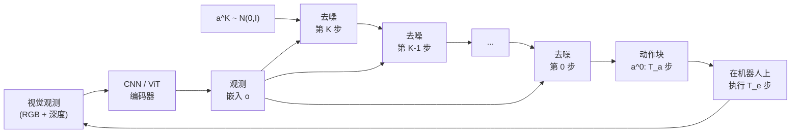

# 扩散策略：基于动作扩散的视觉运动控制

> **英文原文：** [cv-knowledge-base/06_robotics_and_embodied_ai/03_diffusion_policy.md](../../cv-knowledge-base/06_robotics_and_embodied_ai/03_diffusion_policy.md)（本中文版供参考，内容以英文原文为准）

> **最后更新：** 2026年10月
> **难度级别：** 高级 | 研究前沿
> **相关章节：**
> - [跨具身学习](./04_cross_embodiment.md)
> - [具身智能的仿真与数据](./05_simulation_and_data.md)
> - [视觉-语言-动作模型](./01_vla_models.md)
> - [生成模型与扩散](../10_generative_vision/01_diffusion_models.md)

> **🆕 2026年10月更新：**
> - 新增 **TRI 大型行为模型**（约 1,700 小时规模的扩散 Transformer 策略，配合严谨的统计评估）以及 VLA 内部的扩散/流动作头（GR00T N1.5–N1.7 DiT、SmolVLA、π0.5）。
> - 新增单步 / 少步策略（MP1 MeanFlow、ManiFlow 一致性流）以及面向流策略的 **实时分块（Real-Time Chunking）**。
> - 新增 **扩散与流策略的强化学习微调**（DPPO、DSRL、πRL、SAC Flow）和 **视频扩散策略**（UVA、Cosmos Policy、DreamZero）两节。
> - 更正了关于 π0（10 个 Euler 步，约 73 ms）和 π0-FAST（自回归 FAST token，而非整流流）的不准确表述；修复失效链接；为各表格和延伸阅读增加了条目。

---

## 概述

扩散策略（Diffusion Policy）[Chi2023] 将机器人模仿学习重新表述为一个条件去噪问题：策略网络不是回归单个"最佳"动作，也不是在离散化动作上计算类别分布，而是以当前视觉观测为条件，将一段高斯噪声序列迭代去噪为连贯的动作轨迹。其底层生成机制是去噪扩散概率模型（Denoising Diffusion Probabilistic Model, DDPM）[Ho2020]，由 U-Net 或 Transformer 主干学习反转一个固定的前向加噪过程。推理时，模型从动作空间中的纯噪声出发，在观测嵌入的引导下执行 $K$ 步去噪，生成一个滚动时域（receding-horizon）的动作块，在下一个规划周期开始前以开环方式执行一个较短的时域。

其关键的行为优势在于处理 **多模态动作分布**。在日常操作的示范中，人可能根据细微的上下文从左侧或右侧去拿物体；标准行为克隆的 MSE 损失会对两种模式取平均，产生一条犹豫的中间轨迹。扩散策略基于能量的隐式分数匹配目标可以自然地表示这类分布而不发生模式坍缩，在接触丰富和高精度任务上带来显著更高的任务成功率。[Chi2023] 在 15 个仿真与真实任务上，相对此前最先进的行为克隆基线（IBC、BET）平均提升 46.9%。

该工作还提出了两种架构变体：一种是 **基于 CNN** 的策略，通过 ResNet-18 特征金字塔编码空间观测；另一种是 **基于 Transformer** 的策略（DiT 风格），在每个去噪步对观测 token 进行交叉注意力以实现条件化。Transformer 变体在长时程任务上泛化更好，但计算代价更高。2024–2026 年的后续工作将这一范式扩展到三维点云条件化（DP3）、流匹配加速（pi-zero）和大规模预训练，使基于扩散的动作生成成为视觉运动模仿学习的事实标准。

截至 2026 年 10 月，扩散策略的思想已被几乎所有机器人基础模型吸收：GR00T N1.x 使用流匹配扩散 Transformer（DiT）动作头，π0/π0.5/π0.6 和 SmolVLA 使用流匹配动作专家，TRI 的大型行为模型则是在约 1,700 小时机器人数据上训练的多任务扩散 Transformer [TRI2025]。近期文献由三条研究主线主导：(i) **推理速度**——单步策略（MeanFlow、一致性流）与实时分块；(ii) 扩散/流策略的 **强化学习微调**，这需要可解析的似然（DPPO、πRL）或在噪声空间中进行引导（DSRL）；(iii) **视频扩散策略**，其去噪器是一个同时预测未来帧的预训练视频生成器（UVA、Cosmos Policy、DreamZero）。

---

## 技术背景：用于动作生成的 DDPM

### 前向与反向过程

给定一条示范动作轨迹 $\mathbf{a}^0 \in \mathbb{R}^{T_a \times D_a}$（由 $T_a$ 个未来关节位置或末端执行器路径点组成的动作块），前向过程在 $K$ 步中逐步加入高斯噪声：

```latex
q(\mathbf{a}^k | \mathbf{a}^{k-1}) = \mathcal{N}\!\left(\mathbf{a}^k;\,\sqrt{1-\beta_k}\,\mathbf{a}^{k-1},\,\beta_k \mathbf{I}\right)
```

其中 $\beta_1, \ldots, \beta_K$ 是固定的方差调度（余弦或线性）。经过 $K$ 步后 $\mathbf{a}^K \approx \mathcal{N}(\mathbf{0}, \mathbf{I})$。策略网络 $\epsilon_\theta$ 被训练为以视觉观测嵌入 $\mathbf{o}$ 为条件预测每一步的噪声：

```latex
\mathcal{L}_\text{DP} = \mathbb{E}_{k,\,\mathbf{a}^0,\,\boldsymbol{\epsilon}}\!\left[\left\|\boldsymbol{\epsilon} - \epsilon_\theta\!\left(\mathbf{a}^k,\,k,\,\mathbf{o}\right)\right\|^2\right]
```

推理时，从 $\mathbf{a}^K \sim \mathcal{N}(\mathbf{0},\mathbf{I})$ 出发，反向过程迭代：

```latex
\mathbf{a}^{k-1} = \frac{1}{\sqrt{\alpha_k}}\!\left(\mathbf{a}^k - \frac{1-\alpha_k}{\sqrt{1-\bar{\alpha}_k}}\,\epsilon_\theta(\mathbf{a}^k, k, \mathbf{o})\right) + \sigma_k\,\mathbf{z}
```

其中 $\alpha_k = 1-\beta_k$，$\bar{\alpha}_k = \prod_{i=1}^k \alpha_i$，$\mathbf{z} \sim \mathcal{N}(\mathbf{0},\mathbf{I})$。

### 滚动时域控制

扩散策略生成时域为 $T_a$ 的动作块（例如 10 Hz 下 16 步 = 1.6 秒），但在重新规划前只执行前 $T_e < T_a$ 个动作。与逐步预测相比，这种 **动作分块** 提升了时间一致性并减少了误差累积。



### 推理加速：DDIM 及其他

标准 DDPM 需要 $K=100$ 个去噪步，在 GPU 上约为 1–2 Hz——不足以进行反应式控制。**DDIM**（Denoising Diffusion Implicit Models，去噪扩散隐式模型）[Song2021] 将推理重新表述为一个确定性 ODE，在保持样本质量的同时只需 10–16 步。在 Nvidia RTX 3080 上使用 10 步 DDIM，[Chi2023] 报告推理延迟约 0.1 秒，实现约 10 Hz 的控制。进一步的加速方法：

- **一致性蒸馏（Consistency Distillation）**[Song2023]：将多步过程蒸馏为 1–4 步的模型。
- **流匹配（Flow Matching）**[Lipman2022]：用直线条件流替代分数匹配损失，实现少步推理（π0 [Black2024] 对一个 50 步动作块进行 10 个 Euler 步积分；在 RTX 4090 上端到端约 73 ms）。GR00T N1.x 将流匹配与 DiT 去噪器结合。
- **自回归替代方案——FAST token**：π0-FAST 用经 DCT 压缩、以自回归方式解码的离散动作 token 替代流匹配头；它训练更快，但解码比流专家慢。
- **单步流（2025）**：MP1 将 MeanFlow（学习区间上的 *平均* 速度）应用于三维点云策略，实现单步生成（arXiv 2507.10543）；ManiFlow（CoRL 2025，arXiv 2509.01819）将流匹配与一致性训练结合，实现 1–2 步的灵巧控制。
- **实时分块（RTC，NeurIPS 2025）**[Black2025RTC]：不减少步数，而是在执行期间生成下一个动作块以隐藏延迟——冻结将在延迟期间执行的动作，并用引导式流采样补全其余部分；其训练时变体（arXiv 2512.05964）消除了引导开销。

---

## 架构变体

### CNN 扩散策略（DP-C）

- 观测编码器：带组归一化的 ResNet-18，输出的空间特征图被展平为一维 token。
- 去噪器：作用于动作序列的一维时间 U-Net，通过 FiLM 层以观测嵌入为条件。
- 训练：100 步 DDPM，余弦噪声调度，AdamW 优化器。
- 推理：10–16 步 DDIM；足以满足 10 Hz 的桌面控制。

### Transformer 扩散策略（DP-T）

- 观测编码器：ViT 或 ResNet，输出 token 序列。
- 去噪器：Transformer 解码器，带噪动作 token 在每个去噪步对观测 token 进行交叉注意力。
- 在需要全局空间推理的任务上更强；计算量约为 DP-C 的 2 倍。

### 3D 扩散策略（DP3）[Ze2024]

用稀疏 **点云** 编码器（PointNet++ MLP 主干）取代二维图像编码器，以捕捉度量三维结构。动作条件化使用这一紧凑的三维表示。发表于 RSS 2024；在 72 个仿真任务上相对二维 DP 取得 24.2% 的相对提升，并在 4 个灵巧任务（Roll-Up、Dumpling、Drill、Pour）上每个仅用 40 次示范就达到 85% 的真实机器人成功率。**iDP3**（arXiv 2410.10803）将 DP3 扩展到人形机器人，使用第一人称（相机坐标系）三维表示，免去了相机标定和点云分割的需求。

### 大规模多任务扩散 Transformer：大型行为模型（TRI，2025）

TRI 的 LBM 研究（arXiv 2507.05331）在约 1,700 小时双臂机器人数据（内部遥操作、精选的 Open X-Embodiment 子集和仿真数据）上训练语言条件化、多相机的 **扩散 Transformer** 策略，并在仿真和真实世界中通过盲测、随机化试验及统计置信区间对其进行评估。报告的结论：多任务预训练提升了成功率与鲁棒性，微调后的 LBM 达到给定性能水平所需的任务特定数据显著少于单任务扩散策略；但提升往往小于单次演示视频所暗示的程度，且要检测出这些提升所需的评估试验次数远多于惯常做法。LeRobot 现在也提供了一个秉承这一思路的"Multitask DiT Policy"实现。

### VLA 内部的扩散 / 流动作头

| 模型 | 去噪器 | 条件化 | 步数 | 备注 |
|---|---|---|---|---|
| π0 / π0.5 | 约 3 亿参数量级、与 VLM 共享注意力的动作专家 | 前缀 VLM token（π0.5 中还有离散化的状态 token） | 10（流） | π0.5 增加 AdaRMSNorm 时间步注入与知识隔离 |
| GR00T N1.5 / N1.6 / N1.7 | DiT（16 / 32 / 16 层） | 对 VLM 特征的交叉注意力；特定具身的编码器/解码器 | 约 4（流） | N1.6/N1.7 预测状态相对动作块 |
| SmolVLA | 交替自注意力与交叉注意力的流匹配专家 | 截断的 SmolVLM2 特征 | 少量 | 总计 4.5 亿参数；异步推理 |
| Discrete Diffusion VLA (arXiv 2508.20072) | VLM Transformer 本身 | 对动作 token 进行掩码离散扩散 | 迭代 | 将扩散式细化与交叉熵训练的主干统一起来 |

---

## 对比：扩散策略与相关方法

### 行为克隆基线

| 方法 | 分布模型 | 是否模式平均？ | 推理延迟 |
|--------|-------------------|-----------------|-------------------|
| MSE 回归 BC | 单峰高斯 | 是（模式坍缩） | <1 ms |
| IBC [Florence2021] | 基于能量（MCMC） | 否 | ~100 ms（MCMC） |
| BET [Shafiullah2022] | 离散 VQ + 偏移 | 部分 | ~5 ms |
| Diffusion Policy [Chi2023] | DDPM 分数场 | 否 | 10–100 ms（DDIM） |
| ACT [Zhao2023] | CVAE + Transformer | 部分（CVAE） | ~5 ms |
| pi-zero [Black2024] | 流匹配 + VLM | 否 | ~73 ms（完整模型，RTX 4090） |
| GR00T N1.x [NVIDIA2025] | 流匹配 DiT + VLM | 否 | 16 步动作块约 64 ms（N1，L40） |
| MP1 / ManiFlow (2025) | 单步 / 少步流 | 否 | 约 1 个去噪步 |
| Cosmos Policy / DreamZero (2026) | 视频扩散（2–14B） | 否 | 数百毫秒到数秒 |

### ACT（Action Chunking with Transformers，基于 Transformer 的动作分块）[Zhao2023]

ACT [Zhao2023] 在 ALOHA 双臂平台上以 CVAE-Transformer 架构引入了动作分块（在 50 Hz 下预测 $k=100$ 个时间步）。它在精细双臂任务上达到 80–95% 的成功率，而标准 BC 为 20–50%，且只需约 50 次示范。ACT 使用时间集成（对重叠的动作预测取平均），而非开环执行动作块。在高度多模态的任务上扩散策略优于 ACT；ACT 推理更快、实现更简单。

### pi-zero（pi0）[Black2024]

Physical Intelligence 的 pi-zero [Black2024] 在 PaliGemma 3B VLM 主干之上构建了一个 **视觉-语言-动作流模型**，用流匹配取代 DDPM 进行动作生成。它在 7 种机器人平台、68 项任务的 10,000+ 小时示范上训练，在灵巧任务（叠衣服、组装纸箱、收拾餐桌）上取得了最先进的零样本和微调性能。流匹配头输出 50 步动作块以实现 50 Hz 控制。这代表了扩散/流式策略与大规模语言落地预训练的融合。

---

## 扩散与流策略的强化学习微调

扩散和流策略通过模仿学习训练，但其迭代采样使强化学习变得复杂：对于确定性 ODE 采样器，策略梯度所需的动作对数似然无法解析计算。由此出现了四类策略：

```latex
\text{DPPO: treat the K-step denoising chain as an MDP; each step } p_\theta(\mathbf{a}^{k-1}\mid\mathbf{a}^k,\mathbf{o}) = \mathcal{N}(\mu_\theta,\sigma_k^2\mathbf{I}) \text{ has a closed-form log-likelihood}
```

（DPPO：将 K 步去噪链视为一个 MDP；每一步都是闭式对数似然的高斯转移。）

```latex
\text{DSRL: keep } \pi_\text{base}(\mathbf{a}\mid\mathbf{o},\mathbf{w}) \text{ frozen; learn a latent-noise policy } \mathbf{w}\sim\pi^{\mathcal{W}}_\phi(\cdot\mid\mathbf{o}) \text{ with SAC to maximise } Q(\mathbf{o},\pi_\text{base}(\mathbf{o},\mathbf{w}))
```

（DSRL：保持基础策略冻结；用 SAC 学习一个潜在噪声策略，以最大化 Q 值。）

| 方法 | 年份 / 发表载体 | 思路 | 已展示的规模 |
|---|---|---|---|
| DPPO — Diffusion Policy Policy Optimization (arXiv 2409.00588) | ICLR 2025 | 环境步 × 去噪步的双层 MDP；在高斯去噪转移上进行 PPO | 仿真到真实操作；相比其他扩散强化学习方法微调更稳定 |
| DSRL — Steering Your Diffusion Policy with Latent Space RL (arXiv 2506.15799) | 2025 | 在冻结策略的 *输入噪声* 上进行强化学习；黑盒、样本高效 | 已应用于包括 π0 在内的通用策略 |
| SAC Flow (arXiv 2509.25756) | 2025 | 将流速度重参数化为序列模型以用于离策略 SAC | 样本高效的流策略强化学习 |
| πRL (arXiv 2510.25889) | 2025 | Flow-Noise（学习的噪声注入）或 Flow-SDE（ODE→SDE）为 PPO/GRPO 提供可解析似然 | 在 LIBERO、ManiSkill3、MetaWorld、CALVIN 上训练 π0/π0.5 VLA |
| Recap (π\*0.6, arXiv 2511.14759) | 2025 | 完全回避似然：对流 VLA 进行优势条件化的监督训练 | 真实世界、长达数小时的任务 |

---

## 视频扩散策略

2025–2026 年的一个扩展方向是 **以预训练视频扩散模型作为动作去噪器**，联合对未来帧和动作块去噪，使策略继承来自互联网视频的物理先验：

- **UVA**（RSS 2025，arXiv 2503.00200）：共享潜变量，配以解耦的视频与动作扩散头；无需生成视频即可解码动作。
- **Cosmos Policy**（NVIDIA，arXiv 2601.16163）：微调 Cosmos-Predict2-2B，使潜在帧同时编码动作、本体感觉和价值；在公开的 LIBERO 配置中动作去噪使用 5 步；可选地利用其自身预测的未来与价值进行 best-of-N 规划。
- **DreamZero**（NVIDIA，arXiv 2602.15922）：一个仅在 DROID 上训练、基于 Wan2.1 的 14B 世界动作模型，于 2026 年 2 月在 RoboArena 上排名第一。

这些方法模糊了扩散策略与世界模型之间的界限；参见[世界模型](./02_world_models.md)。

---

## 关键论文

| 论文 | 作者 | 年份 | 发表载体 | 主要贡献 |
|-------|---------|------|-------|-----------------|
| Diffusion Policy: Visuomotor Policy Learning via Action Diffusion | Chi et al. | 2023 | RSS 2023 / IJRR 2024 | 在动作轨迹上进行 DDPM；滚动时域控制；相对 SOTA BC 平均提升 46.9% |
| Denoising Diffusion Probabilistic Models | Ho et al. | 2020 | NeurIPS 2020 | 作为生成主干的原始 DDPM 框架 |
| Denoising Diffusion Implicit Models | Song et al. | 2021 | ICLR 2021 | DDIM 加速推理（10–16 步 vs. 100 步）；使机器人频率部署成为可能 |
| Learning Fine-Grained Bimanual Manipulation with Low-Cost Hardware (ACT) | Zhao et al. | 2023 | RSS 2023 | 在 ALOHA 上的动作分块 + CVAE-Transformer；DP 的关键基线/替代方案 |
| 3D Diffusion Policy (DP3) | Ze et al. | 2024 | RSS 2024 | 点云条件化；72 个仿真任务上提升 24.2%；真实世界成功率 85% |
| pi-zero: A Vision-Language-Action Flow Model for General Robot Control | Black et al. (Physical Intelligence) | 2024 | arXiv 2410.24164 | 流匹配 + PaliGemma 3B VLM；7 个平台、68 项任务、10K+ 小时示范 |
| Diffusion Transformer Policy | Ye et al. | 2024 | ICLR 2025 | 基于 DiT、对观测 token 进行交叉注意力的去噪器；长时程任务表现强 |
| Diffusion Policy Policy Optimization (DPPO) | Ren et al. | 2024 | ICLR 2025 | 在去噪 MDP 上进行 PPO；扩散策略的稳定强化学习微调 |
| Unified Video Action Model (UVA) | Li et al. | 2025 | RSS 2025 | 带解耦解码的联合视频-动作潜在扩散 |
| Steering Your Diffusion Policy with Latent Space Reinforcement Learning (DSRL) | Wagenmaker et al. | 2025 | arXiv 2506.15799 | 在冻结扩散/流策略的噪声空间中进行强化学习 |
| Real-Time Execution of Action Chunking Flow Policies (RTC) | Black, Galliker, Levine | 2025 | NeurIPS 2025 | 基于补全的异步动作块生成 |
| A Careful Examination of Large Behavior Models for Multitask Dexterous Manipulation | Toyota Research Institute | 2025 | arXiv 2507.05331 | 约 1,700 小时多任务扩散 Transformer 预训练；严谨的统计方法 |
| Mean Flow Tames Policy Learning in 1-step for Robotic Manipulation (MP1) | — | 2025 | arXiv 2507.10543 | 基于 MeanFlow 的单步点云策略 |
| ManiFlow: A General Robot Manipulation Policy via Consistency Flow Training | — | 2025 | CoRL 2025 | 一致性流训练，实现 1–2 步灵巧控制 |
| πRL: Online RL Fine-tuning for Flow-based VLA Models | RLinf team | 2025 | arXiv 2510.25889 | 通过 Flow-Noise / Flow-SDE 为流式 VLA 提供可解析似然 |
| Cosmos Policy: Fine-Tuning Video Models for Visuomotor Control and Planning | NVIDIA | 2026 | arXiv 2601.16163 | 以视频扩散模型同时作为策略、世界模型和价值函数 |

---

## 基准性能

| 模型 | 数据集 / 任务 | 指标 | 得分 | 备注 |
|-------|---------------|--------|-------|-------|
| Diffusion Policy (DP-C) | Robomimic Lift | 成功率 | 96.9% | CNN 变体，100 次示范 |
| Diffusion Policy (DP-C) | Robomimic Can | 成功率 | 91.3% | CNN 变体 |
| Diffusion Policy (DP-T) | Robomimic Transport | 成功率 | 78.8% | Transformer 变体；双臂 |
| Diffusion Policy (DP-C) | Push-T | 覆盖得分 | 0.804 | 多模态推动任务 |
| Diffusion Policy 平均 | 12 个 Robomimic 任务 | 成功率 | 12 个中 11 个达 SOTA | 首次发表结果 |
| DP3 | 72 个仿真任务 | 平均成功率 | 相对 DP-C 提升 24.2% | 点云三维观测 |
| DP3 | 4 个真实灵巧任务 | 成功率 | 85% | 每个 40 次示范；Allegro Hand + 夹爪 |
| ACT | ALOHA 仿真插入 | 成功率 | 95% | 50 次示范；CVAE-Transformer |
| ACT | ALOHA 真实电池插槽 | 成功率 | 80% | 接触丰富的精细任务 |
| pi-zero | 叠衣服（真实） | 任务完成度 | 未公开报告 | 预训练后零样本 |
| Diffusion Policy (DP-C) vs IBC | 11 个任务平均 | 成功率 | 相对提升 46.9% | 原论文对比 |
| GR00T N1.6（流 DiT 头） | LIBERO 4 套件平均 | 成功率 | ≈97.0% | 代码仓库报告 |
| π0.5（流专家） | LIBERO 4 套件平均 | 成功率 | 96.85% | openpi 报告 |
| π0 + πRL (Flow-Noise) | MetaWorld MT50 | 成功率 | 50.8% → 85.8% | 少样本 SFT 后进行强化学习 |
| π0.5 + πRL (Flow-SDE) | CALVIN ABC→D | 成功率 | 61.3% → 87.0% | 少样本 SFT 后进行强化学习 |

---

## 优缺点

| 方面 | 优点 | 缺点 |
|--------|------|------|
| 分布建模 | 自然地表示多模态和不连续的动作分布；无模式坍缩 | 训练需要大型数据集以避免分数场过拟合 |
| 推理质量 | 动作块产生时间平滑、物理一致的轨迹 | 标准 DDPM（100 步）对反应式任务太慢（1–2 Hz）；需要 DDIM 或流匹配 |
| 架构灵活性 | 模块化：任何视觉编码器（CNN、ViT、点云）都可为去噪器提供条件 | 对超参数敏感：噪声调度、动作块长度、步数、模型规模都很重要 |
| 泛化 | 与强大的视觉编码器结合时，能很好地处理未见过的物体位置 | 难以应对极端分布偏移；仍需要任务特定的示范 |
| 训练稳定性 | 分数匹配损失表现良好；与标准深度学习工具链兼容 | 实现比 MSE-BC 更复杂；训练时间长 2–5 倍 |
| 可扩展性 | 可扩展到更大的模型和数据集（DiT、VLM 主干） | 推理计算成本随去噪步数增加；边缘部署具有挑战性 |
| 强化学习兼容性 | DPPO / πRL / DSRL / Recap 使强化学习微调成为可能；噪声空间引导可保持基础权重冻结 | 似然为近似或需要修改架构；在真实硬件上进行强化学习仍然昂贵 |
| 视频扩散去噪器 | 继承视频预训练的物理先验；联合预测未来以用于规划 | 2–14B 参数；延迟远高于经典 DP；训练计算量大（例如 Cosmos Policy 在 LIBERO 上使用 64 张 H100 × 48 小时） |

---

## 开放问题与研究空白

1. **高控制频率下的实时推理。** 即使使用 DDIM，在嵌入式硬件（Jetson Orin 等）上不经专门蒸馏就实现可靠的 50–100 Hz 控制仍未解决。一致性模型和流匹配减少了步数，但引入了训练复杂性。单步流（MeanFlow、一致性流）、实时分块以及 TensorRT 导出（GR00T N1.7 部署于 Jetson Thor）在 2025–2026 年缩小了这一差距，但视频扩散策略又重新拉大了它。

2. **长时程任务组合。** 扩散策略擅长短的操作基元，但 5 个以上子任务的链条（抓取、堆叠、交接、插入、关闭）仍受误差累积之苦。分层扩散或语言条件化的子目标选择是一个开放方向。

3. **扩散策略的仿真到真实迁移。** 多模态分数场可能过拟合仿真的视觉统计特性。域随机化与针对特定视觉噪声水平调好的去噪步骤之间相互作用不佳；弥合方法仍是临时性的。

4. **数据效率。** 当前 SOTA 结果每个任务使用 50–200 次示范。借助基础模型先验、从单次示范泛化的少样本和单样本扩散策略，在接触丰富的场景中尚不可靠。

5. **动作空间异构性。** 扩散策略通常应用于固定的动作空间（如末端执行器增量或关节位置）。将其扩展到全身人形控制（50+ 自由度）或带力/力矩反馈的可变形工具操作，在很大程度上尚未被探索。

6. **覆盖性与安全性的理论保证。** 随机去噪过程偶尔会产生动力学上不可行的动作。约束扩散（将样本投影到可行流形上）或带安全证书的扩散是一个开放的理论挑战。

7. **与基于模型的规划的整合。** 将扩散策略富有表达力的生成模型与基于物理的模型预测控制（MPC）相结合——用扩散提出候选轨迹、用 MPC 过滤——已显示出前景，但缺乏有原则的训练框架。Cosmos Policy 利用自身预测的价值进行 best-of-N 规划，是一种可学习的替代方案。

8. **多模态性真的是扩散有效的原因吗？** 大规模结果（LBM）和强大的 L1 回归基线（OpenVLA-OFT 以连续回归在 LIBERO 上达到 97.1%）表明，归功于多模态分布建模的许多收益，可能实际上来自动作分块、架构和数据规模。能够区分这些因素的细致消融实验仍然很少。

9. **迭代采样器的稳定强化学习。** 哪种似然近似（去噪 MDP、SDE 转换、噪声空间策略、优势条件化）最能扩展到数十亿参数的流式 VLA 以及真实世界训练，尚无定论。

---

## 延伸阅读

- [Diffusion Policy 项目页与代码（Columbia）](https://diffusion-policy.cs.columbia.edu/)
- [3D Diffusion Policy (DP3) — arXiv:2403.03954](https://arxiv.org/abs/2403.03954)
- [pi-zero 论文 — arXiv:2410.24164](https://arxiv.org/abs/2410.24164)
- [ACT (ALOHA) — arXiv:2304.13705](https://arxiv.org/abs/2304.13705)
- [DDIM — arXiv:2010.02502](https://arxiv.org/abs/2010.02502)
- [Diffusion Transformer Policy — OpenReview ICLR 2025](https://openreview.net/forum?id=PvvXDazPMs)
- [DPPO — arXiv:2409.00588](https://arxiv.org/abs/2409.00588)
- [DSRL — arXiv:2506.15799](https://arxiv.org/abs/2506.15799)
- [实时分块 — arXiv:2506.07339](https://arxiv.org/abs/2506.07339) 与 [训练时 RTC — arXiv:2512.05964](https://arxiv.org/abs/2512.05964)
- [TRI 大型行为模型 — arXiv:2507.05331](https://arxiv.org/abs/2507.05331)
- [MP1（MeanFlow 策略）— arXiv:2507.10543](https://arxiv.org/abs/2507.10543)
- [πRL — arXiv:2510.25889](https://arxiv.org/abs/2510.25889)
- [Cosmos Policy — arXiv:2601.16163](https://arxiv.org/abs/2601.16163)
- [LeRobot Diffusion / Multitask DiT 策略](https://github.com/huggingface/lerobot)
