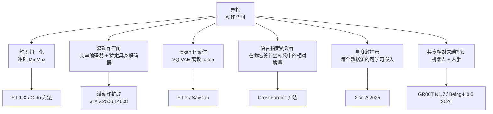
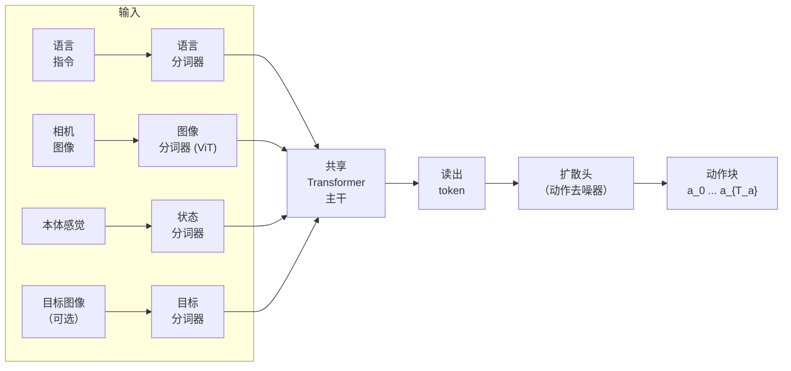

# 机器人跨具身学习

> **英文原文：** [cv-knowledge-base/06_robotics_and_embodied_ai/04_cross_embodiment.md](../../cv-knowledge-base/06_robotics_and_embodied_ai/04_cross_embodiment.md)（本中文版供参考，内容以英文原文为准）

> **最后更新：** 2026年10月
> **难度级别：** 高级 | 研究前沿
> **相关章节：**
> - [扩散策略](./03_diffusion_policy.md)
> - [具身智能的仿真与数据](./05_simulation_and_data.md)
> - [视觉-语言模型](../05_multimodal_vision_language/00_overview.md)
> - [数据集与基准](../11_datasets_and_benchmarks/02_3d_and_robotics_datasets.md)

> **🆕 2026年10月更新：**
> - 新增 **2025–2026 年跨具身通用模型** 一节：π0.5、GR00T N1.5–N1.7（从具身标签到共享的相对末端执行器动作空间）、Gemini Robotics 1.5 **运动迁移（Motion Transfer）**、**X-VLA 软提示**、HPT 的 stem/head 设计。
> - 新增 **将人类视为一种具身** 一节：潜动作预训练（LAPA、UniVLA、villa-X）、EgoScale（GR00T N1.7 中使用的 2 万小时人类视频）、Being-H0.5、EgoVerse。
> - 数据基础设施：LeRobotDataset（Parquet + MP4，v3）作为 RLDS 的 PyTorch 原生替代方案；DROID 以及超大规模专有数据集（Generalist GEN-0/GEN-1）。
> - 为 mermaid 图、关键论文与基准表格增加了条目（X-VLA、GR00T N1.6），新增开放问题与延伸阅读；修复了失效链接。

---

## 概述

跨具身（cross-embodiment）学习探讨的是：单一策略——或一种共享表示——能否在运动学、形态、传感器配置和动作空间截然不同的机器人之间迁移知识。由 Open X-Embodiment 项目 [OXE2023] 实证证实的核心假设是：**在多样化机器人数据上协同训练能提升每种具身上的性能**，即使机器人结构差异巨大。这与 NLP 和计算机视觉中的发现相呼应：更多样化的预训练数据能提升下游任务的泛化，同样的逻辑也适用于视觉运动控制。

Open X-Embodiment（OXE）数据集 [OXE2023] 于 2023 年末发布、在 ICRA 2024 上发表，汇集了来自 34 个研究机构、60 个独立数据集、22 种不同具身（单臂机械臂、双臂系统、移动操作机器人、足式机器人）的 100 多万条机器人轨迹，涵盖 527 种不同的操作技能。数据集以 **RLDS**（Reinforcement Learning Datasets）格式存储——一种基于 TensorFlow Datasets 的回合结构——它提供了一个统一的序列化层，屏蔽了异构传感器配置的差异。在这一混合数据上训练 RT-1-X（一个 Robotics Transformer），在五种不同机器人平台上的平均成功率比仅用各自具身数据训练的策略提高了 50%，确立了协同训练作为一种强大归纳偏置的地位。

根本障碍是 **具身差距（embodiment gap）**：每种机器人都有不同的观测空间（单目 RGB、双目、RGBD、本体感觉维度、力/力矩）和不同的动作空间（关节位置、末端执行器笛卡尔增量、绝对位姿、夹爪开度）。在不进行人工对齐的情况下弥合这些差距，是跨具身研究中决定性的未解问题；近期的架构（Octo、CrossFormer、pi-zero）分别提出了从模态特定分词器到潜动作空间等不同的解决方案。

2025–2026 年的新一代模型又给出了四种新答案。(1) **可学习的具身提示**：X-VLA 为每个数据来源附加一小组可学习的"软提示"嵌入，使单个 0.9B Transformer 能吸收异构性，并仅通过学习新提示即可适配新机器人 [Zheng2025]。(2) **共享的相对动作空间**：GR00T N1.6/N1.7 预测状态相对的动作块，N1.7 更采用机器人 *与* 人手共用的相对末端执行器空间 [NVIDIA2026]。(3) **运动迁移**：Gemini Robotics 1.5 在 ALOHA、双臂 Franka 和 Apollo 人形机器人上训练同一个检查点，使在一种具身上学到的技能能零样本在另一种具身上执行 [GoogleDeepMind2025b]。(4) **将人类视为另一种具身**：数万小时的第一人称人类视频（EgoScale）或以人为中心的统一动作空间（Being-H0.5）被直接混入 VLA 预训练。

---

## 具身差距：观测与动作的异构性

### 观测空间失配

不同机器人将相机安装在不同位置，使用不同分辨率，并且可能包含其他平台完全没有的模态（腕部相机、触觉传感器、深度环）。对齐方法包括：

- **规范视角归一化**：利用估计的相机内参/外参，将所有图像变换到一个规范的第一人称视角。
- **模态掩码**：将缺失的传感器视为被掩码的 token；模型学习从可用的子集中预测动作。
- **模态特定分词器**：每种传感器类型（RGB 图像、深度、关节状态、语言）都经过专门的编码器，所有输出 token 在送入共享 Transformer 主干之前被拼接为统一序列。

### 动作空间失配

动作维度从 4 自由度（简单夹爪）到 30+ 自由度（人形操作）不等。关键策略：



**MinMax 归一化**（Octo [OctoTeam2024] 使用）在训练混合数据的所有示范上对每个维度进行仿射缩放至 $[-1, 1]$，为去噪器/回归器提供一致的数值范围，同时保留相对大小。

**特定具身的动作头**（CrossFormer [Doshi2024] 使用）为每种具身类型在共享 Transformer 主干上附加独立的小型 MLP 头，使主干学习可迁移的表示，而由动作解码器处理特定形态的输出结构。

---

## Open X-Embodiment 数据集与 RT-X 模型

### 数据集统计

- **22 种机器人具身**：包括 Franka Panda、Google RT-1 机器人、WidowX、Hello Robot Stretch、Boston Dynamics Spot、xArm、UR5、ALOHA 等。
- **1,000,000+ 条轨迹**，涵盖 **527 种不同操作技能**，来自 **21 个机构** 的 **34 个研究实验室**。
- **数据格式**：RLDS（见下文）；全部转换为带有灵活观测/动作字段的统一回合模式。
- 以 CC-BY 许可发布；托管于 Google Cloud Storage。

### RLDS 数据格式

RLDS（Reinforcement Learning Datasets）是使 OXE 成为可能的标准化层。每个数据集回合存储为：

```
Episode:
  steps: [
    {
      observation: {image_0: uint8[H,W,3], image_1: ..., state: float32[D_obs]},
      action: float32[D_act],
      reward: float32,
      discount: float32,
      is_first: bool,
      is_last: bool,
      is_terminal: bool,
      language_instruction: string
    }, ...
  ]
```

该模式由 TensorFlow Datasets 支持，序列化为 TFRecord 分片。RLDS 已成为机器人学习数据集的事实标准，使各实验室的数据可以即插即用地混合，而无需定制数据加载器。

**PyTorch 原生替代方案（2025–2026）。** Hugging Face 的 **LeRobotDataset** 格式（状态/动作使用 Parquet + 视频使用 MP4，可在 Hub 上托管和流式读取；2025 年推出 v3.0）已成为新开放数据集和策略的事实格式。GR00T N1.x 使用一种 LeRobot-v2 的"变体"，额外附带一个 `meta/modality.json`，将拼接的状态/动作向量映射到具名字段——实际上是一种轻量级的具身模式描述；openpi、SmolVLA 和 RLinf 都从 LeRobot 数据集进行训练。RLDS（OXE、DROID）与 LeRobot 格式之间的转换如今已是常规操作。

### RT-1-X 与 RT-2-X

OXE 论文评估了两个 RT-X 模型：

- **RT-1-X**：在完整 OXE 混合数据上重新训练的 RT-1 Robotics Transformer 架构 [Brohan2022]。与各平台专用的 RT-1 检查点相比，在 5 个评估平台上取得了 **+50% 的平均成功率**。
- **RT-2-X**：在 OXE 上协同训练的 RT-2 视觉-语言-动作模型（PaLI-X 主干）。在真实世界机器人技能执行上取得了 **3 倍的性能**。RT-2-X 展示了涌现的跨具身泛化能力——仅在一台机器人上见过的技能可以在新的具身上执行。

---

## Octo：开源通用机器人策略

**Octo** [OctoTeam2024]（RSS 2024）是首个在 OXE 上预训练的完全开源通用机器人策略。关键设计选择：

- **架构**：带有用于任务说明（语言字符串或目标图像）的读出 token 的 Transformer，通过模态特定分词器处理异构观测。
- **动作头**：作用于 4 步动作块的扩散头（条件 DDPM），可建模表达力强的多模态分布。
- **训练数据**：来自 OXE 混合数据的 80 万次机器人示范（为计算可行性而精选的子集）。
- **微调**：Octo 可在数分钟到数小时内微调到新的观测空间（如力/力矩输入）、新的动作空间（如关节位置控制）以及全新的具身，是新实验室的实用起点。
- **结果**：微调后，Octo 在 OXE 评估套件的 11 个评估任务中的 9 个上达到或超过此前的任务专用 SOTA。



---

## CrossFormer：跨形态扩展

**CrossFormer** [Doshi2024]（CoRL 2024，Oral——前 4%）将跨具身学习从操作扩展到导航、运动和飞行器：

- **训练数据**：涵盖 20 种具身的 90 万条轨迹，包括单臂/双臂机械臂、轮式机器人、四旋翼和四足机器人。
- **架构**：模态特定分词器 → 共享的仅解码器 Transformer → 特定具身的动作头（每种形态类型一个）。缺失的模态以零掩码。
- **关键发现**：联合训练的单一网络在 20 个评估任务中的 12 个上优于各具身独立的策略，在受益于知识迁移的数据稀缺具身上提升尤为显著。
- **动作空间处理**：每种具身在训练时登记其动作维度和归一化统计量；对应的动作头使用小型 MLP 从共享潜变量进行投影。

---

## 跨具身协同训练：实证发现

OXE、Octo 和 CrossFormer 的一个一致的实证发现是：**加入多样化的跨具身数据能提升源具身上的性能**，即使新增数据来自形态差异极大的机器人。提出的机制包括：

1. **共享视觉表示**：各数据集中多样的场景和物体提升了视觉编码器的泛化能力。
2. **任务级迁移**：操作基元（抓取、推动、放置）在不同具身中都会出现；共享这一信号能提升基元级策略。
3. **隐式数据增强**：跨具身数据中多变的相机视角、光照和背景，对目标具身起到了数据增强的作用。

然而，当数据集在动作统计或任务语义上差异过大时，会发生 **负迁移**；数据集混合加权（例如提高分布内数据的权重）对于避免性能下降至关重要。

---

## 2025–2026 年的跨具身通用模型

### π0 / π0.5 (Physical Intelligence)

π0 在来自 7 种机器人配置的 10,000+ 小时数据以及 OXE 上预训练；π0.5 增加了多环境静态机器人、移动操作机器人（约 400 小时）以及网络/口头数据。Physical Intelligence 报告称，**跨具身机器人数据对任务能力至关重要**，而网络数据对新物体泛化最为重要。不同机器人的动作被零填充到最大动作维度，状态/动作布局由模型根据观测隐式识别。openpi 发布（2025 年 9 月）包含了用于微调到新具身的基础检查点；其 README 提醒，适配到差异很大的平台并不总能成功。

### GR00T N1.x：从具身标签到共享相对动作

GR00T N1 在共享 DiT 周围使用 **特定具身的 MLP 编码器/解码器**，并由 *具身标签*（如 GR-1 人形、Franka、Unitree G1）进行选择。N1.5 增加了用于单臂末端执行器控制（OXE-DROID）和 AgiBot Genie-1 人形机器人的动作头；N1.6 将大多数具身切换为 **状态相对动作块**，并增加了数千小时的双臂 YAM 和 AgiBot 数据；N1.7 将状态/动作维度扩展到 132，并采用 **机器人与人类共享的相对末端执行器动作空间**，NVIDIA 认为这是其跨具身性能的关键因素 [NVIDIA2026]。每次推理或微调调用仍需要一个具身标签，用于选择模态配置（状态/动作键与归一化方式）。

### Gemini Robotics 1.5：运动迁移

Gemini Robotics 1.5 使用 **运动迁移（Motion Transfer, MT）** 方案，在来自 ALOHA、双臂 Franka 和 Apptronik Apollo 的异构数据上训练，以对齐不同具身之间的运动。DeepMind 报告称，仅在一台机器人上示范过的任务可以由其他机器人在没有机器人特定数据的情况下完成，而且即使在数据充足的具身上 MT 也能提升性能 [GoogleDeepMind2025b]。该机制的细节仅部分公开。

### X-VLA：用软提示处理异构性

X-VLA（arXiv 2510.10274）将每种硬件配置/数据来源视为一个"任务"，用可学习的 **软提示** 进行编码，并在一个纯 Transformer、流匹配 VLA 的多模态融合最早阶段注入这些提示。X-VLA-0.9B 在来自七种平台的 29 万个回合上预训练（第一阶段），并在冻结主干的情况下仅通过学习一组新提示来适配新机器人（第二阶段）；仅微调约 900 万参数（1%）时，它在 LIBERO 和 Simpler-WidowX 上即接近 π0。完全微调的检查点报告 LIBERO 98.1%、Simpler-WidowX 95.8%、RoboTwin 2.0 70%。

### HPT：特定具身的 Stem 与 Head

异构预训练 Transformer（Heterogeneous Pre-trained Transformers, HPT，NeurIPS 2024，arXiv 2409.20537）通过特定具身的 **stem** 将每种具身的本体感觉和视觉 token 化为固定数量的 token，由共享的主干（trunk）处理，再接任务特定的 head——这是许多 2025 年模型所采用的模块化 stem/trunk/head 设计的早期形式，也是跨 50 多个数据集进行扩展的早期研究。

---

## 将人类视为一种具身

人类视频的规模远超机器人数据，但缺乏动作标签，且存在很大的形态差距。三种策略已成为主流：

1. **潜动作。** LAPA（ICLR 2025，arXiv 2410.11758）在无标签视频的帧之间学习一个 VQ 潜动作模型，用其预训练 VLA 预测这些潜动作，再用少量带标签数据微调到真实动作。UniVLA（arXiv 2505.06111）学习 *以任务为中心* 的潜动作，抑制与任务无关的运动；villa-X（arXiv 2507.23682）改进了潜动作建模并将其整合到 VLA 预训练中。NVIDIA 的 FLARE 目标（用于 GR00T N1.5）通过对齐未来潜在表示来从人类第一人称视频中学习。
2. **共享的显式动作空间。** EgoScale（arXiv 2602.16710；UC Berkeley、UT Austin、NVIDIA）利用多样化的第一人称人类数据扩展灵巧操作预训练；GR00T N1.7 使用了其中 2 万小时的数据，这得益于与机器人共享的相对末端执行器动作空间。Being-H0.5（arXiv 2601.12993；CoRL 2026）提出了一个以人为中心的统一动作空间以实现跨具身泛化，并发布了 UniHand 预训练子集。
3. **大型第一人称数据集。** EgoVerse（arXiv 2604.07607）等工作专门为机器人学习在世界各地收集第一人称人类操作数据。

与此同时，有公司报告了超大规模的专有 *机器人* 数据集：Generalist AI 的 GEN-0（2025 年 11 月）在跨多种具身的超大规模真实世界操作数据上训练，并报告了可预测的缩放行为，随后于 2026 年 4 月推出 GEN-1；DROID（7.6 万条轨迹、564 个场景）仍是使用最广泛的开放单具身"野外"数据集，也是 RoboArena 评测的基础。

---

## 关键论文

| 论文 | 作者 | 年份 | 发表载体 | 主要贡献 |
|-------|---------|------|-------|-----------------|
| Open X-Embodiment: Robotic Learning Datasets and RT-X Models | Padalkar, Walke, et al. (large consortium) | 2023 | arXiv 2310.08864; ICRA 2024 | 100 万+ 条轨迹、22 种具身、527 项技能；RT-1-X 成功率 +50%；RT-2-X 提升 3 倍 |
| Octo: An Open-Source Generalist Robot Policy | Octo Model Team | 2024 | RSS 2024 | 首个基于 OXE 的开源通用策略；扩散头；可微调到新具身 |
| Scaling Cross-Embodied Learning: One Policy for Manipulation, Navigation, Locomotion and Aviation (CrossFormer) | Doshi, Walke, Mees, Dasari, Levine | 2024 | CoRL 2024 (Oral, top 4%) | 90 万条轨迹、20 种具身（含四旋翼）；共享主干上的特定具身动作头 |
| pi-zero: A Vision-Language-Action Flow Model for General Robot Control | Black et al. (Physical Intelligence) | 2024 | arXiv 2410.24164 | 流匹配 + PaliGemma 3B；7 个平台、68 项任务、10K+ 小时示范；灵巧操作 SOTA |
| RLDS: An Ecosystem to Generate, Share and Use Datasets in Reinforcement Learning | Ramos et al. | 2021 | arXiv 2111.02767 | RLDS 格式——实现 OXE 互操作性的标准化层 |
| RT-1: Robotics Transformer for Real-World Control at Scale | Brohan et al. | 2022 | RSS 2023 | 大规模预训练的 Transformer 动作策略；RT-X 的基线架构 |
| Pushing the Limits of Cross-Embodiment Learning for Manipulation and Navigation | Hejna et al. | 2024 | arXiv 2402.19432 | 对负迁移和混合加权策略的系统研究 |
| Scaling Proprioceptive-Visual Learning with Heterogeneous Pre-trained Transformers (HPT) | Wang, Chen, Zhao, He | 2024 | NeurIPS 2024 | 特定具身的 stem + 共享主干；跨异构数据集扩展 |
| Latent Action Pretraining from Videos (LAPA) | Ye et al. | 2024 | ICLR 2025 | 从无标签视频中学习 VQ 潜动作用于 VLA 预训练 |
| π₀.₅: a Vision-Language-Action Model with Open-World Generalization | Physical Intelligence | 2025 | arXiv 2504.16054 | 跨具身 + 网络数据协同训练；跨机器人数据对任务能力至关重要 |
| UniVLA: Learning to Act Anywhere with Task-centric Latent Actions | Bu et al. | 2025 | arXiv 2505.06111 | 用于跨具身预训练的以任务为中心的潜动作 |
| Gemini Robotics 1.5 | Google DeepMind | 2025 | arXiv 2510.03342 | 运动迁移：单一检查点覆盖 ALOHA、Franka、Apollo |
| X-VLA: Soft-Prompted Transformer as Scalable Cross-Embodiment VLA Model | Zheng et al. | 2025 | arXiv 2510.10274 | 每个数据源的软提示；0.9B；仅通过提示即可适配新机器人 |
| Being-H0.5: Scaling Human-Centric Robot Learning for Cross-Embodiment Generalization | BeingBeyond | 2026 | arXiv 2601.12993; CoRL 2026 | 以人为中心的统一动作空间 |
| EgoScale: Scaling Dexterous Manipulation with Diverse Egocentric Human Data | Berkeley, UT Austin, NVIDIA et al. | 2026 | arXiv 2602.16710 | 大规模第一人称人类数据；GR00T N1.7 使用其中 2 万小时 |

---

## 基准性能

| 模型 | 评估 | 指标 | 得分 | 备注 |
|-------|-----------|--------|-------|-------|
| RT-1-X | 5 个不同平台（OXE 评估） | 平均成功率 | 相对各机器人 RT-1 提升 50% | 源具身上的协同训练收益 |
| RT-2-X | 真实世界操作技能 | 成功率 | 相对单具身 RT-2 提升 3 倍 | 涌现的跨具身泛化 |
| Octo（微调后） | 11 个 OXE 评估任务中的 9 个 | 成功率 | 达到/超过 SOTA | 在目标机器人上少量微调后 |
| CrossFormer | 20 种具身评估套件 | 平均成功率 | 在 12/20 上优于各具身独立策略 | 数据稀缺具身上收益最大 |
| pi-zero | 68 项任务，7 个平台 | 任务完成度 | 在测试的灵巧任务上达 SOTA | 未公开报告逐任务数值 |
| Octo（零样本） | Berkeley Bi-Manual（新平台） | 成功率 | 未公开报告 | 展示了零样本新具身能力 |
| X-VLA-0.9B（完全微调） | LIBERO / Simpler-WidowX / RoboTwin 2.0 | 成功率 | 98.1% / 95.8% / 70% | 代码仓库报告；Simpler Google Robot 83.5% (VM) / 76.4% (VA) |
| X-VLA-0.9B（仅提示 PEFT，约 900 万参数） | LIBERO Spatial / Object / Goal | 成功率 | 96.2% / 96.0% / 94.4% | 主干冻结；仅学习新的软提示 |
| GR00T N1.6 | LIBERO 4 套件平均 | 成功率 | ≈97.0% | 单一 3B 跨具身基础模型，经微调 |
| GR00T N1.5 | GR-1 语言跟随 | 成功率 | 93.3% vs. 46.6%（N1） | 冻结 VLM + FLARE + DreamGen 数据 |

---

## 优缺点

| 方面 | 优点 | 缺点 |
|--------|------|------|
| 数据效率 | 跨具身协同训练相当于免费的数据增强；数据稀缺的具身从共享预训练中获益最多 | 当动作统计或任务语义差异显著时可能发生负迁移；需要谨慎的混合加权 |
| 泛化 | 模型学习与平台无关的视觉和任务表示；对未见场景和物体的零样本泛化更好 | 在新具身内部的泛化仍然有限；通常仍需要目标机器人的微调或适配数据 |
| 基础设施 | RLDS 标准化使数据集可以即插即用地混合；开放数据集生态日益壮大 | RLDS/TFRecord 基础设施的采用门槛不低；PyTorch 原生替代方案仍在成熟中 |
| 架构灵活性 | 模态特定分词器 + 掩码可优雅地处理缺失传感器；特定具身的动作头避免了不同动作空间的混淆 | 模型容量必须随具身数量扩展；存储各具身的动作头会增加参数；内存开销随具身多样性增长 |
| 软提示 / 具身标签 | 适配成本低（仅提示，或标签 + 动作头）；主干共享 | 仍需要每台机器人的数据和归一化统计量；无法零样本迁移到真正未见过的形态 |
| 将人类视频作为一种具身 | 数据量高出数个数量级；包含丰富的灵巧行为 | 形态差距（人手 vs. 夹爪）；手部姿态估计有噪声；收益依赖于共享的动作空间 |

---

## 开放问题与研究空白

1. **有原则的混合加权。** 训练批次应如何为来自 22+ 种具身的轨迹分配权重？当前做法按数据集大小或人工启发式进行混合；一种理论上有原则的方法（如基于梯度的数据选择、影响函数）仍然缺失。

2. **动作空间统一。** MinMax 归一化和特定具身的动作头只是权宜之计。一种真正通用的动作表示——也许位于由跨具身 VAE 学到的潜空间中，或借助相对关节坐标系基元——能够实现向未见形态的真正零样本迁移，仍是开放问题。

3. **本体感觉与触觉的整合。** 大多数跨具身工作聚焦于 RGB 视觉观测，而忽略了对接触丰富装配至关重要的本体感觉或力/力矩信号。在异构传感器配置之间对这些信号进行 token 化和对齐，在很大程度上尚未解决。

4. **人类示范迁移。** 人类视频包含的多样化操作数据要多出数个数量级。通过重定向、奖励学习或潜空间对齐来弥合人到机器人的具身差距（形态、运动学、工具使用），是一个重要的开放方向（相关工作：DexMimic、AnyDex，2025–2026 年的研究）。

5. **评估协议标准化。** 每篇跨具身论文都定义自己的评估套件，使跨论文比较无法进行。目前还没有一个类似 ImageNet、用于操作泛化的标准化多具身基准。

6. **持续/终身跨具身学习。** 随着新机器人加入机队，对旧具身技能的灾难性遗忘是一个现实问题。用于增量添加具身的持续学习方法（EWC、基于 LoRA 的适配器）尚不成熟。

7. **跨具身协同训练的缩放定律。** 目前尚不清楚 OXE 式协同训练是否遵循幂律缩放（具身越多越好、单调提升），还是表现出收益递减。绘制缩放曲线需要尚未发表的系统性消融实验。公司报告（Generalist GEN-0）声称真实世界数据呈现可预测的缩放，但没有公开数据或消融。

8. **哪种动作空间应当成为通用标准？** 2025–2026 年的模型各执一词：零填充的关节向量（π0）、带具身标签的动作头（GR00T N1–N1.5）、与人类共享的相对末端执行器增量（GR00T N1.7、Being-H0.5）、潜动作（LAPA、UniVLA），或可学习的提示（X-VLA）。相对末端执行器空间便于人类数据迁移，但会丢弃对灵巧手和全身人形机器人至关重要的关节级信息。

9. **透明的跨具身声明。** 运动迁移等封闭方案报告了惊人的零样本迁移，但在数据和代码未公开的情况下，很难判断究竟是哪些组成部分（共享的运动学重定向、数据混合、模型规模）在起作用。

---

## 延伸阅读

- [Open X-Embodiment 项目页](https://robotics-transformer-x.github.io/)
- [Octo 模型与代码（octo-models.github.io）](https://octo-models.github.io/)
- [CrossFormer 论文 — arXiv:2408.11812](https://arxiv.org/abs/2408.11812)
- [RLDS 论文 — arXiv:2111.02767](https://arxiv.org/abs/2111.02767)
- [Open X-Embodiment GitHub（google-deepmind）](https://github.com/google-deepmind/open_x_embodiment)
- [pi-zero 论文 — arXiv:2410.24164](https://arxiv.org/abs/2410.24164)
- [Isaac GR00T（具身标签、相对末端执行器、EgoScale）](https://github.com/NVIDIA/Isaac-GR00T)
- [X-VLA — arXiv:2510.10274](https://arxiv.org/abs/2510.10274) 与 [代码](https://github.com/2toINF/X-VLA)
- [Gemini Robotics 1.5 — arXiv:2510.03342](https://arxiv.org/abs/2510.03342)
- [HPT — arXiv:2409.20537](https://arxiv.org/abs/2409.20537)
- [LAPA — arXiv:2410.11758](https://arxiv.org/abs/2410.11758)
- [EgoScale — arXiv:2602.16710](https://arxiv.org/abs/2602.16710)
- [Being-H（H0 / H0.5 / H0.7）](https://github.com/BeingBeyond/Being-H)
- [LeRobotDataset v3 文档](https://huggingface.co/docs/lerobot/lerobot-dataset-v3)
