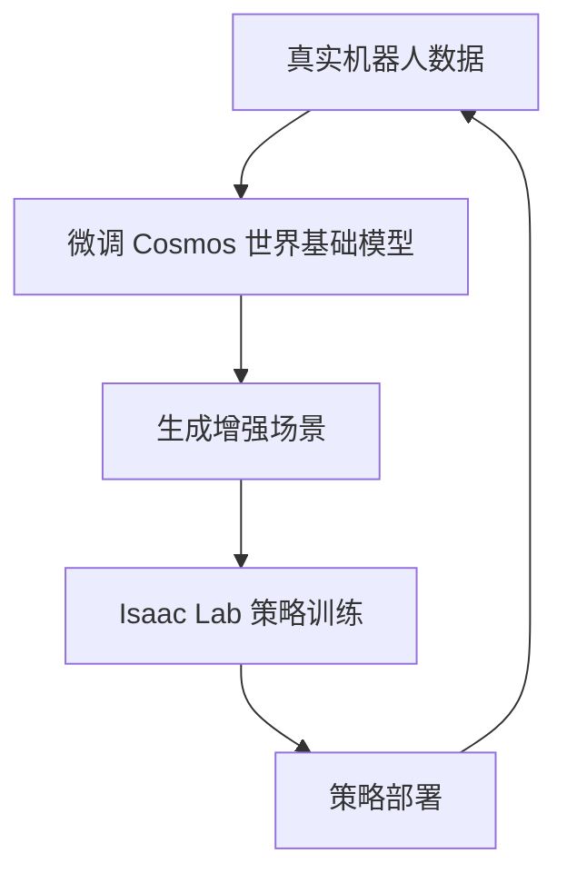

# 具身智能的仿真与数据

> **英文原文：** [cv-knowledge-base/06_robotics_and_embodied_ai/05_simulation_and_data.md](../../cv-knowledge-base/06_robotics_and_embodied_ai/05_simulation_and_data.md)（本中文版供参考，内容以英文原文为准）

> **最后更新：** 2026年10月
> **难度级别：** 高级 | 研究前沿
> **相关章节：** [./02_world_models.md](./02_world_models.md) | [./09_robot_data_and_teleoperation.md](./09_robot_data_and_teleoperation.md) | [./04_cross_embodiment.md](./04_cross_embodiment.md) | [./01_vla_models.md](./01_vla_models.md)

> **🆕 2026年10月更新：**
> - **Newton**（Disney Research + Google DeepMind + NVIDIA 联合开发，自 2025 年 9 月起为 Linux 基金会项目）于 2026 年 3 月 10 日发布 v1.0，并于 2026 年 10 月 14 日发布 v1.7。它是基于 Warp/OpenUSD 的多求解器引擎，主后端为 **MuJoCo Warp**。**Isaac Lab 3.0**（2026 年 9 月发布抢先体验版，正式版目标为 2026 年 10 月底）成为同时支持 PhysX 与 Newton 的多后端框架，其技术报告也已发布（arXiv:2511.04831）。
> - **MuJoCo Playground**（arXiv:2502.08844，RSS 2025 杰出演示论文奖）可在单 GPU 上数分钟内训练出可仿真到现实迁移的运动与操作策略，现可运行于 MJX 或 MuJoCo Warp 之上。**Genesis** 发布了"Genesis World 1.0"（2026 年 5 月），现由初创公司 Genesis AI 支持。
> - 新增及更新的基准包括 **RoboCasa365**（ICLR 2026，365 个任务，2,500+ 场景）、**RoboTwin 2.0**、**LIBERO-Plus**（鲁棒性审计：在相机/初始状态扰动下，VLA 的成功率从约 95% 跌至 30% 以下）、用于 GPU 并行策略评估的 **Isaac Lab-Arena**，以及 **ManiSkill3**（RSS 2025）。
> - 世界模型数据引擎：**Cosmos-Predict2.5 / Transfer2.5**（2025 年 10 月）、**DreamGen / GR00T-Dreams**、Cosmos Policy 检查点（2026 年 2 月），以及 **Cosmos 3** 全模态模型家族（2026 年 5 月；Super 64B、Nano 16B、Edge 4B）。Cosmos 3 的日期已从此前的"2026 年 6 月"更正。
> - 新增开放问题：基准饱和与鲁棒性之间的落差，以及通用策略在真实到仿真（real-to-sim）评估中的保真度。

---

## 概述

仿真已成为现代机器人学习不可或缺的组成部分。它既是强化学习和模仿学习的训练环境，也是感知系统可规模化获取的带标注合成数据来源。从仿真走向物理部署的核心挑战是**仿真到现实差距（sim-to-real gap）**，其根源在于物理保真度、视觉外观、接触动力学、传感器噪声模型和执行器行为等方面的失配。弥合这一差距需要高保真物理引擎、照片级真实感渲染，以及有原则的域随机化（Domain Randomization）。随机化让策略在训练阶段接触足够多的分布变化，从而在测试时泛化到真实世界。

过去三年，GPU 并行仿真框架呈爆发式增长。Isaac Gym（2021）率先实现在单块 GPU 上运行数千个相互独立的机器人环境。其继任者 **Isaac Lab** [Mittal2025] 把这一能力整合为统一框架，结合了刚体物理、可变形体仿真、照片级渲染（通过 NVIDIA Omniverse），并与强化学习库紧密集成。在学术界，2024 年 12 月发布的 **Genesis** [Zhou2024] 声称，在 RTX 4090 上单个 Franka 机械臂场景可达每秒 4300 万帧，约为实时速度的 430,000 倍。这标志着一次质变：当一个运动策略只需 26 秒挂钟时间即可训练完成时，对整个策略族做超参数搜索就变得可行了。

2025–2026 年出现了**围绕共享物理后端的整合**。Google DeepMind 与 NVIDIA 共同开发 **MuJoCo Warp（MJWarp）**，这是用 NVIDIA Warp 编写的 MuJoCo GPU 移植版。**Newton** [Newton2026] 是由 Disney Research、Google DeepMind 和 NVIDIA 共同发起、由 Linux 基金会治理的开放引擎。它以 MJWarp 为主后端，并为布料、线缆、MPM 颗粒介质和闭链机构增加了更多求解器。Isaac Lab 3.0 和 MuJoCo Playground [Zakka2025] 都能在这些后端上训练。因此，研究者无需重写任务代码，即可在 MuJoCo 风格的软接触模型与 PhysX 之间切换。

作为物理仿真器的补充，**世界模型（World Model）**已成为另一条数据生成途径。NVIDIA **Cosmos** [NVIDIA2025] 于 CES 2025 发布，是一个基于扩散和自回归的世界基础模型家族，在大规模视频语料上训练，能够以文本、图像或机器人动作为条件合成物理上合理的视频。将 Cosmos 与 Isaac Lab 结合可以形成*数据飞轮*：真实机器人交互数据用于微调 Cosmos，Cosmos 再生成增强的训练场景，反馈给 Isaac Lab 进行策略学习。这一流程有望在保持物理合理性的同时，大幅降低对真实世界数据的需求。到 2026 年，这条路线又扩展出 Cosmos-Predict2.5/Transfer2.5，以及同样能输出动作的全模态 Cosmos 3 家族。

---

## GPU 并行物理仿真器

### Isaac Lab（NVIDIA）

Isaac Lab [Mittal2025] 是 Isaac Gym 的官方继任者，构建于 NVIDIA PhysX 5 引擎和 Omniverse USD 场景描述格式之上。主要能力：

- **并行环境：** 每块 GPU 运行数千个独立环境，每个环境拥有独立的物理状态
- **多模态感知：** RGB、深度、分割、力-力矩、本体感知，全部驻留在 GPU 上
- **域随机化：** 以编程方式随机化质量、摩擦系数、视觉纹理和光照
- **与强化学习紧密集成：** 原生支持 RSL_RL、RL_Games 和 Stable Baselines 3
- **模仿学习支持：** 用于行为克隆的数据采集流程

```
GPU Memory
┌──────────────────────────────────────────────────┐
│  Env 0   │  Env 1   │  Env 2   │  ...  │  Env N  │  (N = 4096+ on A100)
│  Physics │  Physics │  Physics │       │  Physics │
│  Render  │  Render  │  Render  │       │  Render  │
└──────────────────────────────────────────────────┘
              ↓ batched observations
         Policy Network (GPU)
              ↓ batched actions
         Environment Step (GPU)
```

**2025–2026 年的演进。** Isaac Lab 技术报告（arXiv:2511.04831，2025 年 11 月）涵盖执行器模型、多频率传感器仿真、数据采集和域随机化，以及从全身控制到灵巧操作的各类应用。此后的版本线如下：

| 版本 | 日期 | 要点 |
|---------|------|-----------|
| v2.3.0 | 2025 年 10 月 | Isaac Sim 5.1；DexSuite 灵巧抓起/重定向环境（结合 ADR 与 PBT）；结合 cuRobo 运动规划、用于合成示教生成的 **SkillGen**；G1 移动操作；Vive/Manus 遥操作 |
| v2.3.2 | 2026 年 2 月 | 2.x 系列的最后一个版本。视觉触觉传感器、多旋翼支持、OpenArm 环境、Newton Beta 文档 |
| v3.0.0-beta / beta2 | 2026 年 3 月 / 6 月 | Isaac Sim 6.0。**基于工厂模式的多后端架构**：`isaaclab_newton` 后端（MuJoCo-Warp，无需 Kit 运行时）与 PhysX 并存；可插拔渲染器；Warp 原生数据；四元数约定改为 XYZW |
| v3.0.0-EA | 2026 年 9 月 16 日 | Isaac Sim 6.1，Newton 1.5.2。物理、渲染和可视化后端共用一套任务 API；正式版目标为 2026 年 10 月底 |

**Isaac Lab-Arena**（alpha 版，v0.3）构建于 Isaac Lab 3.0 之上，是一个用于*编写基准和评估策略*的框架。环境由 {场景, 具身形态, 任务} 组合而成，支持关系式物体摆放和原子技能串联。一个策略（例如通过客户端-服务器接口接入的 GR00T 或 π0.5）可以在数千个并行的环境变体上评估，再借助敏感性分析暴露鲁棒性缺口。

### Newton 与 MuJoCo Warp

**Newton** [Newton2026] 源自已弃用的 `warp.sim` 模块。它由 NVIDIA、Google DeepMind 和 Disney Research 在 GTC 2025 上宣布，并于 2025 年 9 月贡献给 Linux 基金会。其设计目标是 GPU 优先计算、OpenUSD 场景读写、可微分性以及用户可扩展的求解器。**1.0.0 版于 2026 年 3 月 10 日发布**（在 GTC 2026 上展示），此后大约每月发布一个版本，直到 **v1.7.0（2026 年 10 月 14 日）**。其代码库提供的示例涵盖：

- **刚体/多关节体：** MuJoCo Warp（主后端）和 Featherstone，以及用于并联连杆腿等闭链机构的 **Kamino**
- **可变形体：** VBD（顶点块下降）布料与软体、ADMM 线缆求解器、Style3D 布料
- **颗粒与流体介质：** 隐式 MPM（沙、雪、黏性流体），可与刚性机器人双向耦合（例如 ANYmal 行走于颗粒地形）

**MuJoCo Warp（MJWarp）** 由 Google DeepMind 和 NVIDIA 作为 Newton 项目的一部分共同维护。它是 MuJoCo 的 GPU（Warp）重新实现，JAX 用户也可以通过 MJX 调用。其光线追踪批量渲染器在 NVIDIA GPU 上可达"每秒数百万帧"。目前并非所有 MuJoCo 功能都已支持：缺少 PGS 求解器和插件，flex 支持仍是实验性的，经由 Warp 的可微分性也尚不可用。

> **解读。** 生态系统已经从*相互竞争的单体仿真器*转向*共享、可互操作的求解器*。同一个 MuJoCo 接触模型如今可以运行在 CPU MuJoCo、MJX（JAX/TPU）、MJWarp（CUDA）以及 Newton/Isaac Lab 上。当论文跨框架比较结果时，这消除了一个仿真到仿真差异的来源。

### Genesis

Genesis [Zhou2024] 是一个纯 Python 物理引擎，最初构建于 Taichi 之上，性能如下：

- 单臂操作 **4300 万+ FPS**（RTX 4090，仅自碰撞）
- 启用随机动作扰动时 **2700 万 FPS**
- 在同等基准上比 Isaac Gym **快 81 倍**
- 统一求解器，支持刚体、MPM（颗粒/软体）、SPH（流体）、FEM 以及稳定的牛顿流体

这些标题数字是在几乎没有物体间接触的单臂场景中测得的，应视为上限；在任何仿真器上，接触密集且带渲染的工作负载都会慢得多。2025–2026 年间，该项目从学术发布成长为由产业支持的代码库：

- 初创公司 **Genesis AI** 于 2025 年 7 月结束隐身状态。据 TechCrunch 报道，其种子轮融资为 1.05 亿美元，由 Eclipse 和 Khosla Ventures 共同领投。该公司现正式支持 Genesis 的开发。
- 编译器从 Taichi 分叉为 **Quadrants**（2025 年 6 月），支持 CUDA、ROCm、Metal、Vulkan、x86 和 ARM64 后端。
- **Genesis World 1.0** 于 2026 年 5 月在 Genesis AI 博客上发布。当前代码库可在同一场景中耦合刚体、FEM、MPM、PBD/SPH 和 **IPC**（增量势接触，经由 libuipc）求解器，并新增 SAP 接触模型、**Nyx** 渲染器（包括 3D 高斯泼溅资产）以及仿真的激光雷达/IMU/触觉传感器。

### MuJoCo / MJX

由于其精确的软接触模型和广泛的验证，MuJoCo 仍然是接触密集型操作研究的参考仿真器。**MJX** 将 MuJoCo 扩展到 JAX，实现 GPU/TPU 并行的批量仿真：

```python
# MJX 批量 rollout 示意
import mujoco
from mujoco import mjx
import jax
import jax.numpy as jnp

model = mujoco.MjModel.from_xml_path("robot.xml")
mx = mjx.put_model(model)
dx = jax.vmap(mjx.make_data)(mx)            # N 个并行状态
step_fn = jax.jit(jax.vmap(mjx.step))       # 批量步进
dx = step_fn(mx, dx)
```

### MuJoCo Playground

**MuJoCo Playground** [Zakka2025]（arXiv:2502.08844；获 RSS 2025 杰出演示论文奖；UC Berkeley、Google DeepMind、多伦多大学、剑桥大学）是一套可通过 pip 安装的 GPU 加速环境。它涵盖 `dm_control` 经典任务、四足与人形运动（如 Unitree G1、Berkeley Humanoid）、灵巧手内操作（LEAP 手）以及非抓取式机械臂操作。该工作报告了**基于状态输入和像素输入的零样本仿真到现实迁移**，策略可在单块 GPU 上数分钟内训练完成。基于视觉的训练使用批量渲染器，环境现可运行于 MJX（JAX）或 MuJoCo Warp（`--impl warp`）之上，配合 JAX-PPO 或 RSL-RL 训练器。Playground 已成为"分钟级出策略"运动研究事实上的可复现基线。

### SAPIEN / ManiSkill3

SAPIEN 是由加州大学圣地亚哥分校开发的快速多关节物体物理引擎。**ManiSkill3** [Tao2025]（arXiv:2410.00425，RSS 2025）构建于 SAPIEN 之上，提供：

- 带渲染的 GPU 并行环境（在典型任务上，基于状态最高可达 10,000 FPS，带视觉渲染时为 2,000 FPS；作者报告在高端配置下可**在 RTX 4090 上以 30,000+ FPS 采集 RGBD + 分割数据**）
- **异构仿真**：每个并行环境可以拥有不同的场景和物体集合
- 20+ 个任务族，2,000+ 个物体模型
- GPU 加速的真实世界策略**真实到仿真评估**，据称比真实评估快约 100 倍
- 用于操作技能评估的标准化基准 API

### Habitat 3.0

Facebook AI 的 Habitat 3.0 专注于具身导航以及带有人类化身的社交导航。它在真实环境的照片级 3D 扫描（HM3D、Gibson、Replica 数据集）中同时支持刚体智能体和多关节人形。

### ProcTHOR

ProcTHOR [Deitke2022] 使用程序化生成创建数千个视觉多样的室内环境，用于训练导航和指令跟随智能体。其核心洞见是：训练时的多样性能够通过分布覆盖很好地迁移到真实世界，即使渲染较为简化。

### RoboCasa / RoboCasa365

RoboCasa [Nasiriany2024] 是基于 Robosuite/MuJoCo 构建的大规模厨房仿真框架，特点包括：

- 120 个视觉多样的厨房场景
- 25 个原子任务，100 个组合任务
- 1,200 条人类示教 + 72,000 条合成示教
- AI 生成的纹理（文本到图像）和资产（文本到 3D）
- 发表于 RSS 2024

**RoboCasa365** [Nasiriany2026]（v1.0，2026 年 2 月 18 日发布；ICLR 2026）将该框架扩展为面向通用机器人的训练与基准平台：

- 在 LLM 辅助下编写的 **365 个任务**、**2,500+ 个厨房场景**、3,200+ 个物体
- **600+ 小时人类示教加 1,600+ 小时机器人数据集**（共计 2,200+ 小时）
- 公开排行榜（2026 年 4 月）。v1.0.1（2026 年 5 月）将任务时域延长了 1.5 倍，随后又为组合任务加入了逐帧子任务标注（2026 年 7–10 月）

RoboCasa 及其 GR1 桌面变体如今已是 NVIDIA GR00T 模型卡中的标准评估套件。

---

## 仿真到现实迁移与域随机化

根本困难在于，在仿真中训练的策略会遇到一个动力学、外观和噪声特性都不同的真实世界。弥合策略分为三类：

### 域随机化（Domain Randomization, DR）

在训练中随机化仿真参数，使真实世界参数落入训练分布之内：

```
P(success_real) ≈ E_{ψ ~ P(ψ)}[P(success_sim | ψ)]
```

其中 `ψ` 编码随机化的物理参数（质量、摩擦、阻尼）和视觉参数（纹理、光照、相机位姿）。

**视觉 DR：** 随机纹理、颜色、光照和干扰物。代表性成果：OpenAI 的灵巧手 [OpenAI2019] 使用极端的视觉 DR，实现了从仿真到真实 Shadow Hand 的迁移。

**动力学 DR：** 随机化质量、惯量、关节摩擦和执行器增益。**自适应 DR**（ADR）会随着策略能力的提升自动扩展随机化范围，从而同时避免随机化不足和过度随机化。Isaac Lab 2025 年的 DexSuite 环境将 ADR 与基于种群的训练（PBT）结合，用于灵巧抓起与重定向任务。

### 系统辨识与可微分仿真

系统辨识不是盲目随机化，而是让仿真参数拟合真实轨迹。可微分仿真器（如 Warp、DiffTaichi）支持基于梯度的参数优化：

```math
\hat{\psi} = \arg\min_{\psi} \sum_t \| s_t^{\text{real}} - s_t^{\text{sim}}(\psi) \|^2
```

Newton 和 Genesis 的 Quadrants 编译器都把可微分性列为设计目标。但实际上，穿过接触密集型 MuJoCo-Warp rollout 的梯度尚不可用（截至 2026 年 10 月），因此 2026 年的大多数仿真辨识流程仍依赖基于采样的优化器（CMA-ES、贝叶斯优化）。

### 基于神经场景重建的真实到仿真到真实（Real2Sim2Real）

第三条路线自 2024 年以来增长迅速：用手机或机器人采集的数据重建*实际*部署场景（3D 高斯泼溅、神经辐射场），将其导入仿真器，再在其中训练或评估策略。Isaac Lab 3.0 的 beta 版加入了神经重建（NuRec）渲染支持，Genesis 的 Nyx 渲染器也接受高斯泼溅资产。关于 SplatSim 和 RL-GSBridge，参见[机器人感知](./08_perception_for_robotics.md)。

### 接触动力学中的现实差距

接触仿真（抓取、插装）仍是最难的领域，原因包括：
- 真实物体表面的变形
- 摩擦各向异性
- 机器人末端执行器的传感器柔顺性
- 环境变化（灰尘、湿度）

NVIDIA 明确将 Newton 1.0 定位于接触密集型工业操作，提供**水弹性接触（hydroelastic contact）**建模，并与合作伙伴开展求解器标定工作。对这些模型的独立仿真到现实验证仍然稀少。

---

## 基准仿真套件

### RLBench

RLBench [James2020] 在 PyRep/CoppeliaSim 中基于 Franka 机械臂定义了 100 个结构化操作任务，任务从简单的到达到双臂装配不等，被广泛用于少样本模仿学习基准。

### Meta-World

Meta-World [Yu2020] 提供 50 个不同的机器人操作任务，用于多任务和元强化学习评估，可同时衡量特定任务性能和泛化性能。

### CALVIN

CALVIN [Mees2022] 是一个长时域、语言条件的基准，要求智能体在新的场景布置中，于单个回合内执行由 4 条指令构成的序列。


### LIBERO 与 LIBERO-Plus

LIBERO [Liu2023] 专注于终身机器人学习，包含横跨四个知识领域（空间、物体、目标、长时域）的 130 个任务。任务旨在衡量前向迁移和灾难性遗忘。

到 2025 年，LIBERO 已成为默认的 VLA 基准，顶尖模型报告的平均成功率在 95% 上下乃至更高。**LIBERO-Plus** [Fei2025]（arXiv:2510.13626）通过扰动七个因素来审视这种饱和：物体布局、相机视角、机器人初始状态、语言指令、光照、背景纹理和传感器噪声。结果表明，VLA *对相机视角和机器人初始状态高度敏感*：在适度偏移下，成功率从约 95% 跌至 30% 以下。在其排行榜上，OpenVLA 在相机扰动下得分 0.8（总分 15.6），OpenVLA-OFT 得分 56.4（总分 69.6）。

### ManiSkill2 / ManiSkill3

ManiSkill2 [Gu2023]（ICLR 2023）包含 20 个任务族和 400 万+ 条示教。升级版 ManiSkill3（2024；RSS 2025）新增了 GPU 并行渲染、每个环境可不同的异构场景以及标准化评估 API。

### RoboTwin 2.0（双臂）

**RoboTwin 2.0** [Chen2025]（arXiv:2506.18088，2025 年 6 月发布）是一个面向**双臂操作**、带有*强域随机化*的可扩展数据生成器与基准。它包含约 50 个任务、多种双臂具身形态（默认：AgileX ALOHA 风格）以及 100,000+ 条预采集轨迹。RoboTwin 1.0 是 CVPR 2025 Highlight 论文，该平台还承办了 CVPR 2025 MEIS 双臂协作挑战赛。

### 家庭规模与评估平台

- **BEHAVIOR-1K** [Li2022]：在 OmniGibson（构建于 Isaac Sim 之上）中定义的 1,000 项日常家务活动。它仍是语义上最全面的家庭基准，也是斯坦福 BEHAVIOR 挑战赛的基础。
- **Isaac Lab-Arena**（2026，alpha 版）：可组合的基准编写，以及对通用策略的 GPU 并行大规模评估（见上文）。
- **RoboArena**（2025）：基于 DROID 平台、针对通用策略的分布式*真实世界*基准。策略通过远程策略服务器提供，并在不同站点的 DROID 装置上评估，另配有仿真评估套件（DROID sim-evals）。

---

## 基于世界模型的合成数据

NVIDIA **Cosmos** [NVIDIA2025] 代表了一种新范式：在海量视频语料上训练、能够生成物理上合理的合成训练数据的**世界基础模型**：



主要能力：
- 以文本、图像或动作为条件的视频生成
- 物理感知的生成（物体恒存性、接触事件）
- 与 Omniverse 集成，用于域随机化增强

### Cosmos-Predict2.5 / Transfer2.5（2025 年 10 月）

**Cosmos-Predict2.5** 于 2025 年 10 月 6 日发布（技术报告 arXiv:2511.00062），在单个流匹配（flow matching，具体为整流流 rectified flow）模型中统一了 Text2World、Image2World 和 Video2World，提供 2B 和 14B 两种规模。它新增了面向机器人的后训练变体：*动作条件*预测（2025 年 10 月）、多视角 AgiBot 生成（2025 年 12 月），以及 **Cosmos Policy** 检查点（2026 年 2 月）。在这些策略检查点中，视频模型经后训练后直接在 RoboCasa 和 LIBERO 上充当策略。**Cosmos-Transfer2.5** 是一个多 ControlNet 的"世界到世界"模型，能把仿真器输出（深度、分割、边缘、模糊）转换为照片级真实视频，可作为人工设计的视觉域随机化的学习式替代方案。2026 年 2 月又发布了蒸馏后的边缘端变体。

### DreamGen / GR00T-Dreams

**DreamGen** [Jang2025]（arXiv:2505.12705）是一个生成"神经轨迹"的四步配方：

1. 在目标机器人上微调视频世界模型
2. 以初始帧和语言指令提示它，生成新行为或新环境的 rollout
3. 用逆动力学模型恢复伪动作
4. 在所得数据上训练视觉运动策略（GR00T N1）

NVIDIA 将其打包为 **GR00T-Dreams** 蓝图，DreamGenBench 则从指令遵循和物理一致性两方面为生成视频打分。它是最早系统性证明*视频模型 rollout 能教会机器人遥操作中从未执行过的动作*的工作之一。

### Cosmos 3（2026）

**Cosmos 3** 于 2026 年 5 月下旬发布，并于 2026 年 6 月 1 日正式公开宣布。它是一个"全模态"世界模型家族，构建于统一的**混合 Transformer（Mixture-of-Transformers）**架构之上，提供两个接口：

- **推理器（Reasoner）：** 文本 + 视觉 → 文本（世界理解、任务规划）
- **生成器（Generator）：** 文本 + 视觉 + 声音 + 动作 → 视觉 + 声音 + 动作（世界仿真与策略学习）

它分为三个档位。**Cosmos3-Super（64B）** 用于合成数据生成并充当蒸馏教师，**Cosmos3-Nano（16B）** 作为后训练基座，**Cosmos3-Edge（4B）**（2026 年 7 月）面向在 Jetson AGX Orin/Thor 上运行的实时策略。示例后训练检查点包括 DROID 机器人策略。这些进展模糊了"世界模型作为数据引擎"与"世界模型作为策略"之间的界线（参见[世界模型](./02_world_models.md)）。

---

## 关键论文

| 论文 | 作者 | 年份 | 发表处 | 主要贡献 |
|-------|---------|------|-------|-----------------|
| Isaac Lab: A GPU-Accelerated Simulation Framework for Multi-Modal Robot Learning | Mittal et al. | 2025 | arXiv:2511.04831 (NVIDIA) | 统一的 GPU 并行仿真+渲染框架；多模态传感器支持；扩展 Isaac Gym；预告 Newton 集成 |
| Genesis: Generative World for General-Purpose Robotics | Zhou et al. | 2024 | 开源发布 | 4300 万 FPS 纯 Python 仿真器；统一的刚体/软体/流体求解器 |
| MuJoCo Playground | Zakka et al. | 2025 | RSS 2025（杰出演示论文） | MJX/MJWarp 环境套件；单 GPU 分钟级得到策略；基于状态与像素的零样本仿真到现实迁移 |
| ManiSkill3: GPU Parallelized Robotics Simulation and Rendering for Generalizable Embodied AI | Tao et al. | 2025 | RSS 2025 | 异构 GPU 并行仿真 + 渲染；30K+ FPS RGBD+分割；快速真实到仿真评估 |
| ManiSkill2: Unified Benchmark for Generalizable Manipulation Skills | Gu et al. | 2023 | ICLR 2023 | 20 个任务族，400 万+ 条示教，GPU 加速评估 |
| RoboCasa: Large-Scale Simulation of Everyday Tasks | Nasiriany et al. | 2024 | RSS 2024 | 120 个厨房场景，100 个任务，AI 生成资产；72K 条合成示教 |
| RoboCasa365: A Large-Scale Simulation Framework for Training and Benchmarking Generalist Robots | Nasiriany et al. | 2026 | ICLR 2026 | 365 个任务，2,500+ 场景，2,200+ 小时示教；公开排行榜 |
| RoboTwin 2.0 | Chen et al. | 2025 | arXiv:2506.18088 | 带强域随机化的双臂数据生成器 + 基准；100K+ 条轨迹 |
| LIBERO-Plus: In-depth Robustness Analysis of Vision-Language-Action Models | Fei et al. | 2025 | arXiv:2510.13626 | 7 轴扰动审计；VLA 在相机/初始状态偏移下崩溃 |
| DreamGen: Unlocking Generalization in Robot Learning through Video World Models | Jang et al. | 2025 | arXiv:2505.12705 | 视频世界模型 rollout + 逆动力学 → 合成机器人轨迹；DreamGenBench |
| Cosmos-Predict2.5 / Transfer2.5 technical report | NVIDIA | 2025 | arXiv:2511.00062 | 统一的基于流的世界仿真；动作条件与多视角机器人变体；多控制仿真到现实迁移 |
| CALVIN: Long-Horizon Language-Conditioned Manipulation | Mees et al. | 2022 | IEEE RA-L | 在新场景中串联 4 条指令的操作基准 |
| ProcTHOR: Large-Scale Embodied AI using Procedural Generation | Deitke et al. | 2022 | NeurIPS 2022 | 用于导航/指令跟随的程序化生成多样室内环境 |
| LIBERO: Benchmarking Knowledge Transfer for Lifelong Robot Learning | Liu et al. | 2023 | NeurIPS 2023 | 130 个终身学习任务；衡量前向迁移与遗忘 |

---

## 基准性能

| 模型 | 数据集/基准 | 指标 | 得分 | 备注 |
|-------|------------------|--------|-------|-------|
| Diffusion Policy [Chi2023] | RLBench（10 个任务） | 成功率 | 76.1% | 基于 CNN；图像输入 |
| ACT [Zhao2023] | ALOHA 双臂任务 | 成功率 | 80–96% | 仿真训练，真实迁移 |
| SuSIE [Black2023] | CALVIN ABC→D | 平均链长 | 3.6/4.0 | LLM 子目标合成 |
| MT-ACT（多任务） | LIBERO-Long | 成功率 | 72.0% | 10 任务序列 |
| DP3 [Ze2024] | ManiSkill2（点云） | 成功率 | 85%+ | 3D 扩散策略 |
| Genesis 基线 | MuJoCo 运动 | 训练时间 | 26 秒 | RTX 4090 上 430,000 倍实时 |
| ManiSkill3 [Tao2025] | 数据采集吞吐量 | FPS | 30,000+（RGBD + 分割） | RTX 4090；作者给出的高端数字 |
| OpenVLA-OFT | LIBERO-Plus（全部扰动） | 成功率 | 69.6% | 相机偏移下为 56.4%；对比干净 LIBERO 上约 95%+ |
| OpenVLA | LIBERO-Plus（全部扰动） | 成功率 | 15.6% | 相机偏移下为 0.8% |

---

## 优缺点

| 方面 | 优点 | 缺点 |
|--------|------|------|
| **GPU 并行仿真** | 样本吞吐量巨大；使复杂技能的强化学习成为可能；场景变化零成本 | 对可变形/接触密集任务物理精度下降；GPU 显存限制回合多样性 |
| **多求解器开放引擎（Newton、MJWarp）** | 厂商中立的治理；同一接触模型可跨 CPU/JAX/CUDA；同一场景中耦合刚体 + 布料 + MPM | API 尚新，频繁出现破坏性变更（Isaac Lab 3.0 仍未发布正式版）；与 CPU MuJoCo 相比存在功能缺口；可微分性尚未端到端打通 |
| **域随机化** | 运动控制的仿真到现实迁移稳健；初始策略无需真实数据 | 可能产生过于保守的策略；视觉 DR 可能损害语义理解 |
| **世界模型合成数据** | 生成照片级真实视频；可外推到未见场景；与真实数据形成闭环；学习式视觉 DR（Transfer2.5） | 生成伪影；物理一致性无法保证；基础模型训练成本高；逆动力学模型产生的伪动作标签引入噪声 |
| **程序化 / LLM 编写的场景生成** | 视觉多样性无限；可有针对性地覆盖边缘情况；LLM 辅助的任务编写（RoboCasa365） | 程序化场景可能缺乏真实世界的语义连贯性；任务有效性仍需检查 |
| **基准套件（RLBench/CALVIN/LIBERO）** | 评估标准化；可复现；社区广泛采用 | 任务集固定；饱和（LIBERO ≥95%）掩盖了 LIBERO-Plus 所揭示的脆弱性；仿真到现实的评估差距 |

---

## 开放问题与研究空白

1. **接触密集型仿真到现实迁移：** 当前仿真器仍无法准确建模高频接触动力学（插装、轴孔装配）。因此，策略在仿真装配任务上可达 >90%，在现实中却跌至 30% 以下。水弹性和 IPC 接触模型（Newton 1.0、Genesis World 1.0）瞄准的正是这一差距，但独立的仿真到现实验证仍很少见。

2. **大规模可变形物体仿真：** 布料、绳索和柔顺材料需要基于粒子或单元的求解器（MPM/FEM/VBD），其速度比刚体求解器慢几个数量级。达到强化学习训练规模的 GPU 并行可变形仿真仍是开放挑战，不过 2026 年的引擎已能在同一场景中将这些求解器与多关节机器人耦合。

3. **仿真中的长时域任务组合：** 当前基准（CALVIN：4 步；LIBERO：6–10 步）仍远短于工业装配序列（100+ 步），需要能够支持连贯长时域状态跟踪的仿真环境。RoboCasa365 的 1.5 倍时域扩展和子任务标注是朝这个方向迈出的一步。

4. **自动场景与任务生成：** 仿真场景的人工编写仍是瓶颈。ProcTHOR 和 RoboCasa 使用程序化工具，RoboCasa365 和 Isaac Lab-Arena 现在开始尝试 LLM 辅助的任务与环境生成。然而，*验证*自动生成的任务是否可行、定义良好且奖励正确，仍未解决。

5. **评估与仿真的相关性：** ManiSkill 或 RLBench 任务上的成功率并不能可靠预测真实世界性能。目前仍缺少一种有原则的方法来衡量仿真基准上的提升与真实机器人提升之间的相关性。真实到仿真评估（ManiSkill3、SimplerEnv 式方案）与分布式真实世界评估（RoboArena）是 2025–26 年互为补充的两种尝试。

6. **触觉/力觉反馈的仿真到现实：** 大多数仿真器将接触视为刚性点接触。把 GelSight 式触觉仿真（含逼真的图像合成）集成到 GPU 并行框架中是一个活跃领域，但解决方案很少。Isaac Lab 在 v2.3.2 中加入了视觉触觉传感器。

7. **世界模型质量指标：** 对于世界模型生成的训练数据能否按生成质量的比例提升下游策略，目前没有公认的评判指标。FID 和 FVD 与策略效用的相关性不佳。DreamGenBench（指令遵循 + 物理一致性）是一种早期的面向任务的替代方案。

8. **基准饱和与鲁棒性：** LIBERO 等套件已接近天花板，但 LIBERO-Plus 显示同样的模型在相机或初始状态扰动下会崩溃。社区需要报告*鲁棒性曲线*（成功率随扰动幅度的变化）的基准，而不是只报告干净划分上的单一成功率。

9. **结果对物理后端的依赖：** PhysX、MuJoCo/MJWarp、Newton 求解器和 Genesis 并存使用，同一任务可能因接触模型不同而得出不同的策略性能。跨引擎的报告规范（使用了哪个求解器、什么时间步长和接触参数）尚未成为通行做法。

---

## 延伸阅读

- [Isaac Lab 文档与论文（arXiv:2511.04831）](https://arxiv.org/abs/2511.04831)
- [Isaac Lab 版本发布（3.0 多后端）](https://github.com/isaac-sim/IsaacLab/releases)
- [Isaac Lab-Arena（策略评估框架）](https://github.com/isaac-sim/IsaacLab-Arena)
- [Newton 物理引擎（Linux 基金会）](https://github.com/newton-physics/newton)
- [MuJoCo Warp（MJWarp）](https://github.com/google-deepmind/mujoco_warp)
- [MuJoCo Playground（arXiv:2502.08844）](https://arxiv.org/abs/2502.08844)
- [Genesis 仿真器 GitHub](https://github.com/Genesis-Embodied-AI/genesis-world)
- [ManiSkill3 GitHub](https://github.com/haosulab/ManiSkill)
- [RoboCasa 项目主页](https://robocasa.ai/)
- [RoboCasa365 / RoboCasa GitHub](https://github.com/robocasa/robocasa)
- [RoboTwin 2.0（arXiv:2506.18088）](https://arxiv.org/abs/2506.18088)
- [LIBERO-Plus（arXiv:2510.13626）](https://arxiv.org/abs/2510.13626)
- [NVIDIA Cosmos 世界基础模型](https://www.nvidia.com/en-us/ai/cosmos/)
- [Cosmos 3 GitHub](https://github.com/NVIDIA/Cosmos)
- [Cosmos-Predict2.5 / Transfer2.5 报告（arXiv:2511.00062）](https://arxiv.org/abs/2511.00062)
- [DreamGen / GR00T-Dreams（arXiv:2505.12705）](https://github.com/NVIDIA/GR00T-Dreams)
- [CALVIN 基准](http://calvin.cs.uni-freiburg.de/)
