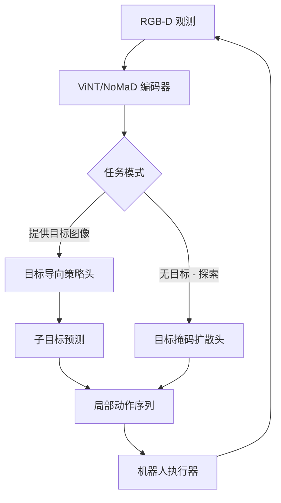
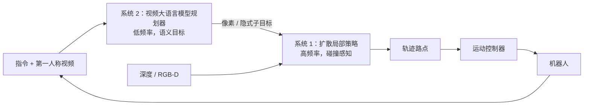

# 机器人操作与导航

> **英文原文：** [cv-knowledge-base/06_robotics_and_embodied_ai/06_manipulation_navigation.md](../../cv-knowledge-base/06_robotics_and_embodied_ai/06_manipulation_navigation.md)（本中文版供参考，内容以英文原文为准）

> **最后更新：** 2026年10月
> **难度级别：** 高级 | 研究前沿
> **相关章节：**
> - [机器人感知](./08_perception_for_robotics.md)
> - [语言条件控制](./10_language_conditioned_control.md)
> - [机器人数据与遥操作](./09_robot_data_and_teleoperation.md)
> - [硬件与机器人平台](./12_hardware_robot_platforms.md)

> **🆕 2026年10月更新：**
> - 新增**2025–26 年导航基础模型**一节：NaVILA 与 Uni-NaVid（RSS 2025）、NavDP、StreamVLN 与 OmniVLA（ICRA 2026）、NavFoM（约 800 万样本，覆盖四足、无人机、轮式机器人和汽车），以及 InternNav 工具箱中的双系统模型 **InternVLA-N1**。
> - 更新 VLN-CE 排行榜。InternVLA-N1（DualVLN）在 R2R-CE 上报告 64.3 SR / 58.5 SPL，StreamVLN 报告 56.4 / 50.2。记录了 **VLN-PE** 中物理控制器带来的差距（SR 下降约 12 个点）。
> - 抓取：**GraspGen**（NVIDIA，ICRA 2026；5700 万抓取数据集，扩散生成器 + 在生成器上训练的判别器）和 **DexGraspVLA**（AAAI 2026；在杂乱场景中零样本灵巧抓取成功率 90%+）。
> - 移动操作：补充了指向 π0.5 / Gemini Robotics 类通用 VLA 的说明。新增关于物理真实导航评估以及导航+操作统一模型的开放问题。

---

## 概述

机器人操作和导航是具身智能体在真实世界部署之前必须掌握的两项基础能力。操作涵盖完整谱系：从对桌面物体的简单平行夹爪抓取，到灵巧的手内重定向、双臂协同以及与可变形材料的交互。其核心挑战在于弥合感知与动作之间的鸿沟。机器人必须从对任意几何形状物体的局部、含噪传感器观测中推断出稳定、可执行的抓取位姿，并在真实世界扰动下稳健地执行。该领域已逐步从基于模型的解析方法（如 GWS 力旋量分析、力封闭度量）转向数据驱动方法，后者从大规模 3D 扫描和人类示教语料中学习接触密集型先验。

导航是移动机器人在未知或部分已知环境中有目的地移动的能力。经典的基于 SLAM 的技术栈（基于图的 SLAM、EKF-SLAM、占用栅格建图）能提供可靠的度量地图，但需要显式的特征工程，并且在杂乱、动态的场景中表现不佳。学习式导航方法将问题建模为目标条件策略学习：给定一个目标设定（PointGoal 的 GPS 坐标、ObjectGoal 的目标物体类别或 ImageGoal 的参考图像），在仿真中训练的策略必须泛化到物理部署。视觉-语言导航（Vision-Language Navigation, VLN）更进一步，要求把自然语言路线描述落地为连续的动作序列，这需要语义场景理解与路径规划的紧密结合。

前沿是长时域移动操作：智能体必须导航到物体处、抓取它、搬运它，然后完成装配或放置。这需要统一的表示，既支持几何精度（稳定抓取所需），又支持语义泛化（指令跟随所需）。ViNT [Shah2023] 和 NoMaD [Sridhar2024] 等导航基础模型编码了跨具身（cross-embodiment）的移动先验，大幅减少了适配新平台所需的数据。2025–2026 年出现了第二代模型：**基于视频大语言模型的导航 VLA**（NaVILA、Uni-NaVid、StreamVLN、NavFoM、OmniVLA），以及将慢速 VLM 规划器与快速扩散局部策略配对的**双系统导航器**（InternVLA-N1）。Habitat [Savva2019]、CALVIN [Mees2022]、LIBERO [Liu2023] 和 ManiSkill3 [Tao2024] 等基准环境为衡量这些维度上的进展提供了标准化框架。

---

## 抓取：从解析方法到学习方法

### 问题形式化

6 自由度（6-DoF）抓取检测将 RGB-D 或点云观测 $\mathcal{P} \subseteq \mathbb{R}^3$ 映射为一组抓取位姿 $\{(R_i, t_i)\}$ 及其质量分数 $q_i$：

```latex
\mathcal{G}^* = \arg\max_{\mathcal{G}} \sum_i q_i(R_i, t_i \mid \mathcal{P})
\quad \text{s.t.} \quad \text{FC}(R_i, t_i) = 1
```

其中 FC 表示满足力封闭条件。经典解析方法枚举候选抓取并验证封闭性；学习方法则直接从数据回归质量分数。

### GraspNet-1Billion [Fang2020]

GraspNet-1Billion 提供了由 RealSense 和 Kinect 相机在 190 个杂乱场景中采集的 97,280 张 RGBD 图像，并为每个可见物体表面点提供密集的 6-DoF 抓取标注。该基准考察一个泛化维度：模型在包含训练中未见物体的场景上进行评估。配套的 GraspNet 模型通过 PointNet++ 编码器处理点云，并使用多层级特征匹配头为候选抓取打分。

### Contact-GraspNet [Sundermeyer2021]

Contact-GraspNet（ICRA 2021）将抓取检测表述为预测物体表面上的接触点，而不是为预先采样的接近方向打分。PointNet++ 主干网络联合估计逐点的抓取接近方向、宽度参数和质量分数。在 ACRONYM 基准 [Eppner2021] 上，Contact-GraspNet 在已见类别的仿真中达到 90%+ 的抓取成功率，在未见形状上则降至约 65%。这一落差推动了后续关于类别级泛化的研究。

### AnyGrasp [Fang2023]

AnyGrasp 通过 RotationNet 架构扩展了 Contact-GraspNet，能处理任意接近角度，并使用以 GraspNet-1Billion 为基础、辅以合成渲染增强的大规模训练集。在料箱拣选评估中，AnyGrasp 清空包含 300 多个新物体的料箱时成功率达 93.3%，并在单臂工业装置上维持每小时 900 次以上的平均拣选次数（MPPH），是 GraspNet-1Billion 未见测试划分上最强的已发表结果之一。

### GraspGen [Murali2025]：基于扩散的抓取生成

**GraspGen**（NVIDIA；arXiv:2507.13097；ICRA 2026）把 6-DoF 抓取视为*生成式建模*，而不是逐点分类：

- **扩散生成器**以物体点云为条件提出抓取位姿；点云可以是局部或完整的，可以是单个物体或杂乱场景。
- **判别器**对候选抓取打分和排序。它采用*在生成器上训练（on-generator）*的方案：不仅从数据集抓取中学习，还从生成器自身的样本（包括失败样本）中学习，从而消除了早期评估器在训练与测试之间的分布差距。
- 发布的仿真数据集包含 **8,515 个 Objaverse-XL（LVIS）物体上的 5700 万+ 个抓取**，覆盖三种末端执行器：Franka Panda、Robotiq-2F-140 和 30 mm 吸盘。

作者报告在 FetchBench 仿真抓取基准上取得最先进结果（比先前方法提升 17%），内存占用比先前的扩散抓取生成器低 21 倍，在 TensorRT 优化之前推理速度约 20 Hz。从 AnyGrasp 到 GraspGen 的趋势与更广泛的策略学习相呼应：*带学习式评价器的多模态生成头*正在取代对单一"最佳"抓取的回归。

---

## 灵巧操作与双臂操作

### ALOHA 与 ACT [Zhao2023]

ALOHA（A Low-cost Open-source Hardware System for Bimanual Teleoperation，低成本开源双臂遥操作硬件系统）是一个造价低于 2 万美元的双臂研究平台，由 WidowX 机械臂和现成舵机构建。它可以采集穿针、拉拉链、开红酒瓶等精细任务的示教数据。配套的学习算法 ACT（Action Chunking with Transformers，基于 Transformer 的动作分块）通过预测长度为 $k$ 的动作块而非单步动作，缓解了行为克隆的误差累积问题：

```latex
\pi_\theta(a_{t:t+k} \mid o_t) = \text{Transformer}(o_t)
```

训练时使用 CVAE 先验对多模态动作分布建模；推理时将隐变量设为零。仅用 50 条示教训练的 ACT 在若干精细操作任务上达到 80–95% 的成功率，显著优于单步 BC 和 LSTM 基线。

**Mobile ALOHA** [Fu2024] 为平台增加了全身移动底盘，可完成需要同时移动与操作的任务：在灶台上烹饪虾、装载洗碗机、按电梯按钮。将 Mobile ALOHA 策略与静态 ALOHA 数据联合训练，可通过迁移带来显著的数据效率提升。

**ALOHA Unleashed**（2024）扩大了 ACT Transformer 主干，并为每个任务使用 500–1000 条示教训练，在系鞋带上达到 78% 成功率，挂衬衫 85%，修理魔术贴绑带 91%。

### 用于灵巧抓取的分层 VLA

**DexGraspVLA** [Zhong2025]（arXiv:2502.20900；AAAI 2026 口头报告）是面向多指手的*分层*框架。预训练 VLM 作为高层规划器，负责定位目标物体并分解指令。低层扩散策略控制器在域不变的基础模型特征上运行，执行灵巧抓取。作者报告了**在杂乱场景中、跨越数千种未见物体 × 光照 × 背景组合、于真实世界零样本实现 90%+ 的灵巧抓取成功率**，并具有对人为干扰的鲁棒性和失败恢复能力。它是[范式与路线图](./07_pros_cons_roadmaps.md)中所讨论的慢/快双系统模式的一个具体实例。

### 作为操作主干的通用 VLA（2025–2026）

到 2025–2026 年，最引人注目的灵巧与双臂工作中，很大一部分来自**通用 VLA** 而非逐任务模仿学习。例如：Physical Intelligence 的 π0.5 能在训练中从未见过的家庭里清洁厨房和卧室，后续又有经强化学习精炼的 π*0.6；Google DeepMind 的 Gemini Robotics 家族运行在 ALOHA 2 和人形平台上；以及 NVIDIA 的 GR00T N1.x。这些模型的最难技能（折叠、打包、装配）通常仍依赖 ALOHA 式的双臂数据。架构与结果参见 [VLA 模型](./01_vla_models.md)和[跨具身](./04_cross_embodiment.md)。

### 可变形物体操作

可变形物体（绳索、布料、线缆、面团）需要能够跟踪非刚性形变的表示。已有方法包括：显式网格仿真结合仿真到现实迁移 [Lin2022]、用于布料状态的学习式视觉描述子 [Seita2021]，以及建模多模态接触动力学的扩散策略 [Chi2023]。核心困难在于感知：标准深度传感器在透明或镜面材料上给出的表面不可靠，而且形变状态本质上是高维的。RoboTwin 2.0 中的双臂叠布与线缆布线基准，以及 Newton 中的 GPU 布料/线缆求解器（参见[仿真与数据](./05_simulation_and_data.md)），使这些任务如今可以在仿真规模上研究。

---

## 导航：从经典到学习

### 基于 SLAM 的经典导航

经典导航流程由三部分组成：

1. SLAM 模块（GMapping、Cartographer、RTAB-Map），将里程计与激光雷达/RGBD 融合为 2D 占用栅格或 3D 点云地图
2. 基于度量地图的全局规划器（A*、Dijkstra）
3. 用于避障的局部规划器（DWA、TEB）

这些技术栈在具有准确地图的静态环境中可靠，但在动态障碍物、感知混淆和新布局下性能下降。

### 学习式目标条件导航

Habitat 平台 [Savva2019] 用三类任务标准化了评估：

- **PointGoal**：导航到 GPS+罗盘坐标。DD-PPO [Wijmans2020] 在 64 块 GPU 上用 25 亿环境步训练，达到近乎完美的水平（99.6% SPL）。
- **ObjectGoal**：导航到目标物体类别（例如"找一把椅子"）。需要语义推理；最佳模型结合语义地图与物体先验。
- **ImageGoal**：导航到由参考图像指定的位置。考察视角变化下的视觉重定位能力。

### 视觉-语言导航（VLN）

R2R（Room-to-Room）基准 [Anderson2018] 要求智能体在 Matterport3D 扫描中遵循自然语言路线描述。基于循环 BERT 的主干（PREVALENT、HAMT）曾主导早期排行榜。截至 2024 年：

- ScaleVLN 在 R2R validation-unseen 上达到 81% 成功率（SR）/ 70% SPL。
- NavGPT-2（基于 LLM 的智能体）达到 74% SR / 61% SPL。
- RynnBrain-Nav-8B 在 VLN-CE（连续环境）上达到 58.6% SR / 49.6% SPL。

**2025–2026：连续环境与物理真实性。** 关注点已从离散图上的 R2R 转向 **VLN-CE**（连续的 Habitat 动作），以及使用物理仿真的机器人控制器重放 VLN 回合的 **VLN-PE**。R2R-CE val-unseen 划分上的代表性结果：

- **InternVLA-N1（DualVLN）**：64.3% SR / 58.5% SPL（RxR-CE 上为 61.4 / 51.8）
- **StreamVLN**：更新后的检查点为 56.4% SR / 50.2% SPL（RxR-CE 上为 54.4 / 45.4）

在 VLN-PE [Wang2025]（ICCV 2025，"Rethinking the Embodied Gap in Vision-and-Language Navigation"）上，同一个 DualVLN 模型**从 63.6% SR（理想化的"瞬移"控制器）降至使用物理运动控制器时的 51.6% SR**。这量化了经典 VLN 差距中有多少来自*执行*而非语言落地。

### 导航基础模型

**ViNT** [Shah2023]（CoRL 2023）是一个在跨多种具身形态（轮式机器人、足式机器人、无人机）的多样化机器人导航数据集上训练的 Transformer。给定当前观测和目标图像，ViNT 预测子目标图像和低层动作分布。在来自 8 个不同平台的数据集上联合训练后，ViNT 展现出很强的分布外泛化能力，并能零样本迁移到行人密集的环境。

**NoMaD** [Sridhar2024]（ICRA 2024 最佳学生论文入围）在 ViNT 的基础上加入扩散策略头，统一了探索（目标被掩码）与目标导向两种行为。扩散头产生的多模态动作分布适用于部分可观测环境中考虑不确定性的规划。



### 导航基础模型：2025–2026 新一代

第二代模型用**视频大语言模型主干**取代小型的任务专用编码器，并同时拓宽了*目标模态*和*具身形态*：

| 模型 | 发表处 | 核心思想 | 具身形态 / 目标 |
|-------|-------|-----------|---------------------|
| **NaVILA** [Cheng2025] | RSS 2025 | 两级结构：VLA 输出中层*语言*动作（方向 + 距离），由强化学习运动策略执行并避障 | 足式机器人（四足、人形）；语言目标 |
| **Uni-NaVid** [Zhang2025a] | RSS 2025 | 单个基于视频的 VLA 统一了 VLN（R2R/RxR）、ObjectNav、具身问答和人物跟随（EVT-Bench）；在线 token 合并使其在单块 A100 上约 5 Hz | 语言目标 |
| **NavDP** [Cai2025] | ICRA 2026 | 无地图导航**扩散策略**，仅在高效的仿真数据流程上训练，训练期间使用特权信息引导；**无需任何真实机器人数据**即可跨具身实现仿真到现实。后续工作 **X-NavDP**（CoRL 2026）增加了跨异构具身的强化学习后训练 | 多种具身形态；无目标 / 点目标 / 图像目标 |
| **StreamVLN** [Wei2025] | ICRA 2026 | 基于 LLaVA-Video、从连续视频进行流式 VLN。**慢-快（SlowFast）上下文**将用于对话轮次的快速滑动窗口 KV 缓存与经 token 剪枝的慢速记忆相结合 | 语言目标；真实机器人部署 |
| **NavFoM** [Zhang2025b] | arXiv:2509.12129 | 在**约 800 万样本**上训练的跨任务、跨具身导航基础模型。时间-视角指示（TVI）token 可处理任意相机配置，预算感知时间采样（BATS）限制上下文长度 | 四足、无人机、轮式机器人、汽车；VLN、物体搜索、跟踪、驾驶 |
| **OmniVLA** [Hirose2025] | ICRA 2026 | **全模态目标条件**：一个策略可接受语言、目标图像或 GPS 位姿（及其组合）作为目标 | 轮式机器人；任意目标模态 |
| **InternVLA-N1** / DualVLN [Wei2026] | 技术报告（2025 年 10 月）；DualVLN 发表于 ICLR 2026 | **双系统**（"Ground Slow, Move Fast"）：VLM"系统 2"以低频率落地目标（像素目标 / 学习式隐式规划），NavDP 扩散"系统 1"产生反应式局部轨迹；两者可联合调优 | 轮式、四足（提供 Unitree Go2 部署代码） |



这些模型的共同点：（i）**以仿真为主的训练**（Habitat、Isaac Sim、InternScenes），对真实世界数据的使用很节制；（ii）**输出轨迹或路点**，交由独立的运动控制器执行，而不是直接输出电机指令；（iii）**长上下文记忆管理**（token 合并、KV 缓存窗口、BATS）是核心架构问题。最初的 ViNT/NoMaD 家族仍是这些工具包中的标准*基线*；InternNav 在 NavDP 之外还附带了 GNM、ViNT 和 NoMaD。

---

## 长时域移动操作

长时域移动操作需要在连贯的任务规划中组合导航与操作子技能。主要挑战：

1. **语义落地**：将语言指令（"从厨房把红色马克杯拿来"）映射为一系列导航路点和抓取目标。
2. **错误恢复**：当抓取失败或路径受阻时，必须在不完全重启任务的情况下重新规划。
3. **物体状态跟踪**：智能体必须维护一个模型，记录哪些物体被移动过以及被移动到了哪里。

CALVIN 基准 [Mees2022] 在单个回合中评估最多 5 个语言条件操作任务构成的序列，要求智能体在新指令和新物体布置上泛化。LIBERO 基准 [Liu2023] 包含 130 个操作任务，组织为四个套件（LIBERO-Spatial、LIBERO-Object、LIBERO-Goal、LIBERO-100），专门测试终身学习与持续学习。

自 2025 年以来，有三项进展改变了这一局面：

- **通用 VLA 作为端到端移动操作器运行。** 例如，π0.5 通过在移动操作机器人、固定机械臂和网络数据上联合训练，在未见过的家庭中执行长达数分钟的家务任务，并在每一步用语言预测一个高层子任务。
- **仿真套件扩展到家庭规模。** BEHAVIOR-1K（1,000 项活动）和 RoboCasa365（365 个厨房任务，2,200+ 小时示教）提供了长时域的组合任务。
- **双系统导航栈**（InternVLA-N1）和分层抓取 VLA（DexGraspVLA）使规划器与控制器之间的边界变得显式且可训练。

---

## 关键论文

| 论文 | 作者 | 年份 | 发表处 | 主要贡献 |
|-------|---------|------|-------|-----------------|
| GraspNet-1Billion | Fang et al. | 2020 | CVPR | 大规模抓取基准；97K 张图像，190 个场景，密集 6-DoF 标注 |
| Contact-GraspNet | Sundermeyer et al. | 2021 | ICRA | 接触点抓取表示；PointNet++ 主干；端到端 6-DoF 检测 |
| AnyGrasp | Fang et al. | 2023 | T-RO | 规模化的旋转抓取检测；料箱拣选成功率 93.3%，>900 MPPH |
| GraspGen: A Diffusion-based Framework for 6-DOF Grasping with On-Generator Training | Murali et al. | 2025 | ICRA 2026 | 扩散抓取生成器 + 在生成器上训练的判别器；5700 万抓取的多夹爪数据集 |
| DexGraspVLA | Zhong et al. | 2025 | AAAI 2026 | 分层 VLM 规划器 + 扩散控制器；杂乱场景中零样本灵巧抓取 90%+ |
| ALOHA + ACT | Zhao et al. | 2023 | RSS | 低成本双臂平台；动作分块 Transformer；50 条示教即可学习 |
| Mobile ALOHA | Fu et al. | 2024 | arXiv | 通过联合训练实现全身双臂移动操作 |
| ViNT | Shah et al. | 2023 | CoRL | 在 8 个机器人平台上训练的跨具身视觉导航 Transformer |
| NoMaD | Sridhar et al. | 2024 | ICRA | 用于统一探索与目标导向导航的扩散策略头 |
| NaVILA: Legged Robot Vision-Language-Action Model for Navigation | Cheng et al. | 2025 | RSS 2025 | 输出语言级动作的 VLA + 强化学习运动策略，用于足式机器人 VLN |
| Uni-NaVid | Zhang et al. | 2025 | RSS 2025 | 单个视频 VLA 统一 VLN、ObjectNav、具身问答与跟随 |
| NavDP | Cai et al. | 2025 | ICRA 2026 | 仅用仿真训练、带特权引导的导航扩散策略；零真实数据 |
| StreamVLN | Wei et al. | 2025 | ICRA 2026 | 采用慢-快上下文（KV 缓存窗口 + 剪枝记忆）的流式 VLN |
| Embodied Navigation Foundation Model (NavFoM) | Zhang et al. | 2025 | arXiv:2509.12129 | 约 800 万样本的跨具身、跨任务导航模型；TVI token，BATS |
| OmniVLA | Hirose et al. | 2025 | ICRA 2026 | 全模态（语言 / 图像 / GPS）目标条件导航 VLA |
| DD-PPO | Wijmans et al. | 2020 | ICLR | 去中心化分布式 PPO；在 Habitat PointGoal 上达到 99.6% SPL |
| CALVIN | Mees et al. | 2022 | RAL | 长时域语言条件多步操作基准 |
| Ground Slow, Move Fast: A Dual-System Foundation Model for Generalizable VLN (InternVLA-N1 / DualVLN) | Wei et al. | 2025 | ICLR 2026 | 慢速 VLM 落地 + 快速扩散局部策略用于 VLN；在 VLN-CE 和 VLN-PE 上达到 SOTA |
| ManiSkill3 | Tao et al. | 2024 | arXiv / RSS 2025 | GPU 并行化操作基准；仿真中 >4300 样本/秒 |

---

## 基准性能

| 模型 | 数据集 / 任务 | 指标 | 得分 | 备注 |
|-------|---------------|--------|-------|-------|
| AnyGrasp | GraspNet-1Billion（未见） | AP | SOTA（2023 年发表） | 报告料箱拣选成功率 93.3% |
| GraspGen | FetchBench（仿真） | 抓取成功率 | 比先前 SOTA 提升 17% | 作者报告；TensorRT 优化前约 20 Hz |
| DexGraspVLA | 真实世界杂乱场景灵巧抓取 | 成功率 | 90%+ | 数千种未见物体/光照/背景组合，零样本 |
| DD-PPO | Habitat PointGoal | SPL | 0.996 | 25 亿环境步，64 块 GPU |
| ScaleVLN | R2R val-unseen | SR / SPL | 81% / 70% | 最佳监督式主干（2023） |
| NavGPT-2 | R2R val-unseen | SR / SPL | 74% / 61% | 基于 LLM 的智能体；无微调 |
| InternVLA-N1（DualVLN） | VLN-CE R2R val-unseen | SR / SPL | 64.3% / 58.5% | 双系统；RxR-CE 61.4 / 51.8 |
| InternVLA-N1（DualVLN） | VLN-PE R2R unseen（物理控制器） | SR / SPL | 51.6% / 42.5% | 理想化"瞬移"控制器下为 63.6 / 56.5 |
| StreamVLN | VLN-CE R2R val-unseen | SR / SPL | 56.4% / 50.2% | 更新后的检查点（2025 年 9 月）；RxR-CE 54.4 / 45.4 |
| NavDP | ClutteredEnv（视觉导航） | SR / SPL | 89.8% / 87.7% | 仅仿真训练；InternNav 基准 |
| ACT | ALOHA 任务（平均） | 成功率 | ~80-95% | 逐任务；50 条人类示教 |
| ALOHA Unleashed | 系鞋带 | 成功率 | 78% | 每任务 500-1000 条示教 |
| ALOHA Unleashed | 挂衬衫 | 成功率 | 85% | 每任务 500-1000 条示教 |
| RynnBrain-Nav-8B | VLN-CE R2R | SR / SPL | 58.6% / 49.6% | 开放词汇（open-vocabulary）具身模型 |
| Diffusion Policy [Chi2023] | CALVIN D→D | 5 任务链成功率 | 未公开报告 | 参考基线 |

---

## 优缺点

| 方面 | 优点 | 缺点 |
|--------|------|------|
| 学习式抓取（AnyGrasp） | 无需 CAD 模型即可处理新物体；实时推理；料箱拣选能力强 | 在透明/反光物体上性能下降；需要稠密点云；失败模式不透明 |
| 生成式抓取（GraspGen） | 多模态抓取分布；支持多种夹爪；学习式评价器减少误报 | 在仿真抓取标签上训练；仍依赖深度；杂乱场景级的碰撞推理依赖后过滤 |
| 双臂模仿学习（ALOHA/ACT） | 硬件成本低；样本效率高（50 条示教）；能处理接触密集任务 | 无法跨物体/场景泛化；对示教质量敏感；没有任务分解 |
| 基础导航模型（ViNT/NoMaD） | 跨具身迁移；适配数据极少；能处理动态障碍物 | 精度低于度量 SLAM；无地图持久化；在缺乏结构的环境中表现差 |
| 视频大语言模型导航 VLA（NaVILA、StreamVLN、NavFoM） | 支持语言及多模态目标；跨任务、跨具身；大规模仿真预训练 | 推理需数十亿参数（常依赖机外 GPU）；上下文/记忆受限；在物理控制器下性能下降（VLN-PE） |
| 经典 SLAM 导航 | 度量精度可靠；地图可解释；确定性的重规划 | 在动态场景中脆弱；布局变化时需重建地图；没有语义理解 |
| 长时域移动操作 | 使家庭规模的任务成为可能 | 需要感知-动作-规划的紧密集成；误差在各阶段之间累积 |

---

## 开放问题与研究空白

1. **透明和镜面物体抓取**：AnyGrasp 和 GraspNet 系列方法依赖从 RGBD 进行深度补全，这在玻璃、液体和亮面金属上会失败。红外结构光和飞行时间传感器都无法在这类表面上可靠恢复深度，透明物体的仿真到现实差距仍未解决。学习式立体匹配（FoundationStereo；参见[感知](./08_perception_for_robotics.md)）是 2025–26 年最有希望的缓解手段。

2. **反应式双臂协同**：当前的双臂模仿学习方法（ALOHA、ACT）将两只手臂视为动作维度翻倍的单一策略。它们缺乏两臂之间的显式通信，当一只手臂的计划受到扰动时无法反应式协同——而这正是叠布或组装宜家家具等任务的关键需求。

3. **操作中的零样本指令跟随**：VLN 系统可以泛化到新的语言指令，但操作领域的对应任务（例如"把衬衫挂在左边的钩子上"）仍需要逐任务示教。将 VLN 式的语言落地与接触密集型技能执行连接起来，是一个开放的研究问题。

4. **优雅失败与恢复**：长时域移动操作会让失败连锁传导——序列中途一次抓取失误就可能使后续步骤全部失效。端到端策略缺乏恢复行为；分层方法 [SayCan, Inner Monologue] 有所改善，但依赖预先定义的技能库。

5. **无地图的持久导航**：ViNT 和 NoMaD 不维护持久的度量地图，因此回到先前访问过的位置需要重新遍历。2025–26 年的视频大语言模型导航器通过 token 剪枝、KV 缓存窗口（StreamVLN）或预算化时间采样（NavFoM）管理记忆，但这些都是*有界上下文*的启发式方法，而非持久的空间记忆。将拓扑记忆或 3D 场景图记忆与导航基础模型结合的研究仍然不足。

6. **可变形物体状态表示**：对于布料、线缆或面团，目前还没有一种公认的紧凑状态表示能够同时做到可学习、有物理依据并可从 RGB-D 观测。现有方法要么过拟合于特定纹理，要么需要仿真中的特权信息。

7. **接触动力学的仿真到现实迁移**：尽管有 GPU 加速仿真器（ManiSkill3、IsaacSim），仿真与现实之间的接触动力学差距仍是需要精确力控、软表面交互或快速重抓取的策略所面临的主要障碍。

8. **有物理依据的导航评估**：VLN-CE 假设运动是理想化的。在物理仿真控制器下（VLN-PE），即使最强的模型成功率也会下降约 12 个点。需要将语言落地、足式或轮式动力学以及动态障碍物或行人结合起来的基准，使进展能反映可部署的能力。

9. **导航 + 操作的统一基础模型**：导航 VLA（NavFoM、OmniVLA）与操作 VLA（π0.5、GR00T）在很大程度上仍是分开训练和评估的。一个能够规划路线、接近目标、抓取并恢复、且对物体状态具有共享记忆的单一模型是自然的下一步，但它在规模化的数据和基准上都还很欠缺。

---

## 延伸阅读

- [GraspNet-1Billion 数据集与基准](https://graspnet.net/)
- [AnyGrasp SDK（GitHub）](https://github.com/graspnet/anygrasp_sdk)
- [GraspGen（NVlabs GitHub，arXiv:2507.13097）](https://github.com/NVlabs/GraspGen)
- [DexGraspVLA（arXiv:2502.20900）](https://github.com/Psi-Robot/DexGraspVLA)
- [通用导航模型：ViNT、NoMaD、GNM](https://general-navigation-models.github.io/)
- [NaVILA（arXiv:2412.04453）](https://github.com/AnjieCheng/NaVILA)
- [Uni-NaVid（arXiv:2412.06224）](https://github.com/jzhzhang/Uni-NaVid)
- [StreamVLN（arXiv:2507.05240）](https://github.com/InternRobotics/StreamVLN)
- [NavDP（arXiv:2505.08712）](https://github.com/InternRobotics/NavDP)
- [InternNav 工具箱（InternVLA-N1、VLN-PE）](https://github.com/InternRobotics/InternNav)
- [X-NavDP：导航扩散策略的强化学习后训练（arXiv:2607.28560）](https://arxiv.org/abs/2607.28560)
- [NavFoM：具身导航基础模型（arXiv:2509.12129）](https://arxiv.org/abs/2509.12129)
- [OmniVLA（arXiv:2509.19480）](https://github.com/NHirose/OmniVLA)
- [ALOHA 与 ACT 项目主页（Tony Zhao，斯坦福）](https://tonyzhaozh.github.io/aloha/)
- [Mobile ALOHA 论文（arXiv:2401.02117）](https://arxiv.org/abs/2401.02117)
- [CALVIN 基准](http://calvin.cs.uni-freiburg.de/)
