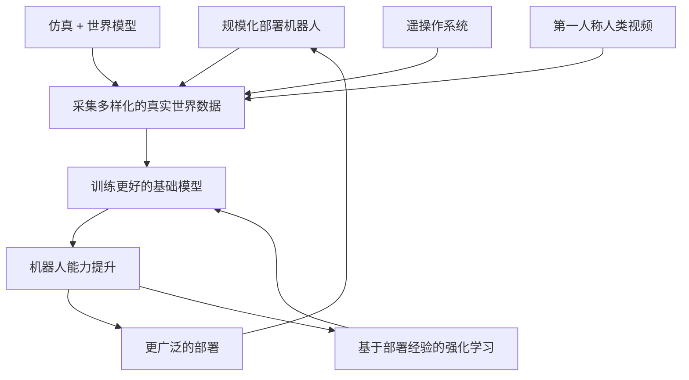
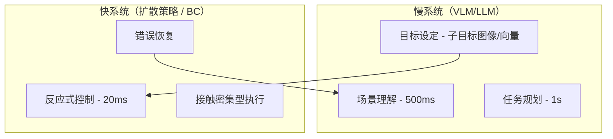

# 机器人学习的范式、优缺点与路线图（2026）

> **英文原文：** [cv-knowledge-base/06_robotics_and_embodied_ai/07_pros_cons_roadmaps.md](../../cv-knowledge-base/06_robotics_and_embodied_ai/07_pros_cons_roadmaps.md)（本中文版供参考，内容以英文原文为准）

> **最后更新：** 2026年10月
> **难度级别：** 高级 | 研究前沿
> **相关章节：** [./01_vla_models.md](./01_vla_models.md) | [./02_world_models.md](./02_world_models.md) | [./11_generalist_vs_specialist.md](./11_generalist_vs_specialist.md) | [./03_diffusion_policy.md](./03_diffusion_policy.md)

> **🆕 2026年10月更新：**
> - 按照实际发布情况更新了各路线图。Physical Intelligence 开源了 π0.5（2025 年 9 月），并发布了经强化学习精炼的 π*0.6（2025 年 11 月）。Google DeepMind 发布了 Gemini Robotics 1.5 / ER 1.5（2025 年 9 月）。NVIDIA 发布了 GR00T N1.6 → **N1.7**（3B，Apache 2.0，用 2 万小时人类视频预训练）、**Cosmos 3**（2026 年 5 月）和 **Newton 1.0**（2026 年 3 月）。人形机器人方面，Figure 03 已经亮相（2025 年 10 月，早于此前预计的"2026–27 年"），1X NEO 开放了面向消费者的预订。
> - **双系统融合论点**（第七部分）如今已成为主导的产业架构：Gemini Robotics 1.5 / 2 + ER、GR00T 系统 1/2、Figure Helix（Helix 02 中已发展为三层）、InternVLA-N1 和 DexGraspVLA。
> - 为**"苦涩的教训"之争**补充了新证据：基于环境-物体多样性的数据扩展定律、万小时量级的人类视频预训练，以及表明基准提升夸大了可部署性的鲁棒性审计（LIBERO-Plus、VLN-PE）。
> - 补充了世界模型即策略的证据（V-JEPA 2-AC 零样本规划、Cosmos Policy）、对 2028 年预测的阶段性检查，以及关于评估与人到机器人迁移的新开放问题。
> - 新增 2026 年的主要发布：**Figure Helix 02**（2026 年 1 月；Figure 03 上的三层 System 0/1/2 全身控制）、**π0.7**（2026 年 4 月；初步的组合泛化，据报道单个通用模型即可与经强化学习微调的 π*0.6 专用模型相当）以及 **Gemini Robotics 2 / ER 2 / On-Device 2**（2026 年 7 月；全身人形 VLA，ASIMOV-2 / ASIMOV-Agentic）。护城河表、路线图、双系统表以及 2028 年状态检查均已相应更新，并补充了 Physical Intelligence 的融资情况。

---

## 概述

截至 2026 年，机器人学习领域已凝聚为三种相互竞争的范式，每种范式都有不同的理论基础、实证记录和实际约束。本文以《自然》*观点*（Nature Perspectives）文章的风格分析当前格局：每种范式在哪里成功、在哪里失败、领域的宏观轨迹预示着什么，以及还有哪些开放问题。本文并非中立综述，而是就融合、扩展以及基准驱动进展的局限提出明确论点。

三种范式是：

1. **端到端视觉-语言-动作（Vision-Language-Action, VLA）模型**，在单个 Transformer 中统一感知、语言理解和运动控制。
2. **基于世界模型（World Model）的规划**，通过学习到的动力学模型进行内部推演和模型预测控制。
3. **扩散策略（Diffusion Policy）及相关的生成式行为克隆**方法，将动作分布建模为分数匹配的去噪过程。

第四种方法是**模块化 LLM + 专用策略**，更适合被描述为一种系统集成策略而非学习范式。它在已部署的产业应用中占有相当大的份额，值得纳入讨论。

贯穿本文的更深层问题是：机器人学是否会走上与自然语言处理相同的扩展轨迹，即"苦涩的教训"所描述的路径，规模和数据压倒人工设计的归纳偏置，在无需领域特定工程的情况下产生通用行为？截至 2026 年，证据仍然高度分化。我们认为正确的提问方式不是"扩展是否有效"，而是"机器人能力的哪些方面会对扩展作出响应、需要什么数据、样本效率如何"。

**2025 年中至 2026 年 10 月之间的变化。** 范式之间的边界在四个方面变得模糊：

- **VLA 吸收了扩散。** 大多数前沿 VLA 现在使用流匹配（flow matching）或扩散动作头，例如 π0/π0.5 和 GR00T N1.x（其 DiT 动作头基于流匹配）。
- **世界模型变成了策略。** V-JEPA 2-AC 在隐空间中零样本规划抓放任务；Cosmos Policy 将视频世界模型后训练为直接输出动作；Cosmos 3 的生成器原生输出动作。
- **系统明确地分层化。** 慢速推理模型驱动快速控制器。
- **学习型控制扩展到全身。** Figure Helix 02（2026 年 1 月）和 Gemini Robotics 2（2026 年 7 月）将学习型人形策略从上半身操作扩展为以单一系统同时完成行走、下蹲和操作。

因此，竞争的焦点正从"选哪种范式？"转向"混合技术栈应如何划分、训练和评估？"

---

## 第一部分 — 三种相互竞争的范式（2026）

### 范式 1：端到端 VLA 模型

RT-2 [Brohan2023]、OpenVLA [Kim2024]、Octo [Team2024] 和 π0 [Black2024] 等 VLA 将机器人控制视为语言建模问题。图像和指令被 token 化，由 Transformer 自回归地预测离散动作 token，或预测连续动作块。该范式继承了大规模视觉-语言预训练带来的数据效率：在互联网规模图文数据上预训练的模型为操作任务带来丰富的语义先验，大幅减少新任务所需的机器人示教数量。

其根本局限在于自回归生成带来的**延迟-精度权衡**。用 7B 参数模型生成一个 6 自由度动作 token 序列，在单块 A100 上需要 50–500 ms。这一频率下限使其无法对动态任务（接物、躲避移动物体）进行反应式控制。架构上的缓解手段（动作分块、并行解码）有所帮助，但无法完全弥合这一差距。2025–26 年的新一代模型进一步缩小了差距：连续流匹配动作头只需几步去噪即可生成整个动作块；端侧变体（Gemini Robotics On-Device，2025 年 6 月；Gemini Robotics On-Device 2，2026 年 7 月，仅需数小时数据即可适配新具身；Cosmos3-Edge 4B，2026 年 7 月）面向本地推理；小型开源 VLA（3B 参数的 GR00T N1.7）以容量换取可部署性。

### 范式 2：基于世界模型的规划

世界模型 [Ha2018, Hafner2023] 学习一个压缩的隐式动力学模型，通过内部推演进行规划。该范式的吸引力在于样本效率：智能体可以通过模拟反事实来改进策略，而无需额外的真实世界交互。DreamerV3 [Hafner2023] 证明，单一一组超参数就能在横跨多种观测和动作空间的 150+ 个任务上训练出有效策略。

物理机器人面临的挑战是，世界模型难以进行**多步接触预测**。抓取接触之后，物理未来的分布熵很高，并且高度依赖于模型的隐变量中可能并未编码的物体几何和表面属性。基于视频生成的世界模型（UniSim [Yang2023]、Genie [Bruce2024]）提升了视觉保真度，但截至 2024 年尚未展示出可靠的低层控制能力。

**2025–26 年的反面证据。** **V-JEPA 2-AC** [Assran2025] 是一个动作条件的隐式世界模型，在少量来自 DROID 数据集的机器人交互数据上进行后训练。它在新实验室的 Franka 机械臂上执行*零样本*模型预测规划，杯子抓放任务的成功率达 80%，而 Octo 为 10%、Cosmos 视频模型规划器为 0%，且无需任何环境特定数据或奖励。NVIDIA 的 **Cosmos Policy** 检查点（2026 年 2 月）将 Cosmos-Predict2.5 后训练为可直接在 RoboCasa 和 LIBERO 上使用的策略。**DreamGen** 则把视频世界模型用作新动作技能的*数据生成器*（参见[仿真与数据](./05_simulation_and_data.md)）。因此，这一范式正分化为两种角色：*世界模型作为规划器/策略*和*世界模型作为数据引擎*。两者如今都已可信，但在抓取层面的成功率仍明显低于在遥操作数据上训练的 VLA。

### 范式 3：扩散策略与生成式行为克隆

扩散策略 [Chi2023]（RSS 2023，IJRR 2025）将条件动作分布 `p(a_t | o_t)` 建模为分数匹配的去噪过程。由此得到的策略能处理**多模态动作分布**（抓取一个物体可能有多种有效方式），而高斯行为克隆方法会使其坍缩。原论文中，该方法在 15 个任务上平均比此前最优方法高出 46.9%，并已成为模仿学习的标准主干。

扩散策略的局限在于无法泛化到示教分布的支撑集之外。它对机器人所追求的目标缺乏语义理解，因此若不结合 VLM，就无法实现组合泛化。到 2026 年，最常见的解决方式是把扩散/流匹配头放在 VLA *内部*（π0、GR00T），或放在 VLM 规划器的*下层*（DexGraspVLA、InternVLA-N1 的 NavDP 系统 1）。该范式作为组件存活了下来，而不再是独立的配方。

---

## 第二部分 — 泛化层级框架

大多数机器人学习评估中缺失的一个关键维度，是对所测量的泛化*类型*的精确刻画。我们提出如下分类：

| 层级 | 名称 | 定义 | 示例 |
|-------|------|-----------|---------|
| **L1** | 任务实例 | 同一任务，不同初始条件（物体位姿、光照） | 在桌面随机位置抓取红色杯子 |
| **L2** | 物体 | 同一任务，同类别中未见过的物体 | 抓取训练中从未见过的新马克杯 |
| **L3** | 环境 | 相同的任务/物体分布，新的布局/背景/场景 | 在新房间中执行厨房技能 |
| **L4** | 任务迁移 | 相关但不同的任务，无需微调的零样本/少样本 | 在抓放上训练，在分拣上测试 |
| **L5** | 长时域组合 | 可分解为已知基元的新任务，需要链式推理 | 从零开始"给我做早餐" |

当前大多数基准测试的是 L1–L2。VLA 范式声称的主要进展是通过视觉-语言预训练实现 L3–L4。L5 仍基本未被任何范式解决：当前最好的结果（SayCan [Ahn2022]、InnerMonologue [Huang2022]）依赖对可用技能的特权枚举和封闭世界假设。Physical Intelligence 的 π0.7（2026 年 4 月）首次给出了端到端 VLA 中*组合*泛化的迹象（由公司报告）：它能重新组合技能，例如在没有该机器人任何叠衣数据的情况下用 UR5e 叠 T 恤，或在极少指导后使用空气炸锅。然而，它在长任务上仍需逐步指导，且没有标准化的外部基准，因此它处于 L4–L5 的边界，而非已解决 L5。

**2025 年暴露出的一个警示：L1 也没有被解决。** LIBERO-Plus [Fei2025] 表明，在干净的 LIBERO 上得分约 95% 的 VLA，在适度的*相机视角*或*机器人初始状态*扰动下会跌至 30% 以下，而这些都是本分类中的 L1 变化。因此，对 L3–L4 的标题式结论应结合 L1 鲁棒性曲线来解读。

---

## 第三部分 — 多维度范式比较

| 维度 | VLA（如 OpenVLA、π0） | 世界模型（DreamerV3、V-JEPA） | 扩散策略 | 模块化 LLM + 策略（SayCan、CaP） |
|------|------------------------|--------------------------------|-----------------|-------------------------------------|
| **架构** | 大型 Transformer（3B–70B）；VLM 主干 + 动作头 | 隐式动力学 RSSM 或 Transformer；世界模型与执行器分离 | 以观测为条件的 U-Net 或 Transformer 分数网络 | LLM 规划器 + 独立的技能策略（RL 或 BC） |
| **数据需求** | 大规模跨机器人示教；受益于互联网预训练 | 强化学习环境交互；受益于离线视频 | 中等数量的专家示教（每任务 50–500 条） | 技能库需要示教；规划依靠 LLM 零样本 |
| **推理延迟** | **50–500 ms**（自回归）；受模型规模限制 | **5–50 ms**（隐空间推演）；世界模型紧凑 | **10–100 ms**（DDPM：慢；DDIM/一致性模型：更快） | **100 ms–2 s**（LLM 规划 + 技能调用） |
| **泛化层级** | L1–L4（语义 VLM 先验） | L1–L3（分布外时模型精度下降） | L1–L2（纯行为克隆；语义泛化有限） | L1–L5（LLM 处理组合性；技能负责执行） |
| **灵巧度上限** | 中等；受动作 token 化分辨率限制 | 低；隐空间规划丢失高频细节 | 高；连续去噪能捕捉细粒度动作 | 低-中；取决于技能策略质量 |
| **样本效率** | 低-中（需要大量机器人数据）；预训练有帮助 | 中-高（基于模型的强化学习） | 中（50–500 条示教可与基于状态的行为克隆相当） | 规划高（LLM 零样本）；技能获取低 |
| **可解释性** | 低（黑盒端到端） | 部分（世界模型可视化） | 低（扩散过程不透明） | 高（LLM 思维链可审计；模块化） |
| **主要失败模式** | 推理慢；精细操作差；token 化误差累积 | 推演中的分布偏移；接触预测失败 | 无语义理解；困于示教支撑集内 | 工具调用幻觉；技能边界不匹配 |
| **硬件需求** | 大模型需 GPU 推理（A100/H100）；边缘部署需量化 | 适中的 GPU；世界模型紧凑 | 适中的 GPU；DDPM 在 CPU 上慢 | LLM：云端/大型 GPU；技能策略：嵌入式 |
| **开源情况** | OpenVLA（7B）、Octo（多模态）；π0 权重于 2025 年 2 月发布；π0.5 权重于 2025 年 9 月发布（openpi）；GR00T N1.7 3B（Apache 2.0） | DreamerV3（JAX）；V-JEPA 2 / 2-AC（Meta）；Cosmos-Predict2.5 与 Cosmos 3（NVIDIA 开放模型） | Diffusion Policy（哥伦比亚大学）；3D-DP（Ze2024） | Code-as-Policies（Google）；SayCan 部分开源；Gemini Robotics-ER 1.5 / ER 2 通过 API 和 AI Studio 提供（非开放权重） |
| **技术成熟度（TRL）** | TRL 4–6 | TRL 3–5 | TRL 5–7 | TRL 5–7 |
| **最佳用例** | 语言引导的抓放；跨场景背景泛化 | 长时域规划；以仿真为主的训练 | 精确的灵巧操作；示教充足的双臂任务 | 多步家务指令；任务排序 |

---

## 第四部分 — 机器人学中的"苦涩的教训"之争

"苦涩的教训" [Sutton2019] 认为，利用计算的通用方法最终会胜过利用人类领域知识的方法。在 NLP 中，基于互联网文本扩展语言模型决定性地证明了这一点：每一种人工设计的特征、语法或知识图谱，最终都被足够大的 Transformer 超越。

### 支持"扩展能解决机器人学"的论据

**[Pro1]** RT-2 [Brohan2023] 证明了互联网规模的视觉-语言预训练能将语义推理迁移到操作任务中：机器人可以响应机器人数据中从未出现过的新颜色-形状组合和文化引用。这恰恰是"苦涩的教训"所描述的模式。

**[Pro2]** π0 [Black2024] 及其后继模型表明，将机器人示教从 100 个任务扩展到 10,000+ 个任务，可使未见任务上的性能近似按对数线性提升，这与 NLP 中观察到的扩展定律形式相同。

**[Pro3]** Open X-Embodiment [OXE2023] 表明，汇集来自 22 种不同机器人具身形态和 21 家机构的数据，使 RT-1-X 的性能比单一具身基线提升约 50%，说明数据多样性比数据同质性更重要。

**[Pro4]** 数据采集基础设施正在迅速成熟：ALOHA、UMI、GELLO 和 Apple Vision Pro 遥操作（teleoperation）系统将单条示教成本降低了 5–20 倍；自主数据采集流程进一步降低了成本。

**[Pro5]** *（2024–26）* **可测量的扩展定律开始出现。** Lin 等人 [Lin2024] 发现，在模仿学习中，对新环境和新物体的泛化能力**随训练用环境-物体对的数量近似呈幂律增长**，而且多样性比每对的示教数量更重要。产业方面，Generalist AI 报告称（公司博客，2025 年 11 月；未经同行评审），其在超过 27 万小时真实世界操作数据上训练的 GEN-0 模型呈现出类似幂律的扩展规律。

**[Pro6]** *（2025–26）* **人类视频正在成为可用的机器人数据。** NVIDIA 的 GR00T N1.7（2026）在机器人数据之外，还用 **2 万小时 EgoScale 第一人称人类视频**进行预训练。它采用*人与机器人具身共享的相对末端执行器动作空间*，NVIDIA 将泛化能力和语言遵循能力的提升归功于此。如果人类视频能够规模化迁移，[Con3] 中关于数据成本的论点将被大幅削弱。

**[Pro7]** *（2026）* **通用模型正在追上专用模型。** Physical Intelligence 报告称，单个 π0.7 通用模型（Gemma 3 4B 主干 + 约 8.6 亿参数动作专家，以子任务指令和子目标图像作为上下文进行训练）在叠衣、意式咖啡和纸箱组装任务上可与其自家经强化学习微调的 π*0.6 专用模型相当。若得到外部证实，这将是迄今最清晰的迹象，表明广度不必以单任务性能为代价（参见[通用模型与专用模型](./11_generalist_vs_specialist.md)）。

### 反对"扩展能解决机器人学"的论据

**[Con1]** **物理瓶颈：** 机器人学习需要对连续物理动力学进行样本高效的学习，而不仅仅是对离散 token 的模式识别。语言模型学会"说出"正确的动作 token，并不等同于控制器学会在柔顺条件下维持接触力。当前的动作 token 化方案丢弃了正是让操作变得困难的连续时间物理信息。

**[Con2]** **具身瓶颈：** 在 NLP 中，单一模态（文本）几乎覆盖所有任务；而机器人的运动学链、传感器配置和驱动特性差异巨大。在 Franka 机械臂数据上训练的模型无法轻易迁移到五指灵巧手——"同一任务"其实是完全不同的运动控制问题 [Peng2018]。

**[Con3]** **数据采集瓶颈：** 互联网规模的文本是免费的，而机器人轨迹数据很昂贵。DROID [Khazatsky2024] 中的 76,000 条示教由 50 名数据采集员历时 12 个月完成，约合每人每天 170 条。按这个速度，若没有成本低几个数量级的采集机制，达到 NLP 级别的数据多样性（数十亿样本）是不现实的。

**[Con4]** **分布偏移瓶颈：** 与文本不同，物理部署会遇到超出任何训练分布的状况。一个 95% 时间都能成功、但在剩余 5% 中灾难性失败（摔碎易碎物品、打翻液体）的机器人，往往无法部署。NLP 中的"幻觉"在大多数应用中尚可容忍，而操作失败可能代价高昂甚至危险。

**[Con5]** *（2025–26）* **基准上的提升夸大了可部署的提升。** LIBERO-Plus 显示接近饱和的 VLA 在相机和初始状态偏移下崩溃。VLN-PE [Wang2025] 显示，当理想化运动被物理控制器取代时，导航成功率下降约 12 个点。规模提升干净划分上分数的速度快于提升鲁棒性的速度，因此在饱和基准上测得的扩展结论只是弱证据。

**综合判断：** 规模将解决机器人智能中*语义与组合*的方面，即"做什么"这一层；它本身不会解决*运动执行*层，即"如何精确而安全地做"。该领域近期的路径需要将大规模预训练的语义先验与专门的高带宽控制策略结合，而不是依靠单一的整体式扩展方案。2025–26 年的证据进一步细化了这一判断。*多样性*扩展（环境、物体、人类视频）看起来是真实有效的。基于部署经验的强化学习（如 π*0.6 及其 Recap 方法）正在成为把语义能力转化为执行可靠性的机制。π0.7 则表明，这些专用模型的收益随后可以被重新整合进单个通用模型。

---

## 第五部分 — 物理 AI 中的数据飞轮与战略护城河

2026 年物理 AI 的竞争格局由一种数据飞轮机制所塑造：

**战略护城河分析：**

| 公司 / 实验室 | 数据来源 | 数据规模（2026 年估计） | 飞轮状态 |
|--------------|-------------|----------------------|----------------|
| Physical Intelligence（π） | 多样化的合作方部署；7 种机器人训练；家庭环境（π0.5） | π0 发布时约 68 个任务，持续扩展 | 活跃；π0.5 已开源（2025 年 9 月）；π*0.6（2025 年 11 月）使用来自真实经验与纠正的强化学习（Recap）；π0.7（2026 年 4 月）通用模型与 π*0.6 专用模型相当；B 轮融资 6 亿美元、估值 56 亿美元（2025 年 11 月），据报道正洽谈以超过 110 亿美元估值融资约 10 亿美元（2026 年 3 月） |
| Google DeepMind | RT-X OXE；Everyday Robots 遗留数据；ALOHA 2、Apptronik 及合作方数据 | 100 万+ 回合（OXE） | 活跃；Gemini Robotics 1.5 + ER 1.5（2025 年 9 月）、On-Device（2025 年 6 月）；Gemini Robotics 2 / ER 2 / On-Device 2（2026 年 7 月，全身；VLA 与 On-Device 仅限早期访问）；可信测试者计划 |
| NVIDIA | Isaac Lab 合成数据；Cosmos 增强；合作方数据；EgoScale 人类视频 | 以合成数据为主 + 2 万小时人类视频（GR00T N1.7） | 加速中；Cosmos 3（2026 年 5 月）作为数据引擎；Newton 1.0 物理引擎；开源 GR00T N1.7 |
| Tesla | Optimus 工厂部署（Fremont、Austin） | 受限领域内数百万次循环 | 起步阶段；电池分拣、零件搬运 |
| Figure / 1X / Unitree | 宝马工厂（Figure）；家庭试点（1X）；Amazon（Digit） | 数万个回合 | 早期阶段；搭载 Helix 02（2026 年 1 月；声称可完成 8 小时无干预班次，未公布指标）的 Figure 03（2025 年 10 月）和 1X NEO 消费者预订（2025 年 10 月）旨在启动家庭数据飞轮 |

护城河不在于模型架构，因为架构已被广泛公开发表；护城河在于**在真实部署环境中采集的专有示教数据**。自 2025 年底以来，护城河也越来越多地体现为**可用于强化学习的部署经验**（自主 rollout 加人类纠正）。这就是为什么部署速度独立于策略质量而重要：越早部署，数据采集飞轮就越早启动。一个相反的趋势是，开放权重（π0.5、GR00T N1.7、Cosmos）让基础模型商品化，从而把差异化进一步推向数据和后训练。

---

## 第六部分 — 近期路线图（2026–2028）

### Physical Intelligence

π0 于 2024 年 10 月发布。π0.5（2025 年 4 月）引入了在未见过的家庭中的开放世界泛化，其权重于 2025 年 9 月在 openpi 中开源（附带知识隔离训练和 PyTorch 支持）。π*0.6（2025 年 11 月）通过 Recap 加入了基于经验的强化学习微调。π0.7（2026 年 4 月）改用 Gemma 3 4B 主干加约 8.6 亿参数的动作专家，并以更丰富的上下文（子任务指令、子目标图像）进行训练。它展现出初步的组合泛化，据报道单个通用模型即可与 π*0.6 专用模型相当。融资方面，该公司于 2025 年 11 月完成 6 亿美元 B 轮融资，估值 56 亿美元；2026 年 3 月，Bloomberg 报道其正洽谈以超过 110 亿美元的估值融资约 10 亿美元（尚未确认完成）。2026–2028 年剩余时间的轨迹可能包括：
- 利用更多合作方部署数据扩展架构和数据配比（很可能采用更大的主干，但具体规模尚未公开）
- 扩展到工业规模的双臂和移动操作
- 将基于自主经验和人类纠正的强化学习（Recap 方向）作为标准的后训练阶段，即机器人领域的 RLHF 对应物
- 减少 π0.7 在长任务上仍需的逐步指导，并让组合泛化接受外部基准检验

### NVIDIA（Cosmos + Isaac Lab + GR00T）

NVIDIA 的策略将**数据问题**（Cosmos 世界基础模型）与**训练基础设施问题**（Isaac Lab + Newton）解耦。截至 2026 年 10 月的状态以及 2026–2028 年的剩余路线图：
- **已发布：** Cosmos-Predict2.5/Transfer2.5（2025 年 10 月）。**Cosmos 3**（2026 年 5 月）：全模态混合 Transformer，分为 Super 64B、Nano 16B 和 Edge 4B 三档，其生成器可输出动作。Newton 1.0（2026 年 3 月）。Isaac Lab 3.0 抢先体验版（2026 年 9 月）。Jetson Thor 开发者套件（2025 年 8 月）。
- **GR00T** [Nvidia2024/2025]：N1（2025 年 3 月）→ N1.5 → N1.6 → **N1.7**（3B，Apache 2.0）。N1.7 采用 Cosmos-Reason2-2B（Qwen3-VL 架构）主干、流匹配 DiT 动作头，以及与人类视频共享的相对末端执行器动作。
- **下一步：** 打通 Cosmos 生成数据、Isaac Lab-Arena 评估与 GR00T 后训练之间的闭环，并在 Jetson Thor 上实现更大模型的机载推理。

### Google DeepMind

继 RT-X 之后，DeepMind 的 Gemini Robotics 将 Gemini 的多模态推理能力融入机器人控制。现状与方向：
- **Gemini Robotics**（2025 年 3 月）和 **Gemini Robotics-ER**（具身推理）
- **Gemini Robotics On-Device**（2025 年 6 月），用于本地低延迟执行
- **Gemini Robotics 1.5 + ER 1.5**（2025 年 9 月）。该 VLA 会"先思考再行动"，技能可在不同具身之间迁移（ALOHA 2、Franka、Apptronik Apollo）。ER 1.5 作为可调用工具的编排器，并通过 Gemini API 向开发者开放。
- **Gemini Robotics 2 + ER 2 + On-Device 2**（2026 年 7 月 30 日）。该 VLA 新增全身人形控制能力（在推理的同时行走、下蹲和操作），而上一版本主要控制上半身。ER 2 是可在 Google AI Studio 中使用的具身推理/规划模型，在 ASIMOV-2 上是 Google 最安全的机器人模型，并随附新的 ASIMOV-Agentic 基准（例如在不确定时向人类求助）。On-Device 2 在本地运行，仅需数小时数据即可适配新具身。VLA 与 On-Device 模型仅限早期访问。
- **2026–2028 年（剩余）：** 向早期访问合作伙伴以外更广泛地开放、更广泛的具身覆盖、通过 Apptronik 进入人形机器人，以及与 Google 的制造和物流合作伙伴集成

### 人形机器人平台：Figure、1X、Unitree

- **Figure：** Figure 02（2024 年 8 月）部署于宝马工厂，Helix 双系统 VLA 于 2025 年 2 月推出。**Figure 03** 于 2025 年 10 月亮相，早于此前预计的 2026–27 年。它针对 Helix 和家庭使用重新设计，配备改进的双手和触觉传感。**Helix 02**（2026 年 1 月下旬）作为统一感知、平衡、运动与操作的单一学习型系统运行于 Figure 03 上，新增约 1 kHz 的系统 0。Figure 展示了约 4 分钟的自主洗碗机卸载与装载，并声称可完成 8 小时无干预班次，但尚未公布吞吐量或错误率指标。
- **1X NEO：** 面向消费者的人形机器人。2025 年 10 月开放预订（20,000 美元，或采用订阅方式），计划于 2026 年交付。早期设备部分依赖遥操作的"专家模式"协助，这同时也是数据采集手段。
- **Unitree：** 约 1.6 万美元的 G1 使研究硬件平民化，价格更低的 R1 于 2025 年发布。H1/H2 级全尺寸人形机器人面向工业应用，数据采集仍处于学术规模。

### 2028 年展望：预测的里程碑

基于当前轨迹，对 2028 年的合理预测（并非保证），以及截至 2026 年 10 月的状态检查：

| # | 预测 | 状态（2026 年 10 月） |
|---|-----------|-------------------|
| 1 | 一台已部署的人形机器人在非结构化家庭环境中连续完成 5 个以上的操作任务，失败率 <10% | 尚未在独立评估下得到证明。消费级人形机器人（1X NEO、Figure 03）正进入家庭，但仍有遥操作兜底。最接近的公开演示是 Helix 02 约 4 分钟的自主洗碗机动作序列（公司报告，无错误率指标） |
| 2 | 仿真训练的策略（借助世界模型增强）在 80% 的标准基准任务上达到遥操作训练策略的水平 | 部分实现。仅用仿真训练的导航（NavDP）可零样本迁移，DreamGen 式神经轨迹可以教会新动作，但操作仍依赖真实遥操作数据 |
| 3 | 基于扩散的动作生成在 Jetson Thor 上实现 <10 ms 推理，支持实时反应式控制 | 有望实现。边缘档模型（Cosmos3-Edge 4B、支持 TensorRT 导出的 GR00T N1.7）以 Thor 为目标；尚无标准化的延迟基准 |
| 4 | 一篇数据扩展论文给出类似 NLP 中 Chinchilla 定律的定量操作扩展定律 | 部分实现。已有幂律多样性扩展 [Lin2024] 和产业报告的扩展结果（GEN-0），但尚无联合考虑模型规模 × 数据规模 × 多样性的定律 |

---

## 第七部分 — 混合融合论点

我们认为，近期（2026–2028）的最先进水平将由**双系统架构**主导，即将慢速的高层语义系统与快速的反应式低层策略耦合：

这与双过程认知架构（[Kahneman2011] 的系统 1 / 系统 2）相呼应，并在 π0 的流匹配头 [Black2024]、分层扩散 [Ze2024] 以及 SayCan/VoxPoser 模式中得到实证支持。

**到 2026 年 10 月，这一论点已在产业系统中基本得到证实：**

| 系统 | 慢系统 | 快系统 | 接口 |
|--------|-------------|-------------|-----------|
| Figure Helix（2025 年 2 月） | VLM"系统 2" | 视觉运动"系统 1" | 隐向量 |
| Figure Helix 02（2026 年 1 月） | VLM"系统 2"（语义推理） | 全身视觉运动"系统 1" + 新增约 1 kHz 的"系统 0"，负责平衡与协调 | 隐向量（S2 → S1）；学习型全身控制（S1 → S0） |
| GR00T N1.x（NVIDIA） | VLM 主干（Eagle → Cosmos-Reason2） | 流匹配 DiT 动作头 | 对 VLM token 的交叉注意力 |
| Gemini Robotics 1.5 + ER 1.5 | ER 1.5 编排器（规划、工具调用） | Gemini Robotics 1.5 VLA | 自然语言子指令 |
| Gemini Robotics 2 + ER 2（2026 年 7 月） | ER 2 规划器（AI Studio；ASIMOV-2 / ASIMOV-Agentic 安全评测） | Gemini Robotics 2 全身 VLA | 自然语言子指令 |
| π0.5 | 同一 VLM 预测语言子任务 | 流匹配动作专家 | 文本子任务 + 共享主干 |
| π0.7（2026 年 4 月） | Gemma 3 4B VLM，可用子任务指令引导 | 约 8.6 亿参数动作专家 | 文本子任务 + 子目标图像 |
| InternVLA-N1（导航） | 视频大语言模型系统 2 | NavDP 扩散系统 1 | 像素目标 / 学习式隐式规划 |
| DexGraspVLA | 预训练 VLM 规划器 | 扩散抓取控制器 | 已落地的目标（掩码/边界框） |

慢系统负责语义泛化（我们泛化框架中的 L3–L5），快系统负责精确执行（L1–L2）。关键在于，两个系统在不同的时间尺度上运行，并可以用不同的数据方案训练：
- 慢系统：大规模互联网 + 机器人数据，更新缓慢
- 快系统：任务特定示教，通过微调或上下文内模仿快速适配

Helix 02 在快系统之下又增加了第三层。这表明"双"系统正在演变为一个时间尺度的层级结构：语义推理、高频全身视觉运动控制，以及约 1 kHz 的平衡控制。

仍然开放的设计空间是**接口**（见开放问题 6）。语言子指令可审计但有损，隐向量表达力强但不透明，像素或掩码目标则介于两者之间。

---

## 关键论文

| 论文 | 作者 | 年份 | 发表处 | 主要贡献 |
|-------|---------|------|-------|-----------------|
| RT-2: Vision-Language-Action Models Transfer Web Knowledge to Robotic Control | Brohan et al. | 2023 | CoRL 2023 | 用于机器人控制的 VLM 主干；语义泛化 |
| OpenVLA: An Open-Source Vision-Language-Action Model | Kim et al. | 2024 | CoRL 2024 | 7B 开源 VLA；强跨具身泛化 |
| π0: A Vision-Language-Action Flow Model for General Robot Control | Black et al. | 2024 | arXiv 2024 | 基于 PaliGemma VLM 的流匹配动作头；68 个任务，7 种机器人 |
| π0.5: a Vision-Language-Action Model with Open-World Generalization | Physical Intelligence | 2025 | arXiv 2025 | 在异构数据上联合训练；分层的子任务 + 动作推理；在未见家庭中进行移动操作 |
| GR00T N1: An Open Foundation Model for Generalist Humanoid Robots | NVIDIA | 2025 | arXiv:2503.14734 | 双系统 VLM + 流匹配 DiT；开放权重；N1.5–N1.7 的基础 |
| V-JEPA 2: Self-Supervised Video Models Enable Understanding, Prediction and Planning | Assran et al. | 2025 | arXiv:2506.09985 | 用于零样本机器人规划的动作条件隐式世界模型（V-JEPA 2-AC） |
| Data Scaling Laws in Imitation Learning for Robotic Manipulation | Lin et al. | 2024 | ICLR 2025 | 泛化能力随环境-物体多样性呈幂律增长 |
| DreamerV3: Mastering Diverse Domains through World Models | Hafner et al. | 2023 | arXiv / ICML | 单一超参数的世界模型适用于 150+ 个任务；DreamerV3 |
| Diffusion Policy: Visuomotor Policy Learning via Action Diffusion | Chi et al. | 2023 | RSS 2023 / IJRR 2025 | 用去噪扩散建模动作分布；平均提升 46.9% |
| Do As I Can, Not As I Say: Grounding Language in Robotic Affordances | Ahn et al. | 2022 | arXiv / CoRL | SayCan：LLM 规划 + 价值函数可供性落地 |
| Open X-Embodiment: Robotic Learning Datasets and RT-X Models | OXE Collab | 2023 | ICRA 2024 | 22 种机器人、21 家机构的数据集；数据汇集带来 50% 提升 |
| LIBERO-Plus: In-depth Robustness Analysis of Vision-Language-Action Models | Fei et al. | 2025 | arXiv:2510.13626 | 表明 L1 扰动会让饱和的 VLA 基准分数崩溃 |
| Helix 02 | Figure AI | 2026 | 公司博客 | Figure 03 上的三层 System 0/1/2 全身人形控制 |
| π0.7: a Steerable Generalist Robotic Foundation Model | Physical Intelligence | 2026 | arXiv:2604.15483 | 初步的组合泛化；单个通用模型 ≈ 经强化学习微调的 π*0.6 专用模型 |
| Gemini Robotics 2 / ER 2 / On-Device 2 | Google DeepMind | 2026 | DeepMind 博客 + 模型卡 | 全身人形 VLA；ER 2 规划器，采用 ASIMOV-2 / ASIMOV-Agentic 安全评测 |

---

## 基准性能

| 模型 | 数据集 | 指标 | 得分 | 备注 |
|-------|---------|--------|-------|-------|
| RT-2-X [Brohan2023] | OXE 评估具身 | 成功率 | 比 RT-2 单一具身基线提升约 3 倍 | 涌现的链式推理 |
| OpenVLA [Kim2024] | BridgeV2 留出集 | 成功率 | 65.7% | 7B 开源；与 RT-2 相当 |
| π0 [Black2024] | 跨机器人（68 个任务） | 任务完成度 | 初步熟练 | 7 种机器人、68 个任务的基础模型 |
| Diffusion Policy [Chi2023] | 15 任务汇总 | 成功率 | 比此前 SOTA 高 46.9% | 基于 CNN；包括 Push-T、Robomimic、Block Push |
| SayCan [Ahn2022] | 真实机器人（101 个任务） | 规划成功率 | 84% | 101 个复杂厨房任务 |
| DreamerV3 [Hafner2023] | Atari 57 + DMC 等 | 人类归一化分数 | 三者均为 SOTA | 单一超参数集 |
| V-JEPA 2-AC [Assran2025] | 真实 Franka，零样本抓放（杯子） | 成功率 | 80% | 对比 Octo 10%、Cosmos 规划器 0%；无任务特定数据 |
| OpenVLA-OFT | LIBERO-Plus（7 个扰动维度） | 成功率 | 69.6% | 对比干净 LIBERO 上约 95%+；相机偏移下为 56.4% |
| π0.7 | 叠衣 / 意式咖啡 / 纸箱组装（真实） | 任务性能 | ≈ 经强化学习微调的 π*0.6 专用模型 | 单个通用模型；公司报告；无标准化外部基准 |

---

## 优缺点

| 方面 | 优点 | 缺点 |
|--------|------|------|
| **VLA 范式** | 语义泛化（L3–L4）；受益于互联网预训练；统一架构 | 推理慢（50–500ms）；灵巧度上限低；需要大型 GPU；对 L1 扰动（相机、初始状态）脆弱 |
| **世界模型范式** | 样本高效；支持心智仿真；隐空间规划可解释；兼作数据引擎（DreamGen、Cosmos） | 接触预测失败；学习到的动力学存在仿真到现实差距；需要强化学习基础设施；抓取成功率仍低于遥操作训练的 VLA |
| **扩散策略** | 灵巧模仿方面同类最佳；能处理多模态动作分布；部署快 | 无语义泛化；受限于示教；不经蒸馏时 DDPM 推理慢 |
| **模块化 LLM + 策略** | 可解释；组合式推理；可利用现成 LLM | 技能边界不匹配；LLM 在工具调用中产生幻觉；LLM 规划带来延迟 |
| **双系统混合**（Helix / Helix 02、GR00T、Gemini Robotics 1.5 / 2 + ER） | 结合语义泛化与反应式控制；各层可使用不同数据方案；现已成为行业标准 | 接口设计临时拼凑；跨层的功劳分配困难；边界处的失败难以诊断 |
| **以规模为解决方案** | 实证扩展定律令人鼓舞；语义先验迁移良好；产业投资加速；人类视频正成为廉价数据源；据报道单个通用模型（π0.7）可与经强化学习调优的专用模型相当 | 数据采集瓶颈；具身多样性损害迁移；不容许安全失败；基准饱和掩盖了鲁棒性缺口 |

---

## 开放问题与研究空白

1. **定量的机器人扩展定律：** 机器人学习尚无与 Chinchilla 相当的分析：需要多少条示教、什么样的多样性、配合多大的模型，才能在留出任务上达到什么性能？这是该领域最重要的单一实证问题。幂律*多样性*扩展 [Lin2024] 和产业报告的结果是初步进展，但联合考虑模型规模、数据量、多样性和具身数量的定律仍然缺失。

2. **人类水平的灵巧操作：** 当前系统的抓放成功率 >90%，但手内操作（重抓、枢轴抓取、手指步态）成功率 <30%。粗操作与精细操作之间的差距无法仅靠规模解决。

3. **安全与失败恢复：** 目前没有任何范式能对失败率或恢复行为提供系统性的保证。在有人的空间中部署一个任务成功率 95%、但不安全失败率达 5% 的机器人是不可接受的。Gemini Robotics ER 2 的 ASIMOV-2 与 ASIMOV-Agentic 评测在规划器层面考察语义与智能体式安全（例如在不确定时求助），但并不提供物理层面的保证。

4. **对物理动力学的因果理解：** 当前模型学习的是观测空间中的相关性。一个能理解物体*为什么*如此表现（质量、摩擦、重力）的机器人，在新的物理配置下会有稳健得多的泛化能力。

5. **无灾难性遗忘的终身学习：** 持续部署的机器人必须在不遗忘已有技能的前提下积累新技能。在新任务上进行标准微调会使先前任务的性能下降 20–50%，这是一个尚未解决的系统性问题。基于部署经验的强化学习（π*0.6）让这一问题更加紧迫，因为每一轮机载改进都有在别处引发性能回退的风险。

6. **慢-快接口：** 双系统架构需要在语义规划器和反应式控制器之间建立有原则的接口。子目标应如何表达（图像、语言、隐向量、掩码）？失败如何被检测和上报？第七部分的表格显示，2025–26 年的每个主要系统都做出了不同的选择，却没有任何比较研究。Helix 02 的三层结构又在视觉运动策略与约 1 kHz 平衡控制器之间增加了一个接口。

7. **与具身无关的策略：** 尽管有 OXE 和 OpenVLA，对于运动学差异很大的具身（例如二指夹爪与五指手），跨具身迁移仍然脆弱。与具身无关的动作的正确表示是一个开放的研究问题。与人类共享的相对末端执行器动作（GR00T N1.7）是候选方案之一，但它不涵盖手部关节运动。

8. **能预测部署表现的评估：** 干净划分上的基准成功率（LIBERO ≥95%）已无法区分模型。鲁棒性审计（LIBERO-Plus）、物理真实的评估（VLN-PE）、分布式真实世界评估（RoboArena）和 GPU 并行评估框架（Isaac Lab-Arena）各自解决了问题的一部分。但仍缺少一个报告鲁棒性曲线和真实世界置信区间的共识协议。

9. **规模化的人到机器人迁移：** 第一人称人类视频（数万小时）现已用于预训练。目前尚不清楚其收益中有多少是语义层面的（做什么），有多少是运动层面的（如何移动），也不清楚如何在不进行逐具身重定向的情况下处理人手与机器人末端执行器之间的形态差异。

---

## 延伸阅读

- [苦涩的教训 — Richard Sutton（2019）](http://www.incompleteideas.net/IncIdeas/BitterLesson.html)
- [π0 技术报告（arXiv:2410.24164）](https://arxiv.org/abs/2410.24164)
- [openpi：π0 / π0-FAST / π0.5 开放权重](https://github.com/Physical-Intelligence/openpi)
- [NVIDIA Isaac GR00T（N1.7）](https://github.com/NVIDIA/Isaac-GR00T)
- [NVIDIA Cosmos 3](https://github.com/NVIDIA/Cosmos)
- [V-JEPA 2 / 2-AC（Meta）](https://github.com/facebookresearch/vjepa2)
- [模仿学习中的数据扩展定律（项目代码）](https://github.com/Fanqi-Lin/Data-Scaling-Laws)
- [Gemini Robotics SDK](https://github.com/google-deepmind/gemini-robotics-sdk)
- [Open X-Embodiment 项目主页](https://robotics-transformer-x.github.io/)
- [DreamerV3 论文（arXiv:2301.04104）](https://arxiv.org/abs/2301.04104)
- [Diffusion Policy 项目主页](https://diffusion-policy.cs.columbia.edu/)
- [Physical Intelligence 博客](https://www.pi.website/blog)
- [π0.7（arXiv:2604.15483）](https://arxiv.org/abs/2604.15483)
- [Gemini Robotics 2（DeepMind 博客）](https://deepmind.google/blog/gemini-robotics-2-brings-whole-body-intelligence-to-robots/)
- [Figure Helix 02](https://figure.ai/news/helix-02)
