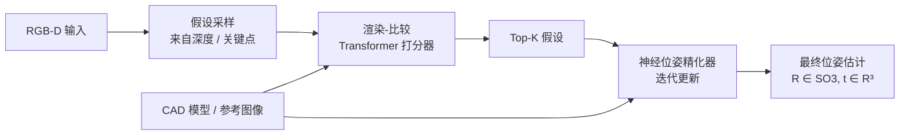
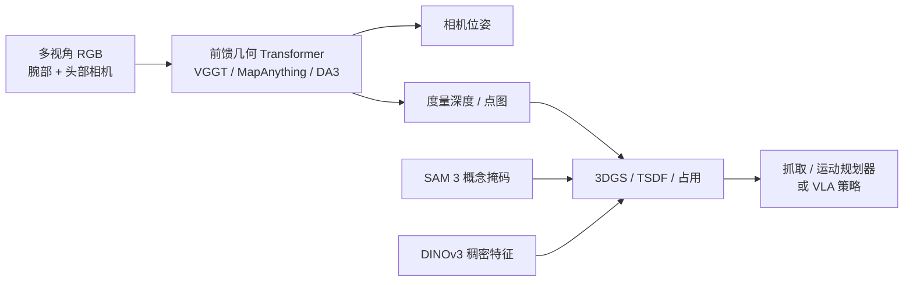
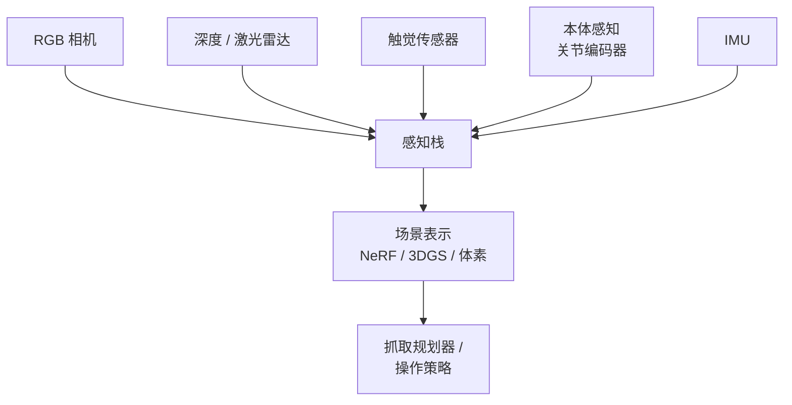

# 机器人感知

> **英文原文：** [cv-knowledge-base/06_robotics_and_embodied_ai/08_perception_for_robotics.md](../../cv-knowledge-base/06_robotics_and_embodied_ai/08_perception_for_robotics.md)（本中文版供参考，内容以英文原文为准）

> **最后更新：** 2026年10月
> **难度级别：** 高级 | 研究前沿
> **相关章节：**
> - [操作与导航](./06_manipulation_navigation.md)
> - [语言条件控制](./10_language_conditioned_control.md)
> - [机器人数据与遥操作](./09_robot_data_and_teleoperation.md)
> - [硬件与机器人平台](./12_hardware_robot_platforms.md)

> **🆕 2026年10月更新：**
> - **视觉基础模型作为机器人前端：** **SAM 3**（Meta，2025 年 11 月；可提示的*概念*分割与跟踪，8.48 亿参数；2026 年 3 月发布 SAM 3.1）、**DINOv3**（2025 年 8 月；7B 教师模型加上用于稠密特征的蒸馏版 ViT/ConvNeXt 主干）以及 **SAM 3D**（单图像 3D 物体重建）。
> - **前馈式 3D 几何：** VGGT（CVPR 2025 最佳论文）、MapAnything（3DV 2026，度量尺度，12+ 种任务）、**Depth Anything 3**（2025 年 11 月，任意视角深度 + 位姿），以及在 CVPR 2026 获得认可的动态场景重建（D4RT）。
> - **面向机器人的学习式立体深度：** **FoundationStereo**（CVPR 2025 口头报告，最佳论文提名；发布时在 Middlebury 和 ETH3D 排名第一）与 **Fast-FoundationStereo**（CVPR 2026；快 10 倍以上，TensorRT 下约 14–23 ms）。这是 2025–26 年应对主动式深度传感器在透明和镜面物体上失效的最实用方案。
> - 免模型 6-DoF 位姿（**Any6D**，CVPR 2025）、自监督触觉表示（**Sparsh**）、Digit 360 更新（约 830 万个触觉单元），新增表格行，以及关于边缘端延迟和模型许可的新开放问题。

---

## 概述

机器人感知研究的是如何从原始传感器流（RGB 图像、深度图、点云、触觉信号和本体感知）中提取与任务相关的表示，并以支持下游规划和控制的形式呈现。被动感知任务（如图像分类、视频理解）面临的约束较少；机器人感知则必须实时运行，要处理操作工作空间中常见的传感器噪声和部分遮挡，并产生足以引导物理接触的精确表示。估计的物体位姿误差 1 mm 就可能导致抓取失败；一次 100 ms 的延迟尖峰就可能让奔跑的机器人摔倒。

该领域在 2022–2025 年间经历了一次重大的范式转变。经典流程把模块化组件组装成人工设计的技术栈：目标检测、基于 ICP 或 PnP 的 6-DoF 位姿估计、占用建图和抓取规划。新范式更青睐统一的场景表示，即在单个可微模型中联合编码几何、外观和语义：3D 高斯泼溅（3D Gaussian Splatting, 3DGS）[Kerbl2023]、神经辐射场（NeRF）[Mildenhall2021] 以及体素化占用网络。这些表示支持新视角合成（可用于数据增强和仿真到现实迁移）、通过语言嵌入进行语义查询，以及用于闭环反馈的实时渲染。

第三层创新是开放词汇（open-vocabulary）场景理解：把 CLIP 等视觉-语言模型融入 3D 表示，使机器人可以直接从连续特征场中回答"橙汁在哪里？"这样的查询，而不受训练时设定的固定类别词表限制。CLIP-Fields [Shafiullah2022]、OpenScene [Peng2023] 和 LangSplat [Qin2024] 等方法表明，可在机器人运行过程中增量构建可用语言查询的空间地图，且无需任何任务特定的标注。

**2025–2026：感知转向"基础模型优先"。** 对机器人学而言最重要的变化是，通用视觉基础模型（Foundation Model）现在开箱即可覆盖经典感知栈的大部分环节：

- **分割：** SAM 3 可以在图像和视频中分割、检测并跟踪某个*命名概念*的所有实例。
- **稠密特征：** DINOv3 提供的稠密自监督特征无需微调即可胜过专用模型。
- **3D 几何：** 前馈网络（VGGT、MapAnything、Depth Anything 3）能在约一秒内从一张到数百张图像中恢复相机位姿、深度和点图。
- **立体深度：** 学习式立体匹配（FoundationStereo）可零样本泛化到结构光传感器失效的真实场景。

机器人学的问题已从"我们能否感知 X？"转向**边缘硬件上的延迟、度量精度、时间一致性和许可问题**。

---

## 6-DoF 物体位姿估计

### 问题陈述

给定 RGB 或 RGB-D 观测以及参考模型（CAD 网格或一组参考图像），估计物体在相机坐标系中的旋转 $R \in SO(3)$ 和平移 $t \in \mathbb{R}^3$：

```latex
(R^*, t^*) = \arg\min_{R,t} \mathcal{L}\bigl(\text{render}(M, R, t),\; I_\text{obs}\bigr)
```

BOP（6D 物体位姿估计基准）挑战赛在多个数据集（YCB-V、LM-O、T-LESS、HB、ITODD）上提供标准化评估，使用汇总了 VSD、MSSD 和 MSPD 误差阈值的平均召回率（AR）指标。

### MegaPose [Labbe2022]

MegaPose（NeurIPS 2022）通过在描绘来自 Google Scanned Objects 和 ShapeNetCore 的 5 万+ 个多样物体的 200 万+ 张合成图像上训练，解决了对未见物体的泛化问题。其架构包括一个粗估计器（通过比较渲染特征与观测特征回归位姿）和一个 ICP 风格的精化器。MegaPose 不需要目标物体的任何真实训练图像，测试时只需其 CAD 模型。其合成训练图像随后被开放用于 BOP 2024 预训练，使 MegaPose 的训练数据成为社区资源。

### FoundationPose [Wen2024]

FoundationPose（CVPR 2024 Highlight，NVLabs）是一个统一的 6-DoF 位姿估计与跟踪模型。它同时支持基于模型（提供 CAD）和免模型（提供参考图像）两种工作方式，无需任何逐物体微调。主要创新：

1. 生成多样化物体-场景组合的大规模合成训练流程。
2. 通过比较渲染特征图与观测特征图为位姿假设打分的渲染-比较 Transformer。
3. 迭代更新估计结果的神经位姿精化器。

截至 2024 年 3 月，FoundationPose 在基于模型的新物体位姿估计上**位居 BOP 排行榜第一**，在 BOP 核心未见数据集上达到 AR = 83.3%，大幅领先此前的最优水平。



### Any6D [Lee2025]：基于单个锚点的免模型位姿估计

**Any6D**（CVPR 2025；FoundationPose 的作者为合著者）去除了对带纹理 CAD 模型或多视角参考采集的需求。它从**单张 RGB-D 锚点图像**估计未知物体的 **6D 位姿*及度量尺寸***。联合物体对齐步骤改善了 2D–3D 对齐和度量尺度估计，随后的渲染-比较阶段生成并精化位姿假设。作者报告该方法对遮挡、无重叠视角以及光照或环境变化都具有鲁棒性。

2025–26 年的另一条互补路线是**生成式重建**。**SAM 3D Objects**（Meta，2025 年 11 月；arXiv:2511.16624）可以从*单张*图像重建完整的 3D 形状、纹理和布局，即使存在杂乱和遮挡也能工作。原则上，它可以提供 FoundationPose 等基于模型的跟踪器所需的网格。对这类"先生成网格再跟踪"流程的系统性机器人评估仍然有限。

---

## 抓取检测与关键点表示

### kPAM：关键点可供性 [Manuelli2019]

kPAM 通过语义 3D 关键点（例如"杯柄"、"杯沿"）而非完整的 6-DoF 位姿来表示物体，从而形式化了类别级操作。给定检测到的关键点 $\{k_i \in \mathbb{R}^3\}$，求解一个由任务参数化的运动规划：

```latex
\min_{T \in SE(3)} \sum_i \| T k_i^{\text{ref}} - k_i^{\text{obs}} \|^2
\quad \text{s.t.} \quad \text{collision-free}(T)
```

kPAM 无需稠密的 6-DoF 位姿估计即可实现类别级泛化（不同形状、颜色的马克杯）。kPAM 2.0（RA-L 2020）将其扩展到序列操作。

### Transporter Networks [Zeng2021]

Transporter Networks（CoRL 2021）通过将动作预测分解为"抓什么"和"放哪里"两步推理来处理抓放任务，两者都被表述为深度特征图上的空间互相关运算：

```latex
Q_\text{place}(p) = \phi_\text{key}(I_t) \star \phi_\text{query}(I_t, \text{pick}_t)
```

该结构利用了空间平移等变性，样本效率比标准模仿学习基线高出几个数量级。该方法不对物体身份、规范位姿或关键点作任何假设，直接作用于图像观测。

关于 2025–26 年基于扩散的 6-DoF 抓取生成（GraspGen），参见[操作与导航](./06_manipulation_navigation.md)。

---

## 面向操作的场景表示

### 神经辐射场（NeRF）

NeRF [Mildenhall2021] 将场景表示为连续函数 $F_\theta: (\mathbf{x}, \mathbf{d}) \mapsto (\mathbf{c}, \sigma)$，把 3D 坐标和视角方向映射为颜色和体密度。体渲染公式为：

```latex
\hat{C}(\mathbf{r}) = \int_{t_n}^{t_f} T(t)\,\sigma(\mathbf{r}(t))\,\mathbf{c}(\mathbf{r}(t), \mathbf{d})\,\mathrm{d}t
```

在机器人学中，NeRF 可以从稀疏观测合成新视角，用于策略训练的数据增强，并为抓取提供高质量 3D 重建。NeRF2Real [Byravan2023] 利用 NeRF 渲染的训练环境，展示了足式运动策略的仿真到现实迁移。

### 3D 高斯泼溅（3DGS）

3DGS [Kerbl2023]（SIGGRAPH 2023）将场景表示为一组各向异性高斯 $\mathcal{G} = \{(\mu_i, \Sigma_i, \alpha_i, \mathbf{c}_i)\}$，通过 alpha 合成进行渲染：

```latex
C(p) = \sum_{i \in \mathcal{N}} c_i \alpha_i \prod_{j < i}(1 - \alpha_j)
```

3DGS 的渲染速度达 100+ FPS（NeRF 则需数秒），可在机器人运行中提供实时反馈。在操作方面：
- **SplatSim**（2024）利用 3DGS 场景重建，展示了 RGB 操作策略的零样本仿真到现实迁移。
- **ManiGaussian**（2024）为 3DGS 加入动态场景建模，用于多任务机器人操作。
- **RL-GSBridge**（2024）使用 3DGS 实现真实到仿真到真实（Real2Sim2Real）迁移，从真实机器人观测构建仿真环境。

自 2025 年起，仿真器开始直接使用高斯泼溅或神经重建资产，例如 Genesis 的 Nyx 渲染器和 Isaac Lab 3.0 beta 版中的神经重建渲染支持（参见[仿真与数据](./05_simulation_and_data.md)）。这让 Real2Sim2Real 从研究流程变成了框架功能。

### 前馈式 3D 基础模型（2025–2026）

逐场景优化（NeRF/3DGS 训练、COLMAP 运动恢复结构）需要数分钟到数小时。一类新的**前馈式几何 Transformer** 只需一次网络前向传播即可得到相机参数和 3D 结构：

- **VGGT** [Wang2025]（牛津 VGG + Meta；**CVPR 2025 最佳论文**）。可以从一张、几张或数百张视图中推断相机内外参、深度图、点图和 3D 点轨迹，通常**每个场景不到一秒**。输出可导出为 COLMAP 格式，并可选做光束法平差。
- **MapAnything** [Keetha2025]（Meta；arXiv:2509.13414；3DV 2026）。它从图像回归**分解式的度量 3D 几何**，在有标定、位姿或深度时还可以将其作为可选条件；单个模型覆盖 **12+ 种重建任务**。度量尺度对机器人至关重要，因为没有外部尺度参考，仅确定到尺度的重建无法用于抓取。
- **Depth Anything 3** [Lin2025]（字节跳动 Seed；arXiv:2511.10647；2025 年 11 月）。它使用普通的 DINO 式 Transformer 和单一的**深度-射线**表示，仅在公开学术数据上训练。一个模型即可覆盖单目深度、多视角深度、位姿条件深度、相机位姿估计和 3D 高斯估计。作者报告其在多视角深度和位姿上优于 VGGT。度量深度变体（DA3METRIC-LARGE）以及嵌套的任意视角 + 度量模型可输出度量尺度的深度。
- **动态场景：** CVPR 2026 最佳论文"Efficiently Reconstructing Dynamic Scenes One D4RT at a Time"表明，前沿正从静态重建转向 **4D（动态）前馈重建**。机器人需要这种能力，因为机器人自身和人都会在场景中移动。



### 体素与占用表示

体素网格和占用网络提供了一种显式的体积化替代方案：
- **VoxPoser** [Huang2023] 使用由 LLM 组合的价值函数，在体素工作空间上生成 3D 可供性地图。
- **C-3PO** 和各种占用网络变体可为反应式操作规划提供实时碰撞检测。

---

## 开放词汇场景理解

### CLIP-Fields [Shafiullah2022]

CLIP-Fields 训练一个小型 MLP，将 3D 坐标映射为 CLIP 特征向量。监督信号来自带位姿的 RGB 帧，其图像块由 CLIP 图像编码器嵌入。得到的特征场可以用任意文本查询：

```latex
f^* = \arg\min_f \|\text{CLIP-img}(I_i) - f(x_i)\|^2
```

使用 CLIP-Fields 的机器人无需任何任务特定训练，就能导航到任意语言查询目标（"找到红色瓶子"），完全依赖 CLIP 在网络数据上训练出的语义空间。

### OpenScene [Peng2023]

OpenScene（CVPR 2023）通过 3D 蒸馏目标，将 2D 开放词汇特征（LSeg、OpenSeg）蒸馏到 3D 点云表示中，从而支持用自然语言进行零样本的 3D 语义场景查询。与 CLIP-Fields 不同，OpenScene 在场景层面处理大规模室内扫描（ScanNet、Matterport3D）。

### LangSplat [Qin2024]

LangSplat（CVPR 2024）将 CLIP 语言特征嵌入 3D 高斯基元，实现了可实时进行语言查询的 3D 场景。LangSplat 在标准高斯属性之外为每个高斯增加一个 CLIP 特征向量 $\ell_i$，并用相同的 alpha 合成核进行渲染：

```latex
L(p) = \sum_{i \in \mathcal{N}} \ell_i \alpha_i \prod_{j < i}(1 - \alpha_j)
```

这使得开放词汇的物体定位能以实时速率运行，适用于反应式机器人抓取流程。

### SAM 3：可提示的概念分割 [Carion2025]

**SAM 3**（Meta；"Segment Anything with Concepts"，arXiv:2511.16719；2025 年 11 月）将 SAM 的视觉提示推广为**概念提示**。给定一个简短的名词短语（例如"红色马克杯"）或一个图像范例，它会在图像和视频中检测、分割并跟踪该概念的**所有实例**。主要设计要点：

- **8.48 亿参数。** 以文本、几何和范例为条件的 DETR 式检测器与 SAM 2 式跟踪器共享视觉编码器；检测器与跟踪器解耦的设计减少了任务间干扰。
- **存在性 token**（presence token）将"该概念是否存在？"与"它在哪里？"分开，提升了对相近提示的区分能力。
- **SA-Co** 基准包含 27 万个不同概念（为以往基准的 50 倍以上），数据引擎标注了超过 400 万个不同概念。SAM 3 在 SA-Co/Gold 图像上达到 cgF1 55.7（人类为 74.0），约为人类水平的 75–80%。
- **SAM 3 Agent** 将 SAM 3 与多模态大语言模型配对，以处理复杂的指代表达。**SAM 3.1 Object Multiplex**（2026 年 3 月 27 日）加入了共享记忆的多目标跟踪，速度显著提升。

对机器人而言，SAM 3 用单个模型取代了 2023–24 年"开放词汇检测器 + SAM"的级联方案（例如 Grounding-DINO + SAM）。它提供的实例掩码可供下游的位姿估计器、抓取生成器和 3D 特征场使用。

### DINOv3 与稠密自监督特征 [Simeoni2025]

**DINOv3**（Meta；arXiv:2508.10104；2025 年 8 月）将自监督学习（Self-Supervised Learning, SSL）扩展到一个 **67 亿参数的 ViT-7B/16 教师模型**，在 LVD-1689M 网络图像上训练，另有在 SAT-493M 上训练的卫星图像变体。它引入了 **Gram 锚定**（Gram anchoring），使稠密图像块特征在长时间训练中保持良好性质。教师模型被蒸馏为 ViT-S/B/L/H+（2100 万–8.4 亿参数）和 ConvNeXt-T/S/B/L（2900 万–1.98 亿参数）主干，适合机器人的算力预算。其冻结的稠密特征无需微调即可在广泛任务上胜过专用的最先进模型。这使 DINOv3 天然适合作为特征场、关键点对应（kPAM 式关键点的学习式后继）和视觉运动策略编码器的主干。在视频方面，**V-JEPA 2.1**（2026 年 3 月）面向时间一致的稠密视频特征，这对机器人自身运动下的跟踪很重要。

---

## 深度、点云与传感器融合

### RGB-D 处理

标准 RGB-D 传感器（Intel RealSense D435、Azure Kinect）通过结构化红外投射获取深度。对机器人而言的主要失效模式：
- 透明/镜面物体：红外结构光失效；飞行时间（ToF）同样不可靠。
- 近距离（<0.3 m）：深度精度显著下降，而这对手内操作至关重要。
- 运动模糊：机器人快速运动会导致深度与彩色图像错位。

PointNet++ [Qi2017] 和稀疏 3D CNN（MinkowskiEngine、SpConv）是点云处理任务的标准主干，适用于抓取检测、6-DoF 位姿估计和场景分割。

### 学习式立体深度：FoundationStereo 与 Fast-FoundationStereo

2025–26 年的一个实际转变是：在同一对红外或 RGB 立体图像上，用**学习式立体匹配**取代传感器的主动深度：

- **FoundationStereo** [Wen2025]（NVIDIA；arXiv:2501.09898；**CVPR 2025 口头报告，最佳论文提名**）在约 100 万对合成立体图像上训练，这些图像经过自动筛选以去除歧义样本。它采用**注入视觉基础模型单目先验的侧调（side-tuning）主干**，并用长程上下文推理对代价体进行滤波。它的设计目标是无需逐域微调即可零样本泛化，发布时在 **Middlebury 和 ETH3D 立体匹配排行榜上排名第一**。2025 年 7 月又加入了 Jetson/TensorRT 支持。
- **Fast-FoundationStereo** [Wen2026]（arXiv:2512.11130；**CVPR 2026**）**速度快 10 倍以上**，同时与 FoundationStereo 的零样本精度非常接近。在 RTX 3090、640×480 分辨率下，报告的延迟约为 **TensorRT 14–23 ms**（PyTorch 29–49 ms），具体取决于检查点和迭代次数。这已足以支撑闭环操作。

由于学习式立体匹配是根据纹理和上下文推断深度，而不是依赖投射图案的回波，它在玻璃、光亮金属和深色表面上的退化要平缓得多。而这些正是结构光和 ToF 的经典失效场景。

### 触觉感知

**GelSight** 传感器使用内嵌 LED 和相机的弹性凝胶表面，在凝胶接触物体时对其形变成像，从而获得高分辨率的表面几何（微米级）和剪切力估计。**DIGIT** 传感器 [Lambeta2021] 将其小型化为指尖尺寸，单价 $<$\$30。

2024 年 10 月，Meta AI 发布了 **Digit 360**，由 GelSight 作为制造合作方。它是一款半球形指尖传感器，拥有**约 830 万个触觉单元**和 18 种以上的感知模态（包括法向力、剪切力、振动和温度），触觉灵敏度超越人类，相关论文为"Digitizing Touch with an Artificial Multimodal Fingertip" [Lambeta2024]。Meta AI 开源了全部设计和代码，并通过征集提案向研究者免费提供组装好的设备。

**Sparsh** [Higuera2024]（Meta FAIR + CMU；CoRL 2024）是一个**自监督触觉编码器**家族（MAE、DINO 和 JEPA 变体），在 DIGIT、GelSight'17 和 GelSight Mini 上训练。在 **TacBench** 下游任务（力估计、滑移检测、位姿）上，它大幅优于端到端模型，并支持以较少数据学习新的触觉任务。这相当于触觉领域的 DINO 式视觉预训练。在仿真方面，Isaac Lab 在 v2.3.2（2026 年 2 月）中加入了视觉触觉传感器。

触觉感知使机器人具备仅靠视觉无法实现的技能：在抓取时检测滑移、估计物体刚度，以及在装配中校准力。

### 传感器融合

融合异构传感器需要仔细的时间同步和外参标定：



模态融合方法包括：早期融合（在特征空间拼接）、晚期融合（对各模态预测进行集成），以及 Transformer 策略中使用的跨模态注意力机制。

---

## 实时性约束

| 任务 | 延迟预算 | 常见瓶颈 |
|------|---------------|-------------------|
| 点云上的抓取检测 | <100 ms | PointNet++ 推理 |
| 6-DoF 位姿跟踪 | <30 ms | 渲染-比较循环 |
| 3DGS 视图合成 | <10 ms | GPU 光栅化 |
| 语言场查询 | <50 ms | CLIP 嵌入 + 特征场求值 |
| SLAM 更新（RTAB-Map） | <100 ms | 回环检测 |
| 学习式立体深度（640×480） | <30 ms | 迭代式代价体精化（Fast-FoundationStereo：RTX 3090 上 TRT 约 14–23 ms） |
| 前馈式多视角重建 | 约 1 s（场景级，而非逐帧） | 对所有视图的全局注意力（VGGT） |
| 概念分割 + 跟踪 | 逐帧，受模型规模限制 | 8.48 亿参数的 SAM 3；多目标记忆（SAM 3.1 multiplex） |

NVIDIA Jetson AGX Orin（275 TOPS INT8）是标准边缘平台。更新的 **Jetson Thor**（自 2025 年 8 月起交付开发者套件，Blackwell 架构）在 130 W 功耗内提供 2,070 FP4 TFLOPS，使更大的感知模型可以在机器人上运行推理。FoundationStereo 和 Cosmos3-Edge 都明确以 Jetson 部署为目标。

---

## 关键论文

| 论文 | 作者 | 年份 | 发表处 | 主要贡献 |
|-------|---------|------|-------|-----------------|
| GraspNet-1Billion | Fang et al. | 2020 | CVPR | 大规模抓取基准；基线模型 |
| NeRF | Mildenhall et al. | 2020/2021 | ECCV / CACM | 连续的体积化场景表示 |
| kPAM | Manuelli et al. | 2019/2020 | ISRR / RA-L | 用于类别级操作的语义关键点可供性 |
| Transporter Networks | Zeng et al. | 2021 | CoRL | 用于抓放的空间互相关；样本效率高 |
| DIGIT | Lambeta et al. | 2021 | RA-L | 低成本（<$30）指尖触觉传感器 |
| CLIP-Fields | Shafiullah et al. | 2022 | arXiv | 用于机器人导航的可语言查询 3D 神经场 |
| MegaPose | Labbe et al. | 2022 | NeurIPS | 基于 CAD 模型的未见物体 6-DoF 位姿估计 |
| 3D Gaussian Splatting | Kerbl et al. | 2023 | SIGGRAPH | 基于各向异性高斯的实时显式辐射场 |
| OpenScene | Peng et al. | 2023 | CVPR | 通过特征蒸馏实现开放词汇 3D 场景理解 |
| FoundationPose | Wen et al. | 2024 | CVPR | 统一的 6-DoF 位姿估计+跟踪；BOP 排名第一（AR 83.3%） |
| LangSplat | Qin et al. | 2024 | CVPR | 嵌入语言的 3DGS，用于实时开放词汇 3D 查询 |
| Sparsh: Self-supervised touch representations for vision-based tactile sensing | Higuera et al. | 2024 | CoRL | 跨 GelSight/DIGIT 的自监督触觉编码器；TacBench |
| Digitizing Touch with an Artificial Multimodal Fingertip (Digit 360) | Lambeta et al. | 2024 | arXiv | 约 830 万触觉单元的多模态指尖；开放硬件 |
| FoundationStereo: Zero-Shot Stereo Matching | Wen et al. | 2025 | CVPR 2025（口头报告，最佳论文提名） | 引入基础模型先验的立体匹配；发布时 Middlebury/ETH3D 第一 |
| VGGT: Visual Geometry Grounded Transformer | Wang et al. | 2025 | CVPR 2025（最佳论文） | 从 1 到数百张视图前馈预测相机、深度、点图和轨迹 |
| Any6D: Model-free 6D Pose Estimation of Novel Objects | Lee et al. | 2025 | CVPR 2025 | 从单张 RGB-D 锚点图像估计 6D 位姿 + 度量尺寸 |
| DINOv3 | Siméoni et al. | 2025 | arXiv:2508.10104 | 采用 Gram 锚定的 7B 自监督教师模型；蒸馏出的稠密特征主干 |
| MapAnything: Universal Feed-Forward Metric 3D Reconstruction | Keetha et al. | 2025 | 3DV 2026 | 度量尺度的分解式几何；12+ 种任务，可选几何输入 |
| SAM 3: Segment Anything with Concepts | Carion et al. | 2025 | arXiv:2511.16719 | 可提示的概念分割/跟踪；SA-Co 基准（27 万个概念） |
| SAM 3D: 3Dfy Anything in Images | SAM 3D Team (Meta) | 2025 | arXiv:2511.16624 | 单图像 3D 形状、纹理与布局重建 |
| Depth Anything 3: Recovering the Visual Space from Any Views | Lin et al. | 2025 | arXiv:2511.10647 | 以普通 Transformer 和深度-射线目标实现任意视角深度 + 位姿 |
| Fast-FoundationStereo: Real-Time Zero-Shot Stereo Matching | Wen et al. | 2025 | CVPR 2026 | 比 FoundationStereo 快 10 倍以上，零样本精度几乎相当 |

---

## 基准性能

| 模型 | 数据集 / 任务 | 指标 | 得分 | 备注 |
|-------|---------------|--------|-------|-------|
| FoundationPose | BOP 核心（未见，基于模型） | AR | 83.3% | CVPR 2024 Highlight；2024 年 3 月 BOP 第一 |
| MegaPose | BOP（未见物体） | AR | 未以单一数字公开报告 | 强基线；训练数据已公开 |
| AnyGrasp | GraspNet-1Billion 未见测试集 | AP | SOTA（2023） | 实测料箱拣选成功率 93.3% |
| Transporter Networks | CLIPort 抓放 | 任务成功率 | 已见任务 >90% | 样本效率为行为克隆的 100 倍 |
| LangSplat | 3D 语义定位 | 准确率 | 未公开报告 | 相比基于 NeRF 的方法可实时运行 |
| SAM 3 | SA-Co/Gold（图像概念分割） | cgF1 | 55.7 | 人类 74.0；约为人类水平的 75–80% |
| SAM 3 | SA-V test（视频概念分割） | cgF1 / pHOTA | 30.3 / 58.0 | 人类 cgF1 53.1 |
| FoundationStereo | Middlebury、ETH3D 排行榜 | 排名 | 第一（发布时，2025 年初） | 侧重零样本泛化 |
| Fast-FoundationStereo | 640×480 立体，RTX 3090 | 延迟 | 约 14–23 ms（TensorRT） | 比 FoundationStereo 快 10 倍以上 |
| VGGT | 多视角场景重建 | 运行时间 | 每个场景 <1 s（典型） | CVPR 2025 最佳论文 |
| DIGIT 360 | 触觉感知模态 | — | >18 种感知特征；约 830 万触觉单元 | 2024 年 10 月发布 |

---

## 优缺点

| 方面 | 优点 | 缺点 |
|--------|------|------|
| FoundationPose（基于模型的 6-DoF） | 无需逐物体微调；可退回免模型模式；BOP SOTA | 需要 CAD 模型或参考图像；若无对称性处理，在对称物体上会失败 |
| 3DGS 场景表示 | 实时渲染（100+ FPS）；显式几何；可通过 LangSplat 扩展语言能力 | 内存随场景复杂度增长；对动态物体的处理仍有限；训练需要多视角采集 |
| 前馈式 3D 模型（VGGT、MapAnything、DA3） | 无需逐场景优化；约 1 s 内得到位姿 + 深度；度量变体可用于抓取 | 延迟为场景级而非逐帧；静态场景假设（4D 仍在发展中）；部分大型检查点为非商业许可（CC BY-NC） |
| 概念分割（SAM 3） | 单个模型完成任意命名概念的检测 + 分割 + 跟踪；支持范例提示 | 8.48 亿参数对边缘端偏重；在 SA-Co 上仍比人类低约 25%；对空间关系（"左边的杯子"）较弱 |
| 学习式立体（FoundationStereo 家族） | 在透明/镜面/深色表面上鲁棒；可利用现有立体/红外相机对；有实时变体 | 需要 GPU；精度依赖基线和标定；失效模式不如主动深度易于解释 |
| 触觉感知（GelSight/DIGIT） | 亚毫米级力/几何感知；滑移检测；支持接触密集型操作；自监督编码器（Sparsh）减少标注 | 在恶劣环境中易损；接触面积有限；融入策略学习并不简单 |
| 开放词汇场（CLIP-Fields、LangSplat） | 零样本语言查询；无需任务特定标签；可增量构建地图 | CLIP 特征分辨率有限；空间上相近的物体查询存在歧义；有幻觉风险 |
| 经典深度处理（PointNet++） | 快速、成熟；开源生态强大 | 在透明/镜面物体上失效；没有大型标注数据集就无法实现语义泛化 |

---

## 开放问题与研究空白

1. **透明与反光物体感知**：在不受控光照下，目前没有任何深度传感器或神经重建方法能可靠恢复玻璃、液体或抛光金属的几何形状。偏振相机和热成像提供了部分解决方案，但缺乏大规模训练数据。学习式立体匹配（FoundationStereo、Fast-FoundationStereo）是 2025–26 年最强的缓解手段，但液体和完全透明的细薄结构仍然困难。

2. **实时动态场景重建**：3DGS 假设场景是静态的，而机器人在动态环境中工作，移动的物体、人以及机器人自身都会遮挡场景的一部分。在机器人运动过程中高效更新动态 3DGS 仍是开放问题。前馈式 4D 重建（CVPR 2026 最佳论文 D4RT）指出了一条路线，但尚未展示以机器人所需速率逐帧运行。

3. **触觉-视觉融合**：尽管已有低成本触觉传感器（DIGIT）和预训练触觉编码器（Sparsh），大多数操作策略仍然忽略触觉反馈。如何把触觉、视觉和本体感知信号融合进一个策略、且在部署时不出现模态缺失，研究仍不充分。

4. **遮挡下的长时域位姿跟踪**：当物体被完全遮挡时（例如杯子被放进抽屉），FoundationPose 及类似跟踪器会丢失目标。遮挡后的重新检测依赖启发式方法，需要对物体恒存性进行有原则的推理。SAM 3 基于记忆的概念跟踪有助于在 2D 中按身份重新捕获物体，但不维护 6-DoF 状态。

5. **可语言查询场的语义精度**：CLIP-Fields 和 LangSplat 继承了 CLIP 的粒度：它们能区分"马克杯"和"碗"，但难以区分"左边的马克杯"和"右边的马克杯"，也难以处理材质和状态属性（"满的瓶子"与"空的瓶子"）。SAM 3 的概念提示和存在性 token 增强了*类别*区分能力，但空间关系和状态查询仍需要多模态大语言模型参与（例如 SAM 3 Agent）。

6. **部署漂移下的传感器标定**：机器人的 RGB-D 传感器会因热膨胀、振动和碰撞而发生外参漂移。在机器人运行过程中无需停机人工重标定的持续在线自标定，是一个尚未解决的工程与学习难题。前馈式位姿估计器（VGGT、MapAnything）可以充当持续的标定监视器，但这一用法基本尚未被探索。

7. **感知中接触动力学的仿真到现实**：在合成数据上训练的感知模型（例如通过 BlenderProc 为 MegaPose 生成的数据）在位姿估计上泛化尚可，但在接触状态预测上会失败，因为仿真无法准确建模接触区域附近的表面摩擦纹理、形变或光照。

8. **边缘端以机器人速率运行的基础感知**：SAM 3（8.48 亿参数）、DINOv3 ViT-7B、VGGT 和 DA3-Giant 都是服务器级模型。虽然已有蒸馏变体（DINOv3 ViT-S/B、DA3-Small/Base、Fast-FoundationStereo），但还没有系统性研究考察：在 Jetson 级硬件上，与 VLA 策略并行、以 30 Hz 运行的完整感知栈的精度-延迟帕累托前沿。

9. **面向部署的许可与可复现性**：2025–26 年若干最强的感知检查点采用非商业许可。例如，Depth Anything 3 的 Large 和 Giant 模型以及 MapAnything 的默认权重为 CC BY-NC 4.0，较小的或替代变体则采用 Apache 许可。工业机器人系统因此往往只能使用较弱的宽松许可变体，使学术 SOTA 与可部署 SOTA 日益成为不同的目标。

---

## 延伸阅读

- [FoundationPose（NVLabs GitHub）](https://github.com/NVlabs/FoundationPose)
- [Any6D（CVPR 2025，GitHub）](https://github.com/taeyeopl/Any6D)
- [FoundationStereo（NVLabs GitHub，arXiv:2501.09898）](https://github.com/NVlabs/FoundationStereo)
- [Fast-FoundationStereo（arXiv:2512.11130）](https://github.com/NVlabs/Fast-FoundationStereo)
- [SAM 3：Segment Anything with Concepts（GitHub）](https://github.com/facebookresearch/sam3)
- [SAM 3D Objects（GitHub）](https://github.com/facebookresearch/sam-3d-objects)
- [DINOv3（GitHub，arXiv:2508.10104）](https://github.com/facebookresearch/dinov3)
- [VGGT（GitHub）](https://github.com/facebookresearch/vggt)
- [MapAnything（GitHub，arXiv:2509.13414）](https://github.com/facebookresearch/map-anything)
- [Depth Anything 3（GitHub，arXiv:2511.10647）](https://github.com/ByteDance-Seed/Depth-Anything-3)
- [Sparsh 触觉表示（GitHub）](https://github.com/facebookresearch/sparsh)
- [Digit 360（GitHub）](https://github.com/facebookresearch/digit360)
- [GelSight / DIGIT 触觉传感器](https://www.gelsight.com/)
- [3D 高斯泼溅项目主页](https://repo-sam.inria.fr/fungraph/3d-gaussian-splatting/)
- [OpenScene：开放词汇的 3D 场景理解](https://pengsongyou.github.io/openscene)
- [BOP Challenge 2024 结果](https://bop.felk.cvut.cz/challenges/)
- [CLIP-Fields 论文（arXiv:2210.05663）](https://arxiv.org/abs/2210.05663)
