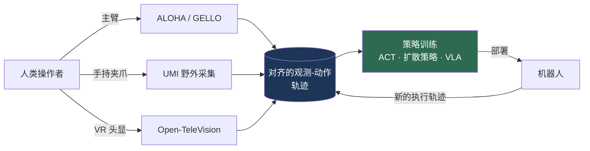
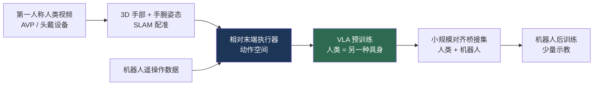

# 机器人数据与遥操作

> **英文原文：** [cv-knowledge-base/06_robotics_and_embodied_ai/09_robot_data_and_teleoperation.md](../../cv-knowledge-base/06_robotics_and_embodied_ai/09_robot_data_and_teleoperation.md)（本中文版供参考，内容以英文原文为准）

> **最后更新：** 2026年10月
> **难度级别：** 高级
> **相关章节：**
> - [跨具身学习](./04_cross_embodiment.md)
> - [VLA 模型](./01_vla_models.md)
> - [仿真与数据](./05_simulation_and_data.md)
> - [优缺点与路线图](./07_pros_cons_roadmaps.md)

> **🆕 2026年10月更新：**
> - 新增 2025–26 年新一代大规模真实机器人语料：**AgiBot World Colosseo**（1,003,672 条轨迹，100 台机器人）、**Galaxea Open-World Dataset**（500+ 小时，单一具身）以及 Generalist AI 的专有 **GEN-0** 语料（约 270k 小时，每周新增 10k 小时以上）。
> - 新增小节：**以 3D 手部姿态作为“动作”的第一人称（egocentric）人类视频**：EgoDex（829 小时，ICLR 2026）、NVIDIA EgoScale（约 20.8k 小时，对数线性扩展）、Physical Intelligence 在 π0.5 中观察到的*涌现式*人到机器人迁移、Figure 的 Project Go-Big，以及 GR00T N1.7 的人类视频预训练。动作标签鸿沟正在缩小，但尚未弥合。
> - 新增 **DexUMI**（面向灵巧手的 UMI 式外骨骼，CoRL 2025 最佳论文入围）以及工业化“数据运营”这一商业模式的兴起。
> - 更新扩展定律证据（GEN-0 幂律与 7B“僵化”阈值；EgoScale），以及在 DROID 平台上的真实世界**分布式评测**（RoboArena，CoRL 2025）。
> - 新增关键论文/基准行、优缺点行、开放问题（家庭数据的隐私与许可、人手与机器人手之间的差距）以及延伸阅读链接。

---

## 概述

当代机器人学习的核心瓶颈不在于架构，而在于**数据**。与语言和视觉不同——互联网为后者提供了几乎无限的文本和图像-描述对——机器人动作数据必须在真实或仿真硬件上以物理方式逐条轨迹地生成。因此，2024–2026 年这一时期的决定性战略问题是：如何以与造就 GPT 级语言模型和 CLIP 级视觉编码器的语料相当的规模，采集、汇聚并摊销具身交互数据。[VLA 模型](./01_vla_models.md)中讨论的每一个视觉-语言-动作模型（Vision-Language-Action, VLA），归根结底都是喂养它的数据管线的函数。

机器人数据分布在一个由*具身保真度*和*采集成本*构成的谱系上。在一端，**被动人类视频**（Ego4D、EPIC-KITCHENS）丰富且廉价，但缺少动作标签以及策略所需的精确本体感知对齐。在另一端，**机器人上的遥操作（teleoperation）**能产生完美对齐的观测-动作轨迹，但昂贵、缓慢且与具体具身绑定。介于两者之间的，是越来越多将示教采集与机器人本体解耦的**便携式数据采集设备**（UMI 的手持夹爪、GELLO 的运动学孪生控制器），以及以物理真实性换取吞吐量的**仿真**（见[仿真与数据](./05_simulation_and_data.md)）。

本文综述构成现代机器人数据生态的遥操作系统与数据集、模仿学习中逐渐显现的经验扩展定律，以及尚未解决的经济与技术矛盾——其中最主要的是人类视频与机器人控制之间的*动作标签鸿沟*（action-label gap），以及机器人数据采集能否成为自我强化的飞轮、而不只是线性成本的问题。

从 2025 年末到整个 2026 年，格局在两方面发生了变化。第一，**规模从学术联盟转向了工业化数据运营**：智元（AgiBot）由 100 台机器人组成的数据工厂产出了百万轨迹级的开放语料，而 Generalist AI 报告了约 270,000 小时的专有语料，且每周增长超过 10,000 小时 [GeneralistAI2025]。第二，**第一人称人类视频成为带动作标签的数据源**，而不再只是表征先验：头戴式采集（Apple Vision Pro、定制设备）记录 3D 手部与手指姿态，可被视为一种拥有自身动作空间的“具身”；2025–26 年的若干成果（EgoDex、EgoScale、Physical Intelligence 的人到机器人迁移、GR00T N1.7）表明，一旦机器人端的预训练规模足够大，这类数据就能可测量地提升机器人策略。

---

## 遥操作系统

遥操作是高质量机器人示教数据的主要来源。关键的设计维度是**操作者到机器人的映射**：人的意图如何被转换为机器人关节或末端执行器指令。

### 主从式（运动学）遥操作

**ALOHA** [Zhao2023]（*A Low-cost Open-source Hardware System for Bimanual Teleoperation*，RSS 2023）确立了低成本双臂数据采集的范式。操作者反向驱动两条主臂，其关节位置被镜像到两条从臂上，从而能完成穿扎带、插电池等精细任务。配套算法 **Action Chunking with Transformers（ACT）** 预测未来动作块而非单步动作，缓解了逐步行为克隆的误差累积问题。整套系统成本约 \$20,000。**Mobile ALOHA** [Fu2024]（CoRL 2024）增加了轮式底盘与全身遥操作（约 \$32,000），并证明**与静态 ALOHA 数据联合训练（co-training），在每个任务仅 50 条示教的情况下可将移动任务成功率提升最多 90%**——这是数据联合训练见效的一个早期且具体的例证。

**GELLO** [Wu2023]（IROS 2024）使用 3D 打印零件和廉价的 Dynamixel 舵机，构建与目标机械臂*运动学结构相同*的低成本主控制器，实现直观的关节空间镜像，且无需针对每种机械臂重新设计即可推广到不同臂型。

### 便携式 / 野外采集

2024 年的关键创新是将数据采集与机器人解耦。**UMI（Universal Manipulation Interface，通用操作接口）** [Chi2024]（RSS 2024，最佳系统论文入围）是一种腕部装有 GoPro 的手持夹爪，可在*野外*（in the wild）记录示教——无需机器人在场。两项技术使这些数据可直接部署：**推理时延迟匹配**，以及与硬件无关的**相对轨迹动作表示**。仅用手持数据训练的策略可**零样本**迁移到多种机器人平台，实现动态、双臂和长时程行为。

**DexUMI** [Xu2025]（CoRL 2025，最佳论文入围）将 UMI 的思想从平行夹爪扩展到**多指灵巧手**：人佩戴一种手部外骨骼，其连杆经过优化，使指尖工作空间与目标机器人手（XHand 或 Inspire Hand）相匹配，从而弥合*运动学*差距；*视觉*差距则通过分割去除人手和外骨骼（SAM 2）并在视频中修复补绘（inpainting）出机器人手来弥合，随后在渲染出的机器人手数据上训练扩散策略（Diffusion Policy）。此后，工业界采用了同样的原则——**以可穿戴或手持采集设备取代回路中的机器人**——作为大型专有数据运营的基础（例如 Generalist AI 的 GEN-0 语料，采集自“数以千计”的家庭、仓库和工作场所 [GeneralistAI2025]）；面向家庭消费市场的初创公司也报道了类似思路的手套式采集装置，但其数据量尚无独立记录。

### 沉浸式 / VR 遥操作

**Open-TeleVision** [Cheng2024]（CoRL 2024）利用 Apple Vision Pro 为操作者提供来自机器人视角的沉浸式第一人称立体反馈，并在两种人形机器人平台上的长时程精细任务（罐子分拣/插入、折叠）中得到验证。更广泛的趋势——以 VR 头显作为遥操作前端——如今已成为人形机器人数据采集的标准做法，因为它能捕获摇杆或主臂装置无法捕获的全身、灵巧意图。到 2025–26 年，这已经产品化：例如，宇树（Unitree）开源的 `xr_teleoperate` 软件栈可用通用 XR 头显驱动其 H2、H1/H1-2、G1 和 R1 人形机器人并集成数据录制，其 `unitree_lerobot` 管线可将录制数据直接转换为 LeRobot 格式的训练数据。全身人形遥操作通常将上半身的 XR 手部/头部追踪，与一个通过强化学习训练的**全身控制器**（whole-body controller）相结合，后者在跟踪重定向后的人体运动时保持机器人平衡——例如随 GR00T N1.7 发布的 NVIDIA GEAR-SONIC 控制器（见[通用 vs. 专用](./11_generalist_vs_specialist.md)）。



### 工业化数据运营（2025–2026）

当资金充足的公司开始把数据采集作为专门的“生产线”来运营时，遥操作的经济学随之改变：

- **智元数据工厂。** AgiBot World [AgiBot2025] 在 **100 台真实机器人**上、于**覆盖 5 个领域（家居、零售、工业、餐厅、办公）的 100 余个 1:1 复刻真实生活场景**中采集，并配有人在回路的校验流程——这一组织模式在 2025 年中国多个城市开设的、由政府支持的人形机器人数据采集“训练场”中得到了呼应。
- **Generalist AI。** GEN-0 [GeneralistAI2025] 在约 270,000 小时的真实世界操作数据上预训练，公司报告每周新增超过 10,000 小时（公司自报；未经独立审计）。
- **Figure Project Go-Big。** 2025 年 9 月，Figure 宣布与 Brookfield（拥有 100,000 余套住宅单元以及办公和物流资产）合作，在真实家庭中采集大规模第一人称人类视频，用于 Helix 预训练 [Figure2025GoBig]。
- **Tesla。** Business Insider 在 2025 年年中报道称，Tesla 的 Optimus 团队已从动作捕捉/VR 遥操作，转向以**视频为主**的采集方式——由佩戴相机设备的工人执行任务并录制，理由是可扩展性；Tesla 未公布细节。

共同的主线是：成本驱动因素从*机器人工时*转向*带仪器记录的人类活动工时*，后者可能便宜一个数量级，并且可以在许多地点并行进行。

---

## 数据集

| 数据集 | 轨迹数 | 具身数 | 显著特点 |
|---------|-------------|-------------|------------------|
| **Open X-Embodiment** [OXE2023] | 1M+ | 22 | 汇聚 60 个数据集、34 个实验室；标准 VLA 预训练语料 |
| **DROID** [Khazatsky2024] | 76,000（约 350 小时） | 1（Franka） | 564 个场景、52 栋建筑、13 家机构，野外采集 |
| **BridgeData V2** [Walke2023] | 60,096 | 1（WidowX） | 24 种环境；开放词汇（open-vocabulary），以目标图像/语言为条件 |
| **RH20T** [Fang2023] | 110,000+ | 多种 | 接触丰富；视觉 + 力 + 音频 + 动作；侧重单样本学习 |
| **RoboMIND** [Wu2024] | 107,000 | 4 | 479 个任务、96 个物体类别；包含 5,000 条标注的失败轨迹 |
| **AgiBot World Colosseo** [AgiBot2025] | 1,003,672（Beta） | AgiBot G1 机队（100 台） | 217 个任务、5 个领域；灵巧手 + 视触觉；IROS 2025 最佳论文入围 |
| **Galaxea Open-World** [Galaxea2025] | 500+ 小时 | 1（Galaxea 移动双臂） | 在多样真实场所使用单一统一具身；与 G0 双系统 VLA 一同发布 |
| **GEN-0 语料** [GeneralistAI2025] | 约 270,000 小时（专有） | 多种（6/7 自由度机械臂、半人形） | 采集自数以千计的真实场所；每周 >10k 小时（公司自报） |
| **EgoDex** [Hoque2025] | 829 小时人类视频 | 人手（Apple Vision Pro） | 194 个桌面任务；每个手部关节的 3D 姿态；CC-BY-NC-ND |
| **EgoScale** [EgoScale2026] | 约 20,854 小时人类视频 | 人手 | 带动作标签的第一人称数据；验证损失呈对数线性扩展 |

**Open X-Embodiment（OXE）** [OXE2023] 是奠基性的汇聚工作：约 1M+ 条轨迹，涵盖 22 种具身和 527 项技能，汇集自 34 个实验室的 60 个现有数据集。其核心经验发现——跨具身（cross-embodiment）联合训练*即使在源具身上*也能提升性能——是跨具身范式的基础（见[跨具身学习](./04_cross_embodiment.md)）。**DROID** [Khazatsky2024] 统一了硬件栈（Franka Panda + 双 ZED 立体相机 + ZED Mini 腕部相机 + Oculus Quest 遥操作），使 13 家机构的 50 名采集者能够贡献可互操作的数据——在 564 个真实场景中采集了 76,000 条轨迹，是同代中场景多样性最高的操作数据集。

**AgiBot World Colosseo** [AgiBot2025]（arXiv:2503.06669；IROS 2025 最佳论文入围；IEEE T-RO 2026）是首个突破百万轨迹的开放真实机器人语料（2025 年 3 月的 Beta 版含 1,003,672 条，此前 2024 年 12 月的 Alpha 版含 92,214 条）。与 OXE 不同，它是**单一厂商且经过质量控制**的：在由 100 台配备灵巧手和视触觉传感器的双臂移动机器人组成的机队上采集，涵盖接触丰富、长时程以及多机器人协作任务。配套的 **GO-1** 通用策略使用潜在动作（latent action）规划器，作者报告在 AgiBot World 上预训练比在 OXE 上预训练的**平均性能高约 30%**；GO-1 已于 2025 年 9 月开源。需注意其许可证（CC BY-NC-SA 4.0）限制了商业复用。

**Galaxea Open-World Dataset** [Galaxea2025]（arXiv:2509.00576，2025 年 9 月）采取了与 OXE 相反的取舍：使用**单一统一的移动双臂具身**采集 500 余小时数据，从根本上避免了跨具身归一化问题，并与 **G0** 双系统 VLA 一同发布（之后于 2026 年 1 月推出 G0Plus，在 2k+ 小时真实机器人数据上预训练）。AgiBot World 与 Galaxea 共同标志着从*异构汇聚*（OXE）向*同构、精心整理的机队数据*的转变——这与视觉-语言预训练中从网络爬取语料转向精选语料的趋势如出一辙。

**DROID 作为评测基座。** DROID 标准化的 Franka 配置已成为共享的*评测*平台：Physical Intelligence 发布了 π0-FAST-DROID 和 π0.5-DROID 检查点，可在新的 DROID 场景中零样本完成简单桌面任务；**RoboArena** [Atreya2025]（CoRL 2025）则在七家机构的 DROID 机器人上进行众包式、双盲的通用策略成对比较，并报告这种分布式方案比集中式固定任务评测能更准确地对策略进行排名（初始研究中针对七个策略进行了 600 余次成对真实机器人评测回合）。

### 人类视频作为数据源

**Ego4D** [Grauman2022]（CVPR 2022，3,670 小时，931 名参与者，74 个地点）和 **EPIC-KITCHENS-100** [Damen2022]（IJCV 2022，97 个动词 × 300 个名词）并非机器人数据集，但越来越多地被用于为操作任务预训练视觉编码器。据报道，在 Ego4D 手-物交互片段上预训练的编码器，在下游成功率上比 ImageNet 预训练编码器的迁移效果**高 20–40%**，这推动了它们在 VLA 预训练管线中的应用。问题在于**动作标签鸿沟**：人类视频包含丰富的物理先验（接触、可供性（affordance）、物体动力学），但没有机器人动作标签，因此只能预训练*表征*，而不能直接监督*控制*。弥合这一鸿沟——通过潜在动作模型（Genie 式，见[世界模型](./02_world_models.md)）、逆动力学或人到机器人的重定向（retargeting）——是 2025–2026 年最活跃的研究方向之一。

### 以手部姿态作为动作的第一人称人类视频（2025–2026）

过去一年最重要的数据进展是：动作标签鸿沟**通过测量人手、而非推断机器人动作而得到缩小**。配备标定相机和设备端 SLAM 的头戴式采集，可逐帧获得 3D 手腕和手指关节姿态，这些姿态可以用与机器人相同的**相对末端执行器动作空间**表示，并作为另一种具身参与联合训练：

- **EgoDex** [Hoque2025]（Apple；ICLR 2026）：使用 Apple Vision Pro 录制的 829 小时 1080p/30 Hz 第一人称视频，附带每个手部关节的 3D 姿态和语言标注，涵盖 194 个桌面任务（从系鞋带到叠衣服）。它是同类中规模最大的公开灵巧人类操作数据集，但采用 CC-BY-NC-ND 许可。
- **EgoScale** [EgoScale2026]（NVIDIA、UC Berkeley、UMD；arXiv:2602.16710，2026 年 2 月）：在**约 20,854 小时**带动作标签的第一人称视频（超过此前工作 20 倍）上训练 VLA，并报告了**人类数据规模与验证损失之间的对数线性扩展定律**，且该损失与下游真实机器人成功率高度相关。在后训练之前有一个小规模的对齐“桥接”阶段（约 50 小时人类数据 + 4 小时机器人数据），所得策略在 22 自由度机器人手上的平均成功率比无预训练基线提高 **54%**，并能迁移到自由度更低的机械手。
- **涌现式人到机器人迁移** [PI2025H2R]（Physical Intelligence 与 Georgia Tech；arXiv:2512.22414，2025 年 12 月）：将第一人称人类视频视为另一种具身（以 3D 手部位置作为动作），并在其上对 π0.5 进行联合微调，在仅出现于人类数据中的四个泛化场景上**性能约提升一倍**。关键在于，这种迁移**随机器人预训练数据的数量和多样性增加而增强**；表征分析显示，随着预训练规模扩大，人类图像与机器人图像在模型内部逐渐对齐——也就是说，能否利用人类视频本身就是规模带来的涌现属性。
- **GR00T N1.7**（NVIDIA，2026）：这一开放的 3B 人形 VLA 在约 20K 小时 EgoScale 人类视频和机器人示教上共同预训练，使用人类与机器人数据共享的相对末端执行器动作空间——这是首个将人类视频作为一等预训练数据源的重要开放发布。
- **Figure Project Go-Big** [Figure2025GoBig]（2025 年 9 月）：Figure 报告称，*仅*用第一人称人类视频训练的 Helix 即可在杂乱的家庭环境中执行语言条件导航（“去冰箱那里”）——这是公司说法，尚无独立评测。



剩余差距已经缩小但依然存在：人手比机器人夹爪或机械手拥有更多自由度和不同的接触力学；第一人称视频缺少力/力矩信息；头部运动会干扰相机与手之间的几何关系。目前的结果（EgoScale、π0.5 迁移）仍需要至少一部分机器人数据来锚定这种映射。

---

## 机器人数据扩展定律

该子领域最重要的经验结果是：模仿学习似乎遵循与语言领域类似的**扩展定律**（scaling laws）。*Data Scaling Laws in Imitation Learning for Robotic Manipulation* [Lin2024]（ICLR 2025；CoRL 2024 X-Embodiment Workshop 最佳论文）报告了**示教数量与成功率 logit 之间的对数线性关系**，且在多种任务和架构上都成立：

```
logit(success) ≈ a · log(N_demos) + b
  where logit(p) = log(p / (1 - p))
```

在数据足够多样（跨物体与环境）时，单任务策略被观察到能够**零样本泛化到任意环境中同一类别的任意物体**。主要的保留意见是：最强的结果是在受控/仿真设置中获得的，大规模真实世界复现仍在进行中。一项互补的元分析 *Neural Scaling Laws for Embodied AI* [Sartor2024] 综述了 327 篇论文，发现机器人基础模型（Foundation Model）的幂律系数与 CV/NLP 模型非常接近——这表明“苦涩的教训”（bitter lesson）可能也适用于机器人学，相关争论详见[优缺点与路线图](./07_pros_cons_roadmaps.md)。

**工业规模的证据（2025–2026）。** 三项结果将扩展问题从受控设置推向了真实世界预训练：

- **GEN-0** [GeneralistAI2025]（2025 年 11 月）报告了在真实机器人任务上**预训练数据量与下游后训练误差之间的幂律关系**，公司将其与模型规模扩展结合，用于规划数据/算力分配。它还报告了一个大约在 **7B 参数处的容量阈值**：较小的模型会“僵化”（在大量预训练下不再吸收新数据），而较大的模型会持续改进——并且数据的*质量与配比*比原始小时数更重要。这些均为公司自报结果，未经同行评审。
- **EgoScale** [EgoScale2026] 发现了**第一人称人类数据**的类似**对数线性定律**（验证损失 vs. 小时数），且验证损失可预测真实机器人成功率。
- **TRI 的大型行为模型（Large Behavior Model, LBM）研究** [TRI2025]（arXiv:2507.05331）对多任务扩散 Transformer 策略进行了统计严谨的盲评（配有 49 个任务的仿真套件 `lbm_eval`），发现微调后的 LBM 随预训练数据增加而稳步提升，且所需的任务特定数据远少于单任务基线——同时强调，只有采用盲评且具备足够统计功效的评测，真实机器人上的比较才有意义。

```
GEN-0 (reported):   L_downstream(D) ≈ c · D^(-α),  α > 0   (D = 预训练小时数)
EgoScale:           L_val(H) ≈ a − b · log(H)               (H = 人类视频小时数)
```

逐渐成形的图景是：正确的度量单位是**按多样性加权的小时数**，而非轨迹条数；并且模型容量必须随数据一同增长，扩展规律才能成立。

---

## 关键论文

| 论文 | 作者 | 年份 | 会议/期刊 | 主要贡献 |
|-------|---------|------|-------|-----------------|
| Learning Fine-Grained Bimanual Manipulation with Low-Cost Hardware (ALOHA/ACT) | Zhao, Kumar, Levine, Finn | 2023 | RSS | \$20k 双臂遥操作 + 动作分块 Transformer |
| Mobile ALOHA | Fu, Zhao, Finn | 2024 | CoRL | 全身移动遥操作；静态数据联合训练 +90% |
| Universal Manipulation Interface (UMI) | Chi, Xu, Pan, Cousineau, Burchfiel, Feng, Tedrake, Song | 2024 | RSS | 手持式野外采集；零样本硬件迁移 |
| DROID | Khazatsky, Pertsch, Nair, et al. | 2024 | RSS | 76k 轨迹、564 场景的标准化数据集 |
| Open X-Embodiment | OXE Collaboration | 2023 | arXiv→ICRA 2024 | 1M+ 轨迹、22 种具身；跨具身迁移 |
| BridgeData V2 | Walke, Black, Lee, Kim, et al. | 2023 | CoRL | 60k 轨迹，大规模语言/目标图像条件 |
| Data Scaling Laws in Imitation Learning | Lin, Hu, Sheng, Wen, You, Gao | 2024 | ICLR 2025 | 示教数量 → 成功率 logit 的对数线性扩展定律 |
| AgiBot World Colosseo | AgiBot World Contributors | 2025 | IROS 2025（最佳论文入围）/ T-RO 2026 | 100 台机器人机队采集的 1M+ 轨迹；GO-1 潜在动作策略，较 OXE 预训练 +30% |
| Galaxea Open-World Dataset & G0 | Galaxea Team | 2025 | arXiv:2509.00576 | 500+ 小时单具身开放世界数据；双系统 G0 VLA |
| DexUMI | Xu, Zhang, Hou, Xu, Fan, Veloso, Song | 2025 | CoRL（最佳论文入围） | 外骨骼 + 机器人手补绘：以人手作为灵巧 UMI |
| EgoDex | Hoque, Huang, Yoon, Sivapurapu, Zhang | 2025 | ICLR 2026 | 829 小时 Vision Pro 第一人称视频，含完整 3D 手部姿态，194 个任务 |
| RoboArena | Atreya, Pertsch, et al. | 2025 | CoRL | 基于 DROID 的众包式双盲成对真实世界评测 |
| Emergence of Human to Robot Transfer in VLAs | Physical Intelligence & Georgia Tech | 2025 | arXiv:2512.22414 | 将人类视频视为具身；仅人类场景上约 2×；迁移随规模涌现 |
| EgoScale | NVIDIA, UC Berkeley, UMD | 2026 | arXiv:2602.16710 | 约 20.8k 小时带动作标签人类视频；对数线性扩展；22 自由度手上 +54% |
| GEN-0 | Generalist AI | 2025 | 技术博客 | 270k 小时真实世界预训练；数据幂律；7B 僵化阈值 |

---

## 基准性能

| 结果 | 数据集/设置 | 指标 | 数值 | 备注 |
|--------|-----------------|--------|-------|-------|
| Mobile ALOHA 联合训练 | 移动任务 | 成功率提升 | 最高 +90% | 静态数据联合训练下每任务仅 50 条示教 [Fu2024] |
| Ego4D 预训练编码器 | 操作任务迁移 | 成功率 | 较 ImageNet +20–40% | 多个操作基准上的报告结果 |
| 数据扩展 | 多任务模仿学习 | logit(success) | 与 N_demos 呈对数线性 | 主要为仿真/受控设置；真实世界验证进行中 [Lin2024] |
| DROID 规模 | 真实世界 | 场景 / 轨迹 | 564 / 76,000 | 13 家机构、52 栋建筑 [Khazatsky2024] |
| AgiBot World 预训练 | GO-1 下游任务 | 相对 OXE 预训练的平均性能 | 约 +30% | 相同策略、不同预训练语料 [AgiBot2025] |
| EgoScale 人类视频预训练 | 22 自由度灵巧手 | 相对无预训练的平均成功率 | +54% | 约 20.8k 小时人类视频；也可迁移到低自由度手 [EgoScale2026] |
| π0.5 + 人类视频联合微调 | 4 个仅见于人类数据的泛化场景 | 任务性能 | 约 2× | 增益随机器人预训练规模增长 [PI2025H2R] |
| GEN-0 语料 | 真实世界预训练 | 小时数 / 增长速度 | 约 270k 小时 / 每周 >10k 小时 | 公司自报 [GeneralistAI2025] |
| RoboArena | DROID 平台，7 家机构 | 策略排名准确度 | 优于集中式评测 | 600+ 成对评测回合，7 个策略 [Atreya2025] |

---

## 优缺点

| 方面 | 优点 | 缺点 |
|--------|------|------|
| 机器人上的遥操作 | 观测-动作完美对齐；保真度高 | 昂贵（DROID 规模数据集约 \$2M+）；与具身绑定；缓慢 |
| 便携式采集（UMI/GELLO） | 廉价、快速、可野外采集；与硬件无关 | 缺少机器人本体感知；部署时存在具身差距 |
| 人类视频（Ego4D/EPIC） | 互联网规模、免费、物理先验丰富 | 无动作标签（动作标签鸿沟）；领域/视角偏移 |
| 汇聚（OXE） | 跨具身迁移；可复用语料 | 异构的动作/观测空间需要归一化 |
| 精选的单一厂商机队数据（AgiBot World、Galaxea） | 同构、质量可控、百万轨迹规模 | 绑定厂商具身；非商业许可；复制成本高 |
| 第一人称视频 + 3D 手部姿态（EgoDex、EgoScale） | 每小时成本低、极其多样、已带动作标签；对数线性扩展 | 人手与机器人手的差距；无力信息；仍需机器人“锚定”数据集 |
| 工业化数据运营（GEN-0、Go-Big） | 10⁵ 小时规模；持续增长 | 专有、未经审计；家庭场景中的隐私与知情同意问题 |

---

## 开放问题与研究空白

- **动作标签鸿沟。** 目前尚无通用方法能可靠地将被动人类视频转换为机器人可执行的动作监督；潜在动作模型和逆动力学方法前景可观，但依赖具体领域。测得的 3D 手部姿态（EgoDex、EgoScale）缩小了以手为中心的操作任务中的鸿沟，但对第三人称互联网视频无效，后者仍缺乏可靠的 3D 动作恢复手段。
- **跨具身的数据归一化。** OXE 汇集了 22 种动作空间互不兼容的具身；有原则的、无损的归一化方法（超越逐数据集的重新缩放）仍未解决——见[跨具身学习](./04_cross_embodiment.md)。
- **扩展定律的真实世界验证。** [Lin2024] 的对数线性扩展在受控设置中最为显著；它是否适用于接触丰富、长时程的真实任务尚未得到验证。
- **质量 vs. 数量。** 示教的*质量*、多样性和数据整理与原始数量之间如何权衡尚不清楚——这是视觉领域 DataComp/MetaCLIP 之争在机器人学中的对应问题。
- **数据飞轮问题。** 已部署机器人产生的数据能否形成自我强化（类似 Tesla FSD），还是始终是线性的人力成本，是该领域最核心的经济不确定性。
- **失败数据与恢复。** 大多数数据集只包含成功轨迹；RoboMIND 的 5,000 条标注失败轨迹暗示失败/恢复数据可能具有不成比例的价值，但很少被采集。
- **触觉与力数据。** 以视觉为主的数据集对接触动力学覆盖不足；可扩展地采集对齐的力/触觉数据流（见[机器人感知](./08_perception_for_robotics.md)）尚不成熟。
- **需要多少机器人数据才能锚定人类视频？** EgoScale 和 π0.5 迁移研究都需要一个机器人“桥接”数据集，且迁移质量随机器人预训练规模提升；机器人与人类数据小时数的最小比例是多少、它是否会随规模缩小，目前仍未知。
- **人手与机器人手的对应关系。** 将 20 余自由度的人手姿态重定向到夹爪或比例不同的机器人手上会损失信息；DexUMI 式的硬件协同设计和学习式重定向只是部分解决方案。
- **开放性、许可与可审计性。** 规模最大的语料（GEN-0、Go-Big、Tesla）是专有的，其扩展结论未经审计；而主要的开放数据集（AgiBot World、EgoDex）采用非商业许可——这同时限制了可复现的科学研究和商业复用。
- **家庭采集中的隐私与知情同意。** 10⁵ 小时规模的第一人称和家庭内采集，带来了尚未解决的知情同意、匿名化和数据治理问题。
- **规模化评测。** RoboArena 式的分布式评测提高了排名的可靠性，但面向通用策略的标准化、可复现的真实世界基准仍然稀缺。

---

## 延伸阅读

- [Open X-Embodiment (arXiv:2310.08864)](https://arxiv.org/abs/2310.08864) — 经典的跨具身数据集与 RT-X 模型
- [DROID 数据集与论文 (arXiv:2403.12945)](https://arxiv.org/abs/2403.12945) — 标准化的野外数据采集
- [UMI: Universal Manipulation Interface (arXiv:2402.10329)](https://arxiv.org/abs/2402.10329) — 手持式野外数据
- [ALOHA / ACT (arXiv:2304.13705)](https://arxiv.org/abs/2304.13705) — 低成本双臂遥操作
- [Data Scaling Laws in Imitation Learning (arXiv:2410.18647)](https://arxiv.org/abs/2410.18647) — 经验扩展行为
- [Ego4D (CVPR 2022)](https://ego4d-data.org/) — 作为操作先验的第一人称视频
- [AgiBot World Colosseo (arXiv:2503.06669)](https://arxiv.org/abs/2503.06669) 及其[代码/数据](https://github.com/OpenDriveLab/AgiBot-World) — 百万轨迹级开放语料与 GO-1
- [Galaxea Open-World Dataset & G0 (arXiv:2509.00576)](https://arxiv.org/abs/2509.00576) — 单具身开放世界数据与双系统 VLA
- [DexUMI](https://github.com/real-stanford/DexUMI) — 以人手作为灵巧手的通用操作接口
- [EgoDex (arXiv:2505.11709)](https://arxiv.org/abs/2505.11709) — 829 小时带 3D 手部姿态的第一人称灵巧操作数据
- [EgoScale (arXiv:2602.16710)](https://arxiv.org/abs/2602.16710) — 用约 20k 小时人类数据扩展灵巧操作
- [Emergence of Human to Robot Transfer in VLAs (arXiv:2512.22414)](https://arxiv.org/abs/2512.22414) — Physical Intelligence 的人类视频研究
- [GEN-0（Generalist AI 博客）](https://generalistai.com/blog/nov-04-2025-GEN-0) — 270k 小时预训练与机器人扩展定律
- [Figure Project Go-Big](https://www.figure.ai/news/project-go-big) — 基于人类视频的互联网规模人形机器人预训练
- [RoboArena (arXiv:2506.18123)](https://arxiv.org/abs/2506.18123) — 通用策略的分布式真实世界评测
- [TRI Large Behavior Models (arXiv:2507.05331)](https://arxiv.org/abs/2507.05331) — 对多任务 LBM 的细致考察
