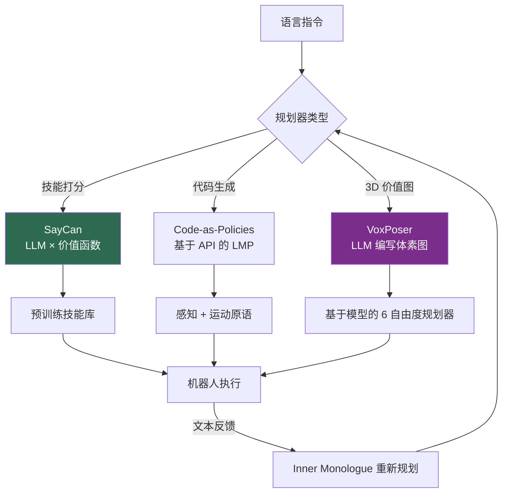
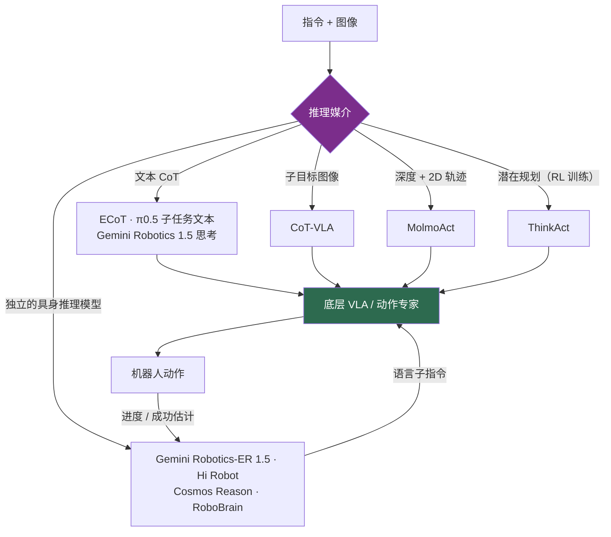

# 语言条件控制

> **英文原文：** [cv-knowledge-base/06_robotics_and_embodied_ai/10_language_conditioned_control.md](../../cv-knowledge-base/06_robotics_and_embodied_ai/10_language_conditioned_control.md)（本中文版供参考，内容以英文原文为准）

> **最后更新：** 2026年10月
> **难度级别：** 高级
> **相关章节：**
> - [VLA 模型](./01_vla_models.md)
> - [通用 vs. 专用](./11_generalist_vs_specialist.md)
> - [机器人数据与遥操作](./09_robot_data_and_teleoperation.md)
> - [大型视觉-语言模型](../05_multimodal_vision_language/02_large_vision_language_models.md)

> **🆕 2026年10月更新：**
> - 新增**基于推理的控制**一节：具身思维链（ECoT）、视觉思维链（CoT-VLA）、空间“动作推理”（MolmoAct、MolmoAct2），以及经强化学习训练的推理型 VLA（ThinkAct）。
> - 模块化规划器这一路线如今以**编排 VLA 的具身推理模型**形式延续：Gemini Robotics-ER 1.5 + Gemini Robotics 1.5（“先思考再行动”）、Hi Robot 与 π0.5 的模型内子任务预测、NVIDIA Cosmos Reason 2（GR00T N1.7 的骨干网络）以及智源（BAAI）RoboBrain 2.5。
> - 新增关键论文与基准行（ECoT 较 OpenVLA +28%、CoT-VLA 真实世界 +17%、LIBERO 饱和、ERQA）、优缺点行，以及关于推理延迟、推理轨迹忠实性和语义安全的开放问题。

---

## 概述

语言条件控制（language-conditioned control）研究的是如何将自然语言指令连同传感观测映射为能够完成该指令的机器人动作。它处于三者的交汇处：落地/接地（grounding，将词语与感知和物理指称对象联系起来）、规划（将抽象目标分解为可执行步骤）和控制（产生运动指令）。大约在 2022 年，该领域分化为两大架构家族，二者之间的张力延续至今：**模块化的“LLM 作为规划器”**系统，使用冻结的语言模型对预训练技能进行排序或生成代码；以及**端到端（end-to-end）VLA**，将语言理解和动作生成整合进单个可微网络（详见 [VLA 模型](./01_vla_models.md)）。

模块化路线源于一个简单的观察：大语言模型拥有大量常识和程序性知识（“要煮咖啡，先找个杯子”），但并未落地到特定机器人的可供性（affordance）或物理状态上。因此，工程问题在于*让规划器落地*——把 LLM 流畅但缺乏物理常识的提议约束到机器人实际可执行的动作上。不同系统的解决方式各不相同：**SayCan** 用学习到的价值函数为提议打分；**Code-as-Policies** 让 LLM 基于感知/运动 API 生成可执行程序；**Inner Monologue** 通过文本形式的环境反馈形成闭环；**VoxPoser** 让 LLM 合成 3D 价值图，再由经典规划器进行优化。本文综述这些系统、它们的落地机制，以及它们与端到端 VLA 范式之间的关系——两者如今既相互竞争，又日益融合。

一个统一的视角是**慢推理 / 快控制的划分**：LLM 规划器每次决策需要数秒，不适合反应式控制，因此总是把底层执行委托给更快的学习式或脚本式原语。这正是[通用 vs. 专用](./11_generalist_vs_specialist.md)中讨论的双系统 VLA 架构（GR00T N1、Helix）在概念上的前身。

自 2025 年以来，两大家族正**围绕显式推理重新融合**。不再是冻结的 LLM 调用手写原语，而是一个为*具身*推理（空间指点、轨迹勾画、进度估计、任务分解）而训练的视觉-语言模型，要么 (a) 通过自然语言子指令来**编排**一个学习得到的 VLA（Gemini Robotics-ER 1.5 → Gemini Robotics 1.5；Hi Robot → π0），要么 (b) 被**整合进 VLA 本身**，在输出动作之前先生成中间推理——文本、子目标图像、深度 token 或 2D 轨迹（ECoT、CoT-VLA、π0.5、MolmoAct）。SayCan 的“say × can”分解依然存在，但这两项如今都从数据中学习得到，而非人工设计。

---

## 模块化“LLM 作为规划器”系统

### 可供性落地：SayCan

**SayCan** [Ahn2022]（*Do As I Can, Not As I Say*，CoRL 2022）是开创性的落地机制。一个 LLM（PaLM-540B）提出候选的下一步技能，并根据指令为每个技能的*语义合理性*打分；另一个单独学习的**价值函数**则根据当前状态为每个技能的*物理可行性*打分。最终执行的技能使二者乘积最大：

```
score(skill) = p_LLM(skill | instruction) · p_affordance(skill | state)
a* = argmax_skill  p_LLM(skill | instruction) · p_affordance(skill | state)
```

在 101 个长时程厨房任务上，PaLM-SayCan 达到了 **84% 的规划成功率和 74% 的端到端执行成功率**。其核心洞见——将“say”项（什么是合理的）与“can”项（什么是可能的）相乘——至今仍是 LLM 落地的经典表述。

### 程序即策略：Code-as-Policies

**Code-as-Policies** [Liang2022]（ICRA 2023）将规划器的输出重新定义为*可执行代码*。一个代码生成 LLM 生成语言模型程序（Language Model Programs, LMP），调用感知与运动原语（`get_obj_pos`、`move_to`、`pick`、`place`），并支持循环、条件语句以及对未定义函数的递归定义（分层代码生成）。生成的策略**可解释、可审计**——控制流是显式的 Python 代码——并能表达基于 token 预测的策略无法表达的空间推理和迭代。代码生成只在任务开始时一次性花费约 5–30 秒；之后程序以原语的速度运行。

### 闭环反馈：Inner Monologue

**Inner Monologue** [Huang2022a]（CoRL 2022）用来自三个来源的闭环文本反馈增强 LLM 规划：成功检测器、被动场景描述器和主动问答。将这些反馈注入回 LLM 提示中，使规划器能够**动态重新规划**，显著提升了桌面、厨房和导航领域的指令完成率。它证明了：*只要*获得丰富的、结构化的语言形式环境反馈，LLM 就可以充当自适应控制器。

### 3D 价值图：VoxPoser

**VoxPoser** [Huang2023]（CoRL 2023）消除了预定义原语的瓶颈。LLM 从指令中推断可供性和约束，并编写代码查询 VLM，以在机器人工作空间上组合出 **3D 体素价值图**（可供性场 + 约束场）。随后，基于模型的规划器根据这些价值图**零样本合成闭环 6 自由度轨迹**——无需任何任务特定训练即可处理开放集指令和物体。



---

## 语言条件模仿学习

在 LLM 规划器发展的同时，另一类工作直接将*底层*模仿策略以语言为条件。**CLIPort** [Shridhar2021]（CoRL 2021）在双流架构中融合了 CLIP 的语义“是什么”通路与 Transporter Networks 的空间“在哪里”通路，无需显式物体位姿或分割，即可端到端学习语言条件的抓取-放置；单个多任务策略覆盖 10 个仿真任务 + 9 个真实任务。**BC-Z** [Jang2022]（CoRL 2022）以语言*或*人类视频示教的预训练嵌入为条件，从示教加人工干预中学习，在 **24 个未见过的零样本任务上达到 44% 的平均成功率**。**PaLM-E** [Driess2023]（ICML 2023，最高 562B 参数）将图像、连续状态和文本交织成“多模态句子”，展示了具身任务与非具身任务之间的正迁移以及涌现的多步推理能力——这是 RT-2 和现代 VLA 的直接前身。这些系统模糊了模块化与端到端的界限：语言条件是学习得到的，但控制仍由单个网络完成，预示了 [VLA 模型](./01_vla_models.md)中的 VLA 融合趋势。

---

## 基于推理的控制（2024–2026）

自 2024 年年中以来的决定性趋势，是借鉴 LLM 的思维链（Chain-of-Thought, CoT）和测试时推理，让策略**在行动前进行显式推理**。不同系统的推理媒介各不相同，而这一选择决定了推理能提供怎样的落地。

### 文本具身思维链

**ECoT** [Zawalski2024]（*Robotic Control via Embodied Chain-of-Thought Reasoning*，CoRL 2024）对 OpenVLA 进行微调，使其在每个动作之前生成结构化推理链：任务计划 → 当前子任务 → 运动原语 → 夹爪位置与物体边界框。由于中间步骤是*落地的*（像素坐标、边界框），而非纯语言的，ECoT 在具有挑战性的泛化任务上将 OpenVLA 的绝对成功率提高了 **28%**，并使失败可诊断——还可通过用自然语言编辑推理来纠正。其代价是延迟：每一步生成数百个推理 token 会拖慢控制，这推动了后续降低推理频率或异步推理的工作。

### 视觉与空间思维链

- **CoT-VLA** [Zhao2025]（CVPR 2025）采用**视觉思维链**：模型先自回归地预测一张*未来子目标图像*，再预测到达该图像的动作块；报告在真实世界操作上比此前最先进的 VLA 提升 **+17%**，在仿真中提升 **+6%**。
- **MolmoAct** [Lee2025]（Ai2，2025 年 8 月，arXiv:2508.07917）是一个开放的“动作推理模型”（Action Reasoning Model），在*空间中*推理：它先输出深度感知 token（可经 VQ-VAE 解码为深度图），然后输出**视觉轨迹**（visual trace）——一串 2D 图像路径点——最后才输出底层动作。该轨迹可由人编辑，在语言与运动控制之间提供了一条可操控通道。模型及预训练/中期训练数据混合均完全开放；**MolmoAct2** 于 2026 年 5 月发布。
- **ThinkAct** [Huang2025]（NVIDIA，NeurIPS 2025）使用与动作对齐的视觉奖励，通过**强化学习**训练多模态 LLM 生成长时程规划，并将其压缩为*视觉潜在规划*，用以条件化下游动作模型——以低频“思考”，以高频行动。

### 作为编排器的具身推理模型

SayCan/Code-as-Policies 的现代后继者，是一个*专门*用于具身推理的 VLM：它负责规划、指点和监控，而把运动控制委托给 VLA：

- **Hi Robot** [Shi2025]（Physical Intelligence，ICML 2025）在 π0 之上放置一个高层 VLM：它理解复杂提示和**实时用户反馈**（“那不是垃圾”），并向底层策略发出原子化的语言指令——相当于端到端学习得到的 Inner Monologue 闭环。
- **π0.5** [PI2025]（2025 年 4 月，CoRL 2025）将层级结构整合进*一个*模型：它先以文本形式预测高层子任务，再预测底层动作块，并在网络数据、口头指令和异构机器人数据上联合训练；它在**完全未见过的家庭**中完成了厨房和卧室的清洁。
- **Gemini Robotics 1.5 / Gemini Robotics-ER 1.5** [GeminiRobotics2025]（Google DeepMind，2025 年 9 月）：ER 1.5 是一个具身推理 VLM，充当“高层大脑”——空间指点、进度/成功估计、多步规划以及**原生工具调用**（例如通过网络搜索查询当地的垃圾回收规则）——开发者可通过 Gemini API 使用。Gemini Robotics 1.5 是会**“先思考再行动”**的 VLA，它将自然语言推理与动作交替生成，并借助*运动迁移*（Motion Transfer）在 ALOHA、双臂 Franka 和 Apptronik Apollo 人形机器人之间共享技能。Google 报告 ER 1.5 在 15 个学术具身推理基准（如 ERQA、Point-Bench）上取得了最先进的结果。
- **Cosmos Reason**（NVIDIA）：一系列面向物理 AI 的推理 VLM，经 SFT + RL 训练，用于对空间、时间和物理进行思维链推理。**Cosmos-Reason2**（2B/8B，2025 年 12 月；32B，2026 年 4 月；Qwen3-VL 架构）被明确定位为具身智能体的规划模型，其 2B 版本是 **GR00T N1.7** 的视觉-语言骨干——使推理型 VLM 成为开放人形 VLA 的 System 2。
- **RoboBrain 2.0 / 2.5**（智源 BAAI；3B–32B，2025–26）：用于规划、可供性/指点和轨迹预测的开放“具身大脑”模型；2.5 版本（2026 年 1–3 月）新增带度量约束的深度感知 3D 空间推理，以及用作 VLA 强化学习奖励信号的**稠密时间价值估计**。



**评估。** 推理在*长时程、新指令和语义泛化*测试上持续带来帮助，并提供了可解释的干预点；但在瓶颈在于接触控制的灵巧性任务上帮助甚微。标准仿真套件已难以区分模型——像 OpenVLA-OFT 这样的微调 VLA 在 LIBERO 上的平均成功率超过 97% [Kim2025]——因此关于推理的结论越来越依赖于真实世界评测和具身问答评测（ERQA、Point-Bench、RoboArena；见[机器人数据与遥操作](./09_robot_data_and_teleoperation.md)）。

---

## 关键论文

| 论文 | 作者 | 年份 | 会议/期刊 | 主要贡献 |
|-------|---------|------|-------|-----------------|
| Do As I Can, Not As I Say (SayCan) | Ahn, Brohan, Brown, et al. | 2022 | CoRL | 可供性落地：LLM × 价值函数；101 个任务上执行成功率 74% |
| Code as Policies | Liang, Huang, Xia, Xu, Hausman, Ichter, Florence, Zeng | 2022 | ICRA 2023 | LLM 生成分层可执行机器人程序 |
| Inner Monologue | Huang, Xia, Xiao, et al. | 2022 | CoRL | 闭环文本反馈使 LLM 能够重新规划 |
| VoxPoser | Huang, Wang, Zhang, Li, Wu, Fei-Fei | 2023 | CoRL | LLM 组合 3D 价值图 → 零样本 6 自由度轨迹 |
| CLIPort | Shridhar, Manuelli, Fox | 2021 | CoRL | CLIP“是什么” + Transporter“在哪里”，用于语言抓取-放置 |
| PaLM-E | Driess, Xia, Sajjadi, et al. | 2023 | ICML | 562B 具身多模态语言模型；多模态句子规划 |
| BC-Z | Jang, Irpan, Khansari, et al. | 2022 | CoRL | 语言/视频条件模仿学习；24 个未见任务上 44% |
| Robotic Control via Embodied Chain-of-Thought Reasoning (ECoT) | Zawalski, Chen, Pertsch, Mees, Finn, Levine | 2024 | CoRL | 动作前进行落地的文本 CoT；较 OpenVLA +28% |
| CoT-VLA | Zhao et al. | 2025 | CVPR | 视觉 CoT：先预测子目标图像，再预测动作 |
| Hi Robot | Shi, Ichter, Equi, et al. | 2025 | ICML | π0 之上的分层 VLM；开放式提示与实时反馈 |
| π0.5: a VLA with Open-World Generalization | Physical Intelligence | 2025 | CoRL | 单一模型先预测子任务文本再预测动作；未见过的家庭 |
| MolmoAct: Action Reasoning Models that can Reason in Space | Lee, Duan, et al. (Ai2) | 2025 | arXiv:2508.07917 | 深度 token → 可编辑 2D 轨迹 → 动作；完全开放 |
| ThinkAct | Huang et al. (NVIDIA) | 2025 | NeurIPS | 经 RL 训练、生成视觉潜在规划的推理型 MLLM |
| Gemini Robotics 1.5 | Gemini Robotics Team (Google DeepMind) | 2025 | 技术报告 | ER 1.5 编排器 + “思考型”VLA；跨具身运动迁移 |

---

## 基准性能

| 系统 | 设置 | 指标 | 分数 | 备注 |
|--------|---------|--------|-------|-------|
| PaLM-SayCan | 101 个厨房任务 | 规划 / 执行成功率 | 84% / 74% | 长时程移动操作 [Ahn2022] |
| BC-Z | 24 个未见任务 | 零样本成功率 | 44% | 语言/视频条件 [Jang2022] |
| CLIPort | 10 个仿真 + 9 个真实任务 | 多任务成功率 | 持平/超过单任务 | 双流“是什么/在哪里” [Shridhar2021] |
| VoxPoser | 开放集桌面任务 | 零样本轨迹合成 | 定性 SOTA | 无任务特定训练 [Huang2023] |
| ECoT（基于 OpenVLA） | Bridge 泛化任务 | 相对 OpenVLA 的绝对成功率 | +28% | 落地的推理链 [Zawalski2024] |
| CoT-VLA | 真实世界 / 仿真 | 相对此前 SOTA VLA 的成功率 | +17% / +6% | 子目标图像推理 [Zhao2025] |
| OpenVLA-OFT | LIBERO（4 个套件） | 平均成功率 | 97.1% | 体现 LIBERO 已趋饱和 [Kim2025] |
| Gemini Robotics-ER 1.5 | 15 个具身推理基准（ERQA、Point-Bench 等） | 综合 | SOTA（Google 自报） | 编排器模型，2025 年 9 月 [GeminiRobotics2025] |
| π0.5 | 未见过的真实家庭 | 长时程清洁 | 定性成功 | 模型内分层推理 [PI2025] |

---

## 优缺点

| 方面 | 优点 | 缺点 |
|--------|------|------|
| LLM 作为规划器（SayCan/CaP） | 可解释，利用网络常识，可组合 | 每次决策需数秒；受限于原语/技能库 |
| 闭环反馈（Inner Monologue） | 自适应重新规划；对失败鲁棒 | 需要可靠的成功检测器/场景描述器 |
| 3D 价值图（VoxPoser） | 开放集、无需任务数据、真正的 6 自由度 | 依赖 VLM 的空间精度；规划器较脆弱 |
| 语言条件模仿学习（CLIPort/PaLM-E） | 端到端，推理速度快 | 需要成对的语言-动作数据；组合泛化较弱 |
| 文本具身 CoT（ECoT、Gemini Robotics 1.5） | 可解释、可编辑，语义泛化更好 | 每步 token 多 → 延迟；推理可能与动作不一致（不忠实） |
| 视觉/空间 CoT（CoT-VLA、MolmoAct） | 落地于像素/深度；轨迹可操控 | 子目标生成代价高；2D 轨迹不足以刻画 6 自由度/接触 |
| 具身推理编排器 + VLA（Gemini Robotics-ER、Hi Robot、Cosmos Reason） | 模块化、可调用工具、可监控成功；复用前沿 VLM | 以语言为接口会丢失细节；需要对齐并部署两个模型 |

---

## 开放问题与研究空白

- **无需价值函数的落地。** SayCan 需要为每个技能学习可供性模型；可扩展的、与技能无关的落地方法仍未解决。
- **空间语言。** LLM/VLM 规划器在关系型空间指令（左/右、后面、之间）上系统性地失败——即[空间智能](../12_research_frontier_2024_2026/06_spatial_intelligence.md)中详述的空间智能鸿沟。
- **反应式语言控制的延迟。** 规划器延迟（100 ms–2 s）使语言在环的反应式控制无法实现；双系统划分只是权宜之计，而非真正的解决方案。
- **组合泛化。** 执行已知指令的*新组合*（“把第三块红色积木放到最左边的架子上”）仍然很脆弱。
- **原语瓶颈 vs. 端到端脆弱性。** 模块化系统受限于其原语；端到端系统缺乏可解释性——目前还没有架构能同时兼顾可审计性和灵巧性。
- **LLM 生成的规划/代码的验证。** 尚无可靠方法能在执行前证明 LLM 生成的规划或程序是安全的。
- **指令歧义与意图。** 如何足够精确地表达人类意图以实现安全泛化（见[未来趋势](../12_research_frontier_2024_2026/07_future_trends.md)）仍未解决。
- **推理延迟与推理分配。** 策略应该在什么时候“思考”？逐步 CoT 对反应式控制而言太慢；自适应、异步或潜在推理（ThinkAct 式）的系统性方案尚不成熟。
- **推理轨迹的忠实性。** 几乎没有证据表明 VLA 所陈述的推理会因果地决定其动作；编辑推理轨迹（ECoT、MolmoAct）有所帮助，但仍缺乏系统的忠实性检验。
- **超越饱和基准的评测。** LIBERO 类套件已接近上限；具身推理问答（ERQA、Point-Bench）衡量的是感知/推理而非闭环控制，因此推理带来的增益难以比较。
- **语义安全。** 推理模型能够识别不安全的指令（Google 的 ASIMOV 基准正是针对这一点），但如何保证底层策略遵守这些判断仍是开放问题。

---

## 延伸阅读

- [SayCan (arXiv:2204.01691)](https://arxiv.org/abs/2204.01691) — 基于可供性落地的 LLM 规划
- [Code as Policies (arXiv:2209.07753)](https://arxiv.org/abs/2209.07753) — 用于具身控制的 LLM 程序
- [Inner Monologue (arXiv:2207.05608)](https://arxiv.org/abs/2207.05608) — 闭环语言反馈
- [VoxPoser (arXiv:2307.05973)](https://arxiv.org/abs/2307.05973) — 可组合的 3D 价值图
- [PaLM-E (arXiv:2303.03378)](https://arxiv.org/abs/2303.03378) — 具身多模态语言模型
- [CLIPort (arXiv:2109.12098)](https://arxiv.org/abs/2109.12098) — 面向操作的“是什么/在哪里”通路
- [ECoT (arXiv:2407.08693)](https://arxiv.org/abs/2407.08693) — 面向 VLA 的具身思维链
- [Hi Robot (arXiv:2502.19417)](https://arxiv.org/abs/2502.19417) — 带用户反馈的分层“VLM 驾驭 VLA”
- [π0.5 (arXiv:2504.16054)](https://arxiv.org/abs/2504.16054) — 模型内子任务推理与开放世界泛化
- [MolmoAct (arXiv:2508.07917)](https://arxiv.org/abs/2508.07917) 及其[代码](https://github.com/allenai/MolmoAct) — 开放的动作推理模型
- [Gemini Robotics 1.5 (arXiv:2510.03342)](https://arxiv.org/abs/2510.03342) — 具身推理、思考型 VLA 与运动迁移
- [Cosmos-Reason2](https://github.com/nvidia-cosmos/cosmos-reason2) — 物理 AI 推理 VLM（GR00T N1.7 骨干）
- [RoboBrain 2.0/2.5](https://github.com/FlagOpen/RoboBrain2.0) — 具备 3D 空间推理的开放具身大脑模型
