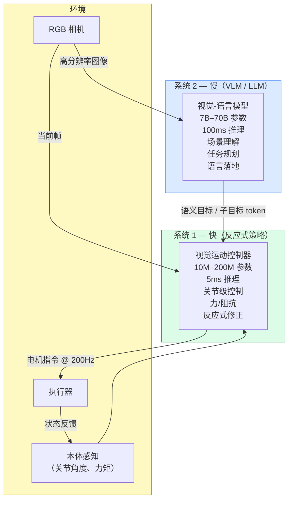
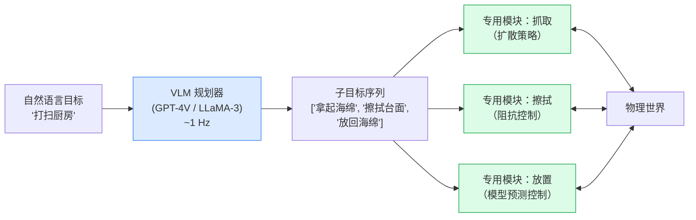

# 通用 vs. 专用机器人策略

> **英文原文：** [cv-knowledge-base/06_robotics_and_embodied_ai/11_generalist_vs_specialist.md](../../cv-knowledge-base/06_robotics_and_embodied_ai/11_generalist_vs_specialist.md)（本中文版供参考，内容以英文原文为准）

> **最后更新：** 2026年10月
> **难度级别：** 研究前沿
> **相关章节：**
> - [../05_multimodal_vision_language/](../05_multimodal_vision_language/) — 支撑 VLA 模型的 VLM 基础
> - [../12_research_frontier_2024_2026/07_future_trends.md](../12_research_frontier_2024_2026/07_future_trends.md) — 前瞻性的具身智能研究议程
> - [../04_3d_vision_and_scene/](../04_3d_vision_and_scene/) — 用于机器人感知的 3D 场景理解
> - [../09_efficiency_and_deployment/](../09_efficiency_and_deployment/) — 与机器人端部署相关的边缘推理

> **🆕 2026年10月更新：**
> - 新的通用派证据：π0.5（未见过的家庭）、**π\*0.6 与 Recap 强化学习**（通用模型 + 基于经验与纠正的任务内强化学习）、Gemini Robotics 1.5 的运动迁移、Generalist AI 的 **GEN-0** 扩展结果，以及 TRI 严谨的**大型行为模型**研究。
> - 新的专用派证据：HIL-SERL（真实世界强化学习 1–2.5 小时后接近完美成功率），以及每个人形机器人技术栈中始终存在的、经专门训练的**全身/平衡层**（作为独立的强化学习控制器，或如 Helix 02 中那样作为学习型的约 1 kHz 系统 0）。
> - 更新双系统谱系：GR00T N1.5 → N1.6 → **N1.7**（3B，Cosmos-Reason2 骨干，EgoScale 人类视频预训练，GEAR-SONIC 全身控制）、运行于 Figure 03 的 Helix → **Helix 02**（三层系统 0/1/2）、Gemini Robotics 2 + ER 2、Galaxea G0、AgiBot GO-1。
> - 新的框架：2025–26 年的共识是**“通用预训练，专用后训练”**——单一基础模型通过微调和强化学习针对每个部署进行专门化——而非任何一个纯粹阵营。
> - 新增关键论文/基准行、开放问题和延伸阅读链接。
> - 新增 2026 年对这一争论最直接的证据：**π0.7**（2026 年 4 月），据报道单个通用模型在叠衣、意式咖啡和纸箱组装任务上即可与经强化学习微调的 π\*0.6 专用模型相当；以及 **Gemini Robotics 2**（2026 年 7 月）的全身控制。Figure 关于 8 小时班次的说法现已标注为公司自报，且未附吞吐量或错误率指标。

---

## 概述

具身智能（Embodied AI）中最深刻的开放争论之一关乎架构：机器人应当由一个在所有可用数据上训练的大型“机器人 GPT”控制，还是由一条模块化管线控制、其中每个专用组件都针对各自的子任务进行优化？这一问题映照着 NLP 中的争论（BERT/GPT 对比集成方法），但带有一个关键的物理转折——机器人必须实时行动、遵守硬性物理约束，并以文本生成器无需面对的方式安全地失败。截至 2026 年 10 月，两大阵营都没有取得决定性胜利，逐渐形成的共识是一种*双系统*或*分层*的混合方案，试图兼取两种范式之长。

2025–26 年的证据将这一共识提炼为一种与 LLM 实践相呼应的配方：**先预训练一个通用模型，再将其专门化**。Physical Intelligence 的 π\*0.6 是一个通用 VLA，并在每个目标任务上通过基于自身部署经验的强化学习进一步提升；Gemini Robotics 和 GR00T 以基础模型形式发布，供针对每种具身进行微调；即便是最通用的人形机器人软件栈，仍依赖一个专门的平衡层：要么是单独经强化学习训练的全身控制器，要么如 Figure 的 Helix 02 那样，是栈内学习得到的约 1 kHz 系统 0。2026 年 4 月，π0.7 则朝另一方向推进：据报道，单个通用模型在 π\*0.6 专用模型自己的任务上即可与之相当 [PI2026]，这表明专用模型的收益可以被重新整合进通用模型。因此，真正的问题与其说是“一个模型还是多个模型？”，不如说是共享预训练与逐任务专门化之间的边界*应当划在哪里*。

本节将这场争论组织为一场思想交锋，综述双方最有力的证据，并介绍目前最受学术界和产业界投资青睐的混合架构。

---

## 通用策略的论据（视觉-语言-动作模型）

### 核心论点

NLP 类比是通用派最有说服力的论点：在互联网规模数据上进行 GPT 式预训练、再进行微调，产生了任何任务特定系统都无法企及的能力。视觉-语言-动作（Vision-Language-Action, VLA）模型试图在机器人领域复制这一路线——在网络图像/视频/文本和机器人示教数据上联合预训练一个大型 Transformer，然后针对具体部署进行微调。

**主要支持者：** Sergey Levine（BAIR/Physical Intelligence）、Chelsea Finn（Stanford/Physical Intelligence）、Pieter Abbeel（UC Berkeley/Covariant）。

### 涌现的跨任务泛化

RT-2 [Zitkovich2023] 证明，一个在互联网数据上预训练的模型，可以借助网络预训练中的语义知识，执行机器人训练中从未见过的新指令——例如拿起一个被描述为“可以当锤子用的东西”的物体。在 6,000 次试验的评测中，RT-2-X（55B 参数，在 Open X-Embodiment 上训练）在涌现技能成功率上比 RT-1-X 提升 3 倍。Open X-Embodiment 数据集 [Collaboration2023] 汇集了来自 33 个学术实验室、22 种不同机器人的示教，涵盖 527 项技能，并表明跨具身训练能带来有意义的迁移：在所有机器人上训练的 RT-1-X，比仅在单一机器人数据上训练的模型提升约 50%。

OpenVLA [Kim2024] 是一个在 Open X-Embodiment 的 970,000 条轨迹上训练的 7B 参数开源 VLA，在 29 个任务上的绝对成功率比 RT-2-X（55B 参数）高 16.5%，表明设计良好的较小通用模型可以击败大得多的闭源系统——呼应了 NLP 中 Chinchilla 的发现：数据效率与规模同样重要。

### 网络预训练作为力量倍增器

核心主张是：互联网规模的预训练赋予机器人常识物理、物体语义和语言落地能力，而这些仅靠机器人数据是不可能编码的。Physical Intelligence 的 π₀ [Black2024] 使用在网络数据上预训练的 PaliGemma-2B 骨干，结合流匹配（flow matching）动作生成，并在涵盖 68 个任务和 7 种机器人配置、超过 10,000 小时的自有示教数据上训练。与仅用机器人数据训练的模型相比，所得模型在新的家务任务上表现出显著更好的泛化能力。

### 新的通用派证据（2025–2026）

- **开放世界泛化。** π0.5 [PI2025] 在网络数据、高层子任务标签和异构多机器人数据上联合训练，在**训练中从未见过的家庭**里完成长时程清洁——这是迄今最清晰的真实世界证明：预训练的广度能换来分布外能力。
- **通用模型 + 强化学习胜过单纯的通用模型。** π\*0.6 [PI2025b]（2025 年 11 月）加入了 **Recap**（RL with Experience & Corrections via Advantage-conditioned Policies，基于经验与纠正、通过优势条件策略的强化学习）：已部署的通用模型从自身的执行轨迹、价值估计和人类纠正中学习。Physical Intelligence 报告称，在高难度任务（制作意式咖啡饮品、折叠各类衣物、组装纸箱）上，Recap **使吞吐量提高一倍以上，失败率大约减半**。这模糊了争论的边界——任务特定的改进是在*没有*任务特定架构的情况下获得的。
- **跨具身技能共享。** Gemini Robotics 1.5 [GeminiRobotics2025] 使用*运动迁移*（Motion Transfer），使在一种机器人（ALOHA）上学到的技能无需逐具身重新训练即可迁移到其他机器人（双臂 Franka、Apptronik Apollo）。
- **工业规模的扩展曲线。** Generalist AI 的 GEN-0 [GeneralistAI2025] 报告了下游误差随约 270,000 小时预训练数据呈幂律改善，并存在一个明显的**约 7B 参数阈值**，低于该阈值的模型无法从更多数据中获益——这是容量与数据必须协同扩展的直接证据（尽管为公司自报）。
- **严谨的多任务证据。** TRI 的大型行为模型研究 [TRI2025] 采用盲评且具备足够统计功效的评测，发现微调后的多任务 LBM 优于单任务策略，并能以少得多的任务特定数据达到同等性能，且随预训练规模平滑提升。TRI 还与 Boston Dynamics 合作，用单个语言条件 LBM 控制电动 Atlas 的全身完成长时程任务（2025 年 8 月）。
- **通用模型比肩自家专用模型。** 据报道，π0.7 [PI2026]（2026 年 4 月；Gemma 3 4B 骨干 + 约 8.6 亿参数动作专家，以子任务指令和子目标图像等更丰富的上下文训练）以单一模型在叠衣、意式咖啡和纸箱组装任务上，即可与针对特定任务、经强化学习微调的 π\*0.6 专用模型相当。它还展现出初步的**组合泛化**：重新组合技能，在没有该机器人叠衣数据的情况下用 UR5e 叠 T 恤，并在极少指导后使用空气炸锅。这是迄今支持通用派的最直接证据。需要注意的是，它在长任务上仍需逐步指导，且没有标准化的外部基准。
- **全身通用模型。** Gemini Robotics 2 [GeminiRobotics2026]（2026 年 7 月）将单一 VLA 从以上半身为主的控制扩展到全身人形控制（在推理的同时行走、下蹲和操作）。配套的 On-Device 2 模型仅需数小时数据即可适配新具身，不过 VLA 与 On-Device 模型仅向早期访问合作伙伴开放。

### 更简洁的端到端设计

从感知到动作的单一可微计算图让梯度贯穿整个系统，在架构上优雅，并免去了人工设计中间表征的需要。整个系统可以在新任务数据上联合微调，而模块化系统则面临“接口工程”问题——一个模块的输出格式必须与下一个模块期望的输入相匹配。

### NLP 的扩展先例

```
观察：在 NLP 中，任务特定模型（逐任务微调的 BERT）
最终被通用的 GPT 式模型所主导。

假设：在数据和规模足够的情况下，机器人策略将沿着
同样的轨迹发展——单个大型策略 θ* 的泛化能力将优于
N 个专用策略 {θ_1, ..., θ_N}。
```

相关的扩展问题（见下文“机器人领域的 Chinchilla 问题”一节）是：考虑到机器人数据采集的物理限制，这一假设是否成立。

---

## 模块化专用系统的论据

### 核心论点

物理系统具有语言 token 所没有的硬约束。一个语法别扭的句子只是不够优雅；一条超出力矩极限的机械臂则会毁掉自己。模块化使每个组件都能被独立验证、约束和替换。

**主要支持者：** Russ Tedrake（MIT/TRI）、Dieter Fox（NVIDIA/UW）、Marc Toussaint（TU Berlin）。

### 物理约束不在 LLM 权重之中

机器人控制需要：

```
关节位置:    q ∈ ℝ^n
关节速度:    q̇ ∈ ℝ^n,  ‖q̇‖ ≤ v_max
关节力矩:    τ = M(q)q̈ + C(q,q̇)q̇ + g(q)
接触力:      λ ∈ K   (摩擦锥约束)
```

这些约束支配着机器人的每一个动作，但它们在基于互联网文本和图像预训练的语言模型的训练分布中根本不存在。使用基于模型的机器人学方法（例如 Drake [Tedrake2019]）设计的专用底层控制器可以对这些量提供硬性保证；而一次 VLA 推理调用则不能。

Marc Toussaint 关于因子化任务与运动规划（task-and-motion planning, TAMP）的工作 [Toussaint2024] 表明，当任务可以分解为结构已知的子问题（几何约束、运动学、逻辑前置条件）时，基于优化的规划器能取得远优于端到端学习策略的样本效率和形式化正确性保证。

### 控制回路延迟与 LLM 推理不相容

高性能机器人控制回路的运行频率为：

| 控制类型 | 典型频率 | 所需延迟 |
|---|---|---|
| 力/阻抗控制 | 1–4 kHz | 0.25–1 ms |
| 关节级伺服 | 250–500 Hz | 2–4 ms |
| 笛卡尔空间控制 | 100–250 Hz | 4–10 ms |
| 任务级规划 | 1–10 Hz | 100–1000 ms |

一次 7B 参数 LLM 推理调用在嵌入式 GPU 硬件上需要 50–200 ms。对于力控制、伺服控制或笛卡尔控制而言，把它放进内层控制回路在物理上是不可能的。这不是可以通过工程手段消除的工程限制——而是反馈控制物理规律的必然结果。快速的扰动抑制（例如有人碰到机器人时不把玻璃杯掉落）需要千赫兹级的反馈，这是任何 LLM 都无法提供的。

### 安全性与可解释性

在制造业和医疗应用中，监管机构或客户可能要求：
- 形式化证明机器人不会到达构型空间中的禁止区域
- 解释为何选择某个具体动作
- 对规划逻辑进行独立审计

模块化管线可以同时支持这三点。而单一神经网络策略在结构上就是不透明的。Russ Tedrake 的 Drake 工具箱提供基于 Lyapunov 的稳定性证书和可达性分析，但只有当控制系统与感知系统相互分离时它们才有意义。一旦两者融合进同一个网络，控制理论的数学工具便无法适用。

### 样本效率

在新任务上从头训练 VLA 通常需要数千到数万条示教。专用方法（模仿学习 + 基于模型的精调）通常只需 50–200 条示教即可达到专家水平。对于机器人数据采集昂贵或危险的场所（例如手术室、核环境），这并非微不足道的学术区别。

### 新的专用派证据（2025–2026）

- **真实世界强化学习专用策略。** HIL-SERL [Luo2025]（Science Robotics 2025）直接在真实机器人上通过人在回路强化学习训练任务特定的视觉策略，在精密、动态和双臂任务（如装配、插接、翻转）上**仅经过 1–2.5 小时训练即可达到接近完美的成功率和快速的节拍**——优于使用多得多数据训练的模仿学习基线。对于工厂工位中已知且固定的任务，这仍是通往可靠性的最具样本效率的路径。
- **全身控制仍需专门化。** 在 2025 年，每一个已部署的人形 VLA 都建立在单独训练的强化学习运动/全身控制器之上（例如随 GR00T N1.7 发布的 NVIDIA GEAR-SONIC 控制器 [NVIDIA2026]）。2026 年，Figure 的 Helix 02 [Figure2026] 将平衡纳入单一学习型系统，但这是通过一个专门的约 1 kHz **系统 0** 实现的，该层单独在人类运动数据和仿真到真实强化学习上训练。Gemini Robotics 2 同样控制全身。因此，专门化并未消失，而是转移到了技术栈*内部*：千赫兹级的平衡回路仍是一个独立的、经专门训练的层。
- **部署中的可靠性差距。** 通用模型的演示强调广度，而商业部署（物流周转箱搬运、工厂零件上料）则是狭窄、重复的，以在线率和吞吐量来衡量——在这些指标上交出成绩的是经过调优的专用系统和经过大量后训练的通用模型，而非零样本通用模型。

---

## 混合中间路线：双系统与分层架构

2024–2026 年吸引最多工程投入的架构是混合架构：把快速、安全攸关、物理落地的计算分配给专用模块，把缓慢、语言落地的语义推理分配给大模型。

### 双系统架构

受认知科学中 Kahneman 的系统 1 / 系统 2 框架启发：



### 已部署的双系统实现

**GR00T N1** [NVIDIA2025]：2025 年 3 月发布。系统 2 是一个 1.34B 参数的 VLM；系统 1 是一个快速反应式策略。总参数量 2.2B。在 L40 GPU 上采样 16 个动作耗时 63.9 ms。在 Fourier GR-1 和 1X 人形机器人具身上、以 780,000 条合成 + 真实轨迹训练。在多种具身的仿真基准上优于最先进的模仿学习基线。

**Helix** [Figure2025]：由 Figure AI 开发，2025 年 2 月发布。系统 2 是一个以 7–9 Hz 运行的 7B 参数 VLM；系统 1 是一个以 200 Hz 运行的 80M 参数视觉运动控制器。两者都运行在机载嵌入式 GPU 上，不依赖云端。Helix 控制的是上半身。对于其后继者 Helix 02，Figure 声称可完成 8 小时无干预班次，但尚未公布吞吐量或错误率指标。

**π₀** [Black2024]：Physical Intelligence 的通用策略以流匹配（连续归一化流）作为动作头，以 PaliGemma 作为语言骨干。π₀-FAST [PhysicalIntelligence2024] 进一步使用 DCT 空间（FAST）分词加速动作生成，实现动作序列 7 倍压缩和 5 倍训练收敛加速。

**后继系统（2025–2026）。** 双系统模式已成为默认的工业架构：

- **GR00T N1.5 → N1.6 → N1.7** [NVIDIA2026]：N1.5（2025 年年中）冻结 VLM 以保持语言落地能力；N1.6 使用基于 Eagle 的 VLM 和 32 层 DiT 动作头；**N1.7**（2026，正式版（GA）发布，3B 参数）换用推理型 VLM **Cosmos-Reason2-2B**（Qwen3-VL 架构）作为系统 2，将 DiT 头减半至 16 层，采用**机器人与人类数据共享的相对末端执行器动作空间**，在约 20K 小时 EgoScale 人类视频上预训练，将动作时域从 16 步扩展到 40 步、状态/动作维度从 29 扩展到 132，并可导出为 TensorRT 以部署在 Jetson 级硬件上。
- **运行于 Figure 03 的 Helix** [Figure2025]：Figure 的第三代人形机器人（2025 年 10 月）围绕 Helix 设计，重新设计的相机系统和触觉指尖为系统 1 提供输入。
- **Helix 02** [Figure2026]（2026 年 1 月下旬）：Figure 03 上统一感知、平衡、运动与操作的单一学习型系统，分为三层。系统 2 负责语义推理，系统 1 以高频将感知转化为全身运动，新增的系统 0 以约 1 kHz 运行，负责平衡与协调。其旗舰演示是约 4 分钟的自主洗碗机卸载与装载。
- **π0.5 / π0.6** [PI2025]：不是两个独立网络，而是单个 VLA 先解码高层子任务（慢、离散），再通过流匹配动作专家解码动作块（快、连续），并采用*知识隔离*（knowledge insulation）训练，使动作专家的梯度不会损害 VLM。
- **Gemini Robotics 1.5 + ER 1.5** [GeminiRobotics2025]：一个显式的双模型系统，由具身推理 VLM 编排一个“思考型”VLA（见[语言条件控制](./10_language_conditioned_control.md)）。
- **Gemini Robotics 2 + ER 2** [GeminiRobotics2026]（2026 年 7 月）：沿用相同的双模型划分，但执行器换成了全身 VLA，规划器 ER 2（可在 Google AI Studio 中使用）被 Google 评为其在 ASIMOV-2 上最安全的机器人模型，并在新的 ASIMOV-Agentic 基准上接受评测。
- **π0.7** [PI2026]（2026 年 4 月）：延续 π0.5 的单网络设计，但提示中包含子任务指令和子目标图像，因此慢速的“规划”信号可以来自人类指导者或更高层的模型。
- **Galaxea G0** 与 **AgiBot GO-1**（2025）：在单一厂商机队数据上训练的中国开放双系统/潜在规划器 VLA（见[机器人数据与遥操作](./09_robot_data_and_teleoperation.md)）。

### 分层控制

另一种框架把大模型视为任务规划器，将目标分解为子目标，每个子目标由一个专用模块执行：



在这一框架中，LLM 明确地*不是*运动控制器——它是语言与经过验证的专用技能库之间的接口。Toussaint 的因子化 TAMP [Toussaint2024] 将其形式化为任务模式变量上的因子图，每种模式由专用控制器处理。

---

## 机器人领域的 Chinchilla 问题

NLP 社区的“Chinchilla”发现 [Hoffmann2022] 表明，大多数大语言模型相对其参数量而言明显*训练不足*——最优算力分配需要比实际使用多得多的数据。这为机器人领域提出了关键的扩展问题：

> **机器人策略是否遵循 LLM 式扩展定律？如果是，最优的数据-参数比是多少？**

**机器人数据扩展定律的支持证据：**
- RT-1-X → RT-2-X：加入跨具身预训练后，在留出任务上的成功率提升约 50% [Collaboration2023]
- OpenVLA 使用比 RT-2 微调数据多 10 倍的数据训练，以少 7 倍的参数取得了更好的泛化 [Kim2024]
- Generalist AI 的 GEN-0 报告了机器人操作领域首批经验扩展曲线，训练数据为来自数以千计真实环境的 270,000 小时数据 [GeneralistAI2025]；它还报告了在大量预训练下低于约 7B 参数的模型会出现“僵化”，即扩展规律成立需要最低容量
- NVIDIA 的 EgoScale 发现第一人称人类视频小时数（最高约 20.8k 小时）与验证损失之间存在对数线性规律，且该损失可预测真实机器人成功率 [EgoScale2026]
- Physical Intelligence 发现，*从人类视频中学习的能力*只有在机器人预训练足够大且足够多样时才会出现——这是一种依赖规模的质变能力，而非平滑增益 [PI2025H2R]

**反面证据（“机器人数据不一样”论点）：**

```
LLM 数据特征：
  来源：互联网文本（可爬取、免费、近乎无限）
  采集成本：每 token 约 $0
  多样性：人类全部书面知识
  规模：可获得约 10^13 个 token

机器人数据特征：
  来源：物理机器人示教（需要硬件 + 时间）
  采集成本：每条轨迹约 $1–100
  多样性：受限于实验室环境和机器人形态
  规模：可获得约 10^7 条轨迹（Open X-Embodiment 约 10^6）
```

结论是：机器人策略*确实*随数据呈现扩展改进，但其数据上限比 LLM 低几个数量级。这使得通用 vs. 专用问题从根本上变成了如何分配稀缺数据的问题——而这是单纯的扩展无法解决的。

**2026 年对反方论点的更新。** 数据上限的提升速度超出预期：专有语料达到约 10⁵ 小时（GEN-0），开放机队语料超过 10⁶ 条轨迹（AgiBot World），带动作标签的人类视频又以低得多的每小时成本增加了约 10⁴ 小时（EgoScale）。与 LLM 规模数据之间的差距仍有几个数量级，但机器人数据这一侧如今在单家公司就以每周 >10⁴ 小时的速度增长——这使举证责任在*预训练*方面转向了通用派，而逐任务的可靠性仍交由专门化解决。

**仿真作为部分解决方案：** Genesis [Genesis2024]（单张 RTX 4090 上 43M FPS，比实时快 430,000 倍）和 Isaac Lab [NVIDIA2024] 试图通过生成合成轨迹来弥合数据缺口。NVIDIA 在 11 小时内生成了 780,000 条合成轨迹（相当于 9 个月的人类示教）用于 GR00T N1 训练，使性能比仅用真实数据训练提升 40% [NVIDIA2025]。

---

## 关键论文

| 论文 | 作者 | 年份 | 会议/期刊 | 主要贡献 |
|---|---|---|---|---|
| RT-2: Vision-Language-Action Models Transfer Web Knowledge | Zitkovich et al. (Google DeepMind) | 2023 | CoRL | 首个大规模 VLA；网络预训练 → 机器人涌现技能；6,000 次试验评测 |
| Open X-Embodiment: Robotic Learning Datasets and RT-X Models | Open X-Embodiment Collaboration (33 institutions) | 2023 | CoRL Workshop / ICRA 2024 | 22 种机器人、527 项技能，跨具身扩展规律；RT-1-X +50% |
| OpenVLA: An Open-Source Vision-Language-Action Model | Kim, Pertsch, Karamcheti et al. | 2024 | arXiv / CoRL 2024 | 基于 OXE 的 7B VLA；以少 7 倍的参数超越 RT-2-X（55B）16.5% |
| π₀: A Vision-Language-Action Flow Model for General Robot Control | Black, Brown, Driess, Finn, Levine et al. | 2024 | arXiv | 流匹配动作头；68 个任务、7 种机器人配置；10k+ 小时示教 |
| GR00T N1: An Open Foundation Model for Generalist Humanoid Robots | NVIDIA Research (Fox et al.) | 2025 | arXiv | 双系统 2.2B VLA；780k 条合成轨迹；L40 上 63.9 ms 推理 |
| Octo: An Open-Source Generalist Robot Policy | Ghosh et al. (Berkeley, Stanford, CMU, Google DeepMind) | 2024 | RSS 2024 | 93M Transformer-扩散策略；800k 个回合；模块化观测头 |
| Factored Task and Motion Planning with Combined Optimization, Sampling and Learning | Toussaint et al. | 2024 | ICRA 2024 | 因子图 TAMP；每个逻辑模式配专用控制器；形式化保证 |
| Helix: A Vision-Language-Action Model for Generalist Humanoid Control | Figure AI | 2025 | 技术报告 | 7B 系统 2 + 80M 系统 1；200 Hz 反应式；无需云端；控制上半身 |
| π0.5: a Vision-Language-Action Model with Open-World Generalization | Physical Intelligence | 2025 | CoRL 2025 | 模型内分层推理 + 联合训练；在未见过的家庭中完成长时程任务 |
| π\*0.6: a VLA That Learns From Experience (Recap) | Physical Intelligence | 2025 | 技术报告 | 基于部署经验 + 纠正的优势条件强化学习；高难度任务吞吐量 >2× |
| Gemini Robotics 1.5 | Gemini Robotics Team (Google DeepMind) | 2025 | 技术报告 | 具身推理编排器 + 思考型 VLA；跨具身运动迁移 |
| A Careful Examination of Large Behavior Models for Multitask Dexterous Manipulation | TRI LBM Team | 2025 | arXiv:2507.05331 | 盲评、具备统计功效的评测；预训练降低任务数据需求 |
| HIL-SERL: Precise and Dexterous Robotic Manipulation via Human-in-the-Loop RL | Luo, Xu, Wu, Levine | 2024 | Science Robotics 2025 | 真实世界强化学习专用策略：1–2.5 小时内接近完美成功率 |
| GEN-0: Embodied Foundation Models That Scale with Physical Interaction | Generalist AI | 2025 | 技术博客 | 270k 小时预训练；数据幂律；约 7B 容量阈值 |
| GR00T N1.7 | NVIDIA | 2026 | 开放模型发布 | 3B；Cosmos-Reason2 作为系统 2；人类视频预训练；GEAR-SONIC 全身控制 |
| Helix 02 | Figure AI | 2026 | 公司博客 | 三层系统 0/1/2；学习型约 1 kHz 平衡层；Figure 03 上的全身控制 |
| π0.7: a Steerable Generalist Robotic Foundation Model | Physical Intelligence | 2026 | arXiv:2604.15483 | 单个通用模型 ≈ 经强化学习微调的 π\*0.6 专用模型；初步的组合泛化 |
| Gemini Robotics 2 / ER 2 / On-Device 2 | Google DeepMind | 2026 | DeepMind 博客 + 模型卡 | 全身人形 VLA；ER 2 规划器；On-Device 2 仅需数小时数据即可适配新具身 |

---

## 基准性能

| 模型 | 数据集 / 评测 | 指标 | 分数 | 备注 |
|---|---|---|---|---|
| RT-2-X (55B) | Open X-Embodiment 涌现任务 | 成功率 | 涌现任务约 62% | 6,000 次试验；涌现 = 出现在 LLM 预训练中而非机器人数据中的任务 |
| RT-1-X | Open X-Embodiment | 成功率 | 相对单机器人 RT-1 约提升 50% | 跨具身训练 |
| OpenVLA (7B) | 29 个任务，多种具身 | 绝对成功率 | 比 RT-2-X 高 16.5% | 7B vs. 55B；BridgeData V2 与 Google Robot |
| Octo-Base (93M) | 语言条件操作 | 对比 RT-2-X | 语言任务上相当 | 800k 训练回合 |
| GR00T N1 (2.2B) | Fourier GR-1 + 1X 人形任务 | 对比 SOTA 模仿学习 | 在仿真基准上超越 SOTA | 加入合成数据带来 40% 提升 |
| π₀ | 9 个基准类别，5 种具身 | 任务完成度 | 在可变形物体 + 长时程操作上达到最先进水平 | 流匹配；10k+ 小时示教 |
| Helix / Helix 02 (Figure AI) | 工厂与家务操作 | 部署 | 声称可完成 8 小时班次 | 公司声明；未公布吞吐量或错误率指标；Helix 02 演示：约 4 分钟的自主洗碗机任务 |
| π\*0.6 + Recap | 意式咖啡、叠衣服、组装纸箱 | 吞吐量 / 失败率 | >2× / 约 ½ | 公司自报；通用模型 + 任务强化学习 [PI2025b] |
| HIL-SERL | 真实世界精密/动态任务 | 训练 1–2.5 小时后的成功率 | 接近完美 | 任务特定强化学习专用策略 [Luo2025] |
| π0.7（单个通用模型） | 叠衣服、意式咖啡、组装纸箱 | 相对专用模型的任务性能 | ≈ 经强化学习微调的 π\*0.6 专用模型 | 公司自报；无标准化外部基准 [PI2026] |
| GEN-0 | 真实世界下游任务 | 后训练误差 vs 数据量 | 幂律；需要 ≥7B | 公司自报 [GeneralistAI2025] |
| AgiBot GO-1 | AgiBot World 任务 | 相对 OXE 预训练的平均性能 | 约 +30% | 机队数据 vs 汇聚数据 [AgiBot2025] |

---

## 优缺点

| 方面 | 通用 VLA 的优点 | 专用/模块化的优点 |
|---|---|---|
| **泛化** | 借助网络预训练零样本泛化到新物体和语言指令；涌现的跨任务迁移 [Zitkovich2023]；初步的组合泛化（π0.7） | 在任务领域内可证明的性能保证；不受领域外指令带来的分布偏移影响 |
| **数据效率** | 在所有任务间摊销数据成本；预训练降低逐任务微调需求 | 每个任务仅需约 50–200 条示教；对已知任务样本效率提升 100 倍 |
| **控制延迟** | 双系统架构的快速通路可达 5–10 ms；完整速度的 LLM 调用需 50–200 ms，与 kHz 力控制不相容 | 基于模型的专用控制器以 1–4 kHz 运行并具有硬实时保证；可与实时操作系统调度器组合 |
| **安全性 / 可验证性** | 黑盒神经网络；无形式化稳定性证书；可解释性研究仍在进行 | 可应用 Lyapunov 函数、可达性分析、形式化验证（Drake）；可接受监管审计 |
| **维护 / 可扩展性** | 单一模型针对新任务微调；无需接口工程 | 新任务需要新的专用模块和接口规范；随任务数量组合爆炸 |
| **失败模式** | 幻觉出物理上不可能的动作；能否平稳退化尚不明确 | 在任务边界处脆弱；超出训练范围后性能断崖式下降 |

---

## 开放问题与研究空白

1. **在不损失通用性的情况下弥合控制频率差距。** 双系统模型中 5 ms 系统 1 / 100 ms 系统 2 的划分仍是务实的工程权宜之计，而非有原则的解决方案。能否让系统 2 足够准确地预测物理状态，使系统 1 无需重新查询即可外推跨越整个 100 ms 间隔？量化多步外推中的误差累积是一个开放研究问题。Helix 02 学习得到的约 1 kHz 系统 0 是产业界首次尝试用学习型层而非经典控制器来弥合这一差距，但尚未公布任何指标。

2. **机器人 Chinchilla 问题。** 目前尚无工作为机器人策略推导出有原则的最优算力分配曲线，即“给定 N 条真实示教和 M 小时仿真，最优策略规模是多少？”。由于数据上限效应，将 Chinchilla 方法应用于机器人数据，很可能会得出性质上不同的结果。

3. **学习策略中的接触物理。** 当前的 VLA 从示教中学习隐式接触模型，在新的接触构型下会灾难性失败。将可微接触仿真（如 MJX、Drake）嵌入 VLA 的内层回路，或提供感知接触的辅助损失，在很大程度上尚未被探索。

4. **从自然语言得到形式化安全规范。** 给定一条自然语言安全约束（“在人附近移动速度不得超过 0.5 m/s”），如何可靠地将其转换为在系统 1 层面强制执行的形式化约束仍是开放问题。基于 LTL 的转换方法 [FormalMethods2026] 显示出前景，但尚未在大规模上得到验证。

5. **跨形态迁移。** Open X-Embodiment 表明在多样具身上训练有帮助，但迁移机制仍知之甚少。如果能从理论上解释*为何*在 6 自由度机械臂上训练的策略可以迁移到 16 自由度人形机器人，就能制定有原则的数据混合策略。

6. **利用互联网视频的样本效率。** 人类互联网视频（Ego4D、HowTo100M）包含大量与任务相关的操作行为，但缺少动作标签。动作标签问题——从无标签视频中恢复机器人可执行的动作——是扩展机器人数据的核心瓶颈之一。潜在动作预训练（Latent Action Pre-Training, LAPT）[LAPT2024] 是一个有前景的方向，但尚未被证明能达到监督示教的质量。

7. **评估泛化 vs. 记忆。** 当前基准把零样本泛化与在网络预训练数据中出现过的任务上的表现混为一谈。需要一个在可验证地不存在于网络训练分布中的任务上进行测试的干净基准，才能使 VLA 泛化论证变得严谨。

8. **专门化边界应划在何处。** “通用预训练、专用后训练”（π\*0.6 Recap、逐具身的 GR00T 微调）如今已成为标准做法，但关于任务特定的强化学习或微调会在多大程度上侵蚀通用性（灾难性遗忘），以及如何将后训练收益回馈到基础模型中，仍缺乏理论。π0.7 据报道与 π\*0.6 专用模型相当，这是此类收益可被通用模型吸收的第一个数据点，但它是公司自报的。

9. **可复现的真实世界比较。** 2025–26 年的许多通用派主张（GEN-0 扩展、Recap 吞吐量、π0.7 与专用模型相当、Helix / Helix 02 班次时长）均为公司自报。盲评且具备统计功效的评测协议（TRI LBM、RoboArena）已经存在，但尚未被用于发布头条结果。

10. **通用与专用之间的蒸馏。** 能否将通用模型蒸馏为紧凑、可验证的专用控制器，用于安全攸关的工位？反过来，能否在不损失可靠性的前提下，将专用的强化学习策略（HIL-SERL）吸收进通用模型？

---

## 延伸阅读

- [RT-2 论文 (CoRL 2023)](https://proceedings.mlr.press/v229/zitkovich23a/zitkovich23a.pdf) — 最初的 VLA 论文，含 6,000 次试验评测
- [Open X-Embodiment arXiv](https://arxiv.org/abs/2310.08864) — 跨具身数据集与 RT-X 扩展结果
- [OpenVLA arXiv](https://arxiv.org/abs/2406.09246) — 超越 RT-2-X 的开源 7B VLA
- [GR00T N1 arXiv](https://arxiv.org/abs/2503.14734) — NVIDIA 的双系统人形机器人基础模型
- [π₀ arXiv](https://arxiv.org/html/2410.24164v1) — Physical Intelligence 的流匹配 VLA
- [Russ Tedrake 的 Underactuated Robotics 课程](https://underactuated.csail.mit.edu/) — 基于模型的机器人控制理论的经典参考
- [π0.5 arXiv](https://arxiv.org/abs/2504.16054) — 通过联合训练和分层推理实现开放世界泛化
- [π\*0.6 / Recap（Physical Intelligence 博客）](https://www.pi.website/blog/pistar06) — 通过基于部署经验的强化学习改进的通用 VLA
- [Gemini Robotics 1.5 arXiv](https://arxiv.org/abs/2510.03342) — 具身推理编排器 + 思考型 VLA
- [TRI Large Behavior Models arXiv](https://arxiv.org/abs/2507.05331) — 对 LBM 的严谨多任务评测
- [HIL-SERL arXiv](https://arxiv.org/abs/2410.21845) — 真实世界人在回路强化学习专用策略
- [GEN-0（Generalist AI）](https://generalistai.com/blog/nov-04-2025-GEN-0) — 基于 270k 小时真实世界数据的机器人扩展定律
- [Isaac GR00T (GitHub)](https://github.com/NVIDIA/Isaac-GR00T) — GR00T N1.x 开放人形机器人基础模型
- [π0.7 arXiv](https://arxiv.org/abs/2604.15483) — 据报道可与 π\*0.6 专用模型相当的可引导通用模型
- [Gemini Robotics 2（DeepMind 博客）](https://deepmind.google/blog/gemini-robotics-2-brings-whole-body-intelligence-to-robots/) — 全身 VLA、ER 2 与 On-Device 2
- [Figure Helix 02](https://figure.ai/news/helix-02) — 三层全身人形控制
