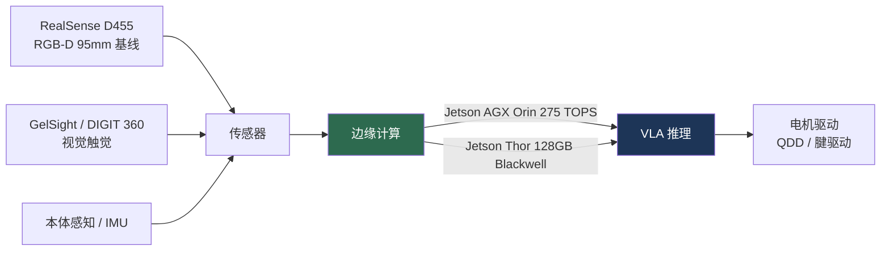

# 硬件与机器人平台

> **英文原文：** [cv-knowledge-base/06_robotics_and_embodied_ai/12_hardware_robot_platforms.md](../../cv-knowledge-base/06_robotics_and_embodied_ai/12_hardware_robot_platforms.md)（本中文版供参考，内容以英文原文为准）

> **最后更新：** 2026年10月
> **难度级别：** 高级
> **相关章节：**
> - [具身智能概述与路线图](./00_overview_roadmap.md)
> - [机器人感知](./08_perception_for_robotics.md)
> - [VLA 模型](./01_vla_models.md)
> - [优缺点与路线图](./07_pros_cons_roadmaps.md)

> **🆕 2026年10月更新：**
> - 新平台：**Figure 03**（2025 年 10 月，为 Helix 和家庭场景打造；BotQ 工厂）、**宇树 H2** 与低价的**宇树 R1**、CES 2026 上展示的 **Boston Dynamics 电动 Atlas** 产品版、**优必选（UBTech）Walker S2**（自主换电）；更新了 Figure 02（试点结束后从 BMW 退役）、**1X NEO**（2025 年 10 月开放消费者预订，\$20k 或 \$499/月）以及 **Tesla Optimus**（2026 年 1 月宣布改造 Fremont 产线）的状态。
> - 新增**产业现状、融资与资本市场**一节：Figure 的 \$39B C 轮、Physical Intelligence 与 Skild AI 的融资、Apptronik 的 \$403M A 轮、宇树的科创板 IPO 进程、智元收购上市公司、现代汽车的 Atlas 部署计划。
> - 计算：Jetson Thor 全面上市（2025 年 8 月）以及端侧 VLA（Gemini Robotics On-Device 与 On-Device 2；可导出 TensorRT 的 GR00T N1.7）。
> - 新的开放问题：供应链风险（稀土磁体）、家用机器人中的遥操作辅助自主与隐私、人形机器人安全标准。
> - 新增 2026 年在这些本体上实现的全身控制里程碑：Figure 03 上的 **Helix 02**（2026 年 1 月；以单一学习型 System 0/1/2 技术栈完成平衡、运动与操作，其中 System 0 约 1 kHz），以及 **Gemini Robotics 2** 全身人形控制和 On-Device 2（2026 年 7 月，早期访问）。另补充了 Physical Intelligence 的 \$600M B 轮（估值 \$5.6B，2025 年 11 月），以及据报道 2026 年 3 月估值超过 \$11B 的融资洽谈。

---

## 概述

2024–2026 年的具身智能热潮，既是算法的故事，也同样是硬件的故事。低成本执行器、强大的边缘计算（Jetson Thor）与视觉-语言-动作模型的融合，催生了一波前所未有的人形机器人和机械臂平台浪潮，正从实验室里的新奇事物走向工厂试点。本文梳理本章其他部分所讨论的策略实际运行于其上的硬件基座，给出经核实的规格参数并明确标注信息披露的可信度——这是一种必要的规范，因为行业媒体中的大量“规格”数据来自厂商营销或第三方估计，而非公开发布的数据手册。

三大硬件趋势占据主导。第一，**转向电动准直驱（quasi-direct-drive, QDD）驱动**，以牺牲峰值力矩换取可反向驱动性、抗冲击性和透明的力控制——这些特性对接触丰富的操作和与人近距离安全协作至关重要。第二，**灵巧多指手**（16–24 自由度）正成为标配，因为 VLA 的灵巧性前沿（叠衣服、铰接物体操作）需要它们。第三，**边缘计算正追上模型规模**：NVIDIA 的 Jetson Thor（128 GB，Blackwell，最高约 2,070 FP4 TFLOPS）使数十亿参数的双系统 VLA 能够在机器人端推理，打通了 [VLA 模型](./01_vla_models.md)中的模型与执行它们的本体之间的闭环。

一个反复出现的主题是**披露差距**：研究级平台（宇树、Franka、Universal Robots）发布完整的数据手册，而旗舰人形机器人（Boston Dynamics 电动 Atlas、Figure 02、Apptronik Apollo）则以保密协议（NDA）为由隐藏关键规格——总自由度、价格、执行器细节。以下规格均据此加以标注。

从 2025 年末开始，故事的主线从*原型机*转向了*产能与资本*：Figure 启用了 BotQ 工厂并发布 Figure 03，Boston Dynamics 展示了带有现代汽车部署计划的产品版 Atlas，1X 开放了 NEO 的消费者预订，Tesla 宣布将 Fremont 的整车产能改造用于 Optimus，而中国厂商（宇树、优必选、智元）正走向或已进入公开股票市场。然而，真实部署仍停留在试点阶段，每个场地的数量只有数十台到一两百台。在软件方面，2026 年为这些本体带来了学习型的**全身**控制：Figure 03 上的 Figure Helix 02（1 月）和 Google DeepMind 的 Gemini Robotics 2（7 月）都以单一学习型技术栈完成行走、平衡与操作，而不是在独立的运动控制器之上叠加一个上半身 VLA。

---

## 人形机器人平台

| 机器人 | 身高 | 体重 | 自由度 | 负载 | 速度 | 价格 | 状态（2025–26） |
|-------|--------|--------|-----|---------|-------|-------|------------------|
| Figure 02 | 168 cm | 70 kg | NDA（每只手 16） | 25 kg | 1.2 m/s | 约 \$150k（估计） | BMW Spartanburg 试点已完成；2025 年 11 月退役 |
| Figure 03 | NDA | 比 F.02 轻约 9% | NDA（触觉指尖） | NDA | NDA | NDA | 2025 年 10 月发布；BotQ 生产；家庭 + 商用；运行 Helix 02（2026 年 1 月） |
| Tesla Optimus Gen 2 / V2.5 | 173 cm | 57 kg | 身体 28+，每只手 11–22 | 20 kg | 约 2.2 m/s | 目标约 \$20–30k | Tesla 内部试点；2026 年 1 月宣布 V3 与 Fremont 产线 |
| 宇树 G1 | 127 cm | 35 kg | 43（含手） | 2–3 kg | 2 m/s | \$13.5k–\$73.9k | 量产（2025 年 5,500+ 台） |
| 宇树 H1 | 180 cm | 47 kg | 19（H1-2：27） | 30 kg | 3.3 m/s | \$99.9k | 研究 / 在售 |
| 宇树 H2 | 180 cm | 70 kg | 31（身体） | NDA | NDA | NDA | 2025 年 10 月发布 |
| 宇树 R1 | 约 121 cm（据报道） | 约 25 kg | 26 | NDA | NDA | ¥39,900 起（约 \$5.9k） | 2025 年 7 月发布；最低价的完整人形机器人 |
| Boston Dynamics Atlas（电动） | 约 150 cm（估计） | 约 89 kg（估计） | NDA | NDA | NDA | 不出售 | 现代汽车 / Google DeepMind |
| Boston Dynamics Atlas（产品版，CES 2026） | NDA | NDA | 56（据报道） | 约 50 kg 举重能力（据报道） | NDA | 未披露 | 计划自 2028 年起部署于现代汽车 Metaplant |
| 优必选 Walker S2 | 约 176 cm（据报道） | NDA | 52（据报道） | 15 kg（据报道） | NDA | NDA | 自主换电；在中国开展工厂试点 |
| Agility Digit v5 | 175 cm | 76 kg | 16+ | 16 kg | 1.5 m/s | 约 \$250k | GXO 仓库（100k+ 周转箱） |
| Apptronik Apollo | 173 cm | 72.5 kg | NDA | 25 kg | NDA | NDA | 工厂试点；Gemini Robotics 2 全身演示（Apollo 2，2026 年 7 月） |
| Sanctuary Phoenix（第 7 代） | 170 cm | 70 kg | NDA（每只手 20–21） | 25 kg | NDA | 约 \$65k（估计） | 零售 / 制造试点 |
| 傅利叶 GR-2 | 175 cm | 65 kg | 53（每只手 12） | 每臂 3 kg | NDA | 约 \$150k+ | 研究 / 企业 |
| 1X NEO | 约 168 cm | 约 30 kg | 75（每只手 22） | 约 25 kg 搬运 | 1.4 m/s | \$20k / \$499 每月 | 2025 年 10 月开放消费者预订；2026 年在美国交付 |

**Figure 02** [FigureAI2024] 运行 **Helix** VLA（7–9 Hz 的系统 2 VLM + 200 Hz 的系统 1 运动策略，上半身 35 自由度），并在为期 10 个月的 Spartanburg 试点中协助生产了 30,000 余辆 BMW X3——这是迄今被引用最多的真实世界人形机器人部署。**Tesla Optimus Gen 2**（57 kg，明显轻于第一代的约 73 kg，11 个指尖触觉传感器，定制执行器）在内部用于电芯分拣；Tesla 的目标是规模化后约 \$20–30k，但尚未确定面向消费者的价格。**宇树 G1**（基础版 \$13.5k）是最容易获得的研究用人形机器人，也是事实上的学术标准，2025 年出货 5,500 余台；**H1** 保持着全尺寸电动人形机器人最快速度的吉尼斯纪录（3.3 m/s）。**Agility Digit** 是首个从事全职商业工作的人形机器人（在 GXO 仓库搬运 100,000 余个周转箱），但有意设计为低灵巧度——专为物流而非操作打造。**1X NEO** 格外轻巧（约 30 kg），采用专利**腱驱动**（tendon-drive）执行器（约 22 dB，头部损伤标准 < 250）以保证家用安全，并搭载 **Jetson Thor**。

> ⚠️ Boston Dynamics 尚未发布电动 Atlas 的官方规格表；上表中的身高/体重/自由度数据为第三方估计。已确认：关节可超出人体活动范围旋转（髋/腰/颈 360°）；已向现代汽车的 RMAC 承诺供应机队，并与 Google DeepMind 建立合作。

### 新平台与状态变化（2025 年 10 月 – 2026 年）

**Figure 03** [Figure2025F03]（2025 年 10 月 9 日发布）是首款明确围绕 VLA 协同设计的旗舰人形机器人。Figure 表示，与 Figure 02 相比，新相机系统每个相机的帧率约提高一倍、延迟降至约四分之一、视场角宽约 60%；每只手新增一个掌心相机，指尖触觉传感器可分辨几克量级的力——这些感知输入直接服务于 Helix 的系统 1。其他改动面向家庭场景：柔软、可清洗的织物外壳，质量比 F.02 低约 9%，以及通过脚部线圈实现的 **2 kW 无线感应充电**，使机器人能自主停靠充电。Figure 的 **BotQ** 工厂初期设计产能约为每年 12,000 台人形机器人，并提出四年内生产 100,000 台的目标。Figure 于 2025 年 11 月报告，其 Figure 02 机队在 BMW Spartanburg 部署结束后已退役；部署期间，这些机器人参与生产班次，上料超过 90,000 个钣金件，并为 30,000 余辆 X3 的生产作出贡献（公司自报）。

**Figure 03 上的 Helix 02** [Figure2026]（2026 年 1 月下旬）是 Figure 首个用到 Figure 03 全身的软件版本。它是一个统一感知、平衡、运动与操作的单一学习型系统，分为三层：System 2 负责语义推理，System 1 以高频将感知转化为全身运动，新增的 **System 0** 以约 1 kHz 运行，负责平衡与协调。约 1 kHz 的回路是一项与硬件相关的变化：平衡如今作为学习型控制器以这一频率运行，而该频率以往只属于经典的关节级控制。Figure 的旗舰演示是约 4 分钟的自主洗碗机卸载与装载，公司声称可完成 8 小时无干预班次，但尚未公布吞吐量或错误率指标。

**人形机器人上的 Gemini Robotics 2。** Google DeepMind 的 Gemini Robotics 2（2026 年 7 月 30 日）从以上半身为主的控制转向**全身人形控制**：它可以在推理的同时行走、下蹲和操作，并在 Apptronik 的 Apollo 2 上进行了演示。配套的 **Gemini Robotics On-Device 2** 在机器人本地运行，仅需数小时数据即可适配新的具身形态。这两个模型仅向早期访问合作伙伴开放，而 ER 2 规划器可在 Google AI Studio 中使用 [GeminiRobotics2026]。

**Boston Dynamics Atlas（产品版）。** 在 CES 2026（2026 年 1 月）上，现代汽车与 Boston Dynamics 展示了面向量产的电动 Atlas：现代汽车表示计划自 2028 年起将其部署在佐治亚州 Metaplant 工厂，并在美国建设机器人制造产能；Boston Dynamics 则确认与 Google DeepMind 合作，将 Gemini Robotics 模型引入 Atlas。发布会相关报道称其拥有 56 个自由度、约 50 kg 的举重能力和可自主更换的电池；截至撰写本文时，Boston Dynamics 仍未发布完整的数据手册。另外，Boston Dynamics 与 TRI 展示了用单个语言条件的**大型行为模型**驱动 Atlas 全身完成长时程任务（2025 年 8 月；见[通用 vs. 专用](./11_generalist_vs_specialist.md)）。

**1X NEO** 于 2025 年 10 月 28 日开放消费者预订，售价 \$20,000（或 \$499/月订阅），计划 2026 年在美国交付。1X 明确表示 NEO 在上市时并非完全自主：**“专家模式”（Expert Mode）**允许 1X 的操作员（在用户同意下）对机器人进行遥操作，以完成其 Redwood AI 模型尚无法完成的任务，这既用于提供服务，也用于采集训练数据——相当于自动驾驶中安全员模式在家用机器人上的对应物。

**Tesla Optimus。** Tesla 在 2025 年展示了 Optimus “V2.5”，但未能实现其 2025 年初提出的在内部部署数千台的设想。2025 年 11 月，股东批准了一项以交付一百万台 Optimus 为里程碑之一的 CEO 薪酬方案；在 2025 年第四季度财报电话会（2026 年 1 月）上，Tesla 表示将停产 Model S/X，并将 Fremont 的产能改造为 Optimus 产线，长期目标约为每年 100 万台，第三代 Optimus 随后推出。在得到独立观察之前，V3 的规格和产量应视为前瞻性信息。

**宇树**在产品线两端同时扩展：**R1**（2025 年 7 月，¥39,900 起，约合 \$5.9k，约 25 kg，26 个关节）是市场上最便宜的完整人形机器人；**H2**（2025 年 10 月，180 cm，70 kg，31 自由度）则是 H1 的全尺寸继任者。宇树的开源软件栈（支持 Go2/B2/H1/G1/H2/R1/A2 的 SDK2、XR 遥操作、LeRobot 集成）及其开放的 **UnifoLM** VLA/世界模型发布，使其成为学术界人形机器人学习的参考平台。

**优必选 Walker S2**（2025）引入了**自主热插拔换电**，让机器人能够自行更换电池以接近连续运行——这是对“开放问题”中所列续航限制的工程化回应。

---

## 产业现状、融资与资本市场（2025–2026）

2025–26 年流入具身智能的资本超过了以往任何一轮机器人周期。下表列出经公司公告或主要财经媒体证实的事件；凡注明估值者均为投后估值。

| 日期 | 公司 | 事件 | 意义 |
|------|---------|-------|--------------|
| 2025 年 2–3 月 | Apptronik | \$403M A 轮（含 Google） | Apollo 也被用作 Gemini Robotics 的具身之一 |
| 2025 年 7 月 | 智元（AgiBot） | 取得科创板上市公司上纬新材（Swancor Advanced Materials）控股权 | 进入中国公开市场的间接路径 |
| 2025 年 7 月 | 宇树 | 启动科创板 IPO 进程（提交上市辅导备案） | 首家走向境内上市的中国头部人形机器人企业 |
| 2025 年 8 月 | NVIDIA | Jetson Thor 全面上市（开发套件 \$3,499） | 人形 VLA 的标准机载计算平台 |
| 2025 年 9 月 | Figure AI | 超过 \$1B 的 C 轮，投后估值 \$39B；与 Brookfield 合作 | 估值最高的人形机器人初创公司；为 BotQ 和 Go-Big 数据提供资金 |
| 2025 年 10 月 | 1X | NEO 开放消费者预订（\$20k / \$499 每月） | 美国首个面向大众市场的家用人形机器人产品 |
| 2025 年 11 月 | Physical Intelligence | \$600M B 轮融资，估值 \$5.6B | 规模最大的“机器人大脑”（仅做模型）公司 |
| 2026 年 1 月 | 现代汽车 / Boston Dynamics | CES 上发布产品版 Atlas；自 2028 年起部署于 Metaplant | 汽车主机厂承诺以生产规模采用人形机器人 |
| 2026 年 1 月 | Tesla | Fremont 产能将改用于 Optimus | 整车产线向人形机器人产线转换 |
| 2026 年 1 月 | Skild AI | 约 \$1.4B 融资，估值约 \$14B（据报道） | 跨具身“Skild Brain”基础模型 |
| 2026 年 1 月 | Figure AI | 为 Figure 03 发布 Helix 02 | 用于全身控制的单一学习型 System 0/1/2 技术栈；声称可完成 8 小时班次，但未公布指标 |
| 2026 年 3 月 | Physical Intelligence | 洽谈以超过 \$11B 的估值融资约 \$1B（Bloomberg 报道；尚未确认完成） | 估值将在四个月内大致翻倍；π0.7 随后于 2026 年 4 月发布 |
| 2026 年 7 月 | Google DeepMind | Gemini Robotics 2 / ER 2 / On-Device 2 | 全身人形 VLA；VLA 与 On-Device 仅向早期访问合作伙伴开放 |

三种结构性模式尤为突出。**(1) 大脑 vs. 本体：** 仅做模型的公司（Physical Intelligence、Skild AI、Generalist AI、Google DeepMind 的 Gemini Robotics）如今的融资额和估值已与硬件厂商相当，押注价值将由策略而非本体获取。据报道，Physical Intelligence 的估值在 2025 年 11 月至 2026 年 3 月间大致翻了一番。**(2) 垂直整合：** Figure、Tesla 和 1X 同时自研本体和模型，认为数据飞轮需要拥有已部署的机队。**(3) 中国的数量优势：** 宇树、优必选、智元、银河通用（Galbot）、傅利叶等以最低的价格交付最大的出货量，背后有地方政府补贴、国家支持的数据采集中心，以及世界人形机器人运动会（北京，2025 年 8 月）等公开活动的支撑；它们通往公开市场的路径（宇树的 IPO 进程、智元收购上市公司、优必选已在香港上市）使其能够获得美国同行需通过私募获取的资本。

> ⚠️ 该领域的部署数据绝大多数为公司自报。截至 2026 年，尚无人形机器人厂商公布过经审计的、在付费、自主、全班次运行中超出试点规模的机器人数量。

---

## 机械臂与灵巧手

| 平台 | 自由度 | 负载 | 工作半径 | 重复定位精度 | 力矩传感 | 价格 |
|----------|-----|---------|-------|---------------|----------------|-------|
| Franka Research 3 (FR3) | 7 | 3 kg | 855 mm | ±0.1 mm | 全部 7 个关节 | 约 \$25–30k |
| Universal Robots UR5e | 6 | 5 kg | 850 mm | ±0.03 mm | 可选腕部力/力矩传感器 | 约 \$35k |
| Trossen WidowX 250 S | 6 | 250 g | 650 mm | — | 无 | 约 \$3.1k |
| UFACTORY xArm 7 | 7 | 3.5 kg | 700 mm | ±0.02 mm | 无 | 约 \$12k |
| Shadow Dexterous Hand | 24（20 个主动驱动） | 5 kg 抓握 | — | — | 100+ 个传感器 | 询价 |
| Allegro Hand v4 | 16 | 约 1.5 kg | — | — | 逐关节力矩 | 约 \$15k |

**Franka Research 3**（Panda 的继任者）之所以成为主流的操作研究机械臂，正是因为它具备**逐关节力矩传感器**和 1 kHz 控制回路，可为接触丰富的任务估计外力。**WidowX 250 S**（\$3.1k，250 g 负载）是低成本模仿学习研究的主力，也是 BridgeData V2 及许多 ACT/扩散策略论文所用的机械臂。在灵巧性方面，**Shadow Dexterous Hand**（24 自由度，腱驱动，100+ 个传感器，采样率最高 1 kHz；其与 Google DeepMind 联合开发的三指 **DEX-EE** 变体增加了基于立体相机的触觉指尖）和 **Allegro Hand**（16 自由度，电流控制的无刷直流电机）是研究领域的标准。

---

## 计算与传感器

**计算。** **Jetson AGX Orin**（最高 275 INT8 TOPS，64 GB）是 2022–2025 年的参考机器人 SoC（用于 Apptronik Apollo）。其继任者 **Jetson Thor**（Blackwell GPU，14 核 Neoverse-V3AE，128 GB，约 2,070 FP4 TFLOPS，40–130 W；2025 年 8 月全面上市）宣称相对 Orin 实现 **7.5 倍性能和 3.5 倍能效**，是 1X NEO 和 NVIDIA GR00T 参考人形机器人的机载大脑。需要注意，**GR00T 是软件/AI 平台**，而非芯片：GR00T N1 双系统 VLA *运行于* Thor 之上，而*训练于* H100/B100 集群（见 [VLA 模型](./01_vla_models.md)）。自 Thor 于 2025 年 8 月全面上市（开发套件 \$3,499）以来，**端侧 VLA** 已从例外变为常态：Google DeepMind 发布了 **Gemini Robotics On-Device**（2025 年 6 月），这是一个经过优化、可在机器人本地运行的 VLA，面向对延迟和网络连接敏感的场景，随后又推出了 **On-Device 2**（2026 年 7 月，面向早期访问合作伙伴），仅需数小时数据即可适配新具身；NVIDIA 的 **GR00T N1.7**（3B）提供 ONNX/TensorRT 导出和服务端-客户端策略 API，便于在 Jetson 级硬件上部署。Figure 的 Helix 同样将其两个系统都运行在嵌入式 GPU 上，不依赖云端。

**传感器。** **Intel RealSense** D435/D455 仍是无处不在的 RGB-D 相机（D455 的 95 mm 基线和全局快门 RGB 在远距离下深度效果更好），尽管 Intel 正在逐步收缩其消费级产品线。**视觉触觉传感器**——**GelSight**（25–50 µm/像素的表面几何）和 **DIGIT**（320×240 @ 60 fps，由 Meta 开源）——将触觉转换为可与 RGB-D 融合的类图像信号；2024 年的 **Digit 360**（GelSight + Meta）将其推进到约 830 万个触觉单元（taxel），具备全向、多模态传感能力。它们在灵巧操作中的作用详见[机器人感知](./08_perception_for_robotics.md)。

**执行器。** **准直驱（QDD）**——即配以低减速比（≤10:1）行星减速器的无刷直流电机——提供可反向驱动性、高控制带宽（电流即力矩，无需力矩传感器）和抗冲击性，代价是峰值力矩低于谐波减速器方案。该方案由 MIT Cheetah 开创，如今已成为宇树四足/人形机器人的标准；1X NEO 的腱驱动是一种相关的柔顺变体。典型力矩密度为 7–20 N·m/kg（摆线 QDD 最高约 64 N·m/kg）。

---

## 关键论文 / 技术参考

| 参考文献 | 作者/机构 | 年份 | 会议/类型 | 主要贡献 |
|-----------|-----------|------|------------|-----------------|
| Learning Fine-Grained Bimanual Manipulation (ALOHA) | Zhao, Kumar, Levine, Finn | 2023 | RSS | 低成本双臂硬件范式 |
| DIGIT: low-cost compact tactile sensor | Lambeta et al. (Meta) | 2020 | RA-L / arXiv:2005.14679 | 开源的基于视觉的指尖触觉传感器 |
| MIT Cheetah 3 (QDD legged design) | Bledt et al. (MIT) | 2018 | IROS | 面向足式机器人的本体感知 QDD 驱动 |
| GR00T N1 | NVIDIA | 2025 | arXiv:2503.14734 | 双系统 VLA；L40 上每 16 个动作块 63.9 ms |
| Jetson Thor platform | NVIDIA | 2025 | 产品（2025 年 8 月全面上市） | 面向人形机器人的 128 GB Blackwell 边缘计算 |
| Open-TeleVision | Cheng, Li, Yang, Yang, Wang | 2024 | CoRL | 基于 Apple Vision Pro 的沉浸式人形机器人遥操作 |
| Introducing Figure 03 | Figure AI | 2025 | 产品发布（2025 年 10 月） | 为 VLA 协同设计的人形机器人：新相机、掌心相机、触觉指尖、感应充电 |
| DexUMI | Xu, Zhang, Hou, Xu, Fan, Veloso, Song | 2025 | CoRL | 与目标机器人手协同设计、用于数据采集的外骨骼硬件 |
| Gemini Robotics On-Device | Google DeepMind | 2025 | 模型发布（2025 年 6 月） | 在机器人硬件本地运行的 VLA |
| GR00T N1.7 | NVIDIA | 2026 | 开放模型（GitHub） | 支持 TensorRT 导出和全身控制器的 3B 人形 VLA |
| Introducing Helix 02 | Figure AI | 2026 | 公司博客（2026 年 1 月） | Figure 03 上的 System 0/1/2 全身控制；约 1 kHz 的学习型平衡层 |
| Gemini Robotics 2 / On-Device 2 | Google DeepMind | 2026 | 模型发布（2026 年 7 月） | 全身人形 VLA；端侧仅需数小时数据即可适配新具身 |

---

## 基准 / 规格对比

| 平台 | 指标 | 数值 | 可信度 |
|----------|--------|-------|-----------|
| 宇树 H1 | 最高速度 | 3.3 m/s（纪录） | 高（官方） |
| Jetson Thor vs Orin | 性能 / 能效 | 7.5× / 3.5× | 高（NVIDIA） |
| Franka FR3 | 重复定位精度 / 控制频率 | ±0.1 mm / 1 kHz | 高（官方） |
| Shadow Hand | 自由度 / 传感器采样率 | 24 / 最高 1 kHz | 高（2024 年 12 月数据手册） |
| Digit 360 触觉 | 触觉单元数 | 约 830 万 | 高（GelSight/Meta） |
| Agility Digit | 商业吞吐量 | 100,000+ 周转箱（GXO） | 高（已报道） |
| Figure 03 vs Figure 02 | 相机帧率 / 延迟 / 视场角 | 约 2× / 约 ¼ / 约 +60% | 中（公司自报） |
| Figure 03 | 无线充电功率 | 2 kW（感应式，经由脚部） | 中（公司自报） |
| Figure BotQ | 初期年产能 | 约 12,000 台人形机器人 | 中（公司自报） |
| Figure 02 @ BMW | 上料零件数 / 支持生产的 X3 数量 | 90,000+ / 30,000+ | 中（公司自报） |
| 宇树 R1 | 起售价 | ¥39,900 起（约 \$5.9k） | 高（官方发布价） |
| 1X NEO | 价格 | \$20,000 或 \$499/月 | 高（官方） |
| Boston Dynamics 产品版 Atlas | 自由度 / 举重能力 | 56 / 约 50 kg | 低–中（媒体报道，CES 2026） |
| Helix 02 System 0（Figure 03） | 控制频率 | 约 1 kHz | 中（公司自报） |
| Figure 03 上的 Helix 02 | 自主洗碗机卸载/装载 | 连续约 4 分钟；声称可完成 8 小时班次 | 低–中（公司演示；无吞吐量/错误率指标） |

---

## 优缺点

| 方面 | 优点 | 缺点 |
|--------|------|------|
| 电动 QDD 驱动 | 可反向驱动、抗冲击、透明的力控制 | 峰值力矩低于谐波减速器方案 |
| 灵巧多指手 | 实现精细操作（折叠、铰接物体操作） | 昂贵、易损、高自由度控制负担 |
| 边缘计算（Jetson Thor） | 机器人端运行数十亿参数 VLA 推理 | 移动平台上 40–130 W 的功耗/散热预算 |
| 研究用人形机器人（宇树） | 价格可承受、数据手册完整、可复现 | 负载/灵巧性低于旗舰平台 |
| 旗舰人形机器人（Figure/Atlas） | 能力强、有真实部署 | 规格受 NDA 限制、无公开价格、供货有限 |
| 消费级家用人形机器人（1X NEO、Figure 03） | 质量轻、外壳柔软、订阅定价；家庭数据飞轮 | 依赖遥操作辅助的自主性；隐私；可靠性未经证实 |
| 低价中国人形机器人（宇树 R1/G1） | 入门价低于 \$15k（R1 约 \$6k）；开放 SDK；出货量大 | 负载小、灵巧性有限；面临出口管制和供应链风险 |

---

## 开放问题与研究空白

- **执行器能量密度与续航。** 大多数人形机器人每次充电只能工作 1.5–5 小时；限制部署时长的往往是能量密度，而非智能。
- **可负担的灵巧性。** 高自由度机械手（Shadow、Allegro）价格仍在 \$15k 以上且易损；廉价而鲁棒的灵巧手是家用机器人的关键门槛技术。
- **触觉标准化。** 视觉触觉传感器缺乏通用的数据格式和大规模数据集，阻碍了触觉基础模型的发展（见[未来趋势](../12_research_frontier_2024_2026/07_future_trends.md)）。
- **规格透明度。** 旗舰人形机器人的 NDA 文化阻碍了可复现的基准测试和公平的跨平台比较。
- **机载 VLA 的散热/功耗。** 在移动平台的散热约束下于 Jetson Thor 上运行大型双系统模型，迫使人们在精度与延迟之间作出权衡，而这种权衡尚未得到充分刻画。
- **新硬件的仿真到现实迁移。** 每种新具身都需要重新调整策略；与硬件无关的控制（参见 UMI，见[机器人数据与遥操作](./09_robot_data_and_teleoperation.md)）仍不成熟。
- **安全认证。** 目前尚无公认标准能针对特定硬件平台认证学习式策略在人员附近运行的安全性。ISO 委员会正在制定专门针对动态稳定（足式/人形）工业机器人的标准，但截至 2026 年尚未定稿。
- **供应链风险。** 人形机器人执行器依赖稀土永磁体；Tesla 曾指出中国 2025 年 4 月对稀土磁体的出口限制影响了 Optimus 的生产，凸显了大多数非中国厂商对单一国家的依赖。
- **遥操作辅助的自主性。** 以远程操作员兜底方式上市的家用机器人（1X NEO 的“专家模式”）引发了隐私、劳动和责任方面的问题，也使“自主”说法难以审计。
- **从试点到机队。** 已宣布的工厂产能（BotQ 每年约 1.2 万台、Tesla 每年 100 万台的目标、现代汽车的计划）远超已证实的部署规模；没有任何厂商公开报告机队规模下的可靠性（平均故障/干预间隔时间）。Figure 关于 Helix 02 可完成 8 小时无干预班次的说法，同样没有附带吞吐量或错误率指标。

---

## 延伸阅读

- [NVIDIA Jetson Thor 发布公告（2025 年 8 月）](https://developer.nvidia.com/blog/introducing-nvidia-jetson-thor-the-ultimate-platform-for-physical-ai/) — 面向人形机器人的边缘计算
- [Figure Helix / BMW 部署](https://www.figure.ai/news/helix) — 生产环境中的系统 1/2 人形机器人控制
- [DIGIT 触觉传感器 (arXiv:2005.14679)](https://arxiv.org/abs/2005.14679) — 开源的基于视觉的触觉
- [Shadow Dexterous Hand 技术规格（2024 年 12 月）](https://shadowrobot.com/) — 24 自由度腱驱动机械手
- [宇树 G1 / H1 官方规格](https://www.unitree.com/g1/) — 易于获取的研究用人形机器人
- [GR00T N1 (arXiv:2503.14734)](https://arxiv.org/abs/2503.14734) — 运行于人形机器人硬件的双系统 VLA
- [Introducing Figure 03](https://www.figure.ai/news/introducing-figure-03) — 为 Helix 和家庭场景设计的第三代人形机器人
- [1X NEO](https://www.1x.tech/neo) — 消费级家用人形机器人（2025 年 10 月开放预订）
- [Boston Dynamics Atlas](https://bostondynamics.com/atlas/) — 电动 Atlas 与现代汽车部署
- [宇树开源 SDK 与遥操作](https://github.com/unitreerobotics) — xr_teleoperate、unitree_lerobot、UnifoLM
- [Isaac GR00T (GitHub)](https://github.com/NVIDIA/Isaac-GR00T) — 支持 TensorRT 部署和 GEAR-SONIC 全身控制的 N1.7
- [Figure Helix 02](https://figure.ai/news/helix-02) — Figure 03 上的 System 0/1/2 全身控制
- [Gemini Robotics 2（DeepMind 博客）](https://deepmind.google/blog/gemini-robotics-2-brings-whole-body-intelligence-to-robots/) — 全身人形 VLA 与 On-Device 2
