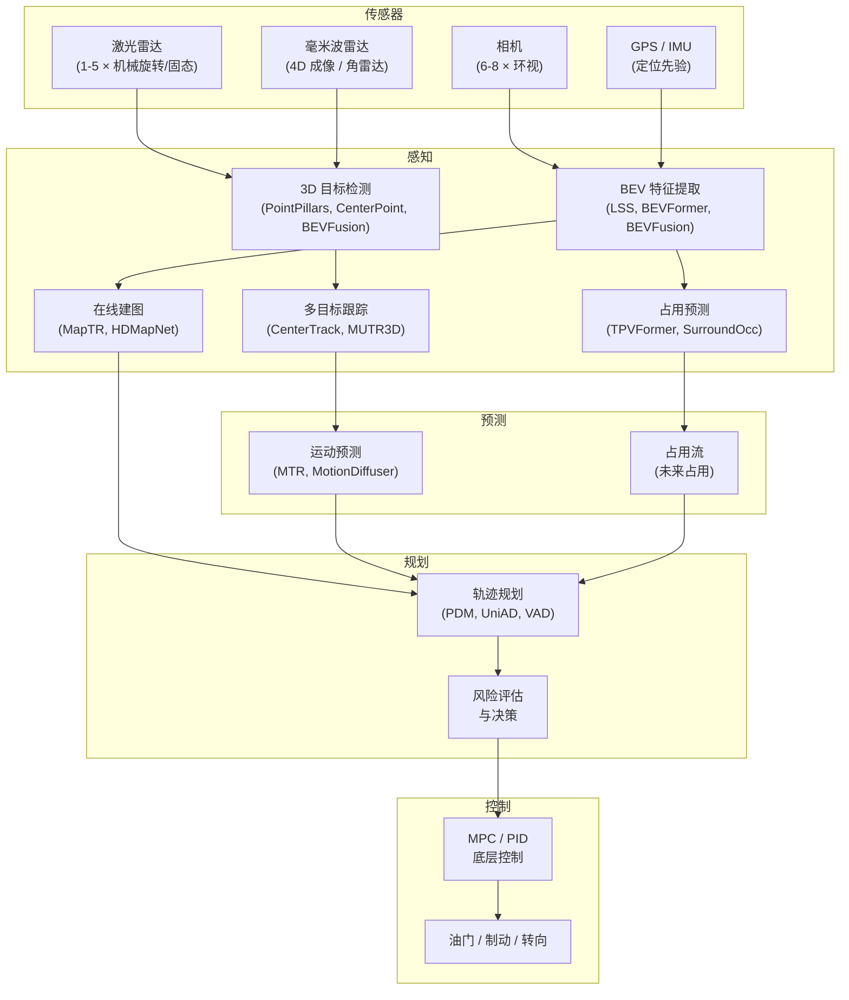
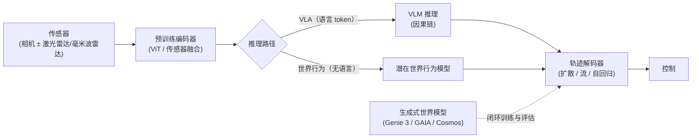

# 自动驾驶：技术栈概览、自动化等级与主要参与者

> **英文原文：** [cv-knowledge-base/07_autonomous_driving/00_overview.md](../../cv-knowledge-base/07_autonomous_driving/00_overview.md)（本中文版供参考，内容以英文原文为准）

> **最后更新：** 2026年10月
> **难度级别：** 高级
> **相关章节：** [感知栈](./01_perception_stack.md) · [端到端驾驶](./03_end_to_end_driving.md) · [仿真与数据](./04_simulation_and_data.md) · [机器人世界模型](../06_robotics_and_embodied_ai/02_world_models.md) · [VLA 模型](../06_robotics_and_embodied_ai/01_vla_models.md)

> **🆕 2026年10月更新：**
> - **按 2026 年 10 月现状重写“主要参与者”表**：Waymo 在美国 10 余个都市区每周约 50 万次付费出行，并公开设定 2026 年底达到每周 100 万次的目标；Tesla 推出无安全员 Robotaxi 出行（2026 年 1 月起于 Austin，随后扩展至佛罗里达州多个城市），Cybercab 已开始生产；Zoox 依据 NHTSA 首个专用 Robotaxi 豁免在 Las Vegas 提供付费服务；Cruise 已停止运营；Wayve 与 Uber 在伦敦提供有安全员监督的出行服务。
> - 新增 **“产业格局（2026年10月）”** 一节，涵盖美国、中国（百度 Apollo Go、小马智行 Pony.ai、文远知行 WeRide、小鹏 XPeng、理想 Li Auto、华为、Momenta）及欧洲参与者。
> - 新增 **“驾驶基础模型 / VLA 转向”** 一节：Waymo EMMA、NVIDIA Alpamayo-R1 / Alpamayo 1、小鹏 VLA 2.0、理想 VLA，以及华为“世界行为”（WEWA）的对立路线。
> - 更新 SAE 等级一节：Mercedes DRIVE PILOT 在德国提速至 95 km/h、BMW Personal Pilot L3、中国首批有条件 L3 准入许可。
> - 新增关键论文、开放问题（VLA 推理的忠实性、大规模远程协助）与延伸阅读条目。

---

## 概述

自动驾驶（Autonomous Driving, AD）是现代计算机视觉的宏大集成挑战，它在极端安全要求下融合了实时感知、结构化预测、运动规划与底层车辆控制。技术栈的经典分解——感知 → 预测 → 规划 → 控制——源于 DARPA 城市挑战赛时代 [Thrun2006]，并一直是 Waymo、Mobileye 和 Cruise 已部署系统中的主导工程理念（直至 GM 于 2024 年 12 月终止 Cruise 的 Robotaxi 项目）。每个模块解决一个范围明确的子问题：感知回答*我周围有什么*，预测回答*它会去哪里*，规划回答*我该做什么*，控制回答*我该如何执行*。模块化技术栈的主要吸引力在于可解释性和安全可认证性；每个组件都可以被独立测试、记录，并按有界误差规范进行形式化验证。

过去五年，*端到端*（end-to-end, E2E）方法对模块化范式形成了持续压力：这类方法将整条链路压缩为单一可微网络，从原始传感器输入直接训练到控制输出 [Chen2023UniAD, Hu2023GAIA1]。其理论优势在于联合优化——来自规划失败的梯度信息可直接反向传播到感知表征，从而消除 3D 边界框或高精地图多边形等人工设计中间表征所带来的信息论瓶颈。Tesla 的 Full Self-Driving v12（2024 年发布）是最受关注的量产案例：FSD v12 用单一神经网络替代了约 30 万行基于规则的 C++ 代码，该网络处理八路摄像头视频流，并直接输出转向、油门和制动力矩 [Elon2024FSD]。其实际性能提升立竿见影，但形式化安全保证仍是一个开放的研究挑战。2025–2026 年间，端到端路线进一步走向**驾驶基础模型**：基于多模态大语言模型的规划器（如 Waymo 的 EMMA [Hwang2024EMMA]）、具备推理能力的视觉-语言-动作模型（Vision-Language-Action, VLA）（如 NVIDIA 的 Alpamayo-R1 [Wang2025Alpamayo]），以及中国车企（小鹏、理想、华为）的量产“VLA”或“世界行为”系统。Tesla 的 FSD v14（2025 年 10 月）现已在美国少数城市支撑无安全员 Robotaxi 出行。与此同时，部署前沿仍由配备激光雷达、结构化（并非纯端到端）的技术栈引领：Waymo 报告称到 2026 年年中每周约有 50 万次付费出行。

在传感器维度上同样存在关键的架构张力。纯视觉系统（Tesla、Wayve）依赖单目深度估计和鸟瞰图（BEV）提升算子，具备成本可扩展性和稠密语义纹理，但缺乏度量深度精度。以激光雷达为核心的系统（Waymo、Cruise）提供亚厘米级测距精度和恶劣天气下的降级运行能力，但伴随成本与机械复杂度。相对于其全天候测距能力，毫米波雷达仍未被充分利用；新兴的 4D 成像雷达（如 Arbe Robotics、Continental ARS 548）有望缩小差距。多模态融合——尤其是 BEVFusion [Liu2022BEVFusion] 中的激光雷达-相机 BEV 融合——目前在公开基准上提供了最佳的总体精度。

---

## 自动驾驶技术栈：模块与数据流

鸟瞰图（Bird's-Eye View, BEV）表征已成为现代感知栈的“通用语言”，因为它提供了一个便于下游规划使用的统一坐标系，且不存在图像空间表征的透视畸变 [Li2022BEVFormer]。在 BEV 特征上进行时序融合，使网络能够跨多帧利用环境的静态结构，从而在没有显式深度传感器的情况下有效扩大纯视觉系统的有效感知范围。

---

## SAE 驾驶自动化等级

美国汽车工程师学会标准 **SAE J 3016-2021** 定义了六个驾驶自动化等级 [SAE2021]：

| 等级 | 名称 | 人类角色 | 示例 |
|-------|------|-----------|---------|
| 0 | 无自动化 | 始终完全控制 | 普通车辆 |
| 1 | 驾驶辅助 | 监控驾驶环境；系统控制单一功能 | 自适应巡航控制 |
| 2 | 部分自动化 | 监控环境；系统控制转向 + 速度 | Tesla Autopilot、GM Super Cruise |
| 3 | 有条件自动化 | 收到请求时必须接管 | Mercedes DRIVE PILOT、BMW Personal Pilot L3（受限 ODD） |
| 4 | 高度自动化 | 在 ODD 内无需干预 | Waymo、Zoox、百度 Apollo Go、Pony.ai（地理围栏内的 Robotaxi） |
| 5 | 完全自动化 | 任何时候都无需人类 | 尚未规模化部署 |

L2 与 L3 之间的区别在法律和责任认定上至关重要：在 L3 中，系统（而非驾驶员）在其设计运行域（Operational Design Domain, ODD）内承担主要责任，而 L2 始终让人类处于控制回路中。截至 2026 年 10 月，经认证的消费级 L3 仍然范围有限。Mercedes-Benz DRIVE PILOT 已在德国（KBA 于 2024 年 12 月批准将其在高速公路上的限速提高到 95 km/h）、加利福尼亚州和内华达州获批。BMW 在德国为 7 系提供 Personal Pilot L3。中国工信部于 2025 年 12 月发放了首批有条件 L3 产品准入许可，仅限指定道路。需要注意的是，大多数宣传为“无监督”的消费级功能（例如 Tesla FSD (Supervised)）在法律上仍属于 L2。Robotaxi 在其地理围栏内属于 L4，但实际上依赖**远程协助**操作员，后者可在模糊情形下提供建议或临时接管。

---

## 传感器套件

### 相机

环视相机系统（通常 6–8 个相机，视场角 60°–120°，800 万像素）提供稠密的语义纹理、目标识别和车道级场景理解。主要挑战在于恢复度量深度，这需要显式深度估计（BEVDepth [Li2022BEVDepth]）或概率化视角提升（LSS [Philion2020LSS]）。相机成本低、性能不随车速下降，但在雨、雾和阳光直射下性能会下降。

### 激光雷达

机械旋转式激光雷达（Velodyne HDL-64E、Hesai QT128）以 10–20 Hz 生成稠密 3D 点云，在 200 m 范围内具有厘米级测距精度。固态激光雷达（Livox、Ouster OS2）正作为降本替代方案出现。激光雷达对光照鲁棒，但对逆反射和透明表面敏感，并在强降水中性能下降。

### 毫米波雷达

角雷达（4 个 77 GHz 车载雷达）可在雨、雾和黑暗中提供带速度分辨的检测，多普勒精度 $\lesssim 0.1\,\text{m/s}$。传统雷达分辨率较粗（方位角约 5°），但 4D 成像雷达（Arbe Phoenix：方位角 0.7°、俯仰角 1.6°）的点密度已接近激光雷达。相对于其在量产中的重要性，雷达在已发表的感知文献中仍未被充分利用。

### 高精地图与纯传感器方案

第一代自动驾驶技术栈假设存在预先构建的、厘米级精度的高精地图（HD Map），用于定位和车道级规划。在线建图研究（MapTR [Liao2023MapTR]、HDMapNet）旨在消除对离线地图的依赖，提高运行灵活性并降低维护成本。完全无图的技术栈是一个关键的开放问题。

---

## 主要参与者

| 公司 | 技术路线 | 传感器套件 | 部署状态（2026年10月） |
|---------|----------|-------------|-------------------------------|
| Waymo | 基于基础模型的结构化方案；以激光雷达为主 | 激光雷达 + 相机 + 毫米波雷达（第 6 代：13 个相机、4 个激光雷达、6 个雷达） | 在美国 10 余个都市区运营 L4 Robotaxi（Phoenix、旧金山湾区、洛杉矶、Austin、Atlanta、Miami、Dallas、Houston、San Antonio、Orlando、Las Vegas 等）；每周约 50 万次付费出行；已宣布进入伦敦和东京 |
| Tesla | 端到端神经网络，纯视觉 | 8 × 相机 | 面向消费者的 FSD (Supervised) v14 属于 L2；Robotaxi 自 2025 年 6 月起在 Austin 运营，2026 年 1 月起提供无安全员出行，2026 年 7 月新增佛罗里达州城市；Cybercab 于 2026 年开始生产 |
| Zoox（Amazon） | 专用双向 Robotaxi | 激光雷达 + 相机 + 毫米波雷达 | 获得 NHTSA 首个专用 Robotaxi 豁免（2026 年 7 月）；2026 年 8 月起在 Las Vegas 提供付费出行 |
| Mobileye | 模块化 + RSS 安全层 | 相机 + 激光雷达 + 毫米波雷达 | L2+ ADAS；L4 试点（Moovit） |
| Cruise（GM） | 模块化，以激光雷达为主 | 激光雷达 + 相机 + 毫米波雷达 | Robotaxi 项目于 2024 年 12 月终止；技术并入 GM 乘用车 ADAS |
| Wayve | 端到端，视觉优先 | 相机 + 毫米波雷达 | 与 Uber 在伦敦提供有安全员监督的 Robotaxi 出行（2026 年 9 月）；向车企授权（Nissan）；GAIA-2/GAIA-3 世界模型 |
| NVIDIA | 平台 + 开放模型 | 全套传感器 | DRIVE Thor/Hyperion 供应商；开放 Alpamayo VLA 模型、AlpaSim 与自动驾驶数据集（2026 年 1 月） |
| 百度 Apollo Go（萝卜快跑） | 模块化混合方案 | 全套传感器 | 在武汉等中国城市运营 L4 Robotaxi（截至 2025 年 8 月全球 16 个城市），通过网约车合作伙伴向中东和欧洲扩张；仅 2025 年第二季度即完成 220 万次全无人出行 |
| Pony.ai（小马智行） | 模块化/端到端混合 | 全套传感器 | 第七代 Robotaxi 在北京、广州、深圳开展全无人商业运营；2025 年 11 月车队超过 900 辆，目标 2026 年底超过 3,000 辆；2025 年 11 月在香港双重上市 |
| WeRide（文远知行） | 模块化/端到端混合 | 全套传感器 | 在中国和中东运营 Robotaxi/Robobus；2025 年 11 月在香港双重上市 |
| XPeng（小鹏） | VLA（VLA 2.0），纯视觉 | 相机（无激光雷达）+ 图灵芯片 | L2+ 城市 NGP；VLA 2.0 Robotaxi 自 2026 年 3 月起开展公开道路测试 |
| 华为（乾崑 ADS 4） | “世界行为”（WEWA）端到端 | 相机 + 激光雷达 + 毫米波雷达 | 搭载于鸿蒙智行（HIMA）旗下品牌的 L2+；ADS 4 面向 L3 定位 |
| Momenta | 数据驱动的端到端 | 相机 + 激光雷达 | 为众多车企供应 ADAS；计划于 2026 年与 Uber 在慕尼黑开展 L4 测试 |

---

## 产业格局（2026年10月）

**美国。** 2025–2026 年，Robotaxi 市场从试点走向规模化商业运营。**Waymo** 从 2025 年初的三个商业运营都市区扩展到 2026 年年中的约 10–11 个。它新增了 Austin 和 Atlanta（通过 Uber）、Miami、Dallas、Houston、San Antonio 和 Orlando，于 2026 年 7 月在 Las Vegas 启动全无人运营，据报道还于 2026 年 9 月在 Denver、San Diego 和 Tampa 开始付费服务。Waymo 报告每周约 **50 万次付费出行**（是 2025 年 4 月所报 25 万次的两倍），联席 CEO Tekedra Mawakana 设定了**到 2026 年底每周付费出行超过 100 万次**的目标。Waymo 公开的 Safety Impact 页面报告称，截至 2025 年 6 月约 9,600 万英里纯乘客（无安全员）里程中，与人类驾驶基准相比，致伤事故和重伤事故均大幅减少。**Tesla** 于 2025 年 6 月在 Austin 推出 Robotaxi 服务，最初车内配有安全监督员。2026 年 1 月 22 日，它使用专门的“unsupervised”FSD v14 分支开始提供无安全员的公共出行（车内无人，远程监控）。在 2026 年第二季度报告中，Tesla 称自 2026 年 7 月起在 Miami、Orlando 和 Tampa 提供无安全员出行，并在 Giga Texas 开始生产 **Cybercab**。Tesla 不公布脱离（disengagement）统计数据，Austin 车队也已受到 NHTSA 关注。**Zoox** 获得 NHTSA 针对无方向盘、无踏板专用车辆的首个豁免（2026 年 7 月 30 日；两年内每年不超过 2,500 辆），并于 2026 年 8 月开始在 Las Vegas 收费运营。

**中国。** 中国是第二大 Robotaxi 市场，也是 VLA 式消费级 ADAS 最积极的采用者。**百度 Apollo Go** 报告 2025 年第二季度完成 220 万次全无人出行（同比增长 148%），覆盖全球 16 个城市，并通过网约车合作伙伴推进国际扩张。**Pony.ai** 的第七代 Robotaxi 在广州实现全城单车经济（UE）盈亏平衡；2025 年 11 月车队超过 900 辆，目标是 2026 年底超过 3,000 辆。Pony.ai 和 **WeRide** 均于 2025 年 11 月完成香港双重主要上市。在消费级方面，**小鹏**推出“VLA 2.0”，这是一个运行在其自研图灵芯片上的纯视觉模型。其 VLA 2.0 Robotaxi（4 颗图灵芯片，无激光雷达，无高精地图）于 2026 年 3 月进入公开道路测试，大众汽车已被宣布为 VLA 2.0 的首个外部客户。**理想汽车**于 2025 年随 i8 推出了其 VLA 司机大模型（MindVLA 体系）。**华为**乾崑 ADS 4 明确拒绝“语言在回路中”的 VLA 设计，转而采用 **“世界引擎 + 世界行为”（World Engine + World Action, WEWA）** 架构：云端基于扩散模型的场景生成器，加上直接将传感器映射为动作的车端世界行为模型。**Momenta** 为众多车企供应端到端 ADAS，并计划自 2026 年起与 Uber 在慕尼黑开展 L4 测试。

**欧洲与日本。** **Wayve** 于 2026 年 2 月融资约 15 亿美元（投资方包括 Uber、Mercedes-Benz、Stellantis 和 Nissan）。它与 Uber 合作，于 2026 年 9 月 3 日在伦敦以小规模车队（少于 20 辆）推出有安全员监督的 Robotaxi 出行。Waymo 一直在伦敦测试（已宣布 2026 年推出），并计划与 GO 和日本交通（Nihon Kotsu）于 2027 年在东京推出商业无人驾驶服务。英国和日本的所有时间表都取决于尚待批准的监管授权。

---

## 驾驶基础模型 / VLA 转向（2025–2026）

2023 年“模块化 vs. 端到端”之争已部分被另一个问题取代：*应当将多少通用预训练*放入回路中：

- **原生多模态大模型规划器。** EMMA [Hwang2024EMMA]（Waymo）构建于 Gemini 级多模态大语言模型之上。它将所有非传感器输入与输出（导航指令、自车历史、轨迹、3D 框、道路图元素）表示为文本，并通过提示词切换任务。它报告了 nuScenes 上最先进的规划结果，以及在 WOD 上具有竞争力的纯视觉 3D 检测结果。其自述局限是输入帧数少、不使用激光雷达/毫米波雷达、计算开销高。
- **推理型 VLA。** NVIDIA 的 Alpamayo-R1 [Wang2025Alpamayo]（于 2026 年 1 月 5 日 CES 上以 **Alpamayo 1** 之名开放发布，为 100 亿参数的 VLA）将 Cosmos-Reason VLM 主干与基于扩散的轨迹解码器相结合。它在“因果链”（Chain of Causation）推理轨迹上训练，并通过 RL 后训练使推理与动作保持一致。NVIDIA 将其定位为可蒸馏到车端技术栈中的*教师*模型。
- **量产 VLA / 世界行为模型。** 小鹏 VLA 2.0、理想 VLA 司机和华为 WEWA 展示了产业界的分化。一派让决策经过类语言的推理 token；另一派（华为，以及在一定程度上的 Tesla）认为语言是不必要的延迟瓶颈，直接将传感器映射为动作，并用学习得到的世界模型进行训练和评估。
- **世界模型即仿真器。** Waymo 的 **Waymo World Model**（2026 年 2 月）构建于 Google DeepMind 的 Genie 3 之上，可同时生成相机和激光雷达数据。Wayve 的 GAIA-2/GAIA-3 以及 NVIDIA Cosmos/AlpaSim 正将生成式世界模型（World Model）变为评估基础设施（参见[仿真与数据](./04_simulation_and_data.md)）。

---

## 模块化 vs. 端到端：架构权衡

模块化技术栈之所以主导量产部署，主要是因为**可解释性**和**独立验证**易于实现。安全工程师可以为每个模块编写形式化规范并单独测试。监管机构（UNECE WP.29、NHTSA）目前更青睐具有可解释决策日志的模块化架构。

端到端系统具有三项结构性优势：**(1) 联合优化**消除了各阶段之间的信息瓶颈；**(2) 隐式世界建模**使网络能够保留显式表征未捕获的信息（例如软遮挡、传感器不确定性）；**(3) 随数据扩展**——端到端系统随着训练数据增加而平滑提升，而模块化系统需要为每个模块建立标注流水线。

以 UniAD [Hu2023UniAD] 为代表的混合方法，将结构化中间表征（BEV 查询、目标查询、地图查询）用作子网络之间的软接口，在支持端到端训练的同时保留了可解释性。这种混合范式很可能是下一代量产系统的发展方向。

形式化地，模块化技术栈将驾驶策略分解为：

$$\pi(a \mid o) = \pi_c(a \mid p) \cdot \pi_p(p \mid f) \cdot \pi_f(f \mid o)$$

其中 $o$ 为原始传感器观测，$f$ 为感知特征，$p$ 为预测输出，$a$ 为控制动作。每个因子被独立优化，从而破坏了联合贝叶斯最优策略。端到端方法将其压缩为一个直接的 $\pi(a \mid o)$ 映射，并用单一目标进行优化。

---

## 关键论文

| 论文 | 作者 | 年份 | 发表平台 | 主要贡献 |
|-------|---------|------|-------|-----------------|
| DARPA Urban Challenge overview | Thrun et al. | 2006 | DARPA Technical Report | 确立了模块化自动驾驶技术栈架构 |
| BEVFormer | Li et al. | 2022 | ECCV | 基于可变形注意力的时空 BEV；nuScenes 纯视觉 56.9% NDS |
| BEVFusion | Liu et al. | 2022 | ICRA 2023 | 用于激光雷达-相机融合的统一 BEV；nuScenes 检测 SOTA |
| UniAD | Hu et al. | 2023 | CVPR (Best Paper) | 面向规划的端到端：在一个网络中完成检测→跟踪→建图→运动预测→规划 |
| GAIA-1 | Hu et al. | 2023 | arXiv 2309.17080 | 自动驾驶生成式世界模型；视频 token 预测；扩展到 90 亿参数 |
| Lift, Splat, Shoot | Philion & Fidler | 2020 | ECCV | 学习深度分布用于 BEV 投影；奠基性的相机-BEV 方法 |
| PointPillars | Lang et al. | 2019 | CVPR | 基于柱体编码的快速激光雷达检测；实时 3D 检测基线 |
| CenterPoint | Yin et al. | 2021 | CVPR | 基于中心热力图的检测；Waymo 上 71.9 mAPH |
| EMMA | Hwang et al. (Waymo) | 2024 | arXiv 2410.23262 | 基于多模态大模型（Gemini）的端到端驾驶；以文本形式输出规划、3D 检测和道路图 |
| NAVSIM | Dauner et al. | 2024 | NeurIPS (D&B) | 采用 PDM Score 的非反应式“伪闭环”规划基准；2025 年事实上的端到端基准 |
| Bench2Drive | Jia et al. | 2024 | NeurIPS (D&B) | 基于 CARLA v2 的多能力闭环端到端基准（220 条路线、44 种交互场景） |
| GAIA-2 | Russell et al. (Wayve) | 2025 | arXiv 2503.20523 | 用于驾驶仿真的可控多相机潜在扩散世界模型 |
| Alpamayo-R1 | Wang et al. (NVIDIA) | 2025 | arXiv 2511.00088 | 结合因果链数据、扩散轨迹解码器和 RL 对齐的推理型 VLA；以 Alpamayo 1（100 亿参数）开放发布 |

---

## 基准性能

| 模型 | 数据集 | 指标 | 分数 | 备注 |
|-------|---------|--------|-------|-------|
| BEVFormer v2 | nuScenes test | NDS | 56.9% | 纯视觉；ECCV 2022 |
| BEVFusion (MIT) | nuScenes test | NDS | 73.4% | 激光雷达-相机；ICRA 2023 |
| CenterPoint | Waymo val | mAPH L2 | ~66.4% | 纯激光雷达；2021 |
| UniAD | nuScenes val | 规划 L2 (3s) | 0.71 m | 完整端到端技术栈；CVPR 2023 最佳论文 |
| VAD | nuScenes val | 平均碰撞率 | 0.22% | 向量化端到端；ICCV 2023 |
| TransFuser（基线） | NAVSIM navtest | PDMS | 84.0 | NAVSIM 参考基线 |
| DiffusionDrive | NAVSIM navtest | PDMS | 88.1 | 截断扩散规划器；CVPR 2025 |
| UniAD-Base | Bench2Drive | Driving Score | 45.81 | CARLA v2 闭环；数据来自 Bench2Drive 论文 |

*注：自 2025 年起，社区已基本从 nuScenes 开环 L2 转向 NAVSIM（PDMS/EPDMS）和 Bench2Drive（闭环 Driving Score / Success Rate）；参见[端到端驾驶](./03_end_to_end_driving.md)。*

---

## 优缺点

| 方面 | 模块化技术栈 | 端到端技术栈 |
|--------|--------------|-----------------|
| 可解释性 | 高——每个模块都有显式输出 | 低——潜在表征不透明 |
| 联合优化 | 否——误差顺序传播 | 是——单一梯度贯穿整个技术栈 |
| 标注成本 | 高——需要每个模块的标签 | 中等——可使用驾驶日志 |
| 监管接受度 | 受现行框架青睐 | 安全论证方法尚不成熟 |
| 数据可扩展性 | 受标注瓶颈限制 | 随原始驾驶视频扩展 |
| 边缘情况处理 | 显式规则覆盖已知情况 | 泛化更好；存在未知失效 |

---

## 开放问题与研究空白

- **长尾安全**：神经网络技术栈在训练数据中代表性不足的罕见分布（施工区域、对抗性行人）上会失效。如何用学习型模型实现每英里 $10^{-9}$ 失效率的安全目标仍未解决。
- **恶劣天气下的传感器融合**：雨、雪和雾以不同方式削弱各个模态；传感器退化情况下的鲁棒多模态融合缺乏系统化的处理方法。
- **大规模无图定位**：在消除高精地图依赖的同时，在 GPS 拒止环境（隧道、城市峡谷）中保持厘米级自车定位，仍是未解难题。
- **因果推理 vs. 统计相关**：当前模型在驾驶场景中隐式地混淆了相关性与因果结构；当环境统计发生变化（新城市、新国家）时可能失效。
- **大规模闭环评估**：开环指标（L2、mAP）是真实世界安全性的糟糕代理；能够测试完整传感器栈的可扩展、照片级真实的闭环基准仍处于起步阶段。
- **神经策略的形式化验证**：在与驾驶相关的状态空间中界定大型神经网络最坏情况行为的方法，目前仍主要停留在理论层面。
- **V2X 与协同感知**：尽管具有明确的安全收益，车路通信以及车辆间的协同感知在已部署系统中仍未被充分探索。
- **VLA 推理的忠实性**：推理型 VLA（Alpamayo-R1、小鹏/理想的 VLA）会生成人类可读的理由，但 2026 年的探测研究质疑所陈述的因果链是否真正驱动了轨迹。在因果上不忠实的解释可能会在安全论证中造成虚假的信心。
- **大规模远程协助与运营**：L4 车队依赖远程协助人员。当规模扩展到每周数百万次出行时，操作员与车辆的配比、延迟和故障处理如何扩展，是一个公开数据很少的社会技术问题。
- **用生成式世界模型做验证**：Waymo World Model、GAIA-3 和 Cosmos/AlpaSim 越来越多地被用于评估。目前尚无公认的方法来证明生成场景的分布及其传感器真实感足以作为安全论证的证据。

---

## 延伸阅读

- [Waymo 安全报告（2023）](https://waymo.com/safety/) — 业界安全方法论参考
- [Tesla AI Day 2022 技术演讲](https://www.youtube.com/watch?v=ODSJsviD_SU) — 占用网络、Dojo 超级计算机
- [OpenDriveLab/UniAD GitHub](https://github.com/OpenDriveLab/UniAD) — 官方实现，CVPR 2023 最佳论文
- [arXiv:2401.08658 — 2022-2023 年业界与学界自动驾驶端到端规划](https://arxiv.org/abs/2401.08658) — 全面综述
- [SAE J 3016-2021 分级体系](https://blog.ansi.org/ansi/sae-levels-driving-automation-j-3016-2021/) — 官方等级定义
- [nuScenes 基准排行榜](https://nuscenes.org/object-detection) — 实时性能追踪
- [arXiv:2410.23262 — EMMA（Waymo）](https://arxiv.org/abs/2410.23262) — 基于多模态大模型的端到端驾驶
- [arXiv:2511.00088 — Alpamayo-R1（NVIDIA）](https://arxiv.org/abs/2511.00088) — 面向长尾驾驶的推理型 VLA
- [NVIDIA Alpamayo 发布公告（2026年1月）](https://investor.nvidia.com/news/press-release-details/2026/NVIDIA-Announces-Alpamayo-Family-of-Open-Source-AI-Models-and-Tools-to-Accelerate-Safe-Reasoning-Based-Autonomous-Vehicle-Development/) — Alpamayo 1、AlpaSim、开放自动驾驶数据集
- [Waymo World Model（2026年2月）](https://waymo.com/blog/2026/02/the-waymo-world-model-a-new-frontier-for-autonomous-driving-simulation) — 基于 Genie 3 的驾驶仿真器
- [TechCrunch：Zoox 扫清最后的联邦障碍（2026年7月）](https://techcrunch.com/2026/07/30/zoox-clears-final-federal-hurdle-to-launch-paid-robotaxi-service/) — NHTSA 首个专用 Robotaxi 豁免
- [小鹏新闻中心](https://www.xpeng.com/pressroom/news/019cae5e67b99c0960ee8a028129016a) — VLA 2.0 Robotaxi 道路测试（2026年3月）
