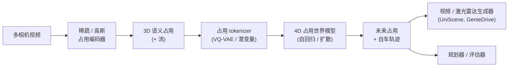

# 3D 占用预测：从边界框到体素化场景理解

> **英文原文：** [cv-knowledge-base/07_autonomous_driving/02_occupancy_prediction.md](../../cv-knowledge-base/07_autonomous_driving/02_occupancy_prediction.md)（本中文版供参考，内容以英文原文为准）

> **最后更新：** 2026年10月
> **难度级别：** 高级
> **相关章节：** [感知栈](./01_perception_stack.md) · [端到端驾驶](./03_end_to_end_driving.md) · [自动驾驶技术栈概览](./00_overview.md) · [仿真与数据](./04_simulation_and_data.md)

> **🆕 2026年10月更新：**
> - 新增 **“2024–2026 年进展”** 一节：完全稀疏占用与 RayIoU 指标（SparseOcc）、基于高斯的占用（GaussianFormer / GaussianFormer-2），以及基于渲染和基础模型的自监督（RenderOcc、SelfOcc、GaussTR）。
> - 新增关于 **4D 占用世界模型** 的小节（OccWorld、OccSora、DOME、UniScene），以及占用引导的视频世界模型（GenieDrive）。
> - 更新 Tesla 一节：占用现已成为端到端 FSD v12–v14 网络的内部表征，Dojo 项目已于 2025 年终止。
> - 新增关键论文条目、评估注意事项、开放问题和延伸阅读。

---

## 概述

经典的自动驾驶感知将环境表示为**带标签的 3D 边界框**集合——即围绕检测到的智能体（车辆、行人、骑行者）拟合的轴对齐或有向长方体。这种表征直接继承自 KITTI 时代的激光雷达检测基准，并编码了很强的结构先验：它假设物体是刚性的、凸的且可枚举的。对于结构化交通中常见的典型类别，这些假设是合理的，现代检测器（CenterPoint [Yin2021]、BEVFusion [Liu2022]）在这些类别上已接近人类精度。然而，边界框范式存在根本性的**覆盖缺口**：任何不属于预定义类别的障碍物——施工护栏、散落物、倒伏的树木、悬垂的植被、拖车、异型车辆——都会被悄无声息地忽略。仅依赖边界框输出的自动驾驶系统，在认知上对占据物理空间的一般障碍物是“盲”的。

**3D 占用预测（Occupancy Prediction）**通过为自车周围离散体素网格中的每个体素估计其是否被占用、以及（可选地）属于哪个语义类别，来弥补这一缺口。输出是一个稠密的 3D 语义地图 $O \in \mathbb{R}^{X \times Y \times Z \times C}$，其中 $C$ 个类别包括标准驾驶类别以及一个通用的*已占用但未知*类别。这种表征是**通用的**：它不仅捕捉智能体类物体，还捕捉地形几何、道路结构和自由空间边界。自由空间估计本身就是安全关键的——它无需显式高精地图即可直接确定可行驶区域。

从边界框到占用栅格的转变在理念上与经典机器人学中的占用建图（Elfes 1989）一致，但现代形式有本质不同：它在推理时仅使用单目或环视相机而不使用激光雷达（至少在 Tesla 的量产系统中如此）；它由聚合激光雷达点云得到的稠密 3D 监督端到端学习；并且它联合预测语义类别归属与几何结构。具有里程碑意义的产业部署是 Tesla 的占用网络（Occupancy Network），于 Tesla AI Day 2022 发布并集成到 FSD v12 中。

---

## 占用表征：形式化定义

设自车的可观测空间为 $\mathcal{V} \subset \mathbb{R}^3$，离散化为分辨率为 $r \text{ m/voxel}$ 的 $X \times Y \times Z$ 体素网格。占用预测任务为：

$$\hat{O} = f_\theta(I_1, \ldots, I_N)$$

其中 $I_1, \ldots, I_N$ 为 $N$ 张环视相机图像（或激光雷达扫描），$f_\theta$ 为学习得到的网络，$\hat{O} \in [0,1]^{X \times Y \times Z \times C}$ 为每个体素分配类别概率向量。真值 $O^*$ 通过聚合多帧激光雷达点云、投影到体素网格，并结合人工标注与自动标注流水线分配语义标签而得到。

**几何语义占用补全**（geometric semantic occupancy completion, GSOC）挑战——即预测未被任何激光雷达光束观测到的已占用体素（被遮挡区域）——是现代占用预测区别于简单激光雷达体素化的关键。网络必须借助上下文推理来推断：如果观测到车辆底部，那么其内部体积也是被占用的；或者一段墙体会延续到遮挡物之后。

标准评估指标是所有 $C$ 个语义类别上的**平均交并比（mIoU）**：

$$\text{mIoU} = \frac{1}{C}\sum_{c=1}^C \frac{|\hat{O}_c \cap O_c^*|}{|\hat{O}_c \cup O_c^*|}$$

其中在二值占用评估中，体素以 $p > 0.5$ 为阈值。Occ3D-nuScenes 基准 [Tian2023Occ3D] 使用 $X \times Y \times Z = 200 \times 200 \times 16$ 的网格，分辨率 0.4 m，覆盖 $[-40, 40] \times [-40, 40] \times [-1, 5.4]$ 米范围，包含 17 个语义类别 + 1 个自由类别。

---

## 为何占用在一般障碍物上优于边界框

边界框感知的五种具体失效模式推动了占用方法的发展：

1. **开放集障碍物盲区**：未知物体（例如从卡车上掉落的沙发）具有非零的物理尺寸，但对闭集检测器而言检测概率为零。占用栅格无论语义类别如何都能编码其物理存在。

2. **非凸几何**：张开双臂的骑行者、后厢门打开的卡车，或形状不规则的道路施工，都无法用单个有向边界框忠实表示。占用天然支持任意几何形状。

3. **可行驶路面估计**：自由空间边界（车辆可以安全行驶的区域）隐含在占用栅格中，但在边界框架构中需要单独的地图模块。统一的占用消除了这一架构接缝。

4. **遮挡推理**：边界框方法无法提供检测到的物体背后被占用空间的任何信息。占用预测利用来自多个视点的聚合激光雷达进行训练，能够以概率方式推理被遮挡区域。

5. **与规划的交互**：规划算法（例如模型预测控制、格点规划器）直接在由占用推导出的代价地图上运行；将边界框转换为代价地图会引入额外的启发式和近似。

---

## Tesla 占用网络

Tesla 的占用网络在 AI Day 2022 上公开介绍，截至 2026 年 10 月，它是基于相机的 3D 占用预测最重要的量产部署。主要架构细节（来自公开演讲；详细架构未正式发表）：

- **输入**：八个环视相机，分辨率最高 1280 × 960，实现 360° 覆盖。
- **主干网络**：每个相机进行多尺度特征提取（HydraNet 式共享主干，配有特定任务头）。
- **BEV/体素提升**：通过学习的视角变换将相机特征提升到 3D 体素网格（类似 LSS，但有专有改进）。
- **时序融合**：使用自车运动补偿对齐在帧间进行循环式 BEV 传播。
- **输出体积**：多分辨率的稠密 3D 占用栅格；Tesla 称之为同样编码物体运动的“向量空间”表征。
- **训练数据**：来自 Tesla 全球车队的 14 亿帧；在内部数据采集阶段利用多帧激光雷达重建进行自动标注，推理时则仅使用相机。
- **训练基础设施**：最初部分在 Dojo（Tesla 自研 AI 超级计算机，自 2023 年 7 月投入运行）上训练。据报道，Tesla 于 2025 年 8 月解散了 Dojo 团队，训练现依赖大型 NVIDIA GPU 集群（Cortex），而自研工作转向 AI5/AI6 推理芯片。

**2024 年后的状态。** 自 FSD v12 起，占用网络不再是为手写规划器提供输入的独立量产模块。类占用的体素特征仍存在于端到端网络*内部*（以及屏幕上的可视化中），但控制由学习得到的策略直接产生。Tesla 尚未公开占用监督在 v13/v14 训练中的权重。

关键设计选择是**仅用相机推理、以激光雷达监督训练**：Tesla 在内部采集激光雷达数据用于生成标签，但不在量产车上安装激光雷达。这样既能获得稠密几何监督，又无需承担量产激光雷达成本。训练流水线使用多视图立体重建，以及来自物理一致性重复观测的车队规模弱监督。

---

## 学术界的占用方法

### Occ3D [Tian2023]

Occ3D（arXiv:2304.14365）提出了一个大规模占用基准和基线。该方法使用 BEVFormer 式的相机主干生成 BEV 特征，然后通过学习的体素解码器沿 $z$ 轴展开。其关键标注贡献在于：Occ3D-nuScenes 提供 0.4 m 分辨率的稠密 3D 标签，这些标签由累积的激光雷达扫描得到并过滤了动态物体。

### TPVFormer [Huang2023]

TPVFormer（CVPR 2023，arXiv:2302.07817）提出**三视角视图（Tri-Perspective View, TPV）**，作为稠密体素网格的替代方案。TPVFormer 不使用单一的 $X \times Y \times Z$ 体积，而是维护三个正交的 2D 特征平面：

$$\text{TPV} = \{F_{XY} \in \mathbb{R}^{H_1 \times W_1 \times C},\; F_{YZ} \in \mathbb{R}^{H_2 \times W_2 \times C},\; F_{XZ} \in \mathbb{R}^{H_3 \times W_3 \times C}\}$$

一个点的特征通过投影到三个平面并求和得到。这将内存从 $O(XYZ)$ 降低到 $O(XY + YZ + XZ)$，在实际分辨率下节省显著。TPVFormer 作为纯视觉基线在 **Occ3D-nuScenes 上达到 7.8 mIoU**——绝对值低于后来的方法，但考虑到其计算效率仍值得关注。TPVFormer 被设计为“Tesla 占用网络的学术替代方案”。

### SurroundOcc [Wei2023]

SurroundOcc（ICCV 2023）通过由粗到细的空间交叉注意力机制，从多相机输入构建高分辨率 3D 占用体积。它使用 3D 可变形注意力，从图像查询中分层填充体素特征。SurroundOcc 仅用相机输入即在 **Occ3D-nuScenes 上达到 20.3 mIoU**，显著优于 TPVFormer 和 BEVFormer 基线。

### OccNet [Tong2023]

OccNet（ICCV 2023）提出将占用作为**通用场景表征**，替代端到端技术栈中的感知模块，并证明占用特征比边界框提供了更好的规划接口。论文在 nuScenes 规划指标（L2 误差、碰撞率）上比较了占用与边界框两种中间表征。

### MonoScene [Cao2022]

MonoScene（CVPR 2022）是早期的纯视觉语义场景补全方法，使用 2D-3D 特征投影和 UNet3D 解码器。它在 Occ3D-nuScenes 上仅达到 6.06 mIoU，但确立了无激光雷达的相机方法的任务框架。

---

## 占用流：动态占用预测

静态占用预测无法区分静态几何（建筑物、路面标线）与动态智能体（车辆、行人）。**占用流（Occupancy Flow）**将预测扩展为包含每个体素的速度场 $V \in \mathbb{R}^{X \times Y \times Z \times 3}$，使系统能够在时间上向前传播占用：

$$O_{t+\Delta t} \approx \text{Warp}(O_t, V_t \cdot \Delta t)$$

UniAD [Hu2023] 将占用流预测作为感知与运动规划之间的中间阶段，证明了显式的未来占用相比基于边界框的运动预测能大幅降低规划碰撞率。Waymo Occupancy Flow Challenge 基准使用 AUC 和 EPE 指标，在 $t + 1s, 2s, \ldots, 8s$ 的未来时域上评估预测的占用。

---

## 2024–2026 年进展

### 完全稀疏占用与 RayIoU [Liu2024SparseOcc]

SparseOcc（ECCV 2024）注意到超过 90% 的体素是空闲的，因此稠密 3D 处理浪费了大部分计算。它从相机特征重建稀疏的 3D 表征，并通过稀疏的**掩码查询**预测语义/实例占用。它还指出了 Occ3D 上体素级 mIoU 的一个缺陷：模型会因在可见性掩码边界附近“加厚”表面而获得奖励。其提出的 **RayIoU** 沿查询射线（类似激光雷达回波）评估占用，并在多个距离阈值下计算首次命中深度/类别的 IoU。RayIoU 现已常与 mIoU 一并报告，并被 CVPR 2024 Autonomous Grand Challenge 的占用赛道采用。

### 基于高斯的占用

**GaussianFormer** [Huang2024GaussianFormer]（ECCV 2024）用一组 3D 语义高斯替代体素。每个高斯带有均值、协方差和语义 logits，仅在查询时通过高斯到体素的泼溅步骤生成稠密占用。这种以物体为中心的稀疏表征将容量分配给被占用区域并减少内存。**GaussianFormer-2**（CVPR 2025）加入了概率化高斯叠加模型，减少了空闲空间上的冗余高斯。同一表征也将占用与神经仿真器中使用的高斯泼溅（Gaussian Splatting）场景重建联系起来。

### 自监督与基础模型监督

稠密 3D 标签是主要瓶颈，因此有一系列工作使用 **2D 渲染损失**来监督占用。RenderOcc（ICRA 2024）将预测的占用体渲染为深度图和语义图，并用 2D 标签监督；SelfOcc（CVPR 2024）仅使用视频光度一致性。**GaussTR**（CVPR 2025）将高斯场景特征与冻结的 2D 基础模型（例如与 CLIP 对齐的稠密特征）对齐，在无需任何 3D 标签的情况下实现零样本的**开放词汇占用**。截至 2026 年 10 月，DINOv3 和 SAM 3 等较新的主干网络很自然地可作为这一路线的即插即用教师模型，但其绝对精度仍远低于激光雷达监督训练。

### 4D 占用世界模型

占用也正成为*驾驶世界模型的状态空间*。**OccWorld** [Zheng2024OccWorld]（ECCV 2024）用 VQ-VAE 对 3D 占用进行 token 化，并自回归地联合预测未来占用 token 与自车运动。OccSora 和 **DOME** 使用扩散 Transformer 进行更长时域的 4D 占用生成，**UniScene**（CVPR 2025）先生成占用，再以占用为条件生成视频和激光雷达数据。反方向上，**GenieDrive**（arXiv 2512.12751）利用预测的 4D 占用来引导具备物理感知的视频世界模型。占用起到几何支架的作用，使生成的相机视频保持一致且可控。这与[仿真与数据](./04_simulation_and_data.md)和[世界模型](../06_robotics_and_embodied_ai/02_world_models.md)中的世界模型仿真器直接相关。

---

## 关键论文

| 论文 | 作者 | 年份 | 发表平台 | 主要贡献 |
|-------|---------|------|-------|-----------------|
| Tesla Occupancy Network | （AI Day 演讲，无正式论文） | 2022 | AI Day | 量产纯视觉 3D 占用；激光雷达监督训练 |
| Occ3D | Tian et al. | 2023 | NeurIPS | Occ3D-nuScenes/Waymo 基准；0.4 m 分辨率、18 类标注 |
| TPVFormer | Huang et al. | 2023 | CVPR | 三视角视图；稠密体素的内存高效替代方案；7.8 mIoU |
| SurroundOcc | Wei et al. | 2023 | ICCV | 由粗到细的 3D 可变形注意力；纯视觉 20.3 mIoU |
| OccNet | Tong et al. | 2023 | ICCV | 以占用作为端到端规划的统一场景表征 |
| MonoScene | Cao & de Charette | 2022 | CVPR | 首个纯视觉语义场景补全；6.06 mIoU 基线 |
| UniAD | Hu et al. | 2023 | CVPR (Best Paper) | 将占用流集成到端到端规划中；碰撞率降低 28% |
| SparseOcc | Liu et al. | 2024 | ECCV | 基于掩码查询的完全稀疏占用；提出 RayIoU 指标 |
| GaussianFormer | Huang et al. | 2024 | ECCV | 以 3D 语义高斯作为稀疏占用表征 |
| GaussianFormer-2 | Huang et al. | 2025 | CVPR | 概率化高斯叠加；更高效的高斯占用 |
| SelfOcc | Huang et al. | 2024 | CVPR | 通过渲染从视频中自监督学习占用 |
| GaussTR | Jiang et al. | 2025 | CVPR | 与基础模型对齐的高斯 Transformer；零样本开放词汇占用 |
| OccWorld | Zheng et al. | 2024 | ECCV | VQ token 化的 3D 占用世界模型；联合预测场景与自车运动 |
| UniScene | Li et al. | 2025 | CVPR | 以占用为中心生成语义占用、视频和激光雷达 |

---

## 基准性能：Occ3D-nuScenes

| 模型 | 模态 | mIoU | 备注 |
|-------|----------|------|-------|
| MonoScene | 纯视觉 | 6.06 | CVPR 2022；早期单目基线 |
| TPVFormer | 纯视觉 | 7.8 | CVPR 2023；高效的三平面表征 |
| BEVFormer | 纯视觉 | 16.75 | 由检测架构改编 |
| SurroundOcc | 纯视觉 | 20.3 | ICCV 2023；已发表的最佳纯视觉方法（2023） |
| CTF-Occ | 纯视觉 | 28.53 | 由粗到细；综述时的最佳纯视觉方法 |
| OccGen (LiDAR-cam) | 激光雷达 + 相机 | ~37–42 | 融合方法显著优于纯视觉方法 |

*注：基准发展迅速；请在 [Occ3D-nuScenes 排行榜](https://github.com/Tsinghua-MARS-Lab/Occ3D)上核实当前 SOTA。*

*评估注意事项（2024–2026）：* 表中数字来自不同的评估协议（是否使用相机可见性掩码、单帧或多帧、不同主干网络与图像分辨率），并不严格可比。自 SparseOcc 起，许多论文还在 Occ3D-nuScenes 上报告 **RayIoU**，该指标惩罚会抬高体素 mIoU 的表面加厚行为。只应在相同指标和协议下比较方法。

---

## 优缺点

| 方面 | 占用预测 | 边界框检测 |
|--------|---------------------|----------------------|
| 开放集覆盖 | 是——任何物理障碍物都会占据体素 | 否——会悄无声息地忽略未知类别 |
| 计算成本 | 高——每个时间步 $O(XYZ \cdot C)$ | 低——仅稀疏检测 |
| 规划接口 | 可直接推导代价地图 | 需要框到地图的转换启发式 |
| 训练标注 | 稠密激光雷达聚合；标注成本高 | 逐帧 3D 框标注 |
| 动态智能体建模 | 需要占用流扩展 | 天然编码每个智能体的动力学 |
| 远距离精度 | 因激光雷达监督稀疏而在远处下降 | 检测器召回率同样下降 |

---

## 开放问题与研究空白

- **标注可扩展性**：稠密 3D 占用标签需要多帧激光雷达累积和动态物体过滤；面向十亿帧规模的半自动标注流水线尚不成熟。
- **纯视觉深度精度**：纯视觉占用（mIoU 约 20–28）与激光雷达辅助占用（约 37–42+）之间差距很大；弥合差距需要更好的深度估计或多模态训练。
- **语义完整性**：占用网络能预测体积几何，但通常缺乏针对罕见物体的细粒度语义类别；训练中障碍物类型的长尾分布代表性不足。
- **时序一致性**：逐帧占用预测常出现闪烁；在不累积动态物体“鬼影”的前提下，通过循环架构或测试时平滑来保证时序一致性仍未解决。
- **可扩展的评估**：mIoU 对所有体素取平均，使自由空间（主导类别）权重过大；需要能恰当加权罕见障碍物类别的安全相关指标。
- **被遮挡区域预测**：仅从相机输入学习“想象”可见表面背后的几何需要强大的学习先验；这与已观测区域的占用在性质上不同。
- **与下游规划的集成**：占用输出与规划代价地图（势场、格点规划器、神经规划器）之间的形式化接口依赖于具体架构；缺乏标准 API。
- **开放词汇占用**：来自 2D 基础模型的零样本占用（GaussTR 式）消除了标签瓶颈，但仍明显落后于监督方法。如何在没有激光雷达的情况下将 DINOv3/SAM 3 级别的特征蒸馏为度量 3D 仍是开放问题。
- **占用世界模型的保真度**：4D 占用世界模型（OccWorld、DOME、UniScene）以短时域预测 IoU 进行评估。它们的推演结果是否足够可靠、可用于闭环规划器评估，基本尚未经过检验。

---

## 延伸阅读

- [Occ3D GitHub 与基准](https://github.com/Tsinghua-MARS-Lab/Occ3D) — 标签、代码、排行榜
- [arXiv:2302.07817 TPVFormer](https://arxiv.org/abs/2302.07817) — CVPR 2023 三视角视图
- [Tesla AI Day 2022 占用网络片段](https://www.youtube.com/watch?v=ODSJsviD_SU&t=2000s) — 量产系统概览
- [Waymo Occupancy Flow Challenge](https://waymo.com/open/challenges/occupancy-flow/) — 包含未来预测评估的基准
- [arXiv:2405.05173 占用感知综述](https://arxiv.org/abs/2405.05173) — 2024 年全面综述
- [arXiv:2304.14365 Occ3D 论文](https://arxiv.org/abs/2304.14365) — 基准构建方法
- [SparseOcc GitHub](https://github.com/MCG-NJU/SparseOcc) — 完全稀疏占用与 RayIoU 评估
- [GaussianFormer GitHub](https://github.com/huang-yh/GaussianFormer) — 基于高斯的占用（v1 与 v2）
- [OccWorld GitHub](https://github.com/wzzheng/OccWorld) — 3D 占用世界模型
- [arXiv:2512.12751 GenieDrive](https://arxiv.org/abs/2512.12751) — 4D 占用引导的驾驶视频世界模型
