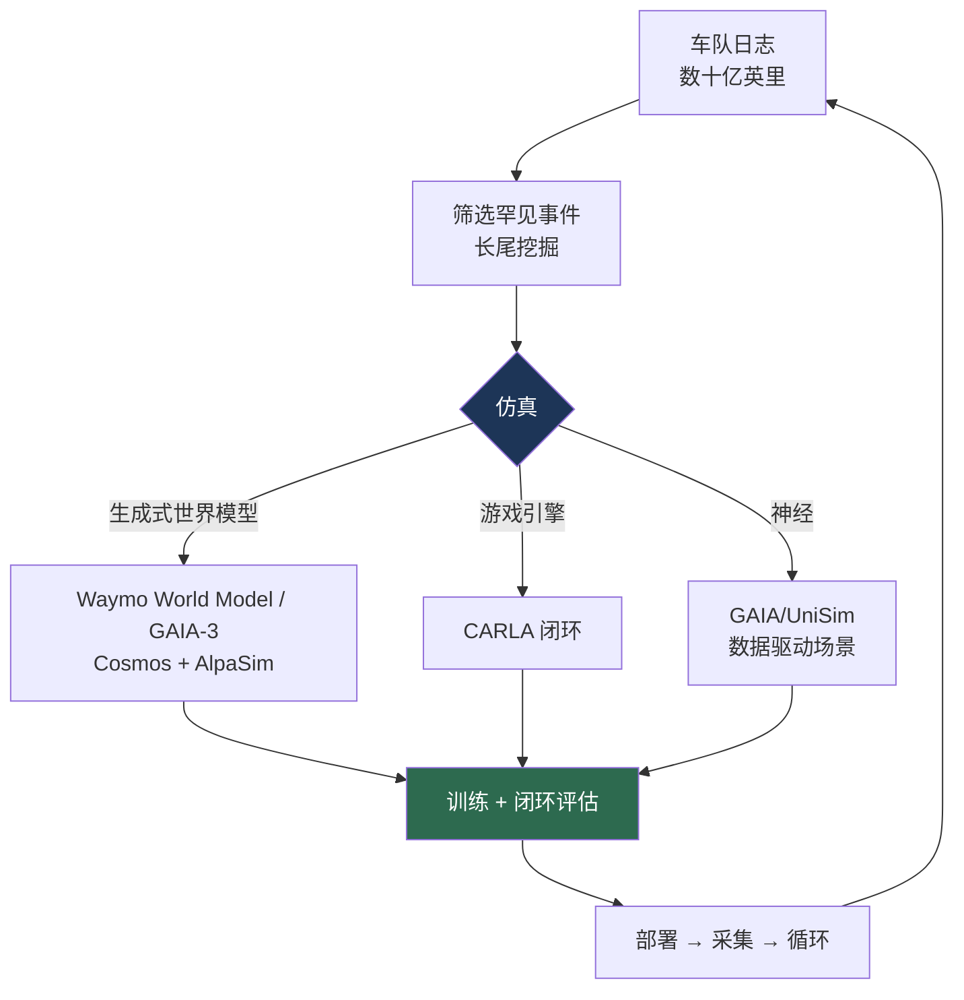

# 自动驾驶的仿真与数据

> **英文原文：** [cv-knowledge-base/07_autonomous_driving/04_simulation_and_data.md](../../cv-knowledge-base/07_autonomous_driving/04_simulation_and_data.md)（本中文版供参考，内容以英文原文为准）

> **最后更新：** 2026年10月
> **难度级别：** 高级
> **相关章节：**
> - [端到端驾驶](./03_end_to_end_driving.md)
> - [感知栈](./01_perception_stack.md)
> - [3D 与机器人数据集](../11_datasets_and_benchmarks/02_3d_and_robotics_datasets.md)
> - [世界模型](../06_robotics_and_embodied_ai/02_world_models.md)

> **🆕 2026年10月更新：**
> - 新增 **“生成式世界模型仿真器（2025–2026）”** 一节：Waymo World Model（构建于 Genie 3，生成相机 + 激光雷达数据，2026 年 2 月）、Wayve GAIA-2/GAIA-3、NVIDIA Cosmos 与开源 **AlpaSim** 仿真器（2026 年 1 月），以及华为的“世界引擎”。
> - 新增关于 **神经重建仿真器**（3D 高斯泼溅：Street Gaussians、OmniRe）与 NAVSIM v2 伪仿真的小节。
> - 数据集与基准扩展：NAVSIM/OpenScene、Bench2Drive、Waymax、NVIDIA 开放的 Physical AI AV 数据集（超过 1,700 小时）以及 Waymo 端到端长尾挑战赛数据。更正了 UniSim 的归属（Waabi）。
> - 新增关于世界模型物理保真度与多传感器一致性的开放问题；新增延伸阅读。

---

## 概述

数据与仿真是制约自动驾驶进展的关键瓶颈，其影响甚至超过模型架构。根本问题在于**长尾**：安全驾驶需要处理罕见的安全关键事件（突然冲上马路的孩子、不寻常的散落物、令传感器致盲的强光），这些事件可能每数百万英里才发生一次，因此几乎不可能从真实车队中以足够的密度采集到。这催生了双重策略：大规模的**真实世界数据采集**（Waymo 和 Tesla 的车队记录了数十亿英里），配合**仿真**，以受控、可复现且安全的方式生成、扩充罕见场景并对其进行压力测试。向端到端学习型驾驶的转变（参见[端到端驾驶](./03_end_to_end_driving.md)）加剧了对数据的渴求，因为这些模型直接从示范中学习，而非依赖手写规则。

自动驾驶仿真本身也已从**手工构建的游戏引擎环境**（CARLA）演进到**神经/数据驱动的仿真**（GAIA、UniSim），后者学习从记录数据中生成照片级真实、物理上合理的驾驶场景——这与[世界模型](../06_robotics_and_embodied_ai/02_world_models.md)中的世界模型密切相关。核心方法论问题是**闭环评估**：一个能很好地模仿记录轨迹（开环）的模型，在其自身动作改变未来状态时仍可能失败（分布偏移 / 误差累积问题），因此该领域已转向能够以反应式方式测试策略的闭环仿真器（nuPlan、CARLA 排行榜）。到 2026 年，领先的自动驾驶开发者已将**生成式世界模型作为其仿真栈的核心**。Waymo 基于 Google DeepMind 的 Genie 3 构建了自己的世界模型，Wayve 将 GAIA-3 定位为评估引擎，NVIDIA 在发布 Cosmos 世界基础模型的同时开源了 AlpaSim，华为则利用基于扩散模型的“世界引擎”训练 ADS 4。仿真与世界建模正在融合为同一个研究领域。本文梳理了关键数据集、仿真器，以及仿真到现实（sim-to-real）与评估方面的挑战。

---

## 真实世界数据集

- **KITTI** [Geiger2012] — 开创性的自动驾驶基准（立体视觉、光流、检测、里程计）；按现代标准规模较小，但具有奠基意义。
- **nuScenes** [Caesar2020] — 1000 个场景，完整的 360° 传感器套件（6 个相机、激光雷达、5 个毫米波雷达），3D 框；标准的多模态自动驾驶感知基准（NDS/mAP）。
- **Waymo Open Dataset** — 大规模、高质量的激光雷达+相机数据，带 3D 标签；包含感知和运动预测基准。
- **nuPlan** — 首个大规模**闭环规划**基准（约 1500 小时），将评估从开环模仿转向反应式仿真。
- **Argoverse 1/2、Lyft Level 5、ONCE** — 其他感知/预测数据集（参见 [3D 与机器人数据集](../11_datasets_and_benchmarks/02_3d_and_robotics_datasets.md)）。
- **OpenScene / NAVSIM** [Dauner2024NAVSIM] — nuPlan 传感器日志的精简再发布版本（含占用标签），支撑 NAVSIM 非反应式规划基准（PDMS；v2 增加了伪仿真和 EPDMS）。
- **Bench2Drive** [Jia2024Bench2Drive] — 约 200 万帧带标注的 CARLA v2 数据，用于端到端训练，并配有 220 条路线、44 种场景的闭环评估协议。
- **Waymo Open Dataset：端到端驾驶（2025）** — Waymo 2025 年基于视觉的端到端驾驶挑战赛发布了罕见长尾片段的相机数据，并以人类评审对候选轨迹的偏好进行评分，而非与单一日志轨迹计算 L2。
- **NVIDIA Physical AI AV 数据集（2026）** — 于 CES 2026 与 Alpamayo 一同发布：超过 1,700 小时、覆盖众多地域和条件的多传感器驾驶数据，是规模最大的开放自动驾驶语料之一。

## 仿真器

- **CARLA** [Dosovitskiy2017] — 基于 Unreal Engine 的开源驾驶仿真器；是闭环策略评估（CARLA Leaderboard）和传感器仿真的标准平台。
- **MetaDrive、SUMMIT、LGSVL** — 轻量级/程序化生成或以交通为重点的仿真器。
- **数据驱动的多智能体仿真器**：**Waymax** [Gulino2023]（Waymo，NeurIPS 2023 D&B）— 基于 JAX、硬件加速的仿真器，在 WOMD 场景上进行大规模闭环规划与强化学习；智能体可采用日志回放或反应式（IDM）行为。
- **神经仿真**：**GAIA-1** [Hu2023]（Wayve）— 一个能根据视频/文本/动作提示生成逼真驾驶视频的生成式世界模型；**UniSim** [Yang2023UniSim]（Waabi，CVPR 2023）— 一个数据驱动的神经闭环传感器仿真器，可重建并编辑真实场景。它们模糊了仿真与世界模型之间的界限（参见[世界模型](../06_robotics_and_embodied_ai/02_world_models.md)）。
- **AlpaSim**（NVIDIA，开源，2026 年 1 月）— 一个由通过 gRPC 通信的 Python 微服务构建的闭环自动驾驶仿真器，用于在边缘场景上评估和训练 Alpamayo 等基于推理的策略。

### 生成式世界模型仿真器（2025–2026）

- **Waymo World Model**（2026 年 2 月）— 构建于 Google DeepMind 的通用交互式世界模型 **Genie 3** 之上，并针对驾驶进行了适配。它可通过语言提示、驾驶输入和场景布局进行操控，能够**同时生成相机视频和激光雷达数据**。后训练将 2D 视频知识迁移为 Waymo 传感器套件专属的 3D 激光雷达输出。它还能将普通行车记录仪视频转换为带深度信息的仿真场景。Waymo 用它合成其车队从未遇到过的罕见事件（洪水、龙卷风、道路上的动物）。发布时未附带任何基准结果或独立评估。
- **GAIA-2 / GAIA-3**（Wayve，2025 年 3 月 / 12 月）— GAIA-2 是一个具备细粒度结构化控制（智能体、道路布局、天气、地域）的多相机潜在扩散世界模型。GAIA-3（约 150 亿参数，数据量约为 GAIA-2 的 10 倍）被定位为离线评估流水线，Wayve 报告称其策略排名与道路测试结果相关。
- **NVIDIA Cosmos** — 面向物理 AI 的世界基础模型（Predict、Transfer 和 Reason 系列；2025 年发布 2.5 系列）。用于合成驾驶数据生成（例如 Cosmos-Drive-Dreams），并通过 Cosmos-Reason 作为 Alpamayo 的主干。
- **反事实与安全关键场景生成** — CounterScene（arXiv 2603.21104）等研究系统为生成式世界模型加入反事实因果推理，生成记录场景的安全关键变体，用于闭环评估。

### 神经重建仿真器

生成式模型“发明”场景；而**基于重建**的仿真器则从新视角重新渲染*真实*日志，使规划器可以偏离记录的轨迹。3D 高斯泼溅（Gaussian Splatting）因能实时渲染，已在这一领域取代神经辐射场（NeRF）。**Street Gaussians**（ECCV 2024）对静态背景以及逐车跟踪的高斯进行建模，**OmniRe**（ICLR 2025）通过场景图将其扩展到行人、骑行者等可变形参与者。NAVSIM v2 的伪仿真正是利用这类 3DGS 渲染，从扰动后的自车状态生成后续观测。其剩余弱点在于外推：横向偏离超过几米后质量迅速下降，而这正是生成式模型接手的地方。“先重建、再生成式修复”的混合流水线是一个活跃的研究方向。

---

## 关键论文 / 资源

| 名称 | 作者/机构 | 年份 | 发表平台 | 主要贡献 |
|------|-------------|------|-------|-----------------|
| KITTI | Geiger, Lenz, Urtasun | 2012 | CVPR | 开创性的自动驾驶基准套件 |
| nuScenes | Caesar et al. | 2020 | CVPR | 360° 多模态自动驾驶感知数据集 |
| Waymo Open Dataset | Sun et al. | 2020 | CVPR | 带 3D 标签的大规模激光雷达+相机数据 |
| nuPlan | Caesar et al. (Motional) | 2021 | CVPR WS | 首个闭环规划基准 |
| CARLA | Dosovitskiy et al. | 2017 | CoRL | 开源驾驶仿真器 |
| GAIA-1 | Hu et al. (Wayve) | 2023 | arXiv | 面向驾驶的生成式世界模型 |
| UniSim | Yang et al. (Waabi) | 2023 | CVPR | 基于真实日志的神经闭环传感器仿真器 |
| Waymax | Gulino et al. (Waymo) | 2023 | NeurIPS D&B | 用于规划/强化学习的 JAX 加速多智能体仿真器 |
| NAVSIM | Dauner et al. | 2024 | NeurIPS D&B | 非反应式规划基准（PDMS）；v2 伪仿真 |
| Bench2Drive | Jia et al. | 2024 | NeurIPS D&B | 基于 CARLA v2 的多能力闭环端到端基准 |
| Street Gaussians | Yan et al. | 2024 | ECCV | 动态城市场景的 3DGS 重建 |
| GAIA-2 | Russell et al. (Wayve) | 2025 | arXiv 2503.20523 | 可控的多相机潜在扩散世界模型 |
| Waymo World Model | Waymo（基于 Google DeepMind Genie 3） | 2026 | 博客 | 基于 Genie 3、用于罕见事件仿真的相机 + 激光雷达世界模型 |
| AlpaSim + Physical AI AV data | NVIDIA | 2026 | 开放发布 | 开源闭环仿真器与超过 1,700 小时的驾驶数据 |

---

## 基准概览

| 基准 | 任务 | 指标 | 备注 |
|-----------|------|--------|-------|
| nuScenes | 3D 检测 | NDS / mAP | 标准感知排行榜 |
| Waymo Open | 检测/预测 | mAP / mAPH | 大规模、高质量 |
| nuPlan | 规划 | 闭环分数 | 反应式评估 |
| CARLA Leaderboard | 驾驶 | 路线/违规分数 | 仿真中的闭环评估 |
| NAVSIM (v1 / v2) | 规划 | PDMS / EPDMS | 非反应式仿真；v2 增加伪仿真 |
| Bench2Drive | 端到端驾驶 | Driving Score / Success Rate | 220 条路线、44 种场景，CARLA v2 |
| Waymax | 规划 / 仿真智能体 | 碰撞、驶出道路、日志偏离 | 在 WOMD 上加速闭环 |

---

## 优缺点（真实数据 vs. 仿真数据）

| 方面 | 真实世界数据 | 仿真 |
|--------|-----------------|-----------|
| 真实性 | 真值级真实 | 存在仿真到现实差距 |
| 罕见事件 | 难以采集 | 可按需生成 |
| 安全性 | 采集边缘场景有风险 | 安全、无限量 |
| 闭环评估 | 离线无法实现 | 天然支持（反应式） |
| 成本 | 高（车队、标注） | 单个场景成本较低 |

---

## 开放问题与研究空白

- **仿真到现实差距。** 游戏引擎中的传感器和动力学与现实不同；神经仿真（GAIA/UniSim）缩小了这一差距，但并未消除。
- **长尾覆盖。** 生成*真实且相关*的罕见安全关键场景仍然困难。
- **闭环保真度。** 反应式智能体以及受自身影响的未来状态难以被忠实仿真（开环/闭环差距）。
- **评估与安全的相关性。** 基准分数无法可靠预测真实世界的安全性；验证方法论尚未解决。
- **神经仿真的可控性。** 世界模型仿真器（GAIA）以可控性换取真实感（参见[世界模型](../06_robotics_and_embodied_ai/02_world_models.md)）。
- **数据治理与隐私。** 车队数据带来隐私、知情同意和监管方面的问题。
- **生成式仿真器的物理与因果保真度。** 视频世界模型（基于 Genie 3 的模型、GAIA、Cosmos）可能生成看似合理但物理上错误的未来（物体恒常性、接触、制动动力学）。目前缺乏衡量生成推演是否在*安全相关意义上正确*的指标。
- **多传感器一致性。** 生成与生成视频在几何上一致的激光雷达和毫米波雷达数据（如 Waymo World Model 目前对激光雷达所做的那样）是新问题，且难以验证。
- **世界模型评估的有效性。** 关于世界模型中的排名与道路测试排名一致的说法（GAIA-3）来自公司自述。在此类评估能够支撑监管安全论证之前，需要开放、可复现的协议来检验仿真器与现实之间的相关性。

---

## 延伸阅读

- [nuScenes (arXiv:1903.11027)](https://arxiv.org/abs/1903.11027) — 多模态自动驾驶数据集
- [Waymo Open Dataset](https://waymo.com/open/) — 大规模自动驾驶数据
- [CARLA (arXiv:1711.03938)](https://arxiv.org/abs/1711.03938) — 开源驾驶仿真器
- [nuPlan](https://www.nuscenes.org/nuplan) — 闭环规划基准
- [GAIA-1 (arXiv:2309.17080)](https://arxiv.org/abs/2309.17080) — 生成式驾驶世界模型
- [GAIA-2 (arXiv:2503.20523)](https://arxiv.org/abs/2503.20523) — 可控多相机世界模型
- [Waymo World Model（2026年2月）](https://waymo.com/blog/2026/02/the-waymo-world-model-a-new-frontier-for-autonomous-driving-simulation) — 基于 Genie 3 的驾驶仿真器
- [NVIDIA Alpamayo / AlpaSim 发布公告](https://investor.nvidia.com/news/press-release-details/2026/NVIDIA-Announces-Alpamayo-Family-of-Open-Source-AI-Models-and-Tools-to-Accelerate-Safe-Reasoning-Based-Autonomous-Vehicle-Development/) — 开放模型、仿真器与数据集
- [NAVSIM GitHub](https://github.com/autonomousvision/navsim) — 伪仿真基准
- [Bench2Drive GitHub](https://github.com/Thinklab-SJTU/Bench2Drive) — 闭环端到端基准
- [Waymax GitHub](https://github.com/waymo-research/waymax) — 加速的数据驱动仿真器
