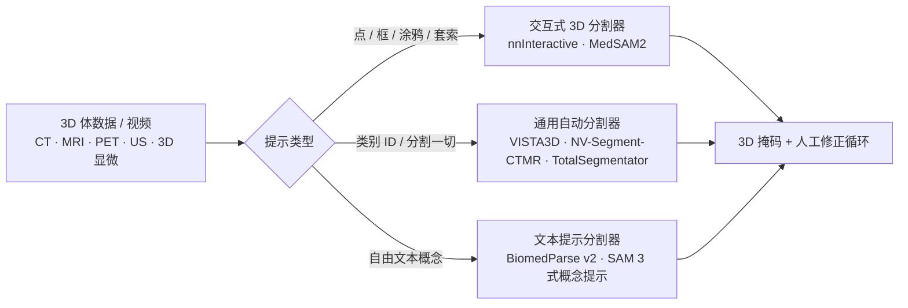

# 医学影像：成像模态、分割与临床计算机视觉

> **英文原文：** [cv-knowledge-base/08_medical_and_scientific_cv/00_medical_imaging.md](../../cv-knowledge-base/08_medical_and_scientific_cv/00_medical_imaging.md)（本中文版供参考，内容以英文原文为准）

> **最后更新：** 2026年10月
> **难度级别：** 高级
> **相关章节：**
> - [语义分割](../02_core_tasks/02_semantic_segmentation.md)
> - [医学影像中的基础模型](./01_foundation_models_medical.md)
> - [科学成像](./02_scientific_imaging.md)
> - [数据集与基准](../11_datasets_and_benchmarks/00_core_datasets.md)

> **🆕 2026年10月更新：**
> - 新增**可提示（promptable）与通用 3D 分割**（2025–2026）章节：MedSAM2（将 SAM 2.1 适配到 3D 体数据与视频）、nnInteractive（CVPR 2025 交互式 3D 分割挑战赛冠军）、VISTA3D（CVPR 2025）及其 CT+MR 后继模型 NV-Segment-CTMR、BiomedParse v2（文本提示的 3D 分割），以及 Meta SAM 3 / SAM 3.1 概念提示对医学领域的意义。
> - 补充 **nnU-Net Revisited**（MICCAI 2024）的结论：经过合理调参的 CNN U-Net 仍可匹敌甚至超越 Transformer 与 Mamba 分割器；并补充 TotalSegmentator MRI（Radiology 2025）。
> - 新增 **3D 生成式合成数据**章节（MAISI v1/v2、NV-Generate-CTMR）。
> - 新增**临床转化与监管**章节：FDA AI 赋能医疗器械清单在 2026 年突破 1,500 项授权，其中放射学约占 75–76%；以及 PCCP 和全生命周期指南。
> - 相应更新了关键论文、基准、优缺点、开放问题与延伸阅读。

---

## 概述

医学影像是计算机视觉最具影响力的应用领域之一，涵盖一系列异构的物理采集模态，每种模态都受各自独特的信号物理、空间分辨率和噪声特性支配。核心挑战在于：在某一机构的扫描仪配置、患者人群或染色方案上训练的深度学习系统，常常无法泛化到外部站点——这一现象称为**域偏移（domain shift）**；同时，这些系统还面临严重的类别不平衡（病灶相对于背景组织很小）以及专家标注数据稀缺的问题。与自然图像基准不同，医学中的真值标注需要专门的临床专业知识，这构成了塑造整个领域的根本瓶颈。

从信号处理角度看，五种主要模态——X 射线（投影放射成像）、计算机断层扫描（CT）、磁共振成像（MRI）、超声（US）和组织病理学（全切片图像，WSI）——呈现出本质上不同的学习问题。CT 以经过校准的线性尺度编码 Hounsfield 单位（HU），非常适合 3D 卷积处理；MRI 需要融合多序列（T1、T2、FLAIR、DWI），每个通道编码不同的组织对比度；超声受散斑噪声和探头相关的采集几何困扰；WSI 处于十亿像素级尺度，需要层次化或基于图块（patch）的处理。组织病理图像通常采用苏木精-伊红（H&E）染色，还会受到不同制片方案导致的染色差异影响，因此染色归一化常作为预处理步骤。

医学图像分割领域奠基性的架构贡献是 **U-Net** [Ronneberger2015]，它提出了带跳跃连接的全卷积编码器–解码器，用以保留下采样过程中丢失的细粒度空间细节。这一设计理念——编码全局上下文、在解码时保留局部细节——被证明极为持久。其有原则的扩展 **nnU-Net** [Isensee2021] 通过数据集指纹（dataset fingerprinting）机制，自动配置预处理、图块大小、归一化、网络拓扑和后处理，在 23 个公共基准的 55 个分割任务中有 33 个取得最佳性能，且无需针对任务的手工调参。截至 2026 年，nnU-Net 仍是专门方法必须超越的主导基线；**nnU-Net Revisited** 研究 [Isensee2024] 表明，许多基于 Transformer 和 Mamba 的分割器所报告的增益在严格验证下会消失，而放大规模的残差编码器 U-Net（nnU-Net ResEnc）在标准 3D 基准上仍处于最先进水平。

自 2025 年以来，该领域又沿两个新方向推进。其一，**可提示的 3D 基础分割模型**（MedSAM2、nnInteractive、VISTA3D、BiomedParse v2）将分割变为一种交互式或文本提示式服务，无需针对每个任务重新训练即可覆盖数百种解剖结构和病灶。其二，面向 CT 和 MRI 的 **3D 原生视觉–语言模型**（Merlin、CT-CLIP、Pillar-0、MedGemma 1.5）开始读取整个体数据而非单张切片；相关内容见[医学影像中的基础模型](./01_foundation_models_medical.md)。

---

## 成像模态

### X 射线与计算机放射成像

投影放射成像将 3D 解剖结构压缩到 2D 探测器平面上，造成结构重叠并限制深度分辨能力。基于 ImageNet 预训练改造的 CNN（CheXNet [Rajpurkar2017] 中的 DenseNet-121）在 NIH ChestX-ray14 数据集上展示了可与放射科医生相媲美的肺炎检测能力。主要任务包括：多标签病理分类（NIH 14 类）、气胸分割和骨抑制。自 2025 年以来，纵向比较（当前检查与既往检查对比）和解剖定位已成为 MedGemma 1.5 等开放医学 VLM 的标准能力。

### 计算机断层扫描

CT 体数据是 3D ConvNet 以及 nnU-Net 3D 全分辨率配置的天然输入。Hounsfield 尺度提供了模态一致的强度归一化，使跨站点校准较为直接。里程碑论文包括 V-Net [Milletari2016]（用于体分割的 Dice 损失）和 3D U-Net [Ccieck2016]。腹部 CT 多器官分割（肝、脾、胰腺、肾）是典型任务。**TotalSegmentator**（基于 nnU-Net）已成为全身 CT 解剖分割事实上的开放工具，默认任务包含 117 个类别，另有许多专门子任务，并在包含 1,228 名受试者的公开 CT 数据集上训练。

### 磁共振成像

MRI 的多模态序列本质上就是多通道输入。脑肿瘤分割（BraTS）需要联合处理 T1、T1ce、T2 和 FLAIR 体数据。主要挑战包括：不同扫描仪之间强度不标准（MRI 缺乏 CT 那样的绝对校准）、运动伪影，以及对 3D 上下文的需求。基于 Transformer 的方法（Swin-UNETR [Tang2022]）通过捕捉长程空间依赖，报告了相对纯 CNN 基线在 BraTS 上的提升，但后续的严格比较 [Isensee2024] 发现，调优良好的 CNN 可以弥补大部分差距。**TotalSegmentator MRI** [DAntonoli2025] 将与序列无关的全身分割扩展到 MR（`total_mr` 任务包含 50 个主要类别，使用包含 616 名受试者的公开 MR 数据集训练）。

### 超声

实时超声应用要求在约 30 FPS 的约束下同时兼顾精度和推理速度。散斑噪声和各向异性点扩散函数促使人们采用领域特定的数据增强策略。超声心动图分割（EchoNet-Dynamic [Ouyang2020]）和甲状腺结节检测是成熟的基准。支持视频的可提示模型如今能够将单个提示在整个心动周期中传播；MedSAM2 提供了一个经微调的超声心动图变体，并被用于标注 251,550 帧超声心动图。

### 组织病理学 / 全切片成像

40× 放大倍率下的 WSI 会产生十亿像素级图像（$\sim 100{,}000 \times 100{,}000$ 像素），无法装入 GPU 显存。标准流程是在多个放大倍率下提取图块，然后通过多示例学习（MIL）或注意力池化进行聚合。**CAMELYON** 挑战赛（淋巴结转移检测）和 **TCGA** 泛癌队列是主要基准。数字病理基础模型（CONCH、UNI、PLIP）利用在数百万图块上的自监督预训练；2025–2026 年的新一代模型（UNI2-h、Virchow2、H-optimus-1、Prov-GigaPath）以及切片级模型（TITAN）在[医学影像中的基础模型](./01_foundation_models_medical.md)中讨论。

---

## 核心架构

### U-Net [Ronneberger2015]

U-Net 编码器–解码器引入了**长跳跃连接**，将编码器特征图拼接到对应的解码器层：

```
Encoder path:  Conv → MaxPool → ... (contracting)
Skip:          encoder[i] → concat → decoder[i]
Decoder path:  UpConv → Conv → ... (expanding)
Final:         1×1 Conv → Softmax/Sigmoid
```

损失函数将二元交叉熵与 Dice 重叠项相结合：

$$\mathcal{L} = -\frac{1}{N}\sum_i y_i \log \hat{y}_i + \left(1 - \frac{2\sum_i y_i \hat{y}_i}{\sum_i y_i + \sum_i \hat{y}_i}\right)$$

### nnU-Net [Isensee2021]

nnU-Net 的自配置流程包括：
1. **数据集指纹**：中位图像尺寸、体素间距、强度统计、类别频率。
2. **架构选择**：根据图块与图像的比例选择 2D、3D 全分辨率或 3D 低分辨率（级联）配置。
3. **超参数推导**：根据指纹规则推导图块大小、批大小和池化核大小。
4. **后处理**：若连通域分析能提升验证集上的单折性能，则予以应用。

在医学分割十项全能（Medical Segmentation Decathlon）中，nnU-Net 赢得了 MICCAI 2018 原始挑战赛第一名，并在其 2019 年 12 月提交后，在开放滚动排行榜上保持第一名近一年。

**nnU-Net Revisited [Isensee2024]。** 一项 MICCAI 2024 研究在统一且经过仔细验证的协议下，对近期的分割架构（如 SwinUNETR 等 Transformer 混合模型以及基于 Mamba 的 U-Net）重新进行了基准测试。核心发现是：(i) 许多已发表的改进源于弱基线、不充分的数据集或不一致的验证；(ii) 带残差编码器的 CNN U-Net（nnU-Net ResEnc M/L/XL 预设，按可用 GPU 预算缩放）仍是最先进水平；(iii) 不同基准数据集区分方法优劣的能力差异很大。这篇论文现已成为评估规范方面的标准参考文献。

### Attention U-Net 与 Swin-UNETR

注意力门控 [Oktay2018] 引入软空间注意力图以抑制无关的背景激活。Swin-UNETR [Tang2022] 用层次化 Swin Transformer 取代 CNN 编码器，在多个分辨率上实现全局自注意力，并在 BraTS 2021 挑战赛中取得最佳性能。

---

## 可提示与通用 3D 分割（2025–2026）

SAM 风格的交互式分割 [Kirillov2023] 最初是 2D 的。自 2025 年起，社区推出了**体数据级、可提示的基础分割模型**，将 nnU-Net 式的 3D 工程实践与 SAM 式提示相结合，并集成到临床和科研查看器中（3D Slicer、napari、MITK、ITK-SNAP、OHIF）。



- **MedSAM2** [Ma2025] 将 SAM 2.1 适配到 3D 医学图像和医学视频：把切片或帧视为带记忆注意力的时间序列。它在超过 455,000 个 3D 图像–掩码对和 76,000 帧视频上训练。作者在人在回路（human-in-the-loop）流程中用它标注了 5,000 个 CT 病灶、3,984 个肝脏 MRI 病灶和 251,550 帧超声心动图，并估计这使人工标注成本降低了 85% 以上。模型权重、3D Slicer 插件以及用于 FLARE 2025 泛癌挑战赛的高效基线均已公开。
- **nnInteractive** [Isensee2025] 来自 DKFZ，是一种完全 3D 的交互式开放集分割器。它接受在 2D 中绘制的点、涂鸦、框以及新的**套索（lasso）**提示，并返回完整的 3D 掩码。它在 120 多个体数据集（CT、MRI、PET、3D 显微）上训练，获得了 CVPR 2025 *Foundation Models for Interactive 3D Biomedical Image Segmentation* 挑战赛第一名。2026 年它增加了客户端/服务器模式和用于远程 GPU 推理的 Docker 镜像。
- **VISTA3D** [He2025]（NVIDIA/MONAI，CVPR 2025）将针对 127 种解剖结构和病灶类型的自动"分割一切"（11,454 个训练体数据）与交互式 3D 点修正统一起来。其后继模型 **NV-Segment-CTMR**（2025 年 10 月）在超过 3 万例 CT 和 MRI 扫描上微调，支持 300 多个类别（共定义 345 个），涵盖 CT 躯体、MRI 躯体和 MRI 脑部。
- **BiomedParse** [Zhao2025]（Nature Methods 2025）根据文本提示在九种模态上联合完成分割、检测和识别。其 **v2** 版本（2025 年 10 月完成发布）转向原生 3D（CT、MRI、超声、PET、3D 显微；200 多个任务），采用 BoltzFormer 解码器处理小目标，并内置目标存在性分类器。它在 CVPR 2025 文本引导 3D 生物医学分割挑战赛中排名第一。
- **SAM 3**（Meta，2025 年 11 月）增加了*可提示概念分割*：名词短语或示例提示会返回所有匹配的实例。SAM 3.1 检查点（2026 年 3 月）增加了更快的多目标跟踪。对医学而言，概念提示接口是继框/点提示之后的自然下一步，但由于其训练数据为自然图像，SAM 3 仍像 SAM 和 SAM 2 一样需要领域适配。参见[实例与全景分割](../02_core_tasks/03_instance_panoptic_segmentation.md)。

---

## 医学图像配准

可变形图像配准——寻找一个将移动图像 $I_M$ 映射到固定图像 $I_F$ 的稠密位移场 $\phi$——对纵向监测和多模态融合至关重要。经典方法（ANTs、Elastix）是迭代式的且速度慢。**VoxelMorph** [Balakrishnan2019] 将配准重新表述为学习问题，训练一个 U-Net 端到端预测 $\phi$，在取得有竞争力精度的同时，推理速度比 ANTs 快几个数量级：

$$\phi^* = \arg\min_\phi \mathcal{L}_{sim}(I_F, I_M \circ \phi) + \lambda \mathcal{L}_{reg}(\phi)$$

其中 $\mathcal{L}_{sim}$ 是局部归一化互相关，$\mathcal{L}_{reg}$ 通过 $\|\nabla \phi\|^2$ 惩罚位移场的不平滑。

---

## 3D 医学影像的生成式合成数据

潜在扩散使**合成 3D 训练数据**变得切实可行。NVIDIA 的 **MAISI**（Medical AI for Synthetic Imaging；WACV 2025）[Guo2025] 能生成高分辨率 CT 体数据及配对的分割掩码，并可控制体素间距以及器官和肿瘤的大小。**MAISI-v2**（AAAI 2026）采用整流流（rectified flow）训练以加速生成。开放的 **NV-Generate-CTMR** 发布将其扩展到 MRI（多种对比度，包括一个脑部专用模型）。它生成带有 132 类配对掩码的 CT，尺寸最高可达 512×512×768 体素。典型用途包括扩充罕见病灶、平衡类别频率以及保护隐私的数据共享。下游增益必须在真实的外部测试集上验证，因为合成数据可能编码了生成器自身的偏差。

---

## 关键挑战

### 数据稀缺与标注效率

专家标注代价高昂：单例腹部 CT 分割约需 1.5 小时 [并非所有任务均有公开报告]。半监督方法（伪标签、mean-teacher、针对医学影像改造的 FixMatch）和小样本方法是活跃的研究领域。联邦学习使多站点训练无需集中受保护的健康信息。自 2025 年以来，借助可提示 3D 分割器（MedSAM2、nnInteractive）进行模型在回路标注，已成为最主要的实际手段；MedSAM2 的作者报告，在病灶和超声心动图数据集上标注成本降低超过 85%。

### 类别不平衡

小病灶（息肉、微动脉瘤、肺结节）占图像体素不到 1%，导致朴素的交叉熵训练坍缩为预测背景。补救措施包括：Dice 损失、focal loss [Lin2017]、非对称损失和难例挖掘。在 Decathlon 的 Pancreas-CT 任务中，胰腺仅占腹部体积的约 0.5%，是最难的分割目标之一。

### 域偏移

扫描仪制造商、磁场强度（1.5T 与 3T）、采集协议和站点都会引入协变量偏移。适配策略包括：域对抗训练 [Ganin2015]、用实例归一化去除扫描仪特定的风格，以及基于熵最小化的测试时适配。

---

## 临床转化与监管（2025–2026）

- **FDA 授权。** 美国 FDA 公开的 *AI-Enabled Medical Device List（AI 赋能医疗器械清单）* 在 2026 年累计条目突破 1,500 项。行业媒体报道，截至 2026 年春季更新共有 1,524 项，2026 年年中更新后约为 1,600 项；具体数字因快照日期和纳入标准而异。放射学始终占主导：约占 2025 年授权的 75%，约占累计清单的 76%（一项截至 2025 年 12 月的 Cureus 分析报告为 76.5%）。大型影像设备厂商（GE HealthCare、Siemens Healthineers、Philips）在厂商排名中领先，部分原因是内嵌 AI 的扫描仪也计入统计。
- **监管框架。** FDA 关于 AI 赋能器械软件**预定变更控制计划（Predetermined Change Control Plans, PCCPs）**的最终指南（2024 年 12 月）允许制造商预先规定模型在获批后如何再训练和更新。2025 年 1 月的一份指南草案涵盖 AI 赋能器械软件功能的**全生命周期管理与上市申报内容**。在欧盟，除 MDR 认证外，《人工智能法案》（AI Act）将大多数医学影像 AI 归类为高风险。
- **证据缺口。** 大多数获批器械是基于回顾性、且常为单站点证据的 510(k) 许可。前瞻性随机评估仍然罕见。开放权重的通用模型（如 MedGemma 1.5）明确*不是*临床级产品，其开发者声明在任何临床使用之前都需要针对具体任务进行验证和微调。

---

## 关键论文

| 论文 | 作者 | 年份 | 发表处 | 主要贡献 |
|-------|---------|------|-------|-----------------|
| U-Net: Convolutional Networks for Biomedical Image Segmentation | Ronneberger, Fischer, Brox | 2015 | MICCAI | 带跳跃连接的编码器–解码器；奠基性分割架构 |
| nnU-Net: A Self-Configuring Method for Deep Learning-Based Biomedical Image Segmentation | Isensee, Jaeger, Kohl et al. | 2021 | Nature Methods | 自动化流程配置；在 33/55 个 Decathlon/竞赛任务中排名第一 |
| V-Net: Fully Convolutional Neural Networks for Volumetric Medical Image Segmentation | Milletari, Navab, Ahmadi | 2016 | 3DV | 3D 体分割；Dice 损失表述 |
| Attention U-Net: Learning Where to Look for the Pancreas | Oktay et al. | 2018 | MIDL | 跳跃连接中的软注意力门控；胰腺分割 |
| VoxelMorph: A Learning Framework for Deformable Medical Image Registration | Balakrishnan et al. | 2019 | IEEE TMI | 学习式可变形配准；比经典方法快约 100 倍 |
| Swin-UNETR: Swin Transformers for Semantic Segmentation of Brain Tumors | Tang et al. | 2022 | arXiv/MICCAI | U-Net 中采用 Swin Transformer 编码器；BraTS 2021 最先进水平 |
| CheXNet: Radiologist-Level Pneumonia Detection on Chest X-Rays | Rajpurkar et al. | 2017 | arXiv | DenseNet-121 的 F1 超过放射科医生平均水平；多标签胸部 X 光 |
| nnU-Net Revisited: A Call for Rigorous Validation in 3D Medical Image Segmentation | Isensee et al. | 2024 | MICCAI | 重新评测 Transformer/Mamba 分割器；残差编码器 CNN U-Net 仍为 SOTA |
| TotalSegmentator MRI: Robust Sequence-independent Segmentation of Multiple Anatomic Structures in MRI | D'Antonoli et al. | 2025 | Radiology | 全身 MR 解剖分割；开放模型与 616 例受试者 MR 数据集 |
| MAISI: Medical AI for Synthetic Imaging | Guo et al. | 2025 | WACV | 用于生成带配对掩码 CT 体数据的 3D 潜在扩散；可控合成数据 |
| VISTA3D: A Unified Segmentation Foundation Model for 3D Medical Imaging | He et al. | 2025 | CVPR | 基于 11,454 个 CT 体数据，对 127 个类别进行自动 + 交互式 3D 分割 |
| MedSAM2: Segment Anything in 3D Medical Images and Videos | Ma et al. | 2025 | arXiv | 将 SAM 2.1 适配到 3D/视频；45.5 万 3D 图像对 + 7.6 万帧；标注成本降低 >85% |
| nnInteractive: Redefining 3D Promptable Segmentation | Isensee, Rokuss, Krämer et al. | 2025 | arXiv | 3D 交互式开放集分割（点/涂鸦/框/套索）；CVPR 2025 挑战赛冠军 |

---

## 基准性能

| 模型 | 数据集 | 指标 | 分数 | 备注 |
|-------|---------|--------|-------|-------|
| nnU-Net (3D) | BraTS 2021 — 全肿瘤 | Dice | 0.9265 | 集成模型，表现最佳的团队 |
| nnU-Net (3D) | BraTS 2021 — 肿瘤核心 | Dice | 0.8868 | 自配置，无手工调参 |
| nnU-Net (3D) | BraTS 2021 — 增强肿瘤 | Dice | 0.8600 | 公开验证集划分 |
| Swin-UNETR | BraTS 2021 — 全肿瘤 | Dice | 0.9328 | 在 5,050 例 CT/MRI 扫描上预训练 |
| nnU-Net | MSD Decathlon（10 个任务平均） | Dice | 排名第一 | 开放排行榜；2019 年 12 月至 2020 年 10 月保持第一 |
| CheXNet (DenseNet-121) | NIH ChestX-ray14 | F1（肺炎） | 0.435 | 超过放射科医生平均 F1 0.387 |
| VoxelMorph | ABIDE 脑 MRI 配准 | Dice（35 个区域） | 0.729 | 比 ANTs 快约 100 倍 |
| nnInteractive | CVPR 2025 交互式 3D 生物医学分割挑战赛 | 最终排名 | 第 1 名 | 多模态 3D，交互式提示 |
| BiomedParse (v2) | CVPR 2025 文本引导 3D 生物医学分割挑战赛 | 最终排名 | 第 1 名 | 文本提示的体分割 |
| MedSAM2 | 人在回路标注（CT 病灶、肝脏 MRI、超声心动图视频） | 标注成本 | 降低 >85% | 作者相对人工标注的估计 |

---

## 优缺点

| 方法 | 优点 | 缺点 |
|----------|------|------|
| U-Net / nnU-Net | 久经验证的基线；自配置；在 3D 体数据上表现强 | 全局上下文有限；难以扩展到十亿像素级 WSI |
| 基于 Transformer（Swin-UNETR） | 长程依赖；在多序列 MRI 上表现强 | 显存占用高；需要大规模预训练数据集；与调优良好的 CNN 基线相比增益常常消失 [Isensee2024] |
| 自监督预训练（改造的 SimCLR、MAE） | 利用大规模无标注数据；标注高效的微调 | 预训练域必须与目标域匹配；计算密集 |
| 半监督（伪标签、mean-teacher） | 减轻标注负担 | 确认偏差；对超参数敏感 |
| 域适配（对抗、归一化） | 提升跨站点泛化 | 对抗训练不稳定；需要目标域样本 |
| 可提示 3D 基础分割器（MedSAM2、nnInteractive） | 开放集；一个模型覆盖多种结构；标注速度大幅提升；已集成到查看器 | 需要人在回路；质量依赖提示；对罕见解剖结构缺乏保证 |
| 通用 / 文本提示分割器（VISTA3D、NV-Segment-CTMR、BiomedParse v2） | 开箱即用支持数百个类别；自动分割加交互式修正 | 词表固定或受本体约束；不同类别和模态间性能不均 |
| 合成 3D 数据（MAISI、NV-Generate-CTMR） | 可控的罕见病灶增强；便于保护隐私的共享 | 生成器偏差；逼真度 ≠ 临床保真度；必须在真实外部数据上验证 |

---

## 开放问题与研究空白

- **大规模标注效率**：尽管主动学习、半监督和可提示 3D 分割器不断进步，大规模 3D 标注（例如 1,000 多个包含 100 多种结构的全身 CT 体数据）仍然昂贵，并且在每种罕见结构少于 10 个标注病例的情况下，尚无方法能弥合与全监督之间的差距。
- **可靠的不确定性量化**：临床部署需要经过校准的不确定性（认知不确定性 + 偶然不确定性），而非点估计；面向医学分割的贝叶斯深度学习和保形预测（conformal prediction）在大规模场景下仍缺乏充分研究。
- **因果泛化与伪相关**：在西门子扫描仪数据上训练的模型可能利用扫描仪特有的伪影；将具有临床意义的特征与采集混杂因素解耦，是一个开放的理论与实践挑战。
- **异构可用性下的多模态融合**：患者可能有 CT 但没有 MRI；能够在推理时通过学习式插补或模态无关潜空间优雅处理缺失模态的模型仍处于起步阶段。
- **全分辨率病理**：在临床相关分辨率下端到端处理十亿像素级 WSI（而非基于图块并进行激进下采样），在没有新的层次化架构或近似注意力机制的情况下，计算上仍不可行。
- **严格的基准评测**：正如 nnU-Net Revisited 所示，不一致的基线和薄弱的验证会夸大所报告的增益；社区标准协议、统计效力充足的测试集和外部验证仍未成为常规。
- **监管与前瞻性验证**：尽管 FDA 清单已超过 1,500 个 AI 赋能器械（约四分之三为放射学），但很少有器械经过前瞻性随机验证；基准性能与真实世界临床影响之间的差距依然存在。
- **可提示与生成式工具的验证**：交互式分割器和合成数据生成器将误差来源转移到了提示和生成器上；目前缺乏衡量用户间差异、提示鲁棒性以及合成数据所致偏差的标准。
- **已部署系统中的持续学习**：随着患者人群、扫描仪和疾病流行率随时间变化，已部署模型需要持续适配，同时不能灾难性地遗忘先前学到的解剖知识；PCCP 提供了监管路径，但并非技术解决方案。

---

## 延伸阅读

- [nnU-Net 论文（Nature Methods 2021）](https://www.nature.com/articles/s41592-020-01008-z)
- [nnU-Net Revisited：呼吁严格验证（MICCAI 2024，arXiv）](https://arxiv.org/abs/2404.09556)
- [医学分割十项全能（Nature Communications 2022）](https://www.nature.com/articles/s41467-022-30695-9)
- [BraTS 2023 挑战赛综述（arXiv）](https://arxiv.org/abs/2305.09011)
- [MedSAM：医学图像中的分割一切（Nature Communications 2024）](https://www.nature.com/articles/s41467-024-44824-z)
- [MedSAM2：3D 医学图像与视频中的分割一切（arXiv 2025）](https://arxiv.org/abs/2504.03600)
- [nnInteractive：重新定义 3D 可提示分割（arXiv 2025）](https://arxiv.org/abs/2503.08373)
- [VISTA3D / NV-Segment-CTMR（MONAI VISTA 代码库）](https://github.com/Project-MONAI/VISTA)
- [BiomedParse v1/v2（GitHub）](https://github.com/microsoft/BiomedParse)
- [TotalSegmentator（CT 与 MRI）](https://github.com/wasserth/TotalSegmentator)
- [NV-Generate-CTMR / MAISI 合成 CT 与 MRI](https://github.com/NVIDIA-Medtech/NV-Generate-CTMR)
- [FDA AI 赋能医疗器械清单](https://www.fda.gov/medical-devices/software-medical-device-samd/artificial-intelligence-enabled-medical-devices)
- [MONAI 框架文档](https://monai.io/)
- [Grand Challenge 基准评测平台](https://grand-challenge.org/)
