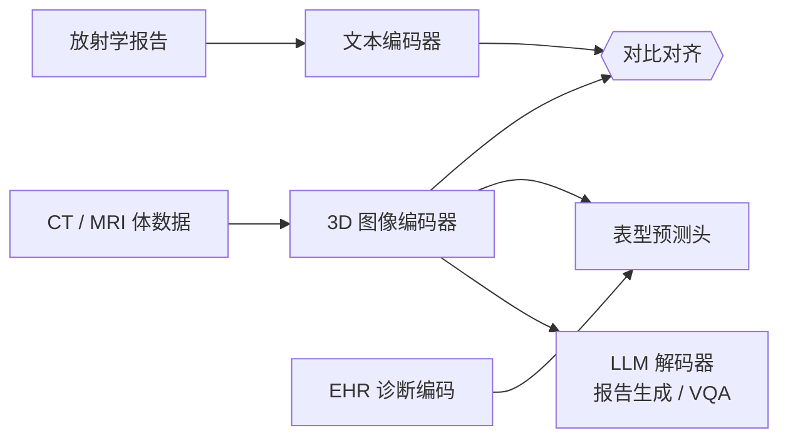

# 医学影像中的基础模型

> **英文原文：** [cv-knowledge-base/08_medical_and_scientific_cv/01_foundation_models_medical.md](../../cv-knowledge-base/08_medical_and_scientific_cv/01_foundation_models_medical.md)（本中文版供参考，内容以英文原文为准）

> **最后更新：** 2026年10月
> **难度级别：** 高级
> **相关章节：**
> - [医学影像模态](./00_medical_imaging.md)
> - [Any-Model / 通用视觉范式](../12_research_frontier_2024_2026/02_any_model_paradigm.md)
> - [多模态视觉-语言模型](../05_multimodal_vision_language/02_large_vision_language_models.md)
> - [科学成像](./02_scientific_imaging.md)

> **🆕 2026年10月更新：**
> - 新增 **MedGemma / MedSigLIP** 小节：Google 的开放医学 VLM（2025 年 5–7 月）以及 **MedGemma 1.5**（2026 年初），后者可接收 3D CT/MRI 体数据、全切片病理图像和纵向胸部 X 光。
> - 新增 **3D CT/MRI 视觉–语言基础模型**章节：Merlin（Nature，2026 年 3 月）、CT-CLIP / CT-RATE / CT-CHAT（Nature Biomedical Engineering 2026）、Pillar-0（2025 年 11 月）。
> - **病理**部分更新至最新：UNI2-h、CONCH v1.5 与 **TITAN**（Nature Medicine，2025 年 11 月）、Prov-GigaPath 与 GigaTIME（Cell，2025 年 12 月），以及 Virchow2 / H-optimus-1 的基准格局。
> - SAM 适配部分补充了 **MedSAM2**、nnInteractive、BiomedParse v2 和 SAM 3；"3D 原生基础模型"这一开放问题已修订，以反映部分进展。

---

## 概述

基础模型（Foundation Model）——在广泛数据分布上预训练、随后适配到下游任务的大型神经网络——自 2022 年以来重塑了医学影像研究。其核心论点是：在海量临床影像档案上进行自监督或弱监督预训练（许多机构拥有数百万份放射学检查和数十亿像素的数字化病理图像），可以得到可迁移到多种下游任务的表征，所需的标注样本远少于从头训练。这与 BERT 和 GPT 在 NLP 中以及 CLIP/DINO 在自然图像中的成功相呼应，但医学数据带来了独特的约束：患者隐私限制了数据汇集；图像–文本配对可通过放射学报告获得（形成天然的对比预训练信号）；而临床语义概念无法被通用的网络爬取图像–标题对很好地描述。

文献中有两种主导的预训练范式。**对比式图像–文本预训练**（类似 CLIP [Radford2021]）对齐成对的图像与文本表征，使匹配对在嵌入空间中比不匹配对更接近。将其应用于胸部 X 光/报告对，得到了无需任何标注图像即可进行零样本病理分类的模型（CheXzero [Tiu2022]、BioViL [Bannur2023]）。**自监督视觉预训练**（MAE、DINO、iBOT）应用于病理图块（UNI [Chen2024]、CONCH [Lu2024]、PLIP [Huang2023]），得到的图块编码器在切片级分类、生存预测和基因表达估计上可媲美甚至超越有监督基线，同时可随预训练数据规模扩展。

SAM（Segment Anything Model）[Kirillov2023] 的出现开辟了第三条路线：将交互式、可提示的分割基础模型适配到医学影像。MedSAM [Ma2024] 在覆盖 10 种成像模态和 30 多种癌症类型的 1,570,263 个图像–掩码对上微调 SAM，得到首个通用的交互式医学分割模型。然而，朴素的 SAM 适配表明，模型最初在自然图像上的训练若不进行显式的 3D 适配，就难以很好地迁移到 CT/MRI 体数据。后续工作（SAM-Med3D、Rep-MedSAM，以及 2025 年的 MedSAM2 和 nnInteractive）解决了效率和体数据泛化问题。

从 2025 年中到 2026 年又出现了三大转变。(1) **开放权重的通用医学 VLM**：Google 的 MedGemma 系列 [Sellergren2025] 为社区提供了可下载的 4B/27B 医学 VLM，配备经医学调优的 SigLIP 编码器。MedGemma 1.5 将其扩展到 3D CT/MRI 和全切片输入。(2) 在配对的体数据、报告和电子病历（EHR）编码上训练的 **3D 原生 CT/MRI 视觉–语言模型**（Merlin、CT-CLIP、Pillar-0）超越了逐切片的范式。(3) **病理从图块级扩展到切片级**：编码器在数十万到数百万张 WSI 上增长到 ViT-H/ViT-G 规模，而切片级多模态模型（TITAN）开始以零样本方式生成报告并检索罕见病例。

---

## 对比式图像–文本模型

### CheXzero [Tiu2022]

CheXzero 表明，一个在 MIMIC-CXR 的 227,827 个胸部 X 光/报告对上预训练的 CLIP 式模型，在推理时不使用任何标注图像，即可实现与全监督基线相当的零样本多标签病理分类。关键洞见在于：放射学报告包含结构化、经过临床验证的自然语言，可作为丰富的监督信号。CheXzero 在所评估的自监督模型中取得了最高的平均 AUC，在使用 0% 标注数据的情况下，对水肿（AUC 0.880）、心脏扩大（AUC 0.825）和气胸（AUC 0.764）等病理表现强劲。

### BioViL / BioViL-T [Bannur2023]

BioViL 在对比预训练中加入局部对齐目标，将放射学报告中的短语与 X 光中的空间区域相关联，从而实现短语定位（phrase grounding）。BioViL-T 进一步建模连续影像检查之间的时间变化，预测发现是好转、恶化还是不变——这是早期静态模型未能解决的一项临床关键能力。

### MaCon / KAD 与报告编码挑战

胸部 X 光预训练中一个长期存在的挑战是，放射学报告常以否定方式描述发现（"无胸腔积液"），因此需要能感知否定的文本编码器。ClinicalBERT 和专门的编码器在这方面比通用 BERT 变体表现更好。

### MedSigLIP [Sellergren2025]

MedSigLIP 是一个源自 SigLIP 的图像–文本编码器，在去标识化的医学数据（胸部 X 光、皮肤科、眼科、组织病理等）上调优。它于 2025 年 7 月随 MedGemma 技术报告发布，既作为 MedGemma 的视觉编码器，也可作为独立的零样本分类器和检索器。作者报告，在 448×448 输入下，其零样本胸部 X 光分类的平均 AUC 比分辨率更高（1280×1280）的 HAI-DEF CXR Foundation 模型高 2.0%。他们还报告，在一个包含 79 种疾病的皮肤科任务上，其结果优于早期的 Derm Foundation 线性探测。

---

## 病理基础模型

### UNI [Chen2024]

UNI（Universal Histopathology Encoder，通用组织病理编码器）是面向计算病理学的通用自监督视觉编码器，采用 DINOv2 式训练，在来自癌症基因组图谱（TCGA）及其他来源、涵盖 20 多种癌症类型的超过 100,000 张全切片图像（WSI）上预训练。UNI 在 34 项计算病理任务（包括图块分类、切片级分类、生存预测和突变预测）上展示了最先进的性能，发表于 Nature Medicine 2024。

**UNI 2（2025 年 1 月）。** UNI2-h 是一个 ViT-H/14（带 8 个寄存器 token）模型，在从超过 350,000 张多样化 WSI 中采样的 2 亿多个 H&E 和 IHC 图像图块上训练。它随附发布了来自 TCGA、CPTAC 和 PANDA 的 2.5 万多张 WSI 的预提取嵌入。

### CONCH [Lu2024]

CONCH（CONtrastive learning from Captions for Histopathology）是一个病理视觉–语言模型，在来自教科书插图、PubMed 文章和社交媒体的 117 万个组织病理图像–标题对上进行对比训练。CONCH 支持零样本切片级分类以及基于自然语言查询的检索。该工作发表于 Nature Medicine 2024，在多个数据集上取得了最先进的零样本病理分类性能。改进后的图块编码器 **CONCH v1.5** 于 2024 年 12 月发布，作为 TITAN 的骨干网络。

### PLIP [Huang2023]

PLIP（Pathology Language and Image Pre-training）在从 Twitter（#pathology、#pathologyTwitter）抓取的约 208,000 个病理图像–文本对上训练，表明即使是嘈杂的社交媒体数据也包含足以学到有用医学表征的信号。PLIP 发表于 Nature Medicine 2023。

### Prov-GigaPath [Xu2024] 与 GigaTIME

Prov-GigaPath（Microsoft Research 与 Providence；Nature 2024）是一个全切片基础模型。它将图块编码器与基于 LongNet 的切片编码器相结合，在 Providence 的真实世界切片上训练，因此将一张切片建模为一个极长的图块序列，而非通过 MIL 池化。2025 年 12 月，同一团队发布了 **GigaTIME**（Cell）。它利用多模态 AI 将常规 H&E 图像在人群规模上转换为虚拟的肿瘤微环境（类似多重免疫荧光）画像，从而将廉价的 H&E 档案变为用于肿瘤微环境（TME）研究的"虚拟人群"。轻量级的 **GigaPath-Flash** 和 **GigaTIME-Flash** 变体于 2026 年 7 月推出。

### TITAN [Ding2025]

TITAN（Transformer-based pathology Image and Text Alignment Network；Nature Medicine，2025 年 11 月）是一个**多模态全切片**基础模型。它作用于 CONCH v1.5 图块特征构成的网格，并以两种方式预训练：在 335,645 张 Mass General Brigham 内部 WSI 上进行视觉自监督学习，以及与超过 182,000 份病理报告和由 PathChat 助手生成的 423,122 条合成区域描述进行视觉–语言对齐。无需微调，TITAN 即可产生通用切片嵌入，支持零样本分类、罕见癌症检索、跨模态检索并起草病理报告。与 CONCH 一样，它刻意将 TCGA/CPTAC/PANDA 排除在预训练之外，以减少基准污染。

### 2025–2026 年编码器格局

2025 年病理编码器数量迅速增长：UNI2-h、**Virchow2**（Paige）、**H-optimus-0/1**（Bioptimus）、Prov-GigaPath、CONCH v1.5 等。独立基准通常将 Virchow2、H-optimus-1 和 UNI2-h 列为第一梯队。一项涵盖 31 个模型、41 个任务的比较发现，Virchow2 在 TCGA、CPTAC 和外部任务上表现最强。多医院的 PathBench 评估（15,888 张 WSI，10 家医院）将 Virchow2 和 H-optimus-1 评为总体最有效的模型。排名随任务而变化，因此实际结论是：一旦使用了第一梯队的编码器，编码器的选择就不如聚合设计和外部验证重要。

---

## 视网膜与眼科模型

### RETFound [Zhou2023]

RETFound 是一个视网膜图像自监督基础模型，采用 MAE 式重建在 160 万张无标注眼底照片上预训练。它发表于 Nature 2023（最早登上 Nature 的医学基础模型之一）。RETFound 在糖尿病视网膜病变分级、年龄相关性黄斑变性分期以及基于视网膜图像的全身性疾病预测（心血管疾病、帕金森病）上展示了强大的小样本和微调性能——后者得益于视网膜作为观察全身血管健康之窗的作用。

RETFound 的预训练目标遵循掩码自编码器（MAE）表述：

$$\mathcal{L}_{MAE} = \frac{1}{|\mathcal{M}|} \sum_{i \in \mathcal{M}} \|x_i - \hat{x}_i\|^2$$

其中 $\mathcal{M}$ 是被掩码的图块索引集合，$\hat{x}_i$ 是解码器的重建结果。

---

## SAM 在医学影像中的适配

### MedSAM [Ma2024]

MedSAM 在覆盖 10 种模态（CT、MRI、X 光、超声、内窥镜、显微、皮肤镜、OCT、眼底、乳腺 X 光）和 30 多种癌症类型的 1,570,263 个图像–掩码对上微调了 SAM 的掩码解码器。微调期间图像编码器（ViT-B）保持冻结以保留通用视觉特征，仅更新掩码解码器。MedSAM 支持边界框和点提示，无需针对任务重新训练模型即可进行交互式分割。发表于 Nature Communications 2024。

**主要局限**：MedSAM 独立处理 2D 切片，并不原生建模 3D 上下文，导致在体积 CT/MRI 中若不进行后处理，切片间预测会不一致。

### SAM-Med3D

SAM-Med3D 扩展了 MedSAM：用 3D Swin Transformer 替换 2D ViT 编码器，并使提示编码器接受 3D 点提示，从而无需逐切片处理即可实现空间一致的体分割。

### MedSAM2 与 2025 年新一代模型 [Ma2025]

**MedSAM2** 基于 SAM 2.1 解决了 MedSAM 的 2D 局限：SAM 2.1 将体数据的切片（或视频的帧）视为带有流式记忆注意力的序列。在关键切片上给出的一个提示会被传播到整个体数据。它在超过 455,000 个 3D 图像–掩码对和 76,000 帧视频上训练。2025 年的相关系统采用了其他路线。**nnInteractive** [Isensee2025] 是原生 3D 的，接受点、涂鸦、框和套索提示，并赢得了 CVPR 2025 交互式挑战赛。**BiomedParse** [Zhao2025]（Nature Methods 2025；v2 支持 3D）采用文本提示，联合完成分割、检测和识别。Meta 的 **SAM 3**（2025 年 11 月）引入了概念提示（名词短语或示例 → 所有实例），一旦适配到医学数据，便天然适合"分割所有 X 类病灶"这类需求。详情和基准结果见[医学影像](./00_medical_imaging.md)。

### 架构示意

---

## 3D CT/MRI 视觉–语言基础模型

本文件早期版本中列出的"3D 原生基础模型"开放问题在 2025–2026 年取得了实质性进展。通用做法是：将体数据编码器（作用于重采样体数据的 3D CNN 或 ViT）与放射学报告文本对齐，有时以结构化 EHR 标签作为额外监督，随后接入 LLM 解码器进行报告生成或 VQA。

### CT-CLIP、CT-RATE 与 CT-CHAT [Hamamci2026]

**CT-RATE** 是一个公开数据集，包含来自 21,304 名患者的 25,692 例非增强 3D 胸部 CT 扫描，每例均配有放射学报告。通过多种重建方式，它被扩展到 50,188 个体数据，超过 1,430 万张切片。**CT-CLIP** 在 CT-RATE 上进行对比训练，可执行零样本多异常检测（18 种异常）。在作者的评估中，它优于全监督基线，并支持以图像或文本进行病例检索。**CT-CHAT** 将 CT-CLIP 编码器与一个 LLM 相结合，该 LLM 在超过 270 万个源自 CT-RATE 的问答对上微调。该工作发表于 Nature Biomedical Engineering（2026），数据、代码和权重均开放。

### Merlin [Blankemeier2026]

**Merlin**（斯坦福；Nature，2026 年 3 月）是一个面向**腹部 CT** 的 3D VLM。它同时受放射学报告和结构化 EHR 诊断编码监督。训练使用了 15,331 例 CT 扫描（超过 600 万张图像）、超过 180 万个诊断编码和超过 600 万个报告 token。它在 6 类任务、752 个具体任务上进行了评估：零样本发现分类、表型分类、图像–报告检索、5 年慢性病预测、报告生成和 3D 器官分割。内部测试使用 5,137 例扫描，外部测试使用来自 3 个独立站点和 2 个公开数据集的 44,098 例扫描。它的表现优于 2D VLM 和先前的 CT 基础模型。代码和权重（`pip install merlin-vlm`）以及一个去标识化的腹部 CT 数据集均已发布。

### Pillar-0 [YalaLab2025]

**Pillar-0**（UC Berkeley / UCSF，2025 年 11 月随衍生公司 Voio 一同发布）是一个开放的放射学基础模型，在 42,990 例腹盆腔 CT、86,411 例胸部 CT、14,348 例头部 CT 和 11,543 例乳腺 MRI 上预训练。它同时发布了 **RATE**，这是一个基于 LLM 的框架，可从报告中为 366 种放射学发现提取结构化标签。在 UCSF 留出数据上，作者报告其在 350 多种发现上的平均 AUC 为 0.87，而 MedGemma 为 0.76，Microsoft 的 MI2 为 0.75，阿里巴巴的 Lingshu 为 0.70。这些比较均为自行报告。

### MedGemma 1.5（3D 与 WSI 输入）

见下文 MedGemma 小节。MedGemma 1.5 可在单个提示中接收多张 CT/MRI 切片或多个 WSI 图块。它是首个具备此能力且广泛可得的开放*通用* VLM，不过其 3D 处理方式是多图像输入，而非专门的体数据编码器。

---

## 医学视觉-语言模型（Med-VLMs）

### LLaVA-Med [Li2023]

LLaVA-Med 在通过 GPT-4 从 PMC-15M 图像–标题对构建的生物医学指令跟随数据上微调了 LLaVA（Large Language and Vision Assistant）。它在 VQA-RAD（放射学视觉问答）上取得了 74.2% 的准确率，在 PathVQA 上也表现强劲，实现了与医学图像的对话式交互。发表于 NeurIPS 2023。

### Med-Flamingo [Moor2023]

Med-Flamingo 通过在配对的医学图像–文本数据上继续预训练，将 Flamingo 小样本多模态模型适配到医学领域。在小样本设置（1–4 shot）下，它在包括视网膜分类和 VQA-RAD 在内的 7 项评估指标中的 4 项上取得最佳表现，成为首个面向多模态临床推理的医学小样本学习器。

### Med-Gemini [Yang2024]

Google 于 2024 年发布的 Med-Gemini 将长上下文推理（100 万 token 上下文窗口）与医学知识检索相结合，可在单次推理调用中对多个影像时间点或多种模态进行多图像分析。截至其发表时，Med-Gemini-L 1.0 在 MedQA（USMLE 风格）和多个医学 VQA 基准上超越了 GPT-4V。针对单项影像任务的具体基准分数并未全部公开。

### MedGemma 与 MedGemma 1.5 [Sellergren2025]

**MedGemma**（Google Health AI Developer Foundations；2025 年 5 月发布，2025 年 7 月发布技术报告）是基于 Gemma 3 构建的一系列**开放权重**医学模型。最先推出的是 4B 多模态模型和 27B 文本模型；27B 多模态变体和 MedSigLIP 编码器于 2025 年 7 月跟进。其视觉编码器为 MedSigLIP，LLM 部分则在放射学、组织病理、眼科、皮肤科和医学文本上进一步训练。权重通过 Hugging Face 和 Vertex AI Model Garden 分发，采用 Health AI Developer Foundations 许可协议。

**MedGemma 1.5**（4B，2026 年初；与 MedASR 医学语音转文字模型一同发布）新增了：
- **高维影像**：3D CT 和 MRI（以多图像提示传入若干切片）以及全切片组织病理（若干图块）。
- **纵向**胸部 X 光比较和**解剖定位**（边界框）。
- Google 报告的相对 MedGemma 1 的提升：疾病相关 CT 发现分类准确率 61% 对 58%，MRI 发现分类准确率 65% 对 51%。

Google 明确声明 MedGemma 并非临床级产品，而是作为微调和验证的起点。其实际意义在于，它为此前依赖封闭 API 的学术界和初创公司提供了一个强大且可宽松下载的基线。

---

## 面向医学数据的自监督预训练策略

| 策略 | 方法 | 主要优势 | 医学应用 |
|----------|----------|------------|---------------------|
| MAE（掩码自编码器） | 重建被掩码的图块 | 标注高效；可扩展 | RETFound、SAM-Med3D |
| DINO / DINOv2 | 自蒸馏，动量编码器 | 强大的图块特征 | UNI、病理 |
| ViT-H/G 规模的 DINOv2 式训练 | 在 10⁵–10⁶ 张 WSI 上带寄存器的自蒸馏 | 第一梯队的冻结特征；强线性探测性能 | UNI2-h、Virchow2、H-optimus-1 |
| SimCLR / MoCo | 实例对比 | 良好的图像级表征 | 放射学分类 |
| CLIP 式 | 图像–文本对比 | 零样本迁移 | CheXzero、CONCH、BioViL、MedSigLIP |
| iBOT | 掩码图像建模 + 自蒸馏 | 结合局部与全局 | UNI 预训练 |
| 切片级 SSL + 视觉–语言对齐 | 在图块特征网格上自监督，再与报告/描述对齐 | 切片嵌入、零样本检索与报告生成 | TITAN |
| 体数据 CLIP + EHR 监督 | 3D 编码器与报告及诊断编码对齐 | 3D 原生零样本发现识别、表型与预后预测 | Merlin、CT-CLIP、Pillar-0 |

---

## 关键论文

| 论文 | 作者 | 年份 | 发表处 | 主要贡献 |
|-------|---------|------|-------|-----------------|
| CheXzero: Expert-level Detection of Pathologies from Chest Radiographs with Zero-labeled Data | Tiu et al. | 2022 | Nature Biomedical Engineering | 用于胸部 X 光的 CLIP；零样本性能可与有监督模型竞争 |
| RETFound: A Foundation Model for Generalizable Disease Detection from Retinal Images | Zhou et al. | 2023 | Nature | 在 160 万张眼底照片上进行 MAE 预训练；多疾病基础模型 |
| A General-Purpose Self-Supervised Model for Computational Pathology (UNI) | Chen et al. | 2024 | Nature Medicine | 在 10 万+ WSI 上进行 DINOv2 式训练；34 项病理任务 SOTA |
| A Visual-Language Foundation Model for Pathology Image Analysis (CONCH) | Lu et al. | 2024 | Nature Medicine | 117 万组织病理图像–文本对；零样本病理分类 |
| Segment Anything in Medical Images (MedSAM) | Ma et al. | 2024 | Nature Communications | 在 157 万医学图像–掩码对上微调 SAM；交互式多模态分割 |
| LLaVA-Med: Training a Large Language-and-Vision Assistant for Biomedicine | Li et al. | 2023 | NeurIPS | 基于 PMC-15M 的 GPT-4 生成指令微调；VQA-RAD 准确率 74.2% |
| Med-Flamingo: A Multimodal Medical Few-shot Learner | Moor et al. | 2023 | arXiv/ML4H | 首个医学小样本多模态模型；视网膜和 VQA 基准 |
| A Whole-Slide Foundation Model for Digital Pathology from Real-World Data (Prov-GigaPath) | Xu et al. | 2024 | Nature | 基于图块序列的 LongNet 切片编码器；Providence 真实世界数据 |
| A Foundation Model for Joint Segmentation, Detection and Recognition of Biomedical Objects Across Nine Modalities (BiomedParse) | Zhao et al. | 2025 | Nature Methods | 文本提示的联合解析；600 万+ 图像–掩码–文本三元组；v2 扩展到 3D |
| MedGemma Technical Report | Sellergren et al. | 2025 | arXiv | 基于 Gemma 3 的开放医学 VLM（4B/27B）与 MedSigLIP 编码器 |
| MedSAM2: Segment Anything in 3D Medical Images and Videos | Ma et al. | 2025 | arXiv | 借助记忆注意力将 SAM 2.1 适配到 3D 体数据和视频 |
| A Multimodal Whole-Slide Foundation Model for Pathology (TITAN) | Ding et al. | 2025 | Nature Medicine | 335,645 张 WSI；自监督 + 与报告及 42.3 万条合成描述对齐；零样本切片任务与报告生成 |
| Pillar-0: A New Frontier for Radiology Foundation Models | YalaLab (UC Berkeley/UCSF) | 2025 | arXiv | 开放的 CT/MRI 体数据基础模型；RATE 为 366 种发现提取标签 |
| Generalist Foundation Models from a Multimodal Dataset for 3D Computed Tomography (CT-CLIP / CT-RATE) | Hamamci et al. | 2026 | Nature Biomedical Engineering | 25,692 例胸部 CT–报告数据集；3D CLIP 与 CT-CHAT |
| Merlin: A Computed Tomography Vision–Language Foundation Model and Dataset | Blankemeier et al. | 2026 | Nature | 受报告 + EHR 编码监督的腹部 CT 3D VLM；评估了 752 个任务 |

---

## 基准性能

| 模型 | 数据集 | 指标 | 分数 | 备注 |
|-------|---------|--------|-------|-------|
| CheXzero | CheXpert（水肿） | AUC | 0.880 | 零样本，0% 标注训练数据 |
| CheXzero | CheXpert（心脏扩大） | AUC | 0.825 | 零样本 |
| CheXzero | CheXpert（气胸） | AUC | 0.764 | 零样本；自监督模型中平均 AUC 最高 |
| UNI | TCGA 18 种癌症分类 | AUC（平均） | 未公开报告（发表时为 SOTA） | 通过 ABMIL 聚合实现切片级 |
| CONCH | 14 项病理任务 | AUC/Acc 平均 | 发表时优于先前方法（SOTA） | 零样本和小样本 |
| LLaVA-Med | VQA-RAD | 准确率 | 74.2% | 微调；对话式医学 VQA |
| MedSAM | 10 种模态（平均 Dice） | Dice | 未以单一平均值公开报告 | 论文中给出各模态结果 |
| MedSigLIP | 胸部 X 光零样本分类 | AUC（平均） | 比 HAI-DEF CXR Foundation 高 2.0% | 448×448 对 1280×1280 输入；作者评估 |
| MedGemma 1.5 4B | 疾病相关 CT 发现分类 | 准确率 | 61%（MedGemma 1 为 58%） | Google 报告 |
| MedGemma 1.5 4B | 疾病相关 MRI 发现分类 | 准确率 | 65%（MedGemma 1 为 51%） | Google 报告 |
| Pillar-0 | UCSF CT/MRI，350+ 种发现 | AUC（平均） | 0.87 | 自行报告；同一数据上 MedGemma 0.76、MI2 0.75、Lingshu 0.70 |
| Merlin | 752 个任务、6 类任务（内部 + 44,098 例外部扫描） | 多种 | 优于 2D VLM 和 CT 基础模型 | 无单一核心数值 |
| TITAN | 切片级线性探测、小样本/零样本、罕见癌症检索 | 多种 | 优于 ROI 和切片级基础模型 | 作者评估（Nature Medicine 2025） |

---

## 优缺点

| 方法 | 优点 | 缺点 |
|----------|------|------|
| 对比式图像–文本（CheXzero、CONCH） | 零样本迁移；推理时无需人工标签；利用自由文本报告 | 需要大规模配对图像–文本语料；临床文本中的否定会导致错误 |
| 自监督视觉（UNI、RETFound） | 可扩展；图块级特征强；无需文本 | 不编码语义化的临床词汇；新任务仍需有监督微调 |
| SAM 适配（MedSAM、SAM-Med3D、MedSAM2） | 交互式；与模态无关；无需逐任务重训练；MedSAM2 增加了 3D/视频传播 | 给放射科医生带来提示设计负担；自然图像先验仍需领域适配 |
| Med-VLM（LLaVA-Med、Med-Gemini、MedGemma） | 对话式、多任务；借助语言跨模态泛化；MedGemma 为开放权重 | 临床场景中存在幻觉风险；计算昂贵；空间定位能力有限；非临床级 |
| 切片级病理模型（TITAN、Prov-GigaPath） | 患者/切片级嵌入；零样本检索与报告起草；有助于罕见病 | 计算量大；预训练数据来自单一机构；扫描仪/染色域偏移 |
| 3D CT/MRI VLM（Merlin、CT-CLIP、Pillar-0） | 利用完整的体数据上下文；零样本发现识别与预后预测；以报告和 EHR 编码作为免费监督 | 局限于特定身体部位；GPU 显存需求大；公开评估集仍然较小；比较多为自行报告 |

---

## 开放问题与研究空白

- **大规模隐私保护预训练**：在不集中受保护健康信息的前提下，利用联邦学习和差分隐私聚合多站点医学影像语料，在计算和统计上依然代价高昂。
- **Med-VLM 的定位与忠实性**：LLaVA-Med 等模型生成的临床描述流畅，但偶尔存在幻觉；将语言输出稳健地定位到图像证据上，是一个尚未解决的对齐问题。
- **3D 原生基础模型**：2025–2026 年出现了首批可信的 3D CT/MRI VLM（Merlin、CT-CLIP、Pillar-0），开放通用 VLM 也开始支持 3D 输入（MedGemma 1.5）。然而，大多数模型仅针对单一身体部位或模态，通用 VLM 仍将体数据作为多图像切片集合处理，而一个具备高效体数据注意力、覆盖全身多序列 MRI + CT 的单一模型仍是开放问题。
- **公平、无污染的基准评测**：数十个病理和放射学基础模型目前在重叠的公开数据集（TCGA、MIMIC-CXR）上报告自行运行的比较。需要独立、留出、多站点的基准（例如 PathBench 式评测）以及预训练数据披露，才能将真实增益与评估伪影区分开来。
- **罕见病与低流行率病理**：在常见疾病上预训练的基础模型在罕见病（少于 100 个训练样本）上表现欠佳；切片级检索（TITAN）有所帮助，但面向罕见医学影像任务的组合泛化和元学习方法在很大程度上仍未被探索。
- **多模态临床融合**：患者同时产生文本、影像、基因组和结构化 EHR 数据；在单一基础模型中统一这些异构模态且不发生灾难性遗忘仍未解决，不过 Merlin 的报告 + EHR 监督以及 GigaTIME 的 H&E 到 TME 转换是早期探索。
- **前瞻性临床验证与监管审批**：基准性能并不保证临床效用；针对 AI 辅助诊断的严格前瞻性试验仍然罕见且方法学上具有挑战性，目前尚无开放的通用医学 VLM 获批用于诊断。
- **时间与纵向建模**：大多数模型独立处理每次检查；MedGemma 1.5 增加了纵向胸部 X 光比较，但对连续 3D 检查中的疾病进展进行建模（超越 BioViL-T 的二元变化检测）需要新的架构和训练范式。

---

## 延伸阅读

- [MedSAM，Nature Communications 2024](https://www.nature.com/articles/s41467-024-44824-z)
- [MedSAM2（arXiv 2025）](https://arxiv.org/abs/2504.03600)
- [UNI / CONCH，Nature Medicine 2024 — Mass General Brigham 新闻稿](https://www.massgeneralbrigham.org/en/about/newsroom/press-releases/mass-general-brigham-researchers-develop-ai-foundation-models-to-advance-pathology)
- [UNI2-h 模型与基准（GitHub）](https://github.com/mahmoodlab/UNI)
- [TITAN：多模态全切片基础模型（Nature Medicine 2025）](https://www.nature.com/articles/s41591-025-03982-3)
- [Prov-GigaPath 与 GigaTIME（GitHub）](https://github.com/prov-gigapath/prov-gigapath)
- [MedGemma 技术报告（arXiv 2025）](https://arxiv.org/abs/2507.05201)
- [MedGemma 1.5 与 MedASR — Google Research 博客](https://research.google/blog/next-generation-medical-image-interpretation-with-medgemma-15-and-medical-speech-to-text-with-medasr/)
- [Merlin：CT 视觉–语言基础模型与数据集（Nature 2026）](https://www.nature.com/articles/s41586-026-10181-8)
- [CT-CLIP / CT-RATE（arXiv；Nature Biomedical Engineering 2026）](https://arxiv.org/abs/2403.17834)
- [Pillar-0（arXiv 2025）](https://arxiv.org/abs/2511.17803)
- [医学图像分析中的基础模型：系统综述（arXiv 2025）](https://arxiv.org/pdf/2510.16973)
- [迈向临床就绪的基础模型（arXiv 2026）](https://arxiv.org/pdf/2603.14271)
- [MONAI：Medical Open Network for AI](https://monai.io/)
- [用于生物医学图像–文本预训练的 PMC-15M 数据集](https://huggingface.co/datasets/axiong/pmc_oa)
