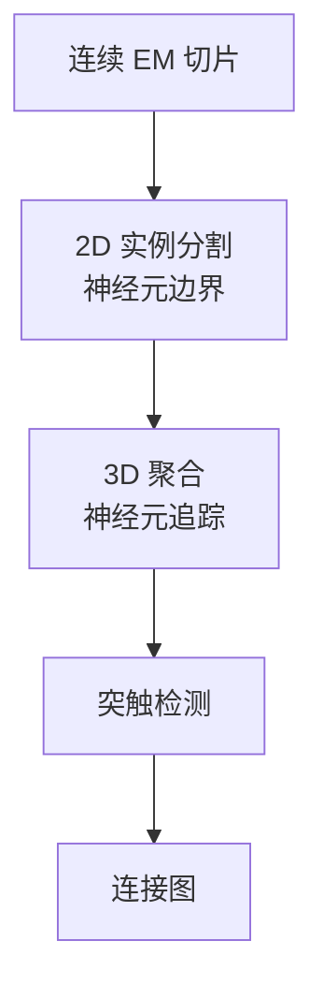
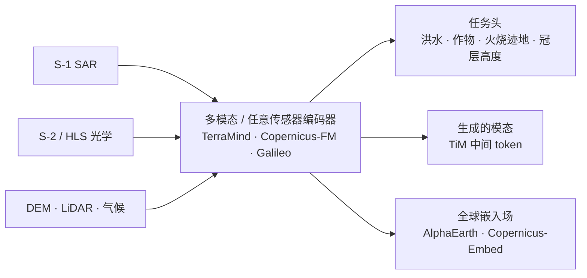

# 科学成像：显微成像、连接组学、冷冻电镜、遥感及其他

> **英文原文：** [cv-knowledge-base/08_medical_and_scientific_cv/02_scientific_imaging.md](../../cv-knowledge-base/08_medical_and_scientific_cv/02_scientific_imaging.md)（本中文版供参考，内容以英文原文为准）

> **最后更新：** 2026年10月
> **难度级别：** 高级
> **相关章节：**
> - [医学影像模态](./00_medical_imaging.md)
> - [医学影像中的基础模型](./01_foundation_models_medical.md)
> - [3D 视觉与场景理解](../04_3d_vision_and_scene/00_3d_representations.md)
> - [数据集与基准](../11_datasets_and_benchmarks/00_core_datasets.md)

> **🆕 2026年10月更新：**
> - **显微成像**：Cellpose3（Nature Methods 2025，图像复原）、**Cellpose-SAM**（2025，SAM 骨干网络，"超人"泛化）、基于 DINOv3 的新 Cellpose 模型（2026 年 6 月），以及 **μSAM**（Segment Anything for Microscopy，Nature Methods 2025）。
> - **连接组学**：MICrONS 立方毫米数据集于 2025 年 4 月正式发表于 Nature；FlyWire 成年果蝇全脑连接组于 2024 年发表于 Nature。
> - **冷冻电镜**：用于自动原子模型构建的 ModelAngelo（Nature 2024）、CryoDRGN-ET（2024）与 **CryoDRGN-AI**（Nature Methods 2025），以及 AlphaFold 3（Nature 2024）。
> - **对地观测基础模型**：Prithvi-EO-2.0、**TerraMind**（ICCV 2025）、**Copernicus-FM**（ICCV 2025 口头报告）、Galileo、Google DeepMind 的 **AlphaEarth Foundations**（2025 年 7 月），以及 DINOv3 的卫星 ViT-7B 和冠层高度图 v2（2026）。
> - **天文学**：**AION-1** 全模态天文基础模型（Polymathic AI，2025）。

---

## 概述

在临床医学之外，计算机视觉日益推动物理科学和生命科学领域的发现——从绘制立方毫米脑组织中单个突触的图谱，到从轨道上检测跨越各大洲的作物胁迫。这些领域具有若干共同的结构性特征，使其区别于自然图像任务：图像由领域特定的物理仪器（电子显微镜、射电望远镜、多光谱卫星传感器）采集；真值标签由领域专家在严格的本体规范下生成；数据规模从单张十亿像素级显微照片到 PB 级遥感档案不等。与自然图像不同，科学成像通常要求定量精度——每个高倍视野中有丝分裂象的精确计数是一种预后生物标志物，而非一个近似的视觉量。

荧光显微镜是细胞生物学的主力工具，用于量化活细胞和组织中的蛋白质分布、细胞器形态和动态过程。单个细胞或细胞核的实例分割是核心 CV 任务，使高内涵筛选中对形态和分子表型的下游量化成为可能。电子显微镜（EM），包括常规电镜（SEM/TEM）和冷冻电镜（cryo-EM），工作在亚纳米分辨率，用于重建 3D 超微结构——从神经组织中突触囊泡的排列到蛋白质复合物的结构。**连接组学**——从连续 EM 体数据重建神经回路的完整布线图——可能是生物学中计算需求最高的 CV 任务，需要以亚体素精度完成 PB 级的 3D 稠密分割。遥感 CV 处理来自卫星和机载传感器的多光谱、高光谱、SAR 和 LiDAR 数据，以在行星尺度上监测土地覆盖、灾害、农业以及与气候相关的现象。

贯穿各领域的主题是：领域特定的预训练和专门架构始终优于通用的 ImageNet 初始化模型。最成功的范式是使用自监督目标（MAE、DINO、对比学习）在大规模领域语料（数百万显微图块、数千个卫星图像瓦片）上预训练基础模型，然后用适量的任务特定标签进行微调。2025–2026 年一个值得注意的细微变化是，**超大规模的通用基础骨干网络**，例如 SAM（用于 Cellpose-SAM 和 μSAM）和 DINOv3（用于新的 Cellpose 模型以及 DINOv3 的卫星变体），如今成为强大的起点，再经领域专门化，这缩小了"通用"预训练与"领域"预训练之间的差距。

---

## 荧光显微：细胞与细胞核分割

### Cellpose [Stringer2021]

Cellpose 为细胞实例分割引入了一种受生物学启发的表征：网络不预测边界框或分水岭能量，而是预测一个**梯度流场**，对其积分后可使粒子收敛到细胞中心。这种表征能够处理高度不规则的细胞形状和拥挤排列，而这些情况会让标准实例分割方法束手无策。

像素 $\mathbf{x}$ 处的梯度场 $\mathbf{g}(\mathbf{x})$ 指向包含 $\mathbf{x}$ 的细胞的质心，编码的是方向（而非大小）。实例分割按如下步骤进行：
1. 预测逐像素梯度向量 $\hat{\mathbf{g}}$。
2. 模拟粒子平流：$\mathbf{x}_{t+1} = \mathbf{x}_t + \hat{\mathbf{g}}(\mathbf{x}_t)$。
3. 将收敛后的粒子位置聚类为细胞实例。

Cellpose 在一个经过精心整理、涵盖 70 多种细胞类型的 608 张人工标注图像数据集上训练，无需重新训练即可泛化到荧光通道、明场和相差显微成像。Cellpose 2.0 [Pachitariu2022] 引入了人在回路的微调工作流，进一步提升了对新细胞类型的精度。

**性能**：在一项针对 18 种显微实例分割方法的系统性基准中，使用 80% 训练数据时，Cellpose（调优后）的 Dice 系数为 0.76 ± 0.03，而相同条件下 StarDist（调优后）为 0.72 ± 0.07。

### Cellpose3、Cellpose-SAM 与基于 DINOv3 的 Cellpose（2025–2026）

- **Cellpose3** [Stringer2025]（Nature Methods 2025）增加了"一键式"**图像复原**（去噪、去模糊、上采样），与分割目标联合训练，因此复原后的图像针对下游分割而非感知质量进行优化。
- **Cellpose-SAM** [Pachitariu2025]（bioRxiv 2025）用 SAM 预训练的 ViT 图像编码器替换 Cellpose 骨干网络，同时保留流场输出。它针对通道顺序、细胞大小、散粒噪声、下采样以及各向同性/各向异性模糊进行了鲁棒性训练。作者报告其超过了标注者间一致性并接近人类共识上界，因而称为"超人泛化"。它成为 Cellpose 4 的默认模型，支持 3D 和人在回路微调。
- **2026 年 6 月**（Cellpose v4.2），团队新增了**基于 DINOv3** 的 Cellpose 模型（`cpdino`、`cpdino-vitb`）以及更新的 `cpsam_v2`，后者在低对比度区域产生的虚假掩码更少。所有 Cellpose 模型及其标注数据集均采用 CC-BY-NC 许可。

### Segment Anything for Microscopy（μSAM）[Archit2025]

**μSAM**（Nature Methods，2025 年 3 月）将 SAM 微调为面向**光学和电子显微镜**的通用模型。根据哥廷根大学的新闻稿，它在超过 17,000 张显微图像、超过 200 万个标注结构上重新训练。它以 napari 工具的形式提供，支持交互式 2D 和 3D 分割（例如 EM 中的线粒体）、自动实例分割以及交互式跟踪。它与 nnInteractive（其训练数据包含 3D 显微数据；参见[医学影像](./00_medical_imaging.md)）一道，使可提示分割成为生物图像分析中的标准工具。

### StarDist [Schmidt2018, Weigert2022]

StarDist 将细胞核表示为**星凸多边形**（2D）或星凸多面体（3D），由从目标中心出发、沿 $K$ 个均匀采样方向的径向距离参数化。单个网络同时预测目标概率图和每个像素的 $K$ 个径向距离：

$$\hat{\mathbf{r}}(\mathbf{x}) = (r_1, r_2, \ldots, r_K), \quad r_k = \text{distance to boundary in direction } \theta_k$$

在多边形空间中进行非极大值抑制以消解重叠预测。StarDist 特别适合紧密排列的细胞核，而基于分水岭的方法在这种情况下容易过分割。StarDist 3D 将其扩展到体荧光成像。

### 高内涵筛选中的深度学习

高内涵筛选（HCS）大规模应用自动化荧光显微——通常每块板有数千个孔，每次实验有数百万个细胞。**CellProfiler** 将经典图像处理与特征提取相结合；**DeepProfiler** 对同样的图像应用基于 CNN 的特征提取（ResNet50、EfficientNet），并将特征输入机器学习分类器。**Recursion Phenomics** 的 RxRx 数据集为形态学画像提供了大规模基准。利用元数据引导通用基础骨干网络的适配是一种新兴的替代方案。Meta 于 2026 年为 DINOv3 提出的 FINO 方案包含荧光图像（HPA）参考训练流程，仅利用图像已附带的元数据。

---

## 连接组学：PB 级 3D 神经回路重建

连接组学旨在从连续电子显微（SEM）图像堆栈中重建**连接组**——神经回路完整的突触连接图。目前的体数据包括小鼠、果蝇和人类皮层的部分区域。

### 规模与挑战

IARPA MICrONS 项目（Machine Intelligence from Cortical Networks）产生了最大的公开哺乳动物连接组学数据集：一个 1.4 mm × 0.87 mm × 0.84 mm 的小鼠视觉皮层体数据，以 8 nm × 8 nm × 40 nm 分辨率成像，包含 >200,000 个细胞、约 120,000 个神经元以及 >5.23 亿个自动检测到的突触。重建过程包括用于功能成像的双光子显微、用于对齐的 microCT 以及用于超微结构的连续 EM，所有数据均配准到统一坐标系。

**2024–2025 年里程碑。** MICrONS 的成果于 2025 年 4 月 9 日以一组论文的形式正式发表在 Nature 和 Nature Methods 上，领衔论文为 *Functional connectomics spanning multiple areas of mouse visual cortex*（Nature 640, 435–447）[MICrONS2025]。这组论文将布线与小鼠观看自然影片时记录的约 76,000 个神经元的功能响应进行了联合配准。（媒体报道给出的重建体数据中神经元数量在约 84,000 到约 120,000 之间，取决于纳入标准。）2024 年 10 月，**FlyWire** 联盟在 Nature 上发表了首个完整的成年*果蝇*（*Drosophila*）全脑连接组（约 140,000 个神经元）[Dorkenwald2024]。它通过自动分割加大规模社区校对构建而成。

### 连接组学中的核心 CV 任务

**神经元分割**被视为在致密神经纤维网中对线粒体、轴突、树突和胞体进行实例分割。基于 U-Net 式架构的方法预测**亲和度（affinity）**（相邻体素属于同一神经元的概率），随后进行基于图的聚合（MALIS、GASP）。**人工校对**对于修正合并错误（两个神经元被错误连接）和分裂错误（一个神经元被分割成多个片段）仍然必不可少。

**突触检测**定位突触前和突触后致密区：SynEM [Staffler2017] 将其表述为边界分类，在 MICrONS 数据集中实现了约 5 亿个突触的自动检测。

---

## 冷冻电子显微镜：结构测定

冷冻电镜通过对大量处于随机取向的速冻颗粒的 2D 投影图像进行计算平均，以近原子分辨率测定蛋白质和大分子复合物的 3D 结构。

### 冷冻电镜工作流中的深度学习

1. **颗粒挑选**：在显微照片中识别候选颗粒图像。TOPAZ [Bepler2019] 将 CNN 分类器与噪声生成模型相结合，对稀疏颗粒实现了高召回率。CryoSegNet [Ding2024] 将挑选表述为图像分割（U-Net 编码器–解码器），并集成基于 SAM 的提示以提升泛化能力。

2. **2D 分类平均**：按构象和视角取向对颗粒图像聚类。卷积自编码器和变分自编码器（cryoDRGN [Zhong2021]）建模连续构象异质性——揭示了经典离散平均所遗漏的动态复合物的多种结构状态。

3. **3D 重建精修**：现代软件包（RELION、cryoSPARC）集成了基于神经网络的位姿精修和衬度传递函数（CTF）校正。

4. **神经从头（*ab initio*）重建与原位异质性**：**CryoDRGN-ET** [Rangan2024]（Nature Methods 2024）将异质性重建扩展到冷冻电子*断层成像*的亚断层图，可视化细胞内的动态复合物。**CryoDRGN-AI** [Levy2025]（Nature Methods 2025）在具有挑战性的冷冻电镜和冷冻电子断层数据集上执行神经从头重建，无需共识模型即可联合估计位姿和异质体数据。

5. **自动原子模型构建**：**ModelAngelo** [Jamali2024]（Nature 2024）将基于密度图推导出的残基候选上的 GNN 与蛋白质语言模型相结合，直接在冷冻电镜密度图中构建原子模型。对于高分辨率密度图，其模型质量可与专家构建的模型相当，从而消除了流程中最耗费人力的步骤之一。

### AlphaFold2 背景 [Jumper2021]

AlphaFold2（DeepMind，2021）在结构生物学中取得了里程碑式成就：它能以接近晶体学的精度从序列预测蛋白质 3D 结构，以 92.4 的中位 GDT_TS 分数赢得 CASP14 竞赛，而此前最佳约为 76。AlphaFold2 使用 Evoformer 模块通过注意力机制处理多序列比对（MSA），随后由带不变点注意力（IPA）的结构模块生成 3D 原子坐标。AlphaFold2 并非传统的 CV 任务（它作用于序列而非图像），但其预测越来越多地被用于初始化或验证冷冻电镜得到的结构——这体现了结构生物学与学习表征之间日益模糊的边界。

**AlphaFold 3** [Abramson2024]（Nature 2024）用**基于扩散**的坐标生成器替代结构模块，并将预测扩展到蛋白质、核酸、配体和离子组成的复合物。其源代码于 2024 年 11 月以 Apache 2.0 许可发布，模型权重可申请用于非商业用途。在冷冻电镜中，AF3 的复合物预测如今经常被对接到中等分辨率密度图中并加以精修，而将 ModelAngelo 式的密度图条件构建与序列条件先验相结合，是一个活跃的研究方向。

---

## 遥感与卫星影像

### 规模与模态特征

卫星影像包括多光谱（Sentinel-2：13 个波段，10–60 m 分辨率）、高光谱（AVIRIS：224 个波段）或合成孔径雷达（SAR：Sentinel-1），其重访周期使变化检测成为可能。与自然图像不同，卫星数据包含不可见光谱波段（NIR、SWIR、热红外），需要大气校正，并覆盖巨大的地理范围。

### 对地观测基础模型

**SatMAE [Cong2022]** 将掩码自编码器（MAE）扩展到多光谱卫星影像：把光谱波段分成相互独立的通道组，并对每组独立掩码图块，从而能够在 fMoW-Sentinel 数据集的时间序列上进行预训练。SatMAE 在土地覆盖分类、洪水制图和作物类型检测上展示了强大的迁移能力。

**Prithvi-EO-1.0 [Jakubik2023]**（IBM 与 NASA）于 2023 年 8 月发布，是一个 1 亿参数、基于 ViT 的地理空间基础模型，以针对时间序列的 MAE 目标在 100 多万个 Harmonized Landsat Sentinel-2（HLS）时序图块上预训练。在洪水制图中，Prithvi 在未见过的地理区域上比 SatMAE 的 mIoU 高约 4%，并优于从头训练的 Transformer 基线。预训练仅需 93.3 GPU 小时，而 SatMAE 需 768 GPU 小时（效率提升 8.2 倍），碳足迹也相应更低（13.3 对 109.44 kg CO₂）。

**Prithvi-EO-2.0 [Jakubik2024]** 将规模扩大到 6 亿参数（是 v1 的 6 倍），引入多时相编码，并在野火制图、作物类型分类和多灾种评估上展示了更好的性能。

### 2025–2026 年新一代：多模态、任意传感器与嵌入场

- **TerraMind** [Jakubik2025]（IBM、ESA Φ-lab 与 FAST-EO 项目；ICCV 2025）被描述为首个**任意到任意（any-to-any）生成式**对地观测基础模型。它在光学、SAR、DEM、土地覆盖及其他衍生图层等模态上预训练，并引入了*模态中思考*（Thinking-in-Modalities, TiM）：模型生成辅助模态（例如由 S-2 生成土地覆盖图）作为中间 token，从而提升微调效果。tiny、small、base 和 large 模型均已在 Hugging Face 开放，并集成到 TerraTorch 中。
- **Copernicus-FM** [Wang2025]（ICCV 2025 口头报告）扩展了 DOFA 的动态超网络，结合元数据编码以处理**任意光谱或非光谱传感器**。它配套发布了 **Copernicus-Pretrain**（来自所有主要 Sentinel 任务 S1–S5P、分布在约 31 万个 0.25° 网格上的 1,870 万张对齐图像）和 **Copernicus-Bench**（15 个层次化任务）。
- **Galileo** [Tseng2025]（NASA Harvest 及合作者，arXiv 2025）在多种遥感输入（多光谱、SAR、高程、气象及其他时空通道）上联合学习**全局和局部特征**，采用分别设置全局与局部目标的掩码建模方案。预训练权重以多种规模发布，最小为"nano"模型。
- **AlphaEarth Foundations** [Brown2025]（Google DeepMind，2025 年 7 月）是一个**嵌入场模型**。它融合光学、雷达、LiDAR、气候和带地理标签的文本等数据源，为每个 10 m × 10 m 陆地像元生成一个 64 维嵌入。年度全球图层以 **Satellite Embedding** 数据集的形式发布在 Google Earth Engine 中（每年超过 1.4 万亿个嵌入足迹）。DeepMind 报告，在其评估套件上误差比次优方法低约 24%，存储需求约少 16 倍（媒体报道的数字）。
- **DINOv3**（Meta，2025 年 8 月）包含一个在 SAT-493M 上训练的**卫星预训练 ViT-7B**（以及一个蒸馏的 ViT-L）。其首个下游产品**冠层高度图 v2**（Canopy Height Maps v2, CHMv2，2026 年 3 月）相比 2024 年的版本改进了全球冠层高度制图；参见[自监督学习](../03_architectures/03_self_supervised_learning.md)。
- **Clay** 是一个开放（代码和模型权重均为 Apache-2.0）的基于 MAE 的对地观测基础模型，附带用于全覆盖（wall-to-wall）嵌入生成的工具。

### 下游任务

| 任务 | 主要数据 | 核心 CV 挑战 |
|------|-------------|------------------|
| 土地覆盖 / 土地利用（LULC）分类 | Sentinel-2、Landsat | 多类别逐像素；类别不平衡 |
| 洪水 / 灾害制图 | SAR、多光谱 | 时间变化；多云条件 |
| 作物类型制图 | Sentinel-2 时间序列 | 物候变化；田块破碎 |
| 建筑物轮廓提取 | 超高分辨率（VHR） | 稠密实例分割 |
| 道路网络提取 | VHR 光学 / SAR | 细长结构；连通性 |
| 目标检测（船舶、飞机） | VHR 光学 | 小目标；方向敏感 |
| 冠层高度 / 生物量估计 | VHR 光学 + GEDI LiDAR | 单目高度回归；全球一致性 |
| 基于嵌入、利用稀疏标签的制图 | 预计算嵌入场（AlphaEarth、Copernicus-Embed） | 标签极少；跨年份和跨区域迁移 |

---

## 天文学与材料科学

### 天文图像分析

光学和射电望远镜巡天（SDSS、DES、Euclid、SKA）产生包含数十亿天体的巡天数据。关键 CV 任务包括：星系形态分类（GalaxyZoo；CNN 以超过 10 倍的吞吐量达到人类志愿者的精度）、强引力透镜检测（在差分成像上使用残差网络）、暂现事件检测（超新星、伽马射线暴），以及射电干涉图像中的源分离。**Zoobot** [Walmsley2023] 将公民科学标签与主动学习相结合，训练出可跨多个巡天扩展的星系形态分类器。

**AION-1** [Polymathic2025]（Polymathic AI，arXiv 2510.17960）是一个面向天文学的大型**全模态（omnimodal）**基础模型。其模态专用分词器覆盖 39 种数据类型（多波段巡天图像、光谱、流量和红移等星表标量），并输入一个统一的编码器–解码器 Transformer，以 4M 式多模态掩码建模目标训练。其嵌入支持相似性搜索、属性估计（例如由图像估计红移）和跨模态生成；模型以 base、large 和 xlarge 三种规模发布。随着超大数据量巡天的启动，例如 Vera C. Rubin 天文台（2025 年 6 月发布首批图像）和 Euclid，这类与巡天无关的表征正变得越来越重要。

### 材料表征

扫描透射电子显微镜（STEM）和原子力显微镜（AFM）以原子分辨率对材料微观结构成像。CV 任务包括缺陷检测（空位、晶界）、多晶材料中的相分割，以及纳米颗粒尺寸分布的自动表征。面向材料显微的基础模型尚处于起步阶段；从 Cellpose/nnU-Net 迁移，以及越来越多地从 μSAM/SAM 系列和 DINOv3 骨干网络迁移的做法很常见，但领域差距仍然很大。

---

## 关键论文

| 论文 | 作者 | 年份 | 发表处 | 主要贡献 |
|-------|---------|------|-------|-----------------|
| Cellpose: A Generalist Algorithm for Cellular Segmentation | Stringer, Wang, Michaelos, Pachitariu | 2021 | Nature Methods | 用于细胞实例分割的梯度流场；跨细胞类型的通用模型 |
| StarDist: Object Detection with Star-Convex Polygons | Schmidt, Weigert, Broaddus, Myers | 2018 | MICCAI | 用于细胞核检测的星凸多边形表征 |
| TOPAZ: Positive-Unlabeled CNN for Particle Picking in Cryo-EM | Bepler et al. | 2019 | Nature Methods | 用于稀疏冷冻电镜颗粒挑选的 PU 学习 |
| Highly Accurate Protein Structure Prediction with AlphaFold2 | Jumper et al. | 2021 | Nature | CASP14 冠军；GDT_TS 92.4；Evoformer + IPA 模块 |
| SatMAE: Pre-training Transformers for Temporal and Multi-Spectral Satellite Imagery | Cong et al. | 2022 | NeurIPS | 针对多光谱时序卫星数据改造的 MAE |
| Prithvi-EO-1.0: A Geospatial Foundation Model | Jakubik et al. | 2023 | arXiv/HuggingFace | 基于 HLS 的 1 亿参数 ViT MAE；洪水/作物 SOTA；NASA-IBM 合作 |
| MICrONS: Large-Scale Cortical Connectomics Dataset | MICrONS Consortium | 2021 | Zenodo / bioRxiv | 1.4mm³ 小鼠视觉皮层；5.23 亿+ 突触；最大的公开连接组 |
| Accurate Structure Prediction of Biomolecular Interactions with AlphaFold 3 | Abramson et al. | 2024 | Nature | 针对蛋白质、核酸、配体、离子的基于扩散的结构生成 |
| Automated Model Building and Protein Identification in Cryo-EM Maps (ModelAngelo) | Jamali et al. | 2024 | Nature | GNN + 蛋白质语言模型直接在冷冻电镜密度图中构建原子模型 |
| CryoDRGN-ET: Deep Reconstructing Generative Networks for Visualizing Dynamic Biomolecules Inside Cells | Rangan et al. | 2024 | Nature Methods | 面向原位冷冻电子断层成像的异质性亚断层图重建 |
| Neuronal Wiring Diagram of an Adult Brain (FlyWire) | Dorkenwald et al. | 2024 | Nature | 首个完整的成年*果蝇*全脑连接组（约 14 万个神经元） |
| Functional Connectomics Spanning Multiple Areas of Mouse Visual Cortex | MICrONS Consortium | 2025 | Nature | 正式发表的立方毫米级 EM 连接组，并与功能成像联合配准 |
| Segment Anything for Microscopy (μSAM) | Archit et al. | 2025 | Nature Methods | 针对光学和电子显微微调 SAM；napari 交互式 2D/3D/跟踪 |
| Cellpose3: One-Click Image Restoration for Improved Segmentation | Stringer, Pachitariu | 2025 | Nature Methods | 面向分割的去噪/去模糊/上采样 |
| Cellpose-SAM: Superhuman Generalization for Cellular Segmentation | Pachitariu, Rariden, Stringer | 2025 | bioRxiv | SAM 骨干 + 流场；对通道、尺寸、噪声、模糊具有鲁棒性 |
| CryoDRGN-AI: Neural ab initio Reconstruction of Challenging Cryo-EM and Cryo-ET Datasets | Levy et al. | 2025 | Nature Methods | 无需共识模型即可联合估计位姿与异质体数据 |
| TerraMind: Large-Scale Generative Multimodality for Earth Observation | Jakubik et al. | 2025 | ICCV | 首个任意到任意生成式对地观测基础模型；模态中思考（TiM） |
| Towards a Unified Copernicus Foundation Model for Earth Vision (Copernicus-FM) | Wang et al. | 2025 | ICCV (oral) | 任意传感器超网络基础模型；1,870 万图像的 Copernicus-Pretrain；Copernicus-Bench |
| AlphaEarth Foundations: An Embedding Field Model for Accurate and Efficient Global Mapping from Sparse Label Data | Brown et al. | 2025 | arXiv | 64 维全球 10 m 嵌入场；Earth Engine Satellite Embedding 数据集 |
| AION-1: Omnimodal Foundation Model for Astronomical Sciences | Polymathic AI | 2025 | arXiv | 对 39 种天文数据类型进行分词；4M 式多模态掩码建模 |

---

## 基准性能

| 模型 | 数据集 | 指标 | 分数 | 备注 |
|-------|---------|--------|-------|-------|
| Cellpose（调优） | 多细胞基准（80% 训练数据） | Dice | 0.76 ± 0.03 | 对比 StarDist（调优）0.72 ± 0.07 |
| StarDist（调优） | 多细胞基准（10% 训练数据） | Dice | 0.69 ± 0.02 | 低数据量下比 Cellpose（0.32 ± 0.4）更鲁棒 |
| AlphaFold2 | CASP14 | GDT_TS | 92.4 | 自由建模目标的中位数；此前最佳约 76 |
| Prithvi-EO-1.0 | 洪水制图（未见区域） | mIoU | 比 SatMAE 高约 4% | Prithvi 训练用时 93.3 GPU 小时，SatMAE 为 768 GPU 小时 |
| SatMAE | fMoW-Sentinel（土地利用） | Top-1 准确率 | 未以单一数值公开报告 | 提交时优于 ImageNet 预训练的 ViT |
| Zoobot | GalaxyZoo 形态 | 与志愿者一致率 | 约 94%（未以单一指标公开报告） | 达到人类志愿者精度 |
| Cellpose-SAM | 细胞分割泛化基准 | 相对人类间一致性的误差 | 低于标注者间误差；接近共识上界 | 作者预印本；尚无独立复现 |
| AlphaEarth Foundations | DeepMind 制图评估套件（稀疏标签） | 误差降低 | 比次优方法低约 24% | 媒体报道；存储约少 16 倍 |

---

## 优缺点

| 方法 | 优点 | 缺点 |
|----------|------|------|
| Cellpose（梯度流） | 能处理不规则形状；在许多细胞类型上无需微调即可使用 | 计算量比 StarDist 大；默认仅 2D |
| StarDist（星凸） | 有解析约束，避免不规则伪影；NMS 速度快 | 假设形状近似凸；难以处理细长或高度非凸的细胞 |
| SAM/DINOv3 骨干的显微模型（Cellpose-SAM、μSAM、cpdino） | 开箱即用的强泛化能力；交互式精修；支持 3D | 大型 ViT 骨干速度较慢；非商业许可（Cellpose 为 CC-BY-NC）；在 EM 上的泛化仍不均衡 |
| MAE 预训练（SatMAE、Prithvi） | 标注高效；利用大规模无标注档案；时序建模 | 难以很好地捕捉多尺度目标；图块分辨率不匹配 |
| 任意传感器 / 生成式对地观测基础模型（TerraMind、Copernicus-FM、Galileo） | 能处理缺失或新增的传感器；跨模态生成；多尺度特征 | 预训练开销更大；基准碎片化使比较困难 |
| 嵌入场（AlphaEarth、Copernicus-Embed） | 无需运行模型；以极少标签实现行星尺度制图；存储紧凑 | 分辨率与时间粒度固定（年度）；可解释性有限；训练数据不透明 |
| 冷冻电镜深度学习（TOPAZ、CryoSegNet、cryoDRGN、ModelAngelo） | 免去繁琐的人工颗粒挑选和模型构建；解析连续异质性 | 需要具有代表性的训练显微照片；假阳性颗粒会降低下游 3D 重建质量；低分辨率下模型构建效果下降 |

---

## 开放问题与研究空白

- **显微成像中的跨模态泛化**：一个无需重新训练即可处理相差、明场、电子和荧光显微的单一模型仍难以实现；Cellpose-SAM 和 μSAM 在光学显微上大幅缩小了差距，但 EM、无标记以及高度各向异性的 3D 数据仍需专门化。
- **PB 级连接组学**：即使完整重建一立方毫米的皮层也需要多年的专家校对（MICrONS 和 FlyWire 都依赖大规模校对工作）；在不引入系统性偏差的前提下大规模自动修正合并/分裂错误尚未解决，而全小鼠脑连接组仍遥不可及。
- **冷冻电镜中的连续构象异质性**：cryoDRGN 及其后继方法（CryoDRGN-ET、CryoDRGN-AI）在潜空间中建模异质性，但对于具有高维柔性的大型复合物，尤其是在原位情况下，所学构象景观的收敛性和可解释性仍具挑战。
- **遥感中的多时相与多传感器融合**：任意传感器模型（Copernicus-FM、TerraMind、Galileo）和嵌入场（AlphaEarth）已使融合变得可行，但在缺失模态（云层遮挡、传感器故障）情况下保持物理一致的表征以及标准化的跨模型基准仍然缺乏。
- **亚网格与物理约束预测**：基于卫星的作物产量或生物量估计需要整合植被指数、气候时间序列和土壤数据；面向对地观测的混合物理信息神经网络尚处于起步阶段。
- **材料与天文学中的标注瓶颈**：对于材料中的缺陷检测和天文学中的稀有事件检测，标注样本本质上稀缺；无需任务特定标签的单样本和自监督检测在生产质量层面上仍基本未解决，不过全模态天文模型（AION-1）提供了一条有前景的基于嵌入的路线。
- **考虑不确定性的科学推断**：CV 模型的预测会被输入到下游科学分析中；将模型不确定性传播到科学推断流程中（例如突触计数的不确定性 → 连接图属性的不确定性）需要新的统计框架。

---

## 延伸阅读

- [Cellpose 2.0（Nature Methods 2022）](https://www.nature.com/articles/s41592-022-01663-4)
- [Cellpose3（Nature Methods 2025）](https://www.nature.com/articles/s41592-025-02595-5)
- [Cellpose-SAM（bioRxiv 2025）](https://www.biorxiv.org/content/10.1101/2025.04.28.651001v1)
- [Segment Anything for Microscopy — μSAM（Nature Methods 2025）](https://www.nature.com/articles/s41592-024-02580-4)
- [AlphaFold2（Nature 2021）](https://www.nature.com/articles/s41586-021-03819-2)
- [AlphaFold 3（Nature 2024）](https://doi.org/10.1038/s41586-024-07487-w)
- [ModelAngelo（Nature 2024）](https://www.nature.com/articles/s41586-024-07215-4)
- [CryoDRGN-AI（Nature Methods 2025）](https://doi.org/10.1038/s41592-025-02720-4)
- [Prithvi-EO-2.0（arXiv 2024）](https://arxiv.org/html/2412.02732v3)
- [TerraMind（arXiv / ICCV 2025）](https://arxiv.org/abs/2504.11171)
- [Copernicus-FM（arXiv / ICCV 2025）](https://arxiv.org/abs/2503.11849)
- [Galileo（arXiv 2025）](https://arxiv.org/abs/2502.09356)
- [AlphaEarth Foundations（arXiv 2025）](https://arxiv.org/abs/2507.22291)
- [DINOv3，含 SAT-493M 模型与 CHMv2（GitHub）](https://github.com/facebookresearch/dinov3)
- [AION-1（arXiv 2025）](https://arxiv.org/abs/2510.17960)
- [MICrONS Explorer](https://www.microns-explorer.org/cortical-mm3)
- [SatMAE（NeurIPS 2022）](https://arxiv.org/abs/2207.08051)
- [CryoSegNet / 基于 SAM 的冷冻电镜颗粒挑选（PMC 2024）](https://www.ncbi.nlm.nih.gov/pmc/articles/PMC11165428/)
